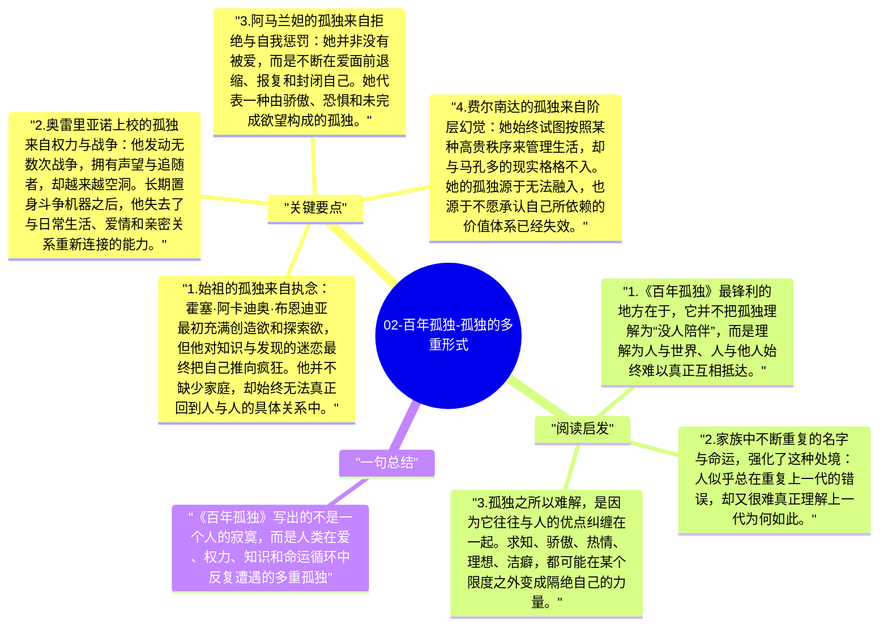

# 02-百年孤独-孤独的多重形式

“孤独”是《百年孤独》的总题目，但它并不是单一情绪。布恩迪亚家族每一代人都活在孤独里，只是形式各不相同：有人困在执念里，有人困在权力里，有人困在欲望、羞耻、知识或血缘记忆里。马尔克斯并不是把孤独写成偶发心理，而是把它写成人的基本处境。

## 关键要点

1. **始祖的孤独来自执念**：霍塞·阿卡迪奥·布恩迪亚最初充满创造欲和探索欲，但他对知识与发现的迷恋最终把自己推向疯狂。他并不缺少家庭，却始终无法真正回到人与人的具体关系中。
2. **奥雷里亚诺上校的孤独来自权力与战争**：他发动无数次战争，拥有声望与追随者，却越来越空洞。长期置身斗争机器之后，他失去了与日常生活、爱情和亲密关系重新连接的能力。
3. **阿马兰妲的孤独来自拒绝与自我惩罚**：她并非没有被爱，而是不断在爱面前退缩、报复和封闭自己。她代表一种由骄傲、恐惧和未完成欲望构成的孤独。
4. **费尔南达的孤独来自阶层幻觉**：她始终试图按照某种高贵秩序来管理生活，却与马孔多的现实格格不入。她的孤独源于无法融入，也源于不愿承认自己所依赖的价值体系已经失效。
5. **末代奥雷里亚诺的孤独来自知识的闭环**：当他终于读懂羊皮卷时，一切已经来不及了。纯粹智识性的理解并没有带来拯救，反而让他在终极真相面前更加孤立。

## 阅读启发

1. 《百年孤独》最锋利的地方在于，它并不把孤独理解为“没人陪伴”，而是理解为人与世界、人与他人始终难以真正互相抵达。
2. 家族中不断重复的名字与命运，强化了这种处境：人似乎总在重复上一代的错误，却又很难真正理解上一代为何如此。
3. 孤独之所以难解，是因为它往往与人的优点纠缠在一起。求知、骄傲、热情、理想、洁癖，都可能在某个限度之外变成隔绝自己的力量。

## 一句总结

《百年孤独》写出的不是一个人的寂寞，而是人类在爱、权力、知识和命运循环中反复遭遇的多重孤独。

---

## Mermaid 思维导图

### 图1

