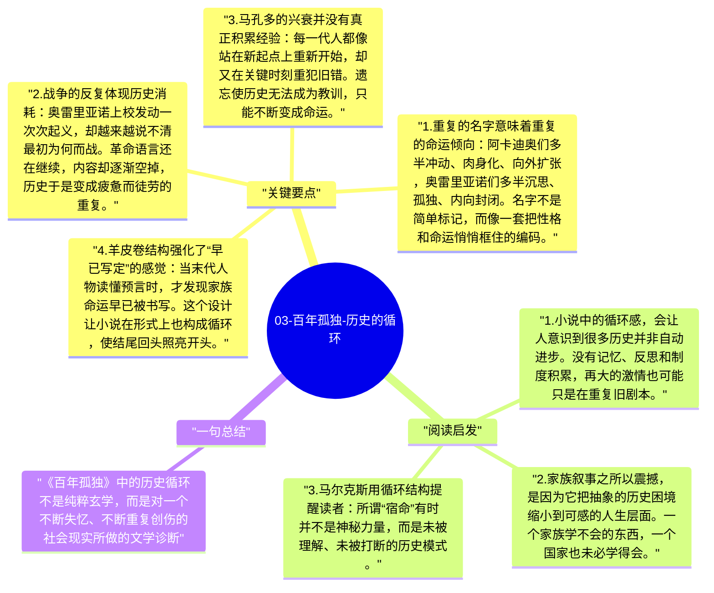

# 03-百年孤独-历史的循环

《百年孤独》中的历史并不线性展开，而像一个不断重演的圆。布恩迪亚家族的名字反复出现，性格与命运不断回返，战争一遍遍开始又结束，马孔多似乎总在尝试摆脱过去，却又被过去牢牢吸住。马尔克斯借此表达的，不只是家族宿命感，更是对拉丁美洲历史循环困境的深刻感受。

## 关键要点

1. **重复的名字意味着重复的命运倾向**：阿卡迪奥们多半冲动、肉身化、向外扩张，奥雷里亚诺们多半沉思、孤独、内向封闭。名字不是简单标记，而像一套把性格和命运悄悄框住的编码。
2. **战争的反复体现历史消耗**：奥雷里亚诺上校发动一次次起义，却越来越说不清最初为何而战。革命语言还在继续，内容却逐渐空掉，历史于是变成疲惫而徒劳的重复。
3. **马孔多的兴衰并没有真正积累经验**：每一代人都像站在新起点上重新开始，却又在关键时刻重犯旧错。遗忘使历史无法成为教训，只能不断变成命运。
4. **羊皮卷结构强化了“早已写定”的感觉**：当末代人物读懂预言时，才发现家族命运早已被书写。这个设计让小说在形式上也构成循环，使结尾回头照亮开头。
5. **循环既是宿命，也是批判**：马尔克斯并不是要宣称人绝无可能改变，而是在指出：如果社会总是失忆、总是被暴力打断、总是缺少稳定公共记忆，那么历史就很难真正前进。

## 阅读启发

1. 小说中的循环感，会让人意识到很多历史并非自动进步。没有记忆、反思和制度积累，再大的激情也可能只是在重复旧剧本。
2. 家族叙事之所以震撼，是因为它把抽象的历史困境缩小到可感的人生层面。一个家族学不会的东西，一个国家也未必学得会。
3. 马尔克斯用循环结构提醒读者：所谓“宿命”有时并不是神秘力量，而是未被理解、未被打断的历史模式。

## 一句总结

《百年孤独》中的历史循环不是纯粹玄学，而是对一个不断失忆、不断重复创伤的社会现实所做的文学诊断。

---

## Mermaid 思维导图

### 图1

