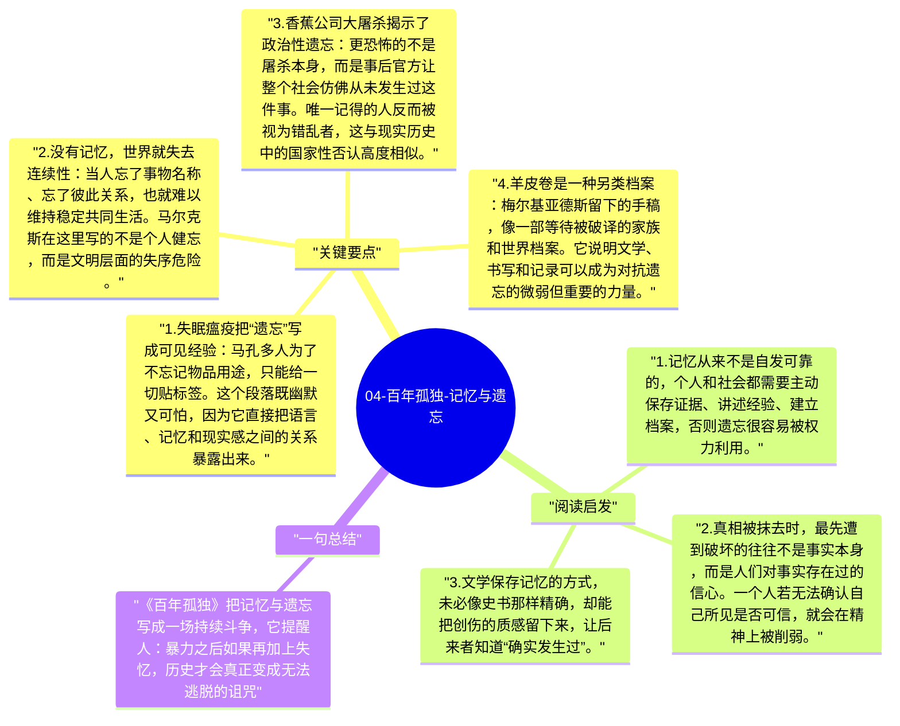

# 04-百年孤独-记忆与遗忘

在《百年孤独》里，记忆从来不是稳定背景，而是整部小说反复争夺的东西。失眠瘟疫让人逐渐忘记事物的名字，香蕉公司大屠杀被官方叙事抹去，家族旧事在一代代流传中变形、模糊甚至断裂。马尔克斯借此指出：一个社会真正危险的时刻，不只是遭遇暴力，而是连暴力发生过这件事都被忘掉。

## 关键要点

1. **失眠瘟疫把“遗忘”写成可见经验**：马孔多人为了不忘记物品用途，只能给一切贴标签。这个段落既幽默又可怕，因为它直接把语言、记忆和现实感之间的关系暴露出来。
2. **没有记忆，世界就失去连续性**：当人忘了事物名称、忘了彼此关系，也就难以维持稳定共同生活。马尔克斯在这里写的不是个人健忘，而是文明层面的失序危险。
3. **香蕉公司大屠杀揭示了政治性遗忘**：更恐怖的不是屠杀本身，而是事后官方让整个社会仿佛从未发生过这件事。唯一记得的人反而被视为错乱者，这与现实历史中的国家性否认高度相似。
4. **羊皮卷是一种另类档案**：梅尔基亚德斯留下的手稿，像一部等待被破译的家族和世界档案。它说明文学、书写和记录可以成为对抗遗忘的微弱但重要的力量。
5. **家族内部同样不断遗忘彼此**：名字混乱、故事重复、情感误解，使亲缘关系并没有自动带来记忆延续。即使在最亲密的共同体中，遗忘也仍然会发生。

## 阅读启发

1. 记忆从来不是自发可靠的，个人和社会都需要主动保存证据、讲述经验、建立档案，否则遗忘很容易被权力利用。
2. 真相被抹去时，最先遭到破坏的往往不是事实本身，而是人们对事实存在过的信心。一个人若无法确认自己所见是否可信，就会在精神上被削弱。
3. 文学保存记忆的方式，未必像史书那样精确，却能把创伤的质感留下来，让后来者知道“确实发生过”。

## 一句总结

《百年孤独》把记忆与遗忘写成一场持续斗争，它提醒人：暴力之后如果再加上失忆，历史才会真正变成无法逃脱的诅咒。

---

## Mermaid 思维导图

### 图1

