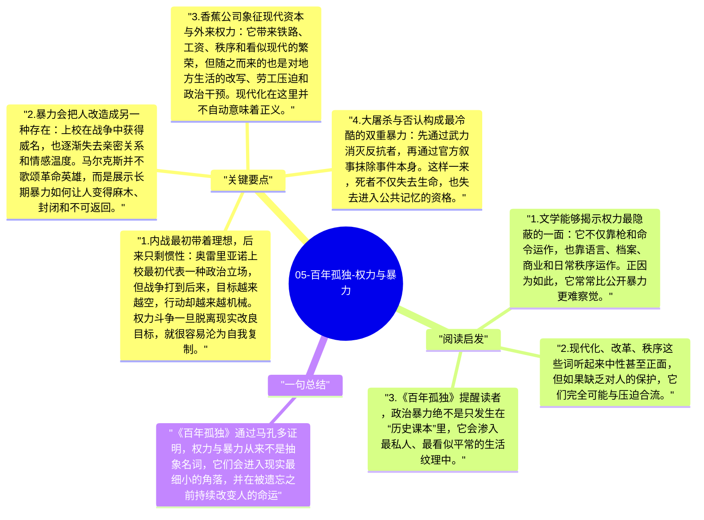

# 05-百年孤独-权力与暴力

《百年孤独》并不是只写家族、爱情和神秘，它同样是一部强烈的政治小说。内战、独裁、外来资本、军队镇压、历史否认，这些都深深嵌入马孔多的命运之中。马尔克斯通过布恩迪亚家族的经历说明，权力和暴力并不是远离私人生活的宏观事件，它们会进入家庭、身体、记忆和语言，把整个世界慢慢改造。

## 关键要点

1. **内战最初带着理想，后来只剩惯性**：奥雷里亚诺上校最初代表一种政治立场，但战争打到后来，目标越来越空，行动却越来越机械。权力斗争一旦脱离现实改良目标，就很容易沦为自我复制。
2. **暴力会把人改造成另一种存在**：上校在战争中获得威名，也逐渐失去亲密关系和情感温度。马尔克斯并不歌颂革命英雄，而是展示长期暴力如何让人变得麻木、封闭和不可返回。
3. **香蕉公司象征现代资本与外来权力**：它带来铁路、工资、秩序和看似现代的繁荣，但随之而来的也是对地方生活的改写、劳工压迫和政治干预。现代化在这里并不自动意味着正义。
4. **大屠杀与否认构成最冷酷的双重暴力**：先通过武力消灭反抗者，再通过官方叙事抹除事件本身。这样一来，死者不仅失去生命，也失去进入公共记忆的资格。
5. **权力的后果最终由普通人承担**：无论是战争还是公司统治，真正被撕裂的总是普通家庭、劳动者和地方共同体。小说把这种代价写得具体，从而拒绝任何抽象化的政治浪漫主义。

## 阅读启发

1. 文学能够揭示权力最隐蔽的一面：它不仅靠枪和命令运作，也靠语言、档案、商业和日常秩序运作。正因为如此，它常常比公开暴力更难察觉。
2. 现代化、改革、秩序这些词听起来中性甚至正面，但如果缺乏对人的保护，它们完全可能与压迫合流。
3. 《百年孤独》提醒读者，政治暴力绝不是只发生在“历史课本”里，它会渗入最私人、最看似平常的生活纹理中。

## 一句总结

《百年孤独》通过马孔多证明，权力与暴力从来不是抽象名词，它们会进入现实最细小的角落，并在被遗忘之前持续改变人的命运。

---

## Mermaid 思维导图

### 图1

