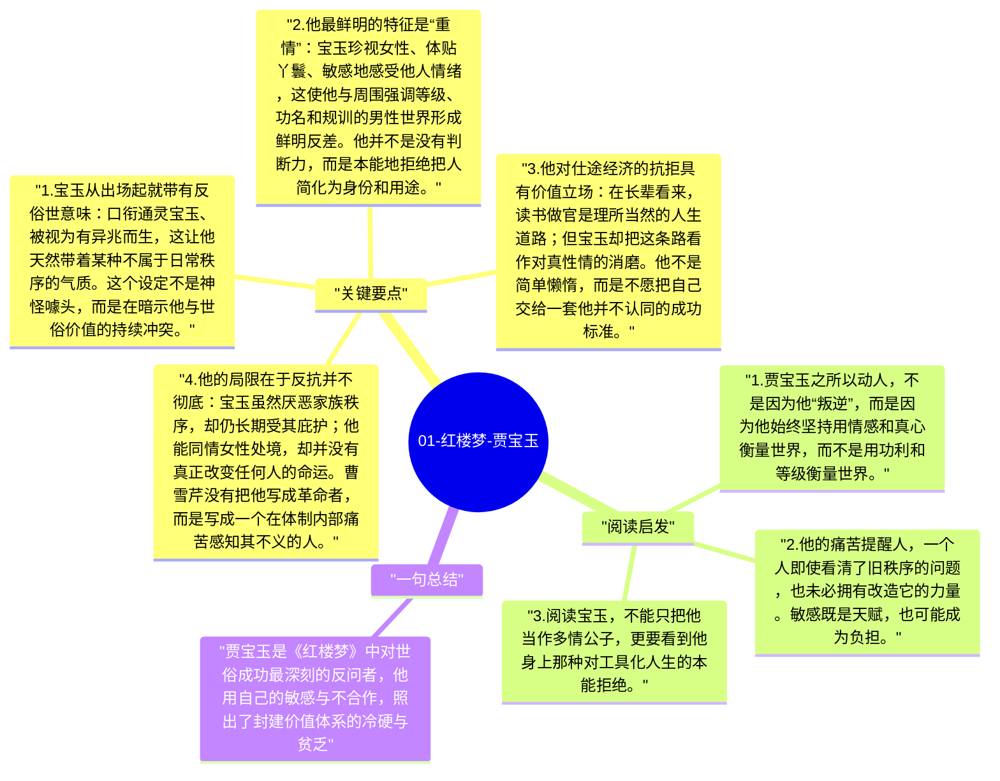

# 01-红楼梦-贾宝玉

贾宝玉是《红楼梦》的灵魂人物，也是整部小说最重要的张力中心。他出身富贵，却本能地厌恶功名仕途；身处封建大家族核心，却始终对这套秩序保持疏离和反感。曹雪芹借贾宝玉提出的问题，不只是“一个少年该怎样长大”，而是“一个重情、敏感、厌恶功利的人，如何在一套强调礼法、仕途和家族责任的世界里存活”。

## 关键要点

1. **宝玉从出场起就带有反俗世意味**：口衔通灵宝玉、被视为有异兆而生，这让他天然带着某种不属于日常秩序的气质。这个设定不是神怪噱头，而是在暗示他与世俗价值的持续冲突。
2. **他最鲜明的特征是“重情”**：宝玉珍视女性、体贴丫鬟、敏感地感受他人情绪，这使他与周围强调等级、功名和规训的男性世界形成鲜明反差。他并不是没有判断力，而是本能地拒绝把人简化为身份和用途。
3. **他对仕途经济的抗拒具有价值立场**：在长辈看来，读书做官是理所当然的人生道路；但宝玉却把这条路看作对真性情的消磨。他不是简单懒惰，而是不愿把自己交给一套他并不认同的成功标准。
4. **他的局限在于反抗并不彻底**：宝玉虽然厌恶家族秩序，却仍长期受其庇护；他能同情女性处境，却并没有真正改变任何人的命运。曹雪芹没有把他写成革命者，而是写成一个在体制内部痛苦感知其不义的人。
5. **最终出家是他与世界关系的终极回答**：当贾家衰败、宝黛爱情破灭、世俗安排彻底压倒个体心愿时，宝玉选择离开。这既是逃离，也是对整个价值体系的否定性回答。

## 阅读启发

1. 贾宝玉之所以动人，不是因为他“叛逆”，而是因为他始终坚持用情感和真心衡量世界，而不是用功利和等级衡量世界。
2. 他的痛苦提醒人，一个人即使看清了旧秩序的问题，也未必拥有改造它的力量。敏感既是天赋，也可能成为负担。
3. 阅读宝玉，不能只把他当作多情公子，更要看到他身上那种对工具化人生的本能拒绝。

## 一句总结

贾宝玉是《红楼梦》中对世俗成功最深刻的反问者，他用自己的敏感与不合作，照出了封建价值体系的冷硬与贫乏。

---

## Mermaid 思维导图

### 图1

