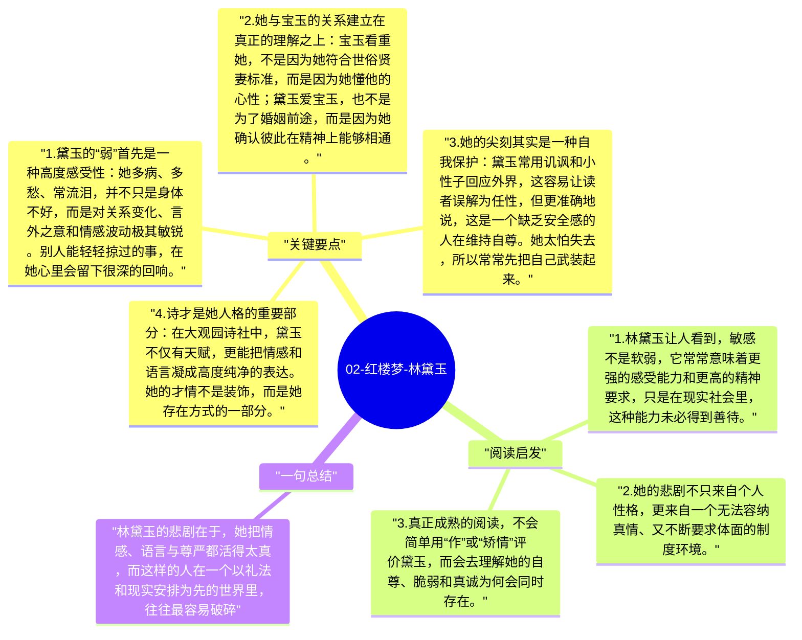

# 02-红楼梦-林黛玉

林黛玉是《红楼梦》中最具诗性和悲剧感的人物。她敏感、聪慧、孤高、脆弱，既有极高的精神感受力，也因此更容易在现实冲撞中受伤。曹雪芹写黛玉，并不是为了塑造一个单纯“爱哭”的才女形象，而是通过她展示：当一个人对情感、语言和尊严都过于敏锐时，她在现实世界里往往要承受更深的痛苦。

## 关键要点

1. **黛玉的“弱”首先是一种高度感受性**：她多病、多愁、常流泪，并不只是身体不好，而是对关系变化、言外之意和情感波动极其敏锐。别人能轻轻掠过的事，在她心里会留下很深的回响。
2. **她与宝玉的关系建立在真正的理解之上**：宝玉看重她，不是因为她符合世俗贤妻标准，而是因为她懂他的心性；黛玉爱宝玉，也不是为了婚姻前途，而是因为她确认彼此在精神上能够相通。
3. **她的尖刻其实是一种自我保护**：黛玉常用讥讽和小性子回应外界，这容易让读者误解为任性，但更准确地说，这是一个缺乏安全感的人在维持自尊。她太怕失去，所以常常先把自己武装起来。
4. **诗才是她人格的重要部分**：在大观园诗社中，黛玉不仅有天赋，更能把情感和语言凝成高度纯净的表达。她的才情不是装饰，而是她存在方式的一部分。
5. **她的死亡是一种双重破灭**：一方面是爱情被现实婚配安排粉碎，另一方面也是一个最懂“情”的人无法在礼法世界中继续存在。焚稿断痴情，因此成为全书最具象征力的悲剧时刻之一。

## 阅读启发

1. 林黛玉让人看到，敏感不是软弱，它常常意味着更强的感受能力和更高的精神要求，只是在现实社会里，这种能力未必得到善待。
2. 她的悲剧不只来自个人性格，更来自一个无法容纳真情、又不断要求体面的制度环境。
3. 真正成熟的阅读，不会简单用“作”或“矫情”评价黛玉，而会去理解她的自尊、脆弱和真诚为何会同时存在。

## 一句总结

林黛玉的悲剧在于，她把情感、语言与尊严都活得太真，而这样的人在一个以礼法和现实安排为先的世界里，往往最容易破碎。

---

## Mermaid 思维导图

### 图1

