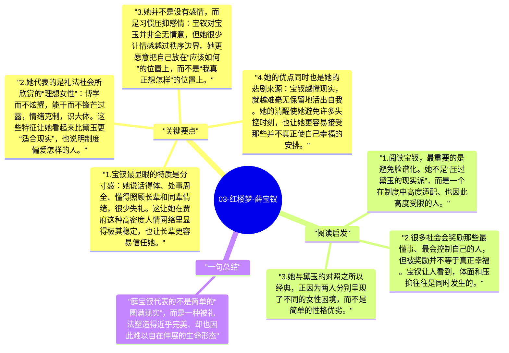

# 03-红楼梦-薛宝钗

薛宝钗常常被拿来与林黛玉对照，但如果只把她理解成“世故圆滑”或“封建贤妻”就太单薄了。她确实更稳重、更合礼法，也更懂得在复杂家族环境中维持分寸；但这并不意味着她没有情感和压抑。曹雪芹写宝钗，实际上是在展示一种被制度奖励的人格类型：她成熟、克制、周全，却也因此把很多真实感受长期收束在内心。

## 关键要点

1. **宝钗最显眼的特质是分寸感**：她说话得体、处事周全、懂得照顾长辈和同辈情绪，很少失礼。这让她在贾府这种高密度人情网络里显得极其稳定，也让长辈更容易信任她。
2. **她代表的是礼法社会所欣赏的“理想女性”**：博学而不炫耀，能干而不锋芒过露，情绪克制，识大体。这些特征让她看起来比黛玉更“适合现实”，也说明制度偏爱怎样的人。
3. **她并不是没有感情，而是习惯压抑感情**：宝钗对宝玉并非全无情意，但她很少让情感越过秩序边界。她更愿意把自己放在“应该如何”的位置上，而不是“我真正想怎样”的位置上。
4. **她的优点同时也是她的悲剧来源**：宝钗越懂现实，就越难毫无保留地活出自我。她的清醒使她避免许多失控时刻，也让她更容易接受那些并不真正使自己幸福的安排。
5. **宝钗不是黛玉的反面，而是另一种困境**：黛玉代表真情难容，宝钗代表规训内化。一个因太真而受伤，一个因太能自我管理而失去自由，两者都不是胜利者。

## 阅读启发

1. 阅读宝钗，最重要的是避免脸谱化。她不是“压过黛玉的现实派”，而是一个在制度中高度适配、也因此高度受限的人。
2. 很多社会会奖励那些最懂事、最会控制自己的人，但被奖励并不等于真正幸福。宝钗让人看到，体面和压抑往往是同时发生的。
3. 她与黛玉的对照之所以经典，正因为两人分别呈现了不同的女性困境，而不是简单的性格优劣。

## 一句总结

薛宝钗代表的不是简单的“圆满现实”，而是一种被礼法塑造得近乎完美、却也因此难以自在伸展的生命形态。

---

## Mermaid 思维导图

### 图1

