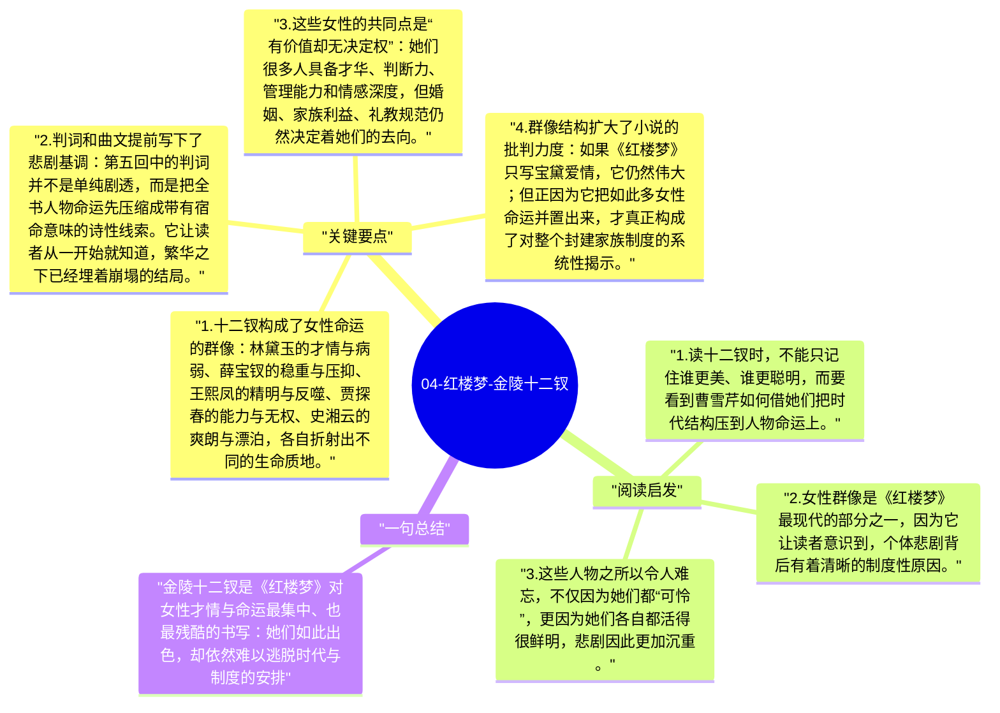

# 04-红楼梦-金陵十二钗

“金陵十二钗”并不是《红楼梦》里一组方便记忆的人物名单，而是曹雪芹用来集中展示女性命运的一种叙事结构。通过十二位女子不同的性格、才情、处境和结局，小说把一个时代中女性的光彩与困境同时呈现出来：她们往往比男性更聪明、更有情、更有能力，却仍然无法掌握自己的命运。

## 关键要点

1. **十二钗构成了女性命运的群像**：林黛玉的才情与病弱、薛宝钗的稳重与压抑、王熙凤的精明与反噬、贾探春的能力与无权、史湘云的爽朗与漂泊，各自折射出不同的生命质地。
2. **判词和曲文提前写下了悲剧基调**：第五回中的判词并不是单纯剧透，而是把全书人物命运先压缩成带有宿命意味的诗性线索。它让读者从一开始就知道，繁华之下已经埋着崩塌的结局。
3. **这些女性的共同点是“有价值却无决定权”**：她们很多人具备才华、判断力、管理能力和情感深度，但婚姻、家族利益、礼教规范仍然决定着她们的去向。
4. **群像结构扩大了小说的批判力度**：如果《红楼梦》只写宝黛爱情，它仍然伟大；但正因为它把如此多女性命运并置出来，才真正构成了对整个封建家族制度的系统性揭示。
5. **“十二钗”也是一种情感档案**：曹雪芹并没有把她们写成抽象符号，而是用大量日常细节、口吻、爱好、脾气和遭遇，让每个人都具有难以替代的具体性。

## 阅读启发

1. 读十二钗时，不能只记住谁更美、谁更聪明，而要看到曹雪芹如何借她们把时代结构压到人物命运上。
2. 女性群像是《红楼梦》最现代的部分之一，因为它让读者意识到，个体悲剧背后有着清晰的制度性原因。
3. 这些人物之所以令人难忘，不仅因为她们都“可怜”，更因为她们各自都活得很鲜明，悲剧因此更加沉重。

## 一句总结

金陵十二钗是《红楼梦》对女性才情与命运最集中、也最残酷的书写：她们如此出色，却依然难以逃脱时代与制度的安排。

---

## Mermaid 思维导图

### 图1

