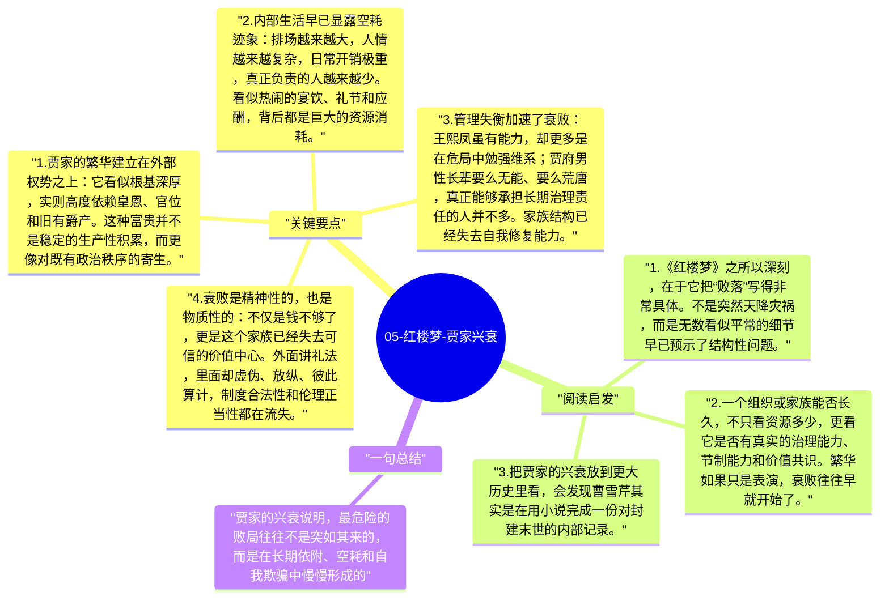

# 05-红楼梦-贾家兴衰

《红楼梦》表面上写的是宝黛钗的情感纠葛，深层却始终有一条更大的线索在推进，那就是贾家的盛极而衰。曹雪芹并没有把家族败落写成某个坏人作恶后的偶然结局，而是通过极其丰富的日常细节，让读者看到一个富贵家族如何在制度依附、内部腐败、财务空转和精神空心中一步步走向崩塌。

## 关键要点

1. **贾家的繁华建立在外部权势之上**：它看似根基深厚，实则高度依赖皇恩、官位和旧有爵产。这种富贵并不是稳定的生产性积累，而更像对既有政治秩序的寄生。
2. **内部生活早已显露空耗迹象**：排场越来越大，人情越来越复杂，日常开销极重，真正负责的人越来越少。看似热闹的宴饮、礼节和应酬，背后都是巨大的资源消耗。
3. **管理失衡加速了衰败**：王熙凤虽有能力，却更多是在危局中勉强维系；贾府男性长辈要么无能、要么荒唐，真正能够承担长期治理责任的人并不多。家族结构已经失去自我修复能力。
4. **衰败是精神性的，也是物质性的**：不仅是钱不够了，更是这个家族已经失去可信的价值中心。外面讲礼法，里面却虚伪、放纵、彼此算计，制度合法性和伦理正当性都在流失。
5. **家族结局是封建贵族秩序的缩影**：贾家的崩塌并非个案，而是一个时代的缩影。曹雪芹通过一个家族的内部瓦解，写出了整套贵族社会迟早难以为继的命运。

## 阅读启发

1. 《红楼梦》之所以深刻，在于它把“败落”写得非常具体。不是突然天降灾祸，而是无数看似平常的细节早已预示了结构性问题。
2. 一个组织或家族能否长久，不只看资源多少，更看它是否有真实的治理能力、节制能力和价值共识。繁华如果只是表演，衰败往往早就开始了。
3. 把贾家的兴衰放到更大历史里看，会发现曹雪芹其实是在用小说完成一份对封建末世的内部记录。

## 一句总结

贾家的兴衰说明，最危险的败局往往不是突如其来的，而是在长期依附、空耗和自我欺骗中慢慢形成的。

---

## Mermaid 思维导图

### 图1

