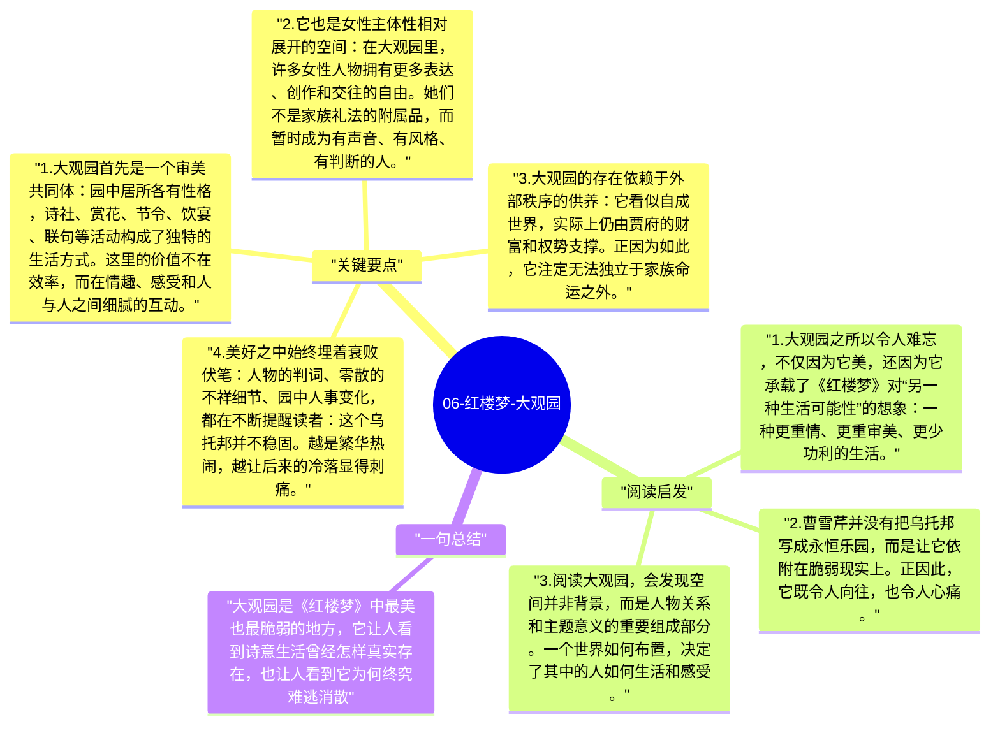

# 06-红楼梦-大观园

大观园是《红楼梦》中最迷人的空间，也是最容易让人低估其意义的空间。它不仅是一座美丽园林，更是一种短暂出现的理想世界：在这里，青春、诗意、女性友谊、审美生活和较少功利算计的日常得以展开。但曹雪芹从一开始就暗示，这样的空间不可能长久存在，它越美，越显出终将消失的哀感。

## 关键要点

1. **大观园首先是一个审美共同体**：园中居所各有性格，诗社、赏花、节令、饮宴、联句等活动构成了独特的生活方式。这里的价值不在效率，而在情趣、感受和人与人之间细腻的互动。
2. **它也是女性主体性相对展开的空间**：在大观园里，许多女性人物拥有更多表达、创作和交往的自由。她们不是家族礼法的附属品，而暂时成为有声音、有风格、有判断的人。
3. **大观园的存在依赖于外部秩序的供养**：它看似自成世界，实际上仍由贾府的财富和权势支撑。正因为如此，它注定无法独立于家族命运之外。
4. **美好之中始终埋着衰败伏笔**：人物的判词、零散的不祥细节、园中人事变化，都在不断提醒读者：这个乌托邦并不稳固。越是繁华热闹，越让后来的冷落显得刺痛。
5. **大观园的解体象征青春与理想世界的终结**：当园子不再、众人离散，它带走的不只是一处住所，而是一整套曾经可能的生活形式。

## 阅读启发

1. 大观园之所以令人难忘，不仅因为它美，还因为它承载了《红楼梦》对“另一种生活可能性”的想象：一种更重情、更重审美、更少功利的生活。
2. 曹雪芹并没有把乌托邦写成永恒乐园，而是让它依附在脆弱现实上。正因此，它既令人向往，也令人心痛。
3. 阅读大观园，会发现空间并非背景，而是人物关系和主题意义的重要组成部分。一个世界如何布置，决定了其中的人如何生活和感受。

## 一句总结

大观园是《红楼梦》中最美也最脆弱的地方，它让人看到诗意生活曾经怎样真实存在，也让人看到它为何终究难逃消散。

---

## Mermaid 思维导图

### 图1

