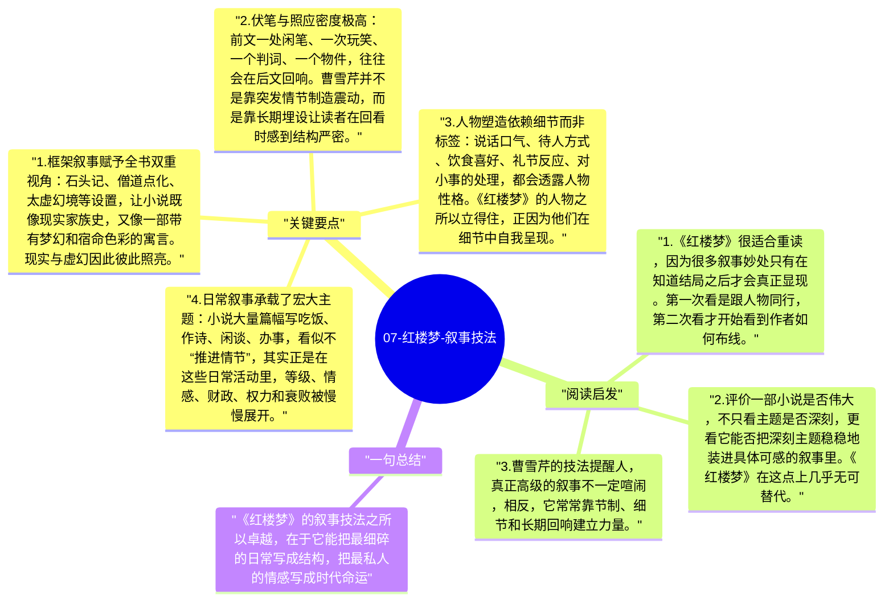

# 07-红楼梦-叙事技法

《红楼梦》的伟大不仅在题材和人物，更在它极高明的叙事组织能力。曹雪芹能把庞杂人物、细碎日常、诗词曲赋、家族兴衰、神话框架和现实批判熔成一个整体，让读者在看似闲散的生活流动中，逐渐感到命运已经被严密编织。它越细密，越显示出作者控制叙事的惊人能力。

## 关键要点

1. **框架叙事赋予全书双重视角**：石头记、僧道点化、太虚幻境等设置，让小说既像现实家族史，又像一部带有梦幻和宿命色彩的寓言。现实与虚幻因此彼此照亮。
2. **伏笔与照应密度极高**：前文一处闲笔、一次玩笑、一个判词、一个物件，往往会在后文回响。曹雪芹并不是靠突发情节制造震动，而是靠长期埋设让读者在回看时感到结构严密。
3. **人物塑造依赖细节而非标签**：说话口气、待人方式、饮食喜好、礼节反应、对小事的处理，都会透露人物性格。《红楼梦》的人物之所以立得住，正因为他们在细节中自我呈现。
4. **日常叙事承载了宏大主题**：小说大量篇幅写吃饭、作诗、闲谈、办事，看似不“推进情节”，其实正是在这些日常活动里，等级、情感、财政、权力和衰败被慢慢展开。
5. **语言风格实现了多层次统一**：俗白与典雅并存，诗词与口语互补，不同人物说话各有身份气息。语言不仅服务于故事，也构成小说自身的审美世界。

## 阅读启发

1. 《红楼梦》很适合重读，因为很多叙事妙处只有在知道结局之后才会真正显现。第一次看是跟人物同行，第二次看才开始看到作者如何布线。
2. 评价一部小说是否伟大，不只看主题是否深刻，更看它能否把深刻主题稳稳地装进具体可感的叙事里。《红楼梦》在这点上几乎无可替代。
3. 曹雪芹的技法提醒人，真正高级的叙事不一定喧闹，相反，它常常靠节制、细节和长期回响建立力量。

## 一句总结

《红楼梦》的叙事技法之所以卓越，在于它能把最细碎的日常写成结构，把最私人的情感写成时代命运。

---

## Mermaid 思维导图

### 图1

