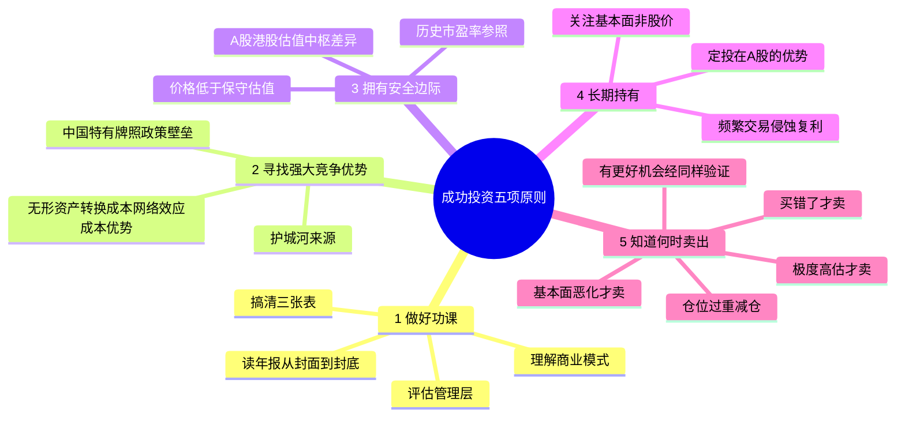
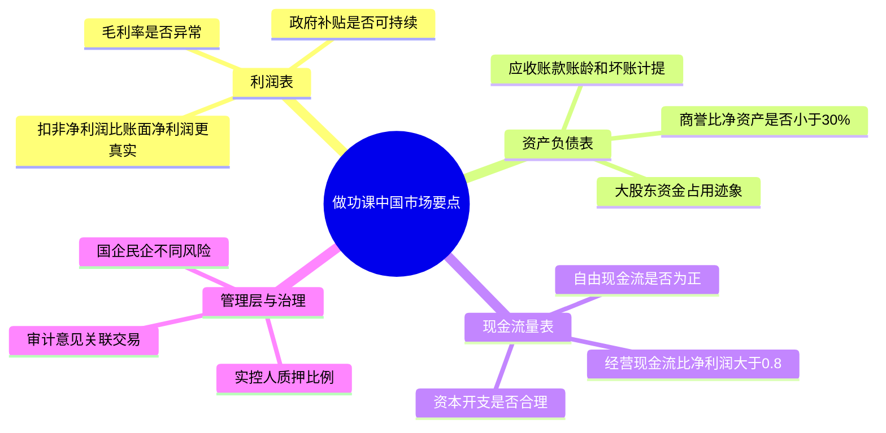
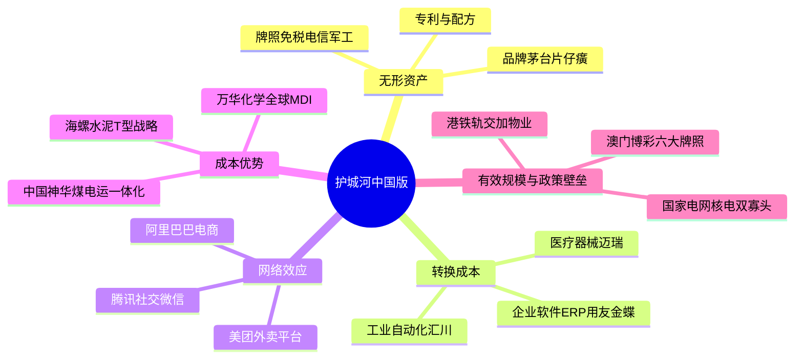
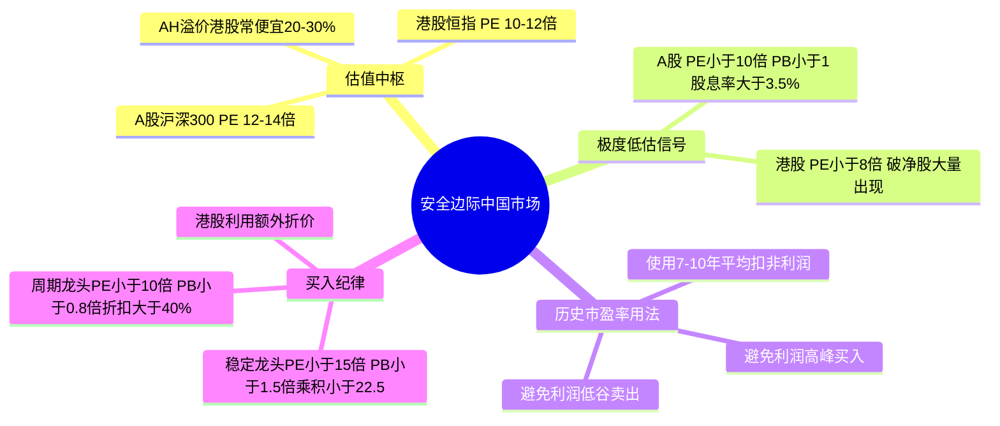
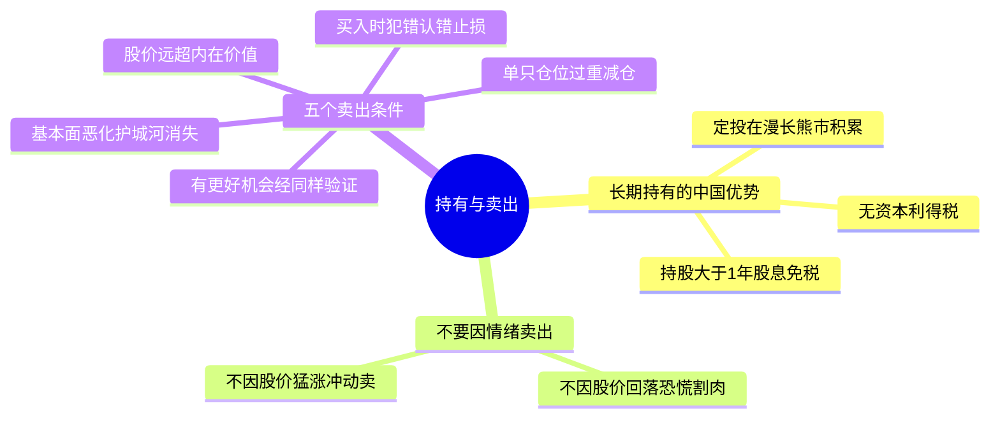

# 《股市真规则》第一章：成功投资股市的五项原则 —— 2026中国A股与港股适配版

**章首基调（原书精神）**  
令人惊讶的是，很少有投资者——有时甚至包括基金经理——能清晰表述自己的投资哲学。  
成功的股票投资依赖于个人的训练，不依赖于别人是否赞同你。  
至关重要的是：要有一个稳固的、有充分依据的投资哲学——也就是一套在世界中思考问题的方式。  
下面五条原则，就是这个哲学的骨架。

**中国版导言**：  
A股和港股市场，波动更剧烈，散户占比高，政策影响大，题材炒作盛行。在这样的环境中，拥有一套稳固的投资哲学不是加分项，而是生存底线。以下五项原则是完全适用的，但每一项都需要根据中国市场特征做出具体调整。

---

## ★ 五项原则总览（章首提纲）

| # | 原则 | 一句话抓住它的“任务” |
|---|------|----------------------|
| 1 | 做好你的功课 | 划定能力圈：不懂不买，把买股票当“要收购整家公司”的尽调 |
| 2 | 寻找具有强大竞争优势的公司 | 只碰能长期守利润的公司——护城河（经济护城河）是灵魂过滤器 |
| 3 | 拥有安全边际 | 好公司≠好投资；只在价格低于保守估值时出手，留缓冲 |
| 4 | 长期持有 | 时间是好公司的朋友；频繁交易的成本/情绪把复利啃光 |
| 5 | 知道何时卖出 | 不因“跌了/涨了”卖；只用基本面触发器决定去留 |

这五项串起来是一条闭环：**研究 → 护城河筛 → 估值/安全边际控买入 → 耐心持有 → 纪律退出**。

---

## 1. 做好你的功课（Do Your Homework）

### 1.1 原书标志句（完全适用A股/港股）
“投资者所犯的大部分一般性错误，往往就是未能彻底调查他们所购买股票的公司。”  
“除非你知道这家公司的详细情况，否则你就不应当购买这只股票。”

### 1.2 “做功课”在中国市场的具体内容

**A. 从年报开始——中国上市公司的年报怎么读**
- 坐下，把公司的年度报告从头到尾读完；浏览过去至少5年的财务报表。
- **A股特别关注**：
  - **扣非净利润**比“净利润”更真实。非经常性损益（政府补贴、资产处置、债务重组收益）经常粉饰利润。
  - **经营现金流**：如果连续多年经营现金流远低于净利润，利润就是纸面的。
  - **应收账款**：A股大量ToG（面向政府）和ToB企业的应收高企，需看账龄和坏账计提是否充足。
  - **商誉**：2014-2016年并购狂潮留下巨额商誉，商誉/净资产>30%的公司需格外警惕。
  - **研发支出资本化**：部分公司通过高比例资本化虚增利润，要对比同行。
- **港股特别关注**：
  - 非控股权益、关联交易、可换股债券的潜在摊薄。
  - 红筹/VIE架构的治理风险。
  - 关注大股东质押比例（港股也有股份抵押，可能引发爆仓连锁）。

**B. 三张报表——中国市场的水下冰山**
| 报表 | 原书定位 | A股/港股特别核验 |
|------|----------|-------------------|
| 资产负债表 | 财务健康快照 | 货币资金是否真实（有无大股东占用）；存货和应收账款减值是否充足；表外负债（担保、PPP项目） |
| 利润表 | 收入-费用-利润 | 主营收入与扣非利润是否同步；毛利率是否显著偏离行业均值（可能造假或隐藏利润）；费用率趋势 |
| 现金流量表 | 价值试金石 | 经营活动现金流净额/净利润>0.8为及格；自由现金流是否持续为正；资本开支是否吞噬现金流 |

**C. 搞清“它怎么赚钱”——商业模式与行业格局**
- 能回答：在产业链哪一段？对上游/下游谁更强势？增长靠提价还是靠量？靠内生还是并购？
- **中国特征**：
  - 国企与民企的商业模式差异：国企融资成本低但效率可能偏低；民企灵活但治理风险更高。
  - 政策依赖性：公司是否依赖补贴、税收优惠、特许牌照？政策变化风险多大？

**D. 评估管理层——中国可观测维度**
- 实控人/大股东的诚信记录（有无违规、减持、质押比例）。
- 国企管理层：是否响应国资委考核（ROE、市值管理、分红）？
- 民企管理层：是否过度自信搞多元化、低价增发稀释小股东利益？

**E. 冷却期——在中国尤其必要**
- 研究和下单之间留出至少24-48小时的冷却期。A股题材股的消息刺激来得快去得也快，冲动追涨是散户亏损的首要原因。

---

## 2. 寻找具有强大竞争优势的公司（Find Companies with Strong Competitive Advantages）

### 2.1 原书标志句（完全适用）
“是什么把一家坏公司与好公司区分开来的呢？在很大程度上，取决于一家公司自身竞争优势的大小。”  
“一家公司是怎样设法使竞争者无路可走，从而使自己获得丰厚利润的？如果你能够回答这个问题，你就能发现这家公司竞争优势的源头了。”

### 2.2 护城河来源——中国版框架
| 来源 | 原书精神 | A股/港股核验与例证 |
|------|----------|-------------------|
| **无形资产** | 品牌、专利、牌照 | 茅台（品牌溢价+社交货币）；片仔癀（绝密配方）；免税牌照（中国中免，但牌照在松动）；专利药（恒瑞医药，但集采侵蚀）；港股：海底捞（服务品牌） |
| **转换成本** | 客户更换痛苦/昂贵 | 企业软件/ERP（用友、金蝶，实施绑定）；银行核心系统；工业传感器/自动化设备（汇川技术）；医疗器械（迈瑞医疗，医院培训绑定） |
| **网络效应** | 越多人用越值钱 | 微信/腾讯（社交关系链）；美团（外卖骑手+用户+商家三方网络）；阿里巴巴（电商双边平台）；港交所（唯一交易所，流动性聚集） |
| **成本优势** | 规模/独特资源/工艺 | 海螺水泥（T型战略+长江水运成本最低）；万华化学（全球MDI成本最低）；中国神华（煤电运一体化）；港股：申洲国际（服装代工极致效率） |
| **有效规模/行业结构** | 市场只能养活少数玩家 | 国家电网/南方电网（自然垄断）；中国核电/中广核（牌照稀缺+高资本门槛）；机场（上海机场，区位垄断）；港股：港铁（轨交+物业模式） |
| **中国特有：政策/牌照壁垒** | 行政准入 | 烟草（不上市）、免税、电信运营商、军工（信息不透明）、卫星导航（北斗）、稀土开采配额；港股：澳门博彩牌照（六大持牌者） |

**原书否定清单仍适用**：
- “优秀管理层”本身不是护城河（人可以走）。
- “行业高增长”不是护城河（如光伏、锂电产能过剩后价格战惨烈）。

### 2.3 校验护城河的三个问题（中国版）
1. 过去5-10年，公司是否维持了高于同行的ROIC/ROE和稳定毛利率？
2. 这个结果能追溯到上述哪一条结构性壁垒？（如果答不出，可能是周期顶部或会计粉饰）
3. 如果同行降价10%，客户会离开吗？（测试定价权）

---

## 3. 拥有安全边际（Have a Margin of Safety）

### 3.1 原书标志句
“发现好公司只完成了投资过程的一半，另一半工作则是评估这家公司的价值。”  
“任何一个投资者的目标都应当是在价格低于股票价值时买入。”

### 3.2 安全边际的定义（中国版估值锚）
> 安全边际 ＝ 股票的保守内在价值 － 你实际支付的市价

在中国市场，由于波动更大、个股风险更高，安全边际要求应当**比美国市场更严格**。

### 3.3 A股与港股的估值参照系

**A股估值中枢**：
- 沪深300市盈率中枢约12-14倍（基于7-10年平滑利润）。
- 极度低估：PE<10倍（如2014年中、2018年底、2024年初）。
- 高估危险区：PE>18-20倍（如2007年、2015年、2021年初）。
- **防守型买入标准**：PE≤15倍（7年平均扣非利润），PB≤1.5倍，PE×PB≤22.5。

**港股估值中枢**：
- 恒生指数市盈率中枢约10-12倍（长期低于A股）。
- 极度低估：PE<8倍（如2022年10月、2024年初）。
- 高估：PE>15倍。
- 港股央企/国企普遍折价更大（AH溢价指数长期在130-150），同一家公司的港股常比A股便宜20-30%，提供了额外的安全边际。

**历史市盈率的使用（原书建议）**：
“探索股票估值的一个简单路径就是看该股票的历史市盈率——要考察过去10年或更长时间。”  
在A股，要使用**过去7-10年的平均利润**计算市盈率，避免在利润高峰买入（PE虚假偏低），或在利润低谷卖出（PE虚假偏高）。

### 3.4 好公司也别付天价——A股血泪教训
- 2021年“茅指数”核心资产，市盈率60-100倍，PE×PB远超22.5。随后2-3年深度下跌50-80%。再好的公司，价格过高就是投机。
- 买得便宜是A股长期生存的最重要保障。

---

## 4. 长期持有（Hold for the Long Haul）

### 4.1 原书标志句
“频繁短期交易的费用如果合计起来，包括税收和佣金，会给你的投资业绩造成几乎不可逾越的障碍。”  
“在经过熊市的时候你应当谦卑一些，保持耐心，因为这将带来利润。”

### 4.2 A股和港股的长期持有挑战与优势
**挑战**：
- A股牛短熊长，波动极大（沪深300年化波动率25-30%），持有体验差。
- 港股流动性不均，小市值股票可能在市场低迷时出现极端折价，考验心理承受力。

**优势**：
- A股暂不征收资本利得税，长期持有无税务负担。
- 持股超过1年，股息红利免征个人所得税（A股），鼓励长期持股收息。
- 定投策略在A股尤其有效：熊市漫长，定投可在低位积累大量份额。

### 4.3 长期持有≠装死
- 持续关注公司基本面（护城河是否被侵蚀、现金流是否恶化），而不是每日股价。
- 关注行业新闻、年报、竞争对手动态，远重于盯盘。

---

## 5. 知道何时卖出（Know When to Sell）

### 5.1 原书标志句
“影响股票价格的是该公司的未来，而且那才是你决定是否要卖出股票的依据。”

### 5.2 在中国市场尤其要避免的卖出冲动
- **不要因股价回落卖出**：A股经常出现整个板块因政策担忧集体下跌，但龙头公司基本面未变，此时卖出往往是底部割肉。
- **不要因股价猛涨卖出**：尤其当护城河、现金流仍在改善，估值尚未离谱时。

### 5.3 五个卖出条件（中国版强化）
| # | 原书条件 | A股/港股应用 |
|---|----------|-------------|
| ① | 你最初买入时就犯了错误 | 发现公司财务造假、护城河判断完全错误——果断认错，不计沉没成本 |
| ② | 公司基本面已经恶化 | 护城河被侵蚀（如集采使仿制药利润永降）、现金流持续为负、管理层诚信出问题 |
| ③ | 股价已远远超出内在价值 | PE×PB远超22.5，或市盈率高出7年平均1倍以上，安全边际完全消失 |
| ④ | 你已发现更好的投资机会 | 新标的须经过同样的功课→护城河→安全边际流程，不能为换而换 |
| ⑤ | 这只股票在组合中占比过大 | 单只股票仓位超过10-15%时，应减仓至安全线以内，尤其在港股小市值股票 |

---

## 投资者清单：成功投资股市的五项原则（中国A股与港股版总结）

✅ **做好你的功课**：除非你清楚公司里里外外，否则不买。在中国，尤其要审查扣非利润、经营现金流、应收账款、商誉、大股东质押。  
✅ **寻找具有强大竞争优势的公司**：在中国，护城河可以来自牌照壁垒（电信、免税）、转换成本（企业软件）、网络效应（腾讯、美团）、成本优势（海螺水泥、万华化学）。问得出“它靠什么挡竞争者”才算数。  
✅ **拥有安全边际**：好公司只完成一半。在中国，由于市场波动大、个股风险高，安全边际折扣应更大（稳定龙头≥30%，强周期≥40-50%）。利用港股相对A股折价获取额外保护。  
✅ **长期持有**：频繁交易是A股散户亏损的首因。利用定投在熊市积累低价筹码，持股超1年享受股息免税。关注公司基本面远多于分时图。  
✅ **知道何时卖出**：不因恐慌卖，不因贪婪卖。只因买错了、基本面恶化、严重高估、有更好的机会（经同样纪律验真）、仓位过重。

**多尔西全书最重要的那句话（中国版）**：  
拥有一个投资哲学并且坚持到底——你的勇气不来自人群方向，而来自你的功课、你的分析、你的估值锚。在中国市场，这五条原则是护送你穿越牛熊的铠甲，而不是可有可无的装饰。

---

## 思维导图（按阅读逻辑拆分）

### 图1：五项原则全景——投资哲学的闭环

###  图2：做功课——A股与港股的财务报表核查要点

###  图3：护城河——中国与港股市场的主要来源

###  图4：安全边际——A股与港股的估值实战锚

###  图5：长期持有与何时卖出——纪律与耐心

# 第一章　成功投资股市的五项原则

> **章首基调（原书精神）**
> 令人惊讶的是，很少有投资者——有时甚至包括基金经理——能清晰表述自己的**投资哲学**。  
> 成功的股票投资依赖于**个人的训练**，不依赖于别人是否赞同你。  
> 至关重要的是：要有一个**稳固的、有充分依据的投资哲学**——也就是一套在世界中思考问题的方式。  
> 下面五条原则，就是这个哲学的骨架。

---

## ★ 五项原则总览（章首提纲）

| # | 原则 | 一句话抓住它的"任务" |
|---|------|----------------------|
| 1 | **做好你的功课** | 划定能力圈：不懂不买，把买股票当"要收购整家公司"的尽调 |
| 2 | **寻找具有强大竞争优势的公司** | 只碰能长期守利润的公司——护城河（经济护城河）是灵魂过滤器 |
| 3 | **拥有安全边际** | 好公司≠好投资；只在**价格低于保守估值**时出手，留缓冲 |
| 4 | **长期持有** | 时间是好公司的朋友；频繁交易的成本/情绪把复利啃光 |
| 5 | **知道何时卖出** | 不因"跌了/涨了"卖；只用**基本面触发器**决定去留 |

> 这五项串起来是一条闭环：**研究 → 护城河筛 → 估值/安全边际控买入 → 耐心持有 → 纪律退出**。

---

## 1. 做好你的功课（Do Your Homework）

### 1.1 原书开宗明义的标志句

> **"投资者所犯的大部分一般性错误，往往就是未能彻底调查他们所购买股票的公司。"**  
> **"除非你知道这家公司的详细情况，否则你就不应当购买这只股票。"**

这不是说你必须拿个 CPA 或 MBA，而是说：**你把自己的真金白银放进去，你就得对它里里外外负责**。

---

### 1.2 "做功课"到底包含什么——原书摊开来讲

#### A. 从年报开始：把年度报告从封面读到封底

> 原书给出的落地动作：**坐下来，把公司的年度报告从头到尾读完**；浏览**过去的财务报表**（不只看最新一期）；查看**行业内的竞争者**（你理解的不能只是一家公司，而是它所处的战场）。

- 要读的不只是数字：
  - **管理层讨论与分析（MD&A）**——管理层自己对经营结果和风险的说法
  - **脚注**——很多"关键信息"藏在这里（会计政策、担保、承诺、诉讼、租赁、养老金…）
- 读同行业竞争者的年报/财报，做对比：你会发现哪家毛利异常、哪家应收膨胀、哪家资本开支吃现金流。

#### B. 财务报表是公司 DNA——原书对三张表的功能定位

> **"财务报表相当于公司的 DNA。"**

| 报表 | 原书给的定位 | 你要用它核什么 |
|------|-------------|---------------|
| **资产负债表** | 公司财务健康的**某一精确时点的快照** | 杠杆水平、流动性（流动比率/速动）、资本结构、隐形负债 |
| **利润表** | 反映**一个时段**的收入—费用—利润路径 | 收入质量（主营 vs 非经常）、毛利率稳定性、费用率趋势 |
| **现金流量表** | **公司创造价值的真正试金石** | 经营性现金流是否跟利润走、自由现金流是否为正、资本开支是否吞噬现金 |

- 原书隐含但极其关键的提醒：**利润为账面，现金流才是硬通货**——很多"伪装"在这里现形。

#### C. 搞清"它怎么赚钱"——商业模式 + 行业格局

你要能回答的不仅是"它现在赚多少"，而是：

- 卖什么？卖给谁？靠提价还是靠量？
- 在产业链哪一段？对上游/下游谁更强势？
- 行业一旦暴利会不会引来一堆新玩家卷利润？
- 增长来源是内生（产品/客户/效率）还是靠并购堆砌？

#### D. 评估管理层——原书给出的观察维度

原书提示可从这几个入口切入（不是让你当私家侦探，而是看"可观测行为"）：

- **报酬**：高管薪酬结构是否合理？与业绩挂钩吗？发放太多股票期权会不会稀释你？
- **性格/诚信**：披露是否坦率？模糊语言多不多？CFO/审计师是否频繁换？
- **运作**：是否存在大量关联交易？资本配置（回购/分红/并购）是在**增厚每股价值**还是挥霍？

#### E. 一个极其实用的动作：研究产生的想法需要一个**冷却阶段**

> **"你花费时间做研究产生的想法需要一个冷却的阶段。当你听到一个好的投资建议时，立即行动的想法通常是很有诱惑力的，但是冷静的判断力总比冲动要好。"**

- 研究过程本身就要当**冷却期**：  
  - 冷下来才能做"反向挑刺"（找它不成立的证据）  
  - 就算真是好公司，错过最初几个点的上涨也不会决定你的成败  
  - 如果研究挖出不那么好看的硬事实，你反而庆幸没冲动

#### F. 本节收束（原书逻辑）

- **把买股票当成重大采购决策**——你会因为商场打九折就盲买一辆不需要的车吗？  
- 做功课的终点不是"收集信息"，而是你能用一句话说清：  
  **我买它，是因为______（生意逻辑），它守利润靠______（护城河），我付的价格相当于价值打______折（安全边际）。**

---

## 2. 寻找具有强大竞争优势的公司（Find Companies with Strong Competitive Advantages / Economic Moat）

### 2.1 原书为什么把"竞争优势"提到第二项原则（而不先看估值）

因为在竞争性经济里：

> **资本天然流向最高回报处 → 最赚钱的公司会招来竞争者 → 利润有强烈的均值回归倾向。**

所以真正把你想要的"好公司"从平庸公司里挑出来的分水岭是：

> **"是什么把一家坏公司与好公司区分开来的呢？在很大程度上，取决于一家公司自身竞争优势的大小。"**  
> **"一家公司是怎样设法使竞争者无路可走，从而使自己获得丰厚利润的？如果你能够回答这个问题，你就能发现这家公司竞争优势的源头了。"**

---

### 2.2 竞争优势（经济护城河）的核心定义——原书口吻

- **竞争优势可以用来保护企业的利益免受侵害**。
- **竞争优势能使一小部分公司在很多年中保持平均水平之上的利润率**，这些公司常常是最好的长期投资对象。
- 一般规律：保持超额利润率的时间越长，股票长期投资业绩越好。

---

### 2.3 护城河从哪里来（原书/晨星框架——摊开到可核查的细节）

| 来源 | 原书精神的具体化 | 你怎么核验（不是拍脑袋） |
|------|------------------|--------------------------|
| **无形资产** | 品牌（客户愿付溢价/降低搜索成本）、专利、法定牌照/许可 | 毛利率长期高于同行且稳定；提价不流失核心客群；同业无法合法复制 |
| **转换成本** | 客户换了你很痛苦/很贵/很麻烦 | 高续约率、低流失率；实施周期长；数据/流程深度嵌入客户业务 |
| **网络效应** | 每多一个用户，产品对所有用户更值钱 | 双边/多边平台；用户增长→价值加速；竞争者难撬动因为"大家都在这儿" |
| **成本优势** | 规模效应/独特低成本资源/极致运营效率 → 行业最低成本生产者 | 单位成本曲线长期优于同行；新进入者无法在经济规模上匹敌 |
| **有效规模 / 行业结构** | 市场只能养活少数玩家，新进入者经济上不划算 | 高固定成本+长回收期+强监管/特许 → 潜在进入者算完账放弃 |

#### 原书顺带的否定清单（很重要）
- **"优秀管理层"本身不算可继承的护城河**：人是可以走的，结构才是能留下的。
- 单纯"行业高增长"不是护城河：增长越快，往往吸引竞争者越多。

---

### 2.4 你怎么知道它"真的有"而不是"看起来有"？

原书给的校验链条（你可以用它当最小检查表）：

1. **看历史结果**：公司是否多年（至少 3–5 年+）维持了高于平均的资本回报率（ROIC/ROE）与稳定甚至扩张的利润率？
2. **追问原因**：这个结果能追溯到上面哪一条结构性壁垒？如果答不出 → 可能是周期顶点、一次性景气或会计化妆。
3. **压力测试**：如果同行降价 10%，它会被迫跟着降（说明没定价权），还是客户不离不弃（说明真壁垒）？

---

## 3. 拥有安全边际（Have a Margin of Safety）

### 3.1 原书标志句

> **"发现好公司只完成了投资过程的一半，另一半工作则是评估这家公司的价值。"**  
> **"你不能不管这只股票在市场上是什么价格都付钱去买，因为它在市场上或许正处于一个非常高的价位。"**  
> **"如果你支付了太高的价钱，你的投资收益率可能就会令你大失所望。"**  
> **"任何一个投资者的目标都应当是在价格低于股票价值时买入。"**

---

### 3.2 安全边际的定义（原书直给的算式感）

> **安全边际 ＝ 股票的保守内在价值 － 你实际支付的市价**

- 差额越大，缓冲越厚，你犯错/世界变坏的容错空间越大。

---

### 3.3 原书给出的一个"简单路径"抓手（不等于全部，但是起点）

> **"探索股票估值的一个简单路径就是看该股票的历史市盈率——你为该公司每 1 美元收益所要支付的价格，要考察过去 10 年或更长时间。"**

- 例（原书举例精神）：如果一只股票现在 PE = 30，而它过去 10 年的 PE 区间是 15–33 → 它现在处于历史高位区域，需要更谨慎。
- 但原书更深层的立场是：**估值是投资过程中最重要的部分**，要用保守原则算你"愿意为一只股票支付的价格"——别把最佳情景当基准。

---

### 3.4 原书对"好公司也别付天价"的警告

- 好公司 ≠ 任何时候都值得买。  
- 如果你不按保守原则算出你愿意支付的价格就出手，**最终你会后悔**——因为公司也可能碰到财务颠簸让股价大跌，没安全边际 = 你押的是"必须一帆风顺"。

> 关键心态：**减少投资风险的最佳路径是认真注意估值，不要寄希望于其他投资者会以更高价接你的盘。**

---

## 4. 长期持有（Hold for the Long Haul）

### 4.1 原书标志句

> **"永远不要忘记：买股票是一个重大的购买行为，并且你要把它当作重要的投资行为对待。"**  
> **"投资应该是一项长期的交易，因为短期的交易意味着你正在玩一种失败者的游戏。"**  
> **"频繁短期交易的费用如果合计起来，包括税收和佣金，会给你的投资业绩造成几乎不可逾越的障碍。"**

---

### 4.2 为什么"长期"是原书反复钉住的结论

- **短期股价运动基本不可预测**（完全不可预测的小事就能把价格砸来砸去）。
- 但**长期股价趋于跟踪企业内在价值的增长**——这才是你该绑定的信号。
- 频繁交易的真实杀手：
  - 佣金/价差/**（应税账户的）资本利得税** → 随时间**复合增长式**吃掉回报
  - 交易越多 = 把更多随机波动变成确定性亏损

---

### 4.3 "长期持有"≠装死——原书给出的正确姿势

> **"关键是，要持续不断地关注你持有股票的那家公司，你对公司的关注要胜过对持有的那只股票的关注。"**  
> **"你花时间关注你所买入股票的那家公司的新闻和所处行业的信息，远比你一天看 20 次股价要有用。"**

- 你跟踪的是：**公司未来现金流会不会更好**（这才是调价的最终力量）
- 触发复检的是**基本面信号**，不是分时图
- 原书情绪价值句：**"在经过熊市的时候你应当谦卑一些，保持耐心，因为这将带来利润。"**

---

## 5. 知道何时卖出（Know When to Sell）

> 最理想情况是"永远持有"，但事实是很少有公司值得无脑抱几十年。  
> **知道何时卖出一只股票，比知道何时买入更重要**——因为多数人习惯是：卖出盈利的太早、持有赔钱的太久。

---

### 5.1 股价已经回落 —— **不要因为这个卖**

> **"影响股票价格的是该公司的未来，而且那才是你决定是否要卖出股票的依据。"**

- 股票走势怎样（从你买入后跌了多少）不是最重要的；你不能改变过去，市场也不 care 你在上面是赚是赔。
- 短期完全不可预测的原因就能让价格向任意方向运动 → **跌了本身不构成卖出理由**
- 只有当"跌"背后对应的是：**你当初分析从根上错了 / 基本面在变坏 / 护城河消失了** → 那才不是"回落"，而是信号

> 实操：如果你买时有安全边际、基本面没坏、护城河还在 → 回落往往不是逃命窗口，而是（如果有余钱）加仓窗口。

---

### 5.2 股票已经猛涨 —— **也不要仅仅因为这个卖**

> **"你的这些钱有更好的投向吗？作为一个投资者，你应该不断地寻找有更高回报的机会来分配你的资金。"**

- 涨了多少是**后视镜信息**，不等于"必然要回调"
- 真正的问题是：**你预期公司未来还会创造现金流吗？估值到荒唐没有？**
- 原书的反直觉点：如果基本面还在变好、护城河还在、估值还没失控 → 卖了就是亲手掐断复利机器
- 但——**如果钱有更好的投向**（见下方第④条），而且调仓是经过同样纪律验真的，那另当别论

---

### 5.3 那什么时候应当卖？——原书给出的 5 个问题（逐条展开）

> 不管什么时候，当你考虑卖出一只股票时，仔细考虑下面 **5 个问题**：

| # | 原书条件（精炼复述） | 展开说明 |
|---|----------------------|---------|
| **① 你在第一次买入时犯了一个错误** | 你最初评估这家公司时遗漏了关键事实——对业务/财务/治理的理解从根上不成立 | → 认错止损；别用"再等等"掩盖沉没成本；**卖的不是"亏钱仓位"，卖的是"错误判断"** |
| **② 公司基本面已经恶化** | 各种迹象表明要重新评估前景——公司相对过去一贯表现已**实质性变坏** | 护城河被侵蚀、现金流引擎出问题、资本配置持续毁损价值 → **不是一次业绩不及预期，而是结构性变差** |
| **③ 股价已远远超出内在价值** | 股价出现了异乎寻常的高价，远高于内在价值 | 市场把未来多年乐观预期全提前兑进去了 → 继续拿的隐含回报不支持 → 卖的实质：**价格不再值得你绑定资本**（即便是最好的公司也该卖） |
| **④ 你已发现更好的投资机会** | 你的这些钱有更好的投向吗？为了买前景更好的，卖掉一个稍微被低估的、即使亏了点也不可惜 | 关键是：新标的也要经过同样的**功课→护城河→安全边际**流程，不能"追热点换仓" |
| **⑤ 这只股票在投资组合里占了太大的比例** | 集中度风险失控（常见经验警戒线约 **10%–15%** 量级，因人而异） | 不要让单只仓位替你赌命运：**不要把所有鸡蛋放在一个篮子里** |

---

## 投资者清单：成功投资股市的五项原则（章末浓缩——原书式总结）

- ✅ **做好你的功课**：除非你清楚公司里里外外，否则不买。把买股票当重大采购；研究过程本身就是冷却期。
- ✅ **寻找具有强大竞争优势的公司**：问得出"它靠什么把竞争者挡在外面持续赚高利润？"才算数；没护城河的高利润大多短暂。
- ✅ **拥有安全边际**：好公司只完成一半；必须等**价格低于保守估值**再出手；看历史估值区间只是抓手，核心是保守估值纪律。
- ✅ **长期持有**：频繁交易的成本（佣金/税/犯错概率）滚雪球式吃复利；关注公司基本面远多于分时报价；熊市里谦卑+耐心才有利润。
- ✅ **知道何时卖出**：不因"回落"恐慌卖，不因"猛涨"冲动卖；只因——**买错了 / 基本面恶化 / 严重高估 / 有更好去处（经同样纪律验真）/ 仓位过重**。

> **多尔西全书最重要的那句话（第一章就钉住）：拥有一个投资哲学并且坚持到底——你的勇气不来自人群方向，而来自你的功课、你的分析、你的估值锚。**