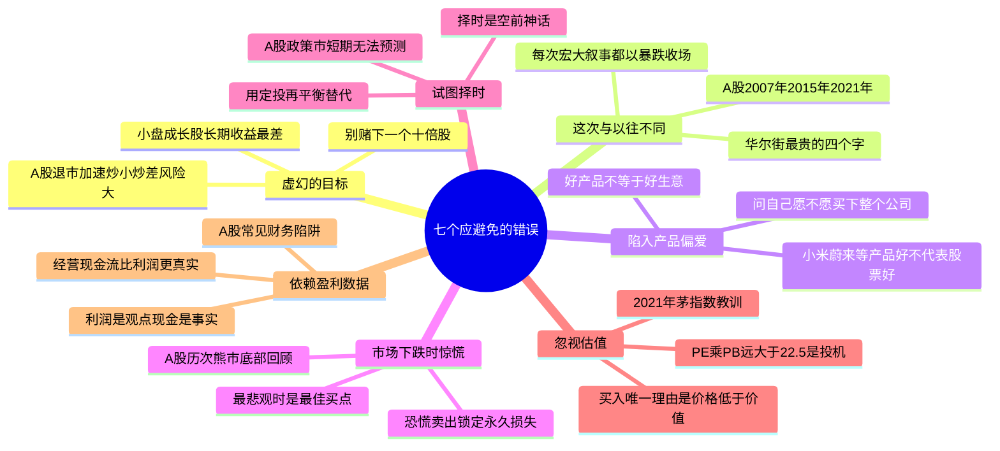
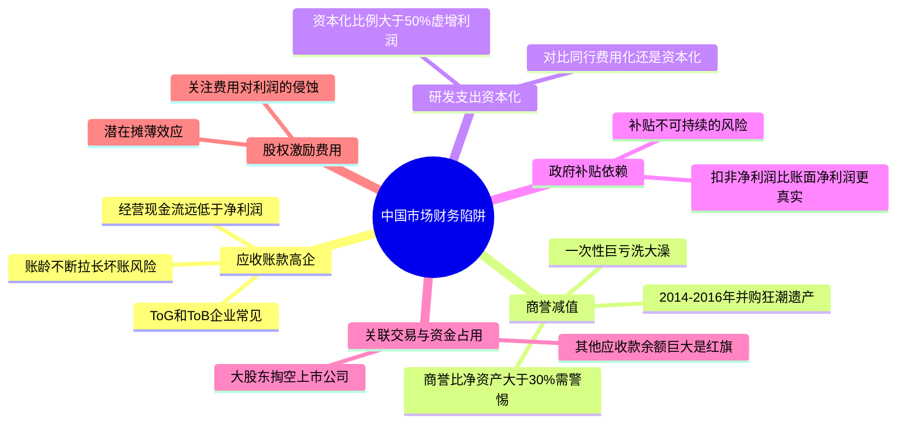
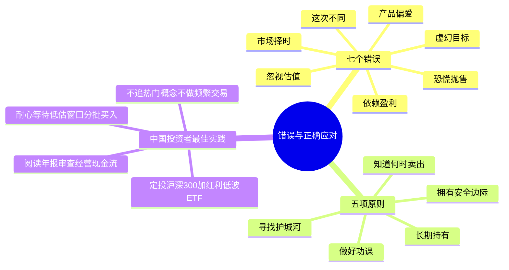

# 《股市真规则》第二章：七个应当避免的错误 —— 2026中国A股与港股适配版

**章首比喻（原书开门见山）**

在很多方面，投资就像网球。

在网球里，拥有一记致命发球和漂亮的反手拍能帮你赢很多分——但所有这些优势，都会被一连串**双误**或非受迫性失误迅速抹掉。五盘比赛打完，往往不是发球最狠的人夺冠，而是失误最少的人夺冠。只要能稳稳把球回过去——不管对手轰什么过来——这就已经价值巨大。

投资几乎一模一样：除非你知道如何避开最常见的错误，否则你组合的回报不会有什么值得兴奋的——因为仅仅几个大错，就需要无数个好股票去弥补。

**中国版导言**：A股和港股市场的波动更剧烈、题材炒作更盛行、散户占比更高。在这样的环境中，不犯大错的重要性远超追求高收益。以下七个错误在全球市场普遍存在，但在中国市场有其独特的表现形式和惨痛案例。

## 投资者清单（章末浓缩·先上总表）

| # | 错误 | 原书英文标题 | 一句话戒条 |
|---|------|-------------|-----------|
| 1 | 虚幻的目标 | Swinging for the Fences | 别拿组合赌“下一个十倍股”；小成长股长期收益反而是最差的类别之一 |
| 2 | 相信这次与以往不同 | Believing That It's Different This Time | 华尔街最贵的四个字；不了解市场历史是严重障碍 |
| 3 | 陷入对公司产品的偏爱 | Falling in Love with Products | 好产品≠好生意；问自己“买得起整个公司我会买吗？” |
| 4 | 在市场下跌时惊慌失措 | Panicking When the Market Is Down | 最便宜的时候恰恰是没人想要的时候；恐慌把波动变永久损失 |
| 5 | 试图选择市场时机 | Trying to Time the Market | 择时是“空前投资神话”；没人能持续踩准进出，收益集中在少数几天 |
| 6 | 忽视估值 | Ignoring Valuation | 买入唯一正当理由是“价格低于价值”，不是等更大傻瓜接盘 |
| 7 | 依赖盈利数据做分析 | Relying on Earnings for the Whole Story | 现金流才是真实度量；EPS可被修饰，经营现金流相对盈利的趋势会提前暴露祸患 |

## 错误一：虚幻的目标（Swinging for the Fences）

### 原书核心论点链
**① 这个错误的本质是什么？**

把投资组合装满高风险、全有或全无的股票——换句话说，每次出手都试图“击出全垒打”——是一条通往投资灾难的确定路线。亏掉的本金需要不成比例的收益才能回本：跌50%需要涨100%，跌70%需要涨233%。几次重锤下来，复利引擎直接报废。

**② 为什么“找下一个十倍股”注定低效甚至危险？**

起步阶段的小公司还没有证明自己是优秀企业；而很多如今的大公司从小公司成长起来的过程中，已经证明了自己——优秀企业保持优秀的概率远大于“从零辨识未来冠军”。

**③ 原书给的硬数据**

小盘成长股是长期持有类股票中长期收益最差的一类。1927年以来，小盘成长股年化回报约9.3%，而标普500约10.7%。不止收益更低，风险更高——很多小公司直接死掉。

**④ 原书例证：纳斯达克摘牌数据**

1997—2002年，纳斯达克每年约8%（约2200家）公司被摘牌。这些公司的股东，很可能在摘牌前就已遭受巨大损失。

### A股/港股映射
- **A股**：每年有数十家公司因财务造假、连续亏损、面值退市等原因被强制退市。2023-2025年退市数量明显增加，注册制下“炒小炒差”的生存空间急剧收窄。
- **北交所/科创板未盈利股**：大量公司市值不足20亿元，流动性极差，一旦业绩不达预期，股价可能下跌80-90%且无法卖出。
- **港股**：大量“细价股”（仙股）长期无人问津，单日跌幅可达90%以上。部分小市值公司存在财务造假、大股东掏空等严重治理问题。

### 中国市场特别提醒
- A股投资者常迷恋“十倍股”故事，追逐“下一个茅台”“下一个腾讯”。但真正伟大的公司往往在你不知不觉中成长，而不是在它刚起步时就能被精准识别。
- **正确的替代目标**：专注于发现“股价已明显低于其内在价值的可靠公司”，而非赌“尚未证明自己的小公司会成为下一个伟大企业”。

⛔ **自检问题**
- 我买这只股票，是因为它有可验证的护城河+可计算的折扣，还是因为我“感觉它会是十倍股”？
- 这只票在我的组合里扮演的是“概率优势仓位”还是“全有或全无的赌注”？

## 错误二：相信这次与以往不同（"It's Different This Time."）

### 原书最著名的一句话
在华尔街，最昂贵的教训就是这四个字：“这次与以往不同。”

**① 为什么会反复掉进同一个坑？**

历史不断地重演，泡沫还是要破裂；不了解市场历史是一个主要的障碍。人性——贪婪/恐惧/FOMO/群体认同——不变；资本逐利→竞争→均值回归的规律不变。每一次泡沫的包装语都类似：“旧规则不再适用于这个新范式”——后来都被证明是错的。

**② 原书经典翻车现场**
- 2000年科网泡沫顶部：半导体板块“不再有周期性”的论调恰恰出现在芯片股高点附近。
- 2001年能源股狂潮：分析师预测20%速度增长，随后股价下跌50-60%。

### A股/港股的历史翻车现场

**案例A：2007年“黄金十年”**
上证指数冲上6124点，市场共识是“中国崛起=股市永远涨”。随后一年暴跌至1664点，跌幅73%。“这次不同”的代价是无数家庭的财富毁灭。

**案例B：2015年“互联网+”与杠杆牛**
创业板市盈率超100倍，市场宣称“互联网颠覆一切，传统估值方法失效”。随后千股跌停、熔断，无数加杠杆的投资者血本无归。

**案例C：2021年“核心资产永远涨”**
“茅指数”和“宁组合”被捧为“可以永远持有的资产”，海天味业市盈率超100倍，中国中免市盈率超60倍。市场宣称“好公司不需要看估值”。随后2-3年深度下跌50-80%。“这次不同”再次被证明是代价最高的四个字。

**案例D：2023-2024年“中国股市失去投资价值”**
沪深300市盈率跌至10倍，市场弥漫“这次真的不一样了——中国经济永远不行了”。但在极度悲观中，大量低估值高股息的优质公司正在被错误定价。格雷厄姆的原则再次应验：极度悲观时往往是买入良机。

### 中国市场特别提醒
- A股牛熊周期更短、更极端。每次牛顶都有“这次不同”的宏大叙事；每次熊底都有“这次真的完了”的绝望论调。
- 记住原书的行动指令：任何时候你听到某人说“这次与以往不同”——关掉手机，去散个步。

⛔ **自检问题**
- 当前推动我买入或卖出的叙事，是靠“数据+估值”支撑的，还是靠“这次规则变了”支撑的？
- 如果我把这段历史对标到过往泡沫的结构里，它长得像哪一页？

## 错误三：陷入对公司产品的偏爱（Falling in Love with Products）

### 原书核心命题
好产品并不必然转化成利润。买股票你买的是生意，不是产品。

**原书例证**：掌上电脑（PDA）曾被认为是一项伟大产品，但掌上电脑公司在2001-2002两年间损失了数亿美元，2003年其股票相比上市时下跌约98%。

**原因**：消费电子类利润薄、竞争激烈；好产品≠有定价权≠有转换成本≠有护城河。

**脱魅检测题**：“这是一个有吸引力的生意吗？如果我买得起的话，我会买下整个公司吗？”如果回答是否定的——放弃这只股票，不管你是多么喜欢这家公司的产品。

### A股/港股映射
- **小米集团（港股）**：产品深受用户喜爱，但硬件毛利率薄，市场竞争激烈。从“产品喜爱”到“投资价值”需要验证其互联网服务和IoT生态是否构成真正的护城河。
- **蔚来/小鹏/理想（新能源车）**：汽车产品本身优秀，粉丝忠诚度高。但汽车行业是资本密集、竞争激烈的苦生意。喜欢车≠应该买股票。
- **泡泡玛特（港股）**：盲盒产品风靡一时，但潮流玩具的生命周期和竞争壁垒需要深入验证。
- **A股消费电子**：很多公司产品炫酷，但利润薄如刀片，依赖大客户，缺乏定价权。

### 中国市场特别提醒
- A股投资者特别喜欢买自己“用过觉得好”的产品公司股票。但作为消费者喜欢和作为股东赚钱是两回事。
- 真正的护城河不在于“产品现在好不好”，而在于“别人能不能轻易复制”。

⛔ **自检问题**
- 我是因为“产品很酷/我很爱用”想买，还是因为“这门生意能持续吐自由现金流+有壁垒”？
- 如果今晚醒来发现股市关门10年、我被迫当这家公司的全资老板——我还乐意持有吗？

## 错误四：在市场下跌时惊慌失措（Panicking When the Market Is Down）

### 原书反直觉但核心的断言
股票最有吸引力的时候，通常是在没有人想买股票的时候——而不是在连理发师都能给股票开出最高价的时候。

**① 恐慌的机制**

当每一个人都在避开购买这些资产的时候，往往是它们最便宜的时候。“最悲观的时候是最好的买入时机。”

**② 为什么“惊慌抛售”是错误而不是谨慎？**

如果你之前的买入是建立在功课+护城河+安全边际之上→下跌=价格噪音（甚至折扣），不是价值毁灭。恐慌抛售=把暂时账面浮亏变成永久确定实亏，而且往往砍在悲观极值附近。

**③ 正确的做法**

先复核：护城河还在吗？现金流假设还成立吗？（成立→持有/分批加；不成立→按“错误/恶化”处理）。别用“受不了了”当卖出理由。把下跌当压力测试：如果你发现自己根本拿不住20%波动，说明要么仓位过重，要么你其实没真懂这家公司。

### A股/港股的极致考验
- **A股2008年**：上证从6124跌至1664，无数投资者在2000点以下割肉，随后市场反弹至3478点。在底部卖出的人永久锁定了亏损。
- **A股2015年股灾**：千股跌停、熔断，流动性枯竭。恐慌中卖出的人在随后蓝筹慢牛中完全踏空。
- **A股2024年初**：沪深300跌至3108点，市场弥漫绝望情绪。但随后9月政策密集出台，短期暴涨。在底部割肉的人错过了最猛烈的反弹。
- **港股2022年10月**：恒指跌至14597点，创2009年以来新低。恐慌中离场的人错过了随后两个月超30%的反弹。

### 中国市场特别提醒
- A股牛短熊长，但每一次熊市底部都是“没人想要股票”的时刻。独立思考、从被遗弃的市场上捡便宜货，是A股超额收益的核心来源。
- 违背自己的性格和意愿需要勇气——但这种勇气是有报酬的。

⛔ **自检问题**
- 我这会儿想卖，是因为“基本面触发条件满足了”，还是因为“看着账户浮亏心里发慌”？
- 如果这只股票明天停牌3年不许交易——我能不能安心睡觉？

## 错误五：试图选择市场时机（Trying to Time the Market）

### 原书态度极为锋利
市场时机的选择是一个空前的投资神话。没有一种策略能持续不断地告诉你何时应当入市、何时清仓离场——而且也没有人能做到这一点。

**证据**：晨星公司所追踪的数以千计的基金中，没有一个在过去20年中能够持续不断地做好市场择时。

**收益不对称原理**：在任何特定年份里，大部分收益来自有限的几天。你一旦踏空那几个关键上涨日（而这些天往往紧跟暴跌之后），长期回报就被永久削掉一大截。

**替代方案**：不靠“猜顶底/预测拐点”指挥进出。改用按估值/安全边际分批建仓（便宜→买；贵→停/减）；定期再平衡（纪律化，把情绪卸下驾驶座）；选股>择时。

### A股/港股的择时教训
- A股短期走势受政策、外资流动、市场情绪影响极大，几乎呈随机游走。试图预测股指短期方向的人，最终多数沦为市场的牺牲品。
- 无数A股投资者试图在牛市顶部逃顶、熊市底部抄底，但真正做到的人极少。更常见的是：牛市中后期追涨加仓，熊市末期恐惧割肉——择时变成了追涨杀跌。
- **最佳替代方案**：定投+再平衡。在A股牛短熊长的环境中，定投可以在漫长熊市中积累大量低价份额，在牛市顶部兑现收益。

⛔ **自检问题**
- 我的交易记录里，“因为觉得要跌所以清/减”和“因为觉得要涨所以追”哪类更多？
- 如果我把过去3年所有“择时操作”去掉，只做买入持有再平衡——结果是更好还是更差？

## 错误六：忽视估值（Ignoring Valuation）

### 原书直给
你买入股票的唯一理由应当是：你认为这家公司现在的股价有投资价值（即价格低于价值）。减少投资风险的路径，就是认真注意估值。不要寄希望于其他投资者会以更高价来接你的盘。

**好公司×天价=烂投资**：“更大的傻瓜理论”不是投资策略。哪怕公司是护城河级优质资产，如果你付的价格是不可持续的高估，你的长期回报照样难看。

**核心纪律**：不估不买。没到你的安全边际区，就等——等本身就是收益的一部分。

### A股/港股血泪教训
- **2021年“茅指数”**：贵州茅台市盈率超60倍，海天味业超100倍，中国中免超60倍。投资者相信“好公司不需要看估值”。随后2-3年深度下跌50-80%。忽视估值是A股投资者最昂贵的错误。
- **2015年创业板**：大量公司市盈率超100倍，甚至亏损公司也被爆炒。股灾后很多股票下跌80-90%。
- **港股2020-2021年新经济股**：快手、美团等上市初期估值极高，随后大幅下跌。

### 中国市场特别提醒
- A股历史上多次泡沫都伴随着“估值不重要”的叙事。历史市盈率（过去10年分位）是A股投资者判断“温度”的重要工具。
- 沪深300市盈率中枢约12-14倍。PE<10倍时是低估区域（如2014年中、2018年底、2024年初）；PE>18倍时进入高估危险区（如2007年、2015年、2021年初）。

⛔ **自检问题**
- 我能写出这只股票我愿意支付的最高价（保守估值）吗？还是我只知道“它应该涨”？
- 如果它明天不涨反而横盘两年——我这笔钱的机会成本划算吗？

## 错误七：依赖盈利数据做分析（Relying on Earnings for the Whole Story）

### 原书核心断言
一家公司财务绩效的真实度量标准是现金流，而不是财务报告的每股盈利（EPS）。**利润是观点，现金是事实。**

**① 为什么EPS会骗人？**

基于每股盈利的会计处理，可以做出公司管理层想要的利润——但现金流要难伪造得多。途径包括：折旧政策选择、费用资本化vs费用化、一次性项目归类、放宽赊销条件→营收/EPS涨了但应收账款膨胀→经营现金流没跟上、股权激励大量发行→EPS表面好看但真实是稀释未来。

**② 关键红旗**

如果公司在经营性现金流停滞或收缩的同时，盈利却在增长——很可能是某些事情正在变坏。因为这意味着：利润在账面上，但钱没回来——增长可能是渠道压货、放宽信用、应收堆积出来的纸面增长。

**③ 你的最小核查动作**

| 步骤 | 看什么 | 红旗 |
|------|--------|------|
| 利润表 | 营收/EPS增长？ | 增长但质量存疑 |
| 现金流量表 | 经营现金流（CFO）是否同步？CFO-CapEx=FCF？ | CFO掉队/FCF长期为负 |
| 资产负债表 | 应收/存货/其他应收款是否异常膨胀？ | 三者增速>>营收增速 |

### A股/港股特别需要警惕的财务陷阱
- **应收账款高企**：大量A股ToG（面向政府）和ToB企业的应收账款占收入比例极高，且账龄不断拉长。利润增长但经营现金流持续为负，是经典的“纸面繁荣”。
- **商誉减值**：2014-2016年A股并购狂潮积累的巨额商誉，在2018-2019年和2022-2023年批量减值。商誉/净资产>30%的公司，某一年可能突然“洗大澡”，一次性亏光数年利润。
- **研发支出资本化**：部分公司研发资本化比例超过50%，将大量当期成本挂为长期资产，利润被严重虚增。应对比同行资本化比例，对高资本化企业打折扣。
- **政府补贴**：很多A股公司扣除政府补贴后实际处于亏损状态。必须看扣非净利润，评估补贴的可持续性。
- **关联交易与资金占用**：大股东通过关联交易、非经营性资金占用等方式掏空上市公司。其他应收款余额巨大且账龄长，是重要的红旗信号。
- **“财务大洗澡”**：在管理层变更或行业低迷时，上市公司倾向于一次性计提巨额减值，为未来利润释放铺路。投资者在巨亏当年需判断：是“真洗澡”（出清风险）还是“藏着更深的雷”。
- **股权激励费用**：大量公司实施股权激励，需关注激励费用对利润的侵蚀和潜在摊薄。

### 中国市场特别提醒
- 在中国，经营现金流/净利润>0.8（过去5年平均）是利润质量的最低及格线。
- 自由现金流/股息支付>1.0是验证分红可持续性的关键。
- 记住原书的终极检验：**利润是观点，现金是事实。** 如果一家公司的净利润长期无法转化为经营现金流，不管它的故事多好听，都应该远离。

⛔ **自检问题**
- 我最近一次看这只股票的现金流量表是什么时候？
- 它的净利润与经营现金流是同向走还是劈叉走？

## 章末：投资者清单——七个应当避免的错误（中国A股与港股版）

**虚幻的目标**：不要试图发现“下一个茅台”或“下一个腾讯”。专注发现股价已低于估值的可靠公司。在A股，炒小炒差正在被退市制度加速淘汰。

**相信这次与以往不同**：2007年“黄金十年”、2015年“互联网+”、2021年“核心资产永远涨”——每一次“这次不同”都以惨烈下跌收场。了解A股和港股的市场历史，才能避免重复错误。

**陷入对公司产品的偏爱**：喜欢小米手机≠该买小米股票；喜欢蔚来汽车≠该买蔚来股票。好产品不等于好生意。问自己“买得起整个公司我会买吗？”

**在市场下跌时惊慌失措**：2008年1664点、2015年2638点、2024年初3100点——每一次极度恐慌都是战略性买入机会。独立思考捡便宜货的勇气是有报酬的。

**试图选择市场时机**：A股政策市特征明显，短期走势几乎无法预测。用定投+再平衡+安全边际替代择时。

**忽视估值**：2021年“茅指数”泡沫的惨痛教训——PE×PB远超22.5的股票，再好的公司也是投机。认真注意估值，不要寄希望于更大傻瓜接盘。

**依赖盈利数据做分析**：在中国，扣非净利润比净利润更诚实；经营现金流比利润更真实；分红比利润更有说服力。记住：利润是观点，现金是事实。

**章收束一句话**：投资的长局胜负，不取决于你抓了几个神话，而取决于你少犯、不反复犯这七类错误。把网球比喻刻进脑子里——失误最少的人赢。在中国市场，这一原则比在任何市场都更为重要。

## 思维导图（按阅读逻辑拆分，A股与港股适配版）

### 图1：七个错误全景——失误最少的人赢

###  图2：A股与港股特有的财务陷阱

###  图3：正确的应对——五项原则 vs 七个错误

 

# 第二章　七个应当避免的错误

> **章首比喻（原书开门见山）**
>
> 在很多方面，投资就像网球。
>
> 在网球里，拥有一记致命发球和漂亮的反手拍能帮你赢很多分——但所有这些优势，都会被一连串**双误（double faults）**或非受迫性失误迅速抹掉。五盘比赛打完，**往往不是发球最狠的人夺冠，而是失误最少的人夺冠**。只要能稳稳把球回过去——不管对手轰什么过来——这就已经价值巨大。
>
> 投资几乎一模一样：**除非你知道如何避开最常见的错误，否则你组合的回报不会有什么值得兴奋的——因为仅仅几个大错，就需要无数个好股票去弥补。**
>
> 所以在深入公司分析流程之前，先把这些**最容易反复踩的坑**钉死。

---

## 投资者清单（章末浓缩·先上总表）

| # | 错误 | 原书英文标题 | 一句话戒条 |
|---|------|-------------|-----------|
| 1 | **虚幻的目标** | *Swinging for the Fences* | 别拿组合赌"下一个微软"；小成长股长期收益反而是最差的类别之一 |
| 2 | **相信这次与以往不同** | *Believing That It's Different This Time* | 华尔街最贵的四个字；不了解市场历史是严重障碍 |
| 3 | **陷入对公司产品的偏爱** | *Falling in Love with Products* | 好产品≠好生意；问自己"买得起整个公司我会买吗？" |
| 4 | **在市场下跌时惊慌失措** | *Panicking When the Market Is Down* | 最便宜的时候恰恰是没人想要的时候；恐慌把波动变永久损失 |
| 5 | **试图选择市场时机** | *Trying to Time the Market* | 择时是"空前投资神话"；没人能持续踩准进出，收益集中在少数几天 |
| 6 | **忽视估值** | *Ignoring Valuation* | 买入唯一正当理由是"价格低于价值"，不是等更大傻瓜接盘 |
| 7 | **依赖盈利数据做分析** | *Relying on Earnings for the Whole Story* | 现金流才是真实度量；EPS可被修饰，经营现金流相对盈利的趋势会提前暴露祸患 |

---

## 错误一：虚幻的目标（Swinging for the Fences / 不要试图通过发现"下一个微软"获利）

### 原书核心论点链

#### ① 这个错误的本质是什么？

> **把投资组合装满高风险、全有或全无（all-or-nothing）的股票——换句话说，每次出手都试图"击出全垒打"——是一条通往投资灾难的确定路线。**

- 你每次买入不是在"博一个神话"，而是在配置**真实的本金**——亏掉的本金需要**不成比例**的收益才能回本：
  - 跌 **50%** → 需要涨 **100%** 才回本
  - 跌 **70%** → 需要涨 **233%** 才回本
- 几次重锤下来，复利引擎直接报废。

#### ② 为什么"找下一个微软"注定低效甚至危险？

> **当一家公司刚起步时，就预言它是不是下一个微软——是相当困难、甚至可以说不可能的。**

- 起步阶段的小公司还没有证明自己是优秀企业；而很多如今的大公司**从小公司成长起来的过程中，已经证明了自己**——优秀企业保持优秀的概率远大于"从零辨识未来冠军"。
- 你更可能买到的是：**一家除了烧钱几乎什么都没做成、最终走向破产或退市的公司**，而不是下一个微软。

#### ③ 原书给的硬数据（Kenneth French / Dartmouth 口径）

> 小盘成长股（**small growth stocks**）是**长期持有类股票中长期收益最差的一类**。

| 类别 | 1927年以来年化回报（约） |
|------|--------------------------|
| **小盘成长股（small growth）** | **≈ 9.3%** |
| **标普500（S&P 500）** | **≈ 10.7%** |

- 表面上只差 **1.4%**，但拉长到几十年，终值差距极大（30年滚存差距可达数成）。
- 更残酷的现实：不止收益更低，风险更高——很多小公司直接死掉。

#### ④ 原书举的例证：纳斯达克摘牌数据

> **1997—2002年，纳斯达克每年约 8%（约 2200 家）公司被摘牌。**
> 这些公司的股东，很可能在这些股票被摘牌之前就已经遭受了巨大的损失。

#### ⑤ 正确的替代目标（原书的正面主张）

> **你应该专注于发现"股价已经低于（或明显低于）其内在价值的可靠公司"。**
> 也就是第一章的五项原则那条路：做功课 → 护城河 → 安全边际 → 持有 → 纪律退出。
> 不是不投小公司，而是：**别用小公司当彩票机**；只有当你能按同样标准验证其生意品质与估值时才碰。

### ⛔ 本节收束：自检问题

- [ ] 我买这只股票，是因为它有**可验证的护城河 + 可计算的折扣**，还是因为我"感觉它会是十倍股"？
- [ ] 这只票在我的组合里扮演的是"概率优势仓位"还是"全有或全无的赌注"？

---

## 错误二：相信这次与以往不同（"It's Different This Time."）

### 原书最著名的一句话

> **在华尔街，最昂贵的教训就是这四个字："这次与以往不同。"**

### 原书推导

#### ① 为什么会反复掉进同一个坑？

> **历史不断地重演，泡沫还是要破裂；不了解市场历史是一个主要的障碍。**
> **你必须成为市场历史的学生，才能弄清楚股市的未来。**

- 人性——贪婪/恐惧/FOMO/群体认同——不变
- 资本逐利→竞争→均值回归的规律不变
- 每一次泡沫的包装语都类似："旧规则（估值/周期/风控）不再适用于这个新范式"——后来都被证明是错的

#### ② 原书给的两个经典"这次不同"翻车现场

**案例 A：2000 年科网泡沫顶部（半导体"不再周期性"论调）**

> 2000 年春天，财经媒体上开始充斥着**"半导体板块的股票将不再有周期性"**的论调——
> 而这**恰恰出现在芯片类股票的高点附近**。

**案例 B：2001 年能源股狂潮 → 随后崩 50%–60%**

> 一年以后（2001 年前后），能源股疯涨，很多分析师预测未来几年这些股票的收益将以 **20% 左右**的速度增长。
> 然而经济增长放缓，能源需求受到打击，而新的产能提高了供应能力。
> 结果：像 **Mirant（米兰特）** 和 **Calpine（卡尔派恩）** 这样的公司股价下跌了 **50%–60%**——在安然崩溃前它们的命运就已经注定了。

（更远的比照：1999 年末《巴伦周刊》封面拿巴菲特开涮问"到底怎么了，沃伦？"哀叹其拒买科技股；三年后纳指跌超 60%，伯克希尔股价反涨约 40%。）

#### ③ 原书给的行动指令

> **任何时候你听到某人说"这次与以往不同"——关掉电视，去散个步。**

### ⛔ 自检问题

- [ ] 当前推动我买入的叙事，是靠"数据+估值"支撑的，还是靠"这次规则变了"支撑的？
- [ ] 如果我把这段历史对标到过往泡沫的结构里（估值分位→叙事→崩塌），它长得像哪一页？

---

## 错误三：陷入对公司产品的偏爱（Falling in Love with Products）

### 原书核心命题

> **好产品并不必然转化成利润。**
> 买股票你买的是**生意**，不是产品。

### 展开

#### ① 最容易陷进去的险境之一

> 几年前，当人们经介绍买了**掌上电脑（PDA）**以后，有谁不认为掌上电脑是一项伟大的产品？
> 看起来似乎很合乎逻辑——但这个好产品**不一定**会转化成利润。

原书给出的结果：
- 掌上电脑公司 **2001–2002 两年间损失了数亿美元**
- **2003 年中，其股票相比上市时下跌了约 98%**

#### ② 为什么"好产品→好投资"会骗人？

- 消费电子类往往**利润薄、竞争激烈**，产品再酷也可能陷入价格战/快速迭代/库存减值
- 好产品 ≠ 有定价权 ≠ 有转换成本 ≠ 有护城河
- 新技术/新产品只有在它能沉淀成上述结构性壁垒时，才对股东值钱

#### ③ 原书给你的"脱魅检测题"（每次心动就问）

> 当你研究股票的时候，问一问自己：
>
> **"这是一个有吸引力的生意吗？如果我买得起的话，我会买下整个公司吗？"**
>
> 如果回答是否定的——**放弃这只股票**，不管你是多么喜欢这家公司的产品。

### ⛔ 自检问题

- [ ] 我是因为"产品很酷/我很爱用"想买，还是因为"这门生意能持续吐自由现金流+有壁垒"？
- [ ] 如果今晚醒来发现股市关门 10 年、我被迫当这家公司的全资老板——我还乐意持有吗？

---

## 错误四：在市场下跌时惊慌失措（Panicking When the Market Is Down）

### 原书反直觉但核心的断言

> **股票最有吸引力的时候，通常是在没有人想买股票的时候——而不是在连理发师都能给股票开出最高价的时候。**

（注："理发师"即经典隐喻——当街头最不炒股的人都开始给你荐股，那是泡沫顶端信号；当所有人避之不及，那才是折扣区。）

### 展开

#### ① 恐慌的机制

> 投资时往往有一种诱惑：**就是要证实或求证其他人也在做同样的事情**（从众的安全感幻觉）。
> 但历史再三告诉我们的恰恰相反：
> **当每一个人都在避开购买这些资产的时候，往往是它们最便宜的时候。**

- 引述精神（原书提到约翰·邓普顿式的思想）：**"最悲观的时候是最好的买入时机。"**

#### ② 为什么说"惊慌抛售"是错误而不是谨慎？

- 如果你之前的买入是建立在**功课 + 护城河 + 安全边际**之上 → 下跌 = 价格噪音（甚至折扣），不是价值毁灭
- 恐慌抛售 = 把**暂时账面浮亏**变成**永久确定实亏**，而且往往砍在悲观极值附近，后面涨回去也与你无关
- 原书措辞：

> **违背自己的性格和意愿需要勇气——但这种勇气是有报酬的。**
> **如果你善于独立思考，并从被其他人遗弃的市场上捡到便宜货，你就会成为一个好的投资者——这远比按照财经报刊的短暂吹捧而购买股票要强得多。**

#### ③ 正确的做法（分层）

1. **先复核**：护城河还在吗？现金流假设还成立吗？（成立→持有/分批加；不成立→按"错误/恶化"处理）
2. **别用"受不了了"当卖出理由**——把决策权交还给第一章的触发器清单
3. 把下跌当**压力测试**：如果你发现自己根本拿不住 20% 波动，说明要么仓位过重，要么你其实没真懂这家公司

### ⛔ 自检问题

- [ ] 我这会儿想卖，是因为"基本面触发条件满足了"，还是因为"看着绿数字心里发慌"？
- [ ] 如果这只股票明天停牌 3 年不许交易——我能不能安心睡觉？

---

## 错误五：试图选择市场时机（Trying to Time the Market）

### 原书态度极为锋利

> **市场时机的选择是一个空前的投资神话（one of the all-time great myths of investing）。**
> **没有一种策略能持续不断地告诉你何时应当入市、何时清仓离场——而且也没有人能做到这一点。**
> **任何人说 otherwise，通常都有一门择时服务要卖你。**

### 展开

#### ① 证据口径（晨星追踪结论）

> 晨星公司所追踪的**数以千计的基金**中，**没有一个在过去 20 年中能够持续不断地做好市场择时**。

→ 这说明不是"你还不够聪明"，而是这件事本身不可稳定复制。

#### ② 收益不对称原理（原书解释为什么择时特别危险）

> 在任何特定年份里，**大部分收益（不论正或负）来自有限的几天**。
> 这意味着：市场择时的风险比依靠长期持有要高得多——
> 因为你一旦踏空那几个关键上涨日（而这些天往往**紧跟暴跌之后**），长期回报就被永久削掉一大截。

示意逻辑：

暴跌 -30% → 暴涨 +25%（两天内） → 你如果因恐惧在谷底卖出/空仓，这两天的反弹你全没吃到

#### ③ 替代方案（原书隐含但明确的导向）

- 不靠"猜顶底/预测拐点"指挥进出
- 改用：
  - **按估值/安全边际分批建仓**（便宜→买；贵→停/减）
  - **定期再平衡**（纪律化，把情绪卸下驾驶座）
  - **选股 > 择时**：管好"买什么+什么价买+何时该卖"，比猜"大盘几月见顶"有效得多

### ⛔ 自检问题

- [ ] 我的交易记录里，"因为觉得要跌所以清/减"和"因为觉得要涨所以追"哪类更多？
- [ ] 如果我把过去 3 年所有"择时操作"去掉，只做买入持有再平衡——结果是更好还是更差？

---

## 错误六：忽视估值（Ignoring Valuation）

### 原书直给

> **你买入股票的唯一理由应当是：你认为这家公司现在的股价有投资价值（即价格低于价值）。**
> **减少投资风险的路径，就是认真注意估值。**
> **不要寄希望于其他投资者会以更高价来接你的盘——即使你买的是好公司的股票，也不要这样。**

### 展开

#### ① 好公司 × 天价 = 烂投资

- 原书反复戳破的幻想：**"更大的傻瓜理论"不是投资策略**
- 哪怕公司是护城河级优质资产，如果你付的价格是**不可持续的高估**（PE/PB/现金流倍数把未来多年乐观预期全透支），你的长期回报照样难看

#### ② 原书给的实用抓手

- **历史估值区间**（如看过去 10 年 PE / PB 分位）至少让你知道：现在是相对便宜还是相对贵
- 但更根本的：要回到**保守内在价值估算**（现金流思路 / 多重交叉验证），别把"最佳情景"当基准
- 核心纪律一句话：**不估不买。没到你的安全边际区，就等——等本身就是收益的一部分。**

### ⛔ 自检问题

- [ ] 我能写出这只股票我愿意支付的最高价（保守估值）吗？还是我只知道"它应该涨"？
- [ ] 如果它明天不涨反而横盘两年——我这笔钱的机会成本划算吗？

---

## 错误七：依赖盈利数据做分析（Relying on Earnings for the Whole Story）

### 原书核心断言

> **一家公司财务绩效的真实度量标准是现金流，而不是财务报告的每股盈利（EPS）。**
> **利润是观点，现金是事实。**

### 展开

#### ① 为什么 EPS 会骗人？

> 基于每股盈利的会计处理，可以做出公司管理层**想要的利润**——但现金流**要难伪造得多**。

途径包括但不限于（原书精神/常见红旗）：
- 折旧政策选择 / 费用资本化 vs 费用化
- 一次性项目归类 / 非经常性损益摆弄
- 放宽赊销条件 → 营收/EPS 涨了，但**应收账款膨胀** → 经营现金流没跟上
- 股权激励大量发行 → EPS 表面好看，但真实是**稀释未来你**

#### ② 现金流量表怎么当照妖镜

> 你可以通过**现金流量表**判断一家公司的财务健康状况，并且通过观察**经营性现金流（CFO）相对盈利的趋势**，在一些会导致公司崩溃的问题爆发前就发现它们。

关键红旗（原书明确点出）：

> **如果公司在经营性现金流停滞或收缩的同时，盈利却在增长——很可能是某些事情正在变坏。**

因为这意味着：利润在账面上，但**钱没回来**——增长可能是渠道压货、放宽信用、应收堆积出来的纸面增长。

#### ③ 你的最小核查动作（三张表联动）

| 步骤 | 看什么 | 红旗 |
|------|--------|------|
| 利润表 | 营收/EPS 增长？ | 增长但质量存疑 |
| 现金流量表 | 经营现金流（CFO）是否同步？CFO − CapEx = FCF？ | CFO 掉队 / FCF 长期为负 |
| 资产负债表 | 应收/存货/其他应收款是否异常膨胀？ | 三者增速 >> 营收增速 |

### ⛔ 自检问题

- [ ] 我最近一次看这只股票的现金流量表是什么时候？
- [ ] 它的净利润与经营现金流是同向走还是劈叉走？

---

## 章末：投资者清单——七个应当避免的错误（原书浓缩·可直接贴墙）

1. **虚幻的目标**：不要试图通过发现"下一个微软"获得巨额收益；专注发现**股价已低于估值的可靠公司**。小的全有或全无赌注是长期收益杀手。
2. **相信这次与以往不同**：了解市场历史才能避免重复错误；听见"这次不同"→关电视散步去。
3. **陷入对公司产品的偏爱**：好产品≠好生意；问"这是个有吸引力的生意吗？买得起整个公司我会买吗？"否→放弃。
4. **在市场下跌时惊慌失措**：最便宜的时候恰恰是没人想要的时候；恐慌把波动变永久损失；独立思考捡便宜货才是超额来源。
5. **试图选择市场时机**：择时是神话；没人能持续踩准；用分批+再平衡+安全边际替代预测。
6. **忽视估值**：买入唯一正当理由是"价格低于价值"；别赌更大傻瓜接盘。
7. **依赖盈利数据做分析**：现金流才是真实度量；EPS 可被修饰，CFO 相对 EPS 的趋势会提前暴露祸患——盈利涨但经营现金流掉队＝红旗。

> **章收束一句话**：投资的长局胜负，不取决于你抓了几个神话，而取决于你**少犯、不反复犯**这七类错误。把网球比喻刻进脑子里——**失误最少的人赢**。