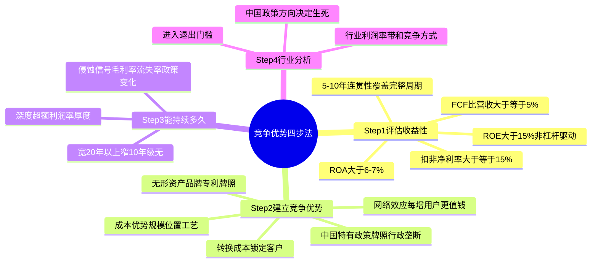
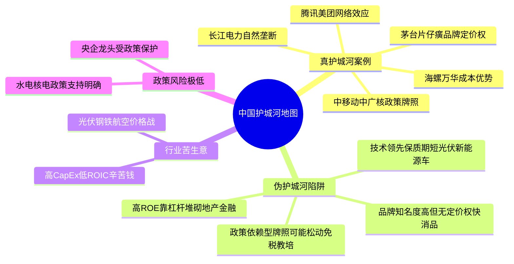
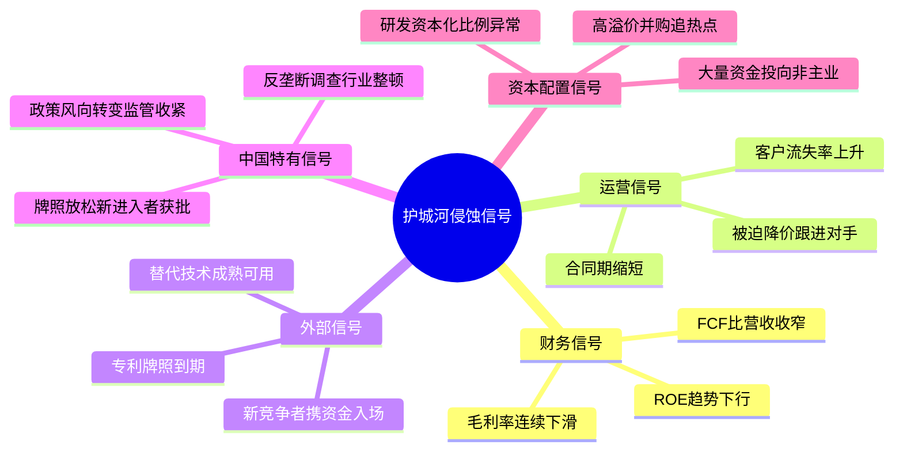

# 《股市真规则》第三章：竞争优势（经济护城河）——晨星体系四步诊断法（2026中国A股与港股适配版）

**章首命题（原书精神）**

投资者习惯通过“哪家公司的利润增长最快”来挑股票，然后假定这种增长会持续——但回头看，当年最令人振奋的公司日后往往表现最差。

原因很简单，也是自由市场的铁律：

成功会吸引竞争，正如黑夜跟在白天后面。利润越丰厚，竞争者来得越猛、越快。大多数高盈利企业在经历一段时间辉煌后，盈利会被竞争者一点点啃回去，趋于均值回归。

所以你要找的根本不是“增长最快”，而是：有没有结构性东西把竞争者挡在外面，让超额利润活得比一个季度更久？——这就是**竞争优势 / 经济护城河**。

**中国版导言**：这一章的四步诊断法在全球市场完全适用，但在中国需额外关注三类特殊问题：一是政策牌照/行政垄断是中国独有的护城河来源（如烟草、免税、电信、军工）；二是国企与民企的治理差异影响护城河的持续性；三是中国部分行业的“内卷式竞争”会加速侵蚀护城河。


## 章内四步框架（原书给出的分析路径）
```
竞争优势分析（四步走，次序不能乱）
│
├── Step 1 评估收益性 （先找“结果证据”：它真的长期赚超额回报吗？）
├── Step 2 建立竞争优势 （追问“原因”：凭什么挡住竞争者？壁垒从哪来？）
├── Step 3 它能持续多久 （定“寿命”：宽/窄/无——深度×宽度）
└── Step 4 行业分析 （看“池塘”：这行业允不允许护城河存活？）
```


四步的逻辑关系：Step1 筛掉“看起来厉害但不是真护城河”的 → Step2 解释“为什么”并区分真/伪壁垒 → Step3 判断能守几年还是几十年 → Step4 确认行业结构不拖后腿。**任何一步不过关，它就不属于“长期复利机器”候选池。**


## Step 1　评估收益性

**原书定位**：要找到公司拥有竞争优势的“确实证据”，第一步不是定性讲故事，而是先拉财务数据，看它过去到底有没有持续产生稳定超额回报。

### 1.1 为什么要“评估收益性”而不是直接看增长？
断定一家公司未来有没有竞争优势相当困难——但你可以先问一个更硬的、可核验的问题：**过去它有没有能力持续赚取稳定收益、产生持续稳定的现金流？**

找的是：利润超过资本成本、能生成实质性自由现金流的公司。高利润 ≠ 护城河；连贯、多年、现金跟得上利润才像。

### 1.2 四个核心仪表 + 一个进阶（原书逐一列出，中国版补充）

**① 自由现金流 FCF —— “印钞机探测器”**
| 项目 | 原书定义/算法 | 原书经验阈值 |
|------|-------------|------------|
| FCF | FCF ＝ 经营性现金流（CFO）－ 资本支出（CapEx） | FCF/销售收入 ≈ 5% 或更多 → “印钞机” |
- **中国市场提醒**：A股大量重资产公司（钢铁、化工、航空）CapEx巨大，FCF常年为负不一定是欺诈，但意味着你需要更严格的安全边际。重点看FCF/收入的稳定性和趋势。

**② 净利润/净利率 —— “经营健康的基本体温”**
| 项目 | 算法 | 阈值 |
|------|------|------|
| 净利率 | 净利润 ÷ 销售收入 | 持续 ≥ 15% → 经营活动总体良好 |
- **中国市场提醒**：必须用**扣非净利润**代替账面净利润！A股大量公司依赖政府补贴、资产处置等非经常性损益维持净利润。扣非净利率才是真实的经营表现。

**③ 净资产收益率 ROE —— “股东资本的回报效率”**
| 项目 | 算法 | 阈值 |
|------|------|------|
| ROE | 净收益÷所有者权益 | 持续 > 15% → 可能有竞争优势 |
- **中国市场提醒**：高ROE必须追问是否靠超高杠杆堆出来的。中国地产、金融、部分国企长期依赖高杠杆维持ROE，去杠杆周期中ROE会剧烈下滑。结合有息负债率和利息覆盖倍数一同审视。

**④ 资产收益率 ROA —— “资产→利润”的转化效率**
| 项目 | 算法 | 阈值 |
|------|------|------|
| ROA | 净收益÷总资产 | 6%～7% 可作粗略基准 |

**⑤〔进阶〕ROIC vs WACC —— “最久经考验的盈利能力度量”**
- ROIC ＝ NOPAT ÷ 投入资本
- 核心判据：ROIC > WACC → 公司在创造经济价值；利差越大越像真护城河。
- **中国市场提醒**：国企的WACC通常低于民企（融资成本低），这是国企的天然优势，但不等于护城河。重点看ROIC是否持续显著高于同行。

### 1.3 时间跨度与连贯性的硬性要求
对这四个指标，你要考察的不止一年——“连贯性”相当重要。
- **5年是最小的估值时间段**
- 如果可能，考察数据最好倒回去**10年**
- **中国特别要求**：必须覆盖一个完整的经济周期（至少7年），包括下行阶段。因为A股盈利周期波动大，单看繁荣期数据极具欺骗性。

### 1.4 Step1 最小实操清单（中国版）

☐ 拉年报：过去5–10年序列（收入/CFO/CapEx/扣非净利润/股东权益/总资产）
☐ 算年度：FCF、FCF/营收、扣非净利率、ROE、ROA
☐ 画线看图：四项是否“高且稳”？（不是某年爆表，而是多年平台）
☐ 同行对照：它的ROE/净利率/FCF%在行业里排哪段？
☐ 中国额外审查：扣非净利润与净利润差距是否过大？政府补贴占比？
☐ 初 verdict：
□ 四项里有 ≥2 项长期偏弱/趋势明显下行 → 淘汰（不用进 Step2）
□ 有连贯的高回报信号 → 进 Step2 追“为什么”
 


## Step 2　建立竞争优势

**原书定位**：Step1 给了你“结果”（它可能真有超额回报）；Step2 回答的是——**为什么？是什么阻止了一个聪明的、资金充裕的竞争者进来抢它的利润？**

### 2.1 建立竞争优势的五条途径（原书逐条展开+中国案例）

**途径① 通过出众的技术或特色 → 创造“真实的差异化产品”**
- 原书警告：保持领先的技术优势短时间内会带来利润，但生命周期很短暂。除非你足够熟悉行业内部运作方式，否则应提防“依靠技术创新保持竞争优势”的公司。
- **中国市场典型案例**：
  - 光伏行业：隆基绿能一度靠单晶硅技术领先获得超额利润，但随着通威、晶科、天合等全面跟进，技术差距缩窄，行业陷入惨烈价格战。技术领先的保质期在光伏行业只有2-3年。
  - 消费电子：立讯精密靠精密制造能力和客户绑定（苹果链），其护城河更多来自转换成本（客户认证+产能规模），而非纯技术。
- ⚠️ **伪护城河信号**：“我们有最先进技术”——技术可被迭代/反向工程/绕开；进入门槛低而回报高→吸引最强竞争。

**途径② 通过一个信任的品牌或声誉 → 创造“可感知的差异化”（定价权的真正来源）**
- 原书核验原则：判断一个品牌的价值，要看这个品牌能为公司赚多少钱——而不是消费者嘴上多信任它。
- **中国真品牌（品牌=真护城河）**：
  - 贵州茅台：出厂价与市场价存在巨大价差，消费者愿付远超成本的溢价。品牌是“社交货币”+收藏属性，竞争者无法复制。
  - 农夫山泉：水源地+“农夫山泉有点甜”的心智占有，定价权强。
  - 片仔癀：绝密配方+文化属性，提价能力显著。
- **中国伪品牌（品牌≠护城河）**：
  - 很多快消品品牌知名度高，但消费者不会为品牌支付显著溢价（如方便面、普通啤酒）。它们靠渠道渗透而非品牌溢价生存。
- **港股案例**：泡泡玛特（IP驱动的品牌溢价）、海底捞（服务品牌带来的溢价和复购）。

**途径③ 降低成本 → 以更低价格提供相似产品/服务（成本优势）**
- 原书拆分：改进流程（细微可模仿）vs 扩大规模→规模优势（最基本、最难被快速超越）。
- **中国成本优势典范**：
  - 海螺水泥：T型战略（长江水运+安徽石灰石资源+沿江沿海布局），吨成本行业最低，规模优势极难复制。
  - 万华化学：全球MDI成本最低，技术壁垒+规模优势+一体化。
  - 中国神华：煤电运一体化，长协占比高，成本锁定。
  - 申洲国际（港股）：服装代工极致效率，规模+自动化+垂直整合，新进入者无法在成本和交期上匹敌。
- 成本优势的终极测试：即使它把价格压到让同行难受的位置，它自己还能赚，而新进入者进来就会亏。

**途径④ 创造高转换成本 → 锁定消费者**
- 机制：让消费者换供应商很痛苦/很贵/很耗时 → 被“锁住”。
- **中国高转换成本案例**：
  - 企业软件/ERP：用友、金蝶。客户业务流程嵌入、员工培训、数据迁移成本极高。
  - 医疗器械：迈瑞医疗。医院设备采购后，培训、维护、试剂耗材形成绑定。
  - 工业自动化：汇川技术。伺服/变频器嵌入客户产线，替换=调试+停机成本。
  - 腾讯（港股）：微信社交关系链，个人更换通讯工具=丢失所有社交连接。
- 判断维度：产品/服务是否需要客户做大量培训？是否和客户业务流程/数据/系统绑在一起？是否倾向签长期合约？

**途径⑤ 建立高进入壁垒 → 把竞争者挡在门外**
- **中国市场特有高壁垒**：
  - 政策牌照：免税（中国中免，但牌照在松动）、电信运营商（中国移动/电信/联通，频谱牌照+网络覆盖）、军工（信息不透明但准入极严）、烟草（不上市）。
  - 自然垄断/行政垄断：长江电力（流域唯一）、国家电网/南方电网（不上市，但相关设备商受益）、核电双寡头（中国核电/中广核）。
  - 网络效应：腾讯微信（社交网络）、美团（外卖三方网络）、阿里巴巴（电商双边平台）。
  - 专利/配方：片仔癀（绝密）、云南白药（绝密）。

### 2.2 把五条途径收拢成“四条真护城河+一条中国特有”

| 真护城河 | 对应途径 | 核验一句话 | 中国市场代表 |
|----------|----------|-----------|------------|
| ① 无形资产（品牌溢价/专利/牌照） | ②+⑤ | 提价不流失？保护期多久？到期后怎么办？ | 茅台、片仔癀、长江电力 |
| ② 转换成本 | ④ | 流失率？迁移成本？合同期？嵌进客户流程多深？ | 用友、迈瑞、汇川技术 |
| ③ 网络效应 | ⑤ | 双侧增长？每新增用户是否让产品更值钱？ | 腾讯、美团、阿里 |
| ④ 成本优势（规模/流程/位置） | ③ | 单位成本 vs 同行？新进入者能否砸钱复制？ | 海螺水泥、万华化学、申洲国际 |
| **⑤ 政策/牌照壁垒（中国特有）** | ⑤ | 政策变化风险？牌照稀缺性趋势？ | 中国移动、中广核、免税牌照 |

### 2.3 Step2 终极拷问
**“什么阻止了一个聪明的、资金充裕的竞争者进来抢这块利润？”**
- 答得出上述四条（或五条）的可验证机制 → 过关。
- 答成“我们技术最先进/品牌最响/市占第一” → 不过关（这些都是结果或标签，不是壁垒机制）。


## Step 3　它能持续多久（优势能持续多久）

**原书定位**：同样叫“有优势”，有的能守20年+，有的3-5年就卷没。你需要在两个维度上想清楚：

| 维度 | 问法 |
|------|------|
| 深度 | 公司能赚多少超额利润？（利润率厚度/定价权强度） |
| 宽度 | 能保持高于平均水平多长时间？（＝竞争优势的寿命） |

### 3.1 持久性排序直觉（从高持续时间→低，加入中国要素）

| 壁垒 | 持续时间倾向 | 中国市场特别提醒 |
|------|------------|----------------|
| 品牌（消费绑定/定价权型） | ★★★★ 很长 | 白酒/中药等中国独有消费品牌，文化属性强，持续时间可能更长 |
| 转换成本（嵌进企业流程/数据） | ★★★★ 很长 | 企业软件/医疗器械，替换=业务中断，客户宁可忍受 |
| 规模/成本优势 | ★★★ 较长 | 规模可建，但需要时间+资本；中国部分行业因过度投资导致“规模不经济” |
| 政策牌照/专营权 | ★★★ 但有政策风险 | 中国政策变化是最大变量：免税牌照在松动、教培牌照一夜清零 |
| 专利/配方 | ★★★ 但有明确到期日 | 片仔癀等绝密配方无到期日；普通专利药有悬崖 |
| 出众技术本身 | ★★ 最短 | 光伏、新能源车等技术迭代极快的行业，技术领先窗口仅2-3年 |

### 3.2 晨星口径：宽/窄/无

| 评级 | 含义 | 你的操作 | 中国市场参考 |
|------|------|----------|------------|
| Wide moat 宽护城河 | 预计能守20年及以上 | 长期持有候选（仍须安全边际） | 茅台、长江电力、腾讯 |
| Narrow moat 窄护城河 | 能守约10年级，但不够铜墙铁壁 | 可做，但壁垒更脆弱→估值折扣更厚、跟踪更勤 | 海螺水泥、美的集团、招商银行 |
| No moat 无护城河 | 超额利润会较快被竞争抹平 | 别用“长期信仰”扛；当周期/烟蒂对待 | 光伏制造、钢铁、航空 |

### 3.3 侵蚀信号清单（每季度/每次财报后过一遍，中国版强化）
- [ ] 毛利率、扣非净利率是否连续下滑（尤其行业没崩时）？
- [ ] 政策风向是否在变（牌照、补贴、监管）？
- [ ] 客户流失率是否上行？合同期是否缩短？
- [ ] 专利/配方到期逼近？替代技术是否成熟到可用？
- [ ] 管理层资本配置：是否把钱耗在不能巩固壁垒的并购上（追热点买增长）？
- [ ] 同行是否出现“可比功能+更低价格”组合拳？
- [ ] **中国特有**：是否出现新的政策壁垒/反垄断调查/行业整顿？


## Step 4　行业分析

**原书定位**：护城河不是长在真空里。有些行业就是比其他行业更容易赚钱，但“行业有吸引力”≠“每只股都好”——你要做的是：对竞争前景有个把握，不盲入不了解的池塘。

### 4.1 原书给的两层任务
- **第一层**：对行业有个大致印象（增长/收缩/周期摆动？大多数公司在赚钱还是亏损？是不是过度竞争？）
- **第二层**：汇总统计（调查十几家公司就有感觉：平均增长率/毛利率/ROE，看销售收入或市值排行榜）

### 4.2 最快上手的“行业体检三连”（中国版）

| 检查 | 好信号（壁垒友好） | 红旗（商品化/苦生意） |
|------|-------------------|----------------------|
| 全行业利润率带 | 长期宽且稳定、少数几家明显更高 | 全行业净利率长期薄（<5-8%）、波动大、价格战频繁 |
| 资本开支强度 vs 回报 | 低CapEx高ROIC/或高CapEx但ROIC也高且稳 | 高CapEx+低ROIC=“辛苦钱且难护城河” |
| 进入/退出门槛 | 巨额前置资本/牌照/网络密度/客户锁定 | 门槛低→利润磁吸新玩家→均值回归快 |
| **中国特有：政策方向** | 国家战略支持、准入门槛高（核电、水电、电信） | 政策打压、限制发展、反垄断重点（教培、互联网平台、地产） |

### 4.3 中国市场行业分类（哪些行业更容易出护城河）

| 护城河友好度 | 行业举例 | 原因 |
|------------|----------|------|
| **高** | 高端白酒、水电、电信、社交平台、机场、核电 | 自然垄断/牌照/品牌/转换成本/网络效应 |
| **中** | 白家电、水泥、银行、保险、医疗器械、乳制品 | 规模+品牌+转换成本，但竞争更激烈 |
| **低** | 光伏制造、钢铁、航空、养猪、服装代工（非龙头） | 产品同质化、产能过剩、价格战 |
| **极低** | 教培、部分互金、电子烟 | 政策风险极大，护城河可被一夜清零 |

**原书结尾句（中国同样适用）**：“尽管行业是否有吸引力并不能告诉你企业的全部，但对竞争前景有一个判断是相当重要的。一些行业就是比其他行业赚钱更容易。”


## 投资者清单：竞争优势（章末浓缩——中国A股与港股版总结）

✅ **超额利润吸引竞争（夜跟随昼）**→ 所以“增长最快”不是筛选器，“能守住利润”才是。

✅ **Step1 评估收益性**：至少5年最好10年；看FCF/营收（≈5%+）、扣非净利率（≥15%）、ROE（>15%，并确认非高杠杆驱动）、ROA（>6%-7%）的连贯性。**中国特别要求：覆盖完整经济周期（≥7年），用扣非净利润。**

✅ **Step2 建立竞争优势**：追问“为什么竞争者抢不走”→ 壁垒落在四条真护城河（无形资产/转换成本/网络效应/成本优势）+一条中国特有（政策牌照壁垒）。技术领先本身通常最短命。

✅ **Step3 能持续多久**：宽（20年+）/窄（~10年）/无。盯侵蚀信号（毛利率趋势、流失率、专利悬崖、**政策变化**、资本配置）。

✅ **Step4 行业分析**：有些行业天生更出护城河（中国：白酒、水电、社交平台）；有些行业天生苦生意（光伏、钢铁、航空）。政策方向决定护城河的生死。


## 附录：竞争优势四步工作表（中国A股与港股版）

【候选公司】_______________ 【行业】___________ 【日期】_____
【数据源】年报（拉5-10年序列）

── Step1 评估收益性 ───────────────────────────────
年份 | 20__ | 20__ | 20__ | 20__ | 20__ |
FCF/营收 | % | % | % | % | % | 均值% ≥5%? □Y □N
扣非净利率 | % | % | % | % | % | 均值% ≥15%? □Y □N
ROE | % | % | % | % | % | 均值% >15%? □Y □N（杠杆异常？）
ROA | % | % | % | % | % | 均值% >6%-7%? □Y □N
连贯性：□高且稳 □跳涨跳跌 □恶化
中国额外审查：扣非与净利润差距____% 政府补贴占比____%
Step1 verdict：□进Step2 □淘汰（原因：）

── Step2 建立竞争优势 ─────────────────────────────
□ 无形资产：品牌溢价证据（）专利/牌照（期限）
□ 转换成本：流失率 合同期 迁移成本证据（）
□ 网络效应：双侧？每增用户→更值钱？竞品撬动难度（/10）
□ 成本优势：单位成本 vs 同行（）规模/位置可持续？□Y□N
□ 中国特有：政策牌照（）行政垄断（）国企优势（）
终极拷问答案（写不出=无护城河）：_________________________
Step2 verdict：□真壁垒可验证 □不可验证→淘汰

── Step3 能持续多久 ───────────────────────────────
评级：□宽（20年+） □窄（~10年） □无
深度（超额利润率厚度）：________________________________________
侵蚀信号：毛利率趋势__ 流失率__ 专利到期__ 政策风险__ 资本配置告警__

── Step4 行业分析（池塘体检）──────────────────────
行业阶段：□增长 □成熟 □周期下行 □碎片化混战
全行业利润率带：薄/中/厚 竞争方式：□差异化壁垒 □同质化价格战
进入门槛：□高 □中 □低 退出难度：□高 □中 □低
中国政策方向：□支持 □中性 □打压/限制
结论：□行业允许护城河存活 □行业偏苦生意 □政策风险极大

── Final ──────────────────────────────────────────
□ 通过四步 → 进入估值/安全边际（第9-10章）
□ 淘汰原因：_____________________________________________
text


## 思维导图（按阅读逻辑拆分）

### 图1：竞争优势四步诊断法全景


### 图2：中国市场的特殊护城河与陷阱

### 图3：侵蚀信号与退出触发



 


# 第三章　竞争优势（经济护城河）——晨星体系四步诊断法

> **章首命题（原书精神）**
>
> 投资者习惯通过"**哪家公司的利润增长最快**"来挑股票，然后假定这种增长会持续——但回头看，当年最令人振奋的公司日后往往表现最差。
>
> 原因很简单，也是自由市场的铁律：
>
> > **成功会吸引竞争，正如黑夜跟在白天后面。利润越丰厚，竞争者来得越猛、越快。大多数高盈利企业在经历一段时间辉煌后，盈利会被竞争者一点点啃回去，趋于均值回归。**
>
> 所以你要找的根本不是"增长最快"，而是：**有没有结构性东西把竞争者挡在外面，让超额利润活得比一个季度更久？**——这就是**竞争优势 / 经济护城河**。

---

## 章内四步框架（原书给出的分析路径）

text
竞争优势分析（四步走，次序不能乱）
│
├── Step 1 评估收益性 （先找"结果证据"：它真的长期赚超额回报吗？）
├── Step 2 建立竞争优势 （追问"原因"：凭什么挡住竞争者？壁垒从哪来？）
├── Step 3 它能持续多久 （定"寿命"：宽/窄/无——深度×宽度）
└── Step 4 行业分析 （看"池塘"：这行业允不允许护城河存活？）

> 四步的逻辑关系：**Step1 筛掉"看起来厉害但不是真护城河"的** → **Step2 解释"为什么"并区分真/伪壁垒** → **Step3 判断能守几年还是几十年** → **Step4 确认行业结构不拖后腿**。任何一步不过关，它就不属于"长期复利机器"候选池。

---

## Step 1　评估收益性

> 原书定位：要找到公司拥有竞争优势的**"确实证据"**，第一步不是定性讲故事，而是**先拉财务数据，看它过去到底有没有持续产生稳定超额回报**。

### 1.1 为什么要"评估收益性"而不是直接看增长？

- 断定一家公司**未来**有没有竞争优势相当困难——但你可以先问一个更硬的、可核验的问题：
  > **过去它有没有能力持续赚取稳定收益、产生持续稳定的现金流？**
- 找的是：**利润超过资本成本、能生成实质性自由现金流**的公司
- 高利润 ≠ 护城河；**连贯、多年、现金跟得上利润**才像

---

### 1.2 四个核心仪表 + 一个进阶（原书逐一列出）

#### ① 自由现金流 FCF —— "印钞机探测器"

| 项目 | 原书定义 / 算法 | 原书给出的经验阈值 |
|------|----------------|-------------------|
| **FCF** | **FCF ＝ 经营性现金流（CFO）－ 资本支出（CapEx）**<br>本质：再投资后还有多少"真金白银"可拿走而不伤核心业务 | **FCF / 销售收入 ≈ 5% 或更多 → 你就找到了一台"印钞机"**<br>（这类公司往往只出现在高质量标的里，如标普500成分股中的少数） |

- 关键动作：不只看绝对数，要看 **FCF 占收入的比例**（把销售额/收入与自由现金流分开 → 看每1美元收入能转成多少超额现金）

#### ② 净利润 / 净利率 —— "经营健康的基本体温"

| 项目 | 算法 | 阈值 |
|------|------|------|
| **净利率** | `净利润 ÷ 销售收入`（利润表里直接取） | **持续 ≥ 15% → 说明经营活动总体良好** |

> 原书提醒：净利润是"每1美元销售收入产生多少利润"的角度；但它可被修饰——所以永远要拿它和**经营性现金流**交叉验证（Step1 和后面的"依赖盈利数据"章节呼应）。

#### ③ 净资产收益率 ROE —— "股东资本的回报效率"

| 项目 | 算法 | 阈值 |
|------|------|------|
| **ROE** | `ROE ＝ 净收益（净利润）÷ 所有者权益（股东权益）`<br>衡量：股东在公司每投1块钱，公司能挣回多少 | **持续 > 15% → 通常表明股东投资正在产生稳定回报 → 公司"很可能有竞争优势"** |

- ⚠️ 高ROE 必须追问：**是不是靠超高杠杆堆出来的？**（对比资产负债率、利息覆盖倍数——后面财报章节会系统展开）

#### ④ 资产收益率 ROA —— "资产→利润"的转化效率

| 项目 | 算法 | 阈值 |
|------|------|------|
| **ROA** | `ROA ＝ 净收益 ÷ 总资产`<br>≈ 净利率 × 资产周转率 | **6%～7% 可作粗略基准**——持续超过这个水平，提示相对同行可能有优势 |

#### ⑤〔进阶〕ROIC vs WACC —— "最久经考验的盈利能力度量"（原书提及）

- **ROIC（投入资本收益率）** 把融资结构（债vs股）剥离掉，看核心业务用资本生钱的本事
  - `ROIC ＝ NOPAT ÷ 投入资本`
  - `NOPAT ≈ EBIT × (1 − 税率)`
  - `投入资本 ≈ 总资产 − 无息流动负债 − 超额现金`
- 核心判据：**ROIC > WACC（加权平均资本成本）** → 公司在创造经济价值；利差越大越像真护城河
- 原书态度：懂就用，不懂的话前面四个把好了也够用

---

### 1.3 原书对"时间跨度与连贯性"的硬性要求（这一句极其重要）

> **对这四个指标，你要考察的不止一年——"连贯性"相当重要。**
> - **5 年是最小的估值时间段**
> - **如果可能，考察数据最好倒回去 10 年**
> - 一家能**连续几年**保持稳定 ROE/ROA、同时有良好 FCF 和净利润的公司 → 比数据跳来跳去的公司更可能真有长期阻止竞争者进入的能力

### 1.4 Step1 最小实操清单（你每张候选票都要跑这一页）

text
☐ 拉年报/10-K：过去 5–10 年序列（收入 / CFO / CapEx / 净利润 / 股东权益 / 总资产）
☐ 算年度：FCF、FCF/营收、净利率、ROE、ROA
☐ 画线看图：四项是否"高且稳"？（不是某年爆表，而是多年平台）
☐ 同行对照：它的 ROE/净利率/FCF% 在行业里排哪段？
☐ 初 verdict：
□ 四项里有 ≥2 项长期偏弱 / 趋势明显下行 → 淘汰（不用进 Step2）
□ 有连贯的高回报信号 → 进 Step2 追"为什么"

---

## Step 2　建立竞争优势

> 原书定位：Step1 给了你"**结果**"（它可能真有超额回报）；Step2 回答的是——
>
> > **为什么？是什么阻止了一个聪明的、资金充裕的竞争者进来抢它的利润？**
>
> 检验竞争优势来源时，关键是**不停问"为什么"**：
> - 为什么竞争者不能夺走它的消费者？
> - 为什么不能对类似产品出一个更低的价格？
> - 为什么消费者能接受它每年涨价？

如果答不出**可验证的机制**，那"高利润"八成只是周期/供需错配/暂时的行业景气。

---

### 2.1 建立竞争优势的**五条途径**（原书逐条展开，每条都有案例或推理）

#### 途径①　通过出众的技术或特色 → 创造"真实的差异化产品"

- **原书案例：EMC（数据存储）vs IBM**
  - 20 世纪 90 年代，EMC 靠**快速更新、领先 IBM 的技术特色**抢到新客户，对产品定出比竞争者高的价格 → 巨额利润
  - 但 IBM 并没放弃 → 终于生产出接近 EMC 的产品，并把价格定得很低把客户拉回去 → IBM 份额恢复，EMC **受到重创**
- **原书结论（关键）：**
  > 保持领先的**技术优势短时间内**会带来利润和股价收益，但这样的生命很短暂。<br>**除非你足够熟悉行业内部运作方式，知道何时一家公司正要被更好的替代**，否则应提防"依靠技术创新保持竞争优势"的公司。

> ⚠️ 伪护城河信号：**"我们有最先进技术"本身不是持久壁垒**——因为技术可被迭代/反向工程/绕开；进入门槛低而回报高 → 吸引最强竞争 → 回报周期往往很短（软件公司同理）。

---

#### 途径②　通过一个信任的品牌或声誉 → 创造"可感知的差异化"（定价权的真正来源）

- **原书案例对比：**
  - ✅ **蒂芙尼（Tiffany）**：本质上"把珠宝放进名贵小盒里包装"——但品牌让消费者愿付高价 → **品牌溢价 = 真实壁垒**
  - ⚠️ **索尼立体声产品 / 福特汽车**：消费者**不会**因"索尼品牌"就为多一台同类音响付显著溢价；也不会为福特多付——因为有松下等平价替代、汽车竞争充分
  - ✅ **可口可乐 / 迪士尼**类：消费者确实愿为"那个名字"付更高价

- **原书给的品牌核验原则（不是"你喜欢它"）：**
  > 判断一个品牌的价值，**通常要看这个品牌能为公司赚多少钱**——而不是消费者嘴上多信任它。<br>维持强势品牌往往需要大量广告费；**除非品牌是独一无二的、消费者有主动消费意愿、投入少产出乘数大**（原书隐含对标：这种才接近真护城河）

---

#### 途径③　降低成本 → 以更低价格提供相似产品/服务（成本优势）

- 原书拆分两种方式：
  | 方式 | 特点 | 持久性 |
  |------|------|--------|
  | **改进流程** | 工艺/运营优化省钱 | 细微且**可被模仿**（竞争者学去就追上） |
  | **扩大规模 → 规模优势** | 来自固定成本的杠杆：产量越高 → 单位固定成本摊得越薄 → 单位总成本越低 | **最基本、最难被竞争者快速超越**（但要确认"新进入者算完账会放弃"） |

- **原书案例组：**
  - **西南航空**：航空业里的独特成本结构/运营模式 → 用成本位置活下来、活得好
  - **戴尔**：靠直销+按订单生产压库存/渠道成本 → 把竞争者挡在外面（原书也提示其模式后来被供应链追赶的压力——演示"成本优势也会被侵蚀"）
  - **先锋集团（Vanguard）**：独特所有权结构 + 规模带来的低成本 spread
  - 广义：**英特尔 vs AMD**——产量/晶圆厂规模→单位成本→后来者极难追

> 成本优势的终极测试：**即使它把价格压到让同行难受的位置，它自己还能赚，而新进入者进来就会亏** → 那才是壁垒，不是"它现在成本低"。

---

#### 途径④　创造高转换成本 → 锁定消费者

- 机制：让消费者**换供应商很痛苦/很贵/很耗时** → 被"锁住"
- 原书给的判断维度（你逐条核对）：
  - 产品/服务是否需要客户做大量**培训**？
  - 是否和客户**生意流程/数据/系统绑在一起**？
  - 是否是**行业标准**（换＝全系统重来）？
  - 厂商是否倾向签**长期合约**？
  - 转换取得的利益是否小于相关转换成本？
- 例子精神：**文字处理软件/Adobe 类**（文件格式/插件/工作流嵌入→高转换成本）vs **番茄沙司**（随时换品牌 = 极低转换成本）

---

#### 途径⑤　建立高进入壁垒 → 把竞争者挡在门外

| 壁垒类型 | 原书举例 |
|----------|---------|
| **专利权** | 制药企业（专利期内排他）→ 但**有期限**，到期后要问"没专利还剩什么？" |
| **法定专营/特许经营权/牌照** | 博彩/赌场类特许、公用事业类准入限制 → "新进入者法律上或经济上不划算" |
| **网络效应** | **eBay（在线拍卖）**：更多买家吸引更多卖家、更多卖家吸引更多买家 → 正反馈循环 → 赢家固化 |

> 原书点出的矛盾：壁垒建得太好可能引发**反垄断审查**；专利到期是自然规律。

---

### 2.2 把五条途径收拢成"四条真护城河"（你所有笔记/判断都用这套语言）

| 真护城河 | 对应途径 | 核验一句话 |
|----------|---------|-----------|
| ① **无形资产**（品牌溢价 / 专利 / 牌照） | ② + ⑤ | 提价不流失？保护期多久？到期后怎么办？ |
| ② **转换成本** | ④ | 流失率？迁移成本？合同期？嵌进客户流程多深？ |
| ③ **网络效应** | ⑤ | 双侧增长？每新增用户是否让产品更值钱？竞品能撬动吗？ |
| ④ **成本优势**（规模/流程/位置） | ③ | 单位成本 vs 同行？新进入者能否砸钱复制？ |

### 2.3 Step2 终极拷问（写不出的话＝没有护城河）

> **"什么阻止了一个聪明的、资金充裕的竞争者进来抢这块利润？"**
> 答得出上面四条的**可验证机制** → 过关；答成"我们技术最先进/品牌最响/市占第一" → 不过关（这些都是结果或标签，不是壁垒机制）。

---

## Step 3　它能持续多久（优势能持续多久）

> 原书定位：同样叫"有优势"，有的能守 **20 年+**，有的 **3–5 年就卷没**。你需要在两个维度上想清楚：
>
> | 维度 | 问法 |
> |------|------|
> | **深度** | 公司能赚多少超额利润？（利润率厚度 / 定价权强度） |
> | **宽度** | 能保持高于平均水平多长时间？（＝竞争优势的寿命） |

---

### 3.1 原书给的"持久性排序"直觉（从高持续时间→低）

| 壁垒 | 持续时间倾向 | 原书理由 |
|------|-------------|---------|
| **品牌（消费绑定/定价权型）** | ★★★★ 很长 | 消费者习惯+心理账户+感知差异 → 不靠技术代际 |
| **转换成本（嵌进企业流程/数据）** | ★★★★ 很长 | 换＝业务中断风险 → 客户宁可忍受 |
| **规模/成本优势（产能/网络规模，新进入者算完账放弃）** | ★★★ 较长 | 规模可以建，但需要时间+资本+运气位置 |
| **专利/专营权/牌照** | ★★★ 但**有明确到期日/政策风险** | 法律给你时间窗口，不是永恒 |
| **出众技术本身** | ★★ 最短 | 进入门槛低、回报高→吸引最强竞争；技术迭代快→今天领先≠明天领先 |

- 原书原文精神句：
  > **一般而言，任何一个基于技术创新的竞争优势，都可能是短暂的。**<br>**成功的软件公司能产生巨大回报（高利润率、低固定资本投资），但因为进入门槛太低而潜在回报太高，今天的领导者也可能是明天的失败者。**

---

### 3.2 晨星口径：宽 / 窄 / 无（你做笔记就写这三个字）

| 评级 | 原书口径精神 | 你怎么用 |
|------|-------------|---------|
| **Wide moat 宽护城河** | 预计能守 **20 年及以上** | 长期持有候选（仍须安全边际） |
| **Narrow moat 窄护城河** | 能守 **约 10 年级**，但不够铜墙铁壁 | 可做，但壁垒更脆弱→估值折扣要更厚、跟踪更勤 |
| **No moat 无护城河** | 超额利润会较快被竞争抹平 | 别用"长期信仰"扛；当周期/烟蒂/交易对待 |

### 3.3 侵蚀信号清单（每季度/每次财报后过一遍）

- [ ] 毛利率、营业利润率是否连续下滑（尤其行业没崩时）？
- [ ] 客户流失率是否上行？合同期是否在缩短？
- [ ] 专利悬崖/牌照到期逼近？替代技术是否成熟到可用？
- [ ] 管理层资本配置：是否把钱耗在**不能巩固壁垒的并购**上（追热点买增长）？
- [ ] 同行是否出现"可比功能 + 更低价格"组合拳？

---

## Step 4　行业分析

> 原书定位：护城河不是长在真空里。**有些行业就是比其他行业更容易赚钱**，但"行业有吸引力"≠"每只股都好"——你要做的是：对竞争前景有个把握，不盲入不了解的池塘。

### 4.1 原书给的两层任务

#### 第一层：对行业有个大致印象
- 它大概在**增长/收缩/周期摆动**哪个阶段？
- 大多数公司一直在赚钱，还是开始亏损？
- 是不是**过度竞争（hypercompetitive）**——参与者拼命挣扎只为有限利润？

#### 第二层：汇总统计（原书建议：**调查十几家公司就有感觉**）
- 看行业里公司的 **平均增长率 / 平均毛利率 / 平均 ROE 或 ROA**
- 看**销售收入或市值排行榜**——谁在最上面？差距是怎么拉开来的？
- 详看：销售收入趋势、盈利增长、毛利率带

---

### 4.2 最快上手的"行业体检三连"（你不用写论文，拉十来家同行扫一眼）

| 检查 | 好信号（壁垒友好） | 红旗（商品化/苦生意） |
|------|-------------------|---------------------|
| 全行业**利润率带** | 长期宽且稳定、少数几家明显更高 | 全行业净利率长期薄（<5–8%）、波动大、价格战频繁 |
| **资本开支强度** CapEx/营收 vs 回报 | 低CapEx高ROIC / 或高CapEx但ROIC也高且稳 | 高CapEx + 低ROIC＝"辛苦钱且难护城河" |
| **进入/退出门槛** | 巨额前置资本/牌照/网络密度/客户锁定 | 门槛低→利润磁吸新玩家→均值回归快 |

> 原书结尾这句很平实也很重要：
> **"尽管行业是否有吸引力并不能告诉你企业的全部，但对竞争前景有一个判断是相当重要的。一些行业就是比其他行业赚钱更容易。"**

---

## 投资者清单：竞争优势（章末浓缩——原书式总结）

- ✅ **超额利润吸引竞争**（夜跟随昼）→ 所以"增长最快"不是筛选器，"能守住利润"才是
- ✅ **Step1 评估收益性**：至少 5 年最好 10 年；看 **FCF/营收（≈5%+）、净利率（≥15%）、ROE（>15%）、ROA（>6%-7%）** 的**连贯性**，不只一年爆表
- ✅ **Step2 建立竞争优势**：追问"为什么竞争者抢不走"→ 壁垒落在四条真护城河：**无形资产（品牌/专利/牌照）｜转换成本｜网络效应｜成本优势**；技术领先本身通常最短命
- ✅ **Step3 能持续多久**：宽（20年+）/窄（~10年）/无；盯侵蚀信号（毛利率趋势、流失率、专利悬崖、资本配置）
- ✅ **Step4 行业分析**：有些行业天生更出护城河；扫同行均值/分布，别被单一公司好看的报表骗进"全行业苦生意"

---

## 附录：竞争优势四步工作表（直接复制进 Excel / Notion / 飞书当模板）


【候选公司】_______________ 【行业】___________ 【日期】_____
【数据源】年报/10-K（拉 5–10 年序列）
── Step1 评估收益性 ───────────────────────────────
年份 | 20__ | 20__ | 20__ | 20__ | 20__ |
FCF/营收 | __% | __% | __% | __% | % | 均值% ≥5%? □Y □N
净利率 | __% | __% | __% | __% | % | 均值% ≥15%? □Y □N
ROE | __% | _% | % | % | % | 均值% >15%? □Y □N（杠杆异常？）
ROA | __% | __% | __% | __% | % | 均值% >6%-7%? □Y □N
连贯性：□高且稳 □跳涨跳跌 □恶化
Step1 verdict：□进Step2 □淘汰（原因：__________________________）
── Step2 建立竞争优势 ─────────────────────────────
□ 无形资产：品牌溢价证据（____________）专利/牌照（期限）
□ 转换成本：流失率____ 合同期____ 迁移成本证据（________________）
□ 网络效应：双侧？每增用户→更值钱？竞品撬动难度（____/10）
□ 成本优势：单位成本 vs 同行（________________）规模/位置可持续？□Y□N
终极拷问答案（写不出=无护城河）：_________________________________
Step2 verdict：□真壁垒可验证 □不可验证→淘汰
── Step3 能持续多久 ───────────────────────────────
评级：□宽（20年+） □窄（~10年） □无
深度（超额利润率厚度）：________________________________________
侵蚀信号：毛利率趋势__ 流失率__ 专利到期__ 资本配置告警__
── Step4 行业分析（池塘体检）──────────────────────
行业阶段：□增长 □成熟 □周期下行 □碎片化混战
全行业利润率带：薄/中/厚 竞争方式：□差异化壁垒 □同质化价格战
进入门槛：□高 □中 □低 退出难度：□高 □中 □低
结论：□行业允许护城河存活 □行业偏苦生意（即使好公司也更难更短）
── Final ──────────────────────────────────────────
□ 通过四步 → 进入估值/安全边际（第9–10章）
□ 淘汰原因：_____________________________________________