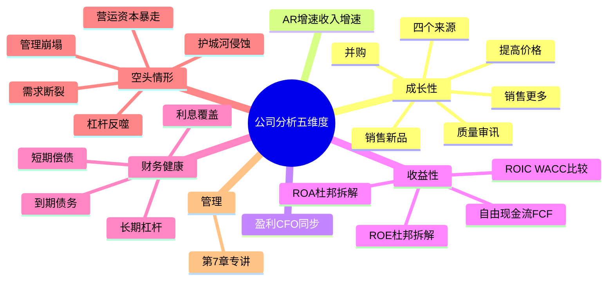
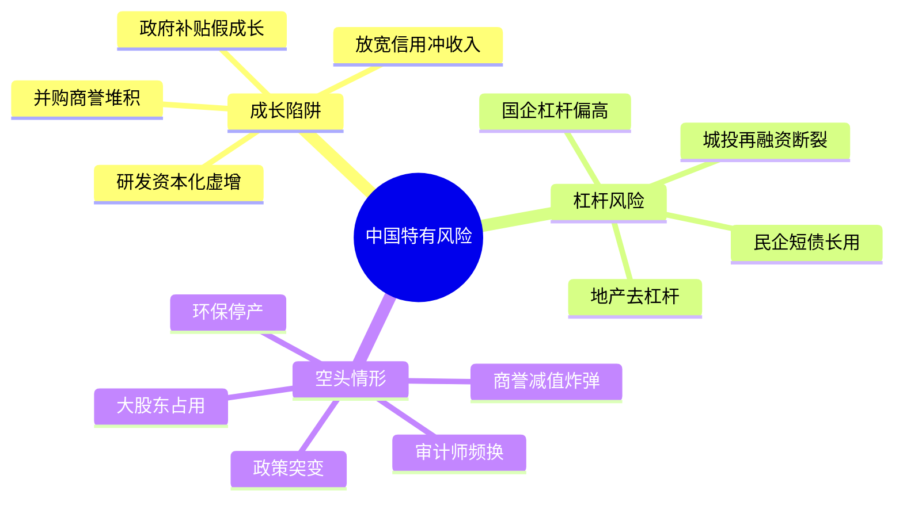

# 第六章　公司分析——基础（2026中国A股与港股适配版）

**章首定位（原书精神）**

现在你已经有财报三张表（第5章）在手了，接下來要做的事是把它变成对投资的判断。多尔西把这一步拆成公司分析的五个维度：

| # | 维度 | 归属 |
|---|------|------|
| 1 | 成长性 | 本章 |
| 2 | 收益性（盈利能力/资本回报） | 本章 |
| 3 | 财务健康状况 | 本章 |
| 4 | 风险 / "空头情形" | 本章 |
| 5 | 管理 | 第7章（整章专讲） |

**中国版导言**：A股和港股公司的成长模式、资本配置行为、杠杆结构与美股存在显著差异。本章在原书五维框架下，注入中国投资者必须额外关注的问题——并购商誉、政府补贴驱动的"假成长"、高杠杆国企与民企的不同风险、以及政策突变的空头情形。

## 0. 分析公司的"五个方面"全景图

公司分析（把财报变成投资决策）
│
├── ① 成长性：它成长多快？来源是啥？能持续吗？
├── ② 收益性：用资本赚到了什么回报？（ROA/ROE/ROIC & FCF）
├── ③ 财务健康状况：地基牢不牢？杠杆会不会炸？
├── ④ 风险/空头情形：坏情况下你亏多少？负面因素压不压得住？
└── ⑤ 管理：谁在主持？为自己还是股东？（→ 第7章）
text

这一章的本质：把"增长""回报""杠杆"三个旋钮同时看，并且把"最坏情况"想清楚。

## 一、成长性（Growth）——最诱人、也最容易骗你的指标

### 1.1 原书开宗明义警告
你不能完全仅凭过去的连续成长率就预测公司未来。高增长历史 ≠ 未来高增长：因为成功吸引竞争，高利润/高增长行业最快被围猎。

### 1.2 销售增长的四个来源

| # | 来源 | 质量 | 中国市场特别提醒 |
|---|------|------|-----------------|
| ① | 销售更多的产品/服务 | ⭐⭐⭐ 最高质量 | 份额提升靠产品力/渠道/成本优势，而非降价抢量 |
| ② | 提高价格 | ⭐⭐⭐ 强质量（需真定价权） | 茅台/片仔癀有真提价权；多数快消品没有 |
| ③ | 销售新的产品/服务 | ⭐⭐ 中高 | 看新业务ROIC能否匹配主业 |
| ④ | 购买其他公司（并购） | ⭐ 最低质量 | **A股头号陷阱**：并购驱动增长+商誉堆积=后续减值炸弹 |

**原书对"并购驱动增长"的硬结论**：一个成功投资者的目标是购买一个好生意，不是购买"兼并收购机器"。

**A股特别提醒**：2014-2016年并购狂潮的教训——业绩承诺期一过精准变脸。港股同样存在靠并购堆砌增长的"综合企业"，市场通常给予折价。

### 1.3 成长质量的"审讯三问"

| 问 | 你找什么 | 中国市场高频答案 |
|----|---------|----------------|
| 利润增长靠"卖更多"还是"挤费用"？ | SG&A/R&D被砍→伤害长期竞争力 | 部分公司靠压缩研发维持利润增长（不可持续） |
| 收入增长是否被"放宽信用"预支？ | AR增速 >> 收入增速 | ToG企业/地产建筑最常见 |
| 增长是否来自一次性损益/会计调节？ | 剔除一次性看核心营业利润增长 | 政府补贴/资产处置常被包装成"成长" |

### 1.4 成长性核查卡

【公司】成长率：收入 CAGR % / EPS CAGR %
来源拆分：有机% / 提价% / 新品____% / 并购____%
质量判断：高质量□ 中□ 低□（理由：______________）
红旗：AR增速>收入？□是 并购占比>30%？□是 盈利↑但CFO↓？□是
政府补贴/利润>20%？□是（依赖风险）
text

## 二、收益性（Profitability / Returns）——用资本赚到了什么回报？

### 2.1 两条主线：ROA/ROE（杜邦拆解） + 自由现金流（真钱）

**A. 资产收益率 ROA**

ROA ＝ 销售净利率 × 资产周转率

- 利润率低但周转高的生意（薄利多销）也能有不错ROA
- 利润率高但周转低的生意（奢侈品/重工业）也能有不错ROA——但往往更重、更周期

**B. 净资产收益率 ROE——最被市场盯、也最容易被杠杆化妆**

ROE ＝ 销售净利率 × 资产周转率 × 财务杠杆比率

| 重点 | 原书警告 | 中国市场补充 |
|------|----------|------------|
| ROE很高但来自超高杠杆 | 不是"牛"，是"刀尖舔糖" | 地产/民营大炼化/部分城投景气高点ROE极高，去杠杆后崩塌 |
| ROE > 40% | 常常可疑 | 刚分拆/大规模回购缩股/一次性加价扭曲 |

**非金融、不靠超高杠杆时，ROE持续 > 10%值得看；>15%更亮眼。**

**C. 自由现金流 FCF（收益性的"最终裁判"）**

FCF ＝ CFO － CapEx

原书四象限（中国版）：

| 象限 | ROE | FCF | 你该想什么 | 中国市场案例 |
|------|-----|-----|-----------|------------|
| 高ROE/高FCF | 高 | 高 | 理想区 | 茅台、长江电力、中海油 |
| 低ROE/高FCF | 低 | 高 | 现金牛但增长有限 | 部分高速/港口/水务 |
| 高ROE/低FCF | 高 | 低 | 扩张吞噬现金 | 新能源运营商、半导体设备 |
| 低ROE/低FCF | 低 | 低 | 危险区 | 大量僵尸企业/ST公司 |

**D. ROIC（投入资本收益率）**——ROIC > WACC → 公司在创造经济价值

### 2.2 收益性"最小核查矩阵"

| 指标 | 3–5年均 | 绿灯 | 红灯 |
|------|---------|------|------|
| 扣非净利率 | __% | ≥15%（有护城河气质） | 低且下滑 |
| ROA | __% | >6%-7% | 长期<同行 |
| ROE | __% | >10%（非金融） | >40%却说不清/杠杆撑着 |
| FCF/营收 | __% | ≈5%+（印钞机信号） | 长期负/接近0 |
| CFO/净利润 | __ | 趋近/大于1 | 长期<0.8 |
| 有息负债/权益斜率 | ↑□→□↓□ | 稳/降 | 爬升 |

## 三、财务健康状况（Financial Health）——地基牢不牢？

### 3.1 短期偿债：流动比率 / 速动比率

| 指标 | 算法 | 经验 |
|------|------|------|
| 流动比率 | 流动资产÷流动负债 | >1.5–2.0通常舒服 |
| 速动比率 | (现金+短投+应收)÷流动负债 | >1.0更稳 |

**中国特别提醒**：很多A股公司流动比率>2但货币资金受限/被占用，速动比率比流动比率更可靠。

### 3.2 长期杠杆：负债结构比"负债总额"重要

| 你要盯的 | 怎么看 | 中国市场补充 |
|----------|--------|------------|
| 有息负债 vs 无息负债 | 有息债才是真利息风险 | 国企杠杆率天然偏高（建筑/电力/钢铁），需结合行业 |
| 利息覆盖倍数≈EBIT÷利息费用 | <2–3×紧张 | 强周期行业在低谷时也要能覆盖利息 |
| 债务到期分布 | 集中到期＋CFO弱＝再融资风险 | 城投/地产债务集中到期是高危信号 |

> 原书冷峻提醒：对非金融公司，过度杠杆是你第一大敌人。

## 四、空头情形 / 风险（Downside Case）——"即使最好的企业也有理由不投"

### 空头情形清单（逐项打钩）

| # | 风险项 | 中国市场高频触发场景 |
|---|--------|-------------------|
| ① | 护城河被侵蚀 | 集采/牌照放开/反垄断/技术替代 |
| ② | 需求断裂 | 地产下行拖累建材/家居/银行；教培"双减"一夜清零 |
| ③ | 财务杠杆反噬 | 民企高杠杆+短债长用；城投再融资断裂 |
| ④ | 营运资本暴走 | ToG企业应收膨胀→坏账暴雷 |
| ⑤ | 资本配置自毁 | 国企盲目多元化；民企跨界追热点（养猪→光伏→AI） |
| ⑥ | 一次性炸弹 | 商誉减值/环保停产/大股东资金占用暴雷 |
| ⑦ | 管理层可信度崩塌 | 财务造假/审计师频换/大股东持续减持 |

> 当负面因素发生2–3项同时叠加会怎样——你才知道你买的到底是投资还是赌局。

## 投资者清单：公司分析——基础（中国A股与港股版总结）

✅ **成长性**：盯来源（销量/价/新品/并购）；低质量成长常来自放宽信用、砍必要费用或频繁并购。A股额外警惕并购商誉堆积和政府补贴驱动的假成长。

✅ **收益性**：ROA/ROE杜邦拆解（看杠杆有没有化妆）；自由现金流才是"所有者能拿的真钱"。A股必须用扣非净利润计算。

✅ **财务健康**：先盯CFO是否自给自足；再看流动/速动与到期债洪峰。国企杠杆高但非必然危险；民企高杠杆+短债长用=致命组合。

✅ **风险/空头情形**：列出负面因素并做叠加压力测试。中国特有风险：政策突变（教培/地产/反垄断）、大股东资金占用、商誉减值炸弹。

✅ **下一步一定是管理（第7章）**：好数字+坏管家＝烂投资。在中国，实控人诚信和大股东行为是管理审查的首要重点。

## 附录：第六章"公司体检卡"（中国A股与港股版）

【公司】___________ 【日期】_____ 【行业】_____ 【市场】□A股 □港股

── 成长性 ────────────────────────────────────────
收入 CAGR % EPS CAGR %
来源拆分：有机% 提价% 新品____% 并购____%
（并购>30%? □警）
质量：□高 □中 □低（理由：______________）
红旗：AR增速>收入?□是 盈利↑但CFO↓?□是 政府补贴/利润>20%?□是

── 收益性 ────────────────────────────────────────
扣非净利率 ____% (≥15%□) ROA ____% (>6%-7%□)
ROE ____% (持续>10%□ >15%□ 但查杠杆来源□)
FCF/营收 ____% (≥5%□) CFO/净利润 ____ (长期<0.8?□红灯)
有息负债/权益斜率 ↑□→□↓□ 利息覆盖 ____×（<3紧张）
ROE>40%? □是（查：分拆/回购/一次性?）

── 财务健康 ──────────────────────────────────────
流动比率 ____ 速动 ____ 短期债到期洪峰：年约____
有息负债/总资产 ____% 趋势↑□→□↓□
利息覆盖 ____× 现金覆盖到期? □够 □勉强 □不够

── 空头情形（downside）───────────────────────────
列出前3大负面：1)____ 2)____ 3)____
若同时发生2项叠加：公司扛得住? □能 □不能
表外/或有负债/担保：□无 □有（附注摘要：____）
中国特有风险：政策突变?□ 大股东资金占用?□ 商誉炸弹?□

verdict: □进入管理层审查（第7章） □淘汰（原因：____）
 

## 思维导图（按阅读逻辑拆分）

### 图1：公司分析五维框架

### 图2：中国市场特有的成长陷阱与杠杆风险

# 第六章　公司分析——基础（Business Analysis Basics）

> **章首定位（原书精神）**
>
> 现在你已经有**财报三张表**（第5章）在手了，接下來要做的事是把它变成对投资的判断。多尔西把这一步拆成**公司分析的五个维度**：
>
> | # | 维度 | 归属 |
> |---|------|------|
> | 1 | **成长性** | 本章 |
> | 2 | **收益性（盈利能力/资本回报）** | 本章 |
> | 3 | **财务健康状况** | 本章 |
> | 4 | **风险 / "空头情形"（downside case / 你能亏多少、怎么亏）** | 本章 |
> | 5 | **管理** | **第7章**（整章专讲报酬/绩效奖励/危险信号/性格/运作） |
>
> 前四个在本章，第五个留到第7章——因为"数字"和"人"必须分开审。

---

## 0. 分析公司的"五个方面"全景图（先挂根节点）

text
公司分析（把财报变成投资决策）
│
├── ① 成长性：它成长多快？来源是啥？能持续吗？（§ 成长性）
├── ② 收益性：用资本赚到了什么回报？（ROA/ROE/ROIC & FCF）（§ 收益性）
├── ③ 财务健康状况：地基牢不牢？杠杆会不会炸？（§ 财务健康）
├── ④ 风险/空头情形：坏情况下你亏多少？负面因素压不压得住？（§ 空头情形）
└── ⑤ 管理：谁在主持？为自己还是股东？（→ 第7章）

> 这一章的本质：**不是教你算更多花哨比率，而是教你把"增长""回报""杠杆"三个旋钮同时看，并且把"最坏情况"想清楚**——这才是做功课（第1章原则一）的落地。

---

## 一、成长性（Growth）——最诱人、也最容易骗你的指标

### 1.1 原书开宗明义警告

> **你不能完全仅凭过去的连续成长率就预测公司未来。**
> 如果投资这么容易，基金经理就不用付那么多学费了。

- 高增长历史 ≠ 未来高增长：因为**成功吸引竞争**，高利润/高增长行业最快被围猎
- 但你不看历史也不行——**历史是你能抓到的最可靠的"证据库"**，关键是：不只看"率"，要看"来源与质量"

> 原书一句话收束：**仔细调查公司成长率的来源，对评估成长质量相当重要。**

---

### 1.2 销售增长（顶线增长）的四个来源（原书逐条给的框架）

> 原书明确：**从长期经营看，应该更关注销售增长，因为销售增长驱动盈利增长。**  
> 销售增长通常来自下面四种之一（或组合）：

| # | 来源 | 质量 | 原书提示 |
|---|------|------|---------|
| **① 销售更多的产品/服务** | ⭐⭐⭐ **最高质量**（抢份额 / 需求真实扩张） | 关键是：份额提升靠的是**更优产品/更低成本/更强渠道**，还是靠"降价抢量"？（后者毛利会说话） |
| **② 提高价格** | ⭐⭐⭐ **强质量——但前提是真定价权** | 需要强势品牌/转换成本/网络效应支撑；否则提价＝丢客户＝不可持续 |
| **③ 销售新的产品/服务（进入新市场/新品类）** | ⭐⭐ **中高（但要看成功率）** | 沃尔玛式"新销售方式/新市场扩张"属于这一类；要核验：新业务ROIC是否能匹配主业、会不会拖FCF |
| **④ 购买其他公司（并购 / 收购）** | ⭐ **最低质量（最容易包装、最难消化）** | 大多数收购**未能给收购方股东带来真正收益**；甚至"小收购、标的收购前很好"，成功概率也大约只有一半；大收购更难彻底摸清架构 |

#### 原书对"并购驱动增长"的硬结论

> **一个成功投资者的目标是购买一个好生意，不是购买"兼并收购机器"。**
> 收购很受华尔街追捧，但历史记录往往是有好有坏——**依靠频繁并购实现的增长常常质量较低**。

实务抓手：
- 把"**有机增长**"（①+②+③自有渠道）和"**并购增长**"分开列
- 若营收增长主要靠并购，你要追问：**被收购标的的FCF/ROIC真实多少？整合费用藏哪了？商誉为啥又涨了？**

---

### 1.3 成长质量的"审讯三问"（原书隐含但贯穿的核心方法）

> 任何一家公司，**盈利增长 > 销售增长 持续一段时间（5–10年）**，你都需要深入挖掘这些数字。

| 问 | 你找什么 |
|---|----------|
| **利润增长是靠"卖更多"还是靠"挤费用"？** | 若SG&A被砍、R&D被砍、广告被砍→利润增但**伤害长期竞争力**（成本削减有极限） |
| **收入增长是不是被"放宽信用/渠道压货"预支的？** | AR增速 >> 收入增速（回到第5章应收红旗） |
| **增长是否来自一次性损益/会计政策调节？** | 把一次性拿掉再看核心营业利润增长 |

> 原书给的方向感：  
> **由于销售增长和进入新市场带来的高质量成长，比单靠降价和会计"改善"带来的低质量成长更可持续。**

---

### 1.4 成长性这一节你该写进笔记的一句话模板

text
【公司】成长率：收入 CAGR __% / EPS CAGR __%
来源拆分：有机 __% / 提价贡献 __% / 新品 __% / 并购 __%
质量判断：高质量□ 中□ 低□（理由：__________________________）
红旗：AR增速>收入？□是 并购占比过高？□是 盈利↑但CFO↓？□是

---

## 二、收益性（Profitability / Returns）——用资本赚到了什么回报？

> 原书定位：成长性是"车速"，收益性是"发动机效率"——**快车不一定省油，有些快车其实是油老虎（资本饥渴）**。

---

### 2.1 两条主线：ROA/ROE（杜邦拆解） + 自由现金流（真钱）

#### A. 资产收益率 ROA（资产→利润 的效率）

> 原书把 ROA 写成杜邦感：

- **ROA ＝ 销售净利率 × 资产周转率**
  - **销售净利率 ＝ 净利润 ÷ 销售收入**（每1美元收入落到利润多少）
  - **资产周转率 ＝ 销售收入 ÷ 资产**（资产转得有多快）

含义一句话：
- **利润率低但周转高的生意**（薄利多销/高流转供应链）也能有不错ROA
- **利润率高但周转低的生意**（奢侈品/重工业）也能有不错ROA——但往往更重、更周期

原书经验口径（非铁律，但好用）：
- **ROA 持续超过 6%–7%** → 相对同行可能有优势（看行业）

---

#### B. 净资产收益率 ROE（股东资本→回报）——最被市场盯、也最容易被杠杆化妆

> **ROE ＝ 销售净利率 × 资产周转率 × 财务杠杆比率**  
> 其中 **财务杠杆比率 ＝ 资产 ÷ 所有者权益**（≈ 权益乘数的另一写法）

| 重点 | 原书警告 |
|------|---------|
| ROE 很高但**来自超高杠杆** | 那不是"牛"，那是"刀尖舔糖"——下行周期可能直接击穿权益 |
| **ROE > 40%** | 原书明确提醒：常常**没有意义/可疑**——可能是刚分拆出来、大规模回购缩股、一次性加价扭曲…看到>40%要先查构成，而不是欢呼 |
| 非金融公司、**不过度用杠杆**前提下，ROE 能**持续 >10%**就是值得看一眼的；**>15%**更亮眼（但要回到护城河/现金验证） |

##### 实操动作（防被ROE骗）：
- 同时看 **负债/权益** 或 **有息负债/(有息负债+权益)** 的斜率
- 看 **利息覆盖（EBIT/利息）**：杠杆是否正把公司推向悬崖边

---

#### C. 自由现金流 FCF（收益性的"最终裁判"）

> **FCF ＝ 经营活动现金流 CFO － 资本支出 CapEx**  
> 原书把 FCF 称作接近 **"所有者盈余"**：表示公司所有者能提取、又不影响业务的真实现金。

- **高ROE + 高FCF＝成熟商人（辉瑞式）**：最舒服的持有区
- **低ROE + 低FCF（年轻创业者/亚马逊早期）**：可能很有故事，但风险更大、更需要你判断"什么时候转成正FCF/高ROE"
- **高ROE + 低FCF（右下象限）**：钱全砸扩张/维持；能为股东赚高回报，但**所有现金被锁在业务里**→你指望的是"未来变现"

原书四象限精神：
| 象限 | ROE | FCF | 你该想什么 |
|------|-----|-----|-----------|
| 高ROE / 高FCF | 高 | 高 | 理想区（但要估值） |
| 低ROE / 高FCF | 低 | 高 | 现金牛但增长有限（看分红/回购） |
| 高ROE / 低FCF | 高 | 低 | 扩张吞噬现金（盯：一旦周期转逆，FCF会不会崩？） |
| 低ROE / 低FCF | 低 | 低 | 危险区（资本黑洞） |

---

#### D. ROIC（投入资本收益率）——原书"更久经考验"的升级项

> **ROIC ＝ NOPAT ÷ 投入资本**  
> **NOPAT ≈ EBIT × (1 − 税率)**  
> **投入资本 ≈ 总资产 − 无息流动负债 −（过剩现金/非经营性）**

判据：**ROIC > WACC** → 公司在创造经济价值；利差越大越像真护城河。

---

### 2.2 收益性这一节"最小核查矩阵"（你每张票都跑）

| 指标 | 3–5年均 | 绿灯 | 红旗 |
|------|--------|------|------|
| 净利率 | __% | ≥15%（有护城河气质） | 低且下滑 |
| ROA | __% | >6%-7% | 长期<同行 |
| ROE | __% | >10%（非金融）持续 | >40%却说不清/杠杆撑着 |
| FCF/营收 | __% | ≈5%+（印钞机信号） | 长期负/接近0 |
| CFO/净利润 | __ | 趋近/大于1 | 长期<1（利润不转现金） |
| 有息负债/权益斜率 | ↑□→□↓□ | 稳/降 | 爬升 |

---

## 三、财务健康状况（Financial Health）——地基牢不牢？

> 原书态度：**增长性和收益性告诉你天花板，财务健康告诉你地板在哪。**  
> 一家ROE 20%的公司，杠杆一旦断裂，你照样归零。

---

### 3.1 短期偿债：流动比率 / 速动比率（先看会不会"憋死"）

| 指标 | 算法 | 原书精神 | 经验 |
|------|------|----------|------|
| **流动比率 ＝ 流动资产 ÷ 流动负债** | 粗体检 | 看短期偿债底座 | **>1.5–2.0** 通常舒服（行业差很大） |
| **速动比率 ＝ (现金+短投+应收) ÷ 流动负债** | 更严（剔存货） | 原书倾向用速动更"冷" | **>1.0**更稳；<1要警惕 |

> 但原书更强调：**真正判死刑的不是比率跌破某数，而是趋势 + CFO长期不足 + 短期债到期洪峰**。

---

### 3.2 长期杠杆：负债结构比"负债总额"重要

| 你要盯的 | 怎么看 | 原书红旗 |
|----------|--------|---------|
| **有息负债 vs 无息负债** | 应付账款是"占上游款"（可能是话语权），**有息债才是真利息风险** | 有息负债/总资产持续上升 |
| **权益负债率/负债权益比** | 看斜率（趋势）比绝对值更准 | D/E >1 且爬升＋周期行业＝双杀风险 |
| **利息覆盖倍数 ≈ EBIT ÷ 利息费用** | 看能扛几次冲击 | **<2–3×**紧张；长期<1.5×危险 |
| **债务到期分布** | 未来2–3年到期洪峰？能否续贷？ | 集中到期＋CFO弱＝再融资风险 |

> 原书一句冷峻提醒：  
> **银行天生就是高杠杆生意——不要用同一套"D/E上限"去毙银行；银行的护城河与风险看的是NIM/准备金/不良率体系（第17章专讲）。对非金融公司，过度杠杆是你第一大敌人。**

---

## 四、空头情形 / 风险（Downside Case / Risk Profile）——"即使最好的企业也有理由不投"

### 4.1 原书定位：这不是悲观，这是尽职调查

> **你投资中的风险是什么？确信你已了解企业的全部情况并做了详细调查，其中的负面因素确实压不过正面因素。**

你要做的，不是编一个"目标价"，而是做一次**压力清单**：

### 4.2 空头情形清单（逐项打钩，比"看涨故事"重要十倍）

| # | 风险项 | 原书语境 |
|---|--------|---------|
| ① | **护城河被侵蚀**：技术颠覆/新竞品/监管放开/客户流失加速 | 回到第3章：优势能持续多久 |
| ② | **需求断裂**：行业下行/替代品兴起/终端客户预算砍 | 周期性行业尤其致命 |
| ③ | **财务杠杆反噬**：利率上行/信贷紧缩/到期洪峰 + CFO弱 | 看利息覆盖与到期分布 |
| ④ | **营运资本暴走**：应收/存货持续膨胀→现金被吃光 | 回到第5章应收/存货 |
| ⑤ | **资本配置自毁**：乱并购/为增长而增长/回购高位（价格远高于保守价值） | 第7章管理延伸 |
| ⑥ | **一次性炸弹**：诉讼/环保/监管罚款/养老金缺口/表外负债 | 看附注/或有负债 |
| ⑦ | **管理层可信度崩塌**：频繁非经常性洗大澡、CFO/审计师频换、收入确认激进 | 第8章"财务伪装"提前预警 |

> 原书结论精神：当你把负面因素列全、并问"如果发生2–3项同时叠加会怎样"——你才知道你买的到底是**投资**还是**赌局**。

---

## 结论（章末收束）

- 成长性告诉你**车能跑多快**，但你要先问：**谁在开、油是不是真赚、刹车灵不灵**
- 收益性（ROA/ROE/ROIC + FCF）回答：**这台发动机值不值你当股东**
- 财务健康回答：**下行时它是不是会爆缸**
- 空头情形回答：**最坏情况下你亏多少、你能不能扛**
- 然后——还不行——你还得看**第7章：管理**（人，是所有数字背后的变量）

---

## 投资者清单：公司分析——基础（原书浓缩）

- ✅ **成长性**：盯来源（销量/价/新品/并购）；低质量成长常来自放宽信用、砍必要费用或频繁并购；盈利增长长期远超销售增长必须深挖
- ✅ **收益性**：ROA/ROE杜邦拆解（看杠杆有没有化妆）；自由现金流才是"所有者能拿的真钱"；高ROE低FCF＝扩张锁现金，更要谨慎
- ✅ **财务健康**：先盯CFO是否自给自足；再看流动/速动与到期债洪峰；有息负债趋势比总额重要；利息覆盖<2–3×紧张
- ✅ **风险/空头情形**：列出负面因素并做叠加压力测试；护城河侵蚀、杠杆反噬、营运资本暴走、资本配置自毁、表外/或有负债
- ✅ **下一步一定是管理（第7章）**：好数字+坏管家＝烂投资

---

## 附录：第六章"公司体检卡"（直接复制进Excel/Notion/飞书填）

text
【公司】___________ 【日期】_____ 【行业】_____ 【数据源】年报/10-K 5–10年
── 成长性 ────────────────────────────────────────
收入 CAGR __% EPS CAGR __%
来源拆分：有机% 提价% 新品% 并购%（并购>30%? □警）
质量：□高（销量/定价权/新品成功） □中 □低（降本/放宽信用/并购撑）
红旗：AR增速>收入?□是 盈利↑但CFO↓?□是
── 收益性 ────────────────────────────────────────
净利率 __% (≥15%□) ROA __% (>6%-7%□) ROE __% (持续>10%□ >15%□)
FCF/营收 __% (≥5%□) CFO/净利润 __ (长期<1?□红灯)
杠杆检查：有息负债/权益斜率 ↑□→□↓□ 利息覆盖 __×（<3紧张）
ROE>40%? □是（查：分拆/回购/一次性?）
── 财务健康 ──────────────────────────────────────
流动比率 __ 速动 __ 短期债到期洪峰：年约$
有息负债/总资产 __% 趋势↑□→□↓□ 利息覆盖 __×
现金够不够覆盖到期? □够 □勉强 □不够(再融资能撑?□能 □不能)
── 空头情形（downside）───────────────────────────
列出前3大负面：1)__________ 2)__________ 3)__________
若同时发生2项叠加：公司扛得住? □能 □不能(理由______________)
表外/或有负债线索：□无 □有（附注摘要：____________）
verdict: □进入管理层审查（第7章） □淘汰（原因：________________）