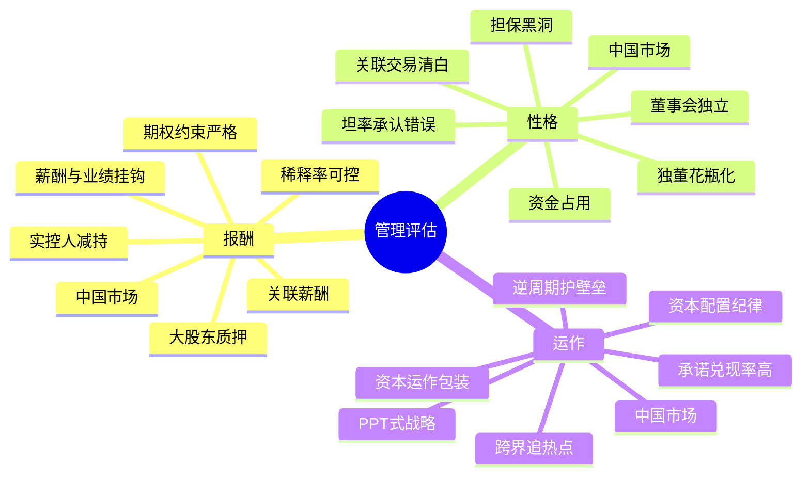
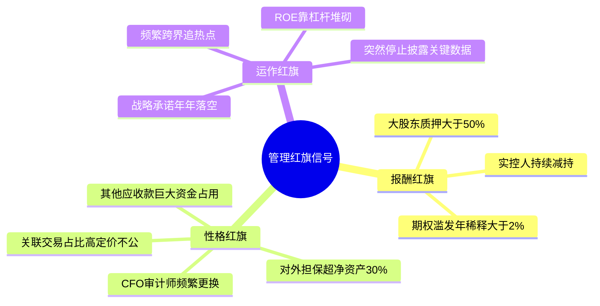

# 第七章　公司分析——管理（2026中国A股与港股适配版）

**章首定位（原书精神）**

作为个人投资者，你很难像VC/PE那样天天跟管理层喝茶摸底——但多尔西给了一套完全可查、可文件化的方法：看**报酬结构、看性格信号、看运作痕迹**，三者加起来，就是“人”这件最难量化的事里，你能拿到的硬证据。

**中国版导言**：A股和港股公司的治理结构存在显著差异。国企管理层受国资委考核驱动（ROE、市值管理、分红），民企则高度依赖实控人个人诚信。本章在原书三部分框架下，注入中国投资者必须额外警惕的信号——**大股东资金占用、关联交易掏空、国企代理人风险、实控人质押爆仓、以及“PPT式”资本运作**。

## 0. 章内三脚架（原书框架：把管理拆成三块）

第七章 公司分析——管理
│
├── 一、报酬（Compensation） ← 委托书/年报薪酬表/期权附注
├── 二、性格（Character） ← 诚信/关联交易/坦率度/权力制衡
└── 三、运作（Operations） ← 执行痕迹/资本配置/披露质量
text

**这一章的本质**：好数字 + 坏管家 = 烂投资；好管家能把平庸资产盘活，但坏管家能把“好生意”糟蹋成价值陷阱。

## 一、报酬（Compensation）——钱怎么说真话

### 1.1 原书总体偏好

| 原书偏好 | 绿灯 | 红旗 |
|----------|------|------|
| 高额红利 > 高固定薪水 | 奖金池透明、基于ROIC/FCF | 不管业绩多差，薪水福利纹丝不动 |
| 严格限制的期权 > 慷慨无约束期权 | 行权价=市价、解锁看ROIC | 期权当糖果发：无业绩条件、年复一年扩大池子 |

### 1.2 中国市场薪酬特征与危险信号

**国企管理层**：
- 2015年“限薪令”后，央企高管年薪普遍被限制在60-80万元左右，远低于市场化水平
- 股权激励在国企中较克制（需国资委审批），但近年来逐步放开
- **关键看**：管理层是否通过**关联方/子公司**变相获取利益？是否在集团层面持有大量股份（而非上市公司层面）？

**民企管理层**：
- 实控人往往就是管理层，薪酬不是主要矛盾；**矛盾在于实控人是否通过关联交易/资金占用掏空上市公司**
- 警惕：实控人给自己和家族成员发放荒谬津贴（豪车、私人飞机、海外度假），尤其在上市公司利润微薄时
- 股权激励：A股大量民企使用限制性股票和期权，需关注**授予条件是否过于宽松**（如仅绑定收入而非利润/ROIC）、**年稀释率是否>2-3%**

| ⚠️ 中国市场特有红旗 | 具体表现 |
|-------------------|---------|
| 大股东/实控人高比例质押 | 质押比例>50%且股价下跌→爆仓→控制权转移→公司动荡 |
| 实控人兼任CEO却另领高薪+大笔期权 | 已是最大股东，额外期权=叠buff |
| 国企高管“旋转门” | 临近退休大量花钱/并购，为退休后铺路 |
| 关键人员频繁离职 | 尤其CFO/审计师频繁更换+财务已可疑=极高风险 |

### 1.3 报酬核查模板

【薪酬审查】CEO总薪酬____ vs 同行____ vs 公司ROIC/FCF()
红利占比% 奖金挂钩指标：ROIC□ FCF□ EPS□ 收入□（模糊□警）
期权年授权额/流通股=%（持续>2-3%?□警）
大股东质押比例%（>50%?□警）
津贴/贷款豁免/关联方疑点：□无 □有（摘要：）
管理层净持股（非期权）：股/%
verdict：□利益一致 □可疑（理由：____________）
text

## 二、性格（Character）——诚信、权力制衡、坦率度

### 2.1 关联交易：中国市场的头号治理风险

**原书**：在关联交易部分找——公司和管理层朋友/亲戚关联公司的持续生意往来。

**中国市场强化版**：

| 审查重点 | 具体动作 |
|----------|---------|
| 大股东资金占用 | 查看**其他应收款**是否巨大且账龄长；是否存在大股东非经营性资金占用公告 |
| 关联采购/销售 | 关联交易占比是否>30%？交易价格是否偏离市场公允价？ |
| 担保圈 | 上市公司是否为大股东/关联方提供巨额担保？（担保金额/净资产>30%=高风险） |
| 大股东/实控人持续减持 | 实控人自己都在卖，你为什么要买？ |

**A股经典掏空套路**：
1. 大股东通过其他应收款长期占用上市公司资金
2. 上市公司为大股东体外资产提供担保→大股东违约→上市公司代偿
3. 关联交易高价采购/低价销售→利润向大股东体外公司转移
4. 大股东高比例质押→爆仓→被动减持→控制权动荡

### 2.2 董事会独立性

| 原书信号 | 中国市场补充 |
|----------|------------|
| CEO兼任董事长=内部制衡弱 | A股大量公司两职合一，尤其民企。国企近年逐步分离 |
| 独立董事占多数 | A股独董“花瓶化”普遍，独董真正发挥作用的不多。看独董是否曾公开质疑管理层议案 |
| 审计委员会全独立 | 近年监管趋严，独董在财务造假案中被追责，独董辞职潮是红旗信号 |

### 2.3 坦率度：管理层敢不敢承认错误？

**中国特别观察**：
- 年报致股东信/管理层讨论（MD&A）：是“成绩单”还是“PR稿”？是否承认决策失误？
- 业绩说明会/电话会：管理层是否回避尖锐问题？只读稿不开放提问？
- **中国的“沉默信号”**：当一家公司突然不再披露以前一直披露的关键数据（如分业务毛利率、客户集中度），通常意味着那些数字不好看了

| 绿灯 | 红旗 |
|------|------|
| 主动披露不利趋势+具体对策 | 失败全推“宏观/疫情/行业”从不承认自己决策失误 |
| 减值/停工主动计提 | “一次性”年年有、从不根治 |
| 关键数据持续透明披露 | 突然停止披露某些数据 |

### 2.4 性格核查模板

【性格审查】
关联交易疑点：□无 □有（描述：____ 定价公允？□yes □no）
大股东资金占用：□无 □有（其他应收款/净资产____%）
大股东质押比例____%（>50%?□警）近一年减持？□是□否
董事会独立？审计委□独 薪酬委□独 CEO兼董事长？□是(警)
致股东信坦率度：□平衡 □PR稿(警) 主动承认错误？□能 □回避
高管任期稳定？□是 □no（CFO/审计师频换?□警）
verdict：□可信 □不可信（理由：_____________________）
text

## 三、运作（Operations）——看“执行力痕迹”

### 3.1 绩效：ROE增长靠什么驱动？

| 原书 | 中国市场补充 |
|------|------------|
| ROE增长可能被高杠杆化妆 | A股地产/民企景气高点ROE极高=杠杆驱动，去杠杆后崩塌 |
| 看ROIC vs WACC | 国企天然WACC低，ROIC>WACC的门槛更易达到；需与同行国企比而非全市场 |
| 股份数变化 | 定增/可转债转股/股权激励行权是否持续摊薄？回购是否注销？ |

### 3.2 坚持到底：计划是活着的还是PPT？

**诊断方法**：翻3-5年前年报里管理层吹过的“战略规划”——对照今天兑现了多少？

中国市场典型红旗：
- 今年说“聚焦主业”，明年跨界追热点（养猪→光伏→AI→机器人）
- 承诺的毛利率提升从未实现，每次说法不同
- “千亿市值”口号喊了多年，收入利润原地踏步
- 频繁更换“战略方向”，每次用新概念包装（如“数字化转型”“AI赋能”）

### 3.3 资本配置：管理层的真实优先级

**原书正负例 + 中国市场强化**：

| 好信号 ✅ | 坏信号 ❌（中国市场高发） |
|-----------|------------------------|
| 股价低迷时回购并注销 | 高位回购护盘/为股权激励行权铺路 |
| 多余现金分红/减债 | 频繁定增融资+大额并购→商誉堆积 |
| 资本开支纪律：先维护壁垒 | 为“增长故事”持续超支，FCF长期为负 |
| 逆周期维护研发/品牌 | 行业低谷砍研发、砍品牌费用保利润 |
| — | **实控人用上市公司资金体外投资/多元化**（最恶劣） |
| — | **国企管理层用冗余现金乱并购→商誉暴雷** |

### 3.4 运作核查模板

【运作审查】
过去3-5年承诺的战略：兑现率____%（□高 □中 □低 □消失）
ROE驱动拆解：经营改善□ 加杠杆□ 回购缩股□（cosmetic?□警）
资本配置：回购注销□ 乱并购□ 过度CapEx□ 分红稳定□
披露质量：segment清晰□ 关键数据持续披露□ 突然停止披露□
行业低谷行为：维护研发/品牌□ 砍费用保利润□（短期主义）
verdict：□执行力强 □画饼（理由：________________）
text

## 四、中国市场管理审查特别清单

| 维度 | 国企重点关注 | 民企重点关注 |
|------|------------|------------|
| **激励** | 是否响应国资委考核（ROE/市值管理/分红）？ | 实控人是否通过关联交易/资金占用掏空？ |
| **质押** | 通常不质押 | 质押比例>50%=高危险 |
| **减持** | 国有股减持受严格限制 | 实控人持续减持=最强卖出信号 |
| **资本配置** | 是否乱并购/冗余现金低效使用？ | 是否追热点跨界/体外投资？ |
| **坦率度** | 年报是否报喜不报忧？ | 是否承认决策失误？ |
| **权力制衡** | 独董是否真正独立？ | 两职合一+家族控制=小股东弱势 |

## 投资者清单：公司分析——管理（中国A股与港股版总结）

✅ **报酬**：看利益是否与股东一致。A股额外警惕：大股东高比例质押、实控人兼任CEO另领大笔期权、关键人员频繁离职。

✅ **性格**：关联交易是A股/港股头号治理风险。查其他应收款（大股东占用）、担保金额/净资产、关联交易占比与定价公允性。致股东信是否坦率承认错误？独董是否曾公开质疑？

✅ **运作**：翻3-5年年报核验“承诺→兑现”轨迹。警惕频繁变更战略方向、跨界追热点、PPT式资本运作。资本配置：回购注销>分红>乱并购。

✅ **国企vs民企**：国企看代理人风险（乱并购/低效资本配置）；民企看实控人诚信（资金占用/减持/质押）。

✅ **信息源**：年报MD&A、委托书/薪酬表、关联交易附注、大股东质押公告、减持预披露公告、交易所监管函/问询函回复——这些公开文件够你判80%的案。

## 附录：第七章“管理体检卡”（中国A股与港股版）

【公司】___________ 【类型】□国企 □民企 【日期】_____

── 报酬（利益一致吗？）─────────────────────
□ CEO薪酬与ROIC/FCF挂钩？
□ 股权激励行权条件严格（ROIC/多年EPS）？
□ 大股东质押比例>50%？□是(警)
□ 实控人近一年减持？□是(警)
□ 年股权稀释率>2-3%？□是(警)
□ 津贴/贷款豁免/关联方疑点：□无 □有（____）

── 性格（可信吗？）─────────────────────
□ 其他应收款/净资产>5%？□是(查大股东占用)
□ 对外担保/净资产>30%？□是(警)
□ 关联交易占比>30%或定价不公允？□是(警)
□ CEO兼董事长？□是(警) 审计委独董全独立？□是
□ 致股东信坦率承认错误？□能 □回避/PR稿
□ CFO/审计师近3年更换？□是(警)

── 运作（执行还是画饼？）─────────────────
□ 3-5年前战略承诺兑现率：□高 □中 □低 □消失
□ ROE靠经营改善还是杠杆/回购？□经营 □杠杆(警)
□ 资本配置：回购注销□ 乱并购□ 过度CapEx□ 分红稳定□
□ 行业低谷：维护研发/品牌□ 砍费用保利润□（短期主义）
□ 关键数据持续透明披露？□是 □突然停止(警)

── 最终 verdict ────────────────────────────────
□ 管理过关（利益一致+诚信可查+执行有痕）
□ 存疑（缩小仓位/等待澄清：）
□ 淘汰（管理红线：）
text

## 思维导图

### 图1：管理评估三脚架

### 图2：中国市场特有的管理红旗信号

# 第七章　公司分析——管理（Management Evaluation）
> **章首定位（原书 p.71 / 中信版约 P95）**
>
> 作为个人投资者，你很难像 VC/PE 那样天天跟管理层喝茶摸底——但多尔西给了一套**完全可查、可文件化**的方法：**看报酬结构、看性格信号、看运作痕迹**，三者加起来，就是"人"这件最难量化的事里，你能拿到的硬证据。

---

## 0. 章内三脚架（原书框架：把管理拆成三块）

> 原书原话精神：**"我把管理评估分成三个部分：报酬、性格、运作。"**

text
第七章 公司分析——管理
│
├── 一、报酬（Compensation） ← 最容易查：委托书/年报薪酬表/期权附注
├── 二、性格（Character） ← 最难但最关键：诚信/关联交易/坦率度/权力制衡
└── 三、运作（Operations） ← 执行痕迹：计划落地吗？资本配置理性吗？披露够透明吗？

> 这一章的本质：**好数字 + 坏管家 = 烂投资；好管家能把平庸资产盘活，但坏管家能把"好生意"糟蹋成价值陷阱。** 你做第一章的"做功课"，第七章就是在判"人是谁在掌舵"。

---

## 一、报酬（Compensation）——最容易查证的一块：钱怎么说真话

> 原书定位：**薪酬本身就是一个很好的检测性格的试纸。**管理团队对金钱的态度，和他们是否会恶意对待股东之间，有很强的联系。

### 1.1 原书的总体偏好（你用来审薪酬包的"尺子"）

| 原书偏好 | 为什么 | 绿灯 | 红旗 |
|----------|------|------|------|
| **高额红利（奖金与长期业绩严格挂钩）** ⭐ > 高固定薪水 | 红利=延迟满足+跟股东同坐一条船 | 奖金池结构透明、基于ROIC/FCF/长期指标 | 不管业绩多差，薪水和福利纹丝不动甚至涨 |
| **严格限制的股票期权（有业绩条件/长锁定期）** ⭐ > 慷慨无约束期权 | 期权无成本→容易滥发→EPS稀释→你为管理层"造富"买单 | 期权总量/年授权率稳定、行权价=市价、解锁看ROIC或多年业绩 | 期权当糖果发：大量无业绩条件、低行权价、年复一年扩大池子 |

---

### 1.2 绩效奖励：钱到底挂在什么钩子上？

> 原书案例精神：**可口可乐**时期——降低了盈利预测但管理者薪酬并未相应向下调整→不合理；**迪士尼**——更糟：没有明确绩效计划、关键信息不公开→双重负面。

#### 你审的四条红线（原书给出）

| # | 审什么 | 原书危险信号 |
|---|--------|-------------|
| ① | **薪酬是否真正与业绩挂钩？** | 业绩下滑年奖金反而改规则保住→"灵活会计"保薪水=股东排最后 |
| ② | **业绩目标会不会被董事会暗降？** | 年初定8%增长，到下半年改成5%让管理层照样拿满→变相自肥 |
| ③ | **是否以"收购"为由奖励管理层？** | 原书原话精神：**"为完成一个收购计划而奖励公司管理层是一个可怕的主意"**——这会激励"买规模"而非"创造价值" |
| ④ | **对标口径有没有猫腻？** | 老是说"行业75分位"——选一组更烂的同行当对标，把平庸包装成优秀 |

> 实操抓手：去**委托书（Proxy Statement/DEF 14A）**查：
>- **Summary Compensation Table**（高管总薪酬拆解：薪水/红利/期权/其他）
>- ** Grants of Plan-Based Awards**（期权/限制性股票实际授予）
>- 绩效指标的措辞：写的是**ROIC/FCF/EPS/收入**哪个？有没有"如果达到X则解锁Y"的硬条件？

---

### 1.3 其他危险信号（原书逐条列的"不可容忍清单"）

#### ⚠️ ① 给高管特定贷款然后悄悄豁免
> **公司以低于市场利率的利息给高管贷款，然后在几年后悄无声息豁免**→本质上公司送钱，还披着"借款"外衣。

#### ⚠️ ② 荒谬的津贴（perks）
> 管理层享受荒谬津贴——私人飞机随便用、豪华公寓、乡村俱乐部、家属旅行——**扮演"当今皇族"而非"审慎管理者"角色**。

#### ⚠️ ③ 期权独占 / 不与员工分享
> 管理层独占某年大部分期权授权，普通员工无份→财富分配信号极差；更公平分享的公司长期经营更好。

#### ⚠️ ④ 过分使用期权（稀释信号）
> 期权池不断扩大、股份数持续攀升→**你手里的每股价值被悄悄稀释**。受限制股票必须作为费用计入利润表（原书提的会计准则方向）。

#### ⚠️ ⑤ 创始人/大股东卷入管理还拿大笔期权
> 如果他们已经是最大股东（已拥有大量企业价值），额外大额期权=叠buff——且可能暴露治理结构缺陷。

#### ⚠️ ⑥ 管理层到底持多少自家股？（最重要的一问）
> 原书偏好：**比起期权头寸，更乐见管理层实打实拥有公司股票（直接持股/限制性股票）/ 把期权看成次要**→skin in the game看真金白银绑在一起多久。

> 去委托书脚注查：**"相关利益人证券持有"表**→看管理层股权vs期权比例、行权日程、什么条件下解锁。

---

### 1.4 报酬这块你写进笔记的一行模板

text
【薪酬审查】
CEO总薪酬____ vs 同行(__公司__) vs 公司ROIC/FCF()
红利占比__% 奖金挂钩指标：ROIC□ FCF□ EPS□ 收入□（模糊□警）
期权年授权额/流通股=____%（持续>2-3%?□警）
津贴/贷款豁免/关联方疑点：□无 □有（摘要：____________）
管理层净持股（非期权）：股/% 锁期到？____
verdict：□利益一致 □可疑（理由：____________________）

---

## 二、性格（Character）——最难但最致命：诚信、权力制衡、坦率度

> 原书定位：**管理团队对金钱的态度，和他们是否会恶意对待股东之间有很强的联系。** 你找不到"测谎仪"，但可以找**行为痕迹**。

### 2.1 关联交易：权力有没有被拿来给亲友"开小灶"？

> **在关联交易部分找：公司和管理层朋友/亲戚关联公司的持续生意往来。**
> 关键要确信：
> - 公司是否给直接关联方大量生意？
> - 有没有滥用权力的过分之举？

- 去**附注"关联交易（Related Party Transactions）"**：有无以高于公允价把业务给"某家公司"、有无租管理层物业给公司、有无家族成员拿咨询费
- 原书隐含但极硬的一条：**如果一笔交易缺乏可辩护的商业逻辑，就可能是利益输送的遮羞布**

---

### 2.2 董事会独立性：制衡机制烂不烂？

| 原书信号 | 好 | 坏 |
|----------|------|-----|
| **董事会成员与管理层重叠** | 独立董事占多数、薪酬/审计委员会全独立 | 多名董事是前任高管/CEO密友/亲属；审计委员会主席不独立 |
| **CEO是否兼任董事长** | 分开（Separation of Chairman & CEO）| 一人兼→内部制衡弱 |
| 关键委员会**审计/薪酬/提名**是否真正独立 | ✅ | ❌ |

> 原书原句精神：**董事会是股东防止CEO经营管理失去节制的重要环节。** 这种重叠不是好兆头。

---

### 2.3 坦率度：管理层敢不敢当面承认错误？

> **"看看年报里致股东的信——它是否对过去一年管理层的成功与失败给出了公正评价，抑或只是一篇无价值的公关稿？"**

逐条看你能在公开材料里核验的：

| 查验动作 | 去哪查 | 绿灯 | 红旗 |
|----------|--------|------|------|
| 年报/10-K **MD&A（管理层讨论与分析）**对负面事项是否直说 | 10-K Item 7 | 写清风险因子+影响+对策 | 只讲"宏观/汇率/天气"从不说自己的决策失误 |
| **致股东的信（Letter to Shareholders）**是否平衡 | 年报开头 | 承认哪块没做好+怎么改 | 全是英雄叙事、"史上最强"、失败全推外界 |
| **季报电话会 Q&A**是否开放尖锐问题 | 录音/实录 | 不躲、不怼、给数字 | 只读稿、打断分析师、只放软球 |
| **减值/重组/停工**：主动提还是藏着 | 附注 | 主动计提（哪怕痛）| 年复一年"非现金"/"一次性"但从不根治 |

> 原书一句话收束：**坦率的团队愿意做出"对自己可能不利但对公司诚实"的决议（主动减值、暂停低效扩张、砍自己奖金池）——这正是你想要的。**

---

### 2.4 其他性格信号（原书列的多条"软但致命"）

| # | 信号 | 原书表述精神 | 你怎么抓证据 |
|---|------|-------------|-------------|
| ① | **个人英雄主义CEO** | 把自己标榜"救世主"、媒体捧上天→危险；**把CEO当英雄是危险的** | 读媒体稿：是"我们团队/护城河"还是"我一个人力挽狂澜"？ |
| ② | **高管流动率 / 关键人员任期** | 较长聘期=内在动力和信心；关键人员频繁换=内斗或文化烂 | 委托书历年的Named Executive Officer名单变迁；LinkedIn查离职轨迹 |
| ③ | **普通员工流动率 / 文化** | 员工流动率也是对管理品质的测试 | Glassdoor趋势/年报里人员成本异常波动 |
| ④ | **自我奖励的管理者** | 越线→不太可能做最利于股东长期利益的决策 | 回到1.3危险信号（津贴/贷款豁免/期权独占） |

---

### 2.5 性格这块你写进笔记的一行模板

text
【性格审查】
关联交易疑点：□无 □有（谁：____ 什么交易：____ 定价公允？□yes □no）
董事会独立？审计委□独 薪酬委□独 提名委□独 CEO兼董事长？□是(警)
致股东信坦率度：□平衡 □PR稿(警) 主动承认错误？□能 □回避
高管任期稳定？□是 □no(离职原因不明?□警)
verdict：□可信 □不可信(理由：_____________________)

---

## 三、运作（Operations / Performance of the Business）——看"执行力痕迹"

> 原书定位：管理好不好，不看PPT，看**过去承诺→现在兑现**的轨迹。你当"事后审计员"，不是听众。

### 3.1 绩效：财务表现背后的驱动力（拆杜邦/杠杆/与业绩挂钩吗？）

- 先看管理层任期内的 **ROE/ROIC/毛利/FCF** 轨迹
- 但原书警告：**ROE增长可能被高杠杆化妆**→必须同时看：
  - **ROIC vs WACC**（真经营效率）
  - **有息负债/权益斜率**
  - **股份数变化**：持续增发=稀释（期权池扩大+可能为了并购/补缺现金发股）

> 原书一句话：**观察管理层任期内，公司ROE增长的驱动力是什么——是经营改善、还是加杠杆、还是回购缩股 cosmetic？**

---

### 3.2 坚持到底：计划是活着的还是PPT？

> 诊断方法（原书给出实操）：
> **去看过去3–7年的年报和当年被大肆宣传的"新战略计划"——它们现在在哪？执行了吗？还是已被悄悄忘掉？**

- 你做的事很简单：
  1. 拉 **3–5年前年报**里CEO吹过的"三大战略支柱"
  2. 对照今天：收入结构变了吗？承诺的margin扩张到了吗？承诺的债务降了吗？
  3. 结论只有三种：
     - **兑现+可验证** ✅
     - **部分兑现但口径偷偷改了** ⚠️（今年叫A指标，明年换B指标）
     - **从雷达上消失** ❌（最差——说明管理层知道你在听一次就走，不打算被追责）

---

### 3.3 坦率（披露质量）：公司给足弹药让你分析吗？

| 原书准则 | 绿灯 | 红旗 |
|----------|------|------|
| 为投资者提供足够信息做完整分析 | 业务段（segment）损益清晰、关键风险因子具体化、脚注不敷衍 | 大片"管理费分配/公司未分配"黑箱、关键客户/供应商集中度不披露 |
| 对不利问题避而不谈 | 主动披露不利趋势+对策 | 有选择地沉默（segment利润掉但"因宏观"一句带过） |

---

### 3.4 自信：管理层敢逆周期做"长期正确"吗？

> 原书举例精神：
> - **行业低迷期维持研发/品牌投入**（不砍在长期壁垒上省钱）
> - **不景气时收购失败对手资产**（别人恐惧时捡便宜能力——但必须是 accretive 的、不能"为买而买"）
> - **不搞短期EPS美容**（不砍必要SG&A换一时利润）

自信≠傲慢；**自信的CEO不怕市场一个季度不爽，因为他知道壁垒要花钱维护**。

---

### 3.5 灵活性：资本配置的立体感（这一条值一整章）

原书给的正负例（精神总结）：

| 好信号 ✅ | 坏信号 ❌ |
|----------|----------|
| 股价低迷时**回购**（用便宜价把价值锁给你）| 股价高涨时大发股（稀释你给管理层扩摊子） |
| 用多余现金**分红/减债**而非乱并购 | 频繁并购"帝国建造"、为买而买（尤其用高价股当货币买） |
| 退休高息债/优化资本结构 | 维持不必要的高杠杆只为提高ROE表象 |
| 资本开支纪律：先维护壁垒，再扩 | 为了"增长故事"持续超支，FCF长期负 |

---

## 四、把三部分合成一个"管理 verdict"（你每张票的结论格）

text
【管理审查】________________
┌─ 报酬：利益一致□ 自肥□（理由：___________________）
├─ 性格：可信□ 不可信□（关联交易□ 董事会独立□ 坦率□ 高管稳定□）
├─ 运作：执行力□ 画饼□（承诺兑现率__% / FCF轨迹□ / 资本配置□）
└─ verdict：□买得（人过关） □存疑（缩小仓/等澄清） □淘汰（管层红线）

---

## 投资者清单：公司分析——管理（章末浓缩·原书式）

- ✅ **报酬**：薪酬升降起码基于公司实际业绩；红利>固定高薪；受限期权>慷慨无约束期权；危险信号=贷款豁免/荒谬津贴/期权独占/过度稀释/不透明关联交易
- ✅ **性格**：关联交易要盯紧；董事会独立性是股东最后防线；管理层是否坦率承认错误比"自信演讲"重要一万倍；高管流动率高/关键人员任期短＝文化告警
- ✅ **运作**：看承诺→兑现轨迹（翻3-7年年报核验）；资本配置（回购vs发股/分红vs并购）暴露管理层的真实优先级；自信=敢逆周期护壁垒，不是傲慢
- ✅ **信息来源不求见面**：委托书（薪酬表/持股/期权）、年报MD&A、附注关联交易、segment披露——这些公开文件够你判80%的案
- ✅ **目标只有一个**：找**像股东一样思考**的管理团队——钱绑在一起、权力有制衡、执行有痕迹、披露不躲闪

---