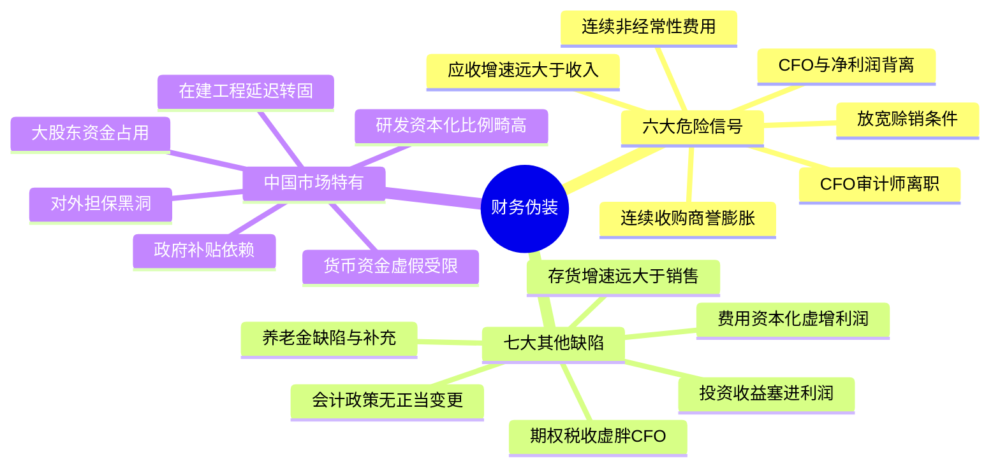
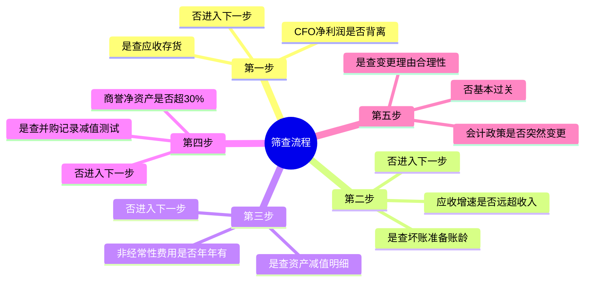

# 第八章　揭开财务伪装（2026中国A股与港股适配版）

**章首定调（原书精神）**

会计准则给管理层很大空间——很多“财务伪装”完全合法，但会误导不细看的人。你不必当CPA去拆穿“怎么做假”，但要能识别警告信号，在证据不够干净时不买/大幅降仓/等澄清。

**中国版导言**：中国会计准则（CAS）与国际准则趋同，但A股/港股公司在**收入确认、应收坏账、商誉减值、研发资本化、政府补贴、关联交易**等方面有独特的“本土特色”。本章在原书六危险信号+七缺陷框架下，注入中国市场最频发的财务伪装形态。

## 一、六个主要危险信号（原书逐条展开·中国版强化）

### ① 衰退中的现金流（CFO与净利润背离）

> **原书**：CFO减少而净利润还在大踏步增→警报。

**中国市场高频场景**：
- **ToG企业**（园林/环保/系统集成）：收入确认激进（完工百分比法），应收账款账龄动辄1-3年，利润增长但CFO持续为负
- **地产/建筑**：合同资产+应收账款双高，现金回款严重滞后
- **消费/制造渠道压货**：放宽信用冲收入，AR膨胀→CFO弱于净利润

| 你的动作 | 中国市场补充 |
|----------|------------|
| 画净利润 vs CFO三年折线 | 看**扣非净利润** vs CFO，而非账面净利润 |
| CFO/净利润<0.8连续2-3年=红灯 | 结合应收账款账龄：1年以上占比上升=钱更难收回 |
| CFO长期负=迟早发债或发股 | 关注是否存在大客户依赖（如单一政府项目/单一大客户） |

### ② 连续的非经常性费用（“一次性”年年见）

> **原书**：当“一次性”年年出现，它就不是一次性。

**中国市场典型形态**：

| 形态 | 具体表现 |
|------|---------|
| **资产减值损失** | 每年大额存货跌价/固定资产减值/在建工程减值 |
| **信用减值损失** | 应收账款坏账计提（有时一年少提→利润好看→下一年集中爆炸） |
| **“财务大洗澡”** | 管理层变更/业绩低迷年→集中计提巨额减值→未来轻装上阵 |
| **商誉减值** | 2014-2016并购狂潮遗产，业绩承诺期一过精准变脸 |

**你的动作**：把损益表里资产减值/信用减值/营业外支出逐行拉5年。若每年都有大额“非经常”但换个名头再来→结构性红旗。

### ③ 连续的收购（Serial Acquirers）

> **原书**：每次收购把财务数据重写一次，越来越难看清真实基线。

**A股特色风险**：
- 2014-2016年并购狂潮：大量公司通过定增+现金收购堆砌利润，商誉堆积
- 业绩承诺期（通常3年）一过→标的精准变脸→商誉减值炸弹
- **港股综合企业折价**：频繁并购的港股综合企业，市场通常给予估值折价

**你的动作**：看并购支出/商誉增速 vs 内生FCF。若增长主要靠并购驱动→安全边际再拔高，查被收购标的真实FCF贡献与商誉膨胀。

### ④ CFO或审计师离开公司

> **原书**：CFO以奇怪理由离开+公司已被怀疑账目问题=极度慎重。

**中国市场强化版**：

| 红旗信号 | 具体含义 |
|----------|---------|
| CFO频繁更换 | 尤其公司财务已存疑时=极高风险 |
| 审计师辞任/频繁更换 | 审计师“不想签字”或与管理层分歧 |
| 独立董事辞职 | 尤其审计委员会独董辞职=财务问题前兆 |
| 证监会/交易所立案调查 | 财务造假嫌疑被正式调查，一票否决 |

**你的动作**：搜索“公司名+CFO+离职/辞职”；查看审计师变更公告措辞；关注是否曾被出具**非标审计意见**（保留意见/无法表示意见/否定意见）。

### ⑤ 没有收到货款的账单（应收增速 >> 收入增速）

> **原书**：应收增速远超收入增速→放宽信用冲收入/渠道压货。

**中国市场最频发的财务伪装之一**：

| 红灯组合 | 含义 |
|----------|------|
| AR增速>收入增速连续2-3年 | 放宽信用冲收入 |
| 坏账准备/AR不升反降 | 公司“过分乐观”，人为抬利润 |
| 其他应收款/预付账款异常膨胀 | 可能隐藏大股东资金占用或虚构交易 |
| 应收账款账龄不断拉长 | 钱越来越难收回→未来坏账风险 |

**你的公式**：ΔAR% vs ΔSales%；DSO≈(AR÷收入)×365趋势；看账龄结构（1年以上应收占比）。

### ⑥ 变更赊销付款条件和应收账款

> **原书**：年报/附注中出现“延长账期/放宽赊销标准”→高度警觉。

**中国市场高频表现**：
- ToB企业为冲业绩放宽信用政策（如“先货后款”改为更长账期）
- 地产/建筑企业以“进度款”名义延缓回款
- 消费/医药企业通过渠道压货（给经销商更长账期）→短期收入增长但未来退货/滞销风险

**配合信号⑤一起看**：放宽账期+应收加速=双重确认。

## 二、要密切注意的七个其他缺陷（原书清单·中国版强化）

### ⑴ 投资收益被塞进核心利润
A股大量公司靠**出售子公司股权/金融资产/投资性房地产**产生一次性收益，使净利润看起来远好于实际经营。**必须看扣非净利润**，剔除投资收益后核心业务是否盈利。

### ⑵-⑶ 养老金缺陷与补充
中国语境对应：**企业年金/社保补缴风险**与附注披露。部分老国企存在大量离退休人员福利负担，虽已逐步剥离，但仍需关注。

### ⑷ 化为乌有的现金流（期权税收抵扣）
中国A股股权激励行权产生的税收抵扣同样可流入CFO，虚胖经营现金流。若CFO中“其他经营活动”项异常大，需看附注。

### ⑸ 塞得满满的仓库（存货增速 >> 销售增速）
**中国高频雷区**：
- 白酒渠道库存周期（经销商囤货→终端动销放缓→渠道爆仓）
- 消费电子迭代跌价（存货库龄越长→跌价风险越大）
- 服装/时尚行业（过季=大幅减值）
- 房企存货（开发产品+开发成本）在房价下行时减值风险巨大

| 你的动作 | 公式 |
|----------|------|
| 存货周转率 | COGS÷均存货，趋势↓=警 |
| 存货增速 vs 收入增速 | 存货跑更快+毛利率无改善→滞销 |
| 存货库龄 | 附注里看“存货跌价准备”是否充足 |

### ⑹ 不好的变更（会计政策/估计变更）
**中国版高频变更**：
- **折旧年限被人为拉长**→减少每年折旧→虚增利润（重资产公司常用）
- **坏账计提比例调低**→减少信用减值→虚增利润
- **研发资本化比例突然提高**→费用推迟→当期利润上升
- **收入确认政策调整**（如从“交货确认”改为“签框架协议即确认”）

**你的动作**：拉年报Note 1（重要会计政策）对比去年，哪条字变了？变更为“少提费用/更早确认收入”→红旗。

### ⑺ 费用化还是非费用化（资本化虚增当期利润）
**A股最频发的利润调节手段之一**：

| 科目 | 红旗信号 |
|------|---------|
| **研发支出资本化** | 资本化比例>50%→利润虚胖。恒瑞医药（全额费用化）vs 部分公司（高比例资本化）天壤之别 |
| **利息费用资本化** | 将借款利息计入在建工程→减少当期财务费用→虚增利润 |
| **广告/营销支出资本化** | 将获客成本/品牌支出挂账→费用推迟 |

**核心原则**：对比同行资本化政策。若一家公司资本化比例显著高于同行且无合理解释，利润质量需打折。

## 三、中国市场特有财务伪装（原书未涵盖）

| 中国特有形态 | 具体表现 | 你的核查动作 |
|------------|----------|------------|
| **政府补贴依赖** | 扣非净利润长期远低于净利润 | 政府补贴/利润总额>20%→不可持续风险 |
| **大股东资金占用** | 其他应收款巨大且账龄长 | 其他应收款/净资产>5%→查附注关联交易 |
| **对外担保黑洞** | 为大股东/关联方提供巨额担保 | 担保总额/净资产>30%=高风险 |
| **货币资金虚假/受限** | 账上大量现金但利息收入极低 | 货币资金/总资产>20%但利息收入/货币资金<1%→资金可能受限/虚假 |
| **在建工程迟迟不转固** | 延迟折旧→虚增利润 | 在建工程/总资产持续攀升且进度缓慢→红旗 |
| **研发资本化比例畸高** | 资本化>50%且无合理解释 | 对比同行：恒瑞全额费用化 vs X公司资本化60% |
| **商誉减值延迟** | 业绩承诺期一过精准变脸 | 商誉/净资产>30%且从未减值=炸弹 |

## 投资者清单：揭开财务伪装（中国A股与港股版总结）

✅ **最硬的一眼**：净利润趋势 vs 经营性现金流趋势——长期背离=潜伏问题。中国必须看扣非净利润 vs CFO。

✅ **应收增速 >> 收入增速** + 坏账准备不跟→放宽信用冲收入信号。ToG/地产/建筑是重灾区。

✅ **连续“非经常性”费用**=结构性（big bath嫌疑）。中国财务大洗澡常见于管理层变更/业绩低迷年。

✅ **频繁收购+商誉膨胀**→财务基线被重写，更难核验。A股2014-2016并购狂潮后遗症仍在。

✅ **CFO/审计师/独董离职**→直接告警。被立案调查=一票否决。

✅ **存货增速 >> 销售增速**→滞销信号。白酒/电子/服装/地产存货减值风险需持续跟踪。

✅ **会计政策无正当变更**（折旧延长/坏账调低/研发资本化提高）→利润虚胖。

✅ **中国特有**：扣非净利润、政府补贴占比、大股东资金占用、对外担保、货币资金真实性、在建工程转固延迟——六个额外必查项。

## 附录：第八章“伪装筛查卡”（中国A股与港股版）

【公司】___________ 【年度】____ 【市场】□A股 □港股

── ① 现金流 vs 利润 ────────────────────────────
CFO/扣非净利润 3年：____ ____ ____ (长期<0.8?□红灯)
走势：CFO↓扣非净利↑?□是(红旗) □no

── ② 应收 ───────────────────────────────────────
ΔAR%____ vs Δ收入%____ → AR跑太快?□是(警)
坏账准备/AR 趋势：同步□ 脱节□(警)
1年以上应收占比：%（上升?□警）
其他应收款/净资产%（>5%?查大股东占用）

── ③ 存货 ───────────────────────────────────────
存货周转=COGS/均存货=____ (↓?□警)
存货增%____ vs 收入增%____
存货跌价准备充足?□是 □no(警)

── ④ 收购/商誉 ─────────────────────────────────
并购驱动增长?□是 商誉/净资产____%（>30%?警）
近3年商誉↑?□是(警) 曾减值过?□是 □从未(警)

── ⑤ 政策变更 ──────────────────────────────────
本年会计估计/政策变更：□无 □有（折旧延长?坏账调低?研发资本化提高?）
变更理由站得住?□y □n(警)

── ⑥ 人员信号 ──────────────────────────────────
CFO近2年离职?□是(⚠) □no
审计师变更?□是(⚠) □no
被立案调查/非标审计意见?□是(一票否决) □no

── ⑦ 中国市场额外 ──────────────────────────────
扣非净利润 vs 净利润差距>20%?□是(依赖非经常性)
政府补贴/利润>20%?□是
大股东资金占用/对外担保黑洞?□是(淘汰)
货币资金/总资产>20%但利息收入极低?□是(资金受限/虚假嫌疑)
研发资本化比例____%（>50%且高于同行?□警）

verdict: □绿灯(可继续估值) □黄灯(降仓/等澄清) □红灯(淘汰)
text

## 思维导图

### 图1：六危险信号+七缺陷（中国版强化）

### 图2：财务伪装快速筛查流程

# 第八章　揭开财务伪装（Avoiding Financial Fakery / Red Flags）

> **章首定调（原书精神）**
>
> 会计准则给管理层很大空间——很多“财务伪装”**完全合法**，但会误导不细看的人；比激进会计更恶劣的，是彻头彻尾的欺骗。你不必当CPA去拆穿“怎么做假”，但要能识别**警告信号**，在证据不够干净时**不买 / 大幅降仓 / 等澄清**。
>
> 多尔西原话精神：**你也许需要一个注册会计师才能把激进/欺骗公司“怎么做”完全理清，但你不用成为财务专家，就能识别警告信号并避开危险公司。**

---

## 章内骨架（原书：六个危险信号 → 七个其他缺陷 → 投资者清单）

text
第八章 揭开财务伪装
├── 一、六个主要危险信号（Red Flags / 危险信号）
│ ├─ ① 衰退中的现金流（CFO与净利润背离）
│ ├─ ② 连续的非经常性费用（“一次性”年年见）
│ ├─ ③ 连续的收购（Serial Acquirers / 重写财务数据）
│ ├─ ④ CFO或审计师离开公司
│ ├─ ⑤ 没有收到货款的账单（应收增速>>收入增速）
│ └─ ⑥ 变更赊销付款条件和应收账款（放宽账期/放宽标准=冲收入信号）
├── 二、要密切注意的七个其他缺陷（Pitfalls / 其他伪装温床）
│ ├─ ⑴ 投资收益被塞进核心利润
│ ├─ ⑵ 养老金缺陷（资金不足/会计增益粉饰）
│ ├─ ⑶ 养老金补充（计划收益不当计入利润）
│ ├─ ⑷ 化为乌有的现金流（期权税收抵扣造成的CFO波动）
│ ├─ ⑸ 塞得满满的仓库（存货增速>>销售增速）
│ ├─ ⑹ 不好的变更（无正当理由的会计政策/估计变更）
│ └─ ⑺ 费用化还是非费用化（把费用资本化→虚增当期利润）
└── 投资者清单：揭开财务伪装

---

## 一、六个主要危险信号（原书逐条展开）

### ① 衰退中的现金流（Declining / weak CFO while net income rises）

> **原书核心句**：随时间推移，经营性现金流（CFO）的增长**应当大致预示**净利润增长；如果你看到**CFO减少（或CFO增长远慢于净利增长）而净利润还在大踏步增**→警报。

- 本质：利润表里记了收入（可能赊销/渠道压货），但现金没同步回来
- 原书点名的经典型：**朗讯（Lucent）**类——大量应收账款、分支机构过度膨胀、养老金抽干现金……表面利润还在走，现金已失速[12](@ref)

#### 你的“最小动作”
- 画 **净利润 vs CFO** 三年折线（或算 **CFO/净利润 比值趋势**）
- 红旗：**CFO长期<净利润**、或 CFO↓/净利↑连续 2–3 期 → 先当“未证实”处理，去查应收/存货

---

### ② 连续的非经常性费用（Frequent "one-time" charges）

> **原书原话精神**：非经常性费用本该“不常”——但有些公司**频繁发生**重组费/减值/整合费/ restructuring…  
> 当“一次性”年年出现，它就是**不是一次性**，而且常被用来：  
> - 把未来费用“摊进现在”（big bath / 洗大澡）→ 让后面看起来轻松  
> - 把不良信息藏在“重组/整合”描述里，不让你看清常态化成本结构

#### 你的“最小动作”
- 把损益表里的 **重组费用 / 减值 / 并购整合费 / 诉讼和解** 逐行拉出 5 年
- 如果每年都有“非经常”但换个名头再来 → 记 **⚠️ 结构性红旗**

---

### ③ 连续的收购（Serial Acquirers）

> **原书警告**：每次收购会把财务数据**改写/重述/重拼**一次，你越来越难看清真实基线；大量收购也常伴随“为买而买”（管理层动机=规模/帝国≠价值）。

#### 你的“最小动作”
- 看 **并购支出 / 并购商誉增速** vs **内生FCF**
- 若增长主要靠并购驱动（见第六章框架）→ 把安全边际再拔高，并追附注：被收购标的真实FCF、整合时间表、商誉膨胀

---

### ④ 首席财务官（CFO职务）或审计师离开公司

> **原书原话精神**：
> - CFO是最懂账的人——若 **CFO以奇怪理由离开**，尤其公司已被怀疑账目问题时，**要极度慎重**  
> - **频繁更换审计师 / 审计师辞任**：也是明确警告信号（独立性/分歧/“我们不想签字”）

#### 你的“最小动作”
- Google：`"[公司名]" CFO resigned / left"` + 10-K/8-K中 **Departure Reason**
- 看代理委托书/公告措辞：retirement正常 vs “mutual separation/strategic disagreement/health”含糊→红旗
- 审计师变更：读 **Form 10-K / 年报“Change in Independent Registered Public Accounting Firm”**节

---

### ⑤ 没有收到货款的账单（A/R growing faster than sales）

> **原书最核心的“应收信号”**：
> - **应收增速 >> 收入增速**（例如销售+10%，应收+20%）→ 很可能放宽信用冲收入/渠道压货  
> - 同时要盯 **坏账准备（Allowance for doubtful accounts）**：若应收飙但坏账准备不按比例提→公司“过分乐观”，人为抬利润表表现[12](@ref)

#### 你的公式（最简）
- **ΔAR% vs ΔSales%**（连续 2–3 年）
- **DSO≈(AR÷收入)×365** 趋势
- 附加：看 **“其他应收款/预付”** 是否异常膨胀（有些公司把虚构应收藏去那儿）[11](@ref)

---

### ⑥ 变更赊销付款条件和应收账款

> **原书**：年报/附注/MD&A里若出现“延长账期/放宽赊销标准/提高信用额度”等表述，要高度警觉——本质可能是“需求不够，靠信贷硬拉销售”。

#### 你要核
- 附注/MD&A 对“信用政策变更”的解释是否站得住（行业淡季？新大客户？ vs 终端需求弱？）
- 配合信号⑤一起看：若放宽账期 + 应收加速 → **双重确认**

---

## 二、要密切注意的七个其他缺陷（原书清单展开）

### ⑴ 投资收益（Investment gains bleeding into operating results）

> **原书**：公司可把**投资收益/出售资产收益**塞进利润表，让核心业务看起来比实际强（甚至用投资收益冲减营业费用）。

- 你的动作：手工拆分 **营业利润（不含投资收益/其他非营业）** vs **净利润**  
- 若净利润亮丽但“持续经营利润”平庸、靠投资/卖楼/卖子公司撑 → 质量打折

---

### ⑵ 养老金缺陷（Underfunded pension）

> 原书语境主要是**美国式固定收益养老金**：计划资金不足＝未来现金流大窟窿；附注能暴露公司是否被退休负债拖住。

- 你至少看清楚：养老金负债规模 / 资金比率 / 是否用“计划投资回报假设”乐观调妆（中国语境→看企业年金/补缴风险与附注披露）

---

### ⑶ 养老金补充（Pension gains boosting profit）

> **原书**：如果养老金计划收益 > 当年费用，超额可计入利润→让利润表更“好看”（不可持续、与市场相关）。

- 动作：把 **pension-related credits/gains** 从核心利润里剔掉再看

---

### ⑷ 化为乌有的现金流（Option-related tax benefits in CFO）

> **原书**：员工行权股票期权时，公司可获**税收抵扣**，这个“员工股票计划的税收收益”会流入**经营现金流**，让CFO虚胖；股价跌时该收益萎缩/消失→CFO也跟着波动。

- 实操：看现金流表附注/或自行近似：**CFO 不含期权税收收益** 趋势更稳（别把不可持续的“期权现金流”当主业造血）

---

### ⑸ 塞得满满的仓库（Inventories rising faster than sales）

> **原书**：存货比销售收入上升快→麻烦。要么滞销，要么在提前确认收入/少结转成本。

- 你的动作：  
  - **存货周转率＝COGS÷均存货**，看趋势  
  - 若存货↑↑ + 毛利率没同步好理由 → 怀疑减值风险（后面可能一次性炸出来）[12](@ref)

---

### ⑹ 不好的变更（Changes in accounting assumptions / policies）

> **原书**：折旧方法、坏账准备计提比例、收入确认时点、费用资本化政策……**无正当理由变更**=用怀疑眼光盯。

- 你的动作（最省力）：
  - 拉 10-K/年报 **Note 1（Summary of Significant Accounting Policies）** 对比去年：哪条字变了？
  - 盯：坏账%/折旧法/收入确认描述/资本化口径
  - 变更为“少提费用/少摊成本/更早确认收入”→红旗

---

### ⑺ 费用化还是非费用化（Capitalizing operating expenses）

> **原书经典警告**：把本应**费用化**（当期营业费用）的东西**资本化**（进资产/B/S）分摊多年 → 当期利润↑，但未来折旧↑，且资产可能不值那么多（在建工程/开发支出/软件/营销费用灰色区）。

- 盯：**PPE/开发支出/无形资产 是否异常膨胀**、转固是否拖延、CapEx/营收是否畸高
- 红旗：利润表费用率“奇迹般下降”，但B/S上“资产项目”悄悄变大

---

## 投资者清单：揭开财务伪装（原书浓缩）

- ✅ **最硬的一眼**：净利润趋势 vs **经营性现金流（CFO）趋势**——长期背离＝潜伏问题（应收/存货/提前确认）[10,12](@ref)
- ✅ **应收增速 >> 收入增速** + 坏账准备不跟 → 放宽信用冲收入信号[12](@ref)
- ✅ **连续“非经常性”费用**（重组/减值/整合）＝结构性（big bath嫌疑）
- ✅ **频繁收购 + 商誉膨胀**→财务基线被反复重写，更难核验
- ✅ **CFO/审计师离职 / 频繁换审计**→直接告警（最懂账的人跑了）
- ✅ **会计政策/估计无正当理由变更**（坏账%/折旧/收入确认）→粉饰嫌疑
- ✅ **把投资收益/养老金会计gain/期权税收抵扣从核心利润与核心现金流里剔除**再看一眼

---

## 附录：第八章“伪装筛查卡”（一键粘进 Excel / Notion / 飞书）

text
【公司】___________ 【年度】____ 【数据源】10-K/年报/附注
── ① 现金流 vs 利润 ────────────────────────────
CFO/净利润 3年：____ ____ ____ (长期<1?□红灯)
走势：CFO↓净利↑?□是(红旗) □no
── ② 应收 ───────────────────────────────────────
ΔAR%____ vs Δ收入%____ → AR跑太快?□是(警)
坏账准备/AR 趋势：同步□ 脱节□(警)
其他应收款/预付 异常?□是□no
── ③ 存货 ───────────────────────────────────────
存货周转 COGS/均存货=____ (↓?□警) 存货增%____ vs 收入增%____
毛利率与存货周转矛盾?□是(疑) □no
── ④ 收购/商誉 ─────────────────────────────────
并购驱动增长?□是 商誉/总资产____% 近3年↑?□是(警)
── ⑤ 政策变更 ──────────────────────────────────
本年会计估计/政策变更：□无 □有（描述：____________ → 理由站得住?□y □n(警)）
── ⑥ 人员信号 ──────────────────────────────────
CFO离职?□是(⚠大) □no 审计师变更?□是(⚠) □no
高管流动率异常?□是 □no
verdict: □绿灯(可继续估值) □黄灯(降仓/等澄清) □红灯(淘汰)