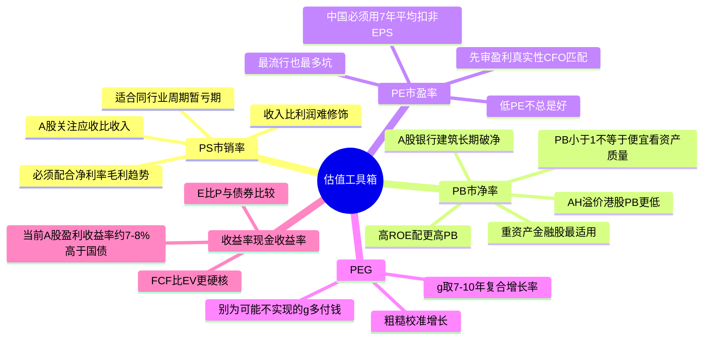
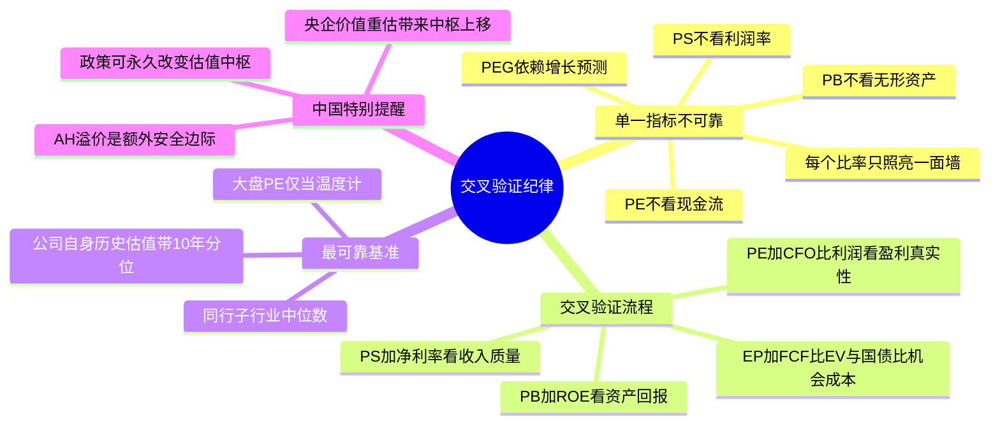

# 《股市真规则》第九章：估值——基础（2026中国A股与港股适配版）

**章首定位（原书精神）**

到此为止你学会了：找好公司（护城河）→ 读懂财报（第5章）→ 审伪装（第8章）→ 审管理（第7章）→ 做公司分析（第6章）。  
但多尔西反复敲的钉子是：**即使买入最好的公司的股票，如果买入价格过高，这也将是一个糟糕的投资。**

**中国版导言**：A股和港股的估值波动远超美股。A股沪深300市盈率在8-25倍之间剧烈摆动，港股恒指市盈率在7-18倍之间波动。在这样的市场中，估值纪律不是锦上添花，而是生存底线。本章的相对估值工具箱在中国完全适用，但每一个比率都需要根据中国市场的特殊性进行校准。

## 一、引入：投资收益 vs 投机收益

### 1.1 多尔西对“投资 vs 投机”的定义（原书明确划线）

| | 投资（Investing） | 投机（Speculating） |
|---|-------------------|---------------------|
| 依据 | 以低于资产估值的价格买入；收益取决于公司财务表现（分红/盈利增长） | 买是因为相信它会升值；收益取决于别人是否愿意出更高价接盘 |
| 你能控制的 | 分析质量 + 买入价（安全边际） | 市场情绪/人群方向（你控制不了） |

**中国A股现实**：长跨度里，投资收益碾压投机收益。A股投资者频繁交易、追涨杀跌，往往沦为投机收益的牺牲品。真正在A股长期赚钱的，是那些在低估时买入、依靠企业盈利和分红获取复利的投资者。

**结论句（你要刻住）**：我们能做的，是坚持不懈做好分析、识别优秀公司，然后**只在价格低于保守估值时出手**——把投机风险最小化，让投资收益最大化。

## 二、按估值全价买入很难投资成功

**原书直白句**：好公司 × 天价 = 烂回报。

- 这里“全价”= 你付的价格几乎不留折扣，甚至溢价追（把未来多年乐观预期全提前兑进现价）
- 原书态度：你可以为高质量、宽护城河公司付更高PE——但不能付“没有安全边际的价”
- 估值不是“抠门”，是对你一定会犯错 + 世界一定会给你意外的保险杠

**A股血泪案例**：2021年“茅指数”核心资产，市盈率60-100倍，投资者相信“好公司不需要看估值”。随后2-3年深度下跌50-80%。再好的公司，买贵了就是糟糕的投资。

**港股案例**：2020-2021年新经济股（快手、美团、腾讯高位），估值极高，随后大幅回调。

这句话等价于第一章“安全边际”在估值章的开场白：**你要的不是“证明它会涨”，而是“证明它值多少，并且用折扣买”。**

## 三、使用多种估值方法更明智

### 3.1 原书核心警告（最常被违反的一条）
**不要依赖任何一个单一的估值指标**——因为没有单一比率能告诉你公司的全部。当你评估一只股票，应同时使用若干个不同的估值工具，让它们相互制衡。

原因一句话：每个比率只照亮一面墙——

| 比率 | 照亮的 | 照不到的（盲区） |
|------|--------|------------------|
| P/S | 规模/收入底座 | 不区分利润率（高利/微利/亏损都能有1×P/S） |
| P/B | 有形资产底座 | 轻资产/无形护城河公司→P/B失真；商誉会抬账面价值 |
| P/E | 盈利效率 | 盈利可修饰/周期扭曲/负利润不可用 |
| PEG | 把增长塞进P/E | 增长率预测极不可靠（你为“可能不实现的g”多付钱） |

### 3.2 原书给的“最可靠基准”优先级
1. **最可靠的基准** = 公司自己的历史估值带（前提是公司护城河/业务模式在此期间没发生本质变化）
2. 其次：同行/子行业中位数（但要调风险&资本结构差异）
3. **最不靠谱**：大盘P/E当万能尺（不同行业不同杠杆不同周期不同再投资需求）

**中国特别提醒**：A股整体估值中枢（沪深300 PE 12-14倍）只能作为“温度计”，不能用来判断个股是否值得买入。每家公司都有自己的历史估值区间。同时，A股部分行业估值中枢可能因政策变化而永久性下移（如地产、教培）。

## 四、逐个拆解：相对估值工具箱（原书 toolkit，中国版校准）

### ① 市销率 P/S（Price-to-Sales）
> P/S ＝ 股价 ÷ 每股销售收入（或 市值 ÷ 营业收入）

| 项目 | 原书定位 | 中国市场补充 |
|------|----------|------------|
| 为什么有用 | 销售收入比利润难修饰（至少比EPS难）；当公司盈利历史不稳定/暂亏但收入真实存在→P/S比P/E可用 | 中国ToG企业（面向政府）收入确认可能激进，需看应收账款/收入比 |
| 适用 | 比较同行业公司；周期性/暂亏损期公司；快速筛查“市销率是否低于自身历史均值带” | A股适用同行业对比；餐饮/零售/电商等轻资产服务业尤其适用 |
| 不适用 | 跨行业硬比P/S（除非盈利能力水平极相似）；低P/S≠低估：可能是微利/无利公司 | 1×P/S对10%净利率公司 vs 1%净利率公司含义天差地别 |
| 核查动作 | 看P/S历史带（5–10年）：当前在高位区还是低位区？同时看净利率/毛利趋势（确认收入质量） | 中国额外看：收入增长与应收账款增长是否匹配 |

**原书一句话收束**：P/S是“最基础的基础比率”，但它必须配合盈利能力才有意义——否则只是“看个热闹”。

### ② 市净率 P/B（Price-to-Book）
> P/B ＝ 股价 ÷ 每股账面价值（BV = 所有者权益/净资产）

| 项目 | 原书定位 | 中国市场补充 |
|------|----------|------------|
| 为什么有用 | 对有巨额有形资产/可核实资产底座的行业，账面价值是真实锚（最经典：银行/保险/重工） | A股银行、建筑、钢铁长期破净，PB 0.3-0.8倍是常态。港股破净更普遍 |
| 不适用 | 服务性/轻资产公司（价值在人/品牌/网络/软件——账面几乎抓不到）→P/B“低”可能只是假象 | 中国消费品（茅台、伊利）PB长期偏高是因为品牌价值不反映在账面 |
| 关键补充 | 高ROE的公司天然配更高P/B——ROE=15%的公司，P/B=3可能合理；ROE=5%的公司，P/B=1.5都可能贵 | 同左，完全适用 |
| 金融股危险信号 | P/B<1.0且资产质量可疑→可能正在经历麻烦（坏账/隐藏损失/拨备不足） | **A股银行极度重要**：PB低至0.3-0.5倍不一定便宜，可能是资产质量存疑。必须结合不良率、拨备覆盖率、逾期贷款偏离度一同审视 |
| **中国特有优势** | — | 港股同公司常有更低PB（AH溢价指数130-150），同一资产港股PB更低=更厚安全边际 |

**实操抓手**：看P/B时永远并排看ROE（P/B÷ROE直觉：你付的是“账面1块钱，它能替你赚多少”）。在中国，PB<0.7倍+ROE>12%+股息率>5%的央企组合，是积极型投资者的经典猎场。

### ③ 市盈率 P/E（Price-to-Earnings）——最流行，也最多坑
> P/E ＝ 股价 ÷ 每股收益（EPS）

**原书给的“正确使用法”——中国版必须用扣非EPS！**

| 问题 | 原书让你先问的 | A股/港股特别关注 |
|------|--------------|----------------|
| 公司最近出售业务/资产了吗？ | 一次性收益会压低P/E（看起来“便宜”但其实不） | 中国公司经常靠卖资产、卖子公司股权调节利润，必须用扣非EPS计算 |
| 发生过大笔非经常性费用吗？ | 一次性费用会抬P/E（看起来“贵”但其实核心没那么差） | “财务大洗澡”一次性计提减值后，PE可能被动抬高，需区分“真洗澡”还是“藏雷” |
| 公司更有周期性吗？ | 周期顶部P/E低（利润爆表）→看起来便宜其实是火中取栗；周期底部P/E高（利润塌）→看起来贵其实是折扣区 | **中国核心原则**：用7-10年平滑后的平均扣非EPS计算PE，而非单一年度 |
| 盈利是真实的还是想象的？ | 看CFO/净利润、AR/存货（回到第5/8章）→纸面EPS要打折 | 经营现金流/净利润>0.8为及格；<0.5为强烈红灯 |
| 再投资需求有多大？ | 高增长但每1美元盈利都需要股东再投进去（资本吞噬）→P/E低≠便宜 | 中国重资产周期股（钢铁、化工、航空）CapEx巨大，FCF远低于净利润 |

**原书最重要一句关于“低P/E幻觉”**：
低市盈率不总是好的。高增长、低风险、较低再投资需求（现金机器）应该有较高P/E——你为低风险高FCF公司多付点，比为周期性重资本公司“便宜P/E”买单更安全。

**A股/港股PE基准用法**：
- 自身历史P/E带（10年分位）+ 同行对比（调风险/增长/资本结构）
- **中国特有建议**：使用过去7-10年平均扣非EPS计算PE，而不是过去12个月。因为A股盈利波动大，单年度PE极易失真。

### ④ PEG（市盈率相对盈利增长比率）
> PEG ＝ P/E ÷ 增长率 g（通常g取5年平均盈利增速）

| 项目 | 原书定位 | A股/港股特别提醒 |
|------|----------|-----------------|
| 表面逻辑 | “成长股应该贵，所以用增长校准一下”——PEG<1常被当“低估”信号 | A股成长股投资者最爱的指标 |
| 原书警告 | 快速增长的公司也更有风险，增长率预测极易错→不要为“预期可能但还没实现的增长率”多付钱 | **2021年茅指数教训**：消费龙头的g被高估（预测永续15-20%增长），PEG<1的幻觉让人追高 |
| 用法 | 只当“粗糙校准”，且g要保守、要多年平均；绝不单靠PEG下单 | g取过去7-10年复合增长率，不是近2-3年爆发期数据 |

**原书态度不是“PEG不能用”，而是**：它比P/E更依赖你预估的未来增长是否正确——当增长落空，PEG好看也没用。

### ⑤ 收益率 & 现金收益率（把股票当“生息资产”看）

**A. 盈利收益率（Earnings Yield）**
> 盈利收益率 ＝ E/P ＝ 1 ÷ P/E

- 好处：可与债券收益率直接比较（机会成本思维）
- 原书精神：如果盈利收益率显著高于当期高质量债券收益率→可能暗示低估（但必须确认盈利质量/持久性）
- **中国应用**：
  - 当前10年期国债收益率约2.5%-3.0%
  - 沪深300盈利收益率约7%-8%（PE 13-15倍的倒数）
  - 股票盈利收益率显著高于债券→相对具有吸引力
  - 但需用扣非盈利计算，且确认公司盈利可持续

**B. 现金收益率（Cash Return / Cash Yield）——原书更偏好的“硬口径”**
> 现金收益率 ＝ 自由现金流FCF ÷ 企业价值EV
> EV ＝ 市值 ＋ 长期有息负债 － 现金及等价物

| 项目 | 为什么 |
|------|--------|
| FCF | 比EPS更接近“真实现金能分给资本提供者”的量 |
| EV分母 | 同时管住股权+债权的资金底座（比只看市值更完整） |
| 注意 | 金融股/外国股因结构不同要谨慎 |

- **中国应用**：
  - FCF/营收≥5%的公司，现金收益率通常较健康
  - 中国大量公司FCF不稳定，现金收益率比盈利收益率更具参考价值
  - 港股央企/国企的FCF/EV常更优（因估值更低）

## 五、投资者清单：估值——基础（中国A股与港股版总结）

✅ **要对估值吹毛求疵**：你买的是“低于内在价值的价格”，不是“低PE故事”。在中国，低PE不一定是低估，高PE不一定是高估——要看7-10年平均。

✅ **别依赖单一估值指标**：P/S、P/B、P/E、PEG、现金收益率各有照亮面也各有盲区→交叉用。在中国，所有盈利类指标都必须用扣非口径。

✅ **P/S**：适合同行业/周期暂亏期；低P/S≠低估，要看净利率/毛利质量。中国需额外关注应收/收入比。

✅ **P/B**：对金融股/重资产有用（A股银行、建筑、钢铁长期破净）；对服务/轻资产意义不大。P/B低要配看ROE与资产质量。港股通常提供更低PB和更厚安全边际。

✅ **P/E**：最流行但坑最多——**在中国，必须用7-10年平均扣非EPS计算**。先审盈利真实性（CFO/AR/存货/一次性）→再比自身历史带→低P/E不总是好（高增长低风险低再投资需求的公司该贵）。

✅ **PEG**：谨慎；别为“可能不实现的g”多付钱；g取7-10年复合增长率，不是近2-3年爆发期。

✅ **收益率/现金收益率**：将E/P和FCF/EV与10年期国债收益率（约2.5-3.0%）比较。当前A股整体盈利收益率约7-8%，相对债券有吸引力。港股更低估值提供更优现金收益率。

✅ **最可靠基准≈公司自身历史估值**（前提：业务模式没质变，政策环境未颠覆）。相对估值只能说“离基准远近”，不能说“值多少”。

✅ **中国特有提醒**：AH溢价使同一公司港股常便宜20-30%；政策变化可永久性改变估值中枢（如教培、地产）；央企价值重估可能带来估值中枢上移。

## 附录：第九章“估值基础”速筛卡（中国A股与港股版）

【公司】___________ 【行业】_____ 【日期】____ 【EPS用扣非?□是 □no】

── P/S ────────────────────────────────────────────
P/S × 历史带(×–×) 位置:低位□ 中位□ 高位□
扣非净利率 % (P/S低但净利率≈0?□警)
中国额外：应收/收入比趋势 □健康 □恶化

── P/B ────────────────────────────────────────────
P/B × ROE % (P/B低但ROE也低?□可能价值陷阱 □ok)
金融股?□是(资产质量查:不良率__拨备覆盖率__) □no
港股vsA股：□港股更便宜(AH溢价__%) □A股更便宜
硬资产占比 % (商誉占比<30%?□是 □否)

── P/E ────────────────────────────────────────────
7年平均扣非EPS __ P/E ×
历史P/E带(×–×) 位置:低□ 中□ 高□
周期股?□是(顶部低P/E最危险) □no
一次性强/资产出售影响?□是(调后P/E__×) □no
CFO/净利润≈__ (5年均值，<0.8?红灯)

── PEG ────────────────────────────────────────────
g(7-10年复合)% PEG=P/E÷g=__ (<1?但g可靠吗□是□no(警))

── 收益率 ────────────────────────────────────────
E/P=1/P/E=% vs 10年国债2.5-3.0% (显著高于?□是)
FCF/营收=% EV=市值+长债-现金=__ FCF/EV=__% vs 国债

── 交叉结论 ─────────────────────────────────────
多指标一致指向低估?□是 □矛盾(列矛盾:________)
港股是否提供额外安全边际?□是(AH溢价>130) □否
最终verdict: □进入DCF/内在价值 □等更优折扣 □淘汰
text

## 思维导图（按阅读逻辑拆分）

### 图1：估值工具箱全景——五种比率各照亮一面墙

### 图2：估值交叉验证——多工具制衡

# 第九章　估值——基础（Valuation: The Basics）

> **章首定位（原书精神）**
>
> 到此为止你学会了：**找好公司（护城河）→ 读懂财报（第5章）→ 审伪装（第8章）→ 审管理（第7章）→ 做公司分析（第6章）**。  
> 但多尔西反复敲的钉子是：
>
> > **即使买入最好的公司的股票，如果买入价格过高，这也将是一个糟糕的投资。**
>
> 第九章不教你"预测明年的价"，而是给你一套**相对估值工具箱 + 使用边界 + 交叉验证纪律**，并为第十章"内在价值/DCF"搭梯子——因为**所有比率法的最大缺陷是：它们全部以价格为基础，只能告诉你"离基准近还是远"，不能说清"公司到底值多少"**。

---

## 章内骨架（原书：引入 → 对估值要吹毛求疵 → 多种工具交叉用 → 各比率逐一拆解 → 投资者清单）

text
第九章 估值——基础
├── 一、引入：投资收益 vs 投机收益（为什么要"估值"而不"猜价"）
├── 二、按估值全价买入很难投资成功（好公司买贵了=平庸回报）
├── 三、使用多种估值方法更明智（单一指标幻觉）
├── 四、逐个拆解：相对 valuation toolkit（P/S · P/B · P/E · PEG · 收益率/现金收益率）
│ ├─ ① 市销率 P/S
│ ├─ ② 市净率 P/B
│ ├─ ③ 市盈率 P/E（最流行，也有最多坑）
│ ├─ ④ PEG（P/E ÷ 增长率——最容易被"预期增长"带沟里）
│ └─ ⑤ 收益率 & 现金收益率（把股票当"生息资产"看）
└── 投资者清单：估值——基础

---

## 一、引入：投资收益 vs 投机收益

### 1.1 多尔西对"投资 vs 投机"的定义（原书明确划线）

| | 投资（Investing） | 投机（Speculating） |
|-|-------------------|---------------------|
| **依据** | 以**低于资产估值的价格**买入；收益取决于**公司财务表现**（分红/盈利增长） | 买是因为相信它会升值；收益取决于**别人是否愿意出更高价接盘** |
| **你能控制的** | 分析质量 + 买入价（安全边际） | 市场情绪/人群方向（你控制不了） |

> 原书引用的博格（先锋创始人）分解精神：  
> 整个20世纪美股约 **10.4% 年收益**可拆成≈ **5% 来自分红 + 4.8% 来自盈利增长 + 仅 0.6% 来自市盈率变化**。  
> → **长跨度里，投资收益碾压投机收益**；短框架（如1980–2000）里投机收益（P/E扩张）占比会放大，但你无法依赖它。

**结论句（你要刻住）：**
> 我们能做的，是坚持不懈做好分析、识别优秀公司，然后**只在价格低于保守估值时出手**——把投机风险最小化，让投资收益最大化。

---

## 二、按估值全价买入很难投资成功

> **原书直白句：好公司 × 天价 = 烂回报。**

- 这里"全价"= 你付的价格**几乎不留折扣**，甚至**溢价追**（把未来多年乐观预期全提前兑进现价）
- 原书态度：
  - 你**可以**为高质量、宽护城河公司付更高PE——但不能付"没有安全边际的价"
  - 估值不是"抠门"，是**对你一定会犯错 + 世界一定会给你意外**的保险杠

> 这句话等价于第一章"安全边际"在估值章的开场白：  
> **你要的不是"证明它会涨"，而是"证明它值多少，并且用折扣买"。**

---

## 三、使用多种估值方法更明智

### 3.1 原书核心警告（最常被违反的一条）

> **不要依赖任何一个单一的估值指标——因为没有单一比率能告诉你公司的全部。**  
> 当你评估一只股票，应**同时使用若干个不同的估值工具**，让它们相互制衡。

原因一句话：每个比率只照亮一面墙——

| 比率 | 照亮的 | 照不到的（盲区） |
|------|--------|-----------------|
| P/S | 规模/收入底座 | 不区分利润率（高利/微利/亏损都能有1×P/S） |
| P/B | 有形资产底座 | 轻资产/无形护城河公司→P/B失真；商誉会抬账面价值 |
| P/E | 盈利效率 | 盈利可修饰/周期扭曲/负利润不可用 |
| PEG | 把增长塞进P/E | 增长率预测极不可靠（你为"可能不实现的g"多付钱） |

### 3.2 原书给的"最可靠基准"优先级

> **最可靠的基准 = 公司自己的历史估值带**（前提是公司护城河/业务模式在此期间没发生本质变化）  
> 其次：同行/子行业中位数（但要调风险&资本结构差异）  
> 最不靠谱：大盘P/E当万能尺（不同行业不同杠杆不同周期不同再投资需求）

---

## 四、逐个拆解：相对估值工具箱（原书 toolkit）

### ① 市销率 P/S（Price-to-Sales）

> **P/S ＝ 股价 ÷ 每股销售收入**（或 市值 ÷ 营业收入）

| 项目 | 原书定位 |
|------|---------|
| **为什么有用** | 销售收入比利润**难修饰**（至少比EPS难）；当公司**盈利历史不稳定/暂亏但收入真实存在**→P/S比P/E可用 |
| **适用** | 比较**同行业**公司；周期性/暂亏损期公司；快速筛查"市销率是否低于自身历史均值带" |
| **不适用** | 跨行业硬比P/S（除非盈利能力水平极相似）；**低P/S ≠ 低估**：可能是微利/无利公司（1×P/S对10%净利率公司 vs 1%净利率公司含义天差地别） |
| **核查动作** | 看 **P/S 历史带（5–10年）**：当前在高位区还是低位区？同时看 **净利率/毛利趋势**（确认收入质量） |

> 原书一句话收束：P/S是"最基础的基础比率"，但它**必须配合盈利能力**才有意义——否则只是"看个热闹"。

---

### ② 市净率 P/B（Price-to-Book）

> **P/B ＝ 股价 ÷ 每股账面价值（BV = 所有者权益/净资产）**

| 项目 | 原书定位 |
|------|---------|
| **为什么有用** | 对有**巨额有形资产/可核实资产底座**的行业，账面价值是真实锚（最经典：**银行/保险/重工**） |
| **不适用** | **服务性/轻资产公司**（价值在人/品牌/网络/软件——账面几乎抓不到）→P/B"低"可能只是假象（尤其商誉一抬BV更失真） |
| **关键补充（原书强调）** | **高ROE 的公司天然配更高 P/B**——ROE=15%的公司，P/B=3 可能合理；ROE=5%的公司，P/B=1.5 都可能贵 |
| **金融股危险信号** | P/B **< 1.0** 且资产质量可疑→可能正在经历麻烦（坏账/隐藏损失/拨备不足）|

> 实操抓手：看 P/B 时**永远并排看 ROE**（P/B ÷ ROE 直觉：你付的是"账面1块钱，它能替你赚多少"）

---

### ③ 市盈率 P/E（Price-to-Earnings）——最流行，也最多坑

> **P/E ＝ 股价 ÷ 每股收益（EPS）**（通常用**稀释EPS**更严谨）

#### 原书给的"正确使用法"

| 问题 | 原书让你先问的（防被P/E骗） |
|------|-----------------------------|
| **公司最近出售业务/资产了吗？** | 一次性收益会压低P/E（看起来"便宜"但其实不） |
| **发生过大笔非经常性费用吗？** | 一次性费用会抬P/E（看起来"贵"但其实核心没那么差） |
| **公司更有周期性吗？** | 周期顶部P/E低（利润爆表）→ **看起来便宜其实是火中取栗**；周期底部P/E高（利润塌）→ **看起来贵其实是折扣区** |
| **盈利是真实的还是想象的？** | 看 CFO/净利润、AR/存货（回到第5/8章）→ 纸面EPS要打折 |
| **再投资需求有多大？** | 高增长但每1美元盈利都需要股东再投进去（资本吞噬）→P/E低≠便宜 |

#### 原书最重要一句关于"低P/E幻觉"

> **低市盈率不总是好的。**  
> 高增长、低风险、较低再投资需求（现金机器）**应该有较高P/E**——你为低风险高FCF公司多付点，比为周期性重资本公司"便宜P/E"买单更安全。

- 基准用法：**自身历史P/E带**（10年分位）+ 同行对比（调风险/增长/资本结构）
- 原书提醒：别迷信"市场平均P/E"当万能标尺

---

### ④ PEG（市盈率相对盈利增长比率）

> **PEG ＝ P/E ÷ 增长率 g**（通常 g 取 **5年平均** 盈利增速，不是单年爆表）

| 项目 | 原书定位 |
|------|---------|
| 表面逻辑 | "成长股应该贵，所以用增长校准一下"——PEG<1常被当"低估"信号 |
| **原书警告（关键）** | **快速增长的公司也更有风险**，增长率预测极易错→**不要为"预期可能但还没实现的增长率"多付钱** |
| 用法 | 只当"粗糙校准"，且 g 要保守、要多年平均；绝不单靠PEG下单 |

> 原书态度不是"PEG不能用"，而是：它比P/E更依赖**你预估的未来增长是否正确**——当增长落空，PEG好看也没用。

---

### ⑤ 收益率 & 现金收益率（把股票当"生息资产"看）

#### A. 盈利收益率（Earnings Yield）

> **盈利收益率 ＝ E/P ＝ 1 ÷ P/E**

- 好处：可与**债券收益率**直接比较（机会成本思维）
- 原书精神：如果盈利收益率显著高于**当期高质量债券收益率**→可能暗示低估（但必须确认盈利质量/持久性）

#### B. 现金收益率（Cash Return / Cash Yield）——原书更偏好的"硬口径"

> **现金收益率 ＝ 自由现金流 FCF ÷ 企业价值 EV**  
> **EV ＝ 市值 ＋ 长期有息负债 － 现金及等价物**

| 项目 | 为什么 |
|------|------|
| FCF | 比EPS更接近"真实现金能分给资本提供者"的量 |
| EV分母 | 同时管住**股权+债权**的资金底座（比只看市值更完整） |
| 注意 | 金融股/外国股因结构不同要谨慎（原书提"不能用/不好用"口径） |

> 原书给的比较精神：**把现金收益率与可比债券收益率放一起看**——不是"精确定价"，而是"机会成本过滤"。

---

## 投资者清单：估值——基础（原书章末浓缩）

- ✅ **要对估值吹毛求疵**：你买的是"低于内在价值的价格"，不是"低PE故事"
- ✅ **别依赖单一估值指标**：P/S、P/B、P/E、PEG、收益率各有照亮面也各有盲区→交叉用
- ✅ **P/S**：适合同行业/周期暂亏期；低P/S≠低估，要看净利率/毛利质量
- ✅ **P/B**：对金融股/重资产有用；对服务/轻资产意义不大；P/B低要配看ROE与资产质量
- ✅ **P/E**：最流行但坑最多——先审盈利真实性（CFO/AR/存货/一次性）→再比自身历史带→低P/E不总是好（高增长低风险低再投资需求的公司该贵）
- ✅ **PEG**：谨慎；别为"可能不实现的g"多付钱；g用多年平均、保守取
- ✅ **收益率/现金收益率**：E/P比债券？FCF/EV > 债券？→机会成本过滤；但金融股特殊
- ✅ **最可靠基准≈公司自身历史估值（前提：业务模式没质变）**；相对估值只能说"离基准远近"，不能说"值多少"——这是第十章DCF登场的理由

---

## 附录：第九章"估值基础"速筛卡（一键粘进 Excel / Notion / 飞书）

text
【公司】___________ 【行业】_____ 【日期】____ 【EPS用稀释?□是 □no】
── P/S ────────────────────────────────────────────
P/S × 历史带(×–__×) 位置:低位□ 中位□ 高位□
净利率 __% (P/S低但净利率≈0?□警)
── P/B ────────────────────────────────────────────
P/B __× ROE __% (P/B低但ROE也低?□可能价值陷阱 □ok)
金融股?□是(资产质量查:_) □no
── P/E ────────────────────────────────────────────
稀释EPS __ P/E __×
历史P/E带(×–×) 位置:低□ 中□ 高□
周期股?□是(顶部低P/E最危险) □no
一次性强/资产出售影响?□是(调后P/E__×) □no
CFO/净利润≈__(<1?红灯)
── PEG ───────────────────────────────────────────
g(5年均)__% PEG= P/E÷g = __ (<1?但g可靠吗□是□no(警))
── 收益率 ────────────────────────────────────────
E/P=1/P/E=__% vs 国债/高等级债 __%
FCF/营收=% EV=市值+长债-现金=__ FCF/EV=% vs 债
── 交叉结论 ─────────────────────────────────────
多指标一致指向低估?□是 □矛盾(列矛盾:____________)