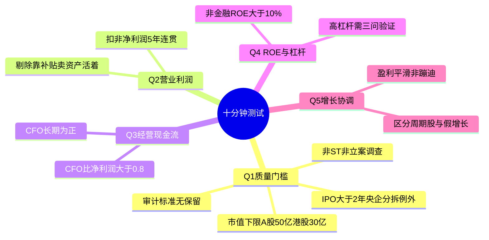
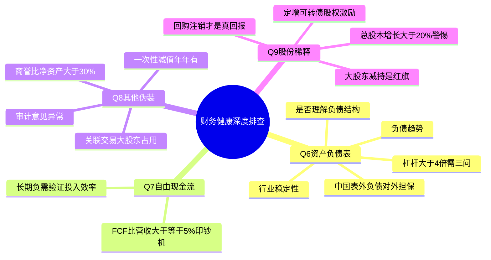
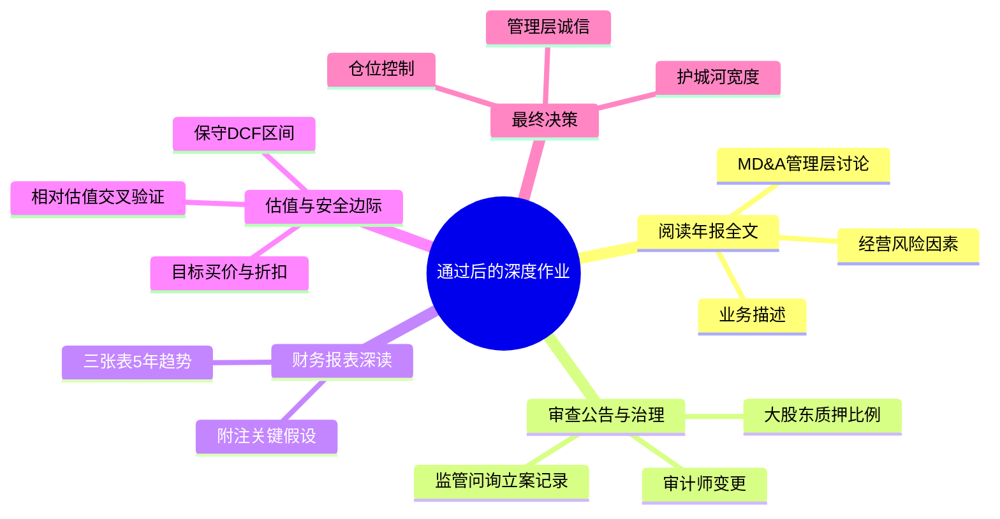

# 《股市真规则》第十二章：十分钟测试——2026中国A股与港股适配版

**章首定位（原书精神）**

市场上几千只股票，你不可能每只都做全套功课。多尔西给这套“10分钟测试”的定位非常清醒：

它不是“发现十倍股”的工具，而是**初筛漏斗**——快速踢掉劣质、高风险、信息不足、财务可疑的票，把有限精力锁在值得深挖的候选池里。

通过测试的 ≠ 一定涨；但没通过的，大概率不值得你花第11分钟。对价值投资者来说：**规避错误本身就是收益**。

**中国版导言**：A股和港股市场公司数量庞大（A股超5000家，港股超2500家），财务质量参差不齐，题材炒作盛行。十分钟测试在中国更为必要——它帮你快速排除绩差股、庄股、财务可疑股、政策风险股。以下测试问题完全适用中国市场，但根据A股/港股特征进行了门槛调整。

## 章内骨架（原书 p.160→163）

十分钟测试
├── Q1 公司能否通过最小的质量考验？（排除 junk / 信息黑洞 / IPO 幻觉）
├── Q2 公司一直不断地赚取营业利润吗？
├── Q3 公司能从经营活动中持续不断地产生现金流吗？
├── Q4 净资产收益率能保持 10% 以上，并且有合理的财务杠杆吗？
├── Q5 盈利增长是协调一致还是飘忽不定？
├── Q6 资产负债表有多清白？（杠杆健康度 + 趋势 + 你是否真懂负债）
├── Q7 这家公司产生自由现金流吗？
├── Q8 还有多少“其他”？（一次性费用 / 非经常性猫腻 / 附注黑洞）
├── Q9 发行在外股票数量在过去几年明显增长了吗？（稀释信号）
└── Q10 超越这10分钟（通过的票 → 下一步的“真正作业清单”）
text

## Q1　公司能否通过最小的质量考验？——先把“信息黑洞/博彩票”排除

### 1.1 原书的三类排除对象（中国市场调整）

| 排除项 | 原书理由 | A股/港股具体标准 |
|--------|----------|------------------|
| ① 极小市值 / 流动性陷阱 | 股价易被操纵、披露严重不足、流动性陷阱 | 设硬门槛：A股总市值≥50亿人民币；港股总市值≥30亿港币（低于此易被庄家控盘，流动性枯竭时无法卖出） |
| ② 不提交正式定期财报的公司 | 你没法做“做功课”是因为信息权被剥夺 | 只看按期披露年度报告、半年报、季报的公司；回避频繁更换审计师、被出具非标审计意见（保留意见/无法表示意见/否定意见）的公司 |
| ③ 最近 IPO（首次公开发行） | 公司选“能卖高价时”才上市 → 极少便宜货；短记录/高期望=估值泡沫高发段 | A股：上市不足2年的新股不碰（注册制下破发比例高，业绩变脸频繁）；港股：同样适用 |
| **④ 中国特有：ST/*ST 公司** | — | 连续亏损、净资产为负、存在重大违法违规的公司，退市风险极高，直接排除 |
| **⑤ 中国特有：被立案调查/财务造假嫌疑** | — | 证监会立案调查、财务造假被公开谴责、大股东资金占用未解决的公司，一票否决 |

**例外**：从大型央企/国企母公司分拆出来的子公司（如三峡能源、中国移动A股上市），已有长期运营历史，分拆上市后可能被低估，可进入例外通道。港股红筹回A也同理。

### 你的 Q1 核查格（直接填）

□ 总市值 ≥ 最低门槛（A股≥50亿/港股≥30亿）？ □否→淘汰
□ 交易场所正规（A股主板/创业板/科创板/北交所；港股主板）？ □是 □否→淘汰
□ 近三年审计意见为标准无保留？ □是 □否→淘汰
□ 未被证监会立案调查/公开谴责？ □是 □否→淘汰
□ 不是 ST/*ST 公司？ □是 □否→淘汰
□ 上市≥24个月？ □否（且非央企/国企分拆）→ 淘汰 □否（但是央企/国企分拆）→ 可进例外通道
text

## Q2　公司一直不断地赚取营业利润吗？——最简单的“生意是否成立”测试

**原书原话精神**：这项测试很简单，但会让你避开很多麻烦。

- 看**营业利润（Operating Income/EBIT）**，不是净利润（净利润可被利息/税率/一次性扭曲）
- 看**过去5年序列**：要的是连贯的盈利机器，不是“一年爆表、两年亏损、反复横跳”
- **中国特别提醒**：A股部分公司靠**政府补贴、资产处置、债务重组收益**维持账面净利润，但营业利润持续为负。必须看**营业利润**或**扣非净利润**，不能只看净利润。

| 绿灯 | 红旗 |
|------|------|
| 营业利润5年里≥4年为正，且亏损年也浅/可控 | 连续亏损 + “下季度就逆转”故事年年讲 |
| 行业不差但营业利润率长期高于同行 | 毛利率连年下滑→竞争侵蚀 |
| 扣非净利润与营业利润趋势一致 | 净利润正但营业利润为负=靠补贴/卖资产活着 |

**Q2 一句话**：钱都赚不到，谈什么复利。在中国，如果一家公司扣非净利润连续亏损，不管故事多好听，十分钟测试直接淘汰。

## Q3　公司能从经营活动中持续不断地产生现金流吗？——利润≠现金，再次登场

**原书原话精神**：快速增长的公司有时会在产生现金流之前报告利润，但每家公司最终都必须产生现金流，否则就需要通过发行债券或股票融资。

| 看什么 | 具体动作（5年最简） |
|--------|-------------------|
| CFO（经营性现金流）正负 | 5年里CFO负年数？允许最多1年负（特殊情况：重扩产期），但不能“长期负” |
| CFO vs 净利润 | CFO/净利润长期趋势应趋近或大于1（至少别长期<0.7–0.8且扩大） |
| 危险形态 | CFO长期负/利润却正 → 应收↑/存货↑吃现金 → 迟早要发股或举债（稀释你或加杠杆） |

**中国高发雷区**：
- ToG（面向政府）企业：大量收入形成应收账款，利润好看但经营现金流长期为负。这是A股最常见的“纸面繁荣”陷阱。园林绿化、环保工程、部分系统集成公司是重灾区。
- 地产/建筑企业：合同资产和应收账款巨大，经营现金流波动剧烈。

✅ **Q3 绿灯**：CFO多数年为正，且与扣非净利同向，CFO/净利润（5年均值）>0.8
❌ **Q3 红旗**：CFO长期负/利润与现金长期撕裂/CFO/净利润<0.5

## Q4　净资产收益率能保持10%以上，并且有合理的财务杠杆吗？

**原书原话**：用10%作为净资产收益率（ROE）最低限度门槛。如果一家非金融性公司5年间有4年不能达到10%以上ROE，它不值得你花时间。

### 4.1 两个数字一起看（这就是“并且”的意思）

| 指标 | 基准 | 中国市场补充 |
|------|------|------------|
| ROE = 净利润 ÷ 股东权益 | 非金融：≥10%（5年里有4年达标）；金融/保险提至≥12% | 中国银行股ROE普遍在10-12%，可适当降低至≥10%但需结合不良率和拨备覆盖率 |
| 杠杆健康 | 同时审有息负债/权益、资产负债率趋势 | 中国国企杠杆率普遍偏高（建筑/电力/钢铁），需区分行业。强周期行业高杠杆+低ROE=淘汰 |

**中国特别提醒**：高ROE必须追问是否靠**超高杠杆**堆出来的。地产、民营大炼化在景气高点ROE极高，但去杠杆后ROE崩塌。真正的优质公司，ROE来自高利润率或高周转率，而非高杠杆。

### 4.2 Q4 实操（30秒判断）

ROE 5年均：%（≥10%达标？□Y □N→淘汰）
有息负债/权益趋势：↑□(警) →□↓
资产负债率≈%（同行业比较，是否异常偏高？）
结论：ROE够但杠杆炸？→ 要么淘汰要么降仓+更大折扣
text

## Q5　盈利增长是协调一致还是飘忽不定？——最好的公司不“蹦迪”

**原书原话精神**：最好的公司显示的是协调一致的增长率。盈利最好不要跳上跳下。

| 看什么 | 绿灯 | 红旗 |
|--------|------|------|
| EPS/扣非净利润 5年序列形状 | 趋势平滑向上 / 最多一次周期下探但恢复 | 一年爆表一年巨亏；标准差极大；“盈利”靠一次性撑 |
| 行业语境 | 稳定/慢周期行业（消费/医药/公用事业）应更稳 | 强周期本身不是错，但你要用“周期思维”而不是“成长股滤镜”看它 |
| 毛利率联动 | 收入增→毛利增（定价权） | 收入增但毛利缩＝量增价崩/成本炸＝假增长 |

**中国案例**：生猪养殖（牧原、温氏）盈利随猪周期剧烈波动，属于典型周期股，不应以“成长股”标准要求其盈利平滑。但若一家消费公司（如食品饮料）盈利也大起大落，则须高度警惕。

**一句话**：Q5不是让你拒绝所有周期——是让你拒绝**“增长来自会计/一次性/渠道压货，不是来自护城河”**的假协调。

## Q6　资产负债表有多清白？——杠杆/债务质量是“非金融公司”的命门

**原书原话**：如果一家非银行公司财务杠杆比率超过4（资产/权益），或者负债权益比率在1.0以上，应该问——

### 6.1 三个追问（原书给的“三问法”）

| # | 问题 | 中国市场补充 |
|---|------|------------|
| ① | 这家公司所处行业业务稳定吗？ | 中国：水电/电信/消费品龙头较稳定；钢铁/化工/地产/养猪极不稳定 |
| ② | 负债相对于总资产一直在上升还是下降？ | 趋势比绝对数重要。中国建筑/电力央企负债率长期偏高，但只要趋势下降且利息覆盖充足，可接受 |
| ③ | 你理解负债吗？ | 区分有息债/无息应付；关注**表外负债**（PPP项目、经营租赁承诺、对外担保）——中国建筑/环保公司常有大量表外负债 |

### 6.2 快速数值锚（非金融公司，中国版）

| 比率 | 原书警戒线 | 中国市场调整 |
|------|-----------|------------|
| 财务杠杆倍数 = 资产 ÷ 权益 | >4× → 进入“需要问三问”区 | 同左。中国建筑/电力/钢铁央企普遍3-5×，需结合行业和利息覆盖 |
| 有息负债/净资产 | >1.0 需警惕 | 强周期行业要求≤0.5；稳定行业≤1.0 |
| 流动比率 | >1.5–2.0 舒服 | A股工业企业≥1.5即可；金融行业不适用 |
| 利息覆盖倍数（EBIT/利息） | >3× | 强周期行业在低谷时也要能覆盖 |

**Q6 收束**：如果非金融公司杠杆>4×且行业不稳/趋势上升/你不懂债结构→淘汰或降到极小仓。

## Q7　这家公司产生自由现金流吗？——终极“真钱”闸口

**原书**：自由现金流是真正的评判标准。FCF = CFO − CapEx。资本支出后的现金真正能使公司价值增长。

| 原书基准精神 | 量级感 | 中国市场调整 |
|------------|--------|------------|
| FCF/销售收入 ≈ 5% 或更多 → “印钞机”级信号 | 同第3/5章经验锚 | 中国重资产行业（钢铁/化工/航空）FCF/营收常年<5%，需看长期趋势而非绝对数 |
| FCF为负的例外 | 如果公司把现金投在未来更高回报的确证项目，且ROE稳定/护城河在形成→先不淘汰，升一级审查 | 中国新能源/半导体设备处于投入期，FCF可能为负，须验证投入是否真有效（ROIC趋势） |

**最简 Q7 动作**

FCF/营收 ____%（≥5%?□gold □ok □弱<2%）
FCF 5年均：正□ 微正□ 负（但高CapEx期?□yes→深度验 □no→红灯）
verdict：□过 □条件过(深度验) □fail
text

## Q8　还有多少“其他”？——非经常性/一次性费用与附注黑洞

**原书原话精神**：公司可以在“一次性非经营费用”中隐藏很多猫腻。历史上又有一次性计提大笔非经营性费用的记录→就该放弃。

**中国版核心审查清单**：

| 检查项 | 具体动作 |
|--------|----------|
| 资产减值损失 | 是否年年有大额减值？“财务大洗澡”后次年轻装上阵？ |
| 信用减值损失 | 应收账款坏账计提是否充足？是否突然大幅计提？ |
| 营业外收入/支出 | 是否靠政府补贴、债务重组收益维持利润？ |
| 商誉减值 | 商誉/净资产>30%且未减值过的公司，炸弹随时可能引爆 |
| 附注：关联交易 | 与大股东/实控人的关联交易是否异常庞大？ |
| 附注：对外担保 | 对外担保金额是否过大（占净资产>30%）？ |

| 绿灯 | 红旗 |
|------|------|
| 偶尔小重组（并购整合一次性）能解释清 | “一次性”年年有；资产减值/信用减值每年巨额 |
| 非经常损益占比极小 | 扣非净利润长期远低于净利润；靠补贴或资产处置活着 |

**中国特有红旗**：
- 审计报告带强调事项段/持续经营重大不确定性
- 大股东非经营性资金占用（其他应收款巨大且账龄长）
- 频繁更换审计师

## Q9　发行在外股票数量在过去几年明显增长了吗？——稀释是静默的财富杀手

**原书原话精神**：股票数量持续增、尤其每年>2%——即使没大收购，也要长时间认真思考。反之：股数缩减＝回购＝超额回报股东（但回购高估值股=浪费）

**中国市场特殊关注**：

| 信号 | A股/港股具体表现 | 态度 |
|------|----------------|------|
| 定增/配股频繁 | A股大量公司通过定向增发融资，摊薄原有股东权益 | 过去5年总股本增长>20%需警惕 |
| 股权激励行权 | 大量期权/限制性股票行权导致股本温和扩张 | 每年<2%可接受，>2%需关注 |
| 可转债转股 | 可转债大量转股导致股本被动扩张 | 计算完全摊薄后的每股指标 |
| 回购注销 | A股近年回购增多，但回购后**用于股权激励而非注销**的，对股东价值提升有限 | 只有回购并注销才是真回报 |
| 大股东减持 | 大股东/实控人持续减持套现 | 严重红旗，十分钟测试直接淘汰 |

**关键区分**：疯狂回购推股价≠好——如果回购发生在估值已高时，跟你自己买贵股一样不智。A股公司高位回购护盘的教训比比皆是。

## Q10　超越这10分钟——通过的票，接下来干什么（原书给的“真正作业”清单）

**原书 p.163 给的下一步（远超10分钟但值得）**：

1. 浏览过去3–5年的三表摘要（资产负债表/利润表/现金流量表概览），先抓大形态
2. 从头到尾读最近一份年报：重点读**公司业务概要、管理层讨论与分析（MD&A）、经营风险**→护城河线索/风险因子
3. **A股特别动作**：查公司公告——是否有被监管问询/立案调查/大股东股份冻结的记录
4. **港股特别动作**：查大股东股权质押比例（>50%须高度警惕），是否频繁合股/供股
5. 读最近季报/半年报（看最新趋势是否背离年报基调）
6. 开始估值（进第9/10章框架：相对比率→保守DCF区间→安全边际→目标买价）

**原书结语精神**：能通过10分钟测试 ≠ 买。它只是说“这只票值得你花接下来的10小时/10天”。一旦进入，你按前五章建立的流程走到底：护城河→财报→伪装→管理→估值→安全边际→仓位。

## 投资者清单：十分钟测试（中国A股与港股版总结）

✅ **先排除**：极小市值（A股<50亿/港股<30亿）、ST/*ST、被立案调查、IPO<2年（央企分拆例外）、非标审计意见。

✅ **Q2 营业利润**：要连贯为正——长期亏损的“故事股”是组合炸弹。在中国，必须看扣非净利润。

✅ **Q3 经营现金流**：CFO长期为负=迟早发债或发股→稀释或加杠杆→淘汰或极苛刻折扣。A股ToG企业是重灾区。

✅ **Q4 ROE≥10% & 杠杆合理**：高ROE但超高杠杆=化妆。中国银行/建筑央企ROE偏低但合理。强周期行业要更高ROE门槛。

✅ **Q5 增长协调性**：盈利跳上跳下=要么极不稳行业要么竞争打穿。要“协调一致”或至少可解释的周期。

✅ **Q6 资产负债表清白**：非金融杠杆>4×要三问（行业稳？负债%趋势？你懂负债？）。国企普遍偏高但不是淘汰的充分条件，需结合现金流和利息覆盖。

✅ **Q7 FCF**：真钱口径。FCF/营收≥5%≈印钞机信号。长期负且无明确CapEx理由→红灯。

✅ **Q8 “其他/一次性”**：历史大额非经常+其他可疑=放弃。中国公司要重点审查商誉、关联交易、大股东资金占用。

✅ **Q9 股份数**：持续增长的流通股=稀释警告。定增、可转债转股、股权激励行权要分别评估。回购注销才是真回报。

✅ **通过的票**→进真正作业（年报从头读→MD&A/风险因素→委托书/公告→季报→估值）。

## 附录：第十二章“十分钟测试”速筛卡（中国A股与港股版）

【票】________________ 【代码】____ 【日期】____ 【市值】____ 【A股/港股】

── Q1 质量门槛 ────────────────────────────────────
□ 市值≥下限（A股50亿/港股30亿）？ □否→淘汰
□ 上市≥24个月？ □否(非央企分拆)→淘汰 □否(央企分拆)→例外
□ 近三年审计意见=标准无保留？ □否→淘汰
□ 非 ST/*ST /被立案调查？ □否→淘汰

── Q2 营业利润 ────────────────────────────────────
营业利润/扣非净利润 5年：__ __ __ __ __ （负年数__）
→ 连贯正？□过 □fail

── Q3 现金流 ──────────────────────────────────────
CFO 5年均：正□ 负□（负>1年？□警）
CFO/净利润 5年均≈____ (长期<0.8?□红灯)

── Q4 ROE & 杠杆 ──────────────────────────────────
ROE 5年均%（≥10%?□过 □fail）
有息负债/净资产%（行业对比是否异常？）
资产/权益____×（>4?□查三问）
三问：行业稳□yes □no 负债/总资产趋势↓□↑(警) 懂负债?□yes □no→fail

── Q5 增长协调 ────────────────────────────────────
扣非净利润序列形态：平滑↑□ 周期但可解释□ 蹦迪□（蹦迪→fail）

── Q6 负债细节 ────────────────────────────────────
有息负债率趋势：□去杠杆 □加杠杆(警)
表外负债/对外担保是否异常？□无 □有(描述:____)

── Q7 FCF ─────────────────────────────────────────
FCF/营收____%（≥5%?□gold）
FCF 5年均正?□过 □负(高CapEx期?□深度验 □no→fail)

── Q8 其他/伪装 ─────────────────────────────────
“一次性”减值/重组年年有？□是→fail
商誉/净资产>30%且未减值？□是→警
大股东资金占用/关联交易异常？□是→淘汰
附注/或有负债不清？□是→fail

── Q9 股份数 ─────────────────────────────────────
总股本5年趋势：↑>20%□(警) ↑<20%□(OK) ↓□(回购加分)
大股东持续减持？□是→淘汰

── verdict ────────────────────────────────────────
□淘汰（理由：_______________________________________）
□通过→进深度（年报全文/MD&A/公告/季报/估值）
□条件通过（高CapEx期/央企分拆例外）→降仓+更苛折扣
text

## 思维导图（按阅读逻辑拆分）

### 图1：十分钟测试全景——初筛漏斗

### 图2：财务健康深度排查

### 图3：通过测试后的真正作业

# 第十二章　十分钟测试（The 10-Minute Test）——海量股票里把"不值得看的"先踢掉

> **章首定位（原书 p.160 / 中信畅销版 ISBN 9787508686431）**
>
> 市场上几千只股票，你不可能每只都做全套功课。多尔西给这套"10分钟测试"的定位非常清醒：
>
> > **它不是"发现十倍股"的工具，而是"初筛漏斗"——快速踢掉劣质/高风险/信息不足/财务可疑的票，把有限精力锁在值得深挖的候选池里。**
>
> 通过测试的 ≠ 一定涨；但**没通过的，大概率不值得你花第11分钟**。对价值投资者来说：**规避错误本身就是收益。**

---

## 章内骨架（原书 p.160→163）

text
第十二章 十分钟测试
├── Q1 公司能否通过最小的质量考验？（排除 junk / 信息黑洞 / IPO 幻觉）
├── Q2 公司一直不断地赚取营业利润吗？
├── Q3 公司能从经营活动中持续不断地产生现金流吗？
├── Q4 净资产收益率能保持 10% 以上，并且有合理的财务杠杆吗？
├── Q5 盈利增长是协调一致还是飘忽不定？
├── Q6 资产负债表有多清白？（杠杆健康度 + 趋势 + 你是否真懂负债）
├── Q7 这家公司产生自由现金流吗？
├── Q8 还有多少"其他"？（一次性费用 / 非经常性猫腻 / 附注黑洞）
├── Q9 发行在外股票数量在过去几年明显增长了吗？（稀释信号）
└── Q10 超越这10分钟（通过的票 → 下一步的"真正作业清单"）

> 原书原话精神（多处一致复述）：
> - **"十分钟测试"不是精确的科学——它基于归纳法，通过≠未来一定好——但它能把明显不值得你时间的那批快速消灭。**
> - 你筛的是**公司质量（business quality）**，不是"最近涨没涨"。

---

## Q1　公司能否通过最小的质量考验？——先把"信息黑洞/博彩票"排除

### 1.1 原书的三类排除对象（p.160）

| 排除项 | 原书理由 | 你怎么做（A股/港股/美股通用翻译） |
|--------|---------|-----------------------------------|
| **① 极小市值 / 柜台交易 / 粉单市场（OTC / Pink Sheets / bulletin board）** | 股价易被操纵、披露严重不足、流动性陷阱 | 设硬门槛：**最小市值**（如 $2亿/¥20亿 起步，依你的资金规模调）；避开柜台/三板/粉单 |
| **② 不向监管机构提交正式定期财报的外国公司**（或每季度只发新闻稿摘要、年报才出一次全文） | 你没法做"做功课"（第1章）是因为**信息权被剥夺** | 只看**按期交完整审计报告**的公司；不碰"信息半遮" |
| **③ 最近 IPO（首次公开发行）** | 公司选"能卖高价时"才上市 → 极少便宜货；且**创业期/短记录/高期望**=估值泡沫高发段 | ⚠️ **例外：从大型母公司分拆出来的 Spin-off**（已有运营历史、常无IPO炒作溢价、有时估值反而有趣）|

> 原书一句话：
>
> **"小市值和柜台交易的公司是首先要排除在外的…最后，首次公开发行的股票不值得花时间…这条规则的例外是那些从大型母公司分拆出来的公司。"**

#### 你的 Q1 核查格（直接填）

text
□ 市值/流通值 ≥ 你的最低门槛？ □否→淘汰
□ 交易场所正规（非OTC/粉单/三板？）□是 □否→淘汰
□ 定期完整财报可查（年报/10-K/审计报告齐）？□是 □否→淘汰
□ 是IPO <24个月？□是（且非Spin-off）→ 淘汰 □是(但Spin-off)→ 可进例外通道

---

## Q2　公司一直不断地赚取营业利润吗？——最简单的"生意是否成立"测试

> **原书原话精神：这项测试很简单，但会让你避开很多麻烦。**

- 看 **营业利润（Operating Income/EBIT）**，不是净利润（净利润可被利息/税率/一次性扭曲）
- 看 **过去 5 年序列**：要的是**连贯的盈利机器**，不是"一年爆表、两年亏损、反复横跳"
- 原书对"一直亏损却讲故事"的态度：
  > 那些还在亏损阶段、突然宣布"正在研制罕见病新药/即将推革命产品"的公司——最终要么成大功要么大破产 → **本质上接近全有或全无的彩票** → 除非你专门做VC仓位且懂技术/监管路径，否则不碰

| 绿灯 | 红旗 |
|------|------|
| 营业利润 5 年里 ≥4 年为正，且亏损年也浅/可控 | 连续亏损 + "下季度就逆转"故事年年讲 |
| 行业不差但营业利润率长期低于同行 | 毛利率也在缩→竞争侵蚀 |

> Q2 一句话：**钱都赚不到，谈什么复利。**（除非你**能证明**这是"亚马逊早期式必要投入期"，且护城河已在形成——这需要更高能力圈，不属于10分钟初筛）

---

## Q3　公司能从经营活动中持续不断地产生现金流吗？——利润≠现金，再次登场

> **原书原话精神：快速增长的公司有时会在产生现金流之前报告利润，但每家公司最终都必须产生现金流，否则就需要通过发行债券或股票融资。**

| 看什么 | 具体动作（5年最简） |
|--------|---------------------|
| **CFO（经营性现金流）正负** | 5 年里 CFO 负年数？允许最多 1 年负（特殊情况：重扩产期），但不能"长期负" |
| **CFO vs 净利润** | CFO / 净利润 长期趋势应趋近或大于 1（至少别长期 < 0.7–0.8 且扩大） |
| 危险形态 | CFO 长期负 / 利润却正 → 应收↑/存货↑ 吃现金 → 迟早要**发股或举债**（稀释你或加杠杆） |

> 原书结论精神：
> - 前者（发债）→ 风险↑
> - 后者（发股）→ **你所有权%被稀释**
> - 两条路都不利于现有股东

✅ Q3 绿灯：**CFO 多数年为正，且与净利同向**  
❌ Q3 红旗：**CFO 长期负 / 利润与现金长期撕裂**

---

## Q4　净资产收益率能保持 10% 以上，并且有合理的财务杠杆吗？

> **原书原话：用 10% 作为净资产收益率（ROE）最低限度门槛。如果一家非金融性公司 5 年间有 4 年不能达到 10% 以上 ROE，它不值得你花时间。**

### 4.1 两个数字一起看（这就是"并且"的意思）

| 指标 | 基准 | 原书补充 |
|------|------|---------|
| **ROE ＝ 净利润 ÷ 股东权益** | **非金融：≥10%（5年里有4年达标）** | 金融/保险提至 **≥12%**（因高资本基数压低表面ROE） |
| **杠杆健康** | 同时审 **有息负债/权益** 或 **负债权益比**、**资产/权益（财务杠杆倍数）** | 高ROE但来自超高杠杆＝"化妆" |

- 原书特别点：**对大量使用杠杆的公司，15% ROE 才是更合适的最低筛**（因为杠杆抬高ROE，你需要更高门槛确认它来自经营不是债）

### 4.2 Q4 实操（30秒判断）

text
ROE 5年均：____% （≥10%达标?□Y □N→淘汰）
有息负债/权益趋势：↑□(警) →□↓
资产/权益（杠杆倍数）≈____×（非金融>4×?□查行业容忍度）
结论：ROE够但杠杆炸？→ 要么淘汰要么降仓+更大折扣

---

## Q5　盈利增长是协调一致还是飘忽不定？——最好的公司不"蹦迪"

> **原书原话精神：最好的公司显示的是协调一致的增长率。盈利最好不要跳上跳下。如果一家公司的盈利跳上跳下，要么它处于极端不稳定行业，要么就是遭到竞争对手有规则的攻击。**

| 看什么 | 绿灯 | 红旗 |
|--------|------|------|
| **EPS/营业利润 5年序列形状** | 趋势平滑向上 / 最多一次周期下探但恢复 | 一年爆表一年巨亏；标准差极大；"盈利"靠一次性撑 |
| **行业语境** | 稳定/慢周期行业（消费/医药/部分工业）应更稳 | 强周期本身不是错，但你要用"周期思维"而不是"成长股滤镜"看它 |
| **毛利率联动** | 收入增→毛利增（定价权） | 收入增但毛利缩＝量增价崩/成本炸＝假增长 |

> 一句话：Q5 不是让你拒绝所有周期——是让你拒绝**"增长来自会计/一次性/渠道压货，不是来自护城河"**的假协调。

---

## Q6　资产负债表有多清白？——杠杆/债务质量是"非金融公司"的命门

> **原书原话（p.161）：如果一家非银行公司财务杠杆比率超过 4（资产/权益），或者负债权益比率在 1.0 以上，应该问——**

### 6.1 三个追问（原书给的"三问法"）

| # | 问题 | 为什么 |
|---|------|------|
| **① 这家公司所处行业业务稳定吗？** | 稳定行业（消费品/食品/医药/公用事业类）能承受更高杠杆；**敏感周期行业（地产/材料/部分工业）高杠杆=炸药** | 同样 D/E=1.0，可口可乐和铁矿厂不是一个风险 |
| **② 负债相对于总资产一直在上升还是下降？** | **趋势比绝对数重要**：负债/总资产在走低＝去杠杆；在走高＝风险累积 | "比率在上升"=你持有期可能被杠杆反噬 |
| **③ 你理解负债吗？** | 只看"总负债"不够——要分清**有息债/无息应付**、表外担保/租赁承诺 | 不理解就不买（原书隐含的"能力圈"红线） |

### 6.2 快速数值锚（非金融公司）

| 比率 | 原书给的警戒线 | 你的用法 |
|------|----------------|---------|
| **财务杠杆倍数 ＝ 资产 ÷ 权益** | **>4×** → 进入"需要问三问"区 | 同时看 负债/权益 >1.0 |
| **流动比率 ＝ 流动资产 ÷ 流动负债** | 原书也写到这里作体检 | >1.5–2.0 舒服（行业差很大） |

> Q6 收束：如果非金融公司杠杆>4×且**行业不稳/趋势上升/你不懂债结构**→淘汰或降到极小仓。

---

## Q7　这家公司产生自由现金流吗？——终极"真钱"闸口

> **原书：自由现金流是真正的评判标准。FCF ＝ CFO − CapEx。资本支出后的现金真正能使公司价值增长。**

| 原书基准精神 | 量级感 |
|-------------|--------|
| **FCF / 销售收入 ≈ 5% 或更多** → 你就找到了一台"印钞机"级信号 | 同第3/5章经验锚 |
| 但原书也留的**重要例外**： | 如果 FCF 为负，但公司把现金投在**未来更高回报的确证项目**，且 ROE 稳定/护城河在形成→可以先不淘汰，但要**升一级审查**（不是10分钟能闭环，标为"需深度验"） |

### 最简 Q7 动作

text
FCF/营收 __% (≥5%?□gold □ok □弱<2%)
FCF 5年均：正□ 微正□ 负(但高CapEx期?□yes→深度验 □no→红灯)
verdict：□过 □condition过(深度验) □fail

---

## Q8　还有多少"其他"？——非经常性/一次性费用与附注黑洞

> **原书原话精神：公司可以在"一次性非经营费用"中隐藏很多猫腻。如果一家公司在前述其他方面已经可疑，同时历史上又有一次性计提大笔非经营性费用的记录→就该放弃（巨额非经营费用通常暗示不良财务状况/粉饰企图）。**

- 去**损益表**拉 5 年"重组费/减值/资产处置损益/诉讼和解/其他经营费用（Other operating expense）"变化
- 看**附注**：Contingencies（或有负债）、Commitments & Leases（租赁承诺）、Related Party（关联交易）

| 绿灯 | 红旗 |
|------|------|
| 偶尔小重组（并购整合一次性）能解释清 | "一次性"年年有；Other科目长年膨胀；附注含糊其辞 |
| 非经常损益占比极小 | 其他收入/费用频繁大项→利润表不干净 |

---

## Q9　发行在外股票数量在过去几年明显增长了吗？——稀释是静默的财富杀手

> **原书原话精神：如果是这样，公司要么发行新股买公司（收购），要么派发大量期权→你的份额被稀释。股票数量持续增、尤其每年>2%——即使没大收购，也要长时间认真思考。反之：股数缩减＝回购＝超额回报股东（但回购高估值股=浪费）**

| 信号 | 原书态度 |
|------|---------|
| **股份数趋势 5 年**：持续↑（尤其 >2%/年） | 红灯（稀释 + 多半并购驱动） |
| 基本持平 | OK（但要查期权池是否将爆） |
| **持续↓（回购）** | 加分项（前提：回购价合理，不是高位护盘） |

> 关键区分（原书提醒）：**疯狂回购推股价≠好**——如果回购发生在估值已高时，跟你自己买贵股一样不智。

---

## Q10　超越这10分钟——通过的票，接下来干什么（原书给的"真正作业"清单）

> **原书 p.163 给的下一步（远超10分钟但值得）：**

1. **浏览过去 3–5 年的三表摘要**（资产负债表/利润表/现金流量表概览），先抓大形态  
2. **从头到尾读最近一份 10-K/年报**：重点读**Item 1（业务描述）＋Item 1A（风险因素）＋MD&A（管理层讨论）**→ 护城河线索/风险因子  
3. 如在美国市场：**读最近两期委托书 DEF 14A**（薪酬/持股/期权池/董事会构成）  
4. **读最近季报 10-Q / 盈利报告**（看最新趋势是否背离年报基调）  
5. **开始估值**（进第9/10章框架：相对比率→保守DCF区间→安全边际→目标买价）

> 原书结语精神：
> **能通过10分钟测试 ≠ 买。它只是说"这只票值得你花接下来的 10 小时 / 10 天"。一旦进入，你按前五章建立的流程走到底：护城河→财报→伪装→管理→估值→MOS→仓位。**

---

## 投资者清单：十分钟测试（原书 p.163 浓缩）

- ✅ **先排除**：极小市值/柜台粉单/信息不透明的外国公司/新鲜 IPO（spin-off 例外）
- ✅ **Q2 营业利润**：要连贯为正——长期亏损的"故事股"是组合炸弹
- ✅ **Q3 经营现金流**：CFO 长期为负＝迟早发债或发股→稀释或加杠杆→淘汰或极苛刻折扣
- ✅ **Q4 ROE≥10% & 杠杆合理**：高ROE但超高杠杆＝化妆；周期股/高杠杆要更高ROE门槛（≈15%）
- ✅ **Q5 增长协调性**：盈利跳上跳下＝要么极不稳行业要么竞争打穿；要"协调一致"或至少可解释的周期
- ✅ **Q6 资产负债表清白**：非金融杠杆>4×或D/E>1要三问（行业稳？负债%趋势？你懂负债？）
- ✅ **Q7 FCF**：真钱口径；FCF/营收≥5%≈印钞机信号；长期负且无明确CapEx理由→红灯
- ✅ **Q8 "其他/一次性"**：历史大额非经常+其他可疑＝放弃
- ✅ **Q9 股份数**：持续增长的流通股＝稀释警告；回购可加分（但别是高位护盘）
- ✅ **通过的票→进真正作业（年报从头读→10-K风险/MD&A→委托书→季报→估值）**

---

## 附录：第十章"10分钟筛卡"（一键粘进 Excel / Notion / 飞书当漏斗顶）

text
【票】________________ 【代码】____ 【日期】____ 【市值】____
── Q1 质量门槛 ────────────────────────────────────
□ 市值≥下限? □no→淘汰 □交易正规? □no→淘汰 □财报完整? □no→淘汰
IPO<2yr? □yes(非Spin-off)→淘汰 □yes(Spin-off)→例外通道
── Q2 营业利润 ────────────────────────────────────
营业利润 5年：__ __ __ __ __ （负年数__） → 连贯正?□过 □fail
── Q3 现金流 ──────────────────────────────────────
CFO 5年均：正□ 负□（负>1年?□警） CFO/净利润≈____ (长期<1?□红灯)
── Q4 ROE & 杠杆 ──────────────────────────────────
ROE 5年均%（≥10%?□过 □fail） D/E（>1?□查） 资产/权益__×（>4?□查三问）
三问：行业稳□yes □no 负债/总资产趋势↓□↑(警) 懂负债?□yes □no→fail
── Q5 增长协调 ────────────────────────────────────
盈利序列形态：平滑↑□ 周期但可解释□ 蹦迪□（蹦迪→fail）
── Q6 负债细节 ────────────────────────────────────
有息债/资本趋势↑□→fail(除非极稳行业+去杠杆计划可信)
── Q7 FCF ─────────────────────────────────────────
FCF/营收__%（≥5%?□gold） FCF 5年均正?□过 □负(高CapEx解释?□深度验 □no→fail)
── Q8 其他/伪装 ─────────────────────────────────
"一次性"年年有?□是→fail 附注模糊/或有负债不清?□是→fail
── Q9 股份数 ─────────────────────────────────────
股份数5年趋势：↑□(>2%/年?□红灯fail) ↓□(回购加分) ≈□(OK)
── verdict ────────────────────────────────────────
□淘汰(理由：_______________________________________)
□通过→进深度（10-K全文/委托书/10-Q/估值）
□条件通过（高CapEx期/Spin-off例外）→降仓+更苛折扣