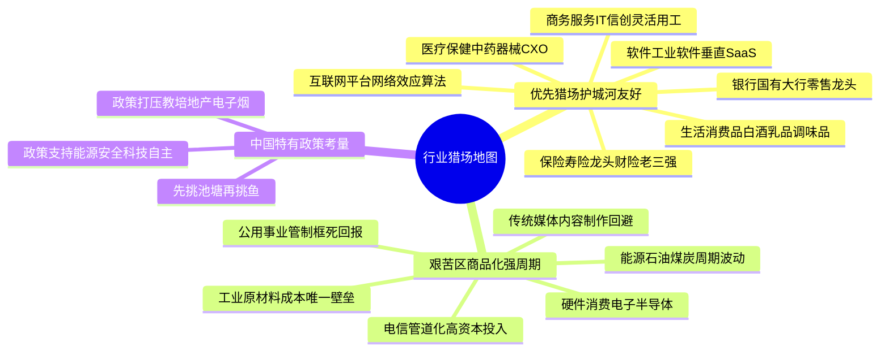
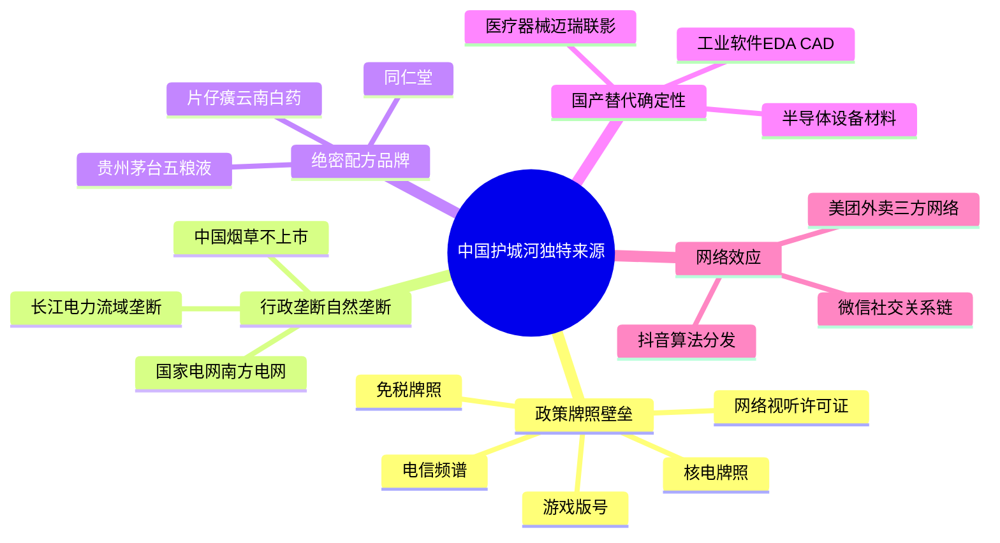
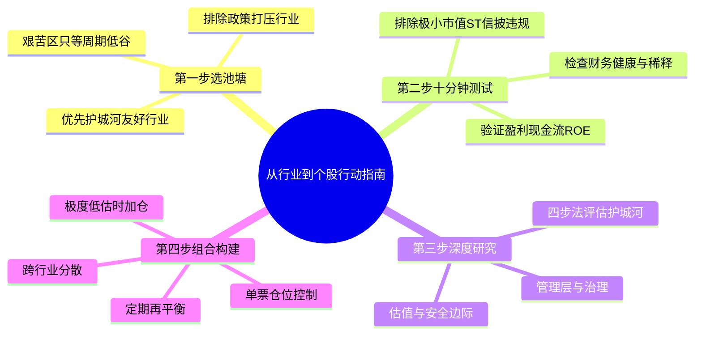

# 《股市真规则》第十三章：股票市场遨游指南——Part II 的地图与猎场标定（2026中国A股与港股适配版）

**章首定位（原书精神）**

前十章给你搭好了“分析引擎”（护城河→财报→伪装→管理→估值→安全边际），第十一章示范了怎么跑全流程，第十二章给了你快速踢掉劣质的漏斗。

第十三章很短，但它是全书最重要的“导航页”之一——多尔西用它回答一个战略性问题：

市场上几千只股票分布在几十个行业里——你的有限时间应该优先投向哪些“猎场”？哪些行业天然更容易长出护城河？哪些行业即使努力也多半是苦工？

然后它引出 Part II 的行业章（第14～26章），每章回答同一套框架问题：这个行业的钱怎么赚？壁垒长在哪？每个行业的关键KPI/风险/你该盯什么？

**中国版导言**：A股和港股市场的行业结构与美股存在显著差异。中国有国有资本主导的垄断行业（电信、电网、核电），有政策强力推动的国产替代赛道（半导体、高端制造），也有竞争极度内卷的“苦生意”（光伏制造、钢铁、航空）。在中国市场做行业选择时，还需要额外考量**政策方向**——它可能既是护城河的来源，也可能是摧毁护城河的力量。


## 章内骨架（原书：p.166 → p.167）
```
第十三章 股票市场遨游指南
├── 注意哪些行业（What Industries to Watch / p.166）
│ ├─ ① 银行与金融服务业（Banking & Financial Services）
│ ├─ ② 商务服务业（Business Services）
│ ├─ ③ 医疗保健行业（Health Care）
│ ├─ ④ 媒体（Media）
│ └─ （后面第14章起逐章展开：医疗→消费服务→商务服务→银行→资管保险→软件→硬件→媒体→电信→生活消费品→工业原材料→能源→公用事业）
└── 结论（p.167）
```


## 一、注意哪些行业——多尔西的“猎场地图”（中国版重绘）

### 0. 先立核心原则（全章灵魂）

**不要试图在所有行业挖宝。** 专注你能理解的、有护城河土壤的行业，你的研究效率会指数级上升；在不友好的行业也能赚钱，但更难、更靠周期择时、更需要安全边际。

你可以把它想成：“行业吸引力”不是涨不涨，而是——能不能长出可持续超额回报的生意结构。

**中国特别原则**：在中国，政策方向是行业选择的第一过滤器。国家支持的行业未必个个有护城河，但被政策明确打压的行业，护城河可能一夜清零（如教培、地产）。反之，政策壁垒（牌照、专营权）是中国独有的护城河来源。


### ① 银行与金融服务业（Banking & Financial Services）

**为什么“值得注意”（原书定性）**

大多数金融服务企业作为资金的中间商有极好的经济地位：银行把储户的钱聚拢，再以更高的利率贷出去（或以手续费/交叉销售金融产品赚钱）。关键：存款基础＝低成本资金来源；贷款/资产端＝收益引擎——如果风险管理做得对，金融是天然的“息差生意”。

**中国银行业特色**：

| 优势/护城河来源 | 中国市场具体表现 | 你要警惕 |
|----------------|----------------|---------|
| 存款特许权 | 六大国有银行及头部股份行拥有覆盖城乡的网点网络，存款成本极低（邮储银行、招商银行成本率<1.5%），是真实的护城河 | 中小银行对同业负债依赖高，成本波动大 |
| 规模/系统黏性 | 国有大行承担清算、托管、外汇等基础设施功能，几乎不可能被替代 | 政策要求“让利实体经济”，息差持续收窄 |
| 信息/客户关系壁垒 | 工资代发、房贷、信用卡绑定，客户迁移成本高 | 互联网金融（蚂蚁、腾讯）对零售客户的分流 |
| 隐性政府背书 | 系统重要性银行享有“大而不能倒”的融资成本优势 | 中小银行不具备，风险溢价更高 |

**中国银行业特别关注**：
- 净息差（NIM）持续压缩：从2019年的2.2%降至2025年的约1.5-1.7%，盈利能力系统性下降。
- 房地产和地方政府融资平台（LGFV）贷款的真实资产质量，远比官方不良率复杂。
- 银行股估值极低（PB普遍0.3-0.8倍），但低估值不等于低估——必须排除“价值陷阱”。

**一句话**：银行业在中国值得关注，但必须深研资产质量、存款成本和政策方向，不能仅看低PE高股息就买入。


### ② 商务服务业（Business Services）

**为什么值得注意（原书理由）**

这是市场中最包罗万象的领域，很多投资者放弃它——但里面有很多很有吸引力的公司；它们不太适合华尔街分析师“行业导向”的胃口→华尔街注意少=可能更多机会。

**中国商务服务业特色**：

| 子行业 | 护城河来源 | 中国市场代表 |
|--------|-----------|------------|
| 基于技术的服务（SaaS/云计算/数据服务） | 转换成本（数据嵌入）+ 规模经济 | 广联达（建筑造价数据）、北森（HR SaaS）、明源云（地产SaaS） |
| 基于人力的服务（灵活用工/专业咨询） | 品牌信誉+规模网络 | 科锐国际（灵活用工）、埃森哲中国 |
| 基于坚实资产的服务（物流/固废处理） | 特许经营权+独特地理位置 | 顺丰（航空枢纽）、光大环境（垃圾焚烧特许经营） |

**中国特别值得关注的子赛道**：
- **信创/国产替代型IT服务**：用友、金蝶等国央企ERP替换，政策确定性高，转换成本强。
- **灵活用工**：政策鼓励+企业降本需求，科锐国际、人瑞人才等具备先发和规模优势。
- **企业征信/数据服务**：企查查、天眼查（未上市），持牌征信机构（百行征信）——牌照壁垒。

**一句话**：中国的商务服务业中，基于技术的SaaS和基于牌照/特许经营的服务，最有可能长出窄但真实的护城河。纯人力密集型服务壁垒较薄，估值须更保守。


### ③ 医疗保健行业（Health Care——药/器械/生物/支付方）

**原书定性**：这个市场领域长期需求前景十分看好，公司趋向于高盈利——但表面上医疗保险制度很小的变化，就可能引起巨大影响。

**中国医疗保健行业特色**：

| 优势 | 风险 |
|------|------|
| 刚性需求（老龄化加速：2025年60岁以上人口超3亿） | 国家医保局“超级买家”定价权：集采降价50-95%，医保谈判降价幅度大 |
| 创新药出海（百济神州、传奇生物等获FDA批准） | 研发失败率高；生物科技≈风投；融资寒冬下现金跑道是生死线 |
| 医疗器械国产替代（迈瑞医疗、联影医疗） | 集采扩面至器械和耗材，定价权被侵蚀 |
| 中药/品牌消费品（片仔癀、云南白药、同仁堂） | 政策相对友好，护城河来自绝密配方和品牌心智 |

**中国医疗保健子行业分类**：

| 子行业 | 护城河来源 | 集采风险 | 代表性公司 |
|--------|-----------|---------|-----------|
| 创新药/生物技术 | 专利+临床数据壁垒 | 医保谈判降价 | 百济神州（港股）、恒瑞医药、信达生物 |
| 仿制药 | 规模制造+首仿窗口 | 极高（纳入集采降价50%+） | 华海药业、科伦药业 |
| 医疗器械 | 转换成本+临床嵌入 | 中高（高值耗材已集采） | 迈瑞医疗、微创医疗 |
| 中药/品牌消费品 | 品牌+绝密配方 | 较低 | 片仔癀、云南白药、同仁堂 |
| CXO（医药研发外包） | 规模+客户关系 | 较低（服务属性） | 药明康德、康龙化成 |
| 医疗服务（医院/连锁诊所） | 品牌+选址+医生资源 | 较低 | 爱尔眼科、通策医疗 |

**一句话**：中国医疗保健行业长期需求确定性极高，但投资必须深研政策方向，区分“集采免疫型护城河”（中药绝密配方、医疗器械转换成本、CXO服务绑定）和“集采敏感型商品化”（仿制药、普通耗材）。


### ④ 媒体（Media）

**原书定性**：很多媒体公司在它周围建立竞争优势，因为媒体有自然平衡/局部垄断特征——而且媒体是极少数“产品交货之前已收款”的行业（广告预付费/订费前收）。

**中国媒体行业特色**：

媒体行业在中国已被互联网平台彻底重塑。传统媒体（报纸、杂志、广播）的广告收入断崖式下滑，而抖音、微信、快手等超级平台掌握了流量分发权和用户时长。

| 子行业 | 护城河来源 | 当前状态 |
|--------|-----------|---------|
| 传统报纸/出版 | 地方垄断（但已瓦解） | 都市报断崖式下滑，仅少数严肃媒体（财新）靠数字订阅存活 |
| 传统电视/广播 | 牌照+广告 | 广告收入连年下滑，年轻观众严重流失 |
| 长视频平台（爱奇艺、腾讯视频、芒果TV） | 独家内容库+会员订阅 | 行业整体微利，内容成本高，用户忠诚度有限 |
| 短视频/社交媒体（抖音、快手、微信视频号） | 网络效应+算法分发 | 护城河极宽，广告和电商变现能力极强 |
| 音乐平台（腾讯音乐、网易云音乐） | 版权库+用户习惯 | 双寡头格局，订阅付费率提升中 |

**中国媒体的真实护城河所在**：
- **社交关系链垄断**：微信的社交关系链是任何新平台无法复制的护城河。
- **算法分发+创作者生态**：抖音的推荐算法和UGC生态形成飞轮。
- **版权资产库**：腾讯视频、爱奇艺多年积累的独家内容库，提高用户迁移成本。
- **政策牌照**：网络视听许可证、游戏版号——无证者出局，存量平台受保护。

**一句话**：在中国，真正的媒体护城河不在内容制作端，而在**平台分发端**（腾讯、字节跳动、快手）。传统媒体和纯内容制作公司缺乏持久壁垒，投资者应聚焦拥有网络效应和算法分发的平台型公司。


## 二、Part II 行业章完整猎场地图（中国版标注）

从原书第14章起的行业章，在中国需按以下优先级重新排列：

### ✅ 优先猎场：护城河友好，值得深度研究

| 行业 | 原书章号 | 中国护城河来源 | 中国代表性赛道 |
|------|---------|---------------|--------------|
| 医疗保健 | 第14章 | 专利/转换成本/品牌/绝密配方 | 中药品牌、医疗器械、CXO |
| 生活消费品 | 第23章 | 品牌定价权+渠道控制+规模成本 | 白酒、乳制品、调味品 |
| 商务服务业 | 第16章 | 转换成本/合同锁定/牌照壁垒 | IT服务、灵活用工、征信 |
| 银行业 | 第17章 | 存款特许权+网点网络+系统地位 | 国有大行、头部股份行 |
| 资产管理&保险 | 第18章 | AUM规模/AUM黏性/承保纪律 | 财富管理平台、寿险龙头、财险老三强 |
| 软件 | 第19章 | 转换成本/网络效应/数据飞轮 | 工业软件、垂直SaaS、网络安全 |

### ⚠️ 更艰苦的猎场：天然商品化/高资本/强周期/强管制

| 行业 | 原书章号 | 中国特殊挑战 | 投资姿态 |
|------|---------|------------|---------|
| 硬件 | 第20章 | 半导体受制程封锁；消费电子竞争惨烈 | 只在低谷+成本优势+低负债时介入 |
| 媒体 | 第21章 | 传统媒体被平台颠覆；内容制作壁垒薄 | 聚焦平台型公司，回避传统内容商 |
| 电信 | 第22章 | 资本密集+管道化+政策降费 | 追求稳定分红，不期待高增长 |
| 工业原材料 | 第24章 | 产能过剩+双碳约束+需求下行 | 仅买入全行业最低成本+最低负债者 |
| 能源 | 第25章 | 油价周期+新能源替代+双碳约束 | 低成本上游龙头，在周期低谷买入 |
| 公用事业 | 第26章 | 垄断但管制回报框死 | 水电/核电等稳定现金流资产，在估值极低时配置 |

### 🌟 中国特有新增赛道（原书未充分覆盖）

| 赛道 | 护城河来源 | 代表性公司 |
|------|-----------|-----------|
| 互联网平台 | 网络效应+算法分发+社交关系链 | 腾讯、美团、快手、拼多多 |
| 新能源汽车 | 规模成本+技术迭代+品牌 | 比亚迪、理想汽车 |
| 光伏/储能 | 规模成本+产业链一体化（但竞争极其惨烈） | 隆基绿能、阳光电源 |
| 半导体设备/材料 | 国产替代+技术壁垒+客户认证 | 北方华创、中微公司 |


## 三、结论——把“行业选择”变成你投资策略的一部分

**原书收束精神**：
- 行业是你第一个过滤器：别把时间均分给三千只票；先问“这行业允不允许护城河存活”
- 后面每章（14～26）统一回答同一套问题：这行业的钱怎么赚？壁垒/护城河通常长在哪？成功公司与不成功的分岔点在哪？你该盯什么KPI、躲什么坑？
- 你的“做功课”因此从漫无目的变成：**先挑池塘，再挑鱼**

**中国版强化**：
- 在中国，政策方向是行业选择的第一个过滤器。国家战略支持（能源安全、科技自主、老龄化应对）的赛道，护城河更容易建立和维持。被政策打压或限制的赛道（如教培、地产、电子烟），护城河可能瞬间瓦解。
- A股和港股市场中，大量散户和短期资金追逐题材和热点，导致不友好的行业常被爆炒，友好的行业常被冷落——这为逆向价值投资者提供了绝佳的“池塘选择”优势。


## 投资者清单：股票市场遨游指南（中国A股与港股版）

✅ **不是所有行业平等**：有的天然更出护城河（消费品品牌、水电垄断、中药绝密配方），有的天然更苦（光伏制造、钢铁、航空）。

✅ **优先猎场**：医疗（中药品牌、医疗器械）、生活消费品（白酒、乳品）、商务服务（SaaS、灵活用工）、软件（工业软件、网安）、金融（国有大行、头部保险）——前提是你懂其风险。

✅ **中国特有政策优势赛道**：能源安全（水电/核电/低成本上游）、科技自主（半导体设备/工业软件）、老龄化应对（医疗器械/中药）。

✅ **更艰苦区**：硬件（消费电子竞争惨烈）、媒体（传统媒体被颠覆）、电信（管道化）、工业原材料（产能过剩）、航空（高杠杆+强周期）——只当周期仓位，且安全边际要求更严。

✅ **实操法则**：把你的观测名单按行业粗筛→只在护城河友好的池塘里深度做功课→不友好但懂周期的，只当“周期仓位”且折扣更狠。在中国，还须额外加上**政策方向**这一层过滤。

✅ **后面14章开始是全书最实用部分**：不是泛泛而谈，而是每行业给“怎么赚钱/壁垒在哪/坑在哪/成功特征清单”。


## 附录：第十三章“行业猎场核查卡”（中国A股与港股版）

【你的观测池行业清单】（打☑=进深度研究名单）

── 护城河友好区（优先做功课）──────────────────────
□ 医疗保健/中药品牌 关键：绝密配方/提价能力/政策友好度
□ 医疗保健/医疗器械 关键：转换成本/临床嵌入/集采概率
□ 医疗保健/CXO 关键：客户绑定/规模/海外收入占比
□ 生活消费品（白酒/乳品/调味品）关键：品牌定价权/渠道控制/预收款/广告效率
□ 商务服务/IT服务（信创）关键：合同锁定/转换成本/政策确定性
□ 商务服务/灵活用工 关键：规模效应/客户关系/技术匹配平台
□ 软件/工业软件 关键：文件格式锁定/职业训练生态/国产替代确定性
□ 软件/垂直SaaS 关键：NRR>100%/数据飞轮/客户流失率
□ 银行（国有大行/零售龙头）关键：存款成本率/不良率/拨备覆盖率/息差趋势
□ 保险（寿险龙头/财险老三强）关键：NBV增速/代理人产能/综合成本率<100%
□ 互联网平台 关键：网络效应/社交关系链/算法分发/变现效率

── 更艰苦区（周期/管制/商品化，只当周期仓）────────
□ 硬件/消费电子 关键：存货/订单簿/成本优势/周期位置，折扣>50%
□ 硬件/半导体 关键：技术壁垒/国产替代进度/客户认证/估值
□ 传统媒体 关键：订阅基盘vs流媒体蚕食，传统媒体回避
□ 电信 关键：CapEx/ARPU/分红稳定性
□ 能源（石油/煤炭）关键：桶成本/储量RRR/负债/周期位置
□ 工业原材料 关键：成本曲线位置/负债/产能利用率/碳成本
□ 公用事业（水电/核电）关键：政策支持/分红可持续/估值

── 中国特有政策风险区（谨慎评估）────────────────
□ 教培 已整顿，基本不可投
□ 地产开发 结构性下行，仅关注极少数最低成本最低负债幸存者
□ 电子烟/部分互金 政策不确定性极高

── 你的纪律 ─────────────────────────────────────
我从不因为“它涨了/新闻热”进不友好行业：□坚守 □有时破例（记原因___）
进深度研究前必过第十二章10分钟筛：□是 □no（淘汰）
每只票必做四步法：□Step1收益性 □Step2护城河 □Step3持久性 □Step4行业分析
text


## 思维导图（按阅读逻辑拆分）

### 图1：行业猎场地图——优先猎场与艰苦区


###  图2：中国市场的护城河独特来源

### 图3：投资者行动指南——从行业到个股



# 第十三章　股票市场遨游指南（A Walk Through the Stock Market）——Part II 的地图与猎场标定

> **章首定位（原书 p.166 / 中信畅销版 ISBN 9787508686431）**
>
> 前十章给你搭好了"分析引擎"（护城河→财报→伪装→管理→估值→安全边际），第十一章示范了怎么跑全流程，第十二章给了你快速踢掉劣质的漏斗。
>
> 第十三章很短，但它是全书**最重要的"导航页"之一**——多尔西用它回答一个战略性问题：
>
> > **市场上几千只股票分布在几十个行业里——你的有限时间应该优先投向哪些"猎场"？哪些行业天然更容易长出护城河？哪些行业即使努力也多半是苦工？**
>
> 然后它引出 Part II 的行业章（第14～26章），每章回答同一套框架问题：
> - 这个行业的钱**怎么赚**？
> - **壁垒**长在哪（护城河来源）？
> - 每个行业的**关键KPI/风险/你该盯什么**？

---

## 章内骨架（原书：p.166 → p.167）

text
第十三章 股票市场遨游指南
├── 注意哪些行业（What Industries to Watch / p.166）
│ ├─ ① 银行与金融服务业（Banking & Financial Services）
│ ├─ ② 商务服务业（Business Services）
│ ├─ ③ 医疗保健行业（Health Care）
│ ├─ ④ 媒体（Media）
│ └─ （后面第14章起逐章展开：医疗→消费服务→商务服务→银行→资管保险→软件→硬件→媒体→电信→生活消费品→工业原材料→能源→公用事业）
└── 结论（p.167）

> 原书这章正文就围绕**四个"建议关注"行业集群**做概览（p.166），然后一句收束：后面章节的目的，是帮你回答每行业的——**怎么赚钱 / 怎么建护城河 / 有什么陷阱 / 成功vs失败怎么分**。

---

## 一、注意哪些行业（p.166）——多尔西的"猎场地图"

### 0. 先立核心原则（全章灵魂）

> **不要试图在所有行业挖宝。**
> 专注你能理解的、有护城河土壤的行业，你的研究效率会指数级上升；在不友好的行业也能赚钱，但更难、更靠周期择时、更需要安全边际。

你可以把它想成：**"行业吸引力"不是涨不涨，而是——能不能长出可持续超额回报的生意结构。**

---

### ① 银行与金融服务业（Banking & Financial Services）

#### 为什么"值得注意"（原书定性）

> **大多数金融服务企业作为资金的中间商有极好的经济地位：银行把储户的钱聚拢，再以更高的利率贷出去（或以手续费/交叉-sell金融产品赚钱）。**  
> 关键：存款基础＝低成本资金来源；贷款/资产端＝收益引擎——**如果风险管理做得对，金融是天然的"息差生意"**。

| 优势/护城河来源 | 原书隐含 | 你要警惕 |
|-----------------|---------|---------|
| **存款特许权（deposit franchise）** | 储户习惯/便利性/网点网络→低息资金 | 存款成本一旦被线上搅动，护城河会褪色 |
| **规模/系统黏性** | 大银行清算网络/托管/交易基础设施→高进入壁垒 | 监管成本/资本要求也更高 |
| **信息/客户关系壁垒** | 交叉销售（存贷+保险+资管）→客户沉没成本 | 复杂表外/杠杆/不良贷款是隐身衣 |

#### 原书给你的"入门警告"（金融股不是看PE那么简单）

- 金融是**高杠杆**生意（资产是别人的钱）→ **资产质量（不良贷款/拨备）**才是真护城河，不是表面ROE
- 后面第17章专讲（但这一章先给你心理锚）：**不要拿非金融的ROE/负债率尺子硬套银行**——银行的护城河看的是NIM/准备金纪律/存款成本/不良率体系

> 一句话：金融服务业值得在"观测名单"里，但必须**懂风险**才碰（否则你买的是β，不是护城河）。

---

### ② 商务服务业（Business Services）

> **这是市场中最包罗万象的领域，很多投资者放弃它——但里面有很多很有吸引力的公司；它们不太适合华尔街分析师"行业导向"的胃口→华尔街注意少=可能更多机会。**

| 为什么值得注意 | 原书理由 |
|-------------|---------|
| **轻资产**（很多细分不需要重工厂）| CapEx低→FCF强 |
| **基于人/流程/合同** → 可产生**高转换成本**（客户嵌进流程/外包系统）| 护城河偏"窄但稳"（见第16章细分：技术型/人力型/资产型） |
| **不性感=低关注=估值可能被忽视** | 这正是你要的：好生意+没被捧上天 |

#### 你该留心什么（这章埋的伏笔）

- 商务服务不是"一个行业"，是**一堆模式**：IT外包/数据处理/工资社保外包/设施管理/咨询…
- 后面第16章会拆：**基于技术（软件+流程锁定）> 基于人力（更低壁垒）> 基于坚实资产（更重但护城河不同）**

---

### ③ 医疗保健行业（Health Care——药/器械/生物/支付方）

> **这个市场领域长期需求前景十分看好，公司趋向于高盈利——但表面上医疗保险制度很小的变化，就可能引起巨大影响。**

| 优势 | 风险 |
|------|------|
| 刚性需求（老龄/疾病不看法庭账本）| **政策/医保控费/定价监管**=利润天花板调节器（见第14章：专利悬崖/药价政治）|
| 护城河真能长出来（专利/品牌/转换成本/数据壁垒）| 研发失败率高；生物科技≈风投（第14章细分） |

> 原书把它放在"值得注意"而非"无脑好"——因为它**好，但是高监管+高不确定性**——你得会区分：品牌药 vs 仿制 vs 生物 vs 器械 vs 支付管理。

---

### ④ 媒体（Media）

> **很多媒体公司在它周围建立竞争优势，因为媒体有自然平衡/局部垄断特征——而且媒体是极少数"产品交货之前已收款"的行业（广告预付费/订费前收）。**

| 优势 | 原书举例精神 |
|------|-------------|
| **区域性自然垄断/寡占**（一座城市对两份日报需求很少→幸存者吃大头）| 报纸/广播历史形态 |
| **内容壁垒/版权+分销网络** | 出版/有线/娱乐 |
| **订费/广告双引擎** | 现金流转更快（预收款） |

#### 但原书也埋了警示（后面第21章展开）
- 媒体护城河正在被**技术/分发去中心化**（互联网/流媒体）侵蚀——旧式"地方垄断"护城河要逐case看还剩多少
- 所以媒体值得注意，但**必须区分"仍能守的壁垒"vs"正在融化的冰"**

---

### 另外值得留意的（原书框架里"后面章节会覆盖"的更大地图）

从 p.167 的"结论"精神+后面目录可知，Part II 的猎场完整名单是：


推荐优先看的护城河友好区：
✅ 医疗保健（14） → 专利/转换成本/网络
✅ 消费服务业（15） → 品牌+同店增长+轻资产扩张
✅ 商务服务业（16） → 转换成本/合同锁定
✅ 银行业（17） → 存款特许权+风控纪律
✅ 资产管理&保险（18） → AUM fee流/承保纪律
✅ 软件（19） → 最高转换成本型护城河候选
△ 生活消费品（23） → 品牌+渠道+规模，但资本密集度低
更艰苦的猎场（天然商品化/高资本/强周期/强管制）：
⚠ 硬件（20） → 技术迭代快/商品化压力
⚠ 媒体（21） → 分发革命打碎旧垄断
⚠ 电信（22） → 资本密集+强管制
⚠ 工业原材料/能源（24/25）→ 大宗商品周期机器
⚠ 公用事业（26） → 自然垄断但回报被管制框死

---

## 二、结论（p.167）——把"行业选择"变成你投资策略的一部分

> 原书收束精神：
>
> 1. **行业是你第一个过滤器**：别把时间均分给三千只票；先问"这行业允不允许护城河存活"
> 2. 后面每章（14～26）统一回答同一套问题：
>    - **这行业的钱怎么赚？**
>    - **壁垒/护城河通常长在哪？**
>    - **成功公司与不成功的分岔点在哪？**
>    - **你该盯什么KPI、躲什么坑？**
> 3. 你的"做功课"因此从漫无目的变成：**先挑池塘，再挑鱼**

---

## 投资者清单：股票市场遨游指南（章末浓缩）

- ✅ **不是所有行业平等**：有的天然更出护城河，有的天然更苦（商品化/强周期/强管制）
- ✅ **优先猎场**：医疗（细分看壁垒）、消费品牌/服务（轻资产+品牌）、商务服务（转换成本合同）、软件（订阅锁定）、金融（存款特许权+风控）——前提是你**懂风险**
- ✅ **更艰苦区**：硬件（技术迭代）、媒体（分发革命）、电信/能源/原材料（周期+资本密集）、公用事业（管制限回报）
- ✅ **实操法则**：把你的观测名单按行业粗筛→只在护城河友好的池塘里深度做功课→不友好但懂周期的，只当"周期仓位"且折扣更狠
- ✅ **后面14章开始是全书最实用部分**：不是泛泛而谈，而是每行业给"怎么赚钱/壁垒在哪/坑在哪/成功特征清单"

---

## 附录：第十三章"行业猎场核查卡"（复制进 Excel/Notion/飞书当你的筛选地图）

text
【你的观测池行业清单】（打☑=进深度研究名单）
── 护城河友好区（优先做功课）──────────────────────
□ 医疗保健 / 医药（品牌药） 关键：专利到期日历 / 管线接力 / 医保控费
□ 医疗保健 / 器械 关键：转换成本 / 临床嵌入 / 召回记录
□ 医疗保健 / 生物（只碰懂的） 关键：现金跑道 / 晚期管线 / 30-50%折扣
□ 消费服务 / 餐饮零售 关键：SSSG同店增长 / 门店级Unit Econ / 扩张回报
□ 商务服务 关键：合同锁定 / 客户集中度 / 转换成本
□ 软件 / SaaS 关键：NRR>100% / 毛利>75% / 获客成本回收期
□ 生活消费品 关键：品牌定价权 / 渠道控制 / 广告效率
□ 银行 / 保险 / 资管 关键：NPL/拨备 / NIM / 负债成本 / 承保纪律
── 更艰苦区（周期/管制/商品化，只当周期仓）────────
□ 硬件 key:周期定位 / 存货/订单簿 / 折扣>50%
□ 媒体（传统） key:订阅基盘vs流媒体蚕食
□ 电信 key:CapEx/用户ARPU/监管
□ 能源 key:桶成本/储量RRR/负债/油价周期
□ 工业原材料 key:供需周期/产能利用率
□ 公用事业 key:管辖PUC/利率风险/分红可持续性
── 你的纪律 ─────────────────────────────────────
我从不因为"它涨了/新闻热"进不友好行业：□坚守 □有时破例(记原因___)
进深度研究前必过第十二章10分钟筛：□是 □no(淘汰)