# 《股市真规则》第十四章：医疗保健行业 —— 中国版重估（2026年视角）

**核心判断前置：**
原书第十四章（美国视角）的分析框架在中国医疗保健行业**70%适用，但30%需要重写**。根本原因：中国的医疗保健不是“自由定价+专利壁垒”游戏，而是**政府定价主导+医保基金平衡优先+国产替代加速**的独特生态。以下逐块对照，标注差异。

---

## 一、行业级护城河：中国版——政策才是最大的护城河（也是最大的风险）

| 原书要点（美国） | 中国对应（2026） |
|------------------|------------------|
| 专利保护/市场排他性 | 专利法框架存在，但实际壁垒更弱：优先审评、专利链接制度起步晚、挑战专利的仿制药可获首仿1年独占（非美国180天）。 |
| 高进入壁垒（研发+临床+监管） | 降低中。药监局（NMPA）过去十年审批加速（从7年缩短至约2年）；中国IND/NDA数量爆发，竞争加剧。 |
| 支付结构带来的低价格敏感度 | **几乎完全相反**。国家医保局（NHSA）是所有支付方的“总买家”，每年国家谈判+集采直接削价。 |
| 经济规模/营销网络 | 依然成立。但营销模式正从“关系驱动”转为“准入驱动+学术驱动”，合规风暴后传统带金模式瓦解。 |
| 财务画像 | 仿制药毛利率已降至30-50%（而非美国40-50%），品牌创新药毛利率仍可60-80%，但面临集采悬崖。 |

**中国核心公式**：
- 护城河 = 是否在医保目录内 + 是否独家/首仿 + 是否在集采范围外 + 临床必需性 + 产能合规
- 风险 = 医保谈判降价幅度 + 集采纳入概率 + 反贪反腐合规 + 美国生物安全法案

---

## 二、品牌制药——中国叫“创新药企”，不是“Big Pharma”

### 2.1 中国创新药的独特逻辑
中国没有传统意义上的“Big Pharma”，更准确是三层分化：

| 层级 | 代表 | 特征 |
|------|------|------|
| 传统制药国企/央企 | 国药、上药、华润医药 | 分销为王，研发薄弱，低估值高股息 |
| 转型创新药企 | 恒瑞医药、石药集团、中国生物制药 | 仿转创中，管线以me-too/me-better为主，逐渐有FIC |
| 纯创新药企（Biotech） | 百济神州、信达生物、君实生物 | 研发驱动，亏损或微利，依赖出海和BD |

### 2.2 中国创新药的“专利悬崖”——集采悬崖更凶猛
- 美国：专利到期 → 仿制药进入 → 价格跌40-60%
- 中国：**集采纳入 → 当场降价50-95%**（不等到专利到期）
- 集采节奏：化学药已成熟（第9批），生物类似药（胰岛素、贝伐珠等）集采已扩面；中成药集采地方推行中；高值耗材（支架、人工关节、脊柱）已执行。

**2026年中国创新药核查清单**：
- 管线中创新药占比（vs 仿制药）？
- 核心产品是否在集采目录/预期中？
- 国家医保谈判降价幅度历史与预期？
- 海外收入占比（BD授权+自主出海）？——这是逃逸国内定价压力的唯一出口。

---

## 三、仿制药——中国叫“集采幸存者”，不是“低成本壁垒”

### 3.1 美国 vs 中国仿制药——截然不同
| 维度 | 美国仿制药 | 中国仿制药（2026） |
|------|-----------|-------------------|
| 核心护城河 | 制造成本+合规+首仿180天 | 过评（一致性评价）+产能+集采中标 |
| 利润率 | 毛利率40-50%，营业利润率15-20% | 集采中标品种毛利率30-40%，营业利润率<10% |
| 竞争壁垒 | 规模制造+FDA合规 | 先过评者拿集采份额，未过评者直接出局 |
| 成长逻辑 | 复杂仿制药+生物类似药 | 存量洗牌（小厂退出）+原料药制剂一体化 |

### 3.2 中国仿制药的核心投资逻辑
- **寻找“集采出清”后的幸存者**：一批多、科伦、华海等全产业链（原料药+制剂）企业，集采中标后以量补价，行业集中度提升。
- **淘汰信号**：毛利率<30%、过评品种<3个、单一品种依赖（纳入集采即死刑）。
- **原料药掌控力**：在中国比美国更重要——原料药自供能力决定集采中标后的利润底线。

**中国仿制药核查**：是否过评（一致性评价）？集采中标品种与未中标占比？原料药是否自供？毛利率底线能否维持30%+？

---

## 四、生物技术——中国版“Biotech”，从me-too到出海

### 4.1 中国Biotech的独特路径
- 过去十年：跟踪式创新（PD-1是典型案例）→同质化竞争→医保谈判降价70-80%→泡沫破裂。
- 2026年趋势：**出海成为生存刚需**。FDA审批+海外授权（License-out）+NewCo模式是估值核心。

### 4.2 中国Biotech的三分类（调整版）
| 层级 | 特征 | 2026年投资态度 |
|------|------|---------------|
| 成熟/准成熟 | 盈利或接近盈利，核心产品国内获批+海外授权/审批 | 可按创新药企估值，安全边际30-40% |
| 上升期 | 核心产品Phase III/审评中，现金跑道>18个月，有海外BD | 需深度管线评估，安全边际40-50% |
| 投机 | 早期管线、无海外授权、现金<12个月 | 极大概率归零，普通投资者回避 |

### 4.3 中国Biotech特有的风险
- **美国生物安全法案**：若通过，可能限制美国药企与中国CXO/部分Biotech合作（药明系已受冲击）。
- **同质化出海**：PD-1之后，ADC、GLP-1、双抗均有大量中国公司跟进，海外授权溢价可能收窄。
- **融资寒冬**：未盈利Biotech的再融资难度大，现金跑道是死生线。

---

## 五、医疗器械——中国版“国产替代+集采洗牌”

### 5.1 原书框架的适用性
转换成本+销售网络+临床数据壁垒——这些器械护城河要素**在中国依然成立**，但必须叠加：
- **国产替代政策**：公立医院采购优先国产品类（影像、支架、骨科、电生理等），进口品牌壁垒被政策主动削弱。
- **集采洗牌**：已实施集采的品类（冠脉支架、人工关节、脊柱、胰岛素泵），降价80-90%，行业出清后龙头集中度提升。未集采品类（电生理、神经介入、TAVR等）享受暂时定价权。

### 5.2 中国器械核查清单（2026版）
- 产品品类是否已纳入或预期纳入集采？
- 国产替代率（当前+趋势）？
- 转换成本（医生培训+术式绑定）是否强？
- 海外收入占比（迈瑞医疗等已全球化的公司受国内集采影响更小）？
- 创新产品线（手术机器人、可降解支架、介入瓣膜）能否撑起第二增长曲线？

---

## 六、医疗保险与管理式医疗——中国是“国家医保局主导”，无PBM

### 6.1 根本不同
中国不存在美国式的商业健康险+PBM生态。支付方是**国家医保局一家独大**（基本医保覆盖95%+人口），商业健康险占比极低且以重疾险为主。  
因此，原书“管理式医疗”板块在中国几乎**无对标**。

### 6.2 中国特有的支付相关投资线索
- **医保控费逻辑**：医保局的首要目标是基金平衡。每年医保谈判、集采降价是确定性事件。投资上，需寻找**不被集采影响的支付环节**（如创新药械的商保外溢、高端民营医疗服务）。
- **DRG/DIP支付改革**：按病种付费逐步推行，医院控费压力传导至药械采购，高性价比产品受益。
- **互联网医疗/数字健康**：阿里健康、京东健康、平安好医生等，是中国的独特存在。护城河更接近平台网络效应+数据，而非传统医疗保健壁垒。

---

## 七、2026年中国医疗保健行业投资者清单（修订版）

- ⚠️ **中国第一性原理**：政府定价（医保局）> 专利壁垒 > 品牌/转换成本。
- ⚠️ **集采是最大变量**：判断每个品种的集采概率和时间窗口，是核心分析动作。
- ✅ **创新药出海**：海外授权/自主审批是逃逸国内定价压力的唯一出路；管线全球化程度是估值溢价关键。
- ✅ **仿制药找“集采幸存者”**：原料药制剂一体化+过评数量+产能规模=竞争优势。
- ✅ **器械找“国产替代+未集采”**：暂未集采+高国产替代率+强转换成本=最佳赛道。
- ⚠️ **Biotech守现金跑道**：<18个月现金且无海外授权的，等于悬崖边的赌注。
- ❌ **无对标管理式医疗**：医保局独大，商业保险生态极弱，PBM、HMO无投资价值。
- 🚨 **全行业黑天鹅**：美国生物安全法案、中国反贪反腐、医保基金赤字风险。

---

## 思维导图（按阅读逻辑拆分）

### 图1：中国医疗保健行业护城河——政策是第一变量

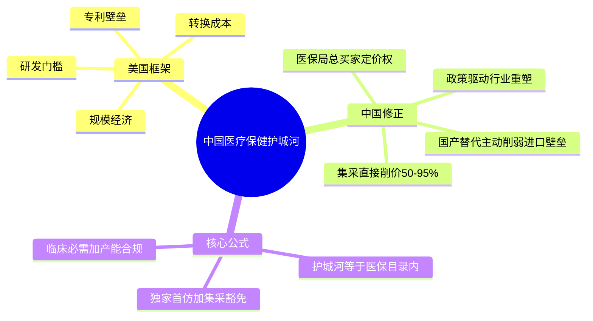
### 图2：中国创新药——出海是唯一出路

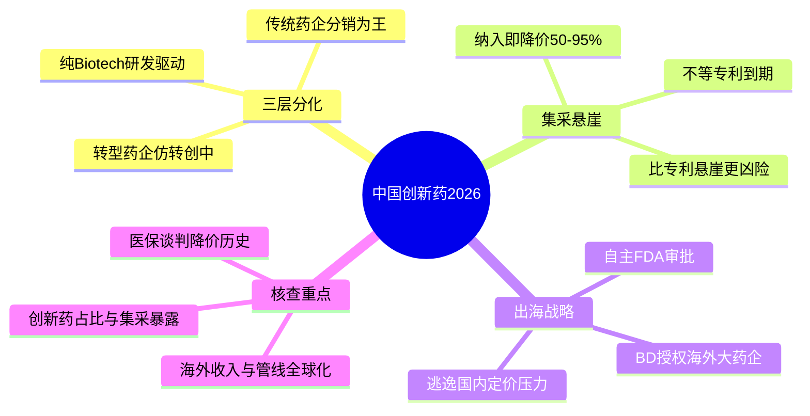

### 图3：中国仿制药——集采幸存者才是赢家

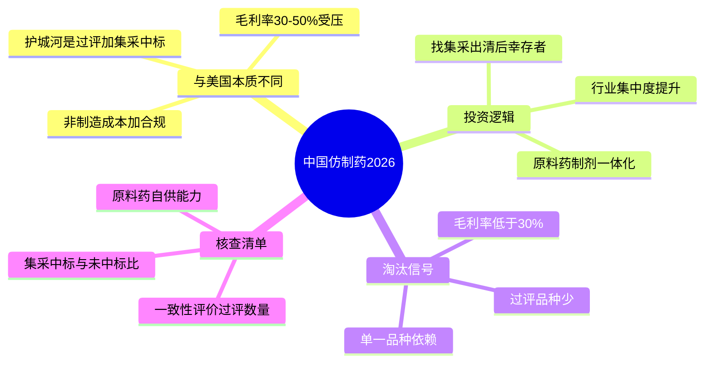


### 图4：中国医疗器械——国产替代+集采洗牌

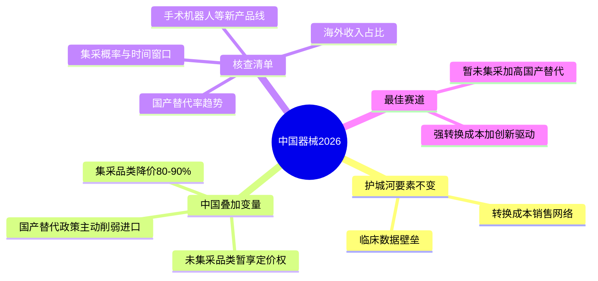


###  图5：中国无管理式医疗——支付是医保局独大

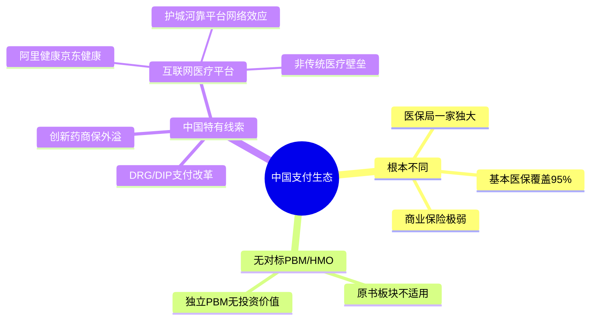


###  图6：2026年中国医疗保健行业全览核查清单

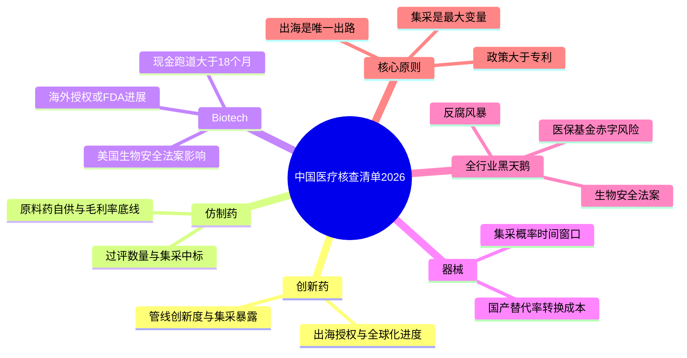


# 美国

# 《股市真规则》第十四章：医疗保健行业 —— 2026年重评估

原书第十四章成稿于2000年代初，其核心框架——**护城河来源、子行业分类、分析核查点**——至今仍有效，但行业本身已发生几处结构性位移。以下逐块对照原书，标注“不变”与“需刷新”之处，并提供2026年更新后的投资者清单。

## 一、行业级护城河：根基未动，但多了三根刺

| 原书要点 | 2026年状况 |
|----------|------------|
| 专利保护/市场排他性 | 依然核心，但美国《通胀削减法案》（IRA）允许Medicare对部分老药议价，首次松动“定价自由”，品牌药专利悬崖后的缓冲期缩短。 |
| 高进入壁垒 | 不变。新药开发成本中位数仍超10亿美元，失败率极高。 |
| 支付结构带来的低价格敏感度 | 已明显削弱。全球医保控费、中国集采、美国PBM压价，药品净价格增速长期低于标价增速。 |
| 财务画像（毛利率75-85%等） | 整体仍高，但大型药企因仿制药和生物类似药竞争，部分产品组合毛利率承压；生物科技毛利率极高但波动大。 |

**不变的核心**：专利、规模、临床数据、转换成本仍是护城河主材。  
**新增变量**：政府议价、通胀削减法案、供应链本地化（尤其生物技术回流）重塑估值锚。

## 二、品牌制药（Big Pharma）：从“重磅药为王”到“管线深度为王”

### 2.1 原书框架的适用性
畅销药梯队、专利到期日历、管线接力——这套分析逻辑**完全不变，甚至更重要**。  
2026年，大型药企更依赖**多适应症平台**（如mRNA、ADC、GLP-1多靶点）而非单一化学分子。专利悬崖依然致命，但企业应对手段更丰富：剂型改良、患者转新一代、授权仿制药。

### 2.2 2026年需注入的新视角
- **GLP-1类药物**（如司美格鲁肽/替尔泊肽）成为史上最重量级品类，重塑代谢、心血管、肾病领域，也带来**单品集中度风险**——诺和诺德、礼来对单品的依赖与当年辉瑞的立普妥不同吗？框架同样适用：看专利到期日历、管线接力。
- **肿瘤免疫、ADC、细胞基因治疗**：高定价但面临支付方强烈抵抗；需评估**健康经济学证据**能否支撑溢价。
- **数字疗法/伴随诊断**开始嵌入药物生态，成为新的转换成本来源（但尚不构成独立宽护城河）。

### 2.3 成功的制药公司特点（2026版核查表）
- 畅销药梯队：是否至少2-3个增长引擎分散到期风险？
- 专利到期日历：是否未来5年有2个以上重磅药到期且缺乏接力？
- 管线深度：后期管线（Phase III/审评中）的峰值销售总和能否弥补到期损失？
- 政府定价暴露度：美国Medicare Part D/Part B议价暴露度评估；非美市场（欧盟、中国集采）影响。
- 营销模式：传统代表团队 vs 数字化精准触达——前者面临监管收紧和成本压力。

## 三、仿制药（Generic Drugs）：规模壁垒依旧，但利润池被挤压

原书描述的“低成本制造+首仿180天窗口+渠道集中”护城河**仍然成立**。  
2026年的变化：
- **行业整合深化**：梯瓦、山德士、晖致等巨头控制大部分市场，小型仿制药企难独立生存。
- **生物类似药（Biosimilars）**成为新战场：门槛高于化学仿制药，但定价压力类似，护城河在于制造工艺和临床互换证据。
- **利润压缩**：美国市场三大批发商和PBM的采购联盟压价，导致许多口服固体制剂仿制药几乎无利润，迫使企业转向**复杂仿制药（复杂注射剂、吸入剂）和品牌仿制药混合模型**。
- **供应链安全**：政策推动关键原料药/制剂本土化生产，可能重塑成本结构。

**2026年仿制药核查要点**：毛利率是否稳定在40%+？FDA合规记录是否干净（警告信即核弹）？产品组合中复杂仿制药/生物类似药占比？对中国/印度原料药依赖度？

## 四、生物技术（Biotechnology）：从“风险资本游戏”到“成熟平台型企业”

原书“三分类法”（成熟/上升/投机）**依然管用**。2026年变化在于：
- **成熟生物技术公司增多**：吉利德、安进、再生元、Vertex等已具备持续盈利能力和管线接力，可视为“类品牌制药”分析。
- **平台化公司出现**：mRNA、CRISPR、ADC技术平台使单一成功扩大为多产品管线，护城河从单药专利转向平台专利+制造能力+数据资产。
- **融资环境周期性极强**：加息周期中，未盈利生物科技估值可腰斩再腰斩，安全边际要求仍须30-50%+。
- **AI药物发现**：降低了早期发现成本，但临床成功率未实质性提升，故事性增强需警惕泡沫。

**2026年生物技术核查**：现金跑道（至少24个月）、晚期管线数量、是否拥有已验证的技术平台、合作伙伴是否为大药企、估值是否低于管线风险调整后净值（rNPV）的30-50%折扣。

## 五、医疗器械（Medical Devices）：护城河稳固，但手术机器人改写竞争

医疗器械仍是原书口中“最简单的医疗保健投资之一”，因其转换成本、销售网络、临床数据壁垒强。  
2026年主要演进：
- **手术机器人**（直觉外科的达芬奇、史赛克的Mako、强生的Ottava）重塑竞争：机器人平台形成软硬件生态锁定期，转换成本更高，但同时带来单品依赖风险和主机换代风险。
- **集采全球化**：中国高值耗材带量采购、欧洲招标降价，部分植入物定价权被削弱。
- **数据/AI化**：如连续血糖监测（CGM）+胰岛素泵闭环系统，创造数据网络效应，成为新的护城河变体。
- **并购驱动增长**：大器械公司（美敦力、雅培、波科）频繁并购小型创新公司，需注意并购整合风险及商誉堆积。

**2026年器械核查清单**：销售队伍渗透是否不可替代？产品是否跨科室分散？研发费用中有多少用于维持现有产品迭代（防御性）vs 开拓新市场（进攻性）？FDA MAUDE不良事件趋势是否平稳？手术机器人或数字化是否增强了转换成本？

## 六、医疗保险与管理式医疗（Managed Care）：护城河依旧薄弱，但集中度带来议价力

原书对此板块最悲观。2026年，护城河仍弱，但**行业集中度提高**（联合健康、 Elevance、Humana等）带来一定规模优势和议价能力。  
关键变化：
- **垂直整合**：联合健康集团（Optum）模式将保险、PBM、医疗提供者、数据分析合为一体，形成了原书未充分讨论的新型“生态系统护城河”。这种护城河不是基于专利，而是基于数据、会员锁定和协同效应。
- **政策风险极高**：美国《平价医疗法案》补贴到期、Medicare Advantage支付规则调整、药品定价改革，随时可重创盈利。
- **PBM独立性下降**：大型健康险公司已基本内化PBM，独立PBM护城河近乎消失。

**2026年管理医疗结论**：只有垂直整合且拥有大型健康数据平台的巨头（如联合健康）具备一定护城河，其余更多是政策博弈载体。安全边际要求至少40-50%。

## 七、2026年医疗保健行业投资者清单（更新版）

- ✅ 护城河根基不变：专利、规模、转换成本、临床数据。
- ⚠️ 定价自由受侵蚀：全球医保控费、美国IRA议价，使“无限定价权”故事终结。
- ✅ 品牌药企：必须评估**管线深度**和**专利到期日历**，单一重磅药依赖是危险信号。
- ✅ 仿制药：规模+合规仍是壁垒；需关注生物类似药和复杂仿制药转型。
- ✅ 生物技术：三分类法不变；AI制药概念需极度警惕估值泡沫；30-50%安全边际仍是铁律。
- ✅ 医疗器械：转换成本壁垒最强；手术机器人和数据闭环增加新护城河层次；需警惕集采和单产品依赖。
- ⚠️ 保险/PBM：除非垂直整合生态，否则护城河薄弱，安全边际要求更高。
- ✅ 全行业新风险：供应链地缘政治（生物技术设备、原料药）、生物安全法案等政策黑天鹅。

## 思维导图（按阅读逻辑拆分）

### 图1：医疗保健行业护城河——2026年不变与变

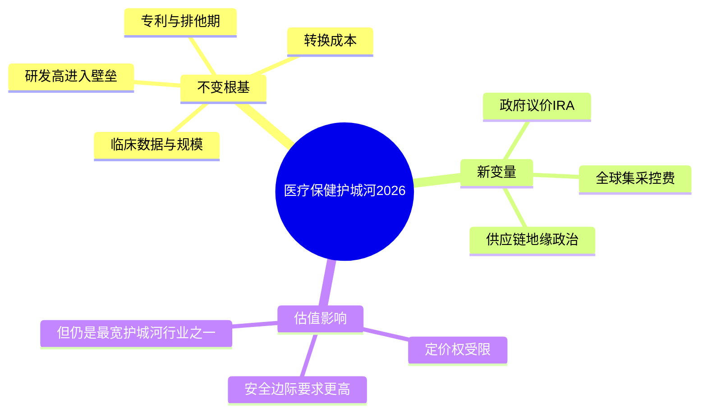
### 图2：品牌制药2026——管线深度重于单品

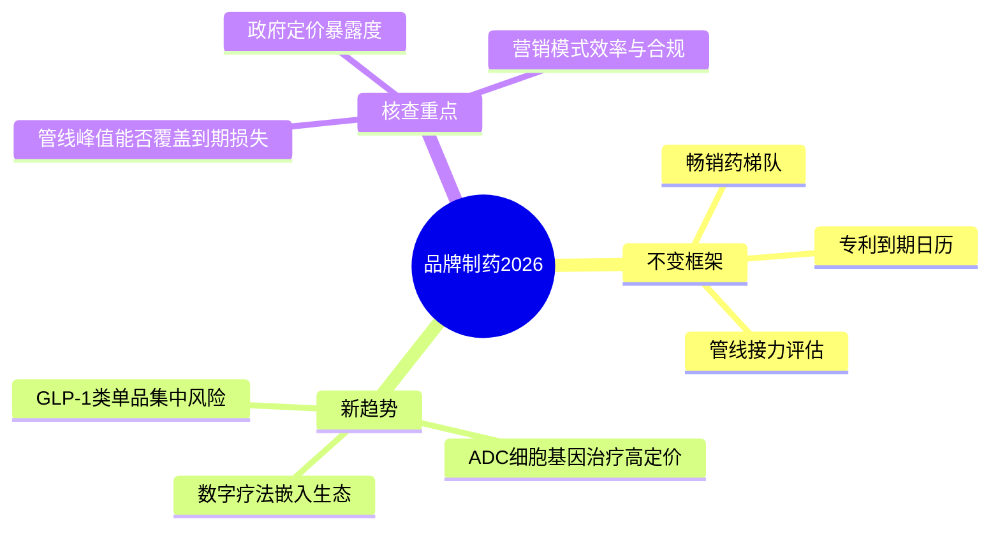
### 图3：仿制药与生物技术2026——分化加剧

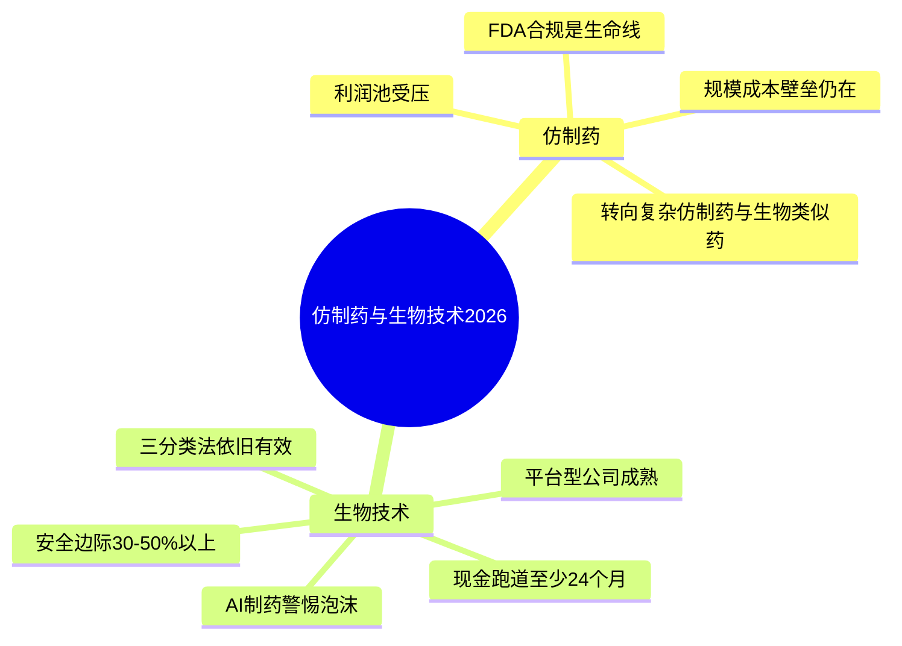

### 图4：医疗器械与管理式医疗2026——新护城河与旧隐患

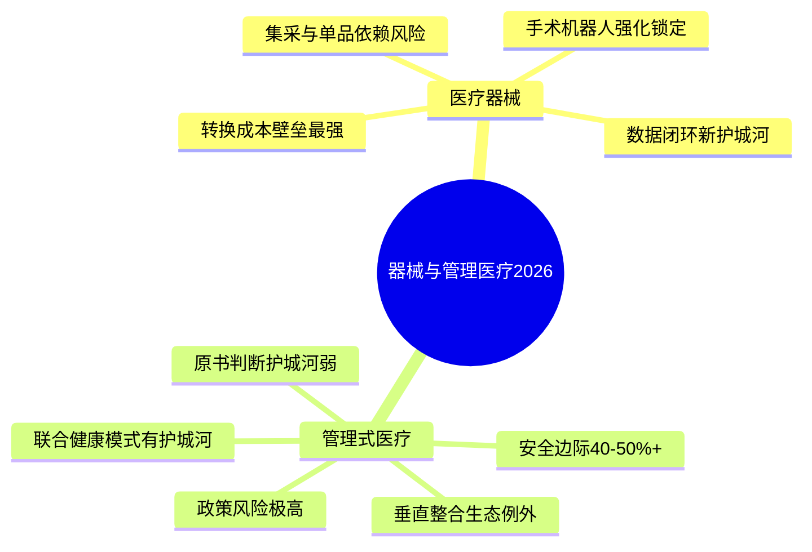


### 图5：2026年医疗保健行业全览核查清单
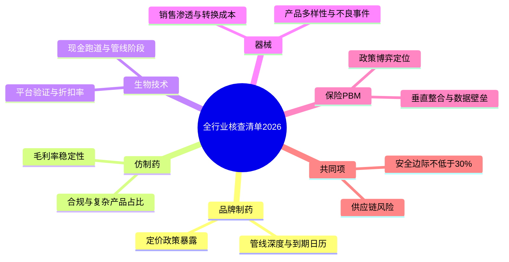

## 旧版本

# 第十四章　医疗保健行业（Health Care）——晨星行业分析第一块硬骨头

> **章首定位（原书精神）**
>
> 医疗保健是少数**与人类生存直接相关**的经济领域：需求稳定甚至逆周期（人生病不看大盘），所以传统上是**防御性避风港**；但与此同时，它又是**政治/定价/监管高压区**——护城河和价值陷阱往往并存。
>
> 多尔西把这一章切成 5 块：**（1）行业级竞争优势来源 →（2）品牌制药 →（3）仿制药 →（4）生物技术 →（5）医疗器械/耗材 →（6）医疗保险与管理式医疗（HMO/PBM类）**，并给每一块的**成功特质清单**。

---

## 0. 本章目录骨架（严格按原书小节顺序：p.174→189）

```
第十四章 医疗保健行业
├── 医疗保健行业的竞争优势（护城河从哪来？）
├── 医药行业（品牌制药 / Big Pharma）
│ └─ 成功的制药公司的特点
├── 仿制药品公司（Generic Drugs）
├── 生物技术行业（Biotechnology）
│ └─ 成功的生物技术公司的特点
├── 医疗器材公司（Medical Devices）
│ └─ 成功的医疗器材公司的特点
├── 医疗保险与管理医疗组织（Managed Care / HMO / PBM类）
│ └─ 成功的……的特点（通常较弱）
└── 投资者清单：医疗保健行业
```
> 为什么医疗保健值得先学：**它最能让你体会到"护城河很宽，但价值也最容易被政策一刀削掉"**——所以这一章不全是"好赛道好公司"，而是一条条**护栏**。

---

## 1. 医疗保健行业的竞争优势（行业级护城河来源）

### 1.1 为什么这个行业能长出宽护城河？

| 来源 | 原书怎么说（归纳） | 对投资的含义 |
|------|---------------------|--------------|
| **专利保护 / 市场排他性** | 品牌药享有专利期（专利申报后最长 20 年；上市独占通常**约 8–10 年**）→ 期间**阻止直接化学拷贝竞争** | 利润引擎是"时间窗口"：你赚的每一分超额利润，都有一个倒计时 |
| **高起步费用 / 高进入门槛（研发+临床+监管）** | 开发单一品种药物到上市可**15–20 年**、花费**数以十亿计美元**；失败率极高 | 新进入者很难"砸钱就复制"——但反过来也意味着：你自己买的股票是在为一个**高淘汰率的概率游戏**定价 |
| **明显的产品差异（临床疗效/安全性/品牌背书）** | 医师处方依赖证据+关系网络；患者对"已验证"的偏好极强 | 对大药企=定价权；对小新锐=要么证明优越性，要么被边缘 |
| **经济规模（制造规模/营销网络/临床数据资产）** | 辉瑞/默克级玩家：营销体系+巨量广告/学术推广+全球分销→新进入者极难追上 | 规模→单位成本+关系护城河；但规模≠永远安全（专利到期照样炸） |
| **支付结构带来的"低价格敏感度"（对患者端）** | 大头由保险/政府项目付→短期内药企定价弹性更高（但不等于"永远能提价"） | 政治/医保控费才是真正的**价格弹性放大器**：一旦政策转向，毛利可快速受压 |

### 1.2 行业财务"气质"（原书给的画像）

- 大制药典型区间（用作你对标时的**量级感**而不是铁律）：
  - **毛利率常常 75%–85%**
  - **营业利润率约 25%–35%**
  - **ROIC/投入资本回报常在 20%–30% 级**
  - 资产负债表往往**低负债、现金流充沛**（因为赚的是"可专利壁垒租"）
- 但：过去几十年趋势是**合并加剧**，站稳脚跟的厂商把刀磨得很锋利——**小玩家难直接挑战**，但大玩家的命门是**专利悬崖+政治控费**。

---

## 2. 医药行业（品牌制药 / Big Pharma）

### 2.1 研发流程：原书先把"神秘感"拆掉（你不需要当药师，但要懂漏斗）

> 原书把路径简化为：  
> **临床前（动物毒性）→ Phase I（安全性/剂量，几十人）→ Phase II（有效性/副作用，几百人）→ Phase III（大样本长期安全有效，上千人）→ FDA审评→上市**

- 时间/金钱口径：**10–15年（开发到上市口径常被写15–20年全生命周期）**、失败率高——所以药企估值永远带着**管线风险**。
- FDA角色（原书定位）：不是故意刁折腾，而是**提高门槛=也抬了护城河**（拦住低质进入者）。

### 2.2 利润引擎：畅销药（Blockbuster）与专利悬崖

| 项目 | 原书抓手 |
|------|---------|
| **畅销药品（Blockbuster）**：常定义为**年收入 ≥10亿美元的单品** | 大单品撑起利润与现金流；但**对单一/少数重磅药依赖=集中风险**→需要更大安全边际 |
| **专利悬崖**：专利/排他期满 → 仿制药进 → 价格/量断崖 | 原书口径精神：仿制药同成分但**便宜 40%–60%很常见**；上市后专有期结束时，销售可在**6个月内丢掉极大量份额（可到约 80%量级）** |
| 护城河对策（原书给的思路）：管线接力 + 换代专利策略（把患者从第一代转到第二代）+ 扩展适应症 |

### 2.3 成功的制药公司的特点（原书清单——逐条是核查动作）

> 找品牌制药的"可持有候选"，你盯的不是"今天又批了几个新药新闻"，而是下面这组结构性东西：

1. **畅销药品**（blockbuster梯队）：  
   - 不只问"有没有"，要问**梯队**：几代接力？下一代在 Phase III 了吗？  
2. **专利保护/专利管理**：  
   - 关键分子/适应症的**到期日历**清不清楚？（你买前必须拉一张专利到期表）  
   - 公司对"专利悬崖"有没有**主动管理**（换代产品/新适应症延期/授权策略）  
3. **完整的药物临床试验体系 + 可供试验的人群/网络**：  
   - 这是隐性资产：能做大规模长期随访=数据壁垒（尤其慢病/肿瘤/免疫）  
4. **强大的市场营销/医生渗透能力**：  
   - 医师关系网络、销售队伍渗透率、治疗领域心智占位（原书点名式举例：辉瑞/心脏病、惠氏/妇科、礼来/精神科关系不可忽略）  
5. **市场潜力要大（影响大量患者+慢性病/终身用药优先）**：  
   - 治广泛慢病/老龄病（心血管/代谢/肿瘤/免疫）> 窄罕见（除非定价极特殊且政策护着）  

#### 你最该写的"制药一行结论"

【制药候选】主打单品：____ 年销售：____ 专利到期：____
接力管线：PhaseIII有个（预计上市窗口，峰值潜力____）
定价风险：医保控费压力□高 □中 □低；毛利率带：____%
verdict：□可接受（接力清晰/到期分散） □高危集中（单品依赖+悬崖近）

---

## 3. 仿制药品公司（Generic Drugs）

### 3.1 原书给的定位：不是"差一等"，而是另一种生意

| 维度 | 仿制药生意气质（原书口径） |
|------|---------------------------|
| 毛利率 | **约 40%–50%**（远低于品牌药，但稳定） |
| 营业利润率 | **约 15%–20%** |
| ROIC | 更看规模：纯仿制药玩家可能**约 10%**；带品牌混合的可略高 |
| 增长逻辑 | 长期趋势有利：处方里仿制占比一路走高（原书给的演进感：1980s ~20% → 2000s后接近 ~50%） |

### 3.2 仿制药的护城河在哪？（比你想的"薄"，但有两处真壁垒）

1. **制造成本/规模经济（最核心）**：  
   - 化学合成路线优化、工厂认证、供应链合规——**低成本制造商赢家通吃**；小厂难追  
2. **监管/审批秩序红利**：  
   - 首仿/专利挑战机制里存在**180天市场排他窗口**（原书提到）→ 能给先手阶段性毛利抬升（约+10pct营业利润率级描述）  
3. **渠道/采购集中度**：大批发商、药店连锁、PBM/医保体系采购更倾向"认证合规+稳定供货+最低成本"→强者更强  

### 3.3 仿制药你该盯的（与公司分析章呼应）

- 盯：毛利率稳定性、产能利用率、产品组合广度（降单品依赖）、合规记录（FDA警告信/工厂整改是核弹级事件）
- 红旗：靠"不停收购小仿制药资产"维持增长（回到第六章：并购增长质量低）

---

## 4. 生物技术行业（Biotechnology）

### 4.1 原书先泼冷水：生物科技 ≠ 自动暴利

> 核心句精神：**除非你深入了解这项技术，否则不要在生物技术公司起步阶段投资。**  
> 现金流不可预测，输光比赚大钱可能性更大——**要用更大安全边际**（原书给的口径约 **30%–50% 折扣**才谈得上"投机性价值投资"）。

### 4.2 原书把生物科技公司分三层（你也要这样分仓看）

| 层级 | 特征 | 投资姿态 |
|------|------|----------|
| **established 公认/成熟** | 收入>$1bn级、正盈利、正现金流、管线更完整 | 可当"更像药企"审视（但专利/排他仍是命门） |
| **up-and-coming 生机勃勃/上升期** | 小规模正盈利或接近、管线有看点 | 现金为王：看它能不能活到下一阶段（现金跑道/合作金/大药企背书） |
| **speculative 投机性** | 负现金流、收入很远、疗法可能全新但风险极高 | 对你如果不是"风险投资仓位的小额"→别碰 |

### 4.3 成功的生物技术公司的特点（原书抓手）

1. **大量药物进入临床试验的最后阶段（Phase III / late-stage）**——不是"刚发现靶点/刚发paper"  
2. **资金充裕（现金跑道长）**：烧钱率（burn rate）/现金覆盖月数要算  
3. **成熟的销售渠道或强合作伙伴（大药企合作/授权/共同推广）**  
4. **（隐含）估值必须打足够折扣**：原书口径 **30%–50% 安全边际**更像"入场券"，不是"抠门"  

---

## 5. 医疗器材公司（Medical Devices / 耗材 / 植入物）

### 5.1 原书定位：这个子行业常常被低估——"最简单的医疗保健投资之一"

> 器械的护城河通常比纯小分子药更好"锚定"：  
> **规模经济 + 高转换成本（临床嵌入/手术流程绑定/医生培训/系统认证）+ 长期临床历史/数据信誉**

- 几家主要厂商常垄断细分（心脏、骨科整形、影像部件等）
- 老龄化 + 寿命延长 = 结构性需求顺风

### 5.2 成功的医疗器材公司的特点（原书清单）

1. **销售人员的渗透能力（医院/术者网络）**：  
   - 器械卖的不是"化学分子"，而是**流程信任+术中支持+售后培训**→销售队伍质量=真实壁垒  
2. **产品多样化（跨品类/跨科室）**：  
   - 降低单品依赖、提高医院一站式采购粘性  
3. **产品创新（R&D转化为能通过审批的新SKU/新适应症）**：  
   - 看：**新产品收入贡献占比**、费用化研发vs管线里程碑、召回/不良事件记录（FDA MAUDE数据库看趋势）  

---

## 6. 医疗保险与管理医疗组织（Managed Care / HMO / PBM系）

### 6.1 原书态度最直接：护城河最弱的一块

- 这类组织面对：**强烈监管压力、诉讼/公共监督、费率审查、医患政治博弈**  
- 原书结论精神：**通常没有强的竞争优势**→你要的**安全边际必须更大**（甚至很多情况更偏"周期/政策博弈"而不是"复利机器"）

### 6.2 若硬要找"相对优势"，原书允许的抓手

- 规模（会员基数/议价力）＋承保纪律（风险选择/管理）+ 业务混合（收费型/行政服务合同占比）
- 但这些都容易被立法/医改重置——所以这里更多是**交易+风控**，不是"长期持有信仰"

---

## 投资者清单：医疗保健行业（章末浓缩——原书式）

- ✅ 医疗需求稳定，但护城河来自**专利/排他期+规模+临床数据壁垒**；最大敌人是**专利悬崖+医保控费/政治**
- ✅ **品牌制药**：盯**畅销药梯队/专利到期日历/管线接力/营销网络**；单品依赖要更大折扣
- ✅ **仿制药**：护城河在**低成本制造规模+合规+渠道**，不是"化学配方"（过期专利后人人可抄）；盯FDA合规/工厂风险
- ✅ **生物技术**：分成熟/上升/投机；只碰你能理解的科学+现金跑道；安全边际要更厚（30–50%级讨论）
- ✅ **器械**：护城河更靠**转换成本+流程嵌入+销售渗透+产品多样/创新**；盯召回与临床不良事件趋势
- ✅ **保险/管理式医疗**：通常护城河弱；需要更大安全边际，更多把其当"政策周期+承保纪律"交易看

---

## 附录：医疗保健行业"子行业核查卡"（一键粘进 Notion/Excel）


【公司】___________ 【子行业】□品牌制药 □仿制药 □生物科技 □器械 □管理医疗
【日期】____
── 品牌制药 ─────────────────────────────────────────
畅销药梯队：主力(年销售) 到期__ 接力PhaseIII：____个
毛利率带% 营业利润率% FCF/营收____%
医保控费压力：□高 □中 □低 安全边际目标：____%
── 仿制药 ───────────────────────────────────────────
毛利率__%(40-50%?) 制造成本优势？□有 □弱 FDA警告信？□无 □有(摘要)
产品广度：____个SKU 并购撑增长？□是(警) □否
── 生物科技 ─────────────────────────────────────────
层级：□成熟 □上升 □投机
现金跑道：个月 晚期管线：PhaseIII个 partner：□大药企 □无
安全边际：____%（原书讨论30-50%级）
── 器械 ─────────────────────────────────────────────
销售渗透：□强(术者绑定) □中 □弱
产品多样：□跨品类 □单品为主(集中风险)
召回/不良事件趋势：□稳 □恶化（FDA MAUDE看）
── 管理医疗 ─────────────────────────────────────────
承保纪律：□好 □可疑 政策风险：□高 □中
结论：□可做(强安全边际) □避开(护城河太薄)