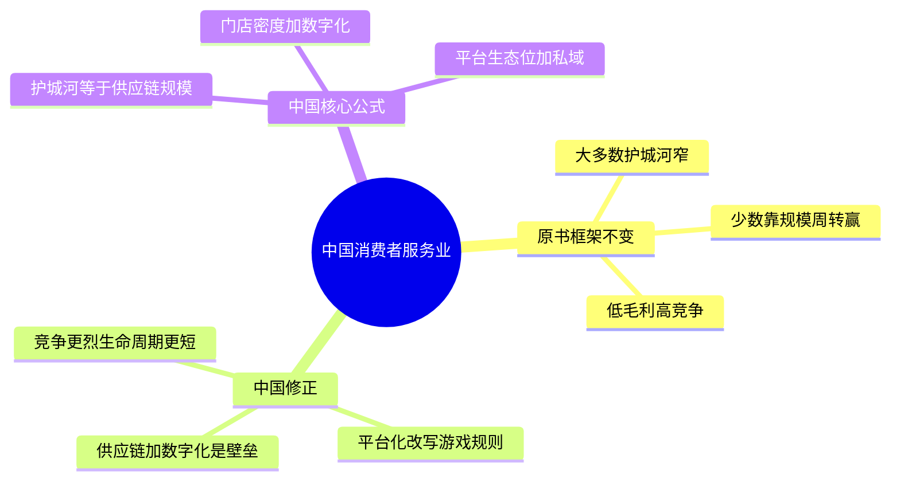
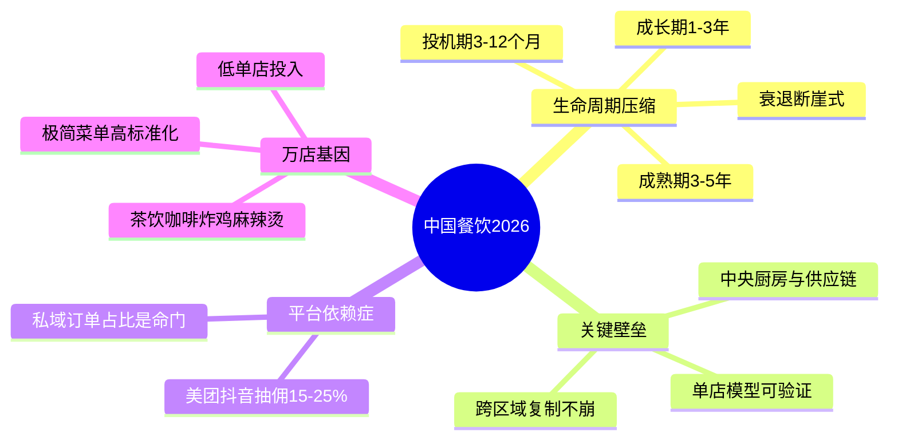
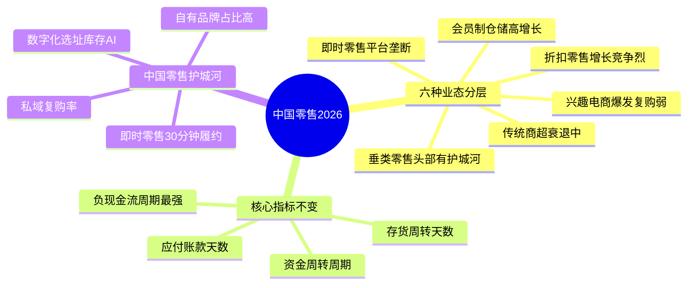
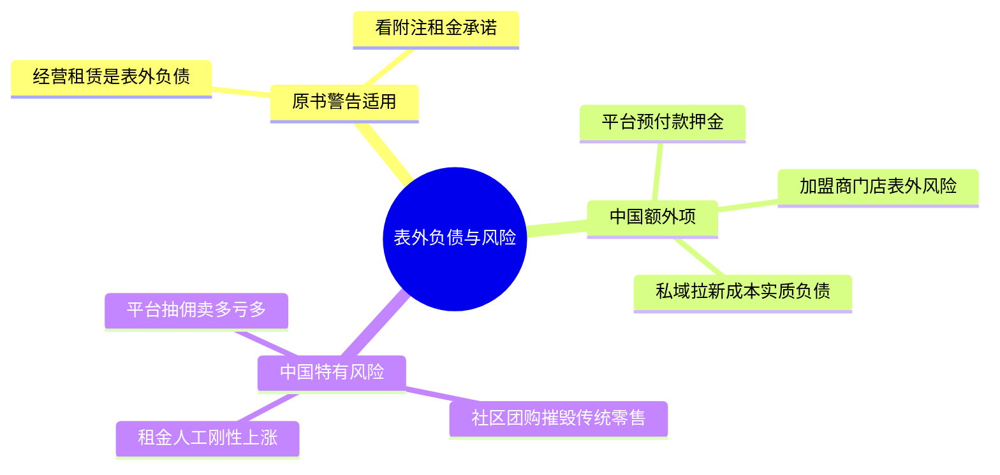
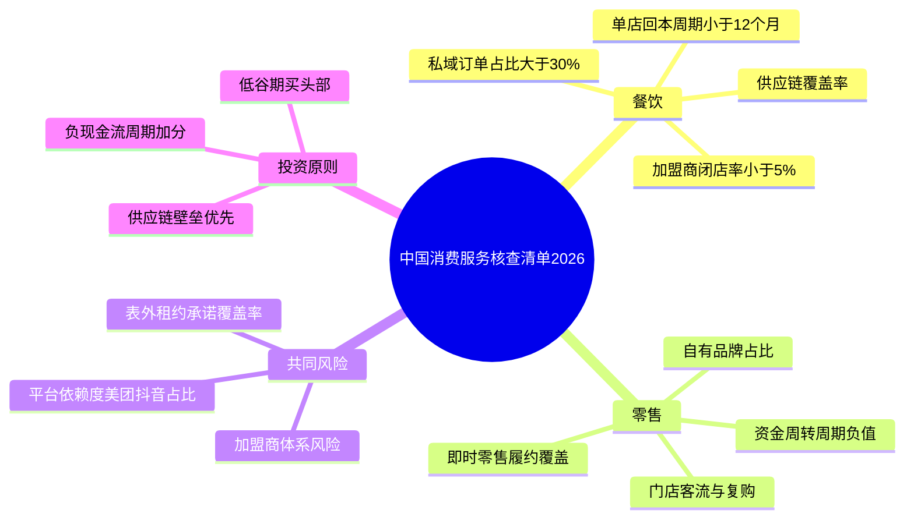

# 《股市真规则》第十五章：消费者服务业 —— 2026年中国版重估

**核心判断前置：**
原书第十五章（美国视角）对消费服务业的定位——“大多数企业护城河窄，少数靠规模+周转赢”——在中国**本质不变，但竞争烈度翻倍、平台化改写规则、生命周期加速压缩**。以下逐块对照，标注差异。

## 一、行业“气质”先钉死——中国版更残酷

| 原书要点（美国） | 中国对应（2026） |
|------------------|------------------|
| 低进入门槛 | 更低。加盟模式泛滥，一条街上同品类三个月换一茬。 |
| 竞争优势面很窄 | 更窄。消费者无忠诚度，价格战是常态；网红店生命周期从3-5年缩短到6-18个月。 |
| 规模经济是唯一可行护城河 | 成立，但中国还多一条：**平台生态位**（美团/抖音本地生活/私域运营能力）已成新壁垒。 |
| 与经济周期绑紧 | 更紧。中国消费者信心波动更大，储蓄率高企，可选消费降级明显。 |

**中国核心公式**：
- 护城河 = 供应链规模成本 + 门店网络密度 + 数字化运营能力 + 平台生态位
- 最大风险 = 价格战 + 平台抽佣 + 租金人工刚性上涨 + 消费者口味速变

## 二、餐饮业——中国版“生命周期”被加速到极限

### 2.1 原书四阶段在中国的时间轴
| 阶段 | 美国典型周期 | 中国2026典型周期 |
|------|-------------|-----------------|
| 投机性成长 | 1-3年 | 3-12个月（小红书/抖音爆红即巅峰） |
| 积极成长 | 3-8年 | 1-3年（加盟模式狂飙，现金流断裂风险极高） |
| 慢速增长/成熟 | 10-20年+ | 3-5年即显疲态（概念老化快，消费者追逐下一个网红） |
| 衰退 | 渐变 | 断崖（关店潮三个月内发生） |

### 2.2 中国餐饮的独特分析要点
- **加盟 vs 直营**：加盟模式扩张快但品牌失控风险极高（食安事故可一夜摧毁品牌）；直营模式稳但资本回报周期长。
- **供应链是关键护城河**：中央厨房+冷链配送+标准化出品能力，决定了连锁能否跨区域复制。中国头部餐饮（海底捞的蜀海、百胜中国）真正的壁垒在供应链。
- **平台依赖症**：美团/抖音团购抽佣侵蚀利润（综合费率可达15-25%），餐饮品牌本质上是平台的“内容生产者”。谁能建立私域（小程序/会员体系），谁才有真正的客户资产。
- **万店基因**：只有极简菜单+极高标准化+极低单店投入的品类（茶饮、咖啡、炸鸡、麻辣烫）能做到万店。正餐/大店模型天花板很低。

### 2.3 成功餐饮公司的特点（2026中国版核查表）
- ✅ 已验证的单店模型：单店回本周期<12个月，毛利率>60%，人效和坪效持续改善。
- ✅ 供应链壁垒：中央厨房覆盖率、冷链配送半径、标准化出品率。
- ✅ 复制能力：跨城市开店同店数据不崩；加盟商管控体系有效（闭店率<5%）。
- ✅ 平台独立性：私域订单占比>30%；自有小程序/会员池；不过度依赖美团/抖音。
- ✅ 菜单聚焦：SKU<30个，出品快，减少对厨师的依赖。
- ❌ 红旗：单店回本周期>18个月；美团/抖音占比>70%；加盟商大面积亏损；食品安全舆情。

## 三、零售业——中国版“平台+供应链”博弈

### 3.1 中国零售的独特分层
| 类型 | 代表 | 护城河来源 | 2026年处境 |
|------|------|-----------|-----------|
| 传统商超 | 永辉、大润发 | 供应链+网点密度 | 被社区团购+即时零售夹击，衰退中 |
| 折扣零售 | 拼多多、名创优品 | 供应链极致低价 | 增长，但竞争激烈 |
| 会员制仓储 | 山姆、Costco | 精选SKU+会员粘性+自有品牌 | 高增长，护城河较宽 |
| 即时零售 | 美团闪购、盒马 | 30分钟履约网络 | 平台垄断强，品牌商无定价权 |
| 兴趣电商 | 抖音电商 | 算法推荐+冲动消费 | 爆发强但复购弱，品牌难沉淀 |
| 垂类零售 | 瑞幸（咖啡零售化）、泡泡玛特 | 品牌+数据+选址密度 | 头部有护城河，尾部在消亡 |

### 3.2 原书“资金周转周期”在中国的应用
公式不变，但中国零售的竞争力更体现在：
- **存货周转天数**：名创优品类极致周转（SKU快速迭代），是核心壁垒。
- **应付账款天数**：大零售商对供应商账期长达60-90天，形成“负现金流周期”。
- **现金流周期为负**：用供应商的钱开店，这是中国零售龙头共同特征。

### 3.3 成功零售商的特点（2026中国版核查表）
- ✅ 自有品牌占比高：山姆/Member's Mark、盒马自有品牌——高毛利+差异化+用户粘性。
- ✅ 数字化运营：门店选址靠数据分析（非拍脑袋）；库存管理AI化；动态定价。
- ✅ 即时零售能力：30分钟履约覆盖；前置仓密度。
- ✅ 私域复购率：小程序/社群/会员体系驱动的复购占比。
- ❌ 红旗：过度依赖平台流量；线下门店客流持续下滑且无应对；存货周转天数上升；应付账期被人为拉长（供应商关系恶化）。

### 3.4 中国零售特有的风险
- **社区团购/拼多多**对传统零售的摧毁性冲击：低价+次日达，让加价率高、周转慢的业态无生存空间。
- **租金+人工持续上涨**：很多零售业态的利润被刚性成本吃掉。
- **平台税**：即时零售每单抽佣15-20%+配送费，品牌商“卖得越多，亏得越多”。

## 四、表外负债——中国版的“隐形炸弹”

原书对经营性租赁的警告在中国完全适用，且需额外关注：
- **中国品牌加盟店的“表外风险”**：加盟商门店的经营数据、租金、亏损往往不并表，但品牌声誉和潜在的赔偿/关店风险由品牌方承担。
- **平台预付款/押金**：对平台的履约保证金、营销预充值，本质上是另一种表外承诺。
- **私域资产折旧**：会员数据、小程序用户等“虚拟资产”在财务上不体现，但其获取成本（拉新补贴）在利润表中被费用化——如果私域粘性下降，前期投入=沉没成本。

## 五、2026年中国消费者服务业投资者清单（修订版）

- ⚠️ **本质不变**：绝大多数公司护城河窄，少数靠规模+周转赢。
- ⚠️ **竞争更烈**：中国低门槛+网红效应+加盟泛滥，生命周期压缩到极致。
- ✅ **餐饮找供应链+平台独立性**：中央厨房+标准化+私域占比，才是可复制护城河。
- ✅ **零售找自有品牌+即时零售+负现金流周期**：山姆/名创优品类模型才是优质资产。
- ⚠️ **警惕平台税**：美团/抖音抽佣是隐形成本，过度依赖平台的品牌=为平台打工。
- ✅ **传统商超慎碰**：被社区团购和即时零售夹击，价值陷阱多。
- ✅ **看表外租约+加盟商风险**：账面干净≠无杠杆。
- ✅ **最安全策略**：在消费低谷期，买具有供应链壁垒、私域运营强、有负现金流周期的头部公司。

## 思维导图（按阅读逻辑拆分）

### 图1：中国消费者服务业——原书框架与中国修正

###  图2：中国餐饮业——生命周期加速与万店基因

###  图3：中国零售业——分层与周转博弈

###  图4：表外负债与中国特有风险

###  图5：2026年中国消费者服务业核查清单

# 第十五章　消费者服务业（Consumer Services）——你每天见的店，大多没护城河，少数靠规模+周转赢

> **章首定位（原书 p.186 / 中信畅销版 ISBN 9787508686431）**
>
> 多尔西开篇就把话说透：
>
> > **我们不认为零售业和消费者服务业值得做"大量长期投资"——因为这个行业大多数企业的竞争优势面非常窄，很少发现一家能保持优势超过几年。**
>
> 但同一句后面紧接转折：
> > **当行业出现阶段性低价时，你也能买到高质量专卖店/服装店/折扣店——只是它们很少"值得无条件长期持有"，更多时候是"好价格+强执行+可验证门槛"的生意。**
>
> 本章拆成两块：**餐饮业（p.186）** 与 **零售业（p.188）**，共同指向同一个分析内核：**低毛利行业靠周转率+规模/成本位置活，护城河要么来自规模/成本，要么来自强品牌+网点密度，其余大多是红海。**

---

## 章内目录骨架（畅销版：p.186→194）

text
第十五章 消费者服务业
├── 我们每天看到的公司（p.186） ← 行业气质：非常熟 / 低门槛 / 很卷
├── 餐饮业（Restaurants / p.186） ← 生命周期：投机成长→积极成长→慢速增长/衰退
│ └─ 成功餐饮公司的特点（原书清单）
├── 零售业（Retailing / p.188） ← 关键：资金周转周期 & 存货/应付博弈
│ └─ 成功零售商的特点（原书清单）
├── 结论（p.193）
└── 投资者清单：消费者服务业（p.194）

---

## 一、我们每天看到的公司——行业"气质"先钉死（p.186）

| 行业特征 | 原书怎么说 | 对你意味着什么 |
|----------|-----------|---------------|
| **低进入门槛** | "open for anyone with a decent location and a bit of capital"精神 | 新竞争者层出不穷 → 超额利润被卷平快 |
| **竞争优势面很窄** | 很少有零售商/消费服务企业保持优势**超过几年** | 别把"它现在火"当"它有城堡" |
| **但也不是不能赚** | **靠规模经济做低成本领导者**是这条路最可行护城河（沃尔玛/家得宝类） | 门槛不在"谁产品好"，而在**谁周转快+采购成本低+网点密度高** |
| **与经济周期绑很紧** | 消费者支出占GDP大头；周期下行→同店下滑→杠杆/租金压力放大 | 更适合"逆向时机"（行业低谷+公司仍强）而非无脑长持 |

> 原书列举的"日常名字"：折扣店（Walmart/Target）、药店（Walgreen/CVS）、服装店（Gap）、家装（Home Depot/ Lowe's）、餐饮（McDonald's/Outback）…——**熟悉≠护城河**。

---

## 二、餐饮业（p.186）——生命周期 + "可复制概念"是全部

### 2.1 餐饮怎么赚钱？（原书拆分）

| 模式 | 例子 | 利润结构 |
|------|------|---------|
| **QSR/速食（柜台交钱）** | McDonald's、Wendy's | 标准化+高周转+强系统；更像"加盟/授权+供应链"生意（很多顶级快餐利润在系统费/地产租金上，不只是汉堡） |
| **Full-service（堂食服务生）** | Outback类 | 客单价高；但人工/租金/体验维护更重 → 模型更脆 |

---

### 2.2 餐饮生命周期（原书三阶段——你买票前先定位它卡在哪）

> 原书明确给的阶段顺序：

| 阶段 | 原书描述精神 | 财务指标典型 | 怎么投 |
|------|-------------|-------------|------|
| **① 投机性成长（Speculative Growth）** | 新概念刚起：经理盯细节与扩张潜力；但**大多数餐饮概念在这个阶段直接失败** | 营收增长快，**盈利通常为负/很薄** | **别当"成长股"买**；除非你有能力判"这个概念可全国复制+单位经济成立"，否则当风投小额 |
| **② 积极成长（Aggressive Growth）** | 每个新店必须盈利以支撑再扩张；现金流典型**为负**（扩太快/借新还旧）→FCF负是常态 | SSSG（同店增长）仍好；但**资产负债表风险↑** | 能投≠能追高；只碰必须有：**单位经济模型（Unit Economics）成立**+可复制+管理层资本纪律 |
| **③ 慢速增长/成熟（Slow Growth）** | 门店基数够了→扩张放缓→**充沛FCF**、稳定资本回报、常分红/回购 | 毛利率稳、周转稳、FCF正 | 这里才谈得上"持有候选"（但仍要估值） |
| **④ 衰退（Decline）** | 概念老化、品牌疲劳、竞争抢份额→同店掉 | 毛利受压、关店费用 | 淘汰/等重生信号 |

> 原书收束：**很少有餐饮连锁能优雅走到"慢速增长"；很多直接从积极成长滑进衰退。**

---

### 2.3 成功餐饮公司的特点（原书给的清单——这是"可复制护城河"的最小证据）

1. **已建立一个成功的概念（Proven Concept）**  
   - 不是"我觉得好吃"，而是：标准化菜单/运营、可培训、可品控、可跨区域口味兼容  
2. **复制是关键（Replicability）**  
   - 你能把第一家店的成功搬到城市B/C/D，而**单位模型不崩**（租金/人工/食材成本可scale）  
3. **老店必须保持新鲜（Refresh, not reinvent）**  
   - 翻新/菜单更新保持吸引力，但别动核心盈利结构（频繁推翻重来=成本黑洞）  

#### 餐饮你最该算的"一个数字"
- **Unit Economics（单店级）**：  
  `单店贡献≈(客单×翻台×天数 − 变动成本 − 店级固定成本)`  
  若单店贡献长期弱→再大连锁也是纸糊

---

## 三、零售业（p.188）——护城河如果不在品牌/规模，就在成本与周转

### 3.1 零售怎么赚钱？原书给的骨架

> **零售业赚钱 = 卖得多 × 周转快 × 毛利够用 − 租金/人工/损耗**，  
> 所以它的命脉不是"客单价多高"，而是**资金转得多快、卡在哪**。

### 3.2 关键指标：资金周转周期（Cash Conversion Cycle / 原书给的口径）

> 原书明确把注意力放到这组联动上：

| 指标 | 算法 | 看什么 |
|------|------|--------|
| **存货周转天数（DSI）** | `365 ÷ (COGS / 均存货)` | 越短＝越好（钱少卡仓库） |
| **应收账款天数（DSO）** | `365 ÷ (收入 / 应收)`（零售通常极小） | 零售应收往往小→不重要 |
| **应付账款天数（DPO）** | `365 ÷ (COGS / 均应付)` | **越大＝越能占上游款＝越像沃尔玛** |
| **资金周转周期 CCC** | `DSI + DSO − DPO` | **越短越好；负CCC＝供应商在给你"免费融资"（强零售信号）** |

> 原书原句精神：
> **确信比较"存货周转率 vs 应付账款周转率"——以此判断谁是零售超级高手。那些既懂顾客需求、又能用强谈判力压供应商账期的公司，才是这行业值得下注的对象。**

---

### 3.3 成功零售商的特点（原书清单）

1. **第一印象不可逆（选址/店面整洁/新鲜）**  
   - "你永远得不到第二次机会去给人留下美好第一印象"——门店通行量（traffic）与形象是硬资产
2. **盯门店通行/选址能力**（Traffic & Location）  
   - 零售很多优势本质是**地产优势**（好mall/好路口/密度）→护城河窄但真（换条街就不灵）
3. **积极的企业文化（运营成本纪律）**  
   - 零售利润薄→浪费/臃肿直接杀ROIC；好文化=持续压损、标准化执行
4. **知道自己是"低价+周转"还是"品牌溢价+体验"**  
   - 沃尔玛路：成本/信息系统/采购规模；高端精品路：品牌+陈列+客群锁定（更少见、更难守）

---

### 3.4 原书专门警告：表外负债（Off-balance-sheet liabilities）——零售/餐饮最大"隐形炸弹"

> **很多零售商账面上很少或没有债务，但"全面财务健康"可能没那么好——因为长期店面租约≈未来租金义务，本质是表外长期负债。**

- 你去**附注"Leases / Commitments"**：  
  - 未来5年租金承诺总和 vs EBITDA/现金流  
  - 若未来租金义务大而现金流弱→**杠杆其实很高，只是你没在负债合计看到**
- 实操：把**调整后净负债**近似为 `有息债 + 未来租金现值(或至少看3-5年承诺) − 现金`

---

## 四、结论（p.193）——这章给你的不是"买餐饮/零售"，而是边界

> **大多数消费服务概念长期失败→投机/积极成长期需更严密监控；小心股价已到"高成长定价"；行业低谷才值得动手；永远盯周转+表外租约+单位经济。**

一句话收束：
- 消费者服务业**不是"不能投"，而是**更少"宽护城河"、更多"窄护城河靠规模/选址/执行"**→你必须**更苛刻的安全边际**，并承认它更接近**周期+执行质量**生意，不是"躺着复利机"。

---

## 投资者清单：消费者服务业（p.194·原书浓缩）

- ✅ **大多数消费者服务概念长期经营中会失败**→对投机/积极成长期投资要**比一般股票更严密监控**
- ✅ **小心股价已到"高成长定价"**——餐饮/零售的成长很容易被竞争复制
- ✅ 护城河若成立，通常来自：**规模→低成本领导者** or **强品牌+网点密度**（窄但可守）
- ✅ **盯资金周转周期 CCC ＝ DSI + DSO − DPO**：越短越好；**比存货周转 vs 应付周转**找"超级高手"
- ✅ **密切注视表外负债（长期租约承诺）**：账面干净≠无杠杆；看附注租赁承诺
- ✅ **当稳健公司出不好月度/季度销售：找逆向机会**（坏天气/高基数可比≠基本面坏）但你要盯基本面，不是股价反应
- ✅ 行业协同波动→行业下滑时找机会买著名零售/餐饮**但要对手边名单（护城河/租约/周转）保持警觉**

---

## 附录：消费者服务业"门店/连锁核查卡"（一键粘进 Excel/Notion/飞书）

text
【公司】___________ 【业态】□餐饮(QSR/堂食) □折扣零售 □专营店 □家装 □其他___
【日期】____
── 1) 生命周期定位 ────────────────────────────────
□投机成长(负FCF/盈利薄/高倒闭率) → 当风投小额/不碰
□积极成长(扩店/同店增但FCF负/借支撑) → 只碰：Unit Econ成立/租约可控/负债不炸
□慢速增长/成熟(FCF+ / 分红回购) → 可当持有候选(仍要折扣)
□衰退(同店↓/关店) → 淘汰/等重生
── 2) 周转引擎（零售业命脉）───────────────────────
DSI=365/(COGS/均存货)=天 DPO=天 CCC=DSI+DSO-DPO=____天 (负=供应商融资✓)
存货/收入趋势：↑□(警) ↓□(好)
应付/租金压力：账面有息债/权益__ 未来5年租约承诺$____ vs CFO（覆盖率×）
── 3) 餐饮专用 ────────────────────────────────────
概念可复制？□yes □no（城市B/C模型崩？____）
老店翻新纪律？□yes(refresh) □no(推翻重来警)
食品/食品安全事故记录：□无 □有(___)
── 4) 表外租约（零售/餐饮通用炸弹）────────────────
附注Lease Commitments：未来1年__ 2-3年__ 4-5年$__
近似租杠杆=承诺/CFO≈____（>3-4?红灯）
── verdict ─────────────────────────────────────────
□可进深度（估值/安全边际） □周期观望(等更低价) □淘汰(理由:____________)