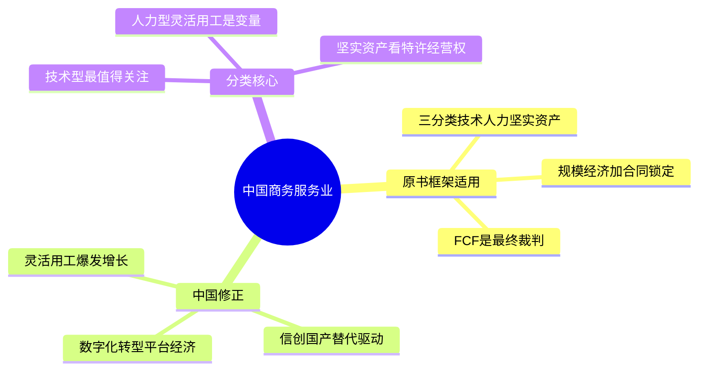
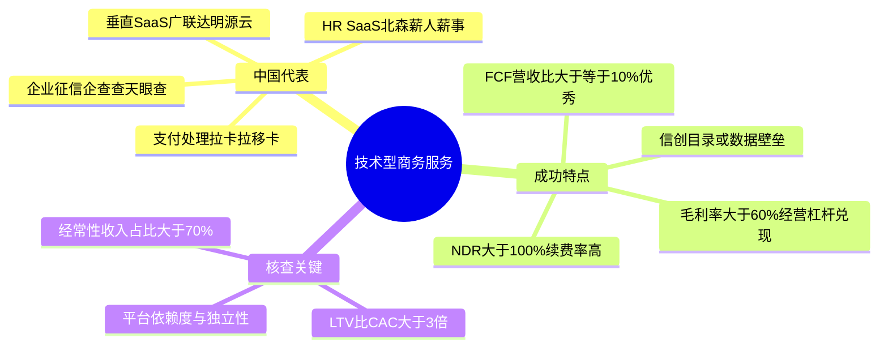
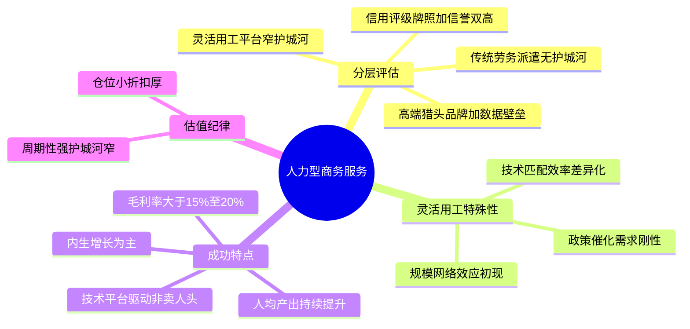
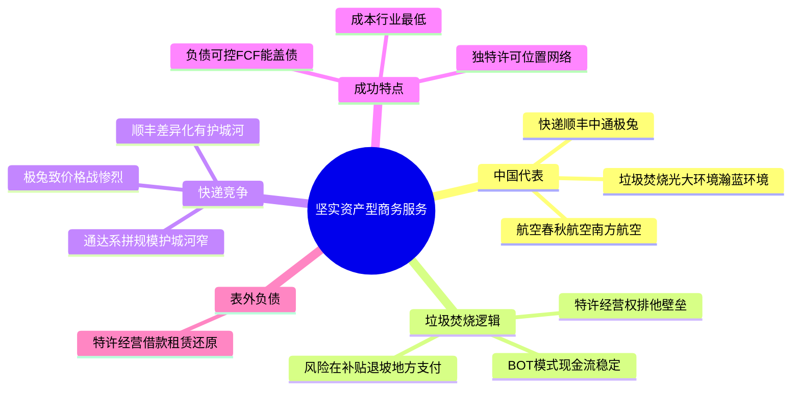
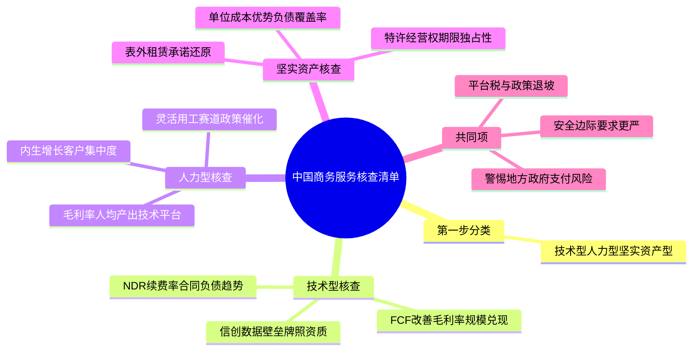

# 《股市真规则》第十六章：商务服务业 —— 2026年中国版重估

**核心判断前置：**
原书第十六章（美国视角）对商务服务业的三分类框架——**基于技术、基于人力、基于坚实资产**——在中国**完全适用，且分类逻辑比在美国更清晰**。但中国商务服务业的生态被**数字化转型、平台经济、政府信创与国产替代、灵活用工爆发**四重力量重塑，每一类公司的护城河来源和风险点都需要中国语境下的重新校准。

## 一、外部采购趋势——中国同样在加深，但驱动力更强

| 原书逻辑（美国） | 中国2026对应 |
|------------------|------------|
| 企业外包非核心业务以省成本/变固定为可变 | 成立，且更甚。中国企业面临**人工成本持续上升+社保合规趋严+增长放缓**三重压力，外包动力更强 |
| 外包占比从3.5%升至5.4%（1990-2001） | 中国人力资源外包（HRO）、IT外包、财务外包、营销SaaS等渗透率仍远低于美国，增速更快 |
| 蛋糕扩大但竞争者也增多 | 成立。中国企服市场极度碎片化，大量初创SaaS和传统外包公司同质化竞争，价格战惨烈 |

**中国核心增量**：
- **灵活用工**：政策鼓励+企业降本+劳动力供给变化，中国灵活用工市场规模已达万亿级，且仍在高速增长
- **数字化/信创替代**：政府和企业IT系统国产化替代（OA/ERP/数据库/信息安全），创造大量本土技术服务需求
- **企业出海服务**：跨境电商、品牌出海带动配套的海外薪酬/税务/合规/物流/营销服务需求

## 二、商务服务业的竞争优势——原书三条壁垒的中国验证

| 原书壁垒 | 中国2026对应 |
|----------|------------|
| 规模经济/经营杠杆 | 成立，但中国多数商务服务公司尚未达到"平台成熟后边际成本极低"阶段，仍在烧钱换规模 |
| 品牌/信誉 | 成立，尤其是涉及合规、税务、薪酬、数据安全等领域——"不敢乱换"的心理在中国同样强烈 |
| 高转换成本/长期合同 | 成立，但在中国SaaS订阅习惯不如美国成熟，中小企业续费率偏低，大客户定制化比例高导致迁移成本更高 |

**中国特有壁垒**：
- **牌照/合规资质**：人力资源服务许可证、劳务派遣许可、信息安全等级保护、等保密评等——在中国，资质本身就是进入壁垒
- **数据本地化/信创合规**：外资商务服务公司（如ADP、Manpower）在中国面临数据出境限制和信创采购壁垒，给本土龙头（如科锐国际、北森）留出空间

## 三、基于技术的公司——中国版"最值得关注"清单

### 3.1 中国对应玩家（举例）
| 原书美国例 | 中国2026对应 |
|-----------|------------|
| ADP（薪资外包） | 薪人薪事、北森（HR SaaS）、金蝶/用友（ERP） |
| First Data/Fiserv（支付处理） | 拉卡拉、移卡、连连数字 |
| Equifax/Experian（征信） | 百行征信、朴道征信（持牌个人征信）、企查查/天眼查（企业征信） |
| 数据服务/云 | 阿里云、腾讯云、华为云（IaaS+PaaS），以及垂直行业SaaS（广联达、明源云等） |

### 3.2 中国技术型商务服务的成功特点（修正版）

| 原书特点 | 中国2026对应 |
|----------|------------|
| ① 现金较多/高FCF转化率 | FCF/营收≥10%算优秀（中国SaaS多处于投入期，FCF常为负或微正，高FCF更难得） |
| ② 规模经济兑现 | 市占率提升需伴随毛利率/经营利润率同步改善；若收入翻倍而亏损扩大=未兑现 |
| ③ 稳定可预期的财务业绩 | 中国SaaS看**续费率/NDR**（净金额留存率）>100%为优秀；合同负债（递延收入）趋势比利润更真实 |
| ④ 快速成长且进入主流市场 | 收入增速>20%+非靠并购；真正的大市场是中小企业（中国有4000万+企业主体，但付费意愿弱，需验证PMF） |
| ⑤ 提供全方位服务（捆绑） | 从单一模块→一体化解决方案（如HR SaaS从招聘→薪酬→绩效→考勤全覆盖）→提高转换成本 |
| ⑥ 强大销售能力/渠道 | 中国商务服务销售高度依赖**直销+渠道伙伴+生态合作**；需关注销售效率（LTV/CAC>3x） |

**中国特有加分项**：
- **信创目录内/参与政府项目**：如用友、金蝶等国央企ERP替代项目，政策护城河+转换成本双高
- **数据资产/行业Know-How壁垒**：广联达（建筑造价数据）、明源云（地产数据）——数据飞轮一旦启动，竞品难追
- **平台生态位**：企业微信/钉钉/飞书上的ISV，靠平台分发获得流量，但需警惕平台绑定风险

**中国技术型商务服务核查清单**：
- 经常性收入占比>70%？NDR>100%？
- 毛利率>60%？经营利润率趋势向好还是持续亏损？
- FCF/营收是否为正且改善？
- 是否在信创/国产替代的确定性赛道上？
- 是否拥有难以复制的行业数据或牌照壁垒？

## 四、基于人力的公司——中国版：灵活用工是最大变量

### 4.1 原书判词在中国更复杂
原书说"基于人力的公司一般缺少吸引力"。这一判断在中国**对传统人力派遣/低端外包成立，但对灵活用工平台和高端专业服务需要重新审视**。

| 子类 | 中国代表 | 护城河评估 |
|------|---------|-----------|
| 传统劳务派遣/低端外包 | 大量中小型人力资源公司 | 无护城河，纯价格竞争，毛利率<10% |
| 灵活用工平台 | 科锐国际、人瑞人才、万宝盛华大中华 | 规模效应+客户关系+技术匹配平台，有一定窄护城河 |
| 高端猎头/专业招聘 | 猎聘、BOSS直聘（偏向平台）、科锐国际高端线 | 品牌声誉+行业专注+人才数据库，窄护城河 |
| 咨询/专业服务 | 埃森哲中国、四大咨询、本土咨询 | 品牌+方法论，但人力密集型本质不变 |
| 信用评级（穆迪类） | 中诚信、联合资信（债券评级） | 牌照+信誉壁垒，原书逻辑完全适用 |

### 4.2 中国灵活用工的特殊性
- **政策催化**：《劳务派遣暂行规定》限制派遣比例（≤10%），企业转向灵活用工/外包——需求刚性增长
- **技术赋能**：平台通过AI匹配+流程管理+合规风控，提高人效并降低风险，这是传统人力公司做不到的
- **护城河来源**：客户关系+行业经验+技术平台+规模网络效应（候选人越多→匹配越好→吸引更多客户）

### 4.3 成功的人力型公司特点（中国2026版）
- 毛利率>15-20%（显著高于纯劳务中介的5-8%）
- 人均产出（revenue/employee）持续提升，而非单纯堆人头
- 技术平台匹配效率（AI+数据）是差异化来源，而非纯粹"卖人"
- 内生增长为主，不靠连续并购堆收入
- 特定行业/职能深耕（如IT外包、医药研发外包CRO、金融外包）

**警告**：依然不属于"可长期持有的复利机器"——周期性强（经济下行客户砍外包）、护城河窄、估值要保守。

## 五、基于坚实资产的公司——中国版：垃圾填埋和快递

### 5.1 中国对应玩家
| 原书美国例 | 中国2026对应 |
|-----------|------------|
| 垃圾填埋/废物管理 | 光大环境、中国天楹、瀚蓝环境（垃圾焚烧发电+固废处理） |
| 快递 | 顺丰、中通、圆通、韵达、极兔 |
| 航空 | 南方航空、中国国航、春秋航空 |

### 5.2 中国垃圾焚烧/固废的独特之处
- **特许经营权模式**：地方政府授予30年垃圾处理特许经营权，有排他性——这是真壁垒
- **重资产+稳定现金流**：BOT模式（建设-运营-移交），运营期现金流稳定但前期负债极高
- **风险**：补贴退坡+地方政府支付能力下降+环保标准趋严

### 5.3 中国快递——比美国更卷的成本竞赛
- 极兔的入局把价格战打到极致，行业集中度提升但利润率极薄
- 顺丰走差异化（时效件+供应链），护城河来自**航空机队+枢纽网络+品牌溢价**，是少数有护城河的快递公司
- 通达系（中通/圆通/韵达）拼规模和成本，护城河窄
- 核查关键：单票收入趋势、单票成本、资本开支/折旧比、FCF是否为正

### 5.4 成功特点（中国版）
| 原书特点 | 中国对应 |
|----------|---------|
| ① 成本领导者 | 单票成本/吨处理成本行业最低 |
| ② 独特资产（许可/位置/网络） | 特许经营权期限、填埋场剩余库容、枢纽机场时刻资源 |
| ③ 谨慎的融资 | 资产负债率<65%+利息覆盖>3x+FCF能覆盖到期债务（中国重资产服务公司普遍高杠杆，需更严筛选） |

**表外负债警告**：中国固废BOT项目大量使用长期特许经营权借款和长期应付款，需要仔细拆解负债结构；快递公司的运输车队和飞机有大量经营租赁，需还原为等效杠杆。

## 六、中国商务服务业投资清单（2026）

- ✅ **先分类再发言**：技术型（⭐最优）> 人力型（△）> 坚实资产型（△需挑独特资产）
- ✅ **技术型**：找高经常性收入+NDR>100%+FCF改善+信创/数据壁垒；中国企服SaaS整体处于投入期，需接受短期低利润，但必须验证单位经济模型（LTV/CAC>3x）
- ⚠️ **人力型**：灵活用工赛道增长确定，但护城河窄；优先选有技术平台+规模效应+特定行业深耕的龙头；传统劳务派遣和纯咨询缺乏吸引力
- ⚠️ **坚实资产型**：垃圾焚烧看重特许经营权+政府支付能力；快递重成本领导+差异化；航空估值极低但有周期和杠杆双重风险
- ✅ **估值要更严**：技术型可给予一定成长溢价（但P/S>10需谨慎）；人力型P/E在15-20x为合理；坚实资产型P/E>15x或P/B>1.5x需更厚安全边际
- 🚨 **中国特有风险**：地方政府支付能力（固废/环卫）、平台税/抽佣（如依赖企业微信/钉钉）、信创政策退坡、灵活用工监管趋严

## 思维导图（按阅读逻辑拆分）

### 图1：中国商务服务业——三分类框架与修正

### 图2：基于技术型——中国版成功特点

### 图3：基于人力型——灵活用工与专业服务

### 图4：基于坚实资产型——垃圾焚烧与快递

### 图5：中国商务服务业核查清单总览

 

# 第十六章　商务服务业（Business Services）——轻资产、合同锁定、三种体质完全不同的"服务生意"

> **章首定位（原书 p.196 / 中信畅销版 ISBN 9787508686431）**
>
> 商务服务公司**与各行各业打交道**——从工资社保外包、数据处理、信用评级、广告代理、临时用工，到垃圾填埋、快递、航空——所以它不是"一个行业"，而是**一整个由"非核心业务外包"喂养的生意集群**。
>
> 多尔西先把话说透：这类公司**种类太杂**，所以你别笼统地说"商务服务业好不好"，而要按**盈利模式**把它劈成三种体质：
>
> > **① 基于技术的（Technology-based）　② 基于人力的（People-based）　③ 基于坚实资产的（Asset-heavy）**
>
> 护城河、现金流质量、风险、你该盯的指标——**三类天差地别**。

---

## 章内目录骨架（畅销版 p.196→203）

text
第十六章 商务服务业
├── 一、外部采购趋势（Outsourcing Trend / p.196） ← 行业需求引擎：为什么企业愿意把活包出去
├── 二、商务服务业的竞争优势（p.196） ← 规模经济/品牌/进入壁垒/长期合同
├── 三、基于技术的公司（p.197）⭐最值得你时间 ← ADP/First Data/征信/数据服务等
│ └─ 成功的基于技术的公司的特点
├── 四、基于人力的公司（p.199）△最不吸引人 ← 咨询/广告代理/人力派遣
│ └─ 成功的基于人力的公司的特点
├── 五、基于坚实资产的公司（p.201）△苦工但偶有窄护城河← 垃圾填埋/快递/航空等
│ └─ 成功的基于坚实资产的公司的特点 + 陷阱
└── 投资者清单：商务服务业（p.203）

> 原书开篇一句很关键（p.196精神）：
> **"在这里，我们可能发现许多公司其实经营得非常好，有强的竞争优势，是长期投资者喜欢在合适价格买入并持有的那种公司——而且这个行业不太适合华尔街分析师'行业导向'的胃口→华尔街注意少＝可能被低估。"**

---

## 一、外部采购趋势（p.196）——行业增长的底层引擎

### 1.1 原书给的数字与逻辑

| 项目 | 原书数据/表述 |
|------|---------------|
| 企业依赖外部服务的程度 | 从 **1990年 ≈3.5%** 增长到 **2001年 ≈5.4%** 的公司支出占比 |
| 本质 | **外包非核心业务＝省时间/省管理带宽/把固定成本变可变成本**→只要经济分工深化，这趋势就长期成立 |
| 含义 | 外包是商务服务的"总需求底座"——但它**不保证每家外包公司都有护城河**（把活包出去≠包给谁都一样） |

> 原书一句话：外部采购普及＝**蛋糕在变大**；但竞争者也在变多——最终谁能守住利润，取决于壁垒（见下一节），不取决于"行业在增长"。

---

## 二、商务服务业的竞争优势（p.196）——为什么有的能守、有的守不住

### 2.1 三条护城河来源（原书逐条给的）

| # | 来源 | 机制 | 哪种子类最受益 |
|---|------|------|----------------|
| ① | **规模经济 / 经营杠杆** | 很多商务服务有**高固定成本底座**（数据中心/清算网络/处理平台/全国性网点）→工作量越大→单位成本越低→后来者越追不上 | 基于技术✅ 基于坚实资产✅ |
| ② | **品牌/信誉（尤其"必须可信"的服务）** | 信用评级、审计/鉴证、payroll合规——客户不敢乱换→**声誉本身=进入壁垒** | 基于技术✅（征信/评级）& 某些人力✅（穆迪类） |
| ③ | **高转换成本 / 长期合同锁定** | 系统嵌进客户流程、数据迁移难、合规依赖、多年合同→客户被锁住 | 基于技术✅✅ |

### 2.2 原书给的"共性检查项"（跨子类都适用的红绿灯）

| 检查 | 绿灯 | 红旗 |
|------|------|------|
| **规模经济是否兑现**（毛利率/营业利润率随规模走？） | 营业利润率随收入规模↑或至少稳 | 收入涨但利润率不涨＝没有网络效应/只有低价抢量 |
| **应计收入/长期合同**（Recurring Revenue） | 高比例收入来自**多年合同/重复性订阅**（80–90%甚至"财年开始前已入账"） | 收入靠一次性项目/不断找新单＝不可靠 |
| **现金流转化** | FCF/营收 高且稳 | 利润高但FCF薄＝营运资本黑洞（应收膨胀） |
| **市场机会大小/竞争方式** | 市场足够大能容纳多家，但竞争**不在纯价格战** | 如果"价格是最重要卖点"＝商品化 |

> 原书原话精神：**要寻找规模经济和经营杠杆→它们提供进入壁垒；要寻找应计/长期合同→给财务稳定性；要关注现金流→回报最终靠真金白银。**

---

## 三、基于技术的公司（p.197）⭐ 商务服务里**最值得你时间**的一块

> 例子：薪资外包（**ADP**）、支付处理（First Data/现在的 Fiserv 系）、征信（**Equifax / Experian**）、数据服务商、清算网络

### 3.1 为什么"基于技术"在这里=最强护城河

| 机制 | 原书怎么说的 |
|------|-------------|
| **高固定成本平台 + 边际成本极低** | 核心系统建成后，多服务一个客户≈增量成本很小→**经营杠杆炸出来：利润比收入增长更快** |
| **后续投资需求较低** | 不像工厂要不停翻新产线→一旦平台成熟，CapEx相对受控→**FCF出得来** |
| **转换成本极高** | 薪资/支付/HRIS嵌进员工数据、税务规则、银行对接→换=项目地狱→客户被锁住 |
| **长期合同锁定收入（可预期）** | 典型：公司 **80%–90% 收入甚至在年度开始之前就已入账**（合同签了）→财务成果更稳定可预期 |
| **品牌/合规信誉** | payroll/征信/清算：客户"不敢乱换"→信誉=护城河 |

### 3.2 成功特点清单（原书逐条给的——直接当核查表用）

| # | 特点 | 你盯的硬指标 |
|---|------|-------------|
| ① **现金较多 / 高FCF转化率** | 原书给的经验感：**自由现金流毛利率 ≈15% 或更高** 是这类好公司的常见信号 | FCF/营收 ≥5–15% 看模式；FCF长期为正且稳 |
| ② **规模经济兑现** | "大就是好"：市场领导者从成本优势挤压小对手 | 市占 vs 同行；营业利润率是否随规模走强 |
| ③ **稳定可预期的财务业绩** | 多半收入**重复性/合同驱动**，不是一单单找新项目 |  recurring revenue %（≥70–80%算强锁定） |
| ④ **快速成长，但进入主流市场**（不是小众实验） | 增长来自真实市场渗透，不是并购堆砌 | 内生增长% vs 并购贡献% |
| ⑤ **提供全方位服务（bundling）** | 从单一服务→套装（薪资+税务+HR）→**提高转换成本、把客户捆更紧** | 每客户收入（revenue per client）趋势↑ |
| ⑥ **强大销售能力/分配渠道** | 商务服务要规模化触达企业客户→直销部队/渠道覆盖 | SG&A效率（销售效率=新增收入/销售费用） |

### 3.3 投资定位（原书结论）

> **基于技术的商务服务＝轻资产+高转换成本+可预期FCF——是全书最"窄但真护城河"的候选池之一。**  
> 但：一旦市场给它们贴上"科技股"溢价→你得砍回保守现金流价值，别为"概念"多付钱。

---

## 四、基于人力的公司（p.199）△ 大多数——**最不吸引人**

> 例子：咨询/专业服务（Accenture类）、临时用工/招聘（Manpower / Robert Half）、广告代理（Omnicom / Interpublic）

### 4.1 原书判词非常直白

> **一般来说，这一类型公司比基于技术的公司缺少吸引力。**
> 原因一句话：**高度依赖核心员工的时间与人才——而这俩都很难"规模化护城河"锁住。**

| 维度 | 原书表述 |
|------|---------|
| 赚钱模式 | "杠杆作用于员工时间"→给技术人力时间标高价（咨询）=基本路径 |
| 壁垒 | 客户关系重要，但**大多公司在一个产业集中度不高的行业里经营**，彼此激烈竞争，竞争优势面通常较窄 |
| 例外 | 少数有**品牌信誉护城河**（穆迪类评级：发行方"必须"买评级，且费用只占发债成本极小比例→客户对价格不敏感）→**窄但真** |

### 4.2 成功（能跑出来的）特点（原书给的——门槛很低，所以你得挑得更狠）

| # | 特点 | 你盯的 |
|---|------|-------|
| ① **产品差别化（专业壁垒）** | 不是"广告公司谁都能开"，而是有**可验证的专业信誉/资质/方法论/独家数据**→客户买的是"信" | 毛利率是否显著高于普通劳⼒中介（≥25–35%更舒服） |
| ② **提供必需品/低成本服务** | 消费者感觉"不得不买"或对成本不敏感（穆迪：评级费只占发债费用一小片） | 收入韧性（衰退期掉多少？） |
| ③ **有组织地增长（内生＞并购）** | 原书警告：这类公司最爱**靠并购撑增长**→你要拆：收入增速里内生 vs 并购各多少 | 并购驱动占比过高＝质量扣分；商誉膨胀＝⚠️ |

### 4.3 实操一句话
- 大多数人力型商务服务＝**周期劳务生意**：看利润率韧性、看人均产出（revenue/employee）、看前十大客户集中度
- 除非你能识别到**穆迪式"必须买+信誉壁垒"**，否则仓位要小、折扣要更厚

---

## 五、基于坚实资产的公司（p.201）——重资产服务：毛利薄、杠杆高、但偶尔有"天然独占"

> 例子：垃圾填埋/废物管理（Waste Management / Republic）、快递（FedEx / UPS）、航空（Southwest / 联航）

### 5.1 原书给的体质

| 特征 | 原书 |
|------|------|
| 成长需要**大量固定资产前置投入** | 填埋场/分拣中心/机队/枢纽→CapEx重 |
| 高营业杠杆 | 固定成本大→收入波动→利润摆幅大（好年很赚/坏年很疼） |
| 竞争优势面**通常较窄** | 因为很多这类生意本质是"成本竞赛"；但… |
| **例外：独特资产＝天然壁垒** | 例：废物管理的**垃圾掩埋场**：政府批准的新填埋点极难拿→已有优质填埋场位置＝真壁垒（别人无法轻易复制产能） |

### 5.2 成功特点清单（原书给的——重资产逻辑）

| # | 特点 | 你盯的硬指标 |
|---|------|-------------|
| ① **成本领导者** | 看 **固定费用周转率 / 营业毛利率 / ROIC** vs 同行 | Op margin是否稳居同行上部；单位成本曲线优势 |
| ② **独特资产（许可/位置/网络）** | 填埋场/枢纽机场slot/分拣网络——**"批准/稀缺"**才是护城河，不是"我有卡车" | 不可替代资产占比 vs 可复制资产 |
| ③ **谨慎的融资（负债可控 / FCF能盖债）** | 重资产+高杠杆=致命组合→必须核：FCF vs 利息/到期洪峰 | 利息覆盖；FCF/股息；杠杆斜率 |

### 5.3 原书专门提的航空子例（Southwest）
> 西南航空是"基于坚实资产"里少数好样板：点对点、单一机型、极简运营→**成本结构驱动**→护城河来自成本位置而非座位舒适度。但航空整体＝**周期+高杠杆+商品化竞争**→大多数航空是最不吸引人的。

### 5.4 常见陷阱（原书点名）
- **资产负债表以外的融资**（如经营租赁承诺/飞机租约）→和第十五章零售"表外租约"同一道理——账面干净≠无杠杆，看附注租赁承诺

---

## 投资者清单：商务服务业（p.203·原书浓缩）

- ✅ **先分类再发言**：基于技术（⭐最有吸引力）/ 基于人力（△大多缺壁垒）/ 基于坚实资产（重资产/窄护城河偶现）
- ✅ **规模经济 + 经营杠杆＝核心壁垒路径**：固定成本平台→量大→单位成本低→利润弹
- ✅ **盯长期合同/重复性收入**：应计收入比重高（80–90%预签合同）→财务可预期
- ✅ **现金流才是裁判**：技术型应有 FCF/营收 亮眼（≈15%FCF毛利率级）；重资产型必须验 FCF能盖债
- ✅ **基于人力型**：除非品牌信誉壁垒（穆迪类），否则缺持久护城河→更小仓/更厚折扣/盯内生增长与人均产出
- ✅ **重资产型**：看成本领导+独特许可资产（填埋场/枢纽位置），永远验表外租约/融资；多数航空最不吸引人
- ✅ **整体估值纪律加倍**：因为华尔街不怎么追它→可能低估，也可能只是"看上去便宜的资本黑洞"→用FCF和安全边际过滤

---

## 附录：第十六章"商务服务三型核查卡"（一键粘进 Excel/Notion/飞书）

text
【公司】___________ 【子型】□基于技术 □基于人力 □基于坚实资产(___)
【日期】____ 【主营】____________________________________
── 共性体检 ───────────────────────────────────────
FCF/营收 __% (≥5%?□gold ≥15%FCF毛利率?□tech型OK)
Recurring收入占比 __%（合同锁定？≥70%?□强 □弱）
负债斜率↑□→□↓ 利息覆盖 × 表外租约/承诺$vs CFO (覆盖率×)
── 基于技术 ───────────────────────────────────────
□市占第一/二？□是 □no
营业利润率随规模：↑□ →□ ↓□（应↑或稳）
bundling？(薪资+税+HR?) □yes(提转换成本) □单一服务(脆)
客户集中度：top5 __% (≤20%?□OK >30%?□警)
── 基于人力 ───────────────────────────────────────
毛利率 __% (≥30?□可能信誉溢价 □commodity警)
人均产出(rev/employee)趋势：↑□ →□ ↓□
内生增长%__ vs 并购驱动%__（并购>50%?□警）
前5客户__%（集中?□是□no）
── 基于坚实资产 ────────────────────────────────────
固定费用周转率/OpMargin vs 同行：□领先 □中游 □落后
独特许可资产：□填埋场 □枢纽slot □网络 □无(纯商品=警)
负债/资本 __% FCF>利息?□是 □勉强 □no(淘)
off-BS租约承诺≈$__ → 等效杠杆？____
── verdict ─────────────────────────────────────────
类型价值：Tech□top候选 □mid Human□小仓厚折 □pass Asset□看独特资产+杠杆
理由：________________________________________________