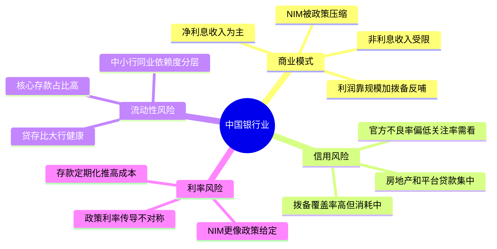
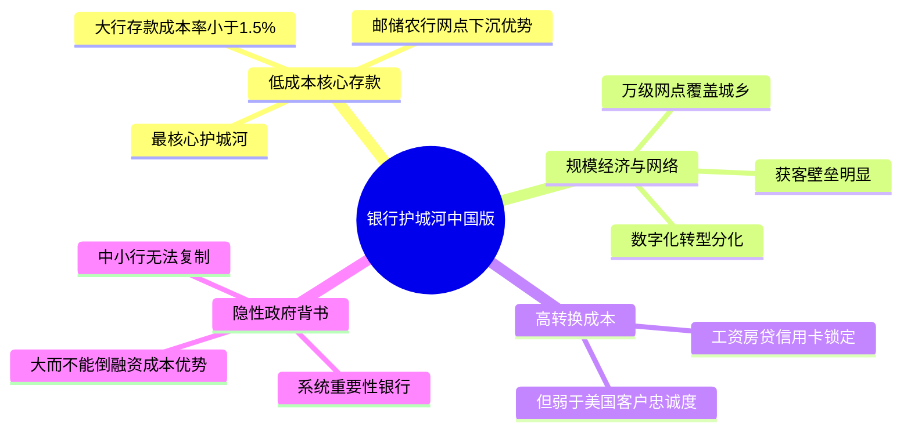
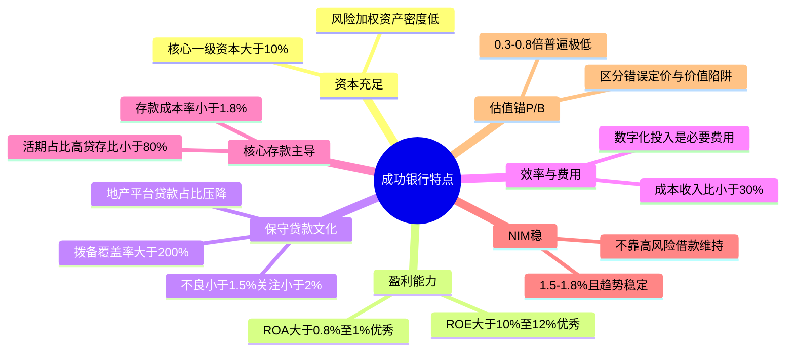
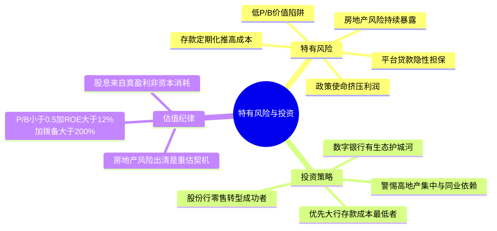

# 《股市真规则》第十七章：银行业 —— 2026年中国版重估

**核心判断前置：**
原书第十七章（美国视角）对银行业的定位——“管理信用、流动性和利率三种风险，护城河来自低成本核心存款+规模经济+转换成本”——在中国**本质完全成立，但行业结构和风险权重截然不同**。
中国银行业并非自由竞争市场，而是**国有大行寡头主导+央行与金融监管总局严格管制利率与信贷投放+政策目标（普惠、涉农、绿色）镶嵌在经营中**的独特生态。2026年尤其关注**房地产与地方政府债务风险出清进程、净息差（NIM）收窄趋势、以及“低估值高股息”背后的陷阱或机会**。以下逐块对照。

## 一、中国银行业：同样赚“息差+费用”，但利润表更受政策校准

### 1.1 银行怎么赚钱——中国版利润表要点
| 项目 | 美国原书表述 | 中国2026对应 |
|------|------------|------------|
| 净利息收入 | 利息收入-利息费用，息差引擎 | 仍是绝对主力（占收入约70-80%），但NIM持续收窄（2025年约1.5-1.7%，远低于美国的2.5-3%+） |
| 非利息收入 | 手续费/托管/财富管理 | 占比偏低（10-25%），且受“减费让利”政策影响，增长受限 |
| 资产减值损失（拨备） | Provision for Loan Losses | 拨备是利润的调节器，监管要求拨备覆盖率>150%（大行）/ >130%（中小行），超额拨备可以反哺利润 |
| 净利润→ROE | ROE可持续15-20%为优质 | 中国银行业ROE已系统性降至10-12%（大行）甚至更低，12%以上算优秀 |

**中国核心矛盾**：
- 银行业的“毛利”（NIM）被政策压缩：贷款利率被LPR引导下行，存款利率虽有自律机制但下行滞后，不对称降息持续挤压息差。
- 利润增长并非来自定价权，而是来自**规模扩张（资产增速≈GDP+通胀）+风险成本控制+拨备反哺**。

### 1.2 三大风险——中国版比原书更集中、更政治化

① **信用风险**——当前最核心矛盾：房地产+地方融资平台（LGFV）
| 原书指标 | 中国2026对应与调整 |
|----------|-------------------|
| 不良贷款率（NPL ratio） | 官方NPL比率较低（大行约1.3-1.5%），但关注类贷款+展期重组类占比更高，真实风险需看“逾期90天以上/不良”偏离度 |
| 拨备覆盖率 | 监管要求高（>150%），大行普遍200%+，看似安全垫厚；但如果房地产/平台贷款大规模迁移为不良，消耗拨备速度很快 |
| 贷款集中度 | 中国银行业贷款高度集中于**房地产（对公+按揭）和基建/平台**，两者合计可占对公贷款40%+，集中度风险极大，是美国原书未充分考虑的维度 |
| 管理层贷款哲学 | 中国银行放贷非纯商业逻辑，受“信贷投放指导”“稳增长”等政策驱动，逆周期调节可能导致逆市场纪律 |

② **流动性风险**——中国银行有“结构性存款依赖+政策流动性支持”双重特征
| 原书指标 | 中国2026对应 |
|----------|------------|
| 核心存款占比 | 中国居民储蓄率高，核心存款（活期+定期）占比相对高，但“存款定期化”趋势拉高付息成本 |
| 贷存比 | 法定监管要求≤75%（已弱化但仍在），大行贷存比多在70-80%，相对健康；部分股份行/城商行偏高，依赖同业负债 |
| 批发/市场融资依赖 | 中小银行对同业存单、央行MLF/再贷款依赖度较高，流动性分层明显；但央行“最后贷款人”角色提供了隐性安全网 |
| 流动性缓冲 | 监管要求LCR（流动性覆盖率）>100%，大行普遍达标，但真正压力测试需考虑存款搬家、理财赎回踩踏等极端情景 |

③ **利率风险**——中国版是“政策利率传导+重定价滞后”
- 贷款利率锚定LPR（政策信号），存款成本却因竞争和定期化而僵化，NIM被不对称压缩。
- 银行账户利率风险（银行账簿IRRBB）在中国监管框架下受到更严格监控，但中小银行资产负债期限错配依然普遍（短借长贷）。
- **实际观感**：中国银行业的NIM更像“政策给定区间”而非“管理能力差异”，真正拉开差距的是**存款成本控制**（见护城河部分）。

## 二、银行业的竞争优势——原书四条在中国谁强谁弱

| 原书护城河来源 | 中国2026对应 |
|---------------|------------|
| ① 低成本核心存款 | **仍然是最强护城河**。存款成本率<1.5%的大行（邮储、农行、建行）拥有巨大优势；存款是“负债端的品牌和网点网络效应”。 |
| ② 规模经济+网点网络 | 国有大行拥有数十万员工和万级网点，覆盖城乡，形成事实上的获客壁垒；但冗员和物理网点也是成本负担，数字化转型是分化器。 |
| ③ 高转换成本 | 成立，但弱于美国。中国客户对银行忠诚度有限，但工资代发/房贷/信用卡绑定仍有锁定效应。 |
| ④ 隐性政府背书 | **中国市场最显著的护城河**：国有大行和系统重要性银行享受“大而不能倒”的融资成本优势（存款人/债主相信政府会兜底），这是城商行/小行无法复制的。 |

**中国银行业护城河结论**：
- 真正的宽护城河仅存在于**六大国有行+少数头部股份行（招行）**，其核心是“低存款成本+规模网络+系统性地位”。
- 大多数中小银行护城河窄或不存在——它们依赖同业负债、更高中小微和区域集中度，风险权重更高。

## 三、成功的银行的特点——2026中国版核查清单

| 原书特点 | 中国2026对应 |
|----------|------------|
| ① 强大的资本基础 | 核心一级资本充足率>10%（大行普遍12%+），同时看**风险加权资产（RWA）密度**（越低越轻） |
| ② 适度稳定的ROE & ROA | ROE>10%算不错（12%+算优秀），ROA>0.8%算健康（>1%优秀）；但须关注ROE是靠高杠杆还是真实管理效率 |
| ③ 保守的贷款文化 | 官方不良率<1.5%+关注率<2%+拨备覆盖率>200%；更重要的是**房地产/平台贷款占比是否在压降**，展期重组是否透明 |
| ④ 效率与费用控制 | 成本收入比<30%（大行）或<35%（股份行）为良好；数字化转型阶段，IT投入是必要费用而非浪费 |
| ⑤ 核心存款主导 | 存款成本率<1.8%（大行）或<2.0%（股份行），活期存款占比高；贷存比<80%，同业负债依赖度低 |
| ⑥ NIM稳 | NIM在1.5-1.8%区间且趋势稳定或降幅小于同行，而非靠压缩风险溢价（向高风险借款）维持息差 |
| ⑦ P/B估值锚 | 中国银行业P/B普遍极低（0.3-0.8x），需区分是“市场错误定价”还是“净资产质量存疑”（隐含不良高）；优先选P/B<0.5x但ROE>10%+资本充足+不良透明的公司 |

**中国加分项**：
- **存款成本优势**：如邮储银行（网点深入县域，存款成本极低）、招商银行（零售存款占比高，成本率低）
- **中间业务差异化**：招行/平安的财富管理、兴业/浦发的金融市场业务，能贡献轻资产收入
- **数字银行/场景嵌入**：微众银行、网商银行（依托腾讯/阿里生态），护城河在数据+场景而非网点

## 四、中国银行业特有风险（原书未涵盖）

- **房地产风险持续暴露**：2023-2025年房地产企业债务重组、保交楼等政策下，银行对公房地产贷款不良率攀升，按揭贷款LTV面临房价下跌压力，是未来3-5年最大的信用成本项。
- **地方政府融资平台（LGFV）风险**：大量基建类贷款依赖政府信用隐性担保，但地方政府财政收入增长放缓，展期重组虽缓释即期风险，但拉长风险久期。
- **政策使命与商业利润冲突**：大行被要求加大普惠、绿色、制造业中长期贷款投放，这些领域风险调整后收益可能不高，影响长期ROE。
- **存款定期化+储蓄惯性**：居民超额储蓄向定期存款沉淀，推高银行付息成本；利率市场化最后一步（存款利率与市场利率并轨）若推进，可能进一步压缩NIM。
- **估值陷阱**：0.3-0.5x P/B的银行可能不是“便宜”，而是隐含了市场对其资产质量的不信任——需逐家核验不良生成率、拨备厚度和资产结构。

## 五、中国银行业投资清单（2026）

- ✅ **本质不变**：银行是风险管理者，护城河在低成本存款+规模+系统地位，但中国的政策色彩更重。
- ✅ **最值得看**：六大国有行中存款成本最低的（邮储、农行），股份行中零售转型成功的（招行），以及少数有数字生态护城河的互联网银行。
- ⚠️ **需警惕**：高房地产/平台贷款集中度的银行、高同业负债依赖的中小银行、P/B<0.3但ROE<8%的“价值陷阱”。
- ✅ **估值纪律**：P/B是主尺，但必须结合ROE+不良覆盖率+资本充足率综合判断。P/B<0.5x+ROE>12%+拨备>200%+存款成本优势≈安全边际足够的候选。
- ✅ **分红验证**：银行高股息率（6-8%）是吸引力，但需确保股息来自真盈利（CFO覆盖），而非资本消耗或监管套利。
- 🚨 **最大变量**：房地产风险出清速度与路径——当市场对隐性不良的恐慌消退时，可能是系统性重估的起点。

## 思维导图（按阅读逻辑拆分）

### 图1：中国银行业——商业模式与三大风险

### 图2：护城河与竞争优势——中国版

### 图2：护城河与竞争优势——中国版

### 图3：成功银行特点——2026中国核查清单

### 图4：中国银行业特有风险与投资清单

# 第十七章　银行业（Banks）——钱的成本差、三大风险、与"低成本存款"铸成的护城河

> **章首定位（原书 p.206 / 中信畅销版 ISBN 9787508686431）**
>
> 多尔西开篇就把银行业从"普通公司"里拎出来：
>
> > **银行业的商业模式可以归纳为一句话：管理三种风险——信用风险、流动性风险、利率风险。**  
> > 而且它**不是**用"销售收入→COGS→毛利"那套普通公司框架读的——银行赚的是**息差 + 费用收入 − 风险成本（拨备）**，资产负债表本身就是产品。

---

## 章内目录骨架（畅销版：p.206→216）

text
第十七章 银行业
├── 一、关于风险：银行业 = 风险管理业（p.206）
│ ├─ ① 信用风险（Credit Risk / 贷款质量）
│ ├─ ② 流动性风险（Liquidity Risk / 存款基础 & 市场融资渠道）
│ └─ ③ 利率风险（Interest Rate Risk / 息差对利率周期的敏感度）
├── 二、银行业的竞争优势（p.212）——护城河从哪来？
│ ├─ 低成本核心存款 → 借款成本优势
│ ├─ 规模经济 + 销售/网点分配网络
│ ├─ 高转换成本（客户惰性/多产品捆绑）
│ └─ 隐性政府背书（最后贷款人/存款保险）→压低融资成本
├── 三、成功的银行的特点（p.213）——原书给的挑选清单
└── 投资者清单：银行业（p.216）

> 一句话定调：**好银行是"低成本借钱 + 严风控放贷 + 稳存款底座 + 不高倍杠杆裸奔"**——其余都是噪音。

---

## 一、关于风险：银行 = 风险管理业（p.206）

### 1.1 银行怎么赚钱（先把"利润表"的银行版刻死）

> 原书拆解（p.206–207 精神）：

| 银行版"利润表"核心组成 | 含义 |
|--------------------------|------|
| **利息收入（Interest Income）** | 贷款/债券/同业资产产生的利息 |
| **利息费用（Interest Expense）** | 付给存款人/发债人的利息 |
| **→ 净利息收入（Net Interest Income）＝ 利息收入 − 利息费用**（息差引擎） | 这是银行与传统公司的"毛利"最接近的等价物 |
| **非利息收入（Non-interest Income）** | 手续费/托管/财富管理/交易相关（不是息差，但很关键） |
| **→ 拨备（Provision for Loan Losses / 风险准备金）** | **不是真实现金流出**（像折旧）→但它是银行"隐藏的成本/保守度温度计"：拨备提得少＝利润好看但风险后置 |
| **税前利润 → 税后净利** | 最终落到 ROE/每股收益 |

> 原书关键结论（p.206-207）：
> - 银行利润表波动很大，受**利率环境 + 信用周期**双重夹击
> - 所以你盯的不是"净利一年增长多少"，而是：**信用文化保守吗？存款底座稳吗？息差抗利率波动吗？杠杆压住了吗？**

---

### 1.2 三大风险（原书逐条拆）

#### ① 信用风险（Credit Risk）——贷款质量，一切的根

| 项目 | 原书怎么审 |
|------|-----------|
| **不良贷款 NPL（Non-Performing Loans）** | NPL ratio ＝ 不良贷款 ÷ 总贷款；看**趋势**而非单点；与同行比 |
| **坏账率/核销（Charge-offs）** | 实际确认的损失 → 更狠、更滞后；同时看 **Recovery rate**（收回多少） |
| **拨备/准备金 vs NPL（覆盖率 Provision Coverage）** | `准备金 ÷ NPL` 越保守越安全（>100%更好）；**低拨备高净利＝红旗** |
| **贷款集中度** | 行业/地区/单一借款人集中度 → 一旦那个行业崩（地产/oil patch）→ 坏账炸 |
| **管理层贷款哲学** | 年报/电话会措辞：保守承销？还是"增长至上/放宽标准"？（后金融危机教训：高速增长常=未来麻烦） |

> 原书原话精神（多处一致）：
> - 这些指标都是"向后看"——它们告诉你**曾经怎样**，不保证**将要怎样**
> - 所以你要看**趋势 + 同行对比 + 管理层是否承认周期**
> - **对超高速贷款增长保持警惕**：金融服务公理＝高增长可能种下大麻烦

---

#### ② 流动性风险（Liquidity Risk）——存款跑、市场融资断，就是银行死亡方式

| 你盯的 | 原书抓手 |
|--------|---------|
| **核心存款（Core Deposits）**＝支票/储蓄/小额定存（零售+小企业） | 最稳定、最便宜；看它占总资产/总负债比是否**高且在增长** |
| **批发/市场融资依赖**＝大额存单/拆借/回购/发债 | 更波动、更易在危机溜走（硅谷式风险） |
| **Loan-to-Deposit（贷存比）** | 传统经验锚：**≈80–90%**更舒服；持续>100%＝更依赖市场融资＝更脆 |
| **现金+高流动证券 / 短期需兑付负债** | 流动性缓冲（速动精神） |

> 原书一句收束（p.210精神）：
> **低成本核心存款是银行最值钱的护城河零件；失去它＝失去定价权与安全感。**

---

#### ③ 利率风险（Interest Rate Risk / Gap Analysis）——息差不是"固定"，利率一变，NIM会被夹

| 概念 | 原书 |
|------|------|
| **资产敏感（Rate-sensitive assets > liabilities）** | 升息环境短期有利（贷款重定价更快）→但太激进也意味着下个周期摔更狠 |
| **负债敏感** | 升息→负债成本涨更快→**NIM（净息差）被挤压** |
| 你最简看 | **NIM（Net Interest Margin＝净利息收入÷生息资产）趋势**：稳/升/降？同行比 |

> 原书提醒：别把银行当"无风险利率代理"——它的息差本身就随宏观摆。

---

## 二、银行业的竞争优势（p.212）——护城河从哪来？

> 原书给的护城河来源（对应第三章框架）：银行不是靠"品牌溢价"护城河，而是靠**成本结构+网络+转换成本+许可/系统性地位**。

| 护城河来源 | 原书表述精神 | 你盯的硬指标 |
|-----------|-------------|-------------|
| **① 低成本借款（核心存款特许权）** | 存款人愿意把钱放你这（便利/网点/信任），你付 **低于联邦/市场成本**；这是银行"与生俱来的实力" | **资金成本（Cost of Funding）** / 核心存款占比（↑好）/ 付息率 vs 同行 |
| **② 规模经济 + 销售/分配网络** | 大网点/系统/清算能力→单位成本更低；FDIC数据例：大行人均创收≈小社区行2.2倍 | 效率比（非息费用/资产 或 成本/收入）vs 同行 |
| **③ 高转换成本（多产品捆绑/惯性）** | 多数人懒得换主账户（工资/房贷/自动扣款绑死）→年流失≈15%级（原书给的美洲/富国语境） | 核心账户留存率/零售粘性 |
| **④ 隐性背书（最后贷款人/存款保险）** | 政府/央行机制压低银行"跑路风险"→强化低成本融资 | 看监管资本/TLAC框架；但别把"太大不能倒"当买入理由（估值仍要严） |

> 原书结论精神（p.212-213）：
> **银行有巨大竞争优势——能以甚至比联邦政府还低的利率借钱——但前提是：风控保守 + 杠杆不过界 + 存款底座稳。**

---

## 三、成功的银行的特点（p.213）——原书给的"买前核查清单"

### 3.1 原书逐条（浓缩成可操作）

| # | 特点 | 你填的核查动作 |
|---|------|---------------|
| ① | **强大的资本基础（首要）** | **权益/资产（或反向：杠杆＝资产/权益）**；一般社区银行安全区：D/E别太疯；重点：**押注高杠杆增长前先押注安全垫** |
| ② | **适度稳定的 ROE & ROA（盈利能力可预期）** | 原书偏好范围精神：**ROE 可持续 15–20% 是优质银行标志**；**ROA（资产收益率）≈1.2–1.4% 级**对好零售银行算舒服带（因为杠杆×ROA≈ROE） |
| ③ | **保守的贷款文化（最大的护城河零件是人）** | 看 NPL趋势、拨备覆盖率、贷款集中度、承销口径；**超高速放贷增长＝红灯** |
| ④ | **效率与费用控制（Cost Control）** | 看 **效率 ratio＝非利息费用/净收入（或/营收）**；越低越好；富国式"低成本运营纪律"是原书正面例 |
| ⑤ | **核心存款主导资金结构** | 核心存款/总存款高；贷存比合理；批发依赖低 |
| ⑥ | **NIM稳** | NIM不滑坡；不靠"奇技淫巧"撑息差 |
| ⑦ | **用 P/B 比价，不是 P/E**（下一节） | 见估值 |

---

### 3.2 为什么银行**绝不能用普通公司 P/E 当主尺**（原书隐含但致命）

- 银行利润可被**拨备高低**短期内美化/丑化（拨备是管理层裁量空间）
- 银行ROE天然被杠杆抬，**P/E低可能只是杠杆高风险**，P/E高可能只是周期底部
- 因此：**P/B（市净率）才是银行间可比的主锚**——因为B=股东权益=吸收损失的真金白银底座

> 原书原句精神（p.215-216清单）：
> **用市净率指标比较相类似的银行，可能是避免为银行股票付钱过多的一个好办法。**

---

## 投资者清单：银行业（p.216·原书浓缩）

- ✅ **银行商业模式=管理三种风险：信用风险（NPL/拨备/集中度/文化）/流动性风险（核心存款 vs wholesale）/利率风险（NIM趋势）**
- ✅ **护城河来自：低成本核心存款特许权 + 规模经济 + 转换成本 +（隐性）系统性地位**——但前提是保守风控，否则杠杆反噬
- ✅ **盯核心指标：NPL趋势 / Provision Coverage / 核心存款占比 / Loan-to-Deposit / NIM / 效率 ratio / ROA≈1.2-1.4% & ROE可持续 15-20%**
- ✅ **资本第一（权益/资产/杠杆纪律）**：没有安全垫的高ROE＝魔术
- ✅ **估值主尺：P/B（不是P/E），同类型银行间比历史带；宽护城河零售银行可承受P/B≈1.5–2.x；问题银行P/B<1要辨"真便宜 vs 价值陷阱"**
- ✅ **对超高速贷款增长保持警惕**：金融服务公理＝高增长→未来核销风险
- ✅ **流动性缓冲：现金+高流动证券 vs 短融依赖**；批发融资占比高＝额外折扣

---

## 附录：银行业"核查卡"（一键粘进 Excel/Notion/飞书）

text
【银行】___________ 【代码】____ 【日期】____ 【口径】US GAAP□ IFRS□ 本地□
── 息差引擎 ───────────────────────────────────────
NIM % (稳↑□ 稳→□ ↓□ 同行%)
Net Interest Income $____ 非息收入占比 __%（>30%?□多元 □依赖息差）
── 信用质量（最重要）────────────────────────────
NPL/总贷款 % (↑?□警 同行%) 趋势：↑□ →□ ↓□
拨备覆盖率＝准备金/NPL __%（>100%?□OK <80%?□警）
Loan growth YoY __%（>15%且NPL↑?□红灯 高速+宽松=毒）
行业集中度：地产%__ 能源%__ 消费金融%__（任一>25%?□查）
── 流动性/存款 ─────────────────────────────────
核心存款/总存款 __% (应高且稳↑)
wholesale/短融占比 __%（↑?□警）
Loan-to-Deposit __%（≤90%?□OK >100%?□脆）
现金+securities可变现 / 短债到期洪峰≈____×
── 资本/杠杆 ───────────────────────────────────
权益/资产 __%（越高越厚） 资产/权益 __×（≤12–15?□OK >20?□查）
ROA __% (≈1.2-1.4%好) ROE __% (可持续15-20%好 / >30%且拨备偏低?□警)
效率 ratio(费用/营收) __%（越低越好）
── 估值（银行间用P/B）────────────────────────────
BVPS(每股账面) $____ P/B __×
历史P/B带(×–×)：低位□ 中位□ 高位□
问题：P/B<1 是"真便宜"还是"坏账地雷"? □需拆NPL/覆盖率
verdict: □可进(风控稳+核心存款强+P/B折扣) □等(杠杆/批发高) □淘汰(理由:___________)