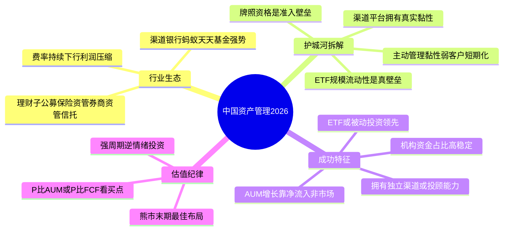
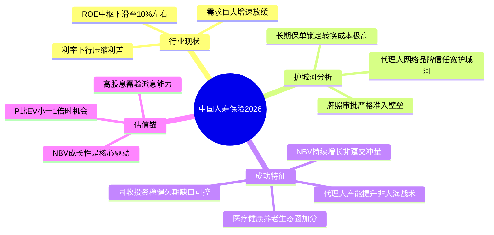
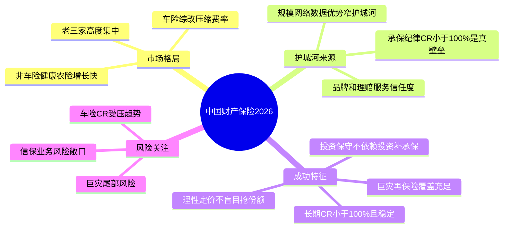
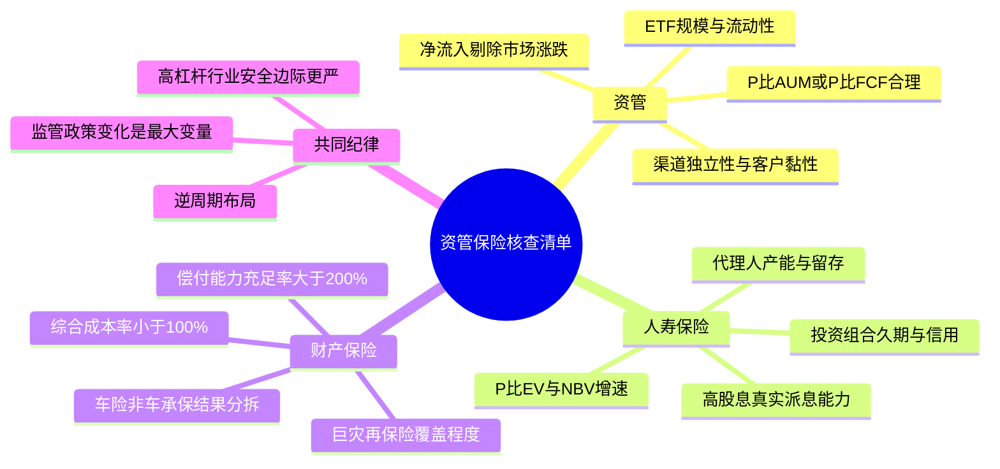

# 《股市真规则》第十八章：资产管理和保险业 —— 2026年中国版重估

**核心判断前置：**
原书第十八章（美国视角）对资产管理和保险业的定位——“用别人的钱赚钱，但护城河天差地别”——在中国**同样适用，但行业结构、监管框架和竞争格局截然不同**。
中国资产管理行业正经历**资管新规后净值化转型、理财子公司崛起、公募基金“赎旧买新”困局与ETF爆发**的多重变局；保险行业则在**利率下行、寿险转型、车险综改与巨灾风险积累**的复杂环境中寻找新均衡。以下逐块对照。


## 一、资产管理行业——中国版“规模大但护城河薄”

### 1.1 中国资产管理行业的独特生态

| 美国资管（原书） | 中国2026对应 |
|-----------------|------------|
| 贝莱德/先锋/富达等独立资管巨头主导 | 银行理财子公司+公募基金+保险资管+券商资管+信托五分天下，银行系（理财子）规模最大但市场化程度最低 |
| 管理费为主要收入，费率市场化 | 费率持续下行：主动权益基金管理费从1.5%降至1.2%甚至更低，ETF费率已进入0.15%时代；银行理财管理费率普遍低于公募 |
| AUM高度集中于头部 | 同样高度集中，但渠道（银行代销、互联网平台）强势，资管公司对渠道的依赖削弱了其护城河 |
| 401(k)等养老金是长期黏性资金 | 中国第三支柱个人养老金起步，体量尚小；长期资金（年金/社保）占比低，零售客户行为短期化 |

**中国资管行业的核心矛盾**：
- 规模全球第二（2025年总AUM超140万亿元人民币），但费率竞争惨烈，利润薄；
- 渠道（银行、蚂蚁、天天基金）掌握客户，资管公司沦为“产品工厂”，品牌黏性弱；
- “基金赚钱、基民不赚钱”的信任危机持续，客户申赎行为顺周期放大市场波动。

### 1.2 中国资管公司的商业模式——AUM×费率，但费率持续压缩
- 收入 = 管理费 + 业绩报酬（少量）。由于竞争和监管引导，管理费率下行趋势明确。
- 成本端：人力成本（投研+销售）高企，规模效应需AUM极大才能体现；许多中小基金公司长期亏损。
- FCF质量：轻资产，理论上FCF应极好，但中国公募基金多为国企或银行子公司，利润上缴压力大，且销售费用（尾随佣金）侵蚀严重。

### 1.3 护城河拆解——中国版更依赖渠道和牌照

| 原书护城河来源 | 中国2026对应 |
|---------------|------------|
| ① 资产黏性 | **较弱**。中国零售客户持有基金平均时间短（往往不足1年），追涨杀跌明显；机构客户黏性相对高（社保/年金/保险委外），但规模有限。 |
| ② 规模/品牌分销 | **渠道为王**。真正的护城河在渠道端（招商银行、蚂蚁财富、天天基金），而非产品端。头部公募（易方达、华夏）依靠先发优势和ETF生态积累了一定品牌，但客户忠诚度有限。 |
| ③ 多样化产品 | **ETF和被动投资是唯一能建立持久护城河的赛道**。ETF一旦形成规模，流动性好、生态完善，转换成本高；主动管理产品缺乏长期黏性。 |
| ④ 牌照/监管准入 | **中国特有的护城河**：公募基金牌照、社保/企业年金投资管理人资格、保险资管牌照、理财子公司牌照等，均构成进入壁垒。 |

**结论**：在中国，纯主动管理型资管公司（如中小公募）护城河薄弱；**拥有渠道的财富管理平台（如东方财富/天天基金）和拥有ETF规模优势+低费率运营能力的头部公募（如华夏、易方达）** 才具备一定的窄护城河。

### 1.4 AUM增长的拆解——中国更需要看“净流量”还是“市场β”
- 中国公募基金AUM波动极大，牛市中规模暴涨（2020-2021），熊市中持续缩水（2022-2024），赎回往往加剧下跌。
- 优秀的公司必须看**非货基AUM中，净流入（剔除市场涨跌）是否持续为正**。尤其关注ETF、债券基金等更具黏性的品类占比。
- **理财子公司**的AUM相对稳定（固收为主、持有到期居多），但费率和利润更低，其护城河在于母行的渠道垄断。

### 1.5 成功资产管理公司的特点——2026中国版

| 原书特点 | 中国2026对应 |
|----------|------------|
| ① 多样化的产品和投资者 | 产品线覆盖主动权益+ETF+固收+多资产；客户结构中有稳定机构资金（保险/年金/银行委外），不单纯依赖零售 |
| ② 黏性资产 | ETF规模大且流动性好；或有养老目标基金、个人养老金账户等长期锁定产品；机构委托管理合同稳定 |
| ③ 利基市场 | 在某些品类（如指数基金、REITs、量化对冲）形成不可替代的供给能力，如华夏基金在ETF领域的领先地位 |
| ④ 市场领导/规模效应 | 非货基AUM排名前10，且运营效率（管理费收入/员工成本）优于同行 |
| ⑤ AUM增长来自净流入而非市场涨跌 | 拆分流量与β，净流入持续为正，尤其在熊市中仍能维持 |

**中国加分项**：
- **渠道掌控力**：旗下拥有独立且强大的销售渠道（如天天基金之于东方财富），能降低对外部渠道的依赖。
- **被动投资与投顾能力**：ETF规模领先+基金投顾业务发展，能改善客户持有体验，增加黏性。
- **跨境/海外布局**：拥有QDII额度及海外投资能力，满足资金全球化配置需求。

### 1.6 估值注意
- 轻资产、高ROE，但利润受市场周期影响极大，属于**强周期成长股**。
- **P/E估值在牛市顶部往往很低（因为利润高峰），在熊市底部往往很高（利润暴跌），容易误判。** 更可靠的是看**P/AUM（市值/管理资产规模）** 或**P/FCF（考虑资本开支少）**，并在市场低迷、资金净流出末期寻找买点。
- 平台型公司（如东方财富）可适当参考P/E，但也要兼顾流量和用户黏性指标。


## 二、人寿保险——中国版“利率下行期的转型之痛”

### 2.1 原书描述 vs 中国2026现实
原书认为人寿保险是“慢增长、商品化、薄护城河、ROE约10-11%”。在中国，人寿保险的**潜在需求巨大，但行业正处于痛苦的转型期**。

| 维度 | 美国（原书） | 中国2026 |
|------|------------|---------|
| 市场增速 | 慢增长，饱和 | 总量仍增长，但增速放缓；保障型产品（健康险）需求上升，但储蓄型产品受利率下行影响大 |
| 产品竞争 | 商品化，价格战 | 同质化严重，大公司品牌渠道占优，中小公司依靠银保渠道和更激进的定价抢份额 |
| 护城河 | 薄 | **龙头寿险公司（国寿、平安、太保）拥有强大的代理人队伍和品牌信任度，这是较宽的护城河**；但中小险企护城河薄 |
| 资产端 | 90%固收 | 固收为主，但面临“资产荒”：长久期高收益资产稀缺，再投资风险突出；部分公司增加权益、另类投资，波动加大 |
| 利润来源 | 死差+费差+利差 | **利差（投资收益与保单负债成本的差额）是主要利润来源**，因此利率下行直接压缩盈利空间 |
| 会计 | DAC摊销、精算假设 | 中国保险公司同样有剩余边际（类似DAC）摊销，且面临会计准则IFRS 17实施后的利润波动加大 |
| ROE | 历史约10-11% | 2020-2025年ROE已从15%+下滑至10%左右，未来可能进一步走低（利率中枢下移） |

### 2.2 中国寿险的护城河来源
- **代理人渠道网络**：平安、国寿拥有数十万乃至百万代理人，下沉市场渗透力强，新进入者短期难以复制。
- **品牌与信任**：保险是长期契约，消费者偏好大品牌，尤其在重疾险、年金险等大额保单上。
- **保单的长期锁定**：寿险保单存续期长（20-30年），退保损失大，这提供了极强的**转换成本**——是原书强调但美国寿险未能充分实现的护城河，在中国成立。
- **监管准入**：保险牌照审批严格，新设保险公司困难。

### 2.3 成功寿险公司特点——2026中国版

| 原书特点 | 中国2026对应 |
|----------|------------|
| ① 谨慎的保费增长 | 保费增速合理（不依靠短期趸交和银保冲量），重视长期期交业务和新业务价值（NBV）增长 |
| ② ROE持续 > 股本成本 | ROE>10%且波动可控，不依赖一次性投资收益 |
| ③ 高信用等级/稳健投资 | 固收投资信用风险可控，非标资产占比低，久期缺口管理良好 |
| ④ 强大的风险管理和精算能力 | 死亡率/发病率/退保率/费用率等假设审慎，剩余边际释放稳定；偿二代（C-ROSS）偿付能力充足 |
| ⑤ 代理人转型成功 | 代理人规模企稳或回升，人均产能（NBV/Agent）提升，而不仅仅是人海战术 |

**中国加分项**：
- **医疗健康生态圈**：平安的“综合金融+医疗健康”模式、国寿的“大健康”战略，增加客户触点和黏性。
- **养老社区布局**：泰康、太保等将保险与养老社区入住权挂钩，提升产品差异化和吸引力。
- **科技赋能**：线上获客、智能核保理赔、数字化营销，提升效率。

### 2.4 中国寿险的估值锚
- **P/EV（价格/内含价值）**：最常用。传统上，成长性好的龙头给1.0-1.5倍P/EV，现因利率下行和转型阵痛，P/EV普遍低于1倍。
- **NBV成长性和ROEV（内含价值回报率）** 是决定估值修复的关键。
- 高股息率（4-6%）提供下档保护，但需确保分红来自自由盈余而非减损资本。


## 三、财产和灾害保险（P&C）——中国版“车险承压，非车崛起”

### 3.1 中国财险的格局
- **市场高度集中**：人保财险、平安财险、太保财险“老三家”占据车险市场60%以上份额，小公司生存艰难。
- **车险综改**：2020年后车险费率市场化改革，保费下降、责任扩大，倒逼公司提升经营效率，**综合成本率（CR）** 成为生死线。
- **非车险高速增长**：健康险、农险、责任险、信用保证保险等，是新的增量来源，但风险筛选和定价能力要求更高。

### 3.2 中国财险的护城河
- **规模+网络+数据**：人保财险拥有最广泛的机构和理赔服务网络，在车险理赔、农险承保等方面形成成本优势和数据积累，这是真壁垒。
- **承保纪律是核心**：财险不是“收保费然后投资”那么简单，关键是**CR<100%**——中国的优秀财险公司（如平安财险、人保财险）长期维持承保盈利，而大量中小公司CR>100%，靠投资维持，护城河很薄。
- **巨灾风险**：中国巨灾保险制度尚在建设，地震、洪水等大灾风险再保险安排不足的公司隐藏尾部风险。

### 3.3 成功财险公司特点——2026中国版

| 原书特点 | 中国2026对应 |
|----------|------------|
| ① 承保纪律（CR<100） | 长期CR<100%，且波动小；能清晰拆分车险、非车险业务承保结果 |
| ② 分散/再保险 | 业务地域分散，巨灾风险再保险覆盖充足，单一灾害事件对资本冲击可控 |
| ③ 保守投资组合 | 固收为主，权益投资有纪律，不靠激进投资弥补承保亏损 |
| ④ 理性定价 | 在市场恶性竞争时不盲目降价抢份额，依靠服务和效率而非价格战 |
| ⑤ 资本充足 | 偿付能力充足率>200%，风险综合评级A级以上，能安然度过巨灾年份 |

**中国特殊关注**：
- **车险CR走势**：受综改影响，CR普遍上升，优等生（平安、人保）能控制在97-99%，中等生已接近100%，差等生承保亏损。
- **信保业务风险**：过往曾出现P2P暴雷、保证保险巨亏事件，需关注公司非车业务中有无高风险的信用保证保险敞口。


## 四、中国资产管理与保险业投资清单（2026）

- ✅ **资产管理**：纯主动管理公司护城河薄，因渠道在外、客户短期化。只有**拥有渠道的平台（东方财富）** 和**ETF规模+流动性壁垒的头部公募（华夏、易方达等）** 具备窄护城河。估值需逆市场情绪，在熊市末期寻找P/AUM或P/FCF的买点。
- ⚠️ **人寿保险**：长期需求存在，但利率下行压缩利差，行业处于转型阵痛期。**代理人网络+品牌信任+长期保单的转换成本**构成龙头公司的宽护城河，但ROE中枢下移。关注NBV增速、代理人人均产能、投资端久期缺口。估值P/EV<1倍时，若转型成效显现，存在重估机会。
- ✅ **财产保险**：“老三家”在车险上的规模、数据和网络优势形成窄护城河，核心看**综合成本率（CR）<100%** 的持续性。非车险成长性好但考验风控。巨灾再保险覆盖程度至关重要。
- 🚨 **共同风险**：利率长期下行（保险）、市场剧烈波动（资管）、监管政策突变（如车险费率化、资管新规加码）、巨灾损失（财险）、信用风险暴露（保险固收投资）。
- ✅ **估值纪律**：资管逆情绪，寿险看P/EV和NBV，财险看PB+CR；高股息可加分，但须验证派息能力。


## 思维导图（按阅读逻辑拆分）

### 图1：中国资产管理行业——渠道为王，主动管理护城河薄




###  图2：中国人寿保险——转型阵痛中的长周期生意



###  图3：中国财产保险——承保纪律是生死线




###  图4：2026年中国资产管理与保险业核查总清单




 


# 第十八章　资产管理和保险业（Asset Management & Insurance）——用别人的钱赚钱，但护城河天差地别

> **章首定位（原书 p.220 / 中信畅销版 ISBN 9787508686431）**
>
> 开篇一句话把两个行业捆在一起的原因说透：
>
> > **像银行业一样，资产管理公司和保险公司也是"用别人的钱赚钱"——资产管理者用投资者的资金买股票/债券并收管理费；保险公司收保费，把钱先拿着投出去，再赔给客户。**
>
> 但多尔西立刻划清一条生死线：
>
> > **资产管理公司令人难以置信地赚钱——即使一个乏善可陈的资产管理者也很可能有一流的财务成果入账；而保险行业是极度竞争的行业，很难打造持久的竞争优势。**

---

## 章内目录骨架（畅销版：p.220→240）

text
第十八章 资产管理和保险业
├── 一、资产管理行业（p.≈220） ← 高毛利/低CapEx/规模效应怪兽，但股价=市场情绪的回声
│ ├─ 赚钱机器：收入 = AUM × 费率%
│ ├─ 护城河为什么薄但真实：黏性+规模+品牌分销
│ ├─ 成功资产管理公司的特点
│ └─ 估值注意：P/E可用但要拆AUM质量
├── 二、人寿保险行业（p.≈232） ← 慢增长/商品化/长尾/90%资产投固收/成功特征清单
├── 三、财产和灾害保险 P&C（p.≈235） ← 承保纪律 = Combined Ratio <100；浮存金float；护城河来自纪律+分散+规模
└── 投资者清单：资产管理和保险业（p.240）

---

## 一、资产管理行业（Asset Management）——高毛利印钞机，但"黏性"才是护城河

### 1.1 一句话商业模式（原书：管理费引擎）

> **收入 ＝ 管理资产规模 AUM × 管理费率（fee %）**  
> 费率通常不到 1%（对共同基金/指数型），但对专户/对冲/某些专业策略可更高。

| 特征 | 原书给的画像 | 对你的含义 |
|------|-------------|-----------|
| **毛利/营业毛利** | **30%–40% 级**（很多行业看不到）| 钱很好赚——但要问：赚的是谁的钱？客户能赎回吗？ |
| **资本需求（CapEx）** | **极低**（不需要工厂/库存/应收链）| ROIC 常夸张高（>50%级）→ 账面薄、P/B失真 |
| **规模效应** | 管理 2×AUM **不需要 2×员工** → 边际成本很低 → 利润率随规模走 | 头部吃尾；小资管难追（除非 niche 垄断） |
| **最大风险** | **AUM 依赖市场**：牛市 AUM↑（哪怕业绩平庸，市场涨就涨）；熊市 AUM↓（赎回+市值双杀） | 股价常是市场情绪的过度反射 → 逆向机会在"恐慌低估+黏性强" |

> 原书原话精神：
> **"这些公司如此依赖市场，以至于公司的股价常常是对占主导地位的乐观主义或悲观主义的过度反射。"**

---

### 1.2 护城河拆解：为什么资管"护城河薄"，但又确实存在

| 来源 | 原书口径 | 强度 | 你盯的 |
|------|---------|------|-------|
| **① 资产的黏性（Sticky Assets / 转换成本）** | 机构/养老/高净值一旦绑定：托管、报告、合规、多账户结构→换=项目地狱 | ⭐⭐⭐（最真实） | 年化**净流出率/赎回率**；retention%；机构AUM占比 |
| **② 规模/品牌分销（Market Leadership）** | 大AUM→更低成本/更全产品线→更大渠道谈判力→track record→"safe choice"效应 | ⭐⭐ | AUM排名/市占；渠道控制（401k默认选项/大平台） |
| **③ 多样化产品（Diversity of products & investors）** | 跨资产类（股/债/mm）→不同市况都有活水→降低单一崩盘风险 | ⭐⭐ | AUM构成：股% 债% mm% 另类%；客户集中度 | 
| ❌ 超额业绩 = 持久护城河？ | 原书警告：好年景吸引钱，但"卓越投资能力"很难证明长期可持续→别把"今年α"当城堡 | — | 看 5–10年风险调整后 track record，不只1年排名 |

---

### 1.3 AUM增长的两个来源（你必须拆开，否则被牛市骗）

> **ΔAUM ＝ 净流入（net new flows） ＋ 市场涨跌带来的市值变动（market appreciation）**

| 来源 | 绿灯 | 红旗 |
|------|------|------|
| **净流入（真增长）** | 机构在主动追加；retention强 | 净流入负/靠分销硬推 |
| **市场涨跌（虚假增长）** | 牛市里AUM↑↑但没真的新钱→利润同样↑但更脆弱 | 牛市末期AUM主要由市场推高＝双杀风险（市场回撤→AUM↓→收入↓→赎回↑→螺旋） |

> 原书实操：你至少看两张数——  
> - **AUM 序列**（5年）  
> - **净新 flows**（年报/10-K或公司披露）：flows正且稳？还是靠β吹泡泡？

---

### 1.4 成功资产管理公司的特点（原书清单——逐条可核查）

| # | 特点 | 你填的核查动作 |
|---|------|---------------|
| ① | **多样化的产品和投资者** | AUM构成（股/债/mm/另类）；零售 vs 机构；前十客户占比≤20%? |
| ② | **黏性资产（Sticky Assets）** | 年赎回率/流出率；机构合同锁定比例（401k/DC plan高黏性） |
| ③ | **利基市场（Niche）** | 是否有独特能力→定价权（例：税收管理产品/ETF品牌生态/固收专营）→竞争者难直接抢 |
| ④ | **市场领导/规模效应** | AUM ≥$10bn级门槛（原书给的量级感）；费用率/OpMargin随AUM↑ |
| ⑤ | **AUM增长来自净流入，不是只靠市场** | net flows vs mkt appr 拆分 |

---

### 1.5 估值注意（资管≠银行≠普通公司）

- 资管账面薄、CapEx低、FCF强→**P/B意义不大**
- 原书语境常用 **P/E 或 P/E vs 增长率**；你更应盯：
  - **AUM质量（黏性/净流入）** × **OpMargin/FCF转化率** × **管理层能否克制（激励费/业绩费是否太激进？）**
- 最重要的纪律：**市况悲观+黏性强+AUM仍正流入=最佳买点**（不是牛市新闻最响时追）

---

## 二、人寿保险（Life Insurance）——慢增长、商品化、长尾风险、ROE≈10-11%的历史带

### 2.1 原书给的行业气质

| 项目 | 原书精神 |
|------|---------|
| 产品性质 | **成熟、慢增长、容易替代**（term life差异小→价格竞争）|
| 进入壁垒 | **适度**（监管+资本金要求）；退出壁垒**极高**（要付保单持有人很多年）|
| 护城河 | **薄**（品牌/规模/渠道分销有点优势→但不是宽护城河）；原书说"也许人寿保险是典型的没有竞争优势的生意" |
| 回报带 | **ROE 历史 ≈ 10%–11%**（≈股本成本附近）→对股东不算差，但也谈不上超额暴利 |
| 资产配置 | **约 90% 美国人寿保险资产投在固收证券**（债券/抵押贷款类）|

---

### 2.2 人寿保险的"会计怪异"（原书提醒你看什么）

| 科目/概念 | 原书提到 | 你盯的 |
|----------|-----------|-------|
| **投资（累计保费+费用）/ 固定收益为主** | 资产侧≈bond portfolio；利率风险很要命 | 利率↓→再投资收益↓；利率↑→存量固收市值↓（AOCI波动） |
| **递延 acquisition costs（DAC）** | 销售保单成本被**资本化**（当资产挂B/S），再摊销→利润表平滑器 | DAC/权益是否异常；摊销节奏是否保守 |
| **未来保单holder benefit（负债侧精算估计）** | 需要精算假设（寿命/发病率/退保率）→管理有裁量空间 | 盯披露的假设变化（折现率/死亡率表/退保率） |
| 收入两源 | **保费+费用收入** + **投资收益** | 核心仍是：保费增长是否健康 × 投资端纪律 |

---

### 2.3 成功人寿保险公司的特点（原书清单）

| # | 特点 | 绿灯 | 红旗 |
|---|------|------|------|
| ① | **谨慎的保费增长率**（不应明显>行业均值，尤其别靠**降价承保**抢份额） | 保费CAGR ≈ GDP+；价格纪律稳 | 保费增速↑↑但投资/准备金质量可疑 |
| ② | **ROE 持续 > 股本成本**（≈10-11%带） | 稳在>10%且波动小 | 靠一次性投资损益撑ROE |
| ③ | **高信用等级 / 稳健投资组合** | 资产90%固收；集中度低；评级稳定 | 大量非投资级/地产敞口爬升 |
| ④ | **经过检验的风险管理文化** | 压力测试披露；久期匹配；退保压力测试 | 复杂衍生品/影子杠杆；假设频繁改 |
| 附加 | **产品不要太花哨** | term/whole/annuity传统＞复杂结构性 | 大量保证最低收益/高期权性负债（把风险曲线尾部变肥） |

> 原书隐含结论：人寿保险更该当**"稳健现金流生意 + 利率周期 + 保守估值"**看，不把它当成长故事。

---

## 三、财产和灾害保险 P&C（Property & Casualty）——承保纪律 > 产品，浮存金是秘密武器

### 3.1 原书核心：保险公司赚两种钱

> **① 承保利润（或亏损）  ② 投资 profit from float（浮存金）**  
> 保费先收进来 → 存在公司账上（float＝你拿着但不属于你）→ 投出去赚收益 → 索赔才出去。

#### ① 承保纪律的终极仪表：综合成本率（Combined Ratio）

> **Combined Ratio ＝ (赔付 + 费用) ÷ 保费**（通常也叫 **Loss+Expense Ratio**）

| CR | 含义 |
|----|------|
| **CR < 100** | **承保赚钱**（即使不算投资，核心业务已正） |
| **CR = 100** | 承保打平 |
| **CR > 100** | 承保亏损（要靠投资补） |

- 原书精神：**浮存金只有在承保纪律下有正价值；如果承保常年亏（CR»100），float=负成本，越滚越危险。**

---

### 3.2 浮存金（Float）——巴菲特最爱的"别人的钱但你能先投"

> **Float ＝ 已收保费 + 投资收益储备 − 未决赔款准备金 − 费用已发生**  
> 直觉：公司拿着这笔钱但因未来赔付义务不能算自有权益——**本质是低成本甚至负成本杠杆**（如果 CR<100）。

| 浮存金生意的关键 | 原书 |
|-----------------|------|
| 成本多少？ | 看 **CR**（<100=成本为负/极低的float） |
| 规模多大？ | 看 Gross Written Premium（GWP）与准备金 |
| 会不会一次巨灾炸掉？ | 看**巨灾再保险/分散/地理集中度** |

---

### 3.3 P&C成功公司的特点（原书隐含清单）

| # | 特点 | 你盯的硬指标 |
|---|------|-------------|
| ① | **承保纪律（CR长期<100或紧贴100）** | 3–5年CR均值；每业务线分别看（auto/home/GL/workers comp） |
| ② | **分散/再保险（别赌单一灾难）** | 地理集中度；巨灾上限；再保险结构 |
| ③ | **保守投资组合（固收为主，久期匹配负债）** | 投资资产质量/评级；AOCI波动；流动性 |
| ④ | **理性定价/不抢份额** | 综合费率/综合赔付趋势 vs 同行 |
| ⑤ | **资本充足（能扛巨灾+周期低谷）** | 股东权益/总负债；评级稳定 |

---

### 3.4 原书对P&C的护城河结论

> **大多数财产险公司没有宽的持久竞争优势（产品易替代、定价受监管/竞争压）——真正的护城河是"承保纪律+分散+规模+理赔网络/品牌信誉"，不是产品差异。**

---

## 投资者清单：资产管理和保险业（p.240·原书浓缩）

- ✅ **资管与保险=别人钱引擎**：资管靠 AUM×费率（高毛利/低CapEx/规模效应）；保险靠承保+投资float
- ✅ **资产管理**：盯 **AUM构成 + 净流入vs市场涨跌 + 赎回率/黏性 + 产品线多样**；股价对市场情绪过度反射→逆向买点常在悲观期
- ✅ **人寿保险**：慢增长/商品化/薄护城河；盯 **保费增速纪律、ROE≈10-11%带、固收组合质量、DAC变化、精算假设透明度**；别为"复杂产品"多付钱
- ✅ **P&C**：核心仪表＝**综合成本率CR<100**；浮存金有价值**当且仅当承保纪律成立**；盯分散/再保险/资本充足
- ✅ **估值**：资管用P/E但更要AUM质量；保险看BV+CR+投资纪律（不拿普通P/E硬套）
- ✅ **共同警告**：这两行都"看起来稳"——但一个靠市场（资管），一个靠自然灾难+周期（P&C），**安全边际不能省**

---

## Appendix：第十八章"资管&保险速筛卡"（一键粘进 Excel/Notion/飞书）

```
═══════════════════════════════════════════════════
【公司】___________ 【类型】□资管 □人寿P&C() 【日期】_
───────────────────────────────────────────────────
■ 资管段 ──────────────────────────────────────────
AUM ____bn YoY __% (net flowsbn vs 市场涨跌$bn → 靠市场?□警)
OpMargin __% (≈30-40%?) 赎回率/流出率 __% (≤5%?黏□ 10-20%中 □>20%脆)
客户集中 top10 % mix:股%债%__ mm%__ niche?□yes(___)
P/E __× 但AUM黏性差?□跳过
■ 人寿段 ─────────────────────────────────────────
保费CAGR __% (<=GDP+2-3%?□ok 远超同业?□警)
ROE % (≈10-11%带?) CR不适用(寿险) 固收/总投% DAC/权益 __% 变化?□稳 □跳
复杂产品结构(保证最低/高期权性)?□少 □多(折价↑)
■ P&C段 ──────────────────────────────────────────
CR 3yr均值 __ (应<100) 每线:auto__ home__ GL__ WC__
巨灾暴露:地理集中□yes(___州/灾区) □no
再保险购足?□yes □no 权益/负债 % 评级AOCI波动□稳 □大
verdict: □passed(进估值/折扣) □hold/watch(周期等) □淘汰(理由:____)
═══════════════════════════════════════════════════
```