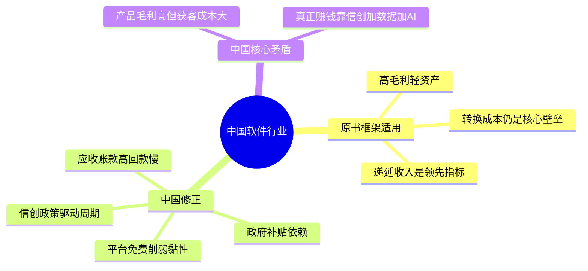
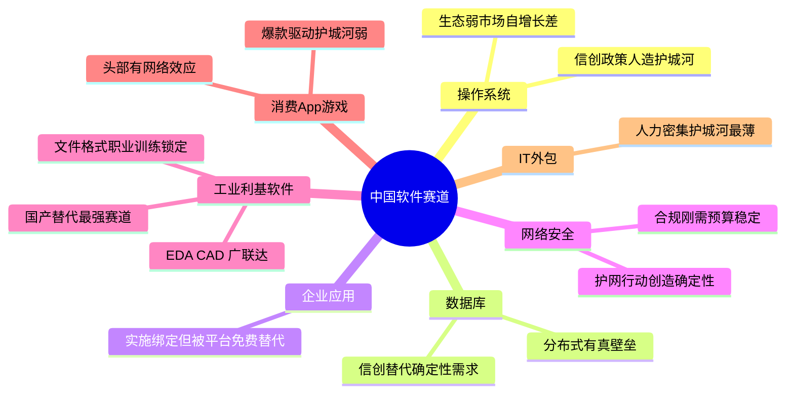
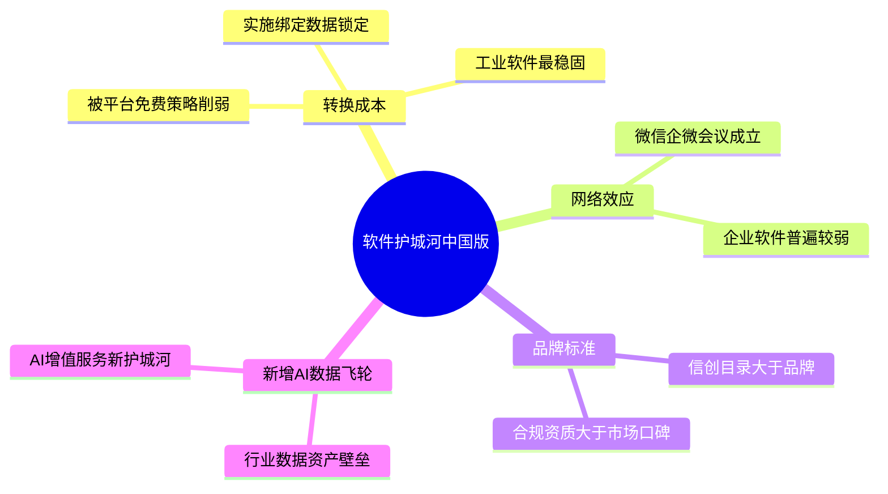
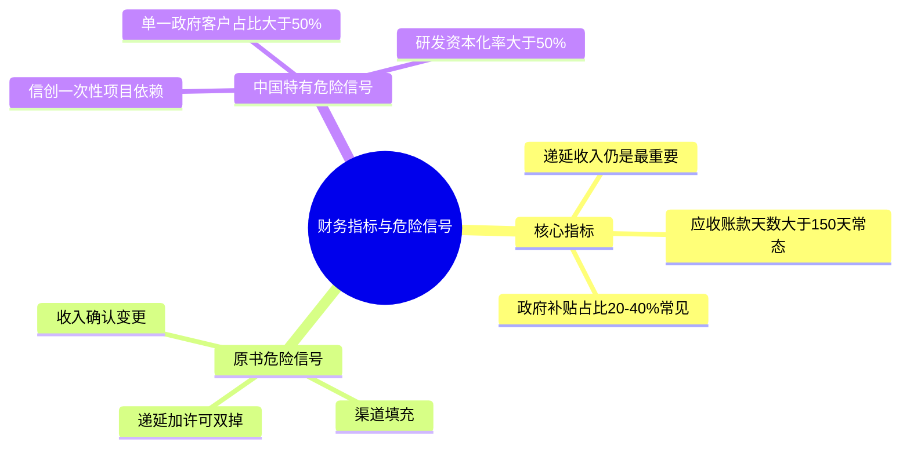
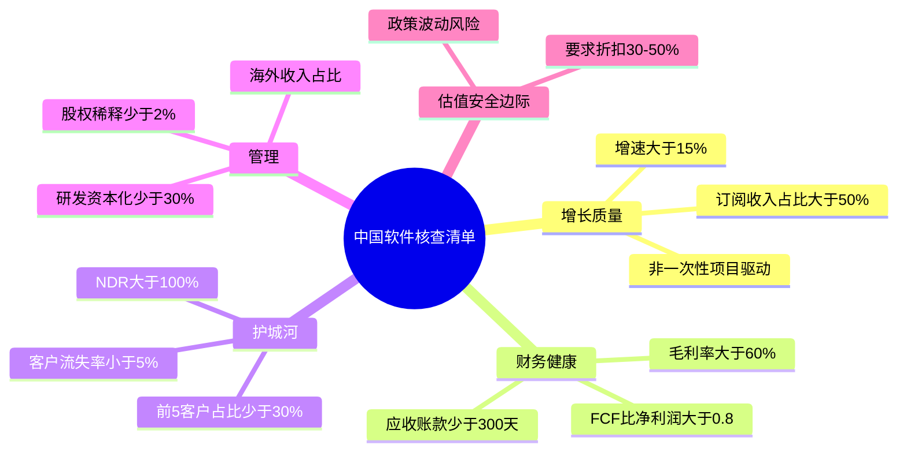

# 《股市真规则》第十九章：软件行业 —— 2026年中国版重估

**核心判断前置：**
原书第十九章（美国视角，写于license时代）的分析框架在中国软件行业**50%适用，50%需要重写**。根本原因：中国软件行业不存在“微软/甲骨文/SAP”那种基于操作系统和数据库的生态垄断，取而代之的是**信创政策驱动+互联网平台生态+AI大模型重塑+价格战惨烈**的独特格局。以下逐块对照。

## 一、行业气质：原书“漂亮面”在中国打了折扣

| 原书要点（美国） | 中国对应（2026） |
|------------------|------------------|
| 高毛利率（40-80%+） | 头部SaaS/信创可达60-80%，但大量中小软件公司毛利率<40%，价格战致毛利持续压缩。 |
| 低CapEx/强FCF | 成立。但中国软件公司普遍**应收账款高企**（政府/国企客户回款慢），FCF/净利润常<1。 |
| 几乎没有有息负债 | 不成立。很多软件公司依赖银行借款或可转债维持运营，净现金公司是少数。 |
| 轻资产/低库存 | 成立。 |
| 强周期性 | 更复杂：中国IT支出周期受**政策驱动**（如信创三年行动计划）影响大于宏观周期。 |

**中国核心矛盾**：
- 软件产品本身是高毛利的
- 但获客成本（地推/渠道/生态绑定价）和回款周期（应收账款）吃掉大部分利润
- 真正赚钱的不是“卖软件”，而是**卖信创资质+卖数据+卖AI能力**

## 二、软件行业分类：中国版七种赛道（原书框架对照）

| 原书赛道 | 中国对应（2026） | 护城河潜力 | 核心逻辑 |
|----------|-----------------|-----------|---------|
| 操作系统 | 统信UOS、麒麟OS | ⭐⭐ | 信创政策强制采购=人造护城河，但生态弱、非市场自增长 |
| 数据库/中间件 | 达梦、人大金仓、TiDB | ⭐⭐⭐ | 信创替代Oracle=确定性需求；分布式DB在互联网场景有真壁垒 |
| 企业应用ERP/CRM/HCM | 用友、金蝶、北森 | ⭐⭐ | 实施绑定存在，但SaaS转型中，面临钉钉/飞书等平台“免费替代”威胁 |
| 安全软件 | 奇安信、深信服、启明星辰 | ⭐⭐⭐ | 政策合规驱动=预算刚性；HW行动（护网）每年创造确定性需求 |
| 专业利基软件 | 中望CAD、华大九天EDA、广联达 | ⭐⭐⭐⭐ | **中国软件最值得关注的赛道**：国产替代+职业训练生态+文件格式锁定 |
| 消费App/游戏 | 腾讯、网易、米哈游 | ⭐⭐ | 爆款驱动，护城河弱但头部有网络效应+IP资产 |
| IT外包/系统集成 | 中软国际、东华软件 | ⭐ | 人力密集型，护城河最薄 |

**中国独有赛道**：
- **信创软件**：政策强制替换Windows/Oracle→人工护城河，但需警惕政策退坡后竞争力暴露
- **AI大模型**：百度（文心）、字节（豆包）、阿里（通义）→护城河在数据飞轮+算力+生态，但估值极高、盈利模式未定
- **工业软件**：EDA/CAD/CAE→国产替代最刚需赛道，华大九天/中望等有真转换成本

## 三、软件行业竞争优势：原书四条壁垒的中国版

### 3.1 转换成本——依然是最强壁垒，但在中国被“平台免费”策略削弱
- ✅ **成立场景**：ERP实施绑定、数据库迁移成本、工业软件（CAD/EDA）文件格式+职业训练锁定
- ⚠️ **削弱场景**：钉钉/飞书/企微以免费OA/IM切入，降低企业“换软件”心理门槛；中小企业的轻量SaaS黏性远不如美国

### 3.2 网络效应——互联网平台强，企业软件弱
- ✅ **成立**：微信小程序生态、腾讯会议（C端网络效应渗入B端）
- ❌ **不成立**：中国企业软件的“网络效应”往往只是渠道铺得多，而非真正的“越多人用产品越值钱”

### 3.3 品牌/标准——信创政策下的“合法地位”>市场品牌
- 中国B端软件采购逻辑：信创目录>合规资质>安全认证>品牌
- SAP/Oracle在中国的衰落，不是被更好的产品打败，而是**被政策排除在采购目录之外**

### 3.4 新增护城河：数据飞轮+AI能力
- 原书未涉及，但2026年中国软件的核心分化点：拥有行业数据的SaaS，可以通过AI提供增值服务，形成新壁垒
- 例：广联达（建筑造价数据）、金山办公（文档AI）、明源云（地产数据）

## 四、软件行业账户：中国特有的“三盏灯”

### 4.1 递延收入（合同负债）——依然是最重要的领先指标
- 中国SaaS/订阅模式的合同负债（预收）同样是“好负债”
- 但注意：中国部分软件公司的“预收”来自政府/国企的预付款（一次性、不可持续），而非真正的订阅预付

### 4.2 应收账款天数（DSO）——中国软件的最大杀手
| 客户类型 | 典型回款周期 | 风险 |
|----------|-------------|------|
| 政府/事业单位 | 6-18个月 | 坏账风险低但资金占用大 |
| 国企/央企 | 3-12个月 | 随政策变动 |
| 民企/中小企业 | 1-3个月 | 坏账风险高 |
- **中国规则**：DSO > 150天是常态（美国原书警告的DSO上升在中国要从更高水位评估），但如果DSO > 300天+坏账率上升，是强烈撤退信号

### 4.3 新增指标：政府补贴/退税依赖度
- 很多中国软件公司的利润中，政府补贴和增值税退税占比较大（可到20-40%）
- 需看扣非净利润/经营利润，剔除补贴后是否仍健康

## 五、危险信号：原书四项 + 中国特有的三项

### 5.1 原书四项仍适用
- ✅ 变更收入确认方式（提前确认）
- ✅ 渠道填充/给经销商塞货
- ✅ 可疑关联交易
- ✅ 许可收入+递延收入双掉头

### 5.2 中国特有的危险信号
- **信创项目依赖**：收入主要来自信创一次性替换项目，而非持续订阅——政策窗口关闭后收入断崖
- **政府/单一客户占比过高**：前5大客户收入占比>50%+均为政府/国企→收入可预测性差、回款慢
- **研发资本化率过高**：软件研发资本化比例>50%（把研发支出当资产挂账少记费用）→利润虚胖

## 六、成功的软件公司的特点：2026中国版核查清单

| 原书要求 | 中国2026版 |
|----------|-----------|
| 逐渐增长的销售收入 | 收入增速>15%+订阅/经常性收入占比>50%，非一次性项目驱动 |
| 长期良好记录 | 经历至少1轮IT支出紧缩+1轮信创政策波动仍稳（而非仅政策顺风期增长） |
| 逐渐扩大的利润率 | 毛利率>60%+经营利润率>15%+FCF/净利润>0.8（回款真变现金） |
| 巨大的客户安装基础 | NDR/NRR>100%（SaaS），客户流失率<5%，前5大客户占比<30% |
| 卓越的管理 | 股权激励克制（年稀释<2%），不通过并购堆砌收入，研发资本化比例合理（<30%） |

**中国加分项**：
- **信创目录内+有真替代能力**（不只靠政策，产品力经得起市场考验）
- **有行业数据资产+AI落地场景**（数据飞轮效应开始兑现）
- **海外收入占比**（逃逸国内价格战+回款难，如万兴科技、金山办公海外版）

## 七、中国软件行业投资清单（2026）

- ⚠️ **原书框架不废，但需中国修正**：四条壁垒仍成立，但信创政策+平台免费+AI重塑是新增变量。
- ✅ **最值得看的赛道**：工业软件（EDA/CAD/CAE）、网络安全（合规刚需+护网）、垂直利基SaaS（有数据+有转换成本）。
- ⚠️ **谨慎对待**：通用企业SaaS（被平台免费替代）、信创纯政策股（政策退坡后裸泳）、游戏/消费App（爆款驱动护城河弱）。
- ⚠️ **中国特有的估值锚**：应收账款/净利润比、政府补贴占比、研发资本化率——这三个数字比PE更能揭示真实质量。
- ✅ **安全边际要更大**：政策波动+回款风险+平台颠覆=要求30-50%折扣。

## 思维导图（按阅读逻辑拆分）

### 图1：中国软件行业——原书框架与修正

### 图2：中国软件七大赛道

### 图3：护城河——中国版四条

### 图4：中国特有财务与危险信号

### 图5：成功软件公司中国版核查清单

# 第十九章　软件行业（Software Industry）——高毛利印钞机，但赢家通吃、强周期、一流技术= weakest 护城河

> **章首定位（原书 p.242 / 中信畅销版 ISBN 9787508686431）**
>
> 开篇一句定调（多尔西原话精神）：
>
> > **很少有行业的经营环境可与软件行业相比——成功的软件公司有极好的成长前景、逐渐扩大的利润率和财务健康状况；但一流的技术在软件行业只是最小的持续竞争优势之一。**
>
> 软件行业最矛盾的地方在于：
> - **进入门槛低**（写代码不需要工厂）→ 永远有新竞争者敲门  
> - **成功门槛极高**（网络效应+转换成本+标准锁定→赢家通吃）→ 少数巨头吃掉大部分利润  
> - 结果：**要么你是城堡，要么你在红海里被碾**——几乎没有"中庸的长期舒服位"。

---

## 章内目录骨架（畅销版：p.242→约 p.252）

text
第十九章 软件行业
├── 一、行业气质：为什么软件"看起来完美"但也最骗人（p.242）
│ ├─ 财务特征：高毛利率 / 低CapEx / 低应收存货 / 强FCF / 轻资产
│ ├─ 黑暗面：强周期性 + 估值泡沫史（微软/甲骨文/SAP 1998-2002 avg P/E≈56 vs SPX≈25）
│ └─ 结论：好生意≠便宜股票；要壁垒+折扣，别被"一流技术"诱惑
├── 二、软件行业的分类（p.243）——不是一种生意，是七种体质
├── 三、软件行业的竞争优势（p.245）——四条真壁垒（转换成本/网络效应/品牌/标准）
├── 四、软件行业账户：你必须读懂的几个特有科目（p.247）
│ ├─ 许可收入（License Revenue）→ 当期需求温度计
│ ├─ 服务收入（Services Revenue）→ 配套/低毛利/看趋势
│ ├─ 递延收入（Deferred Revenue）→ "好负债"=已收现金未交付=未来收入蓄水池
│ └─ 应收账款天数（DSO）→ 放宽信用=渠道压货信号
├── 五、危险信号（p.249）——软件公司特有的伪装温床
│ ├─ ① 变更收入确认时点/方式
│ ├─ ② 渠道填充（给经销商塞货→窃取未来收入）
│ ├─ ③ 可疑的互换交易（barter/互购美化收入）
│ └─ ④ 许可收入趋势掉头 + 递延收入增长减速
├── 六、成功的软件公司的特点（p.250）——原书给的5项清单
└── 投资者清单：软件行业（p.252）

---

## 一、行业气质：为什么软件"看起来完美"但也最骗人（p.242）

### 1.1 财务特征的"漂亮面"

| 特征 | 原书解释 | 数字感 |
|------|---------|--------|
| **初始成本高，边际成本≈零** | 写软件的第一份要大量研发；但复制第1万份=几乎$0（光盘/U盘/下载）| 毛利结构极好：产品毛利**常 40%–80%+** |
| **营运资本极轻** | 电子交付→**存货几乎为零**；很多软件**应收也偏低**（许可/订阅预收付→递延负债） | 营运资本占用小→现金流转快 |
| **CapEx低 / FCF高** | 不需要工厂厂房设备大军→资本支出相对收入极小 | **FCF/营收可到 5%–20%级**（好公司） |
| **几乎没有有息负债**（好公司） | 因为Cash Rich→负债表干净 | 资产侧多是现金/短投/应收/无形资产 |

> 原书原句精神（多处复述一致）：
> **"得到社会认可的软件公司是现金牛，营运资本状况相当好……成功的软件公司可以产生大量的自由现金流。"**

---

### 1.2 黑暗面（原书同样强调的三条）

#### ① 强周期性（macro + IT预算 双重绑）

> **软件行业具有很高的周期性：销售收入受宏观经济条件和公司信息技术支出预算的制约。**
> - 经济不好时，IT支出是"可延期的资本支出"→砍得最快（"缓冲利润下降的捷径"）
> - 季度末效应：很多B2B买家期末负担重→大量交易挤到最后几周→**Q末冲刺+折扣压力**→业绩波动放大

#### ② 技术迭代=护城河持续腐蚀

> **"变换的脚步使得软件公司的未来很难预期。"**  
> 今天领先的平台，可能因一次范式转移（云/SaaS/移动/AI）被边缘——所以**壁垒必须可迁移**（用户嵌入/数据锁/生态），不能只靠"当前版本领先"

#### ③ 估值泡沫史——"现金流好≠该付任何价"

> 原书给的历史口径：
> **微软、甲骨文、SAP 在 1998–2002 的平均 P/E ≈ 56，同期 S&P500 ≈ 25**  
> → 软件公司因"大量现金流+几乎无债"常被市场**过度溢价**

> 原书收束（p.251-252精神）：
> **软件公司的股票很少便宜。选有强竞争优势+已建进入壁垒的，且要以内在价值的折扣价交易——不要被单独的一流技术所诱惑。**

---

## 二、软件行业的分类（p.243）——七种体质，护城河厚度天差地别

> 原书把软件拆成不同赛道告诉你：**不是所有"软件股"一样——有的是城堡，有的是红海，有的是周期赌博。**

| # | 子行业/赛道 | 护城河潜力 | 原书例/逻辑 |
|---|-----------|-----------|-------------|
| ① | **操作系统（OS）** | ⭐⭐⭐⭐ 最强（网络效应+标准锁定） | **微软 Windows**：第三方应用生态=自强化网络 |
| ② | **数据库 / 中间件** | ⭐⭐⭐⭐ 高转换成本+数据锁 | **Oracle**：数据在里面→换=迁移噩梦；但增长慢（成熟） |
| ③ | **企业应用 ERP / CRM / HCM** | ⭐⭐⭐ 窄但稳（实施绑定/流程嵌入） | **SAP / Oracle Apps / Salesforce(CRM)**：多模块+实施=高切换成本 |
| ④ | **安全软件（Security）** | ⭐⭐⭐ 必需+监管驱动，但技术军备竞赛 | 防火墙/端点/身份：必需=预算刚性，但产品迭代快 |
| ⑤ | **专业利基软件（Design/CAD/CAM/EDA/垂直SaaS）** | ⭐⭐⭐ **最被低估的甜蜜区** | **Autodesk（建筑/工程锁死）**：职业训练生态+文件格式=极高转换成本；常常是"小市场霸主 > 大市场明星" |
| ⑥ | **电脑游戏 / 消费App** | ⭐ 最弱（时尚/口碑/平台分发风险） | 进入门槛低→爆款随机→很难持久护城河 |
| ⑦ | **IT外包/技术服务（非产品软件）** | ⭐⭐ 偏人力型商务服务 | 回到第16章框架 |

> 原书一句很值钱的补充（p.244精神）：
> **"常常是那些在很小的利基市场占据优势地位的公司，比那些家喻户晓的服务于大市场的公司更具有对投资的吸引力。"**

---

## 三、软件行业的竞争优势（p.245）——四条真壁垒（第三章框架的软件版）

> 原书明确：**一流技术本身=最小的持续竞争优势**（因为可复制/可绕行/下一轮范式转移干掉它）

| 壁垒 | 软件里长什么样 | 为什么持久 | 例子 |
|------|--------------|-----------|------|
| **① 高转换成本（Switching Costs）⭐⭐⭐⭐** | 数据在里面、流程绑在上面、员工培训成本、定制/集成/插件生态→换=项目地狱 | 即使竞品"功能更好"，客户忍着不换 | ERP实施绑定；Autodesk文件格式+职业习惯；企业备份/安全策略 |
| **② 网络效应（Network Effects）⭐⭐⭐⭐** | 越多人用=越值钱→正反馈锁死标准 | 新用户让产品对老用户更不可或缺 | **Adobe Acrobat Reader** 5M+拷贝→PDF=事实标准；社交/通信平台同理 |
| **③ 品牌/标准（Brand as Standard）⭐⭐⭐** | "买安全的/买行业默认"→降低客户政治风险（IT采购者不想被问责选小厂） | 更像"信任信号+生态认证" | SAP"没人因为买SAP被fire"；Windows/Office默认 |
| ④ | **高进入壁垒（许可/生态护城河）** | OS/DB的生态=应用开发商先适配→第三方锁定 | Windows API/Office格式 |

> 原书原话精神：
> **"具有强大的竞争优势的软件公司有可能产生平均水平以上的收益率，而一流的技术在软件行业中只是最小的持续竞争优势之一。"**

### 3.1 你审软件护城河的"一句话拷问"

> **如果这家公司今天发明了更好的同类产品，但它的客户仍不换——为什么？**  
> 答案落在上面①或②或③＝真壁垒；答"因为我们技术最先进/我们UI最美/我们市占高（但没锁）"＝不够

---

## 四、软件行业账户：你必须读懂的几个特有科目（p.247）——普通公司工具+软件特有的三盏灯

### 4.1 利润表侧：两类收入（你要分开看）

| 科目 | 是什么 | 看什么 |
|------|--------|--------|
| **许可收入（License Revenue）** | 当期**新售出**的永久/定期许可（或SaaS中等效：新增ACV/新签合同） | **是当期市场需求最好的指示器**：许可收入↑＝卖得动；许可收入趋势掉头＝需求降温最早信号 |
| **服务收入（Service / Maintenance Revenue）** | 实施/培训/维护支持（Maintenance & Support）| 通常**低毛利**、配套性质；但好的一面：它是**可循环/黏性**→健康时=长期尾巴；看趋势：维护续约率 |

> 原书精神：对旧许可模型，Maintenance&Support是"老钱"——不性感但稳；新SaaS模型=订阅收入（类似"永远续费"）

---

### 4.2 资产负债表侧：递延收入（Deferred Revenue）——"好负债"

> **递延收入 = 已收现金（或应收开票）但尚未完成交付/服务期 → 不能确认为收入，先挂负债**
> - 对软件公司：**在交付/服务之前先拿到钱很平常**（预付维护/年订阅预付）
> - 所以 **递延收入↑ ＝ 订单健康/现金先于收入**；**递延收入增长减速 or 余额↓ ＝ 业务可能已在慢下来**

| 看什么 | 绿灯 | 红旗 |
|------|------|------|
| **递延收入趋势** | 同步↑（或至少稳）与收入 | 增长减速/掉头→前置现金引擎失速 |
| 与应收对比 | 现金真到 > 只记收入 | 应收↑↑ + 递延反常＝可疑 |

---

### 4.3 应收账款天数（DSO）——软件版放宽信用信号

> 虽然软件应收通常偏小（电子交付/大客户合同预付），但如果 **DSO↑↑** 原书警告：
> - 可能放宽信用条件冲收入（"完成本季指标"）
> - 渠道fill：把未来几季的收入提前塞给经销商/客户

---

## 五、危险信号（p.249）——软件公司特有的伪装温床

### ① 变更收入确认时点/方式（#1红旗）

> **收入应在产品交货/服务实施已完成、价格达成、确信可收款后才确认——不是"我感觉经销商关系稳"就能提前确认。**
> 盯：会计政策附注里**收入确认描述是否滑向宽松**（从"交付后"→"开票后"→"可合理估计后"→"签框架协议后"=越来越早）

### ② 渠道填充 / 给经销商塞货

> 原书警告精神：把比正常多的存货/许可塞进渠道→**窃取未来季度收入**→最终大量销售收入亏空

### ③ 可疑交易：互换交易（barter/互购）

> **开发商和客户同时买对方产品→合法但画虚假健康图景**→收入注水、利润掺水

### ④ 许可收入趋势 + 递延收入 双掉头

> 两个同时失速＝最强"业务已转弱"组合信号（比净利润更提前）

---

## 六、成功的软件公司的特点（p.250）——原书逐条清单

> 原书给的5项（经典：

| # | 特点 | 你写进核查卡的硬动作 |
|---|------|---------------------|
| ① | **逐渐增长的销售收入** | 稳定宏观条件下，年增长 **至少≈10%**（原书量级）；更要看：**许可收入增长是否同步**（不只"服务/并购堆砌"） |
| ② | **长期良好记录（跨周期）** | 至少经历 **2–3个IT周期**仍稳；我们更喜欢**存续多年**的公司（不是刚IPO的story） |
| ③ | **逐渐扩大的利润率** | 软件边际成本≈0→规模经济应兑现：毛利率稳高位 **40–80%+**；营业利润率随规模扩→**每新增$1收入≈直接进营业利润** |
| ④ | **巨大的客户安装基础（Installed Base）** | 已锁客户数/续约率/净留存（NRR）；技术购买者保守→信任+数据锁=护城河燃料 |
| ⑤ | **卓越的管理** | 克制期权滥发（原书专门点名：软件行业爱用期权留程序员→股东被稀释）；资本配置纪律（回购价/并购价） |

### 6.1 补充：SaaS时代的翻译（原书写于licence时代，但映射到SaaS一样用）

| 老口径 | SaaS等价 | 看什么 |
|--------|-----------|--------|
| 许可收入 | **New ARR / New ACV**（新增年化合同值） | 需求温度计 |
| 维护续约 | **NDR / NRR（Net Dollar Retention）** | 老客扩购+续约健康；**>100%好 / 90-100%稳 / <90%警** |
| 递延收入 | **Unearned Revenue（未赚取收入）** / 合同负债 | 现金先于确认＝健康信号 |
| 客户安装基 | **Total Customers + ARR by cohort** | 流失率 churn% |

---

## 投资者清单：软件行业（p.252·原书浓缩）

- ✅ **软件=高毛利/低CapEx/低库存/强FCF的印钞机潜力——但进入门槛低+技术迭代→护城河窄且需持续捍卫**
- ✅ **真壁垒：高转换成本（数据/流程/生态锁定）> 网络效应 > 品牌/标准；一流技术本身≈最小持久优势**
- ✅ **盯特有指标：许可收入趋势（需求温度计）+ 递延收入（现金前置健康）+ DSO（放宽信用？）+ 维护续约率**
- ✅ **危险信号：收入确认提前/渠道fill/互换交易/许可+递延双掉头**
- ✅ **成功特征：逐渐增长销售(≈10%+)、跨周期记录、利润率扩（规模经济兑现）、大安装基、管理克制期权稀释**
- ✅ **强周期（IT预算砍得最早）+ 估值常偏高（现金流好+无债→市场给成长溢价）→必须安全边际+只买壁垒明确的**
- ✅ **"小市场利基霸主"常 > "大众市场明星但无锁"**：Autodesk类 > 游戏/消费App类

---

## Appendix A：第十九章"软件核查卡"（一键粘进 Excel/Notion/飞书）

text
【公司】___________ 【赛道】□OS □DB □ERP/CRM □Security □利基CAD/垂直SaaS □游戏 □其他___
【日期】____ 【模型】□License旧模 □SaaS/订阅
── 增长质量 ────────────────────────────────────────
许可收入/New ARR $____ YoY __% (↑?□稳 □↓警)
总收入YoY __% 许可占比 __% (许可掉但总收靠服务/并购?□警)
SaaS: NRR/NDR __% (>100?□扩购好 95-100?□稳 <90?□警) Churn __%
── 利润率 ──────────────────────────────────────────
毛利率 __% (40-80%?□yes □偏低查成本结构) 营业利润率 __% 趋势：↑□ →□ ↓□
── 现金信号 ────────────────────────────────────────
递延收入/合同负债 $____ YoY __% (减速?□警 掉?□红)
DSO 天 (↑↑?□疑信用放宽) CFO/净利润≈__ (长期<1?红灯)
── 护城河 ──────────────────────────────────────────
壁垒来源：□转换成本(数据锁/实施绑) □网络效应 □品牌标准 □无(纯技术?→淘汰)
安装基客户：____ Top10客户占比 __%（>30%?□集中）
竞品能抢吗？简述：__________________________________
── 危险信号 ───────────────────────────────────────
收入确认放宽？□疑（描述：________）
渠道fill/关联合规疑点？□no □查
许可+递延双掉？□是(红灯)
── 估值纪律 ───────────────────────────────────────
当前P/E × P/S × 历史带(×–×)
周期位：IT支出扩张□ 紧缩□ 不明
要求折扣（壁垒宽?30% 窄?40-50%+）目标≤IV×____
verdict: □可进(壁垒明+周期位对+折扣) □等周期/澄清 □淘汰(理由:__________)