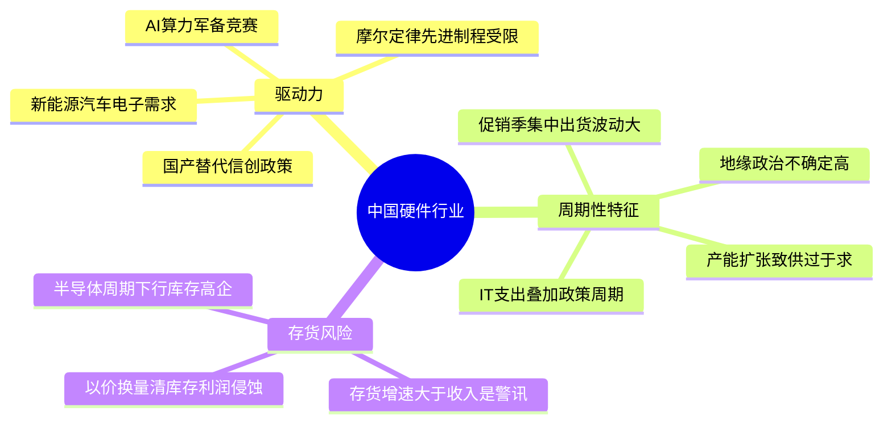
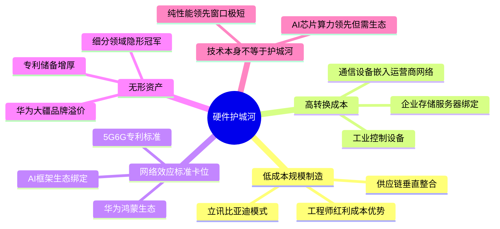
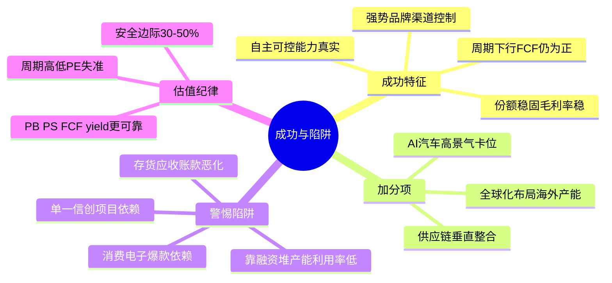
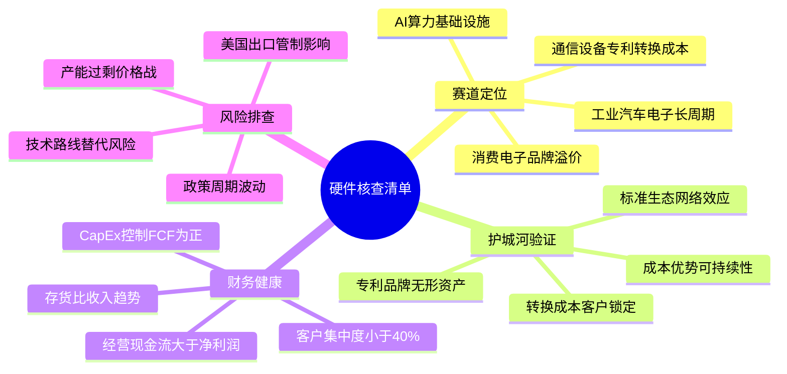

# 《股市真规则》第二十章：硬件行业 —— 2026年中国版重估

**核心判断前置：**
原书第二十章（美国视角）对硬件行业的定位——“技术越牛，护城河越难守；真壁垒在低成本制造、转换成本和标准锁定”——在中国**本质成立，但被逆全球化、国产替代、AI算力爆发和政策驱动深刻改写**。
中国硬件行业正经历**半导体自主化攻坚、消费电子创新放缓与AI终端兴起、通信设备全球领先、算力基础设施狂飙**的复杂生态。以下逐块对照，标注差异。

## 一、硬件行业发展的驱动力——中国版的三重引擎

### 1.1 原书驱动力对照
| 原书驱动力（美国） | 中国2026对应 |
|-------------------|------------|
| 摩尔定律：性能↑成本↓，利润流向消费者 | **依然成立，但中国半导体受制于先进制程封锁**，成熟制程产能过剩，价格战激烈；先进制程突围是战略任务，而非纯商业竞争 |
| 制造→服务转移 | 中国制造仍是大本营，但**产业链外迁压力和智能制造升级**并行；硬件代工（如立讯精密、歌尔）向模组/整机/系统组装升级，赚取更多附加值 |
| 软硬件共生 | **AI终端（AI PC/手机/眼镜/机器人）正在重塑硬件价值**——硬件成为AI服务的入口，软硬件协同更紧密；华为鸿蒙生态是典型案例 |

### 1.2 中国硬件的独特驱动力
- **国产替代/信创**：在半导体（CPU/GPU/FPGA）、操作系统、数据库、服务器、网络设备等领域，政策推动国产化采购，创造确定性需求，但也滋生政策依赖型企业。
- **AI算力军备竞赛**：大模型训练推理对AI芯片、服务器、光模块、存储的需求爆发，是2023-2026年硬件行业最大增量。
- **出口升级**：从“组装代工”到“品牌+技术出海”（华为/小米/大疆/安克），硬件出海的产品附加值提升，但也面临地缘政治风险。
- **新能源/汽车电子**：电动汽车、光伏、储能拉动IGBT、碳化硅、电池管理芯片、传感器等硬件需求，中国在这些领域正形成规模壁垒。

## 二、硬件行业动力学特征——中国版的周期与陷阱

### 2.1 周期性更为剧烈
| 原书特征 | 中国2026对应 |
|----------|------------|
| IT支出可延期，经济下行先砍硬件 | **成立，且叠加政策周期**。例如，信创采购受政府预算和规划周期影响，可能出现“前高后低”；运营商5G投资高峰已过，资本开支下滑 |
| 季末冲刺/折扣压力 | 成立，且中国硬件厂商在消费电子“双11/618”大促中集中出货，季度波动更为极端 |
| 存货泡沫 | **中国硬件公司存货风险更突出**，尤其半导体周期下行时，渠道和原厂库存高企（2022-2023年消费电子去库存是典型）；且中国厂商倾向于“以价换量”清库存，利润侵蚀更严重 |

### 2.2 特有的“政策周期”与“产能周期”
- **政策周期**：信创、东数西算、算力基建等政策驱动大规模硬件采购，政策节奏变化直接冲击收入。
- **产能周期**：中国半导体成熟制程产能大规模扩张，可能导致未来数年的供过于求和价格战（面板、存储、功率器件均已历过）。
- **地缘政治冲击**：美国出口管制不断升级，硬件公司面临供应链中断、技术路线不确定性风险，需评估“去A化”能力和备胎方案。

## 三、硬件行业的竞争优势——原书四条壁垒的中国验证

| 原书壁垒 | 中国2026对应 |
|----------|------------|
| ① 低成本制造/规模经济 | **中国硬件最强护城河**。消费电子产业链（立讯、歌尔）、通信设备（华为/中兴）、光伏组件等，凭借完整产业链、工程师红利和规模效应，全球成本优势显著。但人力成本上升和产业链外迁是长期挑战。 |
| ② 高转换成本 | 通信设备（运营商网络）、企业级存储/服务器、工业控制设备，一旦嵌入客户业务流程，转换成本极高。华为在企业网络和运营商市场的地位部分源于此。 |
| ③ 网络效应/标准卡位 | **华为鸿蒙生态**：企图在IoT领域建立跨设备标准；**通信专利卡位**：华为/中兴在5G/6G标准必要专利中的话语权，收取专利费。整体上，中国硬件公司在全球标准制定中的影响力在上升。 |
| ④ 无形资产（专利/品牌） | **品牌正在崛起**：华为、小米、大疆、安克创新等在消费市场品牌溢价提升；**专利储备增厚**：华为、京东方等在通信、显示等领域专利积累全球前列。但软件生态和系统级专利仍弱于美国巨头。 |

**原书核心结论依然有效**：“技术本身不能构成竞争优势”——中国AI芯片公司（寒武纪、海光等）算力指标领先并不意味着护城河，关键看是否绑定了主流AI框架（PyTorch/TensorFlow）和开发者生态，以及是否拥有可持续的成本优势或转换成本。

**中国硬件最值得关注的真壁垒**：
- **供应链垂直整合+规模成本**：比亚迪电子、立讯精密等，通过一体化制造和自动化，构建“别人做不了这么便宜且这么大量”的壁垒。
- **通信标准专利+全球化受阻下的本土生态**：华为的5G专利+鸿蒙生态+昇腾AI芯片，形成“从芯片到软件”的闭环，在特定市场（国内政企）极具粘性。
- **利基市场的隐形冠军**：如汇顶科技（指纹芯片）、韦尔股份（CIS图像传感器）、卓胜微（射频开关）等在细分领域市占率全球领先，有规模+客户关系壁垒。

## 四、成功的硬件公司的特点——2026中国版

| 原书特点 | 中国2026对应 |
|----------|------------|
| ① 稳固的市场份额+始终如一的盈利能力 | **市场份额稳定或上升，且毛利率稳定在合理水平（而非靠降价抢份额）**。消费电子毛利率15-25%为常态，通信/工业/汽车电子可30-50%+；需区分周期性与趋势性下滑 |
| ② 强势的经营和市场营销 | **渠道控制力+品牌心智**。在国内市场，华为的品牌忠诚度极高；在海外，安克的品牌化运营、小米的本地化渠道是正面案例；过度依赖大客户代工（如苹果链单一客户占比过高）是风险 |
| ③ 弹性的经济状况（扛周期） | **下行周期中FCF仍为正或仅小幅为负，资产负债表稳健，不依赖持续融资**。存货和应收账款控制是关键，现金流质量（经营现金流/净利润>1）比利润增速更可靠 |

**中国加分项**：
- **自主可控/国产替代实力**：在美制裁下，具备去A化解决方案的公司（如华为、中芯国际、北方华创等）享有政策红利和估值溢价，但需区分“真技术替代”与“概念炒作”。
- **AI/汽车电子等高景气赛道卡位**：如光模块（中际旭创）、智能驾驶域控（德赛西威）、碳化硅（天岳先进）等，需验证护城河是否持久，而非只是短期供需缺口。
- **全球化能力**：能在海外建厂、规避关税、服务全球客户的公司（如海尔智家、美的、宁德时代），能对冲国内内卷。

**警惕三类“伪成长”硬件公司**：
- 依赖单一信创项目，缺乏市场化客户
- 靠融资和资本开支堆产能，但产能利用率低、毛利率薄
- 消费电子爆款依赖，产品生命周期短，下一代不确定

## 五、中国硬件行业投资清单（2026）

- ✅ **本质不变**：硬件护城河难建，技术优势保质期短，低成本规模、转换成本、标准锁定、品牌才是真壁垒。
- ✅ **最值得看的赛道**：工业/汽车电子（高转换成本+长产品周期）、通信设备（专利+转换成本）、具备品牌溢价的消费硬件（华为、大疆、安克）、AI算力基础设施（光模块、服务器代工龙头）。
- ⚠️ **谨慎对待**：纯半导体制造（成熟制程产能过剩风险）、消费电子代工（大客户依赖+毛利率薄）、纯信创概念（无技术壁垒的政策驱动股）。
- ✅ **库存监控是硬件投资第一要务**：存货/收入比、存货周转天数必须跟踪，一旦存货增长持续快于收入，是强烈卖出信号。
- ✅ **估值纪律更严**：硬件周期性强、技术迭代快，安全边际要求30-50%折扣；P/E在周期顶部极低（利润高峰），在周期底部极高（甚至亏损），此时P/B、P/S和FCF yield更可靠。
- 🚨 **最大变量**：美国出口管制升级、台海地缘风险、国内经济复苏强度、AI应用落地速度。

## 思维导图（按阅读逻辑拆分）

### 图1：中国硬件行业——驱动力与周期性

###  图2：硬件护城河——中国版真壁垒

###  图3：成功硬件公司特点与陷阱

###  图4：2026年中国硬件行业核查清单

# 第二十章　硬件行业（Technology Hardware）——技术越牛，护城河越难守

> **章首定位（原书 p.243 / 中信畅销版 ISBN 9787508686431）**
>
> 多尔西开篇就把这章的基调钉死：
>
> > **硬件部门的环境使得建立稳定的竞争优势极为困难，因为技术进步和价格竞争意味着硬件市场最大块的利益已经交给了消费者，而不是创造产品的公司。**
>
> 换句话说：摩尔定律把性能送上指数曲线，同时也把**价格/毛利**送进碎纸机——硬件行业天生**商品化压力更重、周期更暴、技术领先保质期更短**。

---

## 章内目录骨架（畅销版：p.243→249）

text
第二十章 硬件行业
├── 一、硬件行业发展的驱动力（p.243） ← Moore定律 + 制造→服务转移 + 软硬件共生
├── 二、硬件行业动力学特征（p.244） ← 周期性（IT支出波动）+ 投资陷阱
├── 三、硬件行业的竞争优势（p.246） ← 技术≠护城河；真壁垒在哪
│ ├─ 低成本制造/规模经济（Dell式）
│ ├─ 高转换成本（Telco设备/企业网络）
│ ├─ 网络效应/标准卡位（Cisco式）
│ ├─ 无形资产（专利/品牌 niches）
│ └─ 常见陷阱：存货泡沫（Inventory bubble）
├── 四、成功的硬件公司的特点（p.248）
└── 投资者清单：硬件行业（p.249）

> 原书一句话收束（多处复述一致）：
> **这个行业的动力可以简单归结为：可靠的管理、一个聚焦的经济模型以及竞争优势。**

---

## 一、硬件行业发展的驱动力（p.243）

### 1.1 Moore定律 = "更好更快更便宜"的双刃剑

| 驱动力 | 原书表述精神 | 对你的含义 |
|--------|-------------|-----------|
| **① 创新能力（核心）** | "硬件部门的核心驱动力是它的创新能力，使功能增强同时成本迅速下降"——背后是**摩尔定律** | 性能/价格曲线有利消费者，但**利润被压**：每代领先窗口越来越短 |
| **② 制造业→服务业转移** | 发达国家经济把中心从制造转向服务；硬件制造越来越被 commoditize / 外包 | 真正"赚得稳"的往往在品牌/渠道/系统集成/服务，不在纯组装 |
| **③ 软硬件共生** | 硬件价值常被"能用什么软件"放大（PC靠Windows生态；手机靠iOS/Android） | 护城河更可能来自**生态锁定**（OS/开发者/驱动/兼容），不来自芯片本身 |

### 1.2 原书给的"硬件=商品化"铁律

> **平均PC 1998年≈$1500 → 2002年≈$1000但更强**——这就是行业底色：  
> - 技术赢了，但**利润率未必赢**  
> - 所以你评估硬件公司时，永远要把"技术领先"翻译成：**领先能守住毛利多久？能绑住客户吗？能不靠降价抢量吗？**

---

## 二、硬件行业动力学特征（p.244）——周期 + 需求震荡 + 投资陷阱

### 2.1 周期性是命门

> **周期性是这个行业至关重要的动力学特征。**
> - IT支出属于企业"可延期的资本支出"→经济一冷就被砍→硬件订单摆幅远大于GDP  
> - 消费者端同样：失业率↑/信心↓→数码/PC/外设等非必需推迟换新

| 表现 | 原书 |
|------|------|
| **IT支出剧震** | 繁荣期公司资本支出宽；衰退期先砍IT预算→硬件收入可断崖 |
| **季末冲刺/折扣压力** | 大量交易挤在季末→销售人员打折完成指标→**短期收入虚高、毛利被咬** |
| **陷阱：在新技术上下赌注** | 原书警告：硬件常见故事——"下一代标准/新架构"看起来性感，但**标准战争输家清零**，赢家也常被随后降价吞利 |

### 2.2 为什么"增长快"≠好投资

> 因为硬件的"快速增长"常伴随：
> - **存货堆积**（渠道/成品胀）→后面要减值或折价清仓  
> - **CapEx军备竞赛**（晶圆/产线/新品NPI）→FCF被吃  
> - **周期高点最像成长股**→散户追进去时往往接近顶部

---

## 三、硬件行业的竞争优势（p.246）——技术本身不是护城河（原书最重要的结论）

### 3.1 原书原话（必须刻住）

> **"尽管大多数硬件公司注意区分它们自己的技术优势，但技术本身不能构成竞争优势。"**
> **"竞争优势在硬件行业是罕见的……评估技术公司的竞争优势可能错综复杂。"**

原因一句话：**可被迭代/逆向/绕过的技术领先，护城河宽度≈"领先窗口长度"**——硬件的窗口往往短。

### 3.2 那真正的壁垒长在哪？（原书给的可用清单）

| 壁垒 | 硬件里长什么样 | 例子（原书点名/语境） |
|------|----------------|---------------------|
| **① 低成本制造 / 规模经济（Cost Advantage）⭐⭐⭐** | 把"更便宜造出来"变成系统能力：供应链/采购/装配/良率/物流→单位成本曲线=真护城河 | **Dell**：直销+按订单生产→压渠道库存/压营运资本→成本位置 |
| **② 高转换成本（Switching Costs）⭐⭐⭐** | 客户嵌入：复杂网络/关键任务设备→换=停机风险+再培训+重新认证 | **电信设备**（Lucent/Nortel/Alcatel语境）：运营商网络=高替换成本 |
| **③ 网络效应 / 标准卡位（Standard Lock-in）⭐⭐⭐** | 越多人/设备用同一协议→第三方配件/运维知识/兼容生态越强→正反馈 | **Cisco 路由器**：协议生态+运维习惯+培训体系→事实标准 |
| **④ 无形资产：专利 + 品牌 niches ⭐⭐** | 专利能挡一阵子（尤其模拟/RF/光电/特种工艺）；品牌在消费侧（Apple类例外）| **Linear Tech / Maxim（原书例）**：niche模拟IC+专属know-how=超额利 |
| ❌ 纯性能领先 | 原书：一流技术在硬件只是**最小持续优势之一**（寿命短） | 你现在GPU/AI芯片也一样——算力强≠护城河，要看是否绑定生态/客户 |

> 原书一段很冷的话（p.246–248语境）：
> **组织公司创建竞争优势的力量在硬件部门被放大了很多倍——但方向不保证成功：很多有技术优势的公司仍失败，因为壁垒不在实验室，在**成本结构/客户锁定/生态/规模**。

---

### 3.3 最常见陷阱（原书点名）：**存货泡沫（Inventory Bubble）**

> **硬件公司常常面对存货不平衡的阶段——不是它们堆积了太多存货，就是消费者需求突然超过供应能力。但当存货比销售收入增长更快时，那是一个警告。**

| 看什么 | 绿灯 | 红旗 |
|------|------|------|
| **存货增速 vs 收入增速** | 存货/收入稳或↓ | **存货↑↑ > 收入↑**（渠道塞货 / 错判需求）→后面要减值/打折清仓→毛利炸 |
| **存货周转天数 DSI** | 稳或↓（周转快=健康） | ↑↑（钱卡仓库；过时风险：电子件过时=近乎100%损失） |
| **产品周期新旧混存** | 老代清完才上新 | 新老同仓堆高→老代变废铁→减值炸弹 |

> 这也是第八章"揭开财务伪装"在硬件行业的**第一战场**：存货不只是一个运营KPI，它是**利润的定时炸弹**。

---

## 四、成功的硬件公司的特点（p.248）——原书给的3项（极精简，因为行业本身不友好）

### 4.1 原书逐条（浓缩成可核查动作）

| # | 特点（原书） | 你填的核查动作 |
|---|-------------|---------------|
| ① | **稳固的市场份额 + 始终如一的盈利能力** | 不是"今年爆量"，而是：份额是否守得住（别被价格战碾）；**毛利率带是否稳**（硬件最诚实的护城河温度计） |
| ② | **强势的经营和市场营销** | 渠道控制/直销效率/品牌心智（Apple是消费硬件里"品牌溢价+生态"的异数；Dell是企业硬件里"成本+渠道"的范本） |
| ③ | **弹性的经济状况（Resilient Economics）** | 下行周期仍正FCF或至少不太崩：**低营运资本占用（尤其应收/存货纪律）/ CapEx可控 / 可变成本占比高** |

### 4.2 你该加的"硬件专属红灯"（原书隐含但直接可用）

- **毛利率连续下滑 + 存货周转连续下滑**＝经典"商品化死亡螺旋"前兆
- **高R&D军备但无生态绑定＝费用黑洞**
- **客户集中度**（Top5客户 %>40–50%）＝需求风险被少数订单绑架

---

## 投资者清单：硬件行业（p.249·原书浓缩）

- ✅ **硬件环境让稳定护城河极难建：技术进步+价格竞争→利益流向消费者，不保证留在制造者**
- ✅ **核心驱动力：Moore定律（性能/成本曲线）+ 制造→服务转移 + 软硬件共生**
- ✅ **周期性强（IT支出可延期）→ 旺季像成长股、淡季像破产股→买点常在悲观期+结构仍稳**
- ✅ **技术≠护城河**：真壁垒=低成本规模（Dell）/高转换成本（telco设备）/网络效应&标准（Cisco路由生态）/niche专利&品牌；纯性能领先=最短命
- ✅ **最大营运红灯：存货泡沫（存货增速>>收入增速 / DSI↑）→硬件过时=近100%减值风险**
- ✅ **成功特征：稳固份额+稳毛利、强势经营/渠道、弹性经济（FCF扛周期）**
- ✅ **安全边际要比"护城河宽"行业更厚（30–50%+），因为技术窗口短+周期深+存货炸弹**

---

## Appendix：第二十章"硬件核查卡"（一键粘进 Excel/Notion/飞书）

text
【公司】___________ 【赛道】□PC/服务器 □网络设备 □半导体(IC设计/制造) □消费电子 □ telecom设备 □其他___
【日期】____
── 1) 周期位 ──────────────────────────────────────
IT支出环境：扩张□ 顶峰□ 收缩□（不明）
历史毛利率带：–% 当前毛利__%（↓>2年?□警）
── 2) 护城河核验（技术≠壁垒）──────────────────────
□低成本规模制造(供应链/良率/直销) □转换成本(关键任务嵌入) □网络效应/标准卡位 □niche专利+know-how □纯性能领先(×淘汰)
"技术领先能守多久？"答：__________________________________________
── 3) 存货炸弹（硬件#1红灯）─────────────────────────
存货增速% vs 收入增速% → 存货跑更快?□是(🚨) □no
DSI=365/(COGS/均存货)=____天 趋势：↑□(警) ↓□
旧代占比__%（>15%?□减值风险）
── 4) 需求质量 ──────────────────────────────────────
Top5客户占比__%（>50%?□集中险）
订单可见度：backlog披露?□yes $____ □no(更猜)
── 5) 弹性 ─────────────────────────────────────────
FCF 3yr：正□ 微正□ 负(周期谷底也负?□很脆)
CapEx/营收 __%（轻?□ 重?）
营运资本占：应收%__ 存货%__（都应低）
verdict: □可进(壁垒明+存货干净+周期低位+折扣) □等(存货/毛利趋势) □淘汰(理由:__)