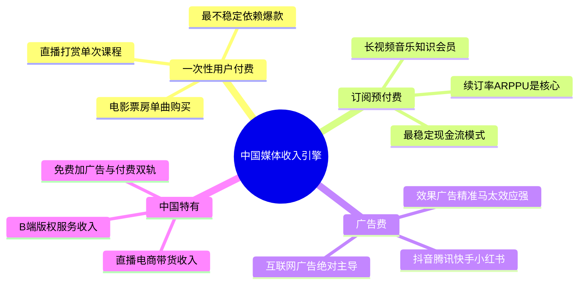
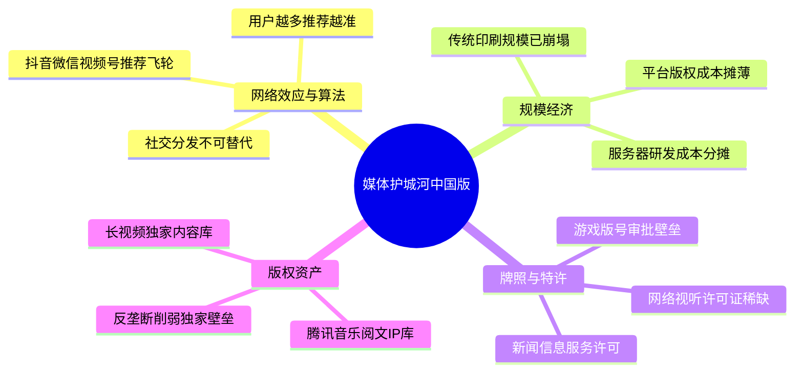
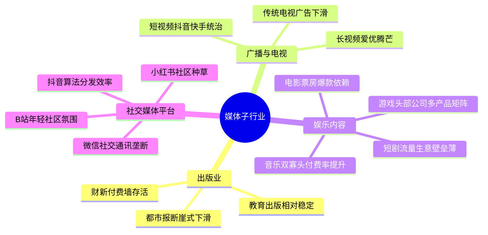
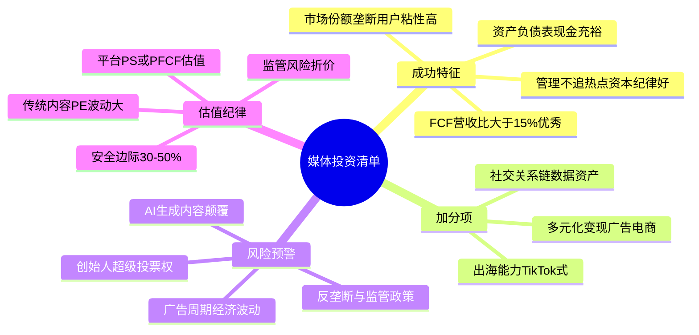

# 《股市真规则》第二十一章：媒体行业 —— 2026年中国版重估

**核心判断前置：**
原书第二十一章（美国视角）对媒体行业的定位——“内容为王，但分发才是城堡；订阅费最稳，广告顺周期，一次性付费最不稳；护城河来自规模经济、地方垄断和牌照”——在中国**本质成立，但行业已被互联网平台彻底重塑**。
中国媒体行业正经历**传统媒体断崖式衰落、互联网平台寡头垄断、短视频/直播重构注意力经济、会员订阅与知识付费崛起、AI生成内容冲击生产端**的复杂变局。以下逐块对照。


## 一、媒体公司怎样赚钱——中国版收入引擎的演变

### 1.1 原书三种收入来源对照
| 原书收入来源 | 中国2026对应 |
|-------------|------------|
| ① 用户使用费（一次性付费） | 电影票房、单曲/专辑购买、电子书单本付费、直播打赏（一次性）、单次知识付费课程。**依然最不稳定**，依赖爆款和流量峰值。 |
| ② 订购费/预付金（最稳） | 长视频会员（爱奇艺/腾讯视频）、音乐会员（QQ音乐/网易云）、知识付费订阅（得到/樊登）、数字报纸订阅（财新/南方周末付费墙）。**续订率和ARPPU（单用户平均收入）是核心KPI**。 |
| ③ 广告费收入 | 互联网广告占绝对主导（字节跳动、腾讯、百度、快手、小红书），电视/广播/户外广告持续萎缩。**效果广告精准度远超传统媒体，马太效应极强**。 |

### 1.2 中国媒体收入结构的独特性
- **广告高度集中于互联网平台**：字节跳动（抖音+今日头条）年广告收入超5000亿元，远超所有电视台和报纸广告收入总和。传统媒体的广告模式基本被“杀死”。
- **直播打赏和电商带货成为新收入形式**：介于“用户使用费”和“广告费”之间，具有极强冲动性和头部主播依赖性，护城河极薄。
- **免费+广告与付费双轨并行**：大多数平台（视频、音乐、阅读）同时提供免费（看广告）和付费（会员免广告+特权）模式，用户ARPU提升空间大。
- **B端内容服务/版权收入**崛起：影视剧版权采买、短剧定制、企业视频服务等，成为内容公司新现金流来源。


## 二、媒体行业的竞争优势——原书三条壁垒的中国对应

| 原书壁垒 | 中国2026对应 |
|----------|------------|
| ① 规模经济 | **互联网平台的规模效应远超传统媒体**。腾讯视频/爱奇艺/优酷的版权采买成本可被亿级用户摊薄；抖音的算法推荐越多人用越精准，形成数据和流量规模壁垒。但传统报纸/杂志的印刷和发行规模经济已崩塌。 |
| ② 垄断/有效规模/特许经营权 | **互联网平台具有“自然垄断”倾向**（微信的社交通讯垄断、抖音的短视频算法垄断），但并非政府特许，而是网络效应+用户习惯导致。传统意义上的地方报纸垄断在中国从未形成（党报体系），有线电视特许被IPTV和OTT瓦解。**政府授予的牌照（如互联网新闻信息服务许可、网络视听许可证、游戏版号）构成中国特有的准入壁垒**。 |
| ③ 无形资产（许可证/版权/品牌） | **版权**：音乐版权（腾讯音乐独家时期构建壁垒，后反垄断打破）、影视版权（爱奇艺/腾讯视频的内容库）、文学IP（阅文集团）。**品牌**：湖南卫视/芒果TV、财新、新华社等具有权威性和受众惯性。**牌照**：新闻牌照、视听许可证、游戏版号是核心壁垒，无证者出局。 |

**中国媒体最真实的护城河**：
- **网络效应+算法分发**：抖音、微信视频号、快手的推荐算法和社交分发，形成“内容创作者越多→用户越多→数据越准→推荐越好”的飞轮。
- **社交关系链垄断**：微信的社交关系链是任何新社交/内容平台无法复制的护城河。
- **版权资产库**：腾讯视频、爱奇艺、芒果TV多年积累的独家内容库和自制能力，提高用户迁移成本。
- **政策牌照**：网络视听许可证总数仅约600张，新申请基本停止，存量平台形成合法垄断。


## 三、子行业拆解——中国版四种体质

### ① 出版业（报纸/杂志/书籍）——中国版已基本“非投资品”
- 中国报纸以党报和都市报为主，都市报在移动互联网冲击下断崖式下滑，党报依赖政府订阅和财政拨款，商业投资价值极弱。
- 杂志：时尚类、财经类部分通过数字订阅和高端内容付费存活，但规模有限。
- 书籍出版：教育出版（教材教辅）相对稳定，大众出版依赖爆款，增长乏力。数字阅读（阅文、掌阅）受免费阅读平台冲击。
- **唯一值得关注的残值**：财新等严肃媒体的付费墙模式，订阅用户数持续增长，但体量太小，不足以成为主流投资标的。

### ② 广播与电视——传统部分衰落，流媒体/OTT崛起
- 传统广播（车载收听为主）在新车联网/音频平台（喜马拉雅、荔枝）侵蚀下萎缩。
- 传统电视：广告收入连年下滑，央视和头部卫视（湖南/浙江/东方）仍保有大量受众，但年轻观众严重流失。
- **在线视频（长视频）**：爱奇艺、腾讯视频、优酷三足鼎立，芒果TV背靠湖南卫视内容成本优势。行业整体仍处微利边缘，核心痛点是内容成本高、用户忠诚度低。短剧集爆款带来会员脉冲，但长期粘性不足。
- **短视频/直播**：抖音、快手、微信视频号统治用户时长，广告和电商变现能力极强，是媒体行业真正的现金牛。

### ③ 娱乐业（影视/音乐/游戏）——中国版“内容+分发”分化
- **电影**：票房依赖爆款，制片公司（光线、博纳、中影）利润随单片波动极大；院线（万达电影）曾拥有渠道优势，但流媒体和短剧分流观众。
- **音乐**：腾讯音乐和网易云音乐双寡头，订阅付费率持续提升，但ARPPU仍低。护城河在版权库和用户习惯。
- **游戏**：中国最赚钱的媒体内容形式，腾讯、网易、米哈游等掌握研发+发行渠道。游戏生命周期不确定性强，头部公司通过多产品矩阵和社交分发构建护城河。
- **短剧/微短剧**：2023年后爆发，制作成本极低，投流（买量）决定成败，本质是“流量生意”而非内容壁垒，头部制作方和投流方利润丰厚但不稳定。

### ④ 社交媒体/内容平台（中国特有大类）——原书未充分覆盖的“超级媒体”
- **微信（腾讯）**：集通讯、公众号、视频号、朋友圈、支付于一体，是中国最大的媒体分发平台。护城河极宽（社交关系链+内容生态+小程序）。
- **抖音/字节跳动**：算法分发+用户生成内容+广告和电商变现，形成无与伦比的流量变现效率。
- **小红书**：生活方式社区，强种草和搜索属性，广告和电商变现增长迅速。
- **B站（哔哩哔哩）**：年轻用户社区，中长视频+直播+游戏，社区氛围和UP主生态是护城河。
- 这类平台是真正的“分发城堡”，掌握流量分发权和数据，护城河远深于纯内容制作公司。


## 四、成功的媒体公司的特点——2026中国版

| 原书特点 | 中国2026对应 |
|----------|------------|
| ① 始终如一地产生充沛自由现金流 | 中国互联网媒体平台普遍能产生强FCF（腾讯、字节、快手盈利后），但长视频和电影制片公司FCF波动极大。FCF/营收>15%算优秀。 |
| ② 在主要市场有高市场份额+垄断/特许优势 | 微信在社交通讯、抖音在短视频、腾讯音乐在在线音乐、阅文在网络文学——市场份额极高，且用户迁移成本高。牌照壁垒（视听许可证）也构成保护。 |
| ③ 明智的收购 | 中国媒体公司历史上不乏失败收购，需关注并购是否带来协同，以及是否导致商誉暴雷。 |
| ④ 表现良好的资产负债表 | 平台型公司普遍现金充裕、有息负债少；传统媒体和影视公司可能高杠杆，需警惕。 |
| ⑤ 公正坦率的管理 | 互联网公司创始人通常拥有超级投票权，需关注小股东利益保护。避免追逐短期热点而分散主业注意力的管理层。 |

**中国加分项**：
- **用户生态与数据资产**：拥有社交关系链、搜索和交易数据、内容兴趣图谱的公司，能通过AI和大数据持续提升变现效率。
- **多元化变现引擎**：能从广告拓展到电商、游戏、支付、本地生活等，实现单一用户多场景变现。
- **出海能力**：TikTok在全球的成功证明了中国媒体平台的出海潜力，能分散单一市场风险和地缘风险。


## 五、媒体行业的风险——中国版

| 原书风险 | 中国2026对应 |
|----------|------------|
| ① 家族控制/治理问题 | 互联网公司多为创始人控制，存在“VIE结构”和海外上市带来的控制权与监管风险；部分传统媒体国企治理效率低。 |
| ② 交叉持股 | 腾讯系曾广泛交叉持股，近年来逐步减持退出，趋向简化。战略投资过多可能导致资本配置不透明。 |
| ③ 高管酬金/津贴 | 互联网公司高管薪酬和股权激励常受到市场关注，需关注稀释比例和与业绩挂钩程度。 |
| ④ 宏观广告周期 | 效果广告同样受经济周期影响，2022-2023年中国广告市场负增长证明即使是线上平台也难逃周期。 |
| ⑤ 技术颠覆 | **AI生成内容（AIGC）** 正在颠覆内容生产端，降低制作门槛，可能冲击传统影视/音乐/游戏公司；推荐算法的监管可能限制流量变现效率。 |

**中国特有的额外风险**：
- **监管风险**：游戏版号审批、反垄断、数据安全审查、未成年人保护、直播打赏限额——政策变化可直接重创盈利模式。
- **舆论引导与内容审查**：内容平台需承担审核成本，且可能因违规停播、下架、罚款。
- **平台间竞争白热化**：抖音vs视频号、美团vs抖音本地生活，竞争迭代极快，护城河可能被跨界对手侵蚀。


## 六、中国媒体行业投资清单（2026）

- ✅ **本质不变**：订阅/预付收入最稳，广告顺周期，一次性付费不可靠。内容本身不是护城河，分发渠道和用户锁定才是。
- ✅ **最值得看的赛道**：拥有社交/算法分发垄断的平台（腾讯）、具有网络效应和多元化变现的短视频平台（快手）、音乐订阅双寡头之一（腾讯音乐）、头部游戏平台（腾讯、网易）、拥有独家版权和内容成本优势的长视频平台（芒果超媒）。
- ⚠️ **谨慎对待**：纯电影制片/发行公司（爆款依赖、现金流波动大）、传统报纸/杂志/出版（结构衰退）、无核心壁垒的中小型内容制作公司。
- ✅ **核心KPI**：订阅收入占比、续订率/留存率、DAU（日活）和时长、广告收入增速、FCF/营收比、用户ARPU趋势。
- ✅ **估值纪律**：平台型公司可参考P/S（成长期）或P/FCF（成熟期），但需考虑监管折价。传统内容公司P/E波动大，安全边际要求30-50%。
- 🚨 **最大变量**：AI生成内容对内容供给和成本的颠覆、反垄断和监管趋严、宏观经济及广告预算恢复强度。


## 思维导图（按阅读逻辑拆分）

### 图1：中国媒体行业——三种收入引擎与演变




###  图2：媒体护城河——中国版真壁垒



###  图3：中国媒体子行业拆解





###  图4：成功媒体公司特点与投资清单




###  


```mermaid
 
```

# 第二十一章　媒体行业（Media Industry）——"内容为王"但"分发才是城堡"

> **章首定位（原书 p.250 / 中信畅销版 ISBN 9787508686431）**
>
> 开篇一句把媒体行业最矛盾的地方钉死：
>
> > **媒体行业的公司能为获得长期投资收益提供充分机会——但在这个行业成功的投资，更多不取决于"选出下一部轰动剧/风行电影"，而在于识别哪些公司能持续产生充沛现金流、且壁垒是结构性的而非一次性的。**
>
> 多尔西的原话精神：
> - 媒体好年景看起来很美（1993–2002 媒体行业年均收益 **16%+ vs S&P500 9%+**）
> - 但驱动它的两个发动机是：**吸引人的经营状况（高毛利/低可变成本）+ 明显的竞争优势（垄断/规模/无形资产）**
> - 核心警告：**不要赶时髦**——为一部风行影片/电视节目买媒体股，很少赚钱。

---

## 章内目录骨架（畅销版：p.250→258）

text
第二十一章 媒体行业
├── 一、媒体公司怎样赚钱——三种收入引擎（p.250）
│ ├─ ① 用户使用费（User Fees / 一次性消费付费）
│ ├─ ② 订购费/预付金（Subscriptions / Prepaid）
│ └─ ③ 广告费收入（Advertising）
├── 二、媒体行业的竞争优势（p.251）——壁垒在哪？
│ ├─ 规模经济（固定成本摊薄＝核心）
│ ├─ 垄断/有效规模（报纸/有线地方特许）
│ └─ 无形资产（许可证/版权/品牌）
├── 三、子行业拆解（p.252）
│ ├─ ① 出版业（Publishing：报纸/杂志/书籍）
│ ├─ ② 广播与有线电视（Broadcast & Cable TV）
│ └─ ③ 娱乐业（Entertainment：影视/音乐制作）
├── 四、成功的媒体公司的特点（p.256）
├── 五、媒体行业的风险（p.257）
└── 投资者清单：媒体行业（p.258）

> 一句话总纲：**Content is king, but distribution is the castle.**（内容可以是王，但分发网络/渠道/特许经营权才是护城河的物理载体。）

---

## 一、媒体公司怎样赚钱——三种收入引擎（p.250）

> 媒体公司通过**生产或传递信息/内容给公众**赚钱。传递手段：电视、广播、电影、互联网、书籍、杂志、报纸。

### 1.1 三种收入来源（原书逐条给的——你必须拆开看）

| 来源 | 机制 | 稳定性 | 原书评价 |
|------|------|--------|---------|
| **① 用户使用费（User Fees / 一次性消费付费）** | 票房/单曲购买/单本图书/DVD——每笔交易单独付费 | **最不稳定**：现金流高度依赖"大制作是否hit"；成功溢价=大牌演员导演分走利润→留给股东少 | ❌ 最差的收入质量；预测未来现金流极难 |
| **② 订购费/预付金（Subscriptions / Prepaid）** | 订户按月/年预付→**现金先于交付**→递延收入（好负债）；需求更可预期 | **最稳定**：续订率/留存率=护城河温度计；一旦安装基锁住→现金流可预测 | ✅ 最佳模式（报纸订户/流媒体订阅/Magazine续订） |
| **③ 广告费收入（Advertising）** | 听众/观众/读者越多→千次曝光CPM越高→**广告收入直接随眼球走** | **顺周期**：经济好→广告预算扩；经济差→砍广告→收入跌；且互联网分流持续压传统CPM | ⚠️ 毛利高但波动；广播/电视/免费门户依赖此 |

> 原书原话精神（多处一致）：
>
> **依赖一次性用户收费的公司常常遭遇不稳定现金流困境——现金流受众多单独产品销售业绩的很大影响。成功严重依赖大制作/大牌明星，毛利率被挤压。**

### 1.2 为什么"内容为王"是半句真理

- 内容能吸引眼球→但**眼球本身不归你**（平台/分发渠道/算法掌握接触点）
- 原书隐含结论：**可持续超额利润来自分发垄断/规模/特许经营权，不是"下一部爆款内容"**
- 所以你买媒体股的理由不该是"我看好这部剧"，而应是：**这公司控制的分发网络/特许市场有没有定价权+现金转化**

---

## 二、媒体行业的竞争优势（p.251）——壁垒来自三样

> 原书给的护城河来源（对应第三章框架）：

| 壁垒 | 媒体里长什么样 | 例子 |
|------|---------------|------|
| **① 规模经济（Economies of Scale）⭐⭐⭐** | 固定成本（编辑部/印刷机/节目制作/广播塔/内容库）摊到更多份数/更多观众→单位成本↓ | **报纸**：大城市只容1–2份大报→胜者吃规模；**广播**：固定节目成本摊到更多台站 |
| **② 垄断 / 有效规模（Natural Monopoly / Local Franchise）⭐⭐⭐** | **地方报纸**：很少城市能撑>1份大日报→事实垄断→提价能力<br>**有线电视特许**：市政给独家特许→本地垄断→但被卫星/流媒体瓦解中 | 报纸特许/有线旧时代"地方印钞机" |
| **③ 无形资产（许可证/版权/品牌）⭐⭐** | 广播频谱许可证（FCC拍卖/有限）→准入控制；版权=内容保护（但数字盗版削弱）；品牌=受众习惯 | **广播许可证**=合法壁垒；迪士尼版权/角色IP=资产 |

> 原书一句收束（p.251-252）：
> **"竞争优势在媒体行业是罕见的，但有效规模/垄断/规模经济能让利润持续。"**
> 同时原书也警告：**放松管制（deregulation）可能毁掉垄断租金**——报纸专营消失、有线电视被卫星/流媒体竞争打破。

---

## 三、子行业拆解（p.252）——三种体质，天差地别

### ① 出版业（Publishing：报纸 / magazines / books）

| 项目 | 原书定位 |
|------|---------|
| **核心优势** | **地方垄断**：大多城市只养得起1份主要日报→广告主不得不登→定价权；**规模经济**：印刷机/编辑部/发行网=固定成本高→发行量越大单位成本越低 |
| **核心趋势（原书写的2000s语境）** | 纸媒已被互联网分流广告+发行→**注定结构性收缩**（原书精神：出版业越来越像夕阳阵地） |
| **还能看什么？** | 只在：有**垄断性地方发行网+强订阅base+数字转型能止血**的少数；否则现金机器在慢慢漏水 |

- 原书盯的：广告页数/广告收入趋势 + 发行量/订户数 + 成本削减纪律

---

### ② 广播与有线电视（Broadcast & Cable TV）

#### 广播（Radio / Broadcast TV）
| 特征 | 原书 |
|------|------|
| 钱从哪来 | **主要是广告**（听众/观众→CPM）；固定节目成本可多台站共享→规模经济明显 |
| 壁垒 | 频谱许可证（有限频道）+ 本地广告商习惯；但互联网夺走年轻受众+数字音频=长期压力 |
| 投资姿态 | "更多是估值问题"——好时是现金牛，但结构性眼球流失 |

#### 有线电视（Cable TV）
| 特征 | 原书 |
|------|------|
| **地方特许垄断** | 市政给独家有线特许→历史上是"印钞机"（月费+机顶盒租赁+广告） |
| **但** | 卫星（Dish/DirecTV）和后来的**流媒体**打破垄断→**不再值得无条件信仰**（原书已有"互联网注定广播与有线没落"的判断） |
| 资本特征 | 资本密集（铺网/设备）→**自由现金流常微不足道**＝缺点；优势只在特许仍有效区域 |

---

### ③ 娱乐业（Entertainment：影视 / TV制作 / 音乐）——原书最警惕的一块

| 项目 | 原书判词 |
|------|---------|
| **商业模式** | 依赖**一次性用户收费（票房/专辑/授权）**→现金流易变 |
| **利润去向** | 行业大部分利润去**大牌演员/导演/制片人**→留给股东的少 |
| **进入壁垒** | 历史上靠**内容库/发行网络/版权**；但互联网削弱分发壁垒（音像盗版/流媒体扁平化） |
| **预测难度** | **长期准确追踪观众口味极难**→"下一次爆款"=不可靠投资依据 |
| 结论 | 不是不能投，而是：只碰**有分发控制权+可预期订阅/授权收入+内容库能持续变现**的（迪士尼式），别追"下一部大片" |

> 原书原句（p.255精神）：
> **"娱乐公司长期利润并不理想……本质上受演出成功驱动，而长期准确预测观众口味难以做到。"**

---

## 四、成功的媒体公司的特点（p.256）——原书给的筛选清单

> 原书把"成功"定义为**能持续吐现金、有结构性壁垒、管理不乱造**，不是"今年出了一部爆剧"。

| # | 特点 | 你填的核查动作 |
|---|------|---------------|
| ① | **始终如一地产生充沛自由现金流** | 原书锚：**FCF / 营业收入 在 8%–10%+ 左右**（≈10%级更舒服）；不是"账面净利高"，是现金真转出来 |
| ② | **在主要市场有高市场份额 + 垄断/特许优势** | 找地方垄断报纸/主导广播市场/有线特许仍有效的区域；"垄断对利润是好的"→许可证（尤其广播频谱）减少竞争→维持高毛利 |
| ③ | **明智的收购（Sensible Acquisitions）** | 盯：收购是否**小而消化得掉**、是否**提升毛利率**、是否把资产负债表弄炸；避开"两家不相干企业间建立协同效应"的宏大叙事 |
| ④ | **表现良好的资产负债表** | 媒体现金流好看时管理层最爱**借钱加码/大手笔并购**→你要看：负债/权益斜率、利息覆盖、FCF是否真≥股息+必要CapEx |
| ⑤ | **公正坦率的管理** | 不追"风行一时"故事哄市场；资本再投资保守，或通过**派息/回购**返还（而不是帝国建造） |

---

## 五、媒体行业的风险（p.257）——原书列的"非财报"陷阱

| # | 风险 | 原书表述 |
|---|------|---------|
| ① | **家族控制（Family Control）** | 很多媒体公司仍被创始人家族控制→表决权/决策可能更利家族（特殊股/投票权结构）→外部股东权力打折 |
| ② | **交叉持股（Cross-holdings）** | 媒体公司彼此持股→另一家在你的公司比单独股东有更多发言权→治理透明度↓ |
| ③ | **高管荒谬酬金/津贴（Perks Culture）** | 媒体是"名利场"→容易陷进浮华→警惕过分津贴/与业绩脱钩的酬金 |
| ④ | **宏观广告周期** | 广告收入顺周期→衰退期收入可断崖；再加数字化分流→传统广告长期趋势承压 |
| ⑤ | **技术颠覆（Digital Disruption）** | 报纸→互联网；有线→卫星→流媒体；每一次分发渠道革命=旧垄断归零 |

---

## 投资者清单：媒体行业（p.258·原书浓缩）

- ✅ **Content is king, but distribution is the castle**（内容可以是王，但分发网络/特许才是护城河载体）
- ✅ **拆三种收入**：用户使用费（最不稳）/ 订购/预付（最稳）/ 广告（顺周期高毛利）→ 盯订阅base&续订率>追爆款
- ✅ **护城河来源**：规模经济（固定成本摊薄）> 垄断/有效规模（地方报纸/有线特许）> 无形资产（许可证/版权/品牌）；技术颠覆可消灭旧壁垒
- ✅ **子行业偏好**：订阅基出版残值 > 广播（广告周期）> 有线（特许瓦解中）≫ 纯娱乐制作（追hit=赌局）
- ✅ **成功特征**：FCF/营收 **8–10%+**；主要市场高份额/垄断特许；明智小收购；干净资产负债表；坦率管理
- ✅ **不要赶时髦**：为一部风行剧/电影买股很少赚钱
- ✅ **风险**：家族控制/交叉持股（治理透明度↓）/ 高管津贴文化 / 广告周期 / 数字颠覆

---

## Appendix A：第二十一章"媒体核查卡"（一键粘进 Excel/Notion/飞书）

text
【公司】___________ 【子型】□出版(报纸/杂志) □广播 □有线电视(特许仍有效?□yes□no) □娱乐制作 □流媒体平台 □其他___
【日期】____
── 收入引擎（必须拆开）───────────────────────────
订购/订阅收入% __% （≥50%?□稳 □薄 □几乎无→看广告%）
广告收入% % （顺周期：经济↓%可掉？）
用户使用费% __% （依赖hit?□yes→赌局警）
续订率/留存% __% （≥85%?□黏 □<80%脆）
── 护城河核验 ────────────────────────────────────
□规模经济(固定成本摊薄/发行量最大) □地方垄断特许(报纸/有线) □许可证/版权(品牌IP)
分发控制权：渠道自有□ 靠第三方平台□（平台风险？□yes□no）
特许到期/竞争开放？□yes(壁垒溶解) □no
── 现金质量 ──────────────────────────────────────
FCF/营收 __% (≥8-10%?□gold □5-8%□薄 <5%□警)
CFO/净利润≈____ (长期<1?红灯)
资本集约：CapEx/营收 __%（有线高?□yes 订阅低?□yes）
── 治理红灯 ──────────────────────────────────────
家族控制/特殊投票权？□yes(表决权打折) □no
交叉持股疑点？□无 □有(___)
高管津贴/与业绩脱钩酬金？□合理 □可疑
verdict: □可进(订阅黏+现金强+特许仍稳+折扣) □等(数字颠覆过渡) □淘汰(追hit/治理差/FCF弱)