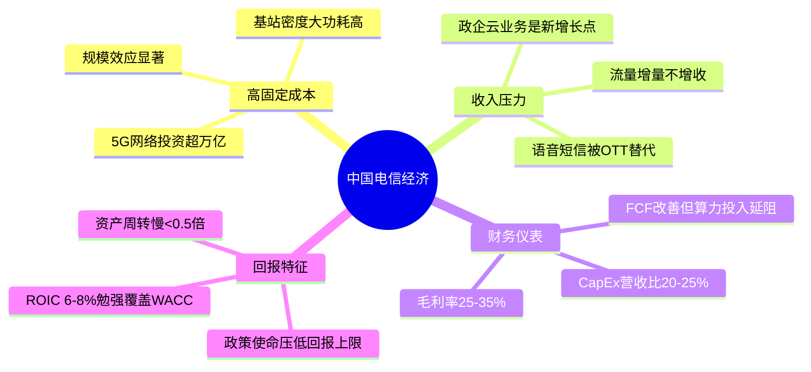
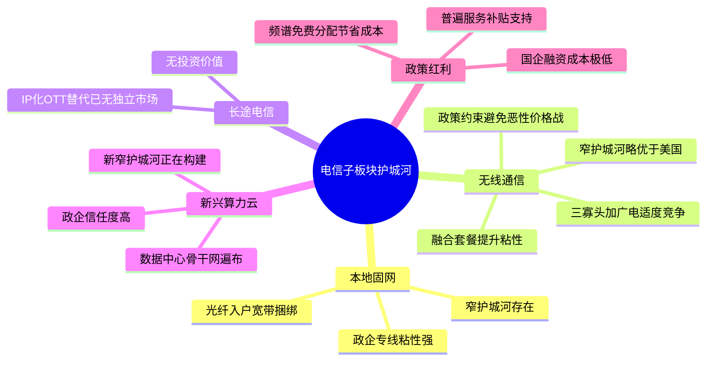
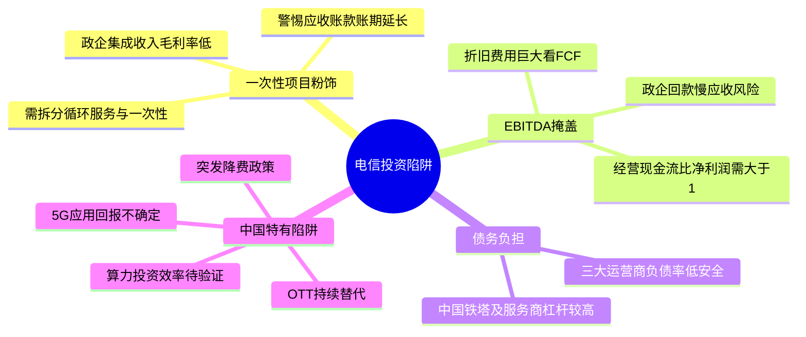
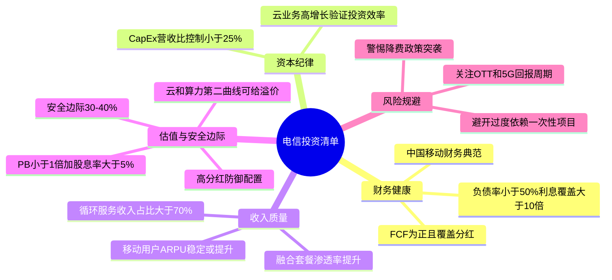

# 《股市真规则》第二十二章：电信业 —— 2026年中国版重估

**核心判断前置：**
原书第二十二章（美国视角）对电信业的定位——“高进入壁垒但低资本回报，产品商品化，护城河窄且在弱化，投资需极厚安全边际”——在中国**本质完全成立，但市场结构、政策角色和增长动力截然不同**。
中国电信业由**三大国有运营商（中国移动、中国电信、中国联通）加中国广电**寡头垄断，竞争烈度受政策调控，5G/算力/云业务正试图打开第二增长曲线，但仍难逃“重资产苦工”底色。以下逐块对照。

## 一、电信经济——中国版“高固定成本+政策定价+管道化”

### 1.1 建网成本的延续与变化
| 原书特征（美国） | 中国2026对应 |
|-----------------|------------|
| 前期资本极其昂贵 | 同样。5G基站密度更大、功耗更高，单站成本数倍于4G；中国建成了全球最大5G网络（超300万基站），累计投资超万亿元。 |
| 固定成本极高，必须摊到足够多用户 | 同样。三大运营商用户总数超17亿（含移动、宽带、物联网），规模效应显著。但增量用户红利结束，转向存量经营。 |
| 毛利率约20-30% | 中国运营商毛利率在25-35%（移动略高，联通略低），高于美国原书给的参考带，因人力成本较低且网络折旧政策不同。但趋势承压。 |
| 资产周转慢，ROIC受压 | 同样。总资产中网络设备/频谱/数据中心占大头，资产周转率低于0.5倍，ROIC通常在6-8%，勉强覆盖WACC。 |

**中国核心矛盾**：
- **营收增长乏力，流量管道化**：移动数据流量收入增速放缓，DOU（单用户月流量）仍在增长但单价持续下降，“增量不增收”困境加剧。
- **政策使命与商业回报冲突**：承担普遍服务、提速降费、算力网络建设、数据安全等准公共职能，拉低潜在利润。
- **资本开支周期**：5G投资高峰已过（2023-2025年逐步下降），资本开支占营收比从高峰约30%向20-25%回落，FCF有望改善，但算力/智算中心新投资重新拉高需求。

### 1.2 中国电信业的核心财务仪表
| 指标 | 原书及格线 | 中国2026年典型水平 |
|------|-----------|---------------------|
| 毛利率 | 20-30% | 25-35%（移动高，联通低） |
| CapEx/营收 | 高，但需FCF仍正 | 20-25%，处下行通道，但算力投资延缓下降 |
| FCF（CFO - CapEx） | 应长期为正 | 三大运营商FCF均正，且因5G投入高峰已过而改善，但算力网投资可能重新消耗 |
| 资产负债率 | 谨慎为宜 | 移动负债率极低（<35%），电信/联通约45-50%，远优于美国原书红线（负债/EBITDA<3x） |
| ROIC | 很难高 | 6-8%，接近WACC，真正超额回报有限 |

## 二、电信业的竞争优势——原书四板块的中国映射

### 2.1 长途电信——中国已基本无独立长途市场
原书认为长途电信“基本无护城河”。在中国，**长途电话早已被IP化、微信语音等OTT完全替代**，传统长途业务收入萎缩殆尽，不具备独立投资意义。运营商当前的长途仅作为融合套餐的一部分存在。

### 2.2 本地电话（固网）——中国版“宽带入户+政企专线”替代原书“本地环路”
- 原书“本地环路控制”在中国体现为**光纤到户（FTTH）和政企专线**，但不再是高利润的语音月租，而是以宽带捆绑销售的流量入口。
- 固网宽带市场饱和，ARPU约30-40元/月，增速缓慢；但**政企专线和云网融合服务**有较强粘性和转换成本，形成一定窄护城河。
- 中国广电入局固网宽带，但份额极小，竞争格局尚属良性。

**结论**：本地固网（宽带+专线）护城河窄但存在，主要来自入户光纤所有权和政企关系。

### 2.3 无线（移动通信）——中国版“三寡头+广电”的适度竞争
- 原书认为无线“近乎零定价权”，中国曾出现类似价格战（4G时代不限流量套餐），但**监管层叫停恶性竞争、引导高质量发展**，使定价权部分恢复。
- 携号转网普及后，用户切换成本降低，但**融合套餐（手机+宽带+权益）和家庭账户**构筑一定粘性。
- 5G套餐ARPU约70-80元，高于4G末期，但增长见顶。
- **中国无线通信的护城河比美国原书描述的略宽**，得益于政策约束竞争和融合捆绑，但仍属窄护城河。

### 2.4 乡村运营商——中国版“普遍服务义务+数字乡村”
原书认为乡村运营商竞争少、毛利高。在中国，乡村覆盖更多是**政策义务**（电信普遍服务试点），由财政补贴+运营商共同推动，本身利润贡献低。但数字乡村、智慧农业等政企项目带来增量收入。

**中国特有的护城河补充**：
- **数据中心/算力网络**：三大运营商拥有遍布全国的数据中心和骨干网络，在云市场（移动云、天翼云、联通云）中增长迅猛，政企客户信任度高，正构建新的窄护城河（转换成本+合规信任）。
- **频谱牌照**：5G频谱由政府分配而非拍卖，节省了巨额资本开支（对比美国拍卖超千亿美元），构成政策红利。
- **国企背景+系统重要性**：融资成本极低（约2-3%），抗风险能力强。

## 三、常见投资陷阱——中国版的变种

### 陷阱①：一次性容量销售/政企项目粉饰增长
中国运营商政企收入占比快速提升（云计算、大数据、物联网等），但部分项目为**一次性系统集成/硬件销售**，毛利率低且不可持续。需拆分循环服务收入 vs 一次性项目收入。

### 陷阱②：用EBITDA掩盖折旧和应收
原书警告完全适用。中国运营商折旧费用巨大，EBITDA虽高，但需看**FCF和经营现金流/净利润比率**。同时关注政企项目应收账款账期延长风险（部分地方政府/中小企回款慢）。

### 陷阱③：债务负担
中国三大运营商资产负债率远低于美国同行（移动<35%），但**中国铁塔**和部分通信服务公司杠杆较高，需区分对待。主要风险不在于负债率，而在于**资本开支效率**：投入算力网络后能否产生对应回报。

**中国特有陷阱**：
- **政策降费风险**：虽已过最严厉周期，但政府对中小企业宽带资费、国际漫游费等仍有下调要求，可能突发冲击。
- **OTT替代**：微信等OTT应用持续侵蚀语音和短信收入，虽已不构成主要矛盾，但仍压缩传统增值业务。
- **5G应用回报不确定**：5G网络建设完成后，尚未出现杀手级消费应用，主要价值在政企（工业互联网），回报周期长。

## 四、成功的电信公司特点——2026中国版核查清单

| 原书特点 | 中国2026对应 |
|----------|------------|
| ① 稳固的财务健康 | 资产负债率<50%，利息覆盖倍数>10x（移动极高），FCF持续为正且能覆盖分红派息。中国移动是财务健康典范。 |
| ② 有维护/升级网络的资金且资本纪律 | CapEx/营收控制在20-25%以下，且算力/云投资能带来双位数收入增长，而非仅铺摊子。电信/移动的云业务增速是验证点。 |
| ③ 关注毛利/固定成本纪律 | 毛利率稳定或微升（25-35%），EBITDA率稳中有升。 |
| ④ 无线价格战压力清醒 | 移动用户ARPU稳定或提升（而非靠降价抢份额），融合套餐渗透率提升。 |
| ⑤ 安全边际加倍 | 中国运营商分红率较高（移动/电信/联通股息率5-8%），估值应参考P/B（1倍上下）和股息率，安全边际在低估值+高分红下较厚。 |

**中国加分项**：
- **云和算力第二曲线**：移动云、天翼云收入增速超30%，且政企市场客户粘性强，可给予一定估值溢价。
- **数据资产与AI赋能**：运营商拥有海量用户数据和网络数据，可内部AI应用降本增效，或对外提供数据服务。
- **低融资成本与政策支持**：央国企身份降低经营风险，在数据要素、东数西算等国家战略中占据核心位置。

## 五、结论——电信不是不能投，而是要极低预期+极厚安全边际

在中国，三大运营商是典型的“高壁垒但低回报”资产，适合追求稳定分红和防御性配置的投资者，不适合期望高成长。

核心逻辑：
- 护城河：寡头垄断、入户光纤/基站网络、频谱牌照、政企关系，构成**窄但相对稳定**的护城河，优于美国原书描述的“无护城河”状态。
- 回报上限：受制于政策定价、管道化、OTT替代，ROIC难超10%，长期净利润增速接近GDP。
- 投资姿态：在**低估值（P/B<1x，股息率>5%）+资本开支下降周期+云业务快速增长**阶段介入，获取分红加适度重估收益。安全边际可略低于原书40-60%的要求（因中国运营商财务更健康），但仍需**30-40%的估值折扣**。

## 思维导图（按阅读逻辑拆分）

### 图1：中国电信经济——重资产+政策定价+管道化

### 图2：中国电信子板块护城河

### 图3：投资陷阱——中国版变种

### 图4：成功电信公司特点与投资清单

# 第二十二章　电信业（Telecom）——高壁垒进、低回报出：资本密集+商品化+监管=最不友好的护城河猎场

> **章首定位（原书 p.263 / 中信畅销版 ISBN 9787508686431）**
>
> 多尔西开篇把电信行业的"矛盾"钉死：
>
> > **电信公司的资本收益率很一般（而且在下降），竞争优势正在恶化甚至不复存在；这些公司的未来依赖规则制定者（管制/政策），而且它们持续投入大量资金仅仅为了保住已有的市场地位。**
>
> 一句话翻译：**建网络要"卡车装的钱"（高CapEx/高固定成本），但产品越来越像日用品（分钟/GB越来越便宜）——所以电信业天然是"重资产苦工"，不是"轻资产印钞机"。**

---

## 章内目录骨架（原书：p.263→267）

text
第二十二章 电信业
├── 一、电信经济（p.263） ← 商业引擎：固定成本巨兽 / 毛利率/资产周转/必须循环收入
├── 二、电信业的竞争优势（p.264） ← 本地网残余壁垒 vs 长途/无线≈无护城河+价格战
│ ├─ ① 长途电信（Long-distance）：基本无护城河
│ ├─ ② 本地电话（Local Bell / ILEC）："较强但仍在弱化"的窄护城河
│ ├─ ③ 无线（Wireless）：近乎零定价权/极易替代＝护城河极难
│ └─ ④ 乡村运营商（Rural ILEC）：竞争较少→毛利反而更高，但仍不是"宽护城河"
├── 三、常见投资陷阱（p.265–266） ← 一次性容量销售伪装增长/盯EBITDA忘了应收/债务炸弹
├── 四、成功的电信业公司的特点（p.266）
├── 五、结论（p.267）
└── 投资者清单：电信业（p.267）

> 原书给这章的情绪不是"不能投"，而是：
> **如果你进电信，必须的安全边际比大多数行业更厚——因为它赚的是"监管特许的租金残渣"，不是结构性超额利润机器。**

---

## 一、电信经济（p.263）——为什么"高门槛 ≠ 高回报"

### 1.1 建网成本="用卡车装的钱"

| 特征 | 原书表述精神 | 对你的含义 |
|------|-------------|-----------|
| **前期资本极其昂贵** | 建立/维护固定线路或无线网络都**花费极其昂贵的费用**→CapEx长期吃现金 | FCF质量必须盯死：不是"净利正"就行，是CapEx后剩多少 |
| **固定成本极高 → 必须摊到足够多用户** | 电信是经典的**高固定成本/低边际成本**生意：多服务一个用户≈几乎不增加成本，但少用户=单位成本炸 | 覆盖率/用户基数=生死线；**资产周转缓慢**（PPE/总资产大）→ROIC被分母压 |
| **成熟公司毛利率预期** | 原书给的量级：**成熟期电信公司毛利率 ≈ 20%–30%**（固定线路/无线均可参考）| 低于这带→很难赚到吸引人的投入资本收益率（ROIC）|

> 原书一句话：
> **达不到这种（20-30%毛利）水平，要赚到有吸引力的ROIC极其困难——都是因为资产周转缓慢造成的。**

---

### 1.2 为什么"进入壁垒高"≠"超额利润"

| 直觉 | 现实（原书） |
|------|------------|
| "建网要几百亿＝没人进得来＝垄断租" | 进来的确少，但**产品（分钟/GB/接入）被技术+政策把价格一路打下去**→你守得住网，守不住定价权 |
| "我付高溢价买龙头" | 龙头更容易被**降费/OTT替代/携号转网**压毛利→高CapEx+低定价弹性=回报被榨 |

> 原书原话精神（多处一致）：
> **"即使从前以较强的竞争优势自夸的公司，比如控制本地电话网络的公司，也要面对来自新进入者（有线/无线/VoIP/政策开放）的日益增强的竞争。"**

---

### 1.3 你盯的"电信三表最窄口径"

| 指标 | 看什么 |
|------|--------|
| **毛利率（Gross Margin）** | 20–30%带是成熟电信的"及格线"；掉=定价压力/成本失控 |
| **CapEx/营收** | 电信永远高（维护网+频谱+升级）→看是否**CapEx可控且FCF仍正** |
| **资产周转（收入/资产）** | 偏慢→ROIC=毛利×周转×杠杆；周转慢=更靠杠杆才能抬ROE（危险） |
| **FCF = CFO − CapEx** | 最终裁判：很多电信"净利正、FCF薄/负"→借债补 |

---

## 二、电信业的竞争优势（p.264）——按子板块拆：本地还有点残留、长途/无线基本无

### 2.1 ① 长途电信（Long-distance）：基本**没有**护城河

| 项目 | 原书结论 |
|------|---------|
| 壁垒 | 连接主要城市的网络多、竞争激烈；声誉/客户基础有一点（AT&T例），但**竞争威胁已很难收高价** |
| 回报 | **怀疑能否赚到与资本成本相当的ROIC**→"不可能是有投资价值的公司"（原书语气） |

> 原书原句精神：**长途电信运营商很少有或大多情况下没有竞争优势。**

---

### 2.2 ② 本地电话公司（Local Bell / ILEC）：**较强但仍"窄/弱"、且在腐蚀**

| 优势来源 | 原书表述 |
|----------|---------|
| **控制本地环路/接入点（last mile）** | 历史上=事实特许/自然垄断→能收access charge/月租 |
| **服务能赚到较高毛利 + 巨额现金流** | 原书：本地电话网络"能赚到相当高的毛利，并产生巨额现金流" |
| 但 | **永远赚不到超额资本收益**→所以"强的竞争优势"也只能放**窄护城河**；而且被无线/有线/VoIP/政策降费持续啃 |
| 升级压力 | 贝尔系要从传统语音进全套（宽带/视频/数据）→资本需求不降→"基于贝尔子公司提供新产品潜力的投资决定需要认真考虑安全" |

> 原书收束：本地电话≈**"受管制特许的现金牛，不是复利城堡"**

---

### 2.3 ③ 无线（Wireless）：**近乎零定价能力 = 护城河极难**

| 项目 | 原书判词 |
|------|---------|
| 产品同质化 | "对大多数消费者，运营商从外表看是一样的→只能价格竞争" |
| 利润展望 | **无线业务可以说是自由竞争的教科书式案例——近乎零定价能力和很容易替代的服务** |
| 例外 | Nextel的"直接通"（push-to-talk）曾实现某种多样化→但原书也补："将来也很可能被竞争对手升级类似性能侵蚀掉"→**没有无线运营商有持久竞争优势** |

> 原书原句精神（web2逐段复述一致）：
> **大多数消费者看运营商差不多＝切换成本极低＝价格战；所以无线是"商品化苦工"的典型。**

---

### 2.4 ④ 乡村运营商（Rural ILEC）：竞争少反而毛利高，但≠宽护城河

| 项目 | 原书 |
|------|------|
| 优势 | 市场小→大厂懒得进→竞争相对不足→**经营毛利率常 >30%，比贝尔系高约10pct**；财务稳定性更好→"很少廉价交易" |
| 局限 | 仍是**窄/本地化**，增长天花板明显；也逃不掉行业降费/技术替代大趋势 |
| 定位 | 更像"小现金牛"：可看，但**不是宽护城河成长故事** |

---

## 三、常见投资陷阱（p.265–266）——电信版"伪装温床"

### 陷阱①：把"一次性网络容量销售"当可持续增长

> **例：奎斯特（Quest）花数十亿建长途网→幻想高增长→但增长更多来自"基础网络容量的一次性销售收入"（卖暗 fiber/容量给批发），远超服务合同循环收入。一旦容量需求枯竭→收入下滑+毛利萎缩→债务撑不住→被迫卖资产。**

- 你盯的：**循环收入（recurring service revenue）vs 一次性容量/设备销售**——只有前者是"生意"，后者是"清库存"
- 红灯：收入增但**服务合同 backlog 不增**、或应收飙升（容量卖给谁但钱没到）

---

### 陷阱②：用EBITDA当神（原书警告）

> **EBITDA＝营业利润＋折旧&摊销**（常用于电信因为折旧大）→能看"近似运营现金生成能力"，但：
> - **EBITDA毛利率下降＝竞争压力/低效的早期信号**
> - **EBITDA会遮盖应收膨胀**（利润表好看、CFO被应收吃）→应收增速>>收入增速在这里尤其毒
> - **EBITDA≠现金流**（CFO才是）

原书实操：看 **EBITDA/营收趋势**（稳?↓?）+ 同时一定看 **CFO/净利润** + **应收**

---

### 陷阱③：膨胀的债务负担（Debt Bomb）

| 原书给的简易警戒线 | 用法 |
|-------------------|------|
| **负债 ÷ EBITDA** | **> 3× 就该警惕**（高CapEx行业更怕利息+再融资风险） |
| 同时看 | 到期洪峰 vs CFO/FCF；AT&T例：借很多债推有线电视升级→最终**以远低于买入价出售有线业务** |

> 原书原句精神：**承担沉重债务寄希望于打造高营业额＝极其有风险；成熟行业公司高负债扩业务＝自找麻烦。**

---

## 四、成功的电信业公司的特点（p.266）——原书"能碰"的最低门槛

> 电信不是"不能投"，而是**必须过三关：网络能养自己（FCF）＋ 负债不炸 ＋ 你买的不是"技术故事"而是"受控回报+折扣"**

| # | 特点（原书） | 你写进核查卡的硬动作 |
|---|------------|---------------------|
| ① | **稳固的财务健康（Strong financial health）** | FCF 3年平均：正□ 微正□ 负（负→靠债?□红灯）；利息覆盖；负债/EBITDA <?3 |
| ② | **有维护/升级网络的资金（且资本纪律）** | CapEx/营收是否失控；升级是否"为生存必须"还是"帝国建造"；FCF能盖CapEx+股息？ |
| ③ | **关注毛利/固定成本纪律** | 毛利率是否守得住20-30%带；EBITDA/营收趋势 |
| ④ | **无线价格战压力清醒** | 无线占比高？→更偏商品化→要求更大安全边际；本地固网占比高？→盯政策降费节奏 |
| ⑤ | **安全边际加倍**（隐含） | 原书清单精神：所有估值都要**认真考虑资金安全**；电信=窄护城河/高杠杆/周期→折扣 40–60%级更合适 |

---

## 五、结论（p.267）——把"电信值得不"收束成一句话

> **规则和新技术变化使电信竞争更激烈；尽管某些领域（本地/乡村）比长途/无线稳，但整体护城河窄且在弱化；如果你投，只碰财务扎实+低负债+循环收入主导+大折扣——否则让它在观测名单外。**

---

## 投资者清单：电信业（p.267·原书浓缩）

- ✅ **电信=资本密集/高固定成本/低边际成本→毛利率≈20-30%及格；资产周转慢→ROIC天然受压**
- ✅ **护城河分层**：本地电话（窄/弱但残存）> 乡村ILEC（毛利高但小/天花板）≫ 长途（≈无）≈ 无线（同质化/价格战/极低切换成本＝几乎无持久护城河）
- ✅ **盯循环收入vs一次性容量销售**（卖暗 fiber/批发＝不可靠增长）
- ✅ **EBITDA有用但危险：看趋势 + 必须配 CFO/净利润 + 应收增速**
- ✅ **债务红线：负债/EBITDA >3× 警惕；到期洪峰+CFO弱＝再融资风险**
- ✅ **成功特征：FCF正/负债可控/毛利率守带/升级CapEx纪律**
- ✅ **安全边际要比"宽护城河"行业厚得多（40–60%）**：高CapEx+商品化+政策降费=回报上限低、下行风险高

---

## Appendix：第二十二章"电信核查卡"（一键粘进 Excel/Notion/飞书）

text
【公司】___________ 【主营】□本地固网(ILEC/Bell系) □长途 □无线() □乡村RLEC □混合
【日期】____
── 1) 经济体检 ────────────────────────────────────
毛利率 __% (20-30%带?□及格 <20%?□警)
EBITDA/营收 __% 趋势：↑□ →□ ↓□（↓=压力）
CapEx/营收 % FCF=CFO-CapEx=__ 正?□微□负(靠债?🚨)
── 2) 收入质量（一次性 vs 循环）────────────────────
循环服务收入占比 __%（≥70%?□稳）
一次性容量/设备销售占比 __%（>20%?□疑）
AR增速 __% vs 收入 __%（AR跑快?□红灯）
── 3) 杠杆闸 ─────────────────────────────────────
负债/EBITDA __×（>3?🚨） 利息覆盖 __×
到期洪峰：年约$__ 现金+可动用额度覆盖?□够 □勉强 □不够
债务用途：维护网□ 升级必需□ 帝国建造/高价并购□(警)
── 4) 护城河现实检验 ─────────────────────────────
壁垒：□本地环路控制(窄但残存) □乡村低竞争(小现金牛) □无线同质化(无→要大折)
政策降费压力：□高 □中 □低(但长期都存在)
无线收入占比 __%（越高=越商品化=折扣↑）
verdict: □可进(财务稳+负债安+折扣>40-50%) □等(债务/AR) □淘汰(理由:_______)