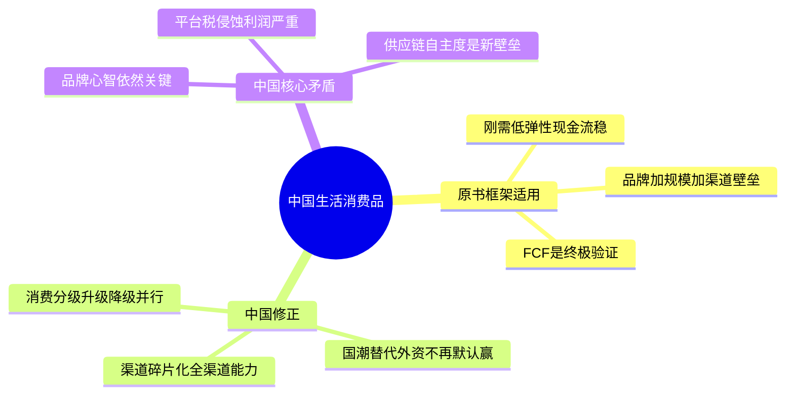
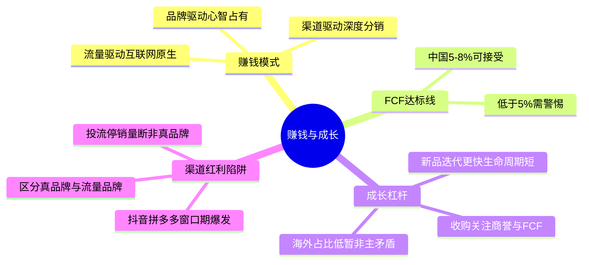
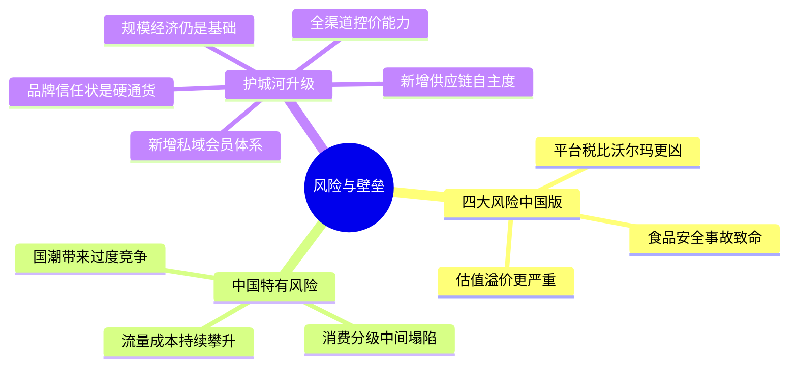
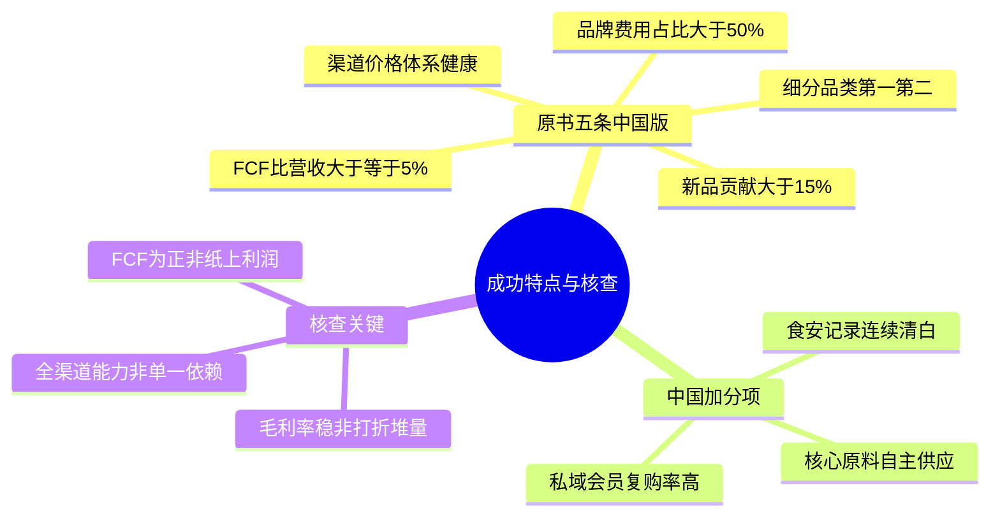
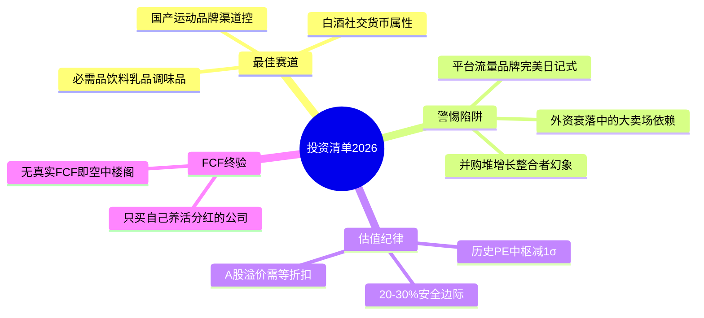

# 《股市真规则》第二十三章：生活消费品行业 —— 2026年中国版重估

**核心判断前置：**
原书第二十三章（美国视角）对生活消费品行业的定位——“成熟期+品牌定价权+规模成本优势+渠道霸权→稳定FCF，需等折扣”——在中国**本质成立，但渠道结构、品牌格局和增长路径完全改写**。中国消费品市场正经历**渠道碎片化（内容电商+即时零售）、国潮品牌替代（外资不再是默认赢家）、消费分级（升级与降级并行）**三重重塑。以下逐块对照。

## 一、中国生活消费品公司是怎样赚钱的——通路已彻底改变

### 1.1 原书"制造→零售→消费者"模型在中国的演变
| 原书通路（美国） | 中国2026对应 |
|------------------|------------|
| 超市/大卖场为主 | 渠道极度碎片化：线下（便利店+社区超市+会员店）+线上（抖音/快手/拼多多/天猫/京东）+即时零售（美团闪购/京东到家） |
| 零售商集中度高（沃尔玛等） | 线下CR3远低于美国，但线上平台集中度极高（阿里+京东+拼多多+抖音≈80%+）；快消品对平台的依赖度持续上升 |
| 饮料浓缩液/装瓶分离 | 同样适用（可口可乐/百事在华有装瓶伙伴），但中国本土饮料品牌（农夫山泉、元气森林）以自主生产为主 |

### 1.2 中国消费品真正的利润来源
- **品牌心智+全渠道渗透**：单一渠道优势已不够，必须同时覆盖**货架电商+内容电商+线下分销+即时零售**四个场
- **FCF/营收这个原书黄金指标在中国仍然有效**，但达标线需调整：美国8-10%是优秀，中国5-8%可接受（因渠道费用更高）；低于5%需警惕，负值即红旗

### 1.3 中国消费品的三类生意模式
| 模式 | 代表 | 特征 |
|------|------|------|
| 品牌驱动（心智占有） | 茅台、农夫山泉、伊利 | 强品牌+渠道控制力，毛利率50%+，FCF充沛 |
| 渠道驱动（深度分销） | 康师傅、统一、达利 | 全国分销网络是壁垒，但毛利率偏低（30-40%），受渠道变革冲击 |
| 流量驱动（互联网原生） | 完美日记、元气森林初期 | 爆发快但品牌沉淀浅，护城河薄弱，毛利率虽高但营销费用侵蚀殆尽 |

## 二、成长策略——中国版四大杠杆的变种

### 2.1 推新品/产品线延伸
- **原书逻辑成立，但中国迭代更快**：新品生命周期从3-5年缩短为6-18个月，要求更高研发转化效率
- **中国特有优势**：口味/包装的本土化创新极快（如无糖茶、中式养生水），先发优势可带来短暂品类红利
- **核查**：新品收入占比>15%+且毛利率不低于老品（证明新品不是靠打折堆量）

### 2.2 收购
- **中国本土并购以"品类补全+渠道整合"为主**，纯财务并购较少
- **红旗**：商誉/总资产>30%+连续并购后收入增长但FCF下滑=整合失败前兆

### 2.3 削减费用
- 原书警告"砍品牌费=自残"在中国**同样成立，且更隐蔽**：部分公司砍的是渠道维护费而非广告费→经销商流失→渠道崩塌
- 看**销售费用率+经销商数量**的同步性：费用率降但经销商也在降=红旗

### 2.4 海外销售
- 中国消费品出海仍处早期（安踏、名创优品、泡泡玛特有一定海外规模），**多数公司海外收入占比<10%**，汇率风险暂非主要矛盾
- 长期：东南亚/非洲市场是必争之地，但需10年+视角

### 2.5 中国独有的第五种增长：渠道红利（短暂但暴烈）
- 抖音/快手/拼多多每一轮新渠道的流量红利窗口期，可让新品牌短期内爆发（如白牌零食、新式茶饮），但**这种增长不可持续，也不是护城河**——渠道红利消退后，裸泳者浮出水面
- **区分**：真品牌（内容平台复购不靠投流） vs 流量品牌（投流停→销量断）

## 三、不希望看到的风险——中国版四大+三个特有

### 3.1 原书四风险对照
| 原书风险 | 中国2026对应 |
|----------|------------|
| 零售商实力增长 | 更剧烈：电商平台（阿里/京东/拼多多/抖音）的议价权远超沃尔玛，流量费+佣金+促销补贴吃掉品牌方毛利的15-25% |
| 诉讼风险 | 中国相对温和，但食品安全事故（如添加剂超标、异物）可一夜摧毁品牌 |
| 外汇风险 | 暂非主要矛盾（出海尚早） |
| 估值哄抬 | 更严重：A股消费品龙头（白酒、调味品）长期享受"确定性溢价"，PE/历史中枢需重新建立基准 |

### 3.2 中国特有风险
- **平台流量成本攀升**：品牌对平台的依赖度越高，利润被平台税的蚕食越确定
- **消费分级与渠道碎片化**：高端与大众两极分化，中间市场塌陷；品牌需要同时服务"拼多多9.9包邮"和"山姆会员店精英"，战略矛盾
- **国潮替代与外资退潮**：大量本土新品牌崛起（东方树叶、简爱酸奶），传统外资品牌（宝洁、联合利华）在中国不再是默认首选；但国潮也带来"过度竞争+同质化"

## 四、竞争优势——中国版三条壁垒+两条新壁垒

### 4.1 规模经济
- **成立，且在中国更重要**：供应链规模决定成本优势（比如伊利/蒙牛的原奶控制、农夫山泉的水源地+生产线密度），在价格战成为常态的中国市场，规模是活下去的前提

### 4.2 强大品牌
- **成立，但品牌定义需重写**：在中国，品牌不只是"知名度"，更是**信任状**（三聚氰胺后/添加剂恐慌后，食品安全信任是硬通货）
- 真正的中国强品牌：茅台（社交货币+收藏）、农夫山泉（水源信任）、伊利/蒙牛（乳品安全）、海天（调味品默认选项）

### 4.3 分销渠道关系
- **成立，但内容已变**：过去是"全国经销商网络+终端铺货率"，现在变为**全渠道数字化分销能力**（同时管理线上价格体系+线下窜货+即时零售库存）
- 能管住"线上低价乱价+线下经销商利益冲突"的公司，才是真渠道壁垒

### 4.4 新增壁垒：私域与会员体系
- 原书未涉及，但在中国：头部品牌正通过私域（企业微信/小程序/会员体系）构建"直达消费者的数字护城河"
- 伊利/蒙牛的会员体系、农夫山泉的"芝麻店"、茅台的i茅台APP，都是绕过平台、掌控客户关系的新壁垒

### 4.5 新增壁垒：供应链纵深（原料+生产）
- 农夫山泉的水源地独占、茅台的特定产区、安井的速冻供应链——在中国，对上游的控制力比下游渠道更稀缺、更持久

## 五、成功的生活消费品公司特点——2026中国版

| 原书特点 | 中国2026对应 |
|----------|------------|
| ① 支配性市场份额 | **细分品类第一/第二**（非全品类）；且市场份额稳定或上升（靠品牌，非靠打折） |
| ② 强大自由现金流 | FCF/营收≥5%（中国标准）；CFO/净利润>0.8（回款真实）；CapEx/营收偏低（轻资产品牌） |
| ③ 对品牌信心的建立 | 销售费用中品牌费用占比>50%（非纯促销/打折）；不因季度业绩波动大幅削减品牌投入 |
| ④ 创新/新品成功率 | 近3年新品贡献>15%+新品毛利率≥老品；非靠低价铺货冲量 |
| ⑤ 渠道掌控力 | 能管理全渠道价格体系（线上线下不倒挂）；经销商流失率<5%；渠道库存健康（不压货冲季报） |

**中国加分项**：
- **私域会员规模与复购率**：微信小程序/会员池>500万+复购率>40%+私域收入占比>10%
- **供应链自主度**：核心原料自供/产地锁定（如水源、牧场、配方专利）
- **食品安全记录清白**：连续3年无重大召回/监管处罚

## 六、中国生活消费品投资清单（2026）

- ✅ **本质不变**：刚需+品牌+规模+渠道=稳定FCF；成熟期增长慢，回报靠分红/回购，不是十倍股。
- ⚠️ **渠道已变**：中国消费品必须评估"全渠道能力"，单一渠道依赖（特别是严重依赖抖音/拼多多投流）是致命风险。
- ✅ **最值得看的细分**：必需品饮料（农夫山泉）、乳品（伊利/蒙牛）、调味品（海天）、白酒（茅台/五粮液）、国产运动（安踏）——这些在品类中有心智+供应链+渠道控制力的龙头。
- ⚠️ **警惕三类陷阱**：平台流量品牌（完美日记式）、外资撤退中的衰落龙头（大卖场依赖型）、靠并购堆增长的"消费品整合者"。
- ✅ **估值纪律**：A股消费品常年溢价，安全边际需从"历史PE中枢-1σ"或"与十年期国债利率倒数的比较"中寻找，至少等20-30%折扣。
- ✅ **FCF是终极验证**：不产生真实FCF的"品牌"只是空中楼阁。

## 思维导图（按阅读逻辑拆分）

### 图1：中国消费品行业——原书框架与修正

###  图2：中国消费品赚钱模式与成长策略

###  图3：中国消费品风险与壁垒

###  图4：成功公司特点与核查清单

###  图5：2026年中国消费品投资清单

# 第二十三章　生活消费品行业（Consumer Staples / Consumer Goods）——"每天要买的东西"里的护城河，不在产品，在品牌+规模+货架

> **章首定位（原书 p.269 / 中信畅销版 ISBN 9787508686431）**
>
> 开篇一句定调（多尔西原话精神）：
>
> > **打开你家的冰箱、杂物室——看看那些生活消费品（汰渍、奥利奥、可口可乐、高露洁……），很多就是值得看的候选；它们在经济低迷期是很好的投资避风港，因为即使衰退，人还是要刷牙、洗脸、喝饮料、买肥皂。**
>
> 但紧接着把话说硬：
>
> > **这个行业已进入成熟期+高度整合，大多数增长只能来自"抢份额/并购/削减费用/出海"——所以你赚的不是"爆发故事"，而是"品牌定价权 + 规模成本优势 + 渠道霸权 → 稳定FCF"；而且因为大家当它避风港，估值常被哄抬到不便宜——你需要更大的安全边际（≈20–30%）。**

---

## 章内目录骨架（原书：p.269→277）

text
第二十三章 生活消费品行业
├── 一、生活消费品公司是怎样赚钱的（p.269） ← 传统制造→零售商通路；饮料浓缩液/装瓶分离模型
├── 二、成长的重要策略（p.270） ← 成熟市场能用的四种增长杠杆（都有限、都有坑）
│ ├─ ① 推新品抢份额
│ ├─ ② 收购其他消费品公司
│ ├─ ③ 削减营业费用（短期甜头，长期毒药）
│ └─ ④ 海外销售（增长+货币风险）
├── 三、生活消费品行业不希望看到的是什么（p.272）← 四大风险：零售霸权/诉讼/汇率/被哄抬的估值
├── 四、生活消费品行业的竞争优势（p.273） ← 三条真壁垒：规模经济/强品牌/分销渠道关系
├── 五、成功的生活消费品公司的特点（p.275）
├── 六、结论（p.277）
└── 投资者清单：生活消费品行业（p.277）

> 一句总纲：**Content is everywhere, but shelf space + mental real estate = the moat.**（产品满地都是，但"在消费者脑子里+在超市货架上"才是城堡。）

---

## 一、生活消费品公司是怎样赚钱的（p.269）

### 1.1 核心生意模式：制造 → 卖给零售商 → 卖给消费者

| 项目 | 原书描述 |
|------|---------|
| **通路结构** | 通过**超市、大卖场/大型市场零售商（mass merchandisers）、仓储会员店、便利店**把产品卖给最终消费者 |
| **品类范围** | 食品行业、饮料行业、家庭和个人用品行业、烟草等 |
| **刚需属性** | 需求**极不弹性**（rain or shine）——衰退期砍的不是牙膏/洗发水/主食，而是车/旅游/奢侈品→现金流更稳 |

> 原书原句精神（web7 逐段复述一致）：
> **"即使是在经济衰退的时候，人们还是一样需要牙膏和洗发水。"**

### 1.2 饮料（不含酒精）的特殊模型：浓缩液/糖浆 → 装瓶伙伴

> 可口可乐/百事这类：**制造浓缩液+糖浆 → 卖给装瓶伙伴（bottlers/distributors）去混合、包装、分销**  
> 母公司的资本密集度更低（更像"品牌+配方+浓缩液"生意），重资产更多落在装瓶网络上。

### 1.3 钱长什么样（最简KPI）

- 毛利结构通常**宽但不暴利**（品牌溢价能守住，但原料/包装/运费/零售返利会压）
- 真正的荣耀指标是 **FCF/营收**（原书给的经验带：**≈8–10%+ 算健康信号**→说明品牌溢价+规模效率+资本纪律成立）

---

## 二、成长的重要策略（p.270）——成熟市场=增长选项少，且每个选项都带刺

> 原书给出一个非常冷的结论：**大多数行业已被少数超大公司绝对份额控制**（例子：美国啤酒三巨头>80%份额；箭牌口香糖≈60%份额）→所以"高增长"往往不是organic expansion，而是下面四种有限玩法。

| # | 策略 | 原书态度 | 坑/你盯的 |
|---|------|---------|----------|
| ① **推新品/产品线延伸（从对手抢份额）** | 唯一"较干净"的内生增长；但**很多新品失败**→要看**成功率**（不只"推了20个SKU"） | 新品收入贡献占比；失败SKU是否悄悄减值/促销清仓 |
| ② **收购其他消费品公司** | 原书警告：并购成功率"大约一半"；大收购更难彻底摸清；常为"为增长而增长" | 商誉/总资产是否膨胀；并购驱动占收入增长%是否过高；FCF是否被整合成本吃 |
| ③ **削减营业费用（SG&A压降）** | 短期利润↑→但**过度砍广告/研发/品牌维护 = 掏空长期品牌价值** | 看广告/品牌支出率趋势；是否"坏季度就砍品牌费"→原书点名：这是耗尽品牌的行为 |
| ④ **海外销售（International expansion）** | 增长引擎，但带来**外币汇兑风险**；多数公司用对冲减轻 | 外汇敞口（海外收入%）；对冲政策/衍生使用是否激进 |

> 原书一句最值钱的（p.270-272语境）：
> **"偶尔的重组可能有助于提高效率降低成本，但如果公司常规地计提重组费用，并依赖这种费用削减策略推动业务——对这样的公司要小心。"**[6](@ref)

---

## 三、生活消费品行业不希望看到的是什么（p.272）——四大风险

| # | 风险 | 原书表述精神 | 你盯的硬证据 |
|---|------|-------------|-------------|
| ① **零售商实力增长（Power of Retailers）** | 沃尔玛/大卖场/会员店集中度→**对制造商定价权形成压制**（账期、上架费、促销补贴、自有品牌Private Label抢货架） | 对Top3零售商依赖度；毛利率被零售商返利/补贴压降趋势；自有品牌占比↑是否吃核心SKU |
| ② **诉讼风险（Litigation）** | 尤其烟草/部分食品添加剂相关→巨额赔偿可炸现金流 | 附注"或有负债/诉讼进展"；行业是否自带长期诉讼尾巴 |
| ③ **外币汇兑风险（Currency / Foreign Exchange）** | 海外占比大→汇率波动直接打利润 | 海外收入%，对冲披露；EPS对汇率敏感度 |
| ④ **昂贵的股票（High Valuations）** | **防御性避风港=常被哄抬**：经济低迷时资金抱团→P/E/PB高于合理→你必须等折扣 | 当前P/E vs 自身历史带；是否"衰退期反而更贵"→需要20-30%MOS |

> 原书原句（web7/雪球复述）：
> **"强大的品牌和可靠的财务业绩常常意味着生活消费品公司的股票可能高于估值交易……尤其在经济增长乏力阶段被哄抬到不切实际的高价。"**[6,5](@ref)

---

## 四、生活消费品行业的竞争优势（p.273）——三条真壁垒（第三章框架的消费版）

| 壁垒 | 生活消费品里长什么样 | 例子 |
|------|---------------------|------|
| **① 规模经济（Economies of Scale）⭐⭐⭐** | 生产/采购/广告摊薄→大公司单位成本更低→能扛价格战且仍有利润；小对手做不到 | P&G/Unilever/雀巢级：全球采购+全球工厂布局+广告池 |
| **② 强大的品牌（Strong Brands）⭐⭐⭐** | 消费者"指名要"→货架被预留→零售愿意给位置→溢价可守；品牌是**心智份额=转换成本的一种（心理）** | 可口可乐/汰渍/奥利奥/高露洁 |
| **③ 分销渠道和关系（Distribution Channels & Relationships）⭐⭐⭐** | 货架有限+条码/物流/促销协同→新品牌进店成本极高；大公司靠**全国分销网络+零售关系**建进入门槛 | 全国覆盖的DSD（direct store delivery）/货架管理协同 |

> 原书原话精神（多处一致）：
> **"生活消费品公司常常有较强的竞争优势（至少一定的优势），有助于保护定价能力——规模经济、品牌、分销渠道。"**[6,5](@ref)

### 4.1 你审消费品牌护城河的"一句话拷问"

> **如果不搞促销/不打折/不进沃尔玛特价堆，它还能卖吗？**  
> - 能＝真品牌定价权  
> - 只能靠持续打折/渠道压货活着＝"品牌"≈空心壳

---

## 五、成功的生活消费品公司的特点（p.275）——原书给的4–5条核查锚

| # | 特点（原书） | 你写进卡片的硬动作 |
|---|-------------|-------------------|
| ① | **市场份额（Market Share）** | 原书：找**比对手规模大且有成本优势**的制造商——在所属行业有**占支配地位的市场份额**（因为份额动量很慢，领导者通常稳）[6,2](@ref) |
| ② | **自由现金流（Free Cash Flow）** | 成熟行业游戏=大量FCF→关键不是"赚到净利"而是**FCF/营收稳定且可观**（≈8–10%+更舒服）[5,6](@ref) |
| ③ | **对品牌信心的建立（Brand Investment Discipline）** | **持续广告/赞助/非销售导向沟通**养品牌认知价值；原书警告：**警惕一直用品牌"廉价促销"的公司**（短期冲量但耗尽品牌价值）[2,6](@ref) |
| ④ | **创新（Innovation / 新品成功率）** | 能不断推出新品且**让新品市占跑到第一/前列**；不是"推100个赌10个活"，而是可重复的NPD流程 |
| 附加 | **营业费用纪律 ≠ 品牌自残** | SG&A%稳；重组费不年年当"利润引擎"；促销深度可控 |

---

## 六、结论（p.277）——把"消费防御"从浪漫拉回纪律

> 原书收束精神：
>
> 1. 这行业**看起来呆板**，但**稳定+低风险+大量FCF**正是你要的（只要你别为"稳定"付天价）[6](@ref)
> 2. 护城河可守（品牌/规模/渠道），但**增长慢**→回报来自**FCF→分红/回购**，不是十倍
> 3. 因为大家拿它当避风港→**估值经常偏贵**→必须安全边际（≈**20–30%**）才动手

---

## 投资者清单：生活消费品行业（p.277·原书浓缩）

- ✅ **刚需/低弹性需求→衰退期仍走量→现金流更稳；但增长慢（成熟期+高度整合）**
- ✅ **赚钱路径：制造品→零售商通路；饮料浓缩液/装瓶分离可降低母公司的CapEx**
- ✅ **增长杠杆有限**：推新品（要质量）、收购（商誉/整合风险）、费用削减（别砍品牌）、出海（汇率风险）
- ✅ **护城河：规模经济 + 强品牌 + 分销渠道关系（货架霸权）**；不在"我家产品更好喝"而在"你家超市必须有它"
- ✅ **四大风险**：零售商议价压制（自有品牌/返利/账期）/ 诉讼（尤其烟草）/ 汇率 / **高估（避风港溢价→等20-30%折扣）**
- ✅ **成功特征**：支配性份额+成本优势 / FCF/营收≈8-10%+ / 持续品牌投资（不廉价促销透支）/ 可重复新品能力 / 费用纪律≠品牌自残
- ✅ **安全边际≈20–30%**：衰退期抱团时最可能"看起来安全但太贵"，要纪律

---

## Appendix：第二十三章"生活消费品核查卡"（一键粘进 Excel/Notion/飞书）

text
【公司】___________ 【品类】□食品 □饮料(浓缩液/装瓶?) □家庭&个人护理 □烟草 □其他___
【日期】____
── 1) 通路依赖 ────────────────────────────────────
Top3零售商占比 __%（>40%?□警示(零售议价)）
零售商自有品牌(Private Label)是否侵蚀核心SKU？□是(护城河变薄) □no
上架费/促销补贴/返利趋势：毛利被压？□稳 □↓(警)
── 2) 品牌健康 ────────────────────────────────────
广告/品牌支出率(广告/收入) __% 趋势：↑□稳 □↓(坏季度砍?□品牌透支警)
是否靠持续深折/堆头促销活着？□是(护城河弱) □no
新品成功率：近3年新品贡献% __%（>5%稳健? □微□靠并购?警）
── 3) FCF锚 ───────────────────────────────────────
FCF/营收 __% (≈8-10%+?□gold 5-8%?□ok <5%?□thin)
CFO/净利润≈____ (长期<1?红灯)
CapEx/营收 __%（轻?□ 中?）
── 4) 风险 ────────────────────────────────────────
海外收入% __%（汇率对冲？□yes □no/激进□）
诉讼/或有负债线索：□无 □有（描述：________）
当前P/E × 历史P/E带(–__) 景气：扩张□ 衰退避险抱团□(更贵→MOS更严)
verdict: □可进(份额支配+品牌投+ FCF厚 + 折扣20-30%+) □等(估值/零售压) □淘汰(理由:_____)