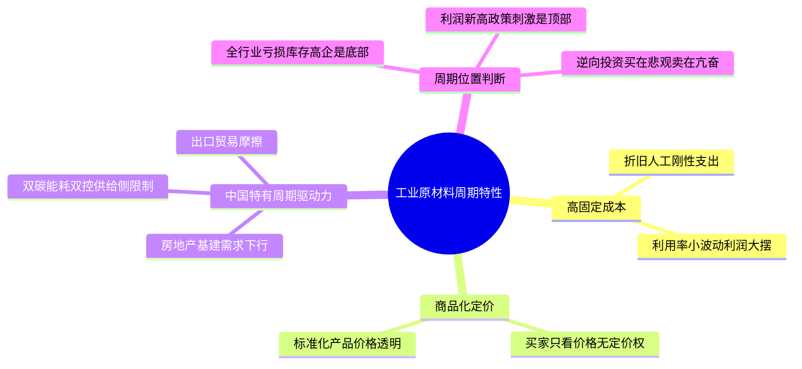
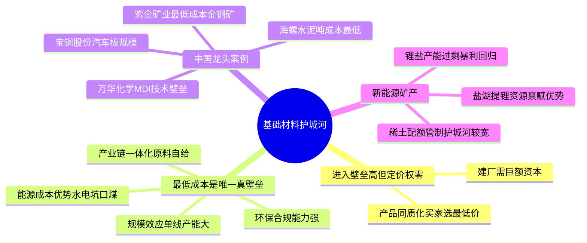
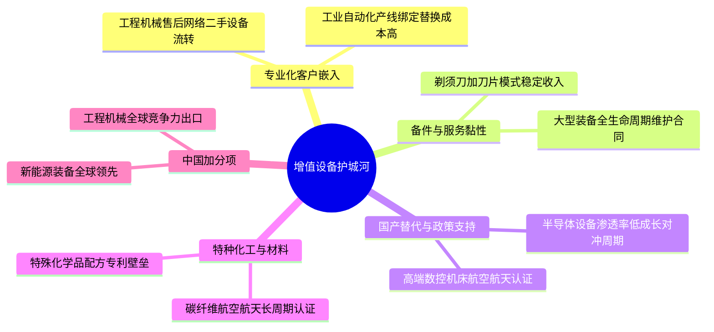
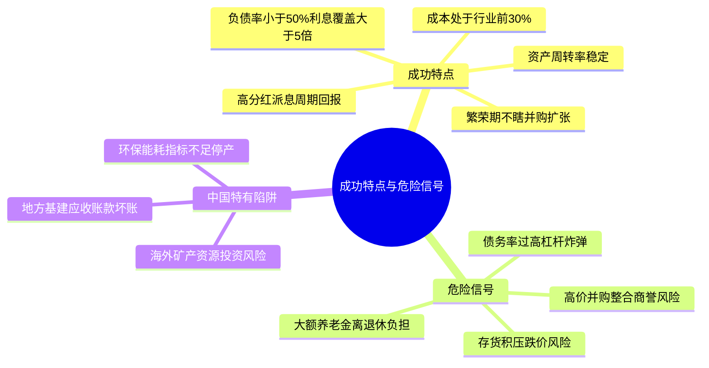
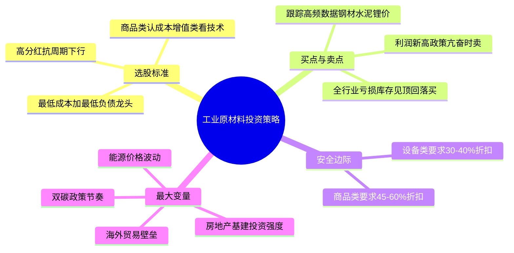

# 《股市真规则》第二十四章：工业原材料和设备行业 —— 2026年中国版重估

**核心判断前置：**
原书第二十四章（美国视角）对工业原材料和设备行业的定位——“旧经济、重资产、高固定成本、商品化定价，护城河极窄，只有最低成本生产者能存活，投资靠周期低谷逆向买入”——在中国**完全成立，且周期性因政策干预和产能过剩而更为剧烈**。
中国工业原材料行业正经历**房地产下行拖累需求、双碳目标约束供给、新能源矿产需求爆发、国产替代与高端制造升级**的多重重塑。以下逐块对照，标注中国特有的变量。

## 一、周期性问题——中国版的“政策+地产+全球贸易”三重周期放大

### 1.1 为什么工业原材料在中国是超级周期股
| 原书机制（美国） | 中国2026对应 |
|----------------|------------|
| 高固定成本，利润对利用率敏感 | 同样。钢厂、化工厂、水泥窑、铝电解槽停产即巨大折旧和人工成本。利用率下降5%，利润可能腰斩。 |
| 商品化定价，买家只看价格 | **更加严重**。螺纹钢、电解铝、水泥、PTA等高度标准化，价格透明，供给端过度竞争，个别企业无定价权。 |
| 与经济周期绑死 | 中国经济结构转型，传统基建和房地产用钢、水泥需求峰值已过，周期向下；而新能源、汽车、高端装备需求上升。供需错配放大周期波动。 |
| —— | **中国特有：供给侧改革与行政限产**：政府可通过“能耗双控”“产能置换”“环保停产”突然收缩供给，短期内推高价格和利润（如2016-2017, 2021），政策一放松，利润又暴跌。政策周期本身成为最大的不确定性。 |

### 1.2 中国工业原材料周期摆幅的直觉
扩张 → 利润暴增 → 企业疯狂扩产（甚至违规新增） → 产能过剩 → 政策收紧/需求下滑 → 价格雪崩 → 全行业亏损 → 行政命令淘汰落后产能 → 幸存者份额上升 → 慢慢修复 → 下一轮政策刺激……

**实操结论**：中国工业原材料股的买点往往出现在**全行业大面积亏损、高成本企业停产、库存见顶回落、而低成本龙头仍能微利或现金流为正、且资产负债表安全**之时。最佳卖点不是在利润最高的季度，而是在政策利好集中释放、市场情绪亢奋时。

## 二、基础材料公司的竞争优势（纯商品）——成本位置决定生死

原书认为基础材料“没有竞争优势，例外是最低成本生产者”。在中国，**最低成本往往与规模、产业链一体化、能源禀赋、环保合规能力绑定**。

### 2.1 中国基础材料行业的成本护城河要素
| 成本优势来源 | 中国代表企业 | 说明 |
|------------|------------|------|
| **产业链一体化** | 宝钢股份（铁矿石自给部分）、中国铝业（自有铝土矿）、万华化学（煤-气-盐化工一体化） | 从原料到终端产品全覆盖，减少中间环节利润流失 |
| **能源成本优势** | 水电铝（云南铝业）、坑口煤化工（宝丰能源） | 用电成本是大宗商品生产命脉，自备电厂或低价水电形成结构性成本差 |
| **规模与工艺效率** | 宝钢、沙钢（钢铁）、海螺水泥（水泥） | 单线规模大，吨折旧/人工低，资产周转率快 |
| **环保与政策合规** | 头部企业普遍优于中小厂 | 在环保停产限产风暴中能维持开工，等于变相清退竞争对手 |
| **地域与物流** | 沿江沿海布局（如宝钢湛江、鞍钢鲅鱼圈） | 降低原料运输成本，贴近消费市场 |

**原书精神完全适用**：只有处于成本曲线左端、负债可控的公司，才能在周期低谷活下来并抢占份额。中国“最低成本生产者”如宝钢、海螺水泥、万华化学在历次周期低谷都验证了这一点。

### 2.2 中国特有的商品周期变量
- **新能源矿产（锂、钴、稀土）**：近年来经历暴利后产能海量释放，锂价暴跌80%，大部分锂盐厂陷入亏损，只有盐湖提锂（蓝科锂业）和自有矿山一体化企业（天齐锂业优质矿）仍能盈利。其护城河在资源禀赋和提锂技术。
- **稀土**：中国掌握全球大部分分离和冶炼产能，且受配额管制，护城河较宽，但价格受政策和下游需求影响大。
- **钢铁/水泥**：房地产需求系统性下滑，产能过剩长期化。即使成本低，若需求持续萎缩，龙头也面临“温吞水”困境，安全边际需更高。

## 三、工业设备和增值产品的竞争优势——专业化、转换成本和国产替代

原书认为增值niche（重型机械、电气装备、特种化工）可能有窄护城河，来自专业化、客户嵌入、防务特许。在中国，还有**国产替代和全球竞争力提升**带来的增量。

### 3.1 中国工业设备/增值产品护城河来源
| 原书壁垒 | 中国2026对应 |
|----------|------------|
| 专业化/客户嵌入 | **三一重工、中联重科**的工程机械在混凝土泵车、起重机领域，售后服务网络和二手设备流转体系提高了客户转换成本。**汇川技术**的工业变频器和伺服，客户产线调试绑定，替换成本高。 |
| 防务/政府特许 | 中国军品供应商（中航工业系统、中国兵器）具有极高进入壁垒，但上市资产往往并非核心军品，需识别。 |
| 某些特殊化学/材料 | **万华化学**的MDI有全球专利和技术壁垒；**光威复材**的碳纤维在航空航天领域通过长周期认证。这些不是纯商品，有技术+认证护城河。 |
| 国产替代与政策支持 | 半导体设备（北方华创、中微公司）、高端数控机床（科德数控）在国产化率极低的市场中，享受政策支持，技术突破即护城河。但技术迭代快，需持续高研发。 |
| 备件与服务黏性 | 大型装备（如风电整机、矿山设备）的全生命周期维护合同能贡献稳定收入，类似于“剃须刀+刀片”模式。 |

**原书结论依然成立**：增值工业品的护城河仍属窄护城河，但若结合国产替代确定性和成本优势（如中国工程机械全球市占率提升），可以给出比纯商品公司稍高的估值容忍度。

## 四、成功的工业原材料和设备公司特点——2026中国版

| 原书特点 | 中国2026对应 |
|----------|------------|
| ① 低成本生产位置 | **现金成本处于行业成本曲线前30%**，拥有资源、能源、物流或工艺优势，且环保投入充足不致被关停。 |
| ② 健康的资产负债表 | **资产负债率<50%（商品类）或<60%（设备类），利息保障倍数>5倍，FCF在周期低谷仍为正或微负**。中国龙头企业（如海螺水泥）近乎零负债，抗周期极强。 |
| ③ 高资产周转率 | 总资产周转率>0.8倍（商品类）或>0.6倍（设备类），且趋势稳定。资产周转下降可能意味着产能过剩或并购消化不良。 |
| ④ 周期纪律 | 不在繁荣期高价并购产能或矿产，不盲目跨界转型（如钢铁厂搞芯片、水泥厂做金融）。历史上有惨痛教训（首钢秘鲁铁矿、重钢澳洲矿）。 |
| ⑤ 分红与资本回报 | 中国成熟工业龙头（宝钢、海螺、中石化）往往有较高分红比例和稳定的派息历史，这是周期低谷持有耐心的回报。 |

**中国加分项**：
- **技术升级与出口竞争力**：如中国工程机械、动力电池、光伏设备已全球领先，能在全球市场赚取利润，部分对冲国内周期。
- **国产替代确定性的专用设备**：半导体设备、高端数控机床等，虽然周期性存在，但渗透率极低，成长性一定程度上对冲周期。
- **ESG合规与绿电使用**：头部企业布局绿电、降碳，未来碳成本或碳关税将形成新的成本优势/劣势分层。

## 五、危险信号——中国工业公司特有的陷阱

| 原书危险信号 | 中国2026对应 |
|------------|------------|
| 太多负债 | **尤其危险**。许多地方国企和民企在周期高点大量举债扩张（如民营大炼化、铝厂），债务率极高，利息覆盖不足，低谷时极易爆雷（如渤海钢铁、方正集团）。 |
| 养老金/退休负担 | 中国老工业基地（东北钢厂、老煤矿）存在大量离退休人员负担，虽部分已剥离，但仍可能侵蚀利润。 |
| 大型分散注意力的并购 | 典型：中国铝业收购力拓（巨亏）、紫金矿业早期海外并购波折（后改善），需关注并购后的整合和商誉。 |
| 存货堆积 | 中国钢材社会库存、铝锭社会库存等高频数据可追踪，当库存天数远高于历史均值且价格还在跌，利润压力将加倍。 |
| **中国特有**：环保限产与能耗指标 | 企业若屡遭环保约谈、未获得能耗指标，可能随时停产，造成收入断崖。 |
| **中国特有**：海外矿山/资源投资风险 | 一些企业在资源国（非洲、南美）投资矿山，面临地缘政治、基础设施、社区劳工等风险（如洛阳钼业的Tenke矿、中铝秘鲁铜矿）。 |
| **中国特有**：应收账款来自地方基建/城投 | 工程机械、水泥、钢材大量销售给地方政府项目，回款周期极长，经济下行时坏账风险上升。 |

## 六、如何在工业原材料行业发现机会——中国版投资清单

- ✅ **选最低成本+最低负债的龙头**：海螺水泥（无债）、宝钢股份（规模+汽车板）、万华化学（MDI壁垒）、紫金矿业（最低成本金铜矿商）。他们在全行业亏损时仍可盈利。
- ✅ **买在悲观：全行业亏损、库存高位回落、高成本厂停产、市场预期极度悲观时**。卖出在利润新高、政策刺激预期充分时。
- ⚠️ **区分商品类和增值设备类**：商品类只认成本优势，增值设备类可适度认可技术/服务壁垒，但安全边际都不可少。
- ✅ **跟踪高频数据**：每周钢材/水泥/铝/铜价格、社会库存、开工率、吨钢利润、PTA价差、锂盐价格等。行业判断比个股选择更重要。
- ✅ **安全边际要比宽护城河行业厚得多**：原书要求50%+，在中国因政策波动和地产下行风险，商品类要求45-60%折扣，设备类30-40%折扣。
- 🚨 **最大变量**：房地产复苏强度、基建投资力度、双碳政策实施节奏、出口景气度、海外反倾销关税、能源价格（煤/电）。

## 思维导图（按阅读逻辑拆分）

### 图1：行业周期特性——高固定成本+商品化=利润摆幅放大器

### 图2：基础材料护城河——只有最低成本者能活

### 图3：增值设备——专业化+转换成本+国产替代

### 图4：成功特点与危险信号

### 图5：2026年中国工业原材料投资策略

# 第二十四章　工业原材料和设备行业（Industrial Materials & Equipment）——旧经济、重资产、高固定成本、商品化定价=最讲周期的猎场

> **章首定位（原书 p.280 / 中信畅销版 ISBN 9787508686431）**
>
> 开篇一句话把行业气质钉死：
>
> > **这是一个传统的旧经济行业，有很多坚实的资产和高固定成本。工业原材料和设备行业被分成：①基础材料生产商（钢材、铝、化学品等商品）＋②增值产品和服务制造商（机械、重型装备、某些专业化工业品）。**
>
> 原书给的致命区分：
>
> > **基础材料买家以价格选产品——不管谁生产的，矿产品都是一样的。没有几家工业原材料公司具有竞争优势；例外是那些能以最低成本生产的公司、集中在少数niche、或国防/专业特许。**

---

## 章内目录骨架（原书：p.280→289）

text
第二十四章 工业原材料和设备行业
├── 一、周期性问题（p.280） ← 高固定成本+商品化=周期放大器
├── 二、基础材料公司的竞争优势（p.281） ← 纯商品：壁垒在"建厂贵"，但定价权≈0→只有成本优势
│ └─ 例外：集中行业（国防/niche特种化工）/ 最低成本生产者（Nucor类）
├── 三、工业原材料和设备行业的竞争优势（p.282） ← 增值设备/niche：专业化→定价权一丝可能
├── 四、成功的工业原材料和设备公司的特点（p.284）
├── 五、危险信号（p.286） ← 高杠杆/养老金黑洞/乱并购/资产周转崩
├── 六、在工业原材料和设备行业发现机会（p.289） ← 周期低谷买低成本+低负债
└── 投资者清单：工业原材料和设备行业（p.289）

> 一句话总纲：**这个行业赚的不是"技术护城河溢价"，而是"成本位置+周期定位+资产负债表韧性"——你买的是周期低谷的生存者，不是永恒复利机。**

---

## 一、周期性问题（p.280）——高固定成本=利润摆幅放大器

### 1.1 为什么工业原材料是**最典型周期股**

| 机制 | 原书表述精神 | 对你的含义 |
|------|-------------|-----------|
| **高固定成本（工厂/高炉/矿山/重型产线）** | 不管开工率50%还是90%，折旧/维护/人员骨架都在→**利润对"利用率"极度敏感** | 小需求波动→大利润波动（经营杠杆双刃） |
| **商品化定价** | 基础材料买家看价格不看牌子→**供应商定价权≈0**→卖不出去只能降价清库存 | 毛利带被供需剪刀差压扁 |
| **与经济周期绑死** | "销售收入和利润对商业周期很敏感"——经济扩张→资本开支旺→订单↑；衰退→停投→订单断崖 | 顶部P/E最"看起来便宜"（利润爆表），底部P/E最"看起来贵"（利润塌）→**反向买** |

> 原书原句（web4逐段复述一致）：
>
> **"在经济周期末端，一个小小的波动就可能造成很大影响……在工业周期的两个顶峰之间，采用买入并持有策略可能只给投资者带来很少利润甚至亏损。"**

### 1.2 周期摆幅的直觉（你用来判"现在在哪"）

经济扩张 → 产能利用率↑ → 定价↑ → 利润暴增 → 所有人都扩产 → 产能过剩埋雷
↓
经济转弱 → 资本开支砍 → 订单塌 → 库存胀 → 降价清仓 → 利润崩 → 弱者破产
↓
低谷淘汰 → 幸存者份额↑ → 慢慢再平衡 → 下一轮……

> 实操结论：**你在工业原材料里的最佳买点不是"利润新高新闻"，而是"利润烂+库存见顶回落+低成本公司在亏但资产负债表扛得住"**。

---

## 二、基础材料公司的竞争优势（p.281）——纯商品（钢/铝/化学品/矿产品）：壁垒在"进不去"，但**定价权≈0**

### 2.1 原书判词很冷

| 项目 | 原书 |
|------|------|
| 进入壁垒 | **高**（新建钢厂/铝厂/造纸厂要百亿级CapEx→新进入者少）|
| 定价权 | **≈零**（矿产品都一样；买家选最便宜的）|
| 超额利润？ | 不存在"结构性超额"——只在**供需紧平衡时**短暂享高价；长期趋势常是**产能饱和→价格跌跌不休**（钢铁/煤炭/有色多次轮回）|
| 唯一真护城河 | **最低成本生产者（Lowest-cost Producer）**→当全行业亏时你还微利或打平→活下来吃份额 |

> 原书例：**美国铝业（Alcoa）**在某些产品/一体化上有利位置——但本质是**成本曲线玩家**，不是品牌溢价玩家。

### 2.2 最低成本生产者长什么样（原书点名：**纽柯 Nucor**）

| 低成本来源 | 例子 |
|-----------|------|
| **工艺/原料结构** | Nucor用**废钢电弧炉（EAF）** vs 传统高炉→更低能耗/更低固定成本/更小规模弹性→周期低谷还能跑 |
| **地理/运营效率** | 贴近废钢供应/低人工成本/扁平管理→单位成本曲线左移 |
| **资产周转** | 同样资本压出更多吨数→**资产周转率（销售收入/资产）**是制造效率的镜子 |

> 原书一句收束：
>
> **"只有最有效率的公司才能在低迷时期幸存。最好的办法是选择低成本同时负债少的公司。"**

---

## 三、工业原材料和设备行业的竞争优势（p.282）——增值设备/niche：专业化是唯一定价权入口

### 3.1 二层拆分（原书框架）

| 层 | 包含 | 护城河？ | 原书态度 |
|----|------|---------|---------|
| **① 基础材料（纯商品）** | 钢/铝/铜/水泥/造纸/基础化工 | ❌ 无（只有成本优势） | 挑最低成本+最干净负债；否则不碰或小仓 |
| **② 增值工业品（Value-added）** | 重型机械/电气装备/工程设备/专业化工业产品（某些特种化工、航空防务部件） | ⭐ 窄但可能真 | 看：**专业化niche + 客户嵌入/转换成本 + 维修备件黏性** |

### 3.2 增值（niche专业化）为什么极少数能守

| 壁垒 | 长什么样 | 例子精神 |
|------|---------|---------|
| **专业化/客户嵌入** | 设备定制→客户产线绑死→换供应商=停机重认证→高转换成本 | 工业锅炉/涡轮机备件/专用生产线 |
| **集中行业（Defense / 政府特许）** | 防务承包=资格壁垒+长期合同→不是自由竞争定价，但有政治/预算风险 | 洛克希德/RTX类（但原书轻描，防务是例外） |
| **某些特殊化学** | 配方/认证/工艺know-how不易复制→客户不敢换 | 特种添加剂/电子气体/涂层 |

> 原书结论精神：
> **"很少有工业原材料和设备公司有任何竞争优势。例外：集中在少数行业（如国防）、某些有利niche（特种化工）、能以最低成本生产的公司。"**

---

## 四、成功的工业原材料和设备公司的特点（p.284）——原书给的4项核查锚

| # | 特点（原书） | 你写进卡片的硬动作 |
|---|-------------|-------------------|
| ① | **低成本生产（Low-cost position）** | **单位成本曲线**：现金成本/吨（或等效单位）vs 同行；看它是**右尾低成本者**还是"高成本跟班"（高成本在低谷先死） |
| ② | **健康的资产负债表（Strong Balance Sheet）** | 原书强调：**高固定成本行业+周期=杠杆炸弹**→盯 **负债/权益趋势**；**利息覆盖**；**FCF在低谷还能不能非负/至少不被迫卖资产** |
| ③ | **效率：资产周转率（Asset Turnover）** | 原书明确：**总资产周转率 & 固定资产周转率**是测制造企业效率的好尺→持续下滑=资本被占/产能低效/需求不匹配 |
| ④ | **周期纪律（不瞎扩/不乱并购）** | 繁荣期不借钱豪赌；低谷不靠发股续命；资本配置=维护+必要升级，不是帝国建造 |

### 4.1 你该加的"工业专属红灯"（原书p.286危险信号直接给的）

| 红旗 | 原书 |
|------|------|
| **太多负债（Too much debt）** | 高固定成本行业+债=双重杀；周期谷底利息+亏损→可能技术性违约/贱卖资产 |
| **资金严重不足养老金计划（Large underfunded pension）** | 老工业公司经典隐形负债→未来现金流被吸 |
| **大型收购行动把管理层弄得心烦意乱（Big distracting acquisitions）** | 并购≠护城河；工业并购尤其容易"买产能/买规模"→整合费+商誉+杠杆↑ |

---

## 五、在工业原材料和设备行业发现机会（p.289）——原书给的"怎么买"哲学

> 不是"选到下个超级周期"，而是：

1. **认清楚：大多数时间是"不买时间"**（尤其是新闻最热/利润爆表/钢价新高时）
2. **机会出现在：悲观+低成本+低负债+仍在运转**
   - 行业亏损季→高成本产能关停→供给收缩→价格底→低成本者份额↑
   - 你要找：**成本曲线左端 + 负债不炸 + 能活着等到再平衡**
3. **安全边际要比"宽护城河"行业厚得多（≈50%+）**——因为：
   - 护城河窄/无
   - 周期深度不可控
   - 商品定价=外生

> 原书收束精神（多处一致）：
>
> **最好的办法=选低成本+少负债；密切注意：太多负债/养老金黑洞/大型分散注意力的并购。**

---

## 投资者清单：工业原材料和设备行业（p.289·原书浓缩）

- ✅ **分成两块**：基础材料=纯商品（无定价权，只有成本优势）/增值niche=专业化可能有一丝护城河
- ✅ **周期是高固定成本放大器**：利润对利用率极度敏感→顶部"低P/E"是经典陷阱，低谷才是买区
- ✅ **纯商品壁垒不在"进不去"，而在"谁成本最低"**：最低成本生产者（Nucor类）活下来吃份额；高成本跟班=周期炮灰
- ✅ **增值niche护城河=转换成本/专业化/特许（防务/特种化工）**——仍然窄，但可守
- ✅ **成功特征：低成本生产位置 + 健康资产负债表（负债可控/利息覆盖/无养老金黑洞）+ 好资产周转率 + 不瞎并购**
- ✅ **危险信号**：负债/EBITDA过高 / 养老金资金不足 / 大型并购分散精力 / 资产周转持续↓ / 存货堆积（商品存货=跌价风险）
- ✅ **找机会靠"低谷纪律"，不靠"猜下一波商品超级周期"；安全边际≈50%+；FCF低谷能扛=唯一裁判**

---

## Appendix：第二十四章"工业原材料核查卡"（一键粘进 Excel/Notion/飞书）

text
【公司】___________ 【子型】□基础商品(钢/铝/铜/水泥/造纸/基础化工) □增值niche(重型机械/电气装备/特种化工/防务) □混合
【日期】____ 【主要商品/产品】____________________
── 1) 周期位（最重要）────────────────────────────
行业供需：紧缺□ 平衡□ 过剩□（价格趋势：↑□ ↓□ 库存天数：↑□↓□）
自己利润位置：高峰□ 中□ 谷底□（谷底+扛得住=买区）
高点追?□no（经典陷阱） 谷底怕?□no（这正是要验的）
── 2) 成本位置（纯商品层生死线）────────────────────
单位现金成本可比?□yes /吨(或__/单位) vs 行业盈亏平衡≈$
处于成本曲线：左1/3低成本□ 中□ 右尾高成本(×淘汰候选)
工艺优势：EAF废钢□ 高炉□ 一体化矿山→冶炼→轧□ 其他__________
── 3) 效率 ───────────────────────────────────────
总资产周转率=收入/总资产 __× 固定资产周转率=收入/PPE __×
趋势：↑□ →□ ↓□（↓=产能低效/需求错配→警）
── 4) 负债炸弹 ────────────────────────────────────
负债/EBITDA __×（>3?🚨） 利息覆盖 __×
养老金/退休金负债不足？□无 □有（摘要：未拨备$__）
到期洪峰：年约____ CFO谷底估__（够?□勉强□不够→淘）
── 5) 存货危险（商品存货=跌价风险）────────────────
存货/收入 % vs 同行% 存货增速% vs 收入增速%（跑快?🚨）
存货跌价准备/存货% __%（提足?□no(利润虚)）
verdict: □可进(低成本+负债安+谷底扛+折扣>50%) □等(周期位置/负债) □淘汰(高成本+高杠杆+养老金黑洞)