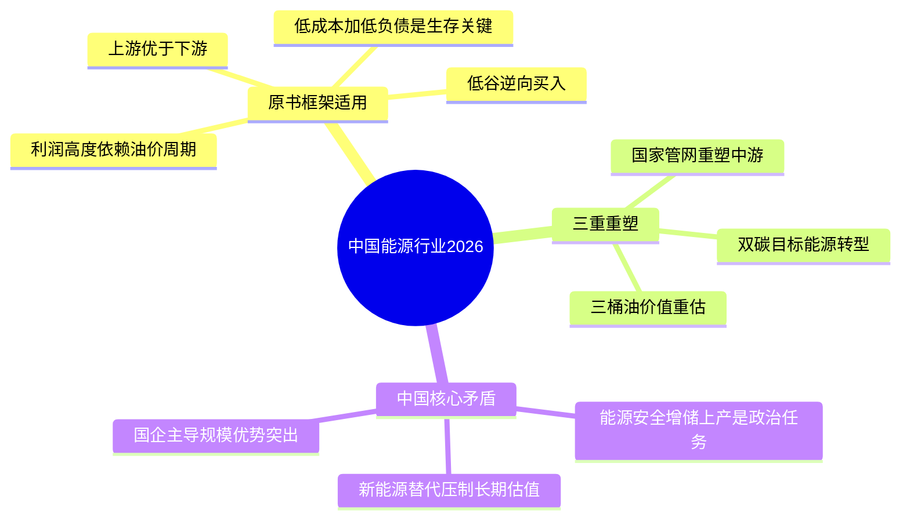
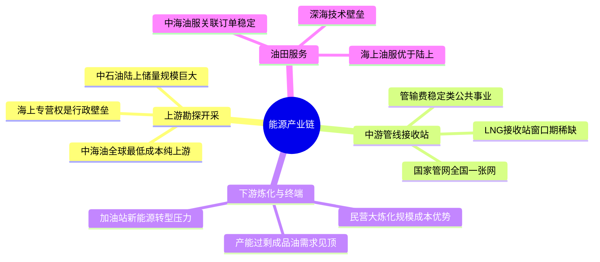
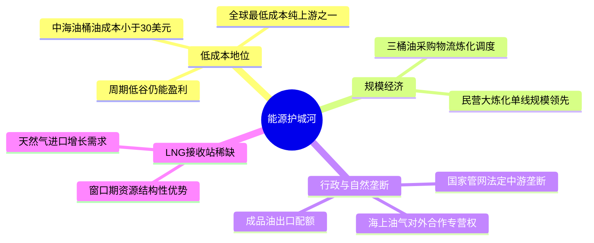
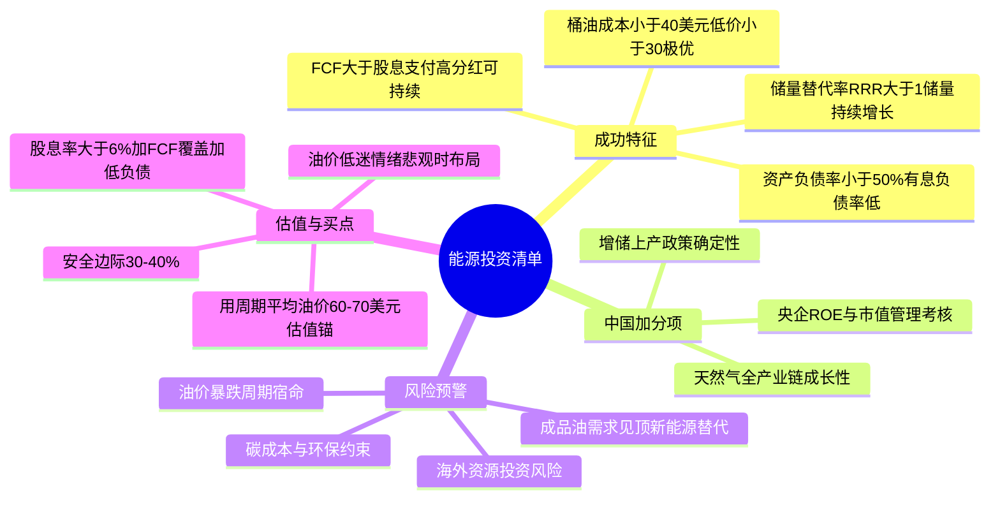

# 《股市真规则》第二十五章：能源行业 —— 2026年中国版重估

**核心判断前置：**
原书第二十五章（美国视角）对能源行业的定位——“利润高度依赖油价周期，上游优于下游，护城河在规模和低成本，投资靠低谷逆向买入”——在中国**本质成立，但被“双碳”目标、能源安全战略和国企主导格局深刻重塑**。
中国能源行业正经历**传统油气增储上产与能源转型并行、“三桶油”高分红价值重估、国家管网重塑中游格局、新能源猛烈冲击化石能源长期需求预期**的复杂变局。以下逐块对照。


## 一、来自地下——上游勘探与开采（E&P）：中国版“增储上产”是政治任务

### 1.1 原书框架对照
| 原书要点（美国） | 中国2026对应 |
|-----------------|------------|
| 世界多数油气在OPEC国家 | 中国是最大油气进口国，对外依存度原油>70%、天然气>40%，能源安全是最高战略。 |
| 纯E&P公司周期赌性强 | 中国纯上游上市公司少，多为三桶油体系内资产，独立E&P（如民营油服转型）体量极小。 |
| 储量补偿比率RRR>1为健康 | 同样适用。中国海上油气（中海油）近年储量替代率>150%，远优于陆上老油田。 |
| 低成本桶是生存关键 | **中海油**桶油成本<30美元（全球极低水平），**中石油**陆上老油田成本>50美元，差异悬殊。 |

### 1.2 中国上游核心玩家与成本曲线
| 公司 | 类型 | 桶油完全成本（估算） | 护城河评估 |
|------|------|---------------------|-----------|
| 中国海油（中海油） | 海上纯上游 | <30美元/桶 | **低成本+海上区块专营权+储量高增长**，中国能源最接近宽护城河的资产 |
| 中国石油（中石油） | 综合（上游为主） | 50-55美元/桶 | 陆上老油田成本偏高，但储量规模巨大，承担能源安全使命 |
| 中国石化（中石化） | 综合（下游为主） | 上游占比小，成本偏高 | 上游不是利润主驱，看炼化和销售 |

### 1.3 中国上游特有的“储量价值”
- **国家矿权制度**：海上油气对外合作专营权归中海油，构成独家行政壁垒。陆上常规油气区块主要为三桶油持有，页岩气等非常规向民企开放但技术和成本门槛极高。
- **增储上产的政治任务**：政策要求加大勘探开发力度，资本开支刚性，不以短期油价波动为转移。
- **储量指标依然关键**：中海油储量替代率持续>150%，中石油靠非常规（页岩气/致密油）维持RRR≈1。储量寿命（R/P比）是长期投资者必须跟踪的。


## 二、输油输气管线——中游：中国版“国家管网”重塑格局

### 2.1 原书“对商品价格不敏感”的逻辑在中国更极致
- **2019年国家管网公司成立**，从三桶油剥离长输管线资产，实现“全国一张网”。理论上管网向第三方公平开放，收取管输费，商业模式与原书描述的“收费公路”完全一致。
- 国家管网暂未上市，但其控股或参股的省级管网公司（如陕天然气）和LNG接收站（如深圳燃气、新奥股份）部分在A股，具备“类公共事业”稳定现金流特征。

### 2.2 中国中游投资关注点
- **管输费定价**：由国家发改委核定，回报率受管制（准许收益率约8%），但稳定性极高。
- **LNG接收站**：中国天然气进口激增，接收站窗口期成为稀缺资源，拥有接收站的公司（新奥、广汇、九丰）享有结构性优势。
- **储气库**：峰谷价差套利空间，政策推动建设，但资本密集，回报周期长。


## 三、炼油厂——下游：中国炼能过剩，裂解价差才是命门

### 3.1 原书框架中国验证
原书认为“炼油比上游盈利少得多，周期性强”。在中国**更加严重**：
- 中国炼油产能全球最大，结构性过剩，成品油需求增速放缓（新能源车渗透率>40%，汽油消费峰值已现或临近）。
- 裂解价差（Crack Spread）是核心KPI，而非油价绝对值。2022-2023年因俄乌冲突价差异动，但长期趋势偏薄。
- **“减油增化”**是行业转型方向：从成品油转向化工品（乙烯、PX），但化工品同样面临产能过剩和周期低谷。

### 3.2 中国炼化护城河来源
- **规模化+一体化**：荣盛石化（浙石化）、恒力石化、恒逸石化等民营大炼化，单线规模全球领先，一体化程度高，成本优势显著。但高负债扩张是潜在风险。
- **技术+产品差异化**：万华化学（化工新材料）、卫星化学（轻烃裂解）向高附加值转型，护城河较传统炼油更宽。
- **成品油出口配额**：政府分配，拥有配额的国有炼厂有一定政策优势。


## 四、终端销售——加油站和燃料零售

- 中国加油站格局：中石化（约3万座）、中石油（约2万座）主导，民营和外资（壳牌、BP）加油站占比较低。
- **新能源车冲击**：随着电动车普及，加油站客流量长期承压。部分站点转型为“加油+充电+便利店+洗车”综合服务站。
- **成品油定价机制**：中国汽柴油零售价受政府指导（参考国际原油成本加一定利润），而非纯市场定价，一定程度上保护了终端利润，但也限制了向上弹性。


## 五、油田服务——中国版：跟随“三桶油”资本开支周期

### 5.1 原书判词在中国依然成立
“大多数油田服务企业为股东创造价值比较艰难，竞争激烈，强周期。”

| 中国油服代表 | 业务 | 护城河评估 |
|------------|------|-----------|
| 中海油服 | 海上钻井、物探、船舶 | **有一定护城河**：中海油关联订单稳定、深海技术壁垒、重资产进入门槛 |
| 海油工程 | 海上平台建造安装 | 寡头格局，技术壁垒，受益中海油增储上产 |
| 杰瑞股份 | 压裂设备 | 技术领先但竞争加剧，页岩气开发节奏驱动 |
| 石化油服 | 陆上钻井 | 低毛利、强周期、护城河薄 |

### 5.2 中国油服投资要点
- 海上油服优于陆上：中海油服、海油工程受益于中海油确定性的资本开支增长，且竞争格局更优。
- 陆上油服高度依赖三桶油CAPEX，议价权弱，更适合在油价低迷、三桶油资本开支即将反弹前布局。
- 技术壁垒（深海、页岩气压裂）是唯一能获得超额回报的路径。


## 六、石油价格的影响——中国版的定价逻辑

### 6.1 原书周期规律依然有效
“油价是周期性的，低谷比高峰是更好的买点。”

### 6.2 中国特有的油价变量
| 变量 | 影响 |
|------|------|
| 中国原油进口量 | 全球最大进口国，需求变化直接扰动国际油价。经济复苏强度=油价变量。 |
| 新能源替代速度 | 中国新能源车渗透率全球最高，正在压制长期原油需求预期，压制油气股估值天花板。 |
| 地缘政治（俄罗斯/中东/美国） | 作为进口依赖国，油价暴涨时输入型通胀压力大，政策倾向保供稳价；油价暴跌时利于战略储备。 |
| 成品油定价机制 | 国内油价“天花板/地板价”（国际原油>130美元或少<40美元时不再调整），限制了终端利润的极端波动。 |

### 6.3 周期操作法则
- 在油价低迷（布伦特<70美元）、市场情绪悲观、三桶油资本开支接近底部区域时，分批布局低成本上游龙头（中海油）。
- 在油价高位（>100美元）、全民唱多“永久高油价”时，警惕周期反转。
- 用**周期平均油价**（如布伦特60-70美元）作为估值锚，而非用顶峰年EPS计算PE。中海油在60美元油价假设下仍能产生可观FCF，是估值底线支撑。


## 七、能源行业的竞争优势——中国版护城河总结

| 原书壁垒 | 中国2026对应 |
|----------|------------|
| 规模经济 | 三桶油+国家管网的规模绝对优势，采购、物流、炼化调度成本行业最低。 |
| 低成本地位 | **中海油是全球最低成本纯上游之一**（<30美元/桶），护城河极宽。中石油/中石化陆上成本偏高，靠规模和历史储量维持地位。 |
| 自然垄断/管线 | 国家管网对长输管线的法定垄断，未上市但影响整个中游格局。LNG接收站是稀缺资源。 |
| 无形资产（储量/专营权） | 海上油气对外合作专营权（中海油）、成品油出口配额、加油站网络位置，构成行政和地理位置壁垒。 |
| OPEC制度庇护 | 中国不是OPEC成员，但受益于OPEC+维持油价中枢的行动，同时作为最大进口国有“买家议价”的部分对冲。 |

**核心结论**：中国能源行业护城河最宽的资产是**中海油的海上低成本纯上游+国家管网的法定中游垄断**，其次是**民营大炼化的规模一体化成本优势**。


## 八、成功的能源公司特点——2026中国版核查清单

| 原书特点 | 中国2026对应 |
|----------|------------|
| ① 油价下跌时仍能盈利 | 低桶油成本（<40美元为优，<30美元为极优）。中海油在布伦特<50美元时仍正经营现金流。 |
| ② 清晰的资产负债表 | 资产负债率<50%（综合石油公司），有息负债率低，FCF>股息支付。中海油净现金状态，中石油/中石化负债率约40-45%。 |
| ③ 储量增长（RRR>1） | 中海油RRR>150%且新发现成本<10美元/桶，中石油靠非常规勉强维持RRR≈1。储量替代是长期价值试金石。 |
| ④ 低成本>高成本 | 成本曲线左端=周期生存权。中国能源股的估值分化本质上是成本分化。 |
| ⑤ 高分红与资本纪律 | 三桶油近年来分红比例提升（中石油/中海油承诺>45%），股息率5-8%，成为险资等长期资金配置核心。高分红=管理层不再乱投资的信号。 |

**中国加分项**：
- **增储上产政策确定性**：三桶油上游资本开支受政策支持，不随油价短期波动，投资确定性强于美国纯市场驱动的E&P。
- **天然气成长性**：天然气在中国能源转型中作为过渡能源，消费增速仍可观，拥有天然气全产业链的公司（中石油、中海油、新奥股份）有增量逻辑。
- **“三桶油”价值重估**：央企考核从“规模”转向“ROE和市值管理”，分红提升、回购可能、经营效率改善是潜在催化剂。


## 九、能源行业的风险——中国版

| 原书风险 | 中国2026对应 |
|----------|------------|
| ① 油价暴跌 | 同样致命。但三桶油多元化业务、低负债和国企融资优势提供了比美国独立E&P更强的抗风险能力。 |
| ② OPEC解体/地缘突变 | 作为进口国，供应中断风险极端重要。中国战略石油储备（约90天）是短期缓冲垫。 |
| ③ 环保/能源转型 | **中国最核心长期风险**：双碳目标下，化石能源长期需求必然见顶。加油站网络、炼化产能可能面临资产搁浅。 |
| ④ 高杠杆+信贷冻结 | 三桶油和优质民企负债率可控，但部分中小型油服、民营炼化高负债扩张，周期低谷可能爆雷。 |
| ⑤ 过度资本开支/恶性并购 | 中国企业在海外高价收购资源的历史教训深刻（如中海油尼克森、中石油海外部分项目），需关注商誉和资产减值风险。 |
| ⑥ 汇率/资源民族主义 | 中国能源企业大量海外资产（中石油在非洲/中亚、中海油在巴西/圭亚那），面临当地政策变动和汇兑风险。 |

**中国特有的额外风险**：
- **成品油需求见顶**：新能源车替代加速，未来成品油消费衰减将压制炼化和加油站长期利润。
- **碳成本**：国内碳市场逐步扩容，石化行业将被纳入，增加碳排放成本。
- **天然气市场化改革不确定性**：门站价和终端价联动机制尚不完善，顺价不畅压缩城市燃气公司利润。


## 十、结论——2026年中国能源行业投资清单

- ✅ **上游 > 下游**：原书逻辑在中国更清晰。**中海油是唯一具备宽护城河特征的中国能源股**（全球最低成本+海上专营权+储量高增长+高分红）。
- ✅ **中游管线/接收站**：国家管网未上市，但LNG接收站（新奥、广汇）和省级管网具备类公共事业稳定现金流特征。
- ⚠️ **炼化/终端**：产能过剩+新能源替代，长期估值承压。大炼化看成本优势，但安全边际要求更高。
- ✅ **买在低谷**：油价低迷（布伦特60-70美元）+中国经济悲观预期+新能源替代恐慌时，是布局低成本龙头的最佳时机。
- ✅ **安全边际**：用周期平均油价（60-70美元）作为估值锚，要求**30-40%折扣**（中海油可略低，因成本足够低）。
- ✅ **关注分红**：三桶油股息率是估值底部的确认信号——当股息率>6%+FCF覆盖充分+资产负债表干净=安全边际充足。
- 🚨 **最大变量**：全球油价周期、中国新能源替代速度、OPEC+团结程度、地缘政治（台海/南海/中东）、碳约束政策节奏。


## 思维导图（按阅读逻辑拆分）

### 图1：中国能源行业——原书框架与三重重塑




### 图2：中国能源产业链拆解




### 图3：护城河——中国版低成本与规模优势




### 图4：成功能源公司特点与投资清单


 

# 第二十五章　能源行业（Energy）——石油、天然气与"商品周期机器"

> **章首定调（原书精神·p.291）**
>
> 尽管可以从煤、核能、水电、风电、太阳能等获取能源，但**没有任何一种能源能挑战石油和天然气的垄断地位**——世界上约 **2/3 的能源**来自石油和天然气，它们不仅驱动汽车和家庭取暖，还越来越多用于发电。
>
> 能源行业最大的特征是：
>
> > **收益率高度依赖石油价格 → 石油价格是周期性的 → 所以行业利润也是周期性的 → 低谷比高峰是更好的买入时机。**
>
> 你在这章学到的不是"油价预测术"，而是：**在强周期行业里，怎么用护城河思维+资产负债表纪律+估值锚，把周期变成你的朋友而不是绞肉机。**

---

## 第二十五章 能源行业
```
├── 来自地下（上游：勘探与开采 Exploration & Production / E&P） p.291
├── 输油输气管线（中游：Pipeline / Midstream） p.292
├── 炼油厂（下游：Refining） p.292
├── 消费者（下游终端：Marketing & Retail / 加油站体系） p.293
├── 服务提供商（Oilfield Services / 油田服务） p.293
├── 石油价格的影响 p.294
├── 能源行业的竞争优势 p.295
├── 成功的能源类公司的特点 p.296
├── 能源行业的风险 p.298
├── 结论 p.299
└── 投资者清单：能源行业 p.299
```
---

## 1. 来自地下——上游：勘探与开采（Exploration & Production, E&P）p.291

### 1.1 原书命题

> **我们使用的能源大多数来自地下。石油公司通过勘探和开采石油与天然气创造价值。**

- 重要现实锚定（原书给的尺度感）：
  - 世界天然气/石油资源的很大比例在 **OPEC 国家地下（尤其中东）**
  - **"不可能在我们有限寿命甚至孙子辈开采完"**——不是资源秒没，而是**储量≠可经济采出量**（技术/成本/价格共同决定）
- 公司类型：
  - **综合石油公司**（Integrated Oil：自拥上下游全链条，如埃克森美孚级）
  - **纯 E&P / 独立勘探开采公司**（只干 upstream，更纯周期赌）

### 1.2 上游赚的是什么钱？

| 变量 | 原书指向 |
|------|---------|
| **油价 − 开采/生产成本 − 税/特许费** | 毛利本质 |
| 成本结构 | 固定成本（平台/钻井设施/ lease 运营） vs 可变（燃料/化学剂/人工），但整体**高度暴露于大宗商品价格** |
| 关键资产 | **储量（Reserves）= 未来可经济开采的油/气量**，不是去年利润 |

### 1.3 你必须盯的"储量指标"（原书反复回到这）

#### ① 储量补偿比率（Reserve Replacement Ratio / RRR）
> **RRR ＝ 某期间新探明储量 ÷ 同期开采量**

- **RRR > 1.0**：公司至少补回了今年采出的储量（能维持生产寿命）
- **RRR 远高于 1.0 且持续**：不仅维持，还在扩"资产底座"→ 长期价值更稳
- RRR 持续 < 1.0：靠存量吃老本 → 终将见顶（估值时必须折价）

#### ② 储采比（Reserve-to-Production Ratio / R/P）
- 储量 ÷ 年产 = "按当前速度还能采多少年"——给你**时间维度的直觉**，但不替代 RRR（因为新探明可能改变分子）

> 上游一句收束：你买的不是"今年EPS"，而是**一桶一桶的地下资产 + 能以什么成本拿出来 + 油价周期站在哪**。

---

## 2. 输油输气管线——中游（Pipelines / Midstream）p.292

### 2.1 原书定位：被忽视的赚钱机器

> **管线是在能源行业里对商品价格不敏感的业务——只要商品数量相对稳定，管线公司按"输送量"收费 → 现金流可预测。**

| 特征 | 原书表述 |
|------|---------|
| 商业模式 | **收费公路逻辑**：不赌油价涨跌，赚的是"过路费"（volume-based fee） |
| 为什么对价格不敏感 | 输的是"量"而非"价"；终端使用者要的是能源到位，不是投机 |
| 护城河来源 | **自然垄断/规模经济**（铺一条干线千亿级沉没成本→新进入者算完账放弃）+ 特许/许可路径 |
| 谁拥有 | 综合石油公司常自拥部分管网；也有**大型独立管线公司**（更纯 midstream 标的） |
| 风险 | 不是油价暴跌，而是**经济衰退→需求量塌→输送量掉**（所以仍是周期，但比 E&P 温和） |

> 原书隐含但重要：midstream 更接近"类公共事业现金流"——但**别忘了它也有杠杆**（管线资本密集），估值仍要安全边际。

---

## 3. 炼油厂——下游（Refining）p.292

### 3.1 原书核心判断

> **炼油行业比从地下开采石油盈利少得多。炼油利润率也趋向周期性——且周期不一定和石油价格以同样频率波动。**

| 项目 | 原书逻辑 |
|------|---------|
| 毛利率 | **薄**——原油是原料成本，产品价格受终端竞争限价 |
| 利润驱动 | **裂解价差（Crack Spread）≈ 成品油价格 − 原油成本**，而不是油价绝对值 |
| 为什么"开采 > 炼油"通常更有吸引力 | 上游有资源稀缺+OPEC限产护盘；下游是**加工制造业**，更像"赚加工费"，没有"OPEC炼油卡特尔"保护利润 |
| 周期性 | **产能周期**：炼能过剩→裂解价差压死；检修季/意外停产→短期跳升→不可持续 |

### 3.2 炼油这段的实操含义

- 如果你是保守型：宁可买**综合石油公司里上游权重高的**，而不是纯炼油独立
- 如果你买纯炼油：盯的不是"油价涨没涨"，而是 **裂解价差 + 产能利用率 + 检修周期 + 区域供需（ import/export 平衡）**
- 原书暗示：炼油更像**制造业周期股**，不是"护城河复利机器"

---

## 4. 消费者——终端/营销（Marketing & Retail）p.293

> **下游业务的其他部分是市场营销——经营便利加油站，向工业用户销售燃料等产品。**

- 很多服务站独立经营、拿大石油公司品牌特许权；部分大型石油公司自拥自营加油站
- 这层赚的是**分销/零售毛利 + 便利店附加销售**，本质是**高周转薄利生意**
- 对综合石油公司的意义：帮上游产品找到出口，但**利润率通常不如 upstream**，且受政治/限价（尤其汽油零售价敏感度极高）

---

## 5. 服务提供商——油田服务（Oilfield Services）p.293

### 5.1 原书判词非常直白

> **大多数石油服务企业为股东创造价值比较艰难——石油服务企业趋向于高度竞争，很难获得竞争优势，财务健康状况趋向于强烈的周期性。**

| 维度 | 原书口吻 |
|------|---------|
| 竞争烈度 | **极高**（钻井服务、完井、测井、压裂车队——设备可复制、客户是大石油公司→议价权在买方）|
| 护城河 | 很难（除非有独家技术/IP？但大多可替代）→ 更靠**规模/全球服务网络** |
| 现金流 | 随油价/钻机数（rig count）剧烈摆动→强周期 |
| 投资姿态 | 除非你很懂油田技术且能挑到"有真实壁垒/垄断片段"的细分龙头，否则**油田服务应更小仓位/更高安全边际** |

---

## 6. 石油价格的影响（p.294）——全章最关键的"周期观"

### 6.1 原书开宗明义

> **能源行业的收益率高度依赖石油价格。石油价格是周期性的，所以行业利润也是周期性的。**
> **石油价格处于周期性低谷时，是更好的买入石油公司股票的时机。**

### 6.2 油价影响谁、如何影响（原书给的传导链）

| 环节 | 受影响方向 | 原书强调 |
|------|-----------|---------|
| **上游 E&P** | 油价↑→利润暴增；油价↓→利润暴缩 | 最直接、最猛 |
| **炼油** | 更复杂：油价↑→原料成本高→不一定跟涨（裂解价差可能压）→有时油价涨反而炼油利润受压 | **裂解价差**才是炼油利润的真驱动，不是油价绝对值 |
| **管线/Midstream** | 间接：油价崩→经济衰退→需求掉→输送量掉 | 对商品不敏感≠与经济无关 |
| **油田服务** | 油价↓→钻机数砍→服务需求塌 | 双倍杠杆效应 |

### 6.3 OPEC 因子（原书专门提）

> **OPEC 在能源行业是对盈利非常有影响力的因素——这个组织能够把油价维持在生产成本之上。**
> 它是**勘探和开采业的卡特尔**：成员不总是守配额，但"为行业利益"仍能相当成功地操纵市场价格。
> → 这是上游超额利润能存续的制度性原因之一，但反过来也意味着：**地缘政治/成员国博弈 = 不可建模风险**（你只能留安全边际对付它）。

### 6.4 原书给的周期操作法则（你该刻在键盘上）

> - **别在高油价、全民唱多"永久高油价"时追**——那往往是周期顶部区域  
> - **低谷≠明天反转，但低谷给你"贱买好资产"的时间窗**（前提：公司资产负债表扛得住）  
> - 能源股估值锚：**用周期平均视角（如周期调整盈利/现金流），别用顶峰年EPS去算PE**

---

## 7. 能源行业的竞争优势（p.295）

### 7.1 原书摊开的壁垒来源（对应第三章框架）

| 护城河 | 能源行业里的具体形态 | 强度 |
|--------|---------------------|------|
| **规模经济** | 石油市场销售业务里，规模经济可能是竞争优势**唯一靠谱路径**；公司越大→采购/运输/炼能调度/成本摊薄越优→**公司越大越赚钱** | ⭐⭐⭐ 上游&综合最强 |
| **低成本地位（Cost Leadership）** | 低盈亏平衡桶成本（lifting cost / breakeven）＝周期低谷还能活、甚至还在赚 | ⭐⭐⭐ 核心生存力 |
| **自然垄断/许可壁垒（管线/部分特许）** | midstream 的输油输气管线 | ⭐⭐（更像类公共事业） |
| **无形资产（储备/专属区块权利）** | 储量本身=资产；但"拥有地下权利"更多是地契/特许问题，不是品牌溢价 | ⭐（储量数量/质量关键，但不是"护城河"独立） |
| **OPEC 制度庇护（上游价格下限）** | 卡特尔效应＝行业结构有利，但不算公司自身护城河 | — |

### 7.2 原书最重要一句（把"竞争优势"从"油价赌"里救出来）

> **我们看到：勘探和开采比炼油和销售更有吸引力。**
> 原因：上游靠**稀缺资源+规模+成本优势+OPEC限产结构**护住利润空间；下游更像加工费竞争。

---

## 8. 成功的能源类公司的特点（p.296）——原书给的筛选清单

> 你不需要预测油价，你需要问：**这家公司在任何油价环境下，能不能证明自己是"低成本+低杠杆+还在补储量"的 survivor？**

### 特点①：优良的财务记录——即使在油价下跌时也能盈利

> **对于综合石油公司：即使石油价格下跌，它们也能盈利。**
- 这不是说"亏损不可能"，而是：**低成本产油桶（breakeven低）→ 低谷仍正经营现金流→不需要砍股息/不疯狂借**
- 看 **现金流稳定性** 更多于净利润（因为油价抖时利润抖得更狠）
- 附加信号：能**在低谷仍分红或至少不砍**（砍了往往=资产负债表告警）

### 特点②：清晰的资产负债表（低杠杆扛周期）

> **负债权益比率低于 1.0 的公司是较好的投资选择。**（量级感：D/E < 1.0 ≈ 负债/资本 ~50%以下）
- 能源是重资本+强周期→杠杆是双刃剑：油价好时放大回报，油价崩时加速死亡
- 原书态度：**拥有表现良好资产负债表的公司，在低谷时远好于背负债务的公司**
- 你要盯：
  - 有息负债/资本趋势
  - 利息覆盖（哪怕用 EBITDA/利息 看，因折旧会扭曲）
  - **FCF 是否够覆盖股息**（别借来分红）

### 特点③：储量增长——储量是能源公司的"库存"

> **密切注意储量的变化和新储量的增长——因为这是保证公司未来采掘收入的坚实资产。**
- 盯：**储量补偿比率 RRR**（持续>1）+ **新发现成本（Finding & Development Cost / F&D）**趋势（越低越好）
- 储量结构：证实储量（Proved）vs  probable→ 保守估值只拿 proved 当锚

### 特点④（隐含）：低成本 > 高成本

- 每桶操作/lifting cost、每桶完全成本（all-in breakeven）是**护城河的温度计**
- 低桶成本公司 = 周期里"最后一个被淹的"（水位降时高处先露头）

---

## 9. 能源行业的风险（p.298）

> 原书把风险摊开，你直接套第六章"空头情形"框架：

| # | 风险 | 原书语境 |
|---|------|---------|
| ① | **油价暴跌/超长低谷** | 周期宿命——即使好公司也会被砸估值；扛不住高杠杆先死 |
| ② | **OPEC 解体/作弊/地缘突变** | 供给冲击→油价双向暴跳（涨也快跌也快） |
| ③ | **环保/气候政策 & 能源转型** | 碳税、限排、补贴新能源→化石资产搁浅风险/提前退役成本 |
| ④ | **高杠杆 + 信贷冻结** | 重债能源公司在衰退/银行收紧时最脆（再融资断链） |
| ⑤ | **过度资本开支/恶性并购** | 油价好时管理层最爱"大干快上"→过剩产能→下一轮更惨（自我强化周期） |
| ⑥ | **汇率/资源民族主义/征收风险**（海外上游） | 跨国 E&P 特有风险 |

---

## 结论（p.299）

> **能源行业不是"成长行业"，它是"周期资源行业"——你的alpha来自：**
> 1. **挑低成本+低杠杆+储量在补的公司**（护城河在成本与规模，不在品牌）  
> 2. **在市场对油价绝望时出手（低谷买），不是油价上头条时追**  
> 3. **用安全边际补偿你无法预测的油价路径**

---

## 投资者清单：能源行业（p.299·原书浓缩）

- ✅ **收益率高度依赖油价，利润是周期性的；低谷比高峰是更好的买点**
- ✅ **勘探和开采 > 炼油/销售**（上游有资源稀缺+规模+OPEC结构护盘；下游更像加工费竞争）
- ✅ **OPEC 是上游卡特尔——影响力巨大但要跟踪成员国守信度**
- ✅ **成功的能源公司**：即使在油价下跌也能盈利（低成本桶）+ 清晰资产负债表（D/E<1级）+ 储量补偿比率持续>1（还在补资产）
- ✅ **规模经济是核心路径**：公司越大越赚钱（采购/运输/炼能调度/成本摊薄）
- ✅ **油田服务高度竞争、难护城河、强周期→更谨慎/更小仓/更高折扣**
- ✅ **管线/midstream对商品价格不敏感（赚输送量过路费），但仍受经济衰退影响且资本密集→盯杠杆**
- ✅ **风险**：油价暴跌、OPEC突变、环保/转型搁浅、高杠杆+信贷冻、过度CapEx/并购

---

## 附录：能源行业"核查卡"（一键粘进 Excel / Notion / 飞书）

【公司】___________ 【类型】□综合石油 □纯E&P □管线Midstream □炼油 □油田服务
【主要产区/地区】________________ 【日期】____
── 上游储量/成本（若有）─────────────────────────
证实储量 Proved Reserves：____ 百万BOE
储采比 R/P：约____年
储量补偿比 RRR（近3年平均）：____（>1? □是 □否 远低于1?□警）
每桶lift成本：____/bbl 完全成本breakeven：____/bbl（行业低?□是 □否）
新发现成本 F&D 趋势：↓□ →□ ↑□
── 财务（周期抗压测试）─────────────────────────
油价假设（你保守用的）：$____/bbl
负债/权益：（<1.0?□OK □偏高） 有息债/资本：%
利息覆盖 EBITDA/利息：____×（<2.5紧张）
FCF 3年平均：正□ 负□ FCF/股息：____×（应>1）
即使在$50/bbl情景：OCF仍正?□是 □勉强 □否(淘汰)
── 油价暴露 ─────────────────────────────────────
□E&P纯上游（直接油价） □综合（上游权重__%） □管线(输送量逻辑) □炼油(裂解价差)
油价低谷($50-$60级)买点?□是（公司已低价折让+杠杆可控） □否(等更清楚)
verdict: □可做（低成本+低杠杆+储量补+折扣__%） □避(高杠杆/高桶成本/储量消耗)