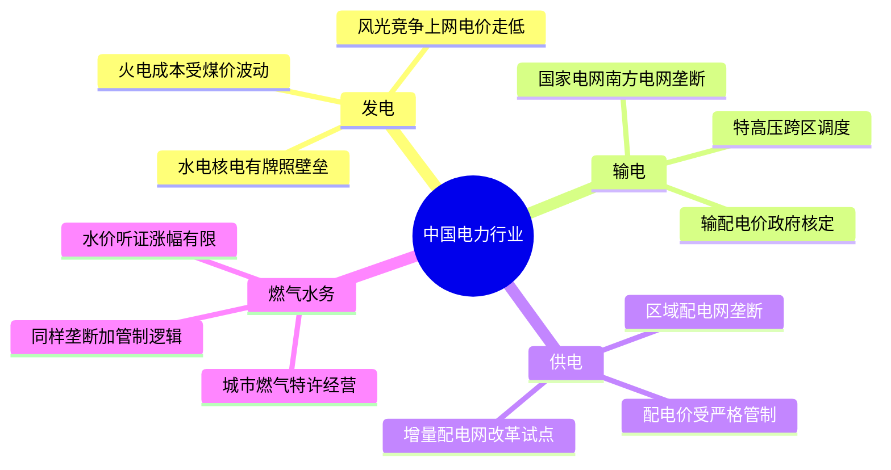
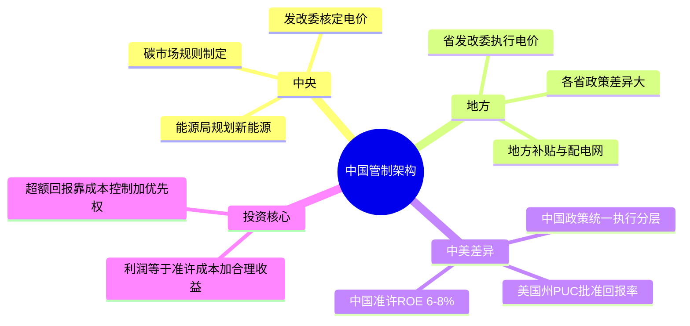
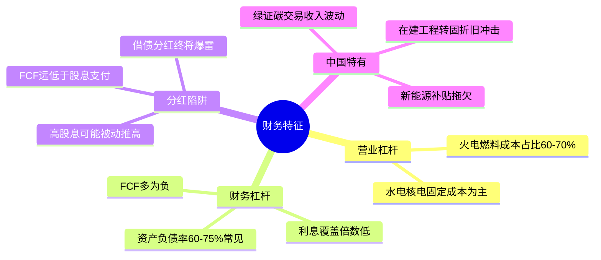
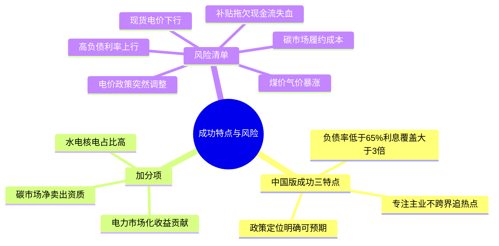
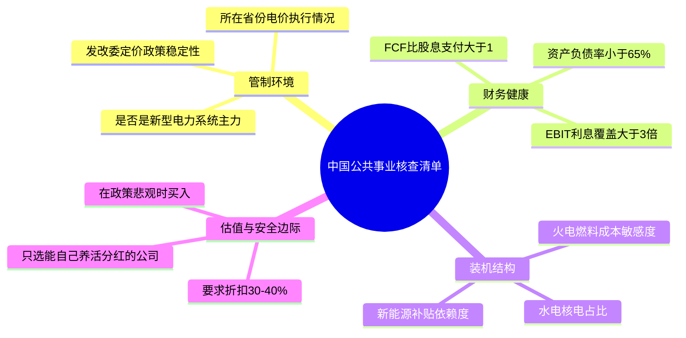

# 《股市真规则》第二十六章：公共事业行业 —— 2026年中国版重估

**核心判断前置：**
原书第二十六章（美国视角）对公共事业的定位——"宽护城河但受管制，稳定现金流+分红，需严控杠杆与估值"——在中国**本质完全适用，但管制逻辑和行业结构截然不同**。
中国公共事业并非"州级PUC博弈"，而是**国家发改委+国家能源局统一管控，叠加碳中和转型与电力市场化改革**的独特生态。以下逐块对照。


## 一、中国电力行业三块结构：与美国同形但不同质

### 1.1 发电（Generation）——从"五大"垄断到新能源多元混战
| 项目 | 美国原书判断 | 中国2026对应 |
|------|------------|------------|
| 竞争程度 | 最激烈，趋向市场化 | 竞争激烈且分化：火电受燃料成本+碳约束挤压；风光核水等优先上网，但面临电价下行压力 |
| 护城河 | 弱，成本优势是主要差异化 | 弱。仅少数大型水电（长江电力）、核电（中国核电/中广核）有自然垄断+牌照壁垒 |
| 关键变量 | 燃料成本、碳排放合规 | 煤价（火电）、弃风弃光率（新能源）、绿电交易溢价、碳市场履约成本 |

**中国发电侧核心矛盾**：
- 火电仍占装机约50%，但利用小时数下降，燃料成本受煤价波动，且面临"容量电价+电量电价"补偿机制改革
- 风光高速扩张，但过度竞争导致上网电价走低，补贴退坡后盈利能力分化
- 水电/核电是少数拥有"宽护城河"的子行业：一次建成长期回报，但受制于审批和生态限制

### 1.2 输电（Transmission）——中国的绝对自然垄断
| 项目 | 美国原书判断 | 中国2026对应 |
|------|------------|------------|
| 竞争优势 | 极强，巨额前期投资+NIMBY | 极强，国家电网/南方电网两家垄断，没有竞争对手 |
| 护城河来源 | 高效规模+许可壁垒 | 行政垄断+特高压技术壁垒+跨区调度能力 |
| 管制约束 | 回报率被监管框架约束 | 输配电价由政府核定（"准许成本+合理收益"），ROE受严格管控 |

**中国输电的独特之处**：
- 国家电网/南方电网不是上市公司（其上市平台如国电南瑞、涪陵电力等仅涉部分业务），投资者无法直接买"中国输电垄断"
- 特高压、配网升级等投资巨大，但输配电价调整滞后，可能导致"投资增加而准许收益未同步"的回报周期错配

### 1.3 供电（配电/电力零售）——垄断但被政府锁定价差
| 项目 | 美国原书判断 | 中国2026对应 |
|------|------------|------------|
| 竞争优势 | 最强，最后一公里无可选择 | 最强，每个区域只有一个配电网（国网/南网地市公司），用户无法更换 |
| 管制 | 政府定价，回报有限 | 政府严格核定配电价，且近年来要求降低一般工商业电价，利润空间受挤压 |
| 新变量 | —— | 增量配电网改革试点（允许社会资本参与）、分布式光伏"隔墙售电"可能稀释局部垄断 |

**中国供电的核心矛盾**：
- 垄断权在电网公司手中，而非独立上市实体；A股有部分地方电网（三峡水利、郴电国际等），规模小且同样受管制
- 综合能源服务、充电桩运营等新业态正从供电垄断边界缝隙中生长，但体量尚小

### 1.4 燃气与水务——同样的垄断+管制逻辑
- **城市燃气**：特许经营权模式，每个城市通常只有一家管道燃气运营商（中国燃气、华润燃气、新奥能源等），护城河宽但受限于居民用气价格联动机制（顺价是否通畅是关键）
- **水务/污水处理**：区域垄断，但水价调整需听证，涨幅有限；污水处理费受政府定价影响大


## 二、管制、管制还是管制——中国版是"政策统一但执行分层"

### 2.1 三层管制架构（中国语境）
| 层级 | 谁管 | 管什么 | 对投资影响 |
|------|------|--------|-----------|
| 中央 | 国家发改委、国家能源局 | 电价政策、输配电价核定、新能源发展规划、碳市场规则 | 决定行业整体盈利天花板 |
| 地方 | 省发改委/物价局/能监办 | 具体电价执行、地方补贴、配电网改革试点 | 各省差异导致同类资产回报不同 |
| 跨区 | 电力交易中心、碳交易所 | 省间现货交易、绿证交易、碳排放配额 | 新收益来源，但波动大 |

### 2.2 中国与美国的管制核心差异
| 维度 | 美国 | 中国 |
|------|------|------|
| 定价模式 | 州PUC批准回报率（Rate of Return） | 国家核定"准许成本+合理收益"（ROE通常控制在6-8%） |
| 竞争引入 | 部分州放松管制，发电侧竞争 | 发电侧市场化竞价（电力现货市场），但输配仍垄断 |
| 政策驱动力 | 州政治、环保团体 | 中央"双碳"目标、能源安全、产业政策压倒一切 |
| 估值锚 | 监管框架稳定性 | 政策方向确定性（如"新型电力系统"建设） |

**中国公共事业的投资第一性原理**：
公司利润 = 准许成本 + 合理收益（ROE） - 实际成本
真正的超额回报不来自"定价权"，而来自**成本控制能力 + 政策支持下的优先调度/优先上网权（如大型水电、核电）**


## 三、中国公共事业公司的财务特征

### 3.1 营业杠杆与燃料成本
- 火电企业：燃料成本占60-70%，煤价波动直接决定盈亏。2021-2022年煤价暴涨导致全行业巨额亏损，2023年后容量电价机制部分对冲，但并未根除
- 水电/核电/新能源：可变成本极低，营业杠杆偏向固定成本（折旧+财务费用），一旦上网电价确定，利润弹性取决于发电小时数

### 3.2 财务杠杆——中国公共事业最脆弱的环节
中国公共事业公司普遍**高负债运营**，特别是新能源运营商（大量资本开支靠债务融资）。
| 指标 | 美国原书量级 | 中国常见水平 |
|------|------------|------------|
| 资产负债率 | 50-60% | 60-75%，甚至更高（新能源运营商常超70%） |
| 利息覆盖倍数 | >3-4x | 很多火电/新能源仅2-3x，甚至低于2x |
| FCF | 长期为正 | 多数为负（持续扩建），分红依赖再融资或借款 |

**分红陷阱的中国版本**：
- 很多公司承诺高分红，但FCF远低于股息支付，实际是"借债分红"或"资产注入承诺换股价"
- 警惕："高股息率"可能是股价因基本面恶化而下跌后的被动推高

### 3.3 中国特有的财务关注点
- **应收账款**：新能源补贴拖欠严重（历史累计数千亿），部分公司应收账款/营收比极高，虽无坏账风险但现金流严重滞后
- **在建工程转固**：大量新建项目转固后折旧猛增，利润表承压，需关注转固时间表与盈利能力匹配度
- **绿证/碳交易收入**：新兴收入来源，但体量有限且价格波动大


## 四、成功的公共事业公司的特点——中国2026版

| 原书特点 | 中国2026对应 |
|----------|------------|
| ① 稳定、良好的管制结构 | **政策支持明确+电价机制可预期**：如在"新型电力系统"中被定位为基荷/调峰主力（核电、大型水电、气电调峰），且所在省份电价政策稳定 |
| ② 表现良好的资产负债表 | **相对低负债+利息覆盖充裕**：资产负债率<65%，EBIT/利息>3x，FCF至少能覆盖股息支付的大部分 |
| ③ 专注本行 | **不跨界转型**：坚持发电/输电/配电/燃气主业，不追逐"新能源+储能+氢能"等热门概念盲目扩张，资本纪律严格 |

**中国加分项**：
- **装机结构清晰**：水电/核电占比高、燃料成本压力小的公司，盈利稳定性更强
- **电力市场化收益贡献**：若能通过现货交易、辅助服务获取额外收益，可突破"准许ROE"上限
- **ESG/碳中和受益**：在碳市场中有净卖出资质的低碳资产


## 五、公共事业部门的风险——中国版

| 原书风险 | 中国2026对应 |
|----------|------------|
| ① 管制变化/政治风险 | **电价政策突然调整**（如2021年"一刀切"降电价）、新能源补贴核查退坡、环保停产 |
| ② 环境管制/合规支出 | 火电灵活性改造、碳市场履约成本、废水零排放等增加资本开支 |
| ③ 流动性风险 | 高负债企业在利率上行周期再融资困难，或信贷额度收紧 |
| ④ 燃料价格冲击 | 煤价暴涨（火电）、天然气价飙升（燃气发电/城燃），且顺价机制不畅 |
| ⑤ 中国特有：补贴拖欠 | 新能源补贴长期拖欠，导致现金流持续失血，虽2023年后部分解决但存量问题仍存 |
| ⑥ 中国特有：电力市场化竞价 | 现货市场电价下行，新能源"保量保价"比例下降，收益不确定性上升 |


## 六、中国公共事业投资清单（2026）

- ✅ **本质不变**：宽护城河（自然垄断/行政垄断）+受管制回报，不适合期望高增长，适合寻求稳定现金流+适度分红
- ⚠️ **核心矛盾**：高负债+持续资本开支 vs 管制ROE上限——许多公司毁灭价值的风险来自"投资回报低于WACC的扩建"
- ✅ **最值得看**：大型水电（长江电力）、核电（中国核电/中广核）、国家级管网（国家管网，暂未上市）、城市燃气龙头（华润燃气/新奥股份，顺价通畅区域）
- ⚠️ **需警惕**：高负债新能源运营商（FCF长期为负、依赖融资）、火电为主且煤价高敏感公司、补贴依赖度过高的存量项目
- ✅ **估值纪律**：因为成长慢、杠杆高，安全边际要求至少30-40%；买入时点应选在政策悲观、煤价高位等负面因素充分定价时
- ✅ **分红验证**：只买FCF/股息>1的公司，若FCF长期负却高分红=迟早爆雷


## 思维导图（按阅读逻辑拆分）

### 图1：中国电力行业三块结构



###  图2：中国公共事业管制架构



###  图3：财务特征与分红陷阱



###  图4：成功特点与风险



###  图5：2026年中国公共事业核查清单



# 第二十六章　公共事业行业（Utilities）——垄断、管制与杠杆三角

> **章首定调（原书精神）**
>
> 公共事业**从前**被视为最典型的保守投资——需求稳定、现金可预测、靠稳定分红吃饭。  
> **但这个情景今天已经不复存在。** 放松管制（deregulation）重塑了行业结构：部分环节引入竞争，同时政府定价权仍在——结果是：
>
> > **公共事业通常有宽护城河（自然垄断），但因为管制，它往往难以赚取超额回报——你买的不是"成长故事"，而是"受监管的稳定现金流 + 分红"，且必须严控估值与资产负债表风险。**

---

## 章内目录骨架（畅销版 p.301→306）

```
第二十六章 公共事业行业
├── 电力行业（发电 / 输电 / 供电——三块的解体与重构） p.301
├── 管制、管制还是管制 p.303
├── 公共事业公司的财务特征 p.303
├── 成功的公共事业公司的特点 p.304
├── 公共事业部门的风险 p.305
├── 全局考虑 p.306
└── 投资者清单：公共事业 p.306
```
---

## 1. 电力行业——三块结构：发电 / 输电 / 供电（p.301）

> 原书把电力公共事业拆成**三个功能层**——这是理解整个章的钥匙：不同层被管制的程度不同，竞争优势的强弱也不同。

### 1.1 发电（Generation）——"消耗煤/气/铀 → 发出来电"

| 项目 | 原书判断 |
|------|---------|
| **竞争程度** | **电力行业竞争最激烈的领域**——今天发电侧在很多州/地区已走向市场化，进入门槛虽仍存在（建厂资本大），但**在下降** |
| 护城河 | 弱（至少相对输电/供电而言）——成本优势（燃料采购效率、电厂位置、运营效率）是主要差异化 |
| 你盯什么 | 燃料成本敞口（煤/天然气/铀）、电厂利用率、碳排放合规成本、新可再生能源对基荷电厂的经济挤压 |

> 原书隐含结论：纯发电资产越来越像"大宗商品生意"——赚的是运营效率差价，不是垄断租。

---

### 1.2 输电（Transmission）——"高压线路长距离送电力"

| 项目 | 原书判断 |
|------|---------|
| **竞争优势** | **很强**——巨额前期投资形成巨大进入壁垒，加上 **NIMBY（Not In My Backyard，"别在我家后院建高压塔/变电站"）效应**让新线路极难获批 |
| 护城河来源 | **高效规模 + 许可/监管壁垒（本质上只有一张网）** |
| 但 | 输电资产同样**受管制**——回报率被监管框架约束 |

> 一句话：输电是自然垄断，但它的"超额利润"被监管拿走了→变成**稳定但受限**的回报。

---

### 1.3 供电（Distribution / 电力零售）——"最后一公里把电送到你家/企业"

| 项目 | 原书判断 |
|------|---------|
| **竞争优势** | **供电企业在公共事业里有最强的竞争优势**——拥有本质上**无可选择的垄断地位**（你家只有一根电线杆接入，你没得选） |
| 但 | **垄断导致这个领域大部分被政府管制**→消费者支付的电价和投资收益**不会无限上涨**——这就是"宽护城河但受控回报"的核心矛盾 |

> 原书一句话收束电力三层：
> - 发电 → **竞争化**（回报靠效率）
> - 输电 → **自然垄断 + 高壁垒 + 管制回报**
> - 供电 → **自然垄断 + 最强排他性 + 最强管制**

---

### 1.4 电力之外：燃气 / 供水污水处理（原书同章语境）

- 同样逻辑：**住户只有一家供电/供气/供水公司**→天然垄断→政府限价保障"合理回报"（经典规制模型：许可以回报率定价）
- 所以公共事业的核心悖论（原书贯穿章的灵魂）：
  > **宽护城河来自垄断/自然垄断 → 但正因为有垄断，就必须受管制 → 管制决定了你的回报上限**

---

## 2. 管制、管制还是管制（p.303）

> 原书原文精神：**"在一个地域中，第一位的驱动因素是房地产——类似的管制也许是影响公共事业行业最重要的单一因素。"**

### 2.1 两层管制架构（美国语境/晨星分析框架）

| 层级 | 谁管 | 管什么 | 对你的影响 |
|------|------|--------|-----------|
| **州级（State level）— 最重要** | 州公共服务委员会/公用事业委员会（PUC/PSC） | 决定：**行业结构怎么搭、多大竞争度允许、电价批准与否** → **这是投资前景的头号开关** | 州越"保护在位/限制竞争"，受管制公共事业的确定性越强；州越"放松管制开放市场"，发电侧竞争越激烈、回报越不确定 |
| **联邦级（Federal）** | FERC / EPA 等 | 跨州输电、环保排放、核电站许可等 | 影响资本支出与合规成本（尤其燃煤电厂脱硫脱硝/退役） |

### 2.2 原书给的投资地图（州级光谱）

完全管制（旧式）←————————————→ 放松管制/开放市场
〔垄断特许 + 批准回报率〕 〔发电竞价 + 零售选择〕
↑稳定/可预测 ↑利润压力/波动

- 原书结论精神：
  > **那些竞争性最小的州里，公共事业处境比处在放松管制、开放市场的州的公司好得多。**
- 实操含义：你买公共事业股前，先查它**收入权重最高的州是哪些**→查那些州的 PUC 态度（亲投资者还是亲消费者/绿色政治优先）

### 2.3 "弱管制企业"的延伸讨论（原书提到的类比：铁路/ISP）

> 有些"类公共事业"企业有**事实垄断/强特许经营权**，但**政府不直接限价**（或限得轻）→ 盈利能力可能更强，但管理水平也往往更参差（因为没有管制加压）。铁路（巴菲特 BNSF 逻辑）是经典例子：政府要求"合理公正"但不直接定价→管理好的铁路=极强现金机器。

---

## 3. 公共事业公司的财务特征（p.303）

### 3.1 两大杠杆：营业杠杆 + 财务杠杆

| 杠杆类型 | 什么意思 | 原书表述 |
|----------|---------|---------|
| **营业杠杆（Operating Leverage）** | 大部分成本是**固定成本**（电厂折旧、人员、维护、基础设施）；**唯一重要的可变成本是燃料** | 需求随季节/气温波动，但"随时间推移对电力需求影响不大"（刚性需求） → 营业杠杆不是最致命的——除了燃料价格冲击 |
| **财务杠杆（Financial Leverage）— 更致命** | 公共事业资本密集 → 习惯用**大量借债**建电厂/铺网 → 很多公司在高负债率下挣扎 | 出借方爱给它贷款（有电厂/不动产作抵押、现金流可预测）→ 但**高杠杆 = 利率上行/信贷紧缩时最脆** |

### 3.2 原书给的财务画像

- **现金流特征**：收入刚性（人/工厂总要用电）→ 经营现金流**稳定可预测**（这是公共事业的"卖点"）
- **资产负债表特征**：**大量固定资产（PPE占比高）+ 通常有息负债不低** → 看 ROE 时务必拆解：高ROE可能=高杠杆化妆
- **分红陷阱（原书专项警告）⚠️**

> #### ⚠️ 原书"不可靠的分红"警告（极其重要）
>
> 很多投资者被公共事业吸引，是因为**慷慨的红利率**。但：
>
> 1. **如果一只股票收益率看起来不合理地高**（例如可比收益率 5% 时它给 15%）→ **可能不是"慷慨"，而是"遇到麻烦 → 股价先跌 → 推高了表面收益率"**
> 2. 困境公司最简单的自救：砍分红省现金 → 你以为买了"分红机器"，结果分红没了、股价还跌
>
> > **红利应当在公司财务健康状况安全的情况下支付。**

### 3.3 你盯的公共事业财务三件套（从前面章节工具箱直接搬来）

| 指标 | 绿灯 | 红旗 |
|------|------|------|
| **利息覆盖（EBIT/利息）** | >3–4×（受监管稳定现金流可容忍略低，但不能滑向2×以下） | <2.5× 且 CFO走弱＝危险 |
| **有息负债/资本 或 负债/权益** | 同比↓或稳；行业比绝对数重要 | 悄悄爬升＋CFO承压 |
| **FCF（正否？派息覆盖率=FCF/股息）** | FCF长期为正且**FCF > 股息支付**（分红是自己赚的真钱，不是借来发的） | FCF长期负却还在高分红＝借债发分红＝迟早爆 |

---

## 4. 成功的公共事业公司的特点（p.304）——原书给的**三条硬清单**

> 这不是"愿景宣言"，而是你每张公共事业票都该打的 ✓ 或 ✗。

### 特点①：稳定、良好的管制结构（Regulatory Environment）

- 原书：在**竞争性最小、管制框架最可预期**的州/辖区 → 公司处境最好
- 你要核查：
  - 它主要运营在哪些州？
  - 这些州的 PUC 历史态度：批准回报率是否**合理可覆盖资本成本**（WACC）？
  - 政治风向：激进绿色转型/提前退役煤电/核电 → 是否导致**搁浅资产（stranded costs）**没被补偿？
  - 是否允许** periodic rate case（定期费率案）**顺畅推进，还是常年扯皮冻结电价？

> 判据一句话：**好管制环境 = 可预期回报 + 能过费率案 + 不随意改规则没收既有投资**

---

### 特点②：表现良好的资产负债表（Strong Balance Sheet）

> 原书原话精神：**大量的现金和相对低的资产负债率永远是有吸引力的。**

- 公共事业天然重资产高杠杆 → 所以"相对"二字极关键：
  - 不是跟科技股比负债率，而是跟**同行**比
  - 现金/可变现流动性 必须能覆盖：①短期债到期洪峰 ②突发环保/安全整改资本
- 原书暗示的及格线感（量级，非铁律）：
  - 资产负债率不过度往上滚（很多健康公共事业在 **50%–60% 总资产负债率**量级，但你要看**有息负债部分**和**利息覆盖**更准）
  - 能**自己赚的现金养自己**（CFO长期为正，FCF至少接近正/弱正）

---

### 特点③：专注本行（Focus on Core Business）

> 原书原话精神：
>
> **"那些试图进入核心业务以外领域的公司，往往比留在主业的公司做得糟糕。公共事业公司更适合与其身份匹配的业务。能够继续专注于自己主业的公司往往做得更好。"**

- 公共事业管理层的"自毁两件套"：
  - 跑去搞**非核心并购**（海外、非regulated扩张、金融化操作）
  - 用高杠杆去追"成长故事"（忘掉自己是受管制现金流机器）
- 绿灯：管理层说清楚：主业=发电+输电+配电（+可能燃气管网）→ 资本配置纪律=维护资产/必要升级/适度分红回购

---

## 5. 公共事业部门的风险（p.305）

> 原书把风险从"行业级"到"公司级"摊开——你做空头情形（第6章框架）直接套：

| # | 风险 | 原书表述 | 你怎么核 |
|---|------|---------|----------|
| ① **管制变化 / 政治风险**（头号风险） | "公共事业行业日益增长的风险主要来自管制的变化，而且这个因素今天仍然存在"；立法者和规章制定者有巨大影响力 | 查州级选举/PUC成员任命/费率案历史记录；算"如果准许ROE下调100-150bp会怎样" |
| ② **环境管制/合规支出** | "如果环境管制绷紧→运营电厂被迫为减排升级环保系统→增加更多资本支出" | 燃煤机组/老旧燃气机组占比高的公司风险更高；核电退役成本巨大；碳税/限额交易讨论要跟踪 |
| ③ **全行业重大流动性风险**（高杠杆的宿命） | 原书点了**流动性风险**——信贷市场冻结时，重债公共事业最先挨刀 | 短期债到期洪峰 vs 现金+信贷额度；不要假设"永远能续贷" |
| ④ **燃料价格冲击传导不完全** | 即使发电侧燃料是可变成本——但受管制框架下**未必能把燃料涨价全额转嫁到电价**（尤其居民侧政治敏感） | 看燃料混合（核电/水电/可再生占比高=燃料敞口低）、对冲政策 |

---

## 6. 全局考虑（p.306）

> 原书收束句精神：
>
> **放松管制对塑造这个行业极为重要。**  
> 公共事业不再是"闭眼买分红"的避风港；你必须把它当**受管制/资本密集/高杠杆的现金流生意**审——而且只在**管制友好 + 资产负债表干净 + 估值足够折扣**时才出手。

### 6.1 公共事业的投资定位（用前面章节的语言翻译）

| 维度 | 公共事业的表现 |
|------|---------------|
| 护城河 | **宽**（自然垄断/特许经营权）|
| 超额回报能力 | **被管制压制**→ ROIC 往往被推向"准许水平"（≈WACC+小溢酬），难到真正超额 |
| 成长 | 慢（人口/GDP相关 + 电网扩容）|
| 现金流 | **稳定可预测**（刚性需求）|
| 杠杆 | **高**（资本密集）→ 估值必须更保守 |
| 适合买点 | **当市场把它当"增长股破灭版"过度抛售、但基本面（管制+CFO+负债）仍稳时** |

---

## 投资者清单：公共事业（p.306·原书浓缩）

- ✅ **"宽护城河但受管制"是核心矛盾**：自然垄断给生存安全感，但管制框定回报上限——这不是"超额利润机器"，是**稳定现金流+受控回报**生意
- ✅ **管制是第一驱动力**：州级 PUC 框架 > 联邦；查公司运营的州列表与政治/费率案历史；管制敌意＝估值再便宜也要非常小心
- ✅ **财务杠杆是头号脆弱点**：盯利息覆盖、有息负债趋势、短期到期洪峰；FCF必须≥股息（别借来分红）
- ✅ **警惕"高得不合理的分红收益率"**：15%收益可能是股价跌出来的麻烦信号，不是慷慨
- ✅ **成功三特征**：稳定良好管制结构 + 表现良好的资产负债表（相对低杠杆/充足流动性） + 专注本行（不瞎多元化）
- ✅ **风险清单**：管制变化/政治、环境合规资本支出、流动性/信贷冻结、燃料价格不完全传导
- ✅ **估值纪律加倍重要**：因为成长慢、杠杆高——安全边际不是"抠门"，是补偿"你买的不是高增长，是带杠杆的受控现金流"

---

## 附录：公共事业行业"核查卡"（直接复制进 Excel / Notion / 飞书）


【公司】___________ 【主要州/辖区】________________ 【日期】____
【业务构成】发电% 输电% 配电/供电% 燃气% 其他__%
── 管制环境（最重要）───────────────────────────────
主运营州PUC态度：□友好/稳定 □中性 □敌意/激进改革
近3次费率案结果：通过□ 延迟□ 削减ROE□（摘要：____________）
准许ROE大致区间：% WACC估算：% 价差：____%（>0?）
政治风险：核电/煤电是否成靶子？□是 □否 搁浅资产风险：□高 □中 □低
── 财务健康（杠杆是命门）──────────────────────────
资产负债率（总）：% 有息负债/资本：%
利息覆盖 EBIT/利息：____×（<2.5紧张） CFO 3年均：正□ 负□
FCF 3年均：正□ 负□ FCF / 股息支付：____×（应>1）
短期债到期洪峰：年约$现金+可动用额度覆盖？□够 □勉强 □不够
分红收益率：____%（同区可比约3-6%？若>10%→查股价为何跌）
── 专注度 ──────────────────────────────────────────
非核心并购/海外冒险？□无 □有（描述：____________）
资本配置：□维护+必要扩产+分红/回购 □疑似追增长故事
── 空头情形（downside）────────────────────────────
①管制突变（ROE砍200bp）→ 股价/估值？____
②信贷冻结 → 到期债能续？____
③环保合规大支出 → FCF受压？____
④燃料涨价 ≠ 全额传导 → 利润被吃？____
verdict: □可做（管制稳+杠杆可控+估值折扣__%） □避开

