# 第09章-第4章 蜡烛图与市场的整体技术面

## 章节笔记

### 开篇提出的问题

- 我曾经翻译过的一本日文书中有言：“无视市场情况而贸然投资，必将遭受伏击，损兵折将。

### 止损

- 面对这样一个缺口，交易者可以在回调到缺口区某个点位时买入，而此前做多者则应该把止损卖出点设在缺口底部下方，在周收盘（即周五收盘价）到达该点位时卖出。

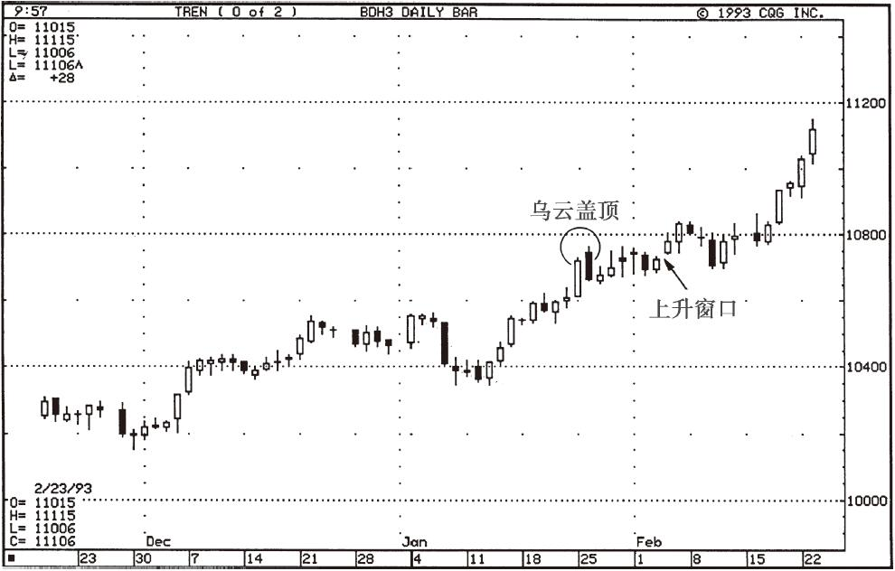

### 超越乌云盖顶形态

- 在图4-3中，Amgen股价的上升缺口体现出支撑力，在11月的回调中始终没有被回补。

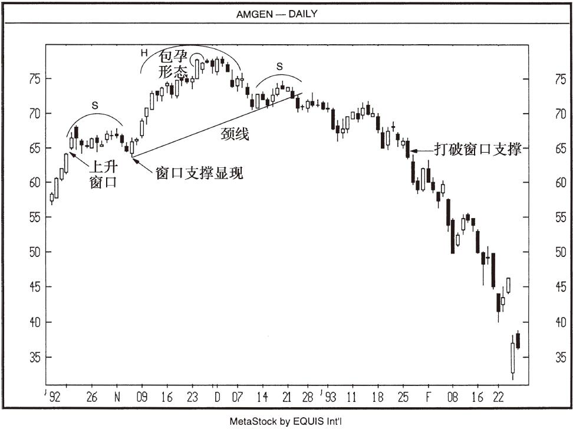

### 风险与收益的权衡

- 权衡风险与收益，就意味着设定止损点，这是控制风险的手段；

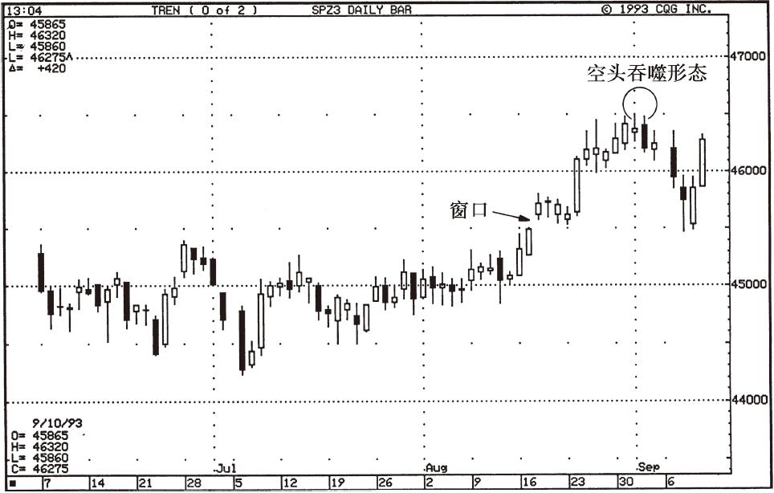

### 蜡烛图与风险收益比

- 几周之后，蜡烛图走出了乌云盖顶的组合，此时如果以乌云盖顶的顶部为止损点，以上升缺口的底部为目标价位进行放空交易，将是一次收益不菲的战机。

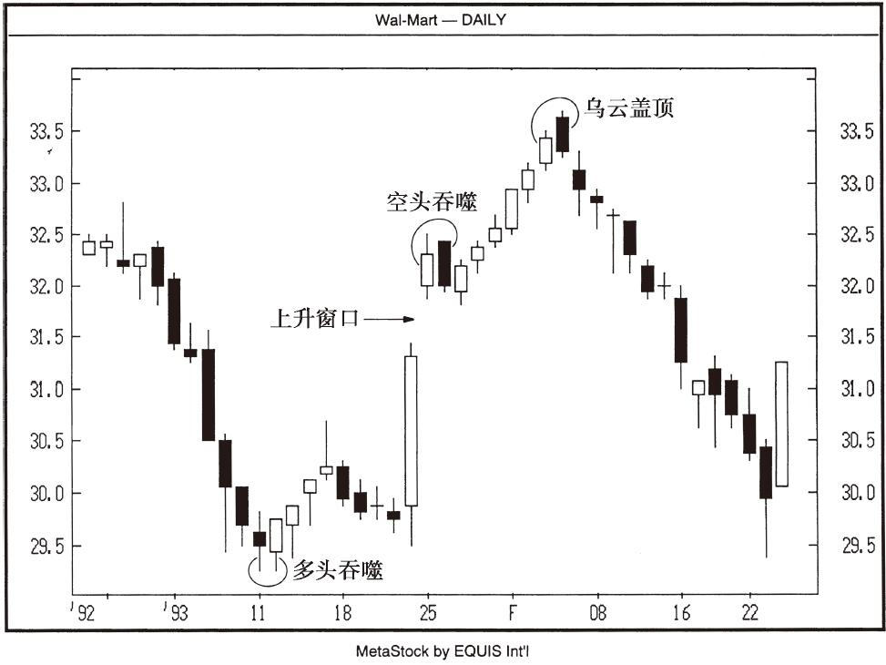

### 风险收益比

- 请注意，这个启明星的底部一周以后成了支撑位。

### 趋势

- 后来的行情发展证明，一直到7月19日收盘价到达趋势线下方时，这条构成支撑的上升趋势才被确认跌破。

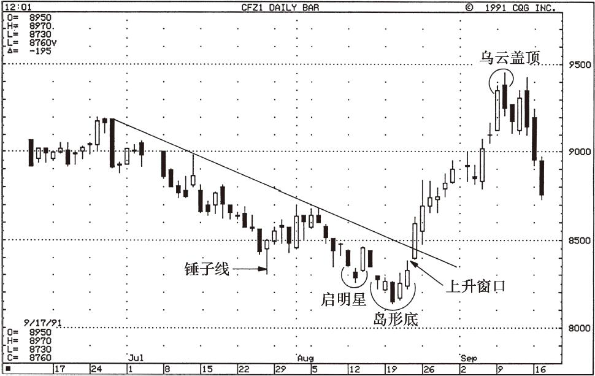

### 蜡烛图与趋势线

- 对于以移动平均线来判定趋势的投资者，我利用图4-10来说明如何利用蜡烛图信号在趋势内进行操作。

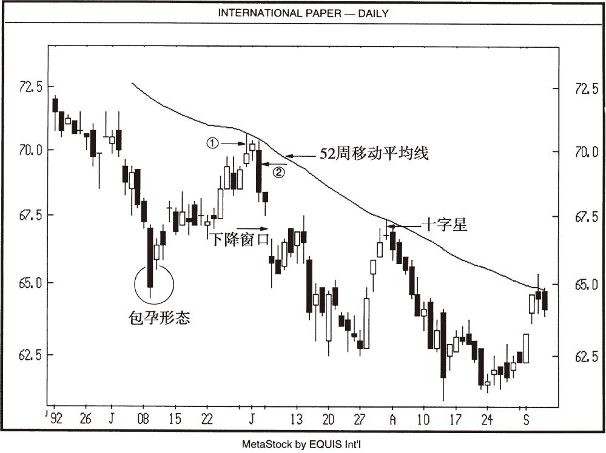

### 做一个市场变色龙

- 下单交易，就意味着你对市场的趋势有了自己的期待和判断。

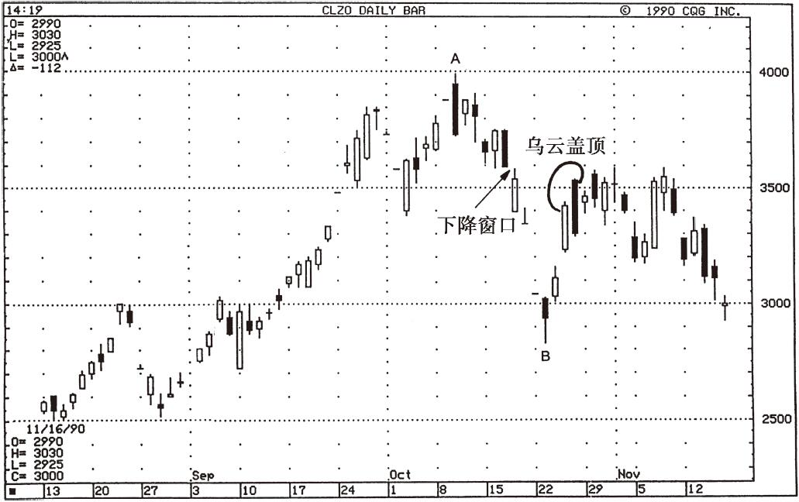

### 寻找改变市场舆论的价格

- 在本例中，如果多方有足够的力量推升价格，使之收盘于35.50～36.00美元阻力区的高点以上，就会证明我的判断发生了错误，此时必须改变看空的立场。

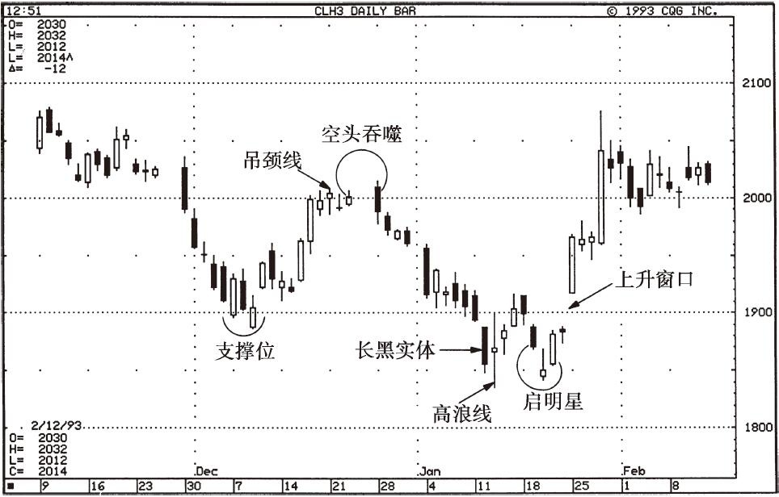

### 计算机与蜡烛图

- 随着计算机的日益普及以及蜡烛图理论的广泛流行，交易者可能希望用计算机来筛选最可靠或最重要的蜡烛图组合形态。

### 蜡烛图形态出现的位置

- 这与人们经常问我的一个问题有关：哪些蜡烛图形态最重要？

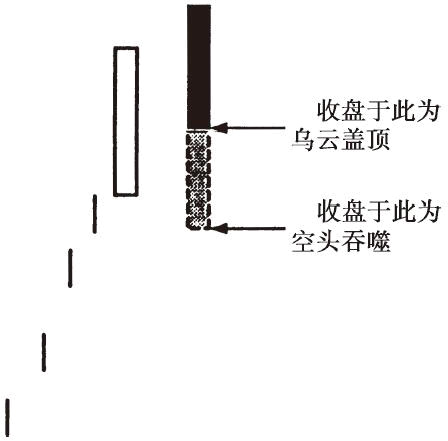

### 乌云盖顶与空头吞噬比较

- 孤立地看一个形态是非常危险的，前面出现过的图4-5可以表明这一点：就收益风险比率来考察，图中的乌云盖顶相比空头吞噬形态而言，是个更诱人的交易（做空）机会，而那个空头吞噬则实际上没有构成机会，是个诱人的陷阱。

### 如何决定一个蜡烛图形态的具体标准

- 在一根强劲的长白实体之后，行情高开，但收盘价低于前一根白线的收盘价，这不是清晰地显示空方已经从多方手中夺取了控制权吗？

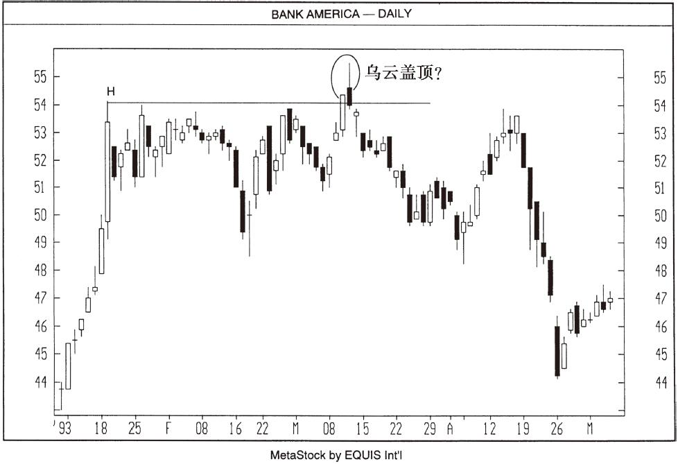

### 下单交易

- 一旦某个蜡烛图形态出现，是否意味着它发出了买进或卖出信号？

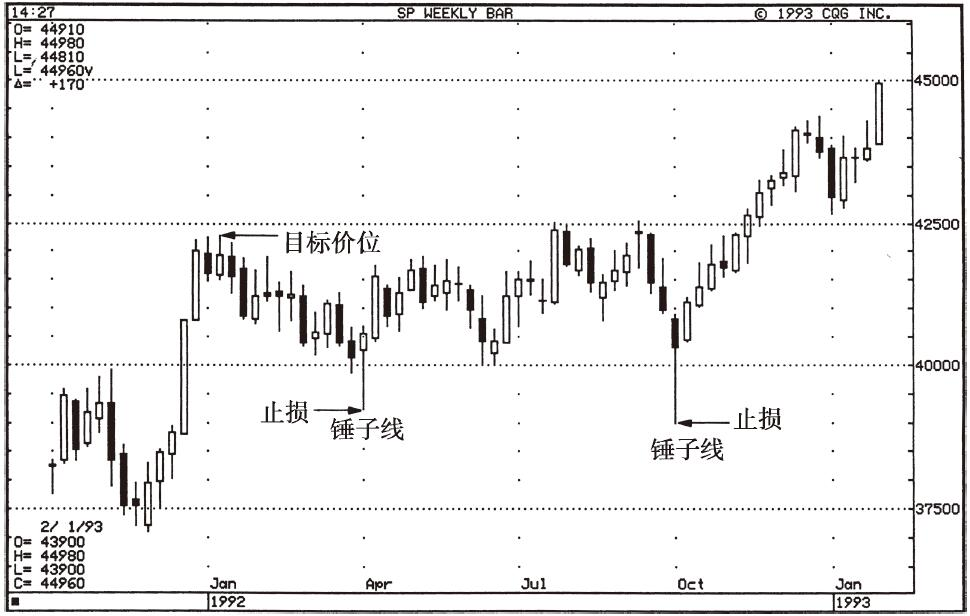

### 何时冲销一笔头寸

- 某个时候，某位交易者可能会设在上周的低点，而下一次，某位交易者可能将其设在支撑线上或者50%的反弹位或回落位。

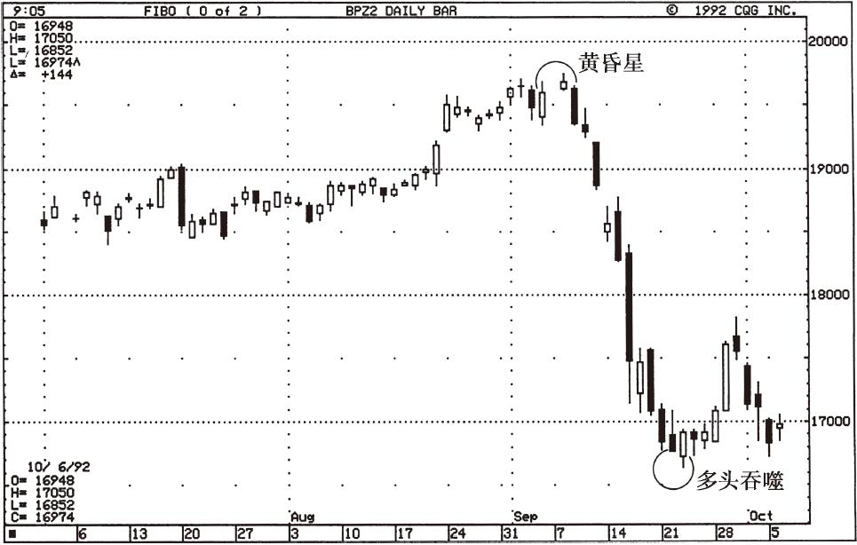

### 蜡烛图与价格目标

- 原先的支撑可以转化为阻力。

### 风险收益比：1992年3月可可

- 请注意，这个启明星的底部一周以后成了支撑位。

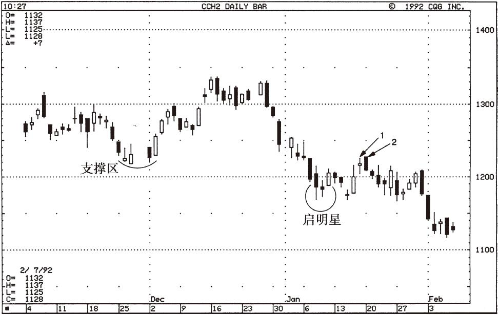

### 止损与风险耐受力

- 支撑缺口的完全封闭，是场内的多头止损卖出的信号。

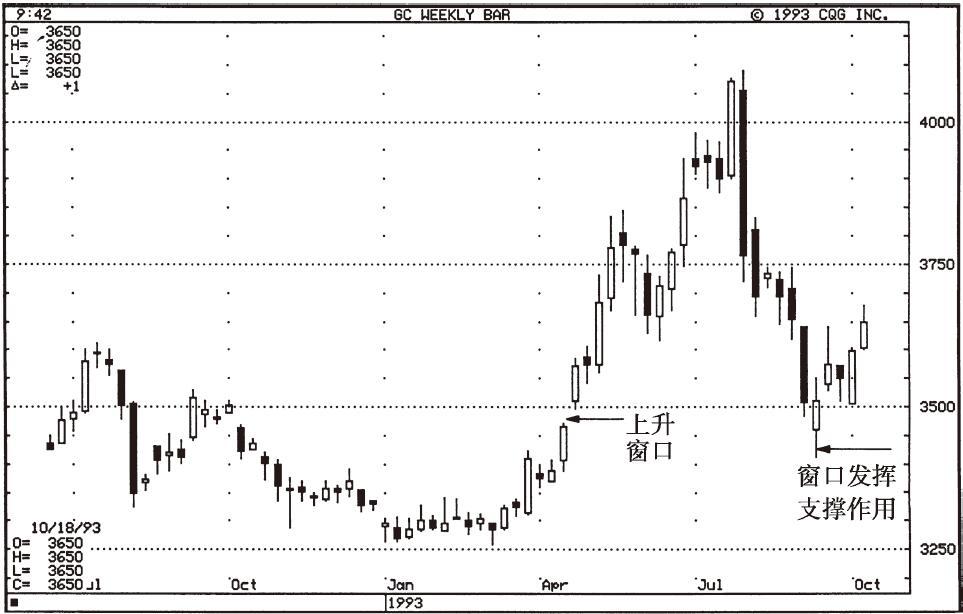

### 蜡烛图信号与趋势线：1993年9月5年期票据

- 蜡烛图信号与趋势线：1993年9月5年期票据

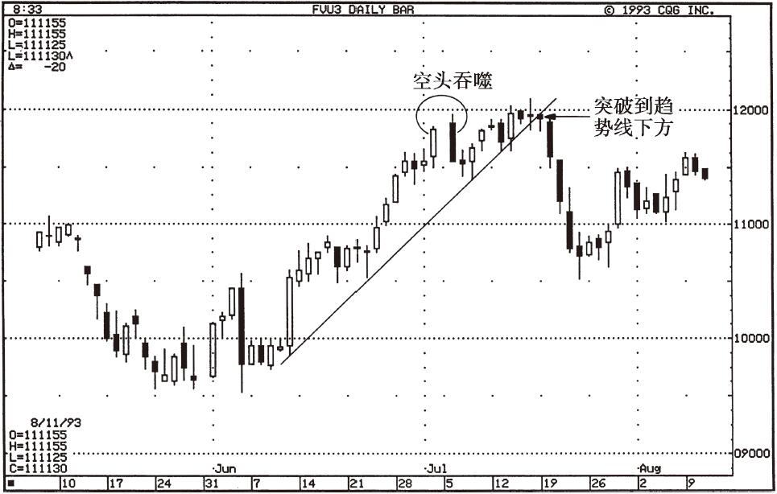
