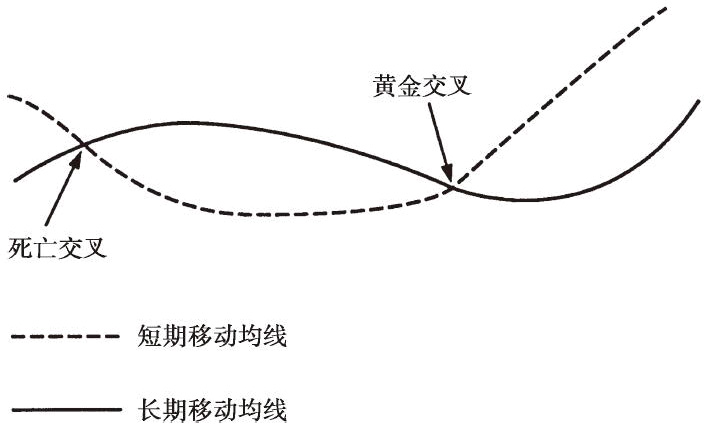
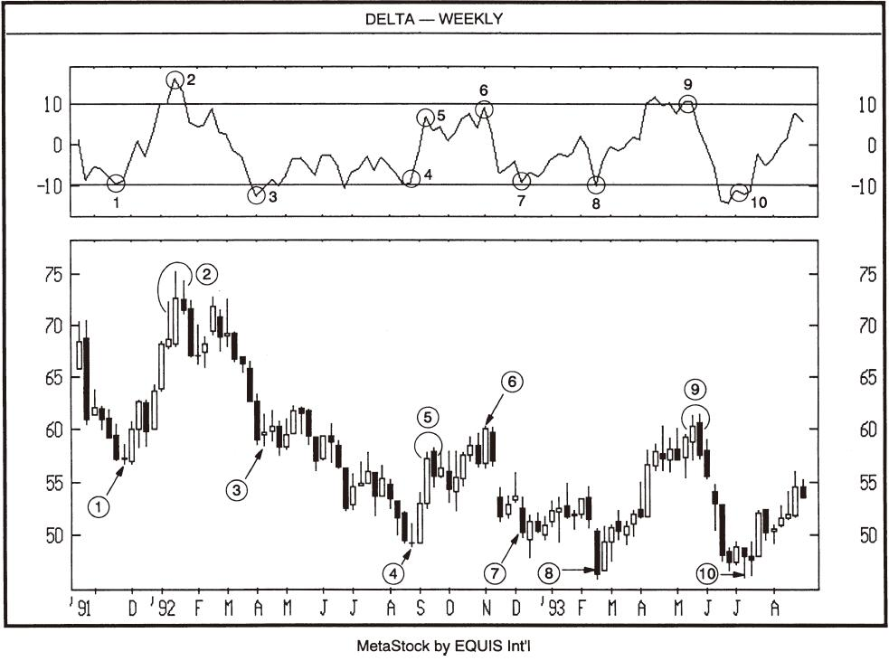
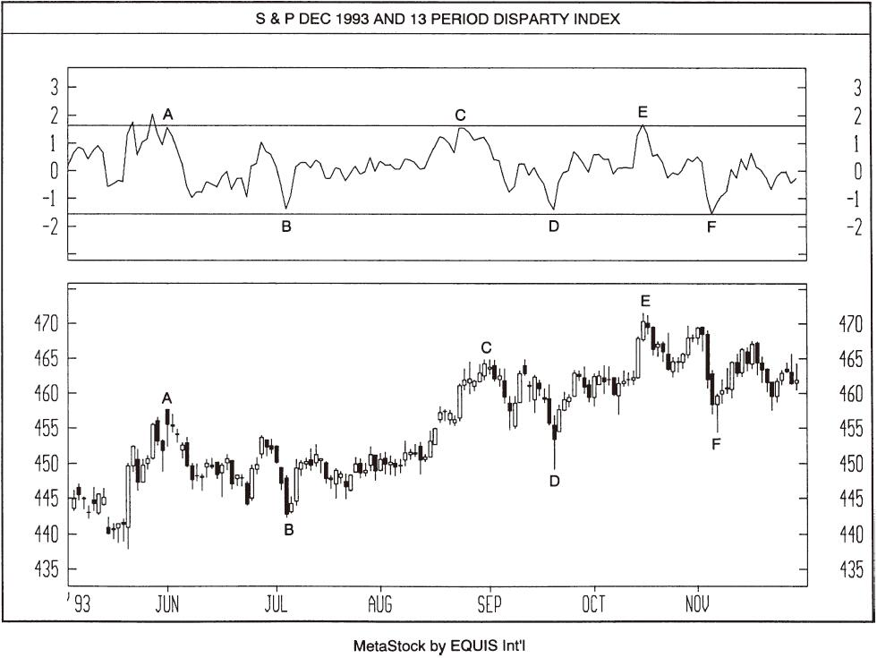
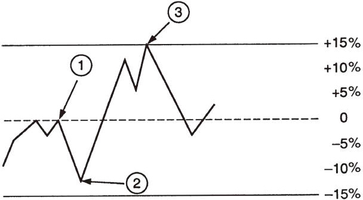
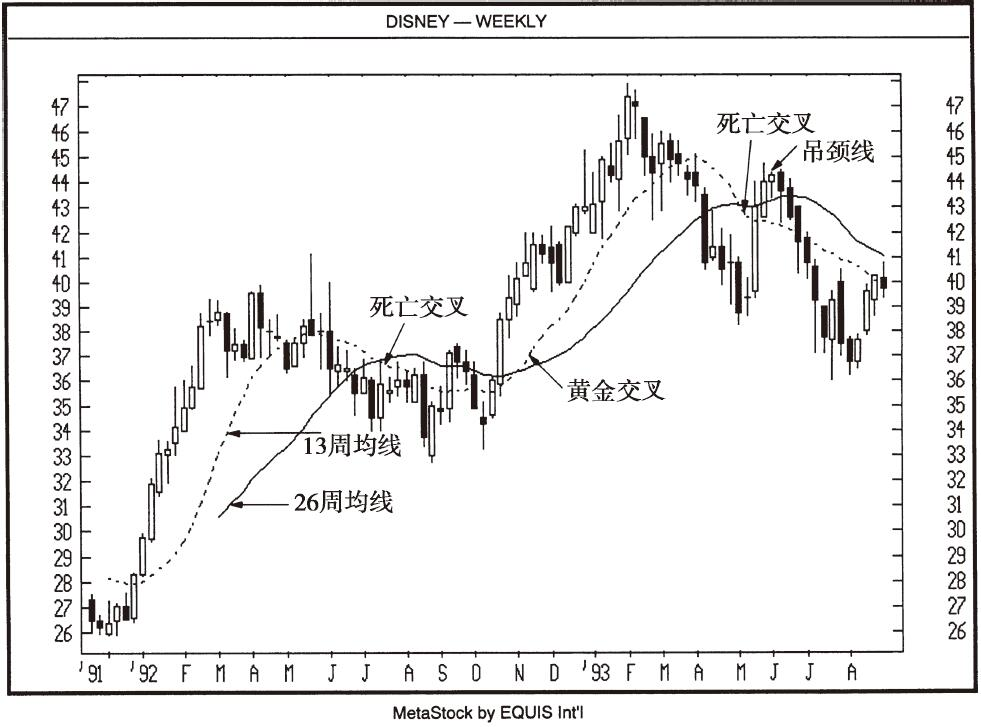

# 第12章-第5章 日本人如何使用移动平均线

## 章节笔记

### 开篇提出的问题

- 日本人与西方人一样将移动平均线视为重要的交易工具。

### 黄金交叉与死亡交叉

- 1993年5月，一条吊颈线（它又与后面一个交易周的蜡烛线构成了空头吞噬形态）表明市场有可能发生修正，与此前的一个死亡交叉相互印证。

### 差异指数

- 差异指数也称差异比率，用百分数表示，以收盘价减去移动平均值后的差除以所选定的移动平均值得出。

### 显示的是9日差异指数。图中

- 区域1：差异指数为0（图中标示为①处），表示当天的价格与所选定的移动平均（本例中为9日移动平均值）相等。

### 依据差异指数进行交易

- 兹举一例，如某书中曾有如下一段文字：“在低价区，一个包孕形态很有可能表明底部已近，而在高价区，一个包孕形态很有可能表明行情即将见顶。

### 差异指数

- 有些日本交易员习惯于用差异指数来判定行情究竟是处于低价区还是高价区，因为差异指数能有效地反映市场是否超买或者超卖。

### 很典型地表明，差异指数能为蜡烛图提供增值分析，为蜡烛图提供重要参考。我们知道，依据差异指数判定市场是否超买或超卖，首先取决于市场的性质以及标的物的特质和所选定的差异指数。就本图中的股票而言，当13周差异指数到达+10%时，行情处于超买状态；当差异指数到达-10%附近时，市场处于超卖状态。图5-4中由差异比率提供的这类额外信息，可以进一步确认蜡烛图中的信号，具体来说就是

- 十字星后出现的长白实体蜡烛线帮助确认了十字星的多头信号。

### 差异指数可视为超买或超卖指标

- 如上所述，差异指数是有用的工具，可以用来判断市场是否处于超买或超卖状态。

### 偏离指数

- 日本的技术分析中还有一个移动平均摆动指标，称为“偏离指数”。

### 200日偏离指数与差异指数

- 但要记住，高企的偏离值并不一定意味着价格就会反转，而只是表明行情正处于投机狂热中，而过低的偏离值也只是表明行情处于恐慌性抛售中。

### 差异指数与背离：德国马克13日差异指数

- 差异指数与背离：德国马克13日差异指数

### 黄金交叉与死亡交叉：迪士尼——周线

- 黄金交叉与死亡交叉：迪士尼——周线

