# 第13章-第6章 三线反向突破图

## 章节笔记

### 开篇提出的问题

- 在一位日本交易员的笔下，三线反向突破图是一种“更为微妙的点线图，在这种图形中，市场本身呈现反转，而不是由主观设定的规则来判定反转。

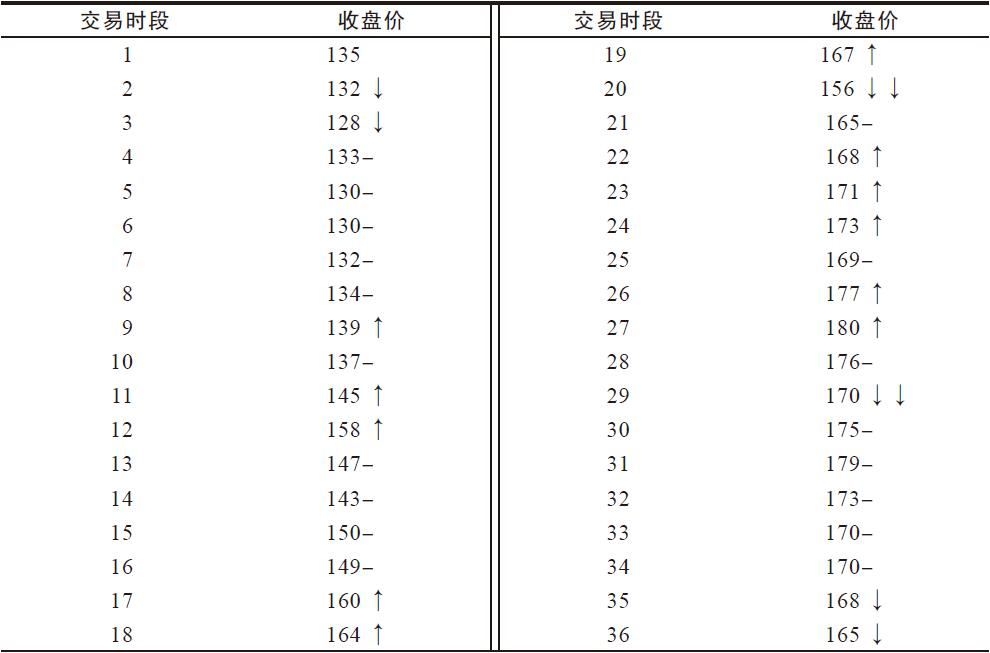

### 三线反向突破图的画法

- 我们现在就来举例介绍三线反向突破图的画法。

### 三线反向突破图

- 三线反向突破图反映的是收盘价，图6-1中的初始价格称为“基价”。

### 白线与黑线作为买入与卖出信号

- 如果像图6-2a那样，黑白线连续相间出现，说明市场没有明确的趋势。

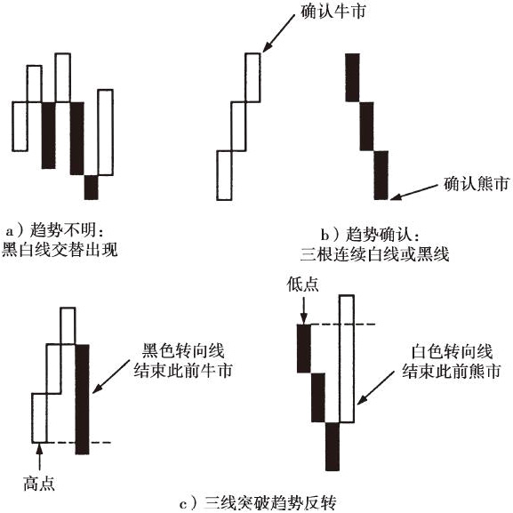

### 趋势确认

- 从这个例子中可以看出，在三线反向突破图中，有时候，新趋势出现很久以后才会出现反转信号。

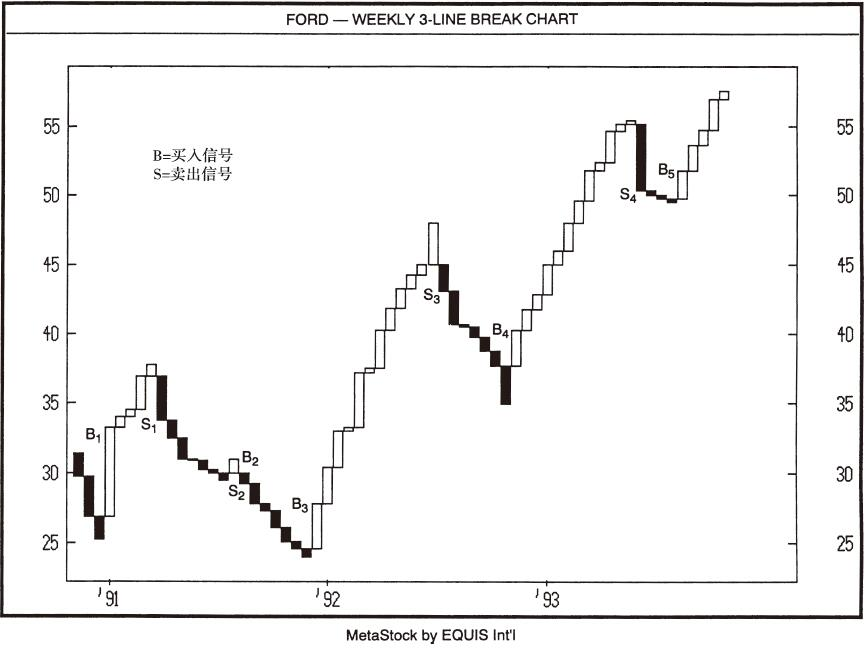

### 白、黑线作为买入、卖出信号

- 三线反向突破图用的是收盘价，也就是说，是否构成反转，必须等待收盘才能确认。

### 三线反向突破图与蜡烛图

- 三线反向突破图的作用就是判断市场的牛熊趋势，因此也可以用于蜡烛图的辅助工具。

### a是一个三线反向突破图，它显示在价格到达29.50美元以后，出现了一根黑色转向线，而在对应的图6-4b的蜡烛图中，这里出现了一个空头吞噬形态，暗示市场在这里见顶。三线反向突破图中的这根黑色转向线表明市场已经转身向下。按照顺势（大趋势）而为的理论，交易者这时应该在蜡烛图上寻找在这个熊市中卖出（做空）的时机。与此同时，这个熊市市道中的多头信号可以忽略不见，也可以作为平仓时机。

- 按照这个观念，我现在来说明如何将图6-4a的三线反向突破图与图6-4b的蜡烛图交易策略结合起来使用。

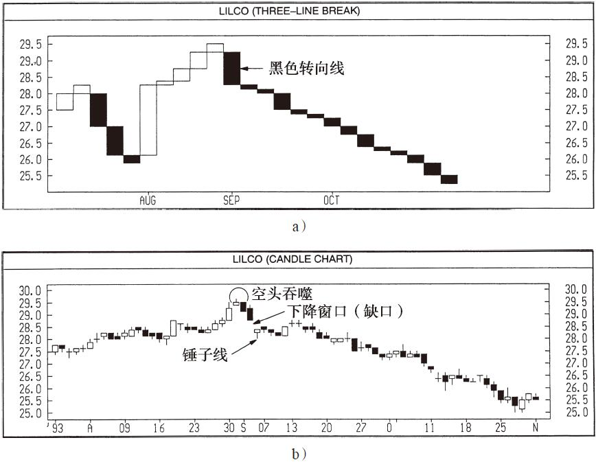

### a是一个三线反向突破图，而图6-5b是一个蜡烛图。我用它们来演示如何从三线反向突破图中发现市场的大趋势，然后用这个大趋势来引导蜡烛图交易。

- 在这期间出现了一根长白实体蜡烛图，暂时中止了市场的卖压，但是在这个白色蜡烛线的底部所构成的支撑被打破之时，蜡烛图又发出了行情下行的信号。

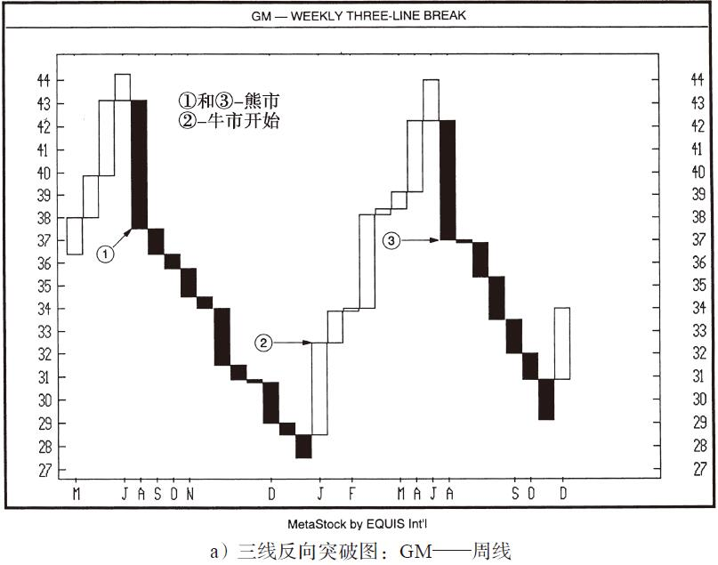

### 三线反线突破图与蜡烛图

- 但是，大趋势还在上行，而且长白蜡烛图构成了支撑，因此我们可以把这条高浪线之后的抛售看成牛市中的修正阶段。

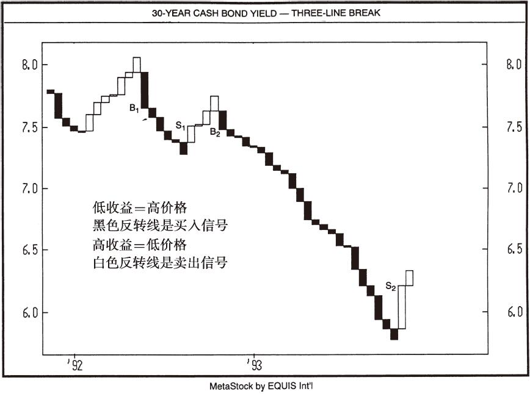

### 其他突破图形

- 三线反向突破图中，必须突破此前的三根连续白线或者黑线，才能画出一条转向线，确认趋势反转。

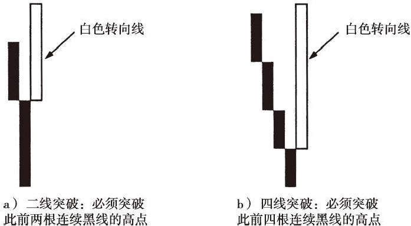

### 二线突破与四线突破

- 我们可以看出，在二线突破图上，买卖信号的数量明显增加，而在五线突破图上，买卖信号相对较少。

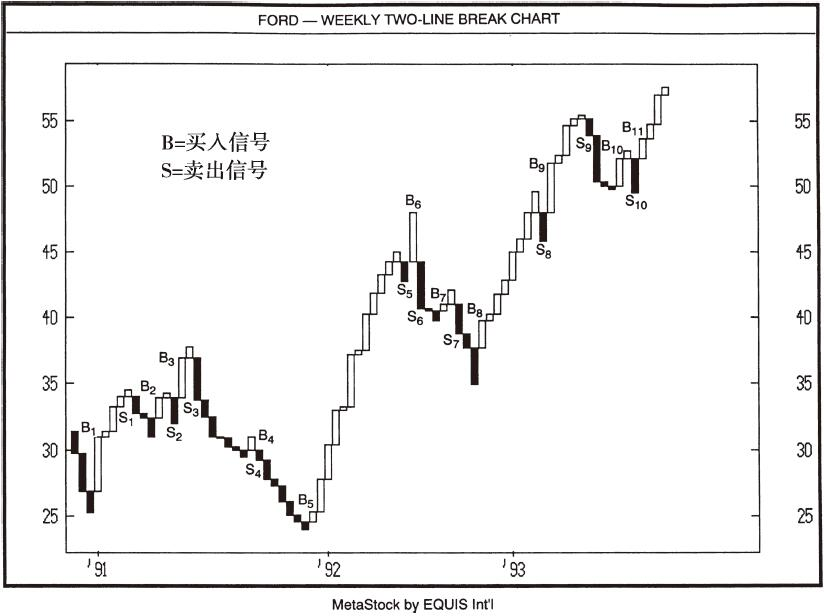

### 对趋势反转的进一步确认

- 趋势出现反转迹象，甚至在出现了一根转向线以后，有些日本交易员还会等待进一步的确认。

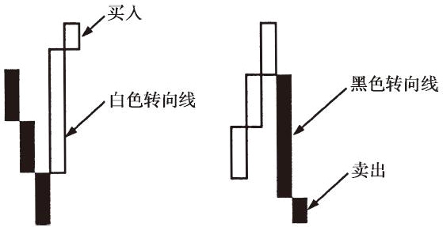

### 等待进一步确认

- 交易者对趋势反转的确认等得越久，出错的概率就越低，而获利潜力也会降低，因为此时这个新趋势又已经前行了一段时间。

### 黑鞋、黑白套装、脖颈

- 如图6-11所示的那条短短的黑线有时称为“黑鞋”，原因很简单，因为它看起来就像是一只黑色鞋子。

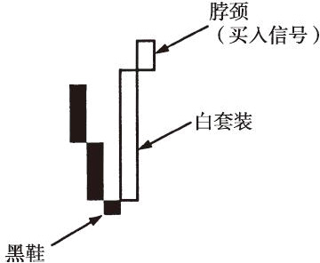

### 黑鞋、白套装、脖颈

- 日本人针对三线反向突破图有一种说法：“在黑鞋上面有白套装，白套装上面伸出脖颈时买入。

### 脖颈、黑套装和黑鞋

- 上升趋势顶端的那个小实体（即脖颈）表示买盘衰减，或者卖压强劲，足以减缓多头前进的步伐。

### 迭创新高（低）与三线反向突破图

- 我们知道，在蜡烛图中，迭创新高（低）式排列具有重要意义。

### 墨西哥电信——日线

- 他说，这两个点位对以后的任何反弹都构成了阻力。

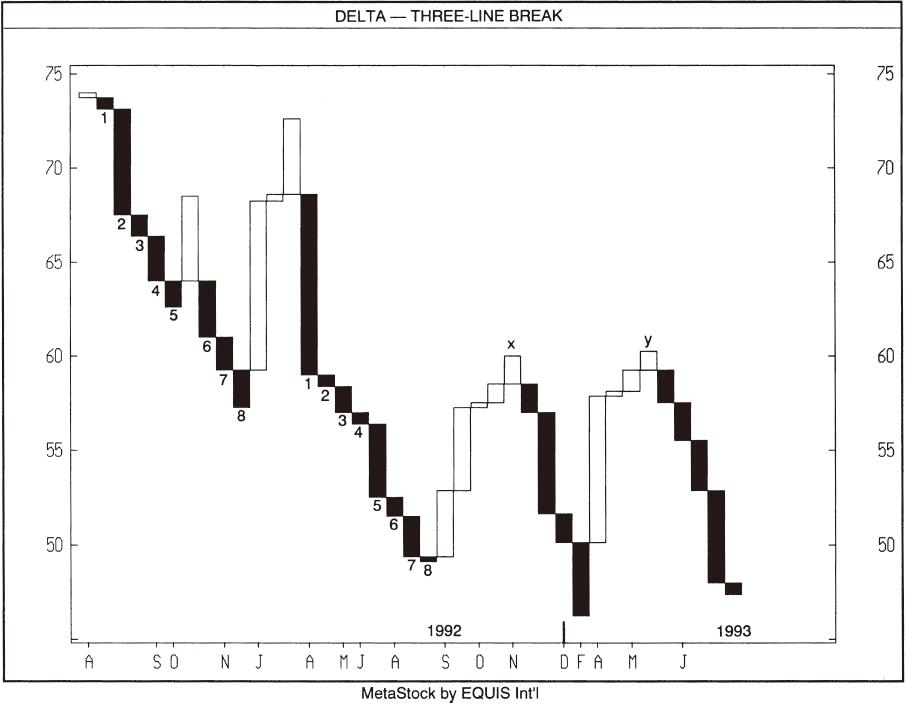

### 三线反向突破图中的迭创新低

- 在图6-15中，上行的支撑线与49.50美元附近的阻力区可以用来说明，蜡烛图中的趋势线与阻力位在三线反向突破图中也很容易找到。

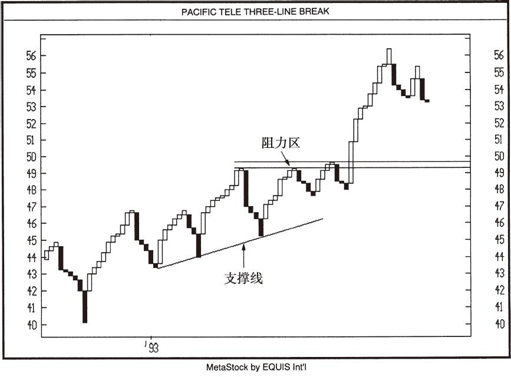

### 三线反向突破图练习题

- 为巩固对三线反向突破图的理解，我们来做一个练习。

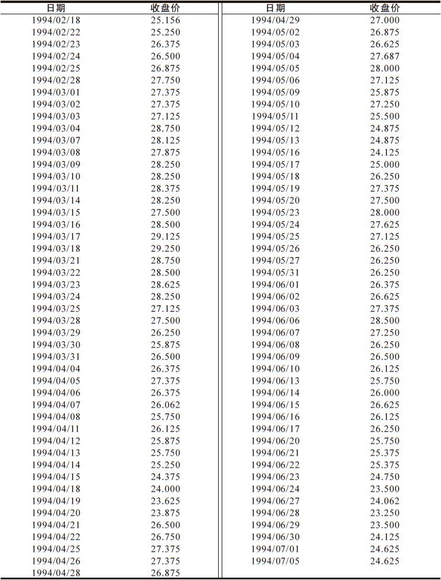

### 表6-2 三线反向突破图练习用数据

- 表6-3 三线反向突破图练习参考答案所用数据

### 三线反向突破图中的趋势线

- 三线反向突破图中的趋势线

### 三线反向突破图中使用经典的西方分析技术

- 三线反向突破图中使用经典的西方分析技术

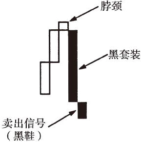

### 五线反向突破图：福特——周线

- 五线反向突破图：福特——周线

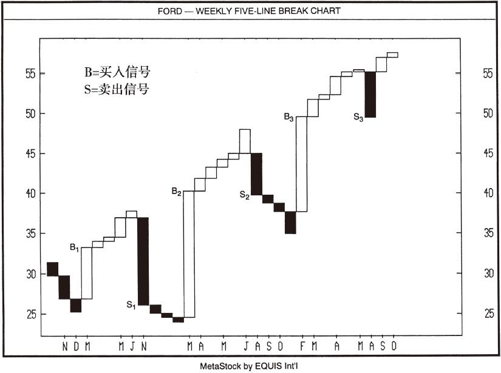

### 三线反向突破图中的双顶

- 三线反向突破图中的双顶

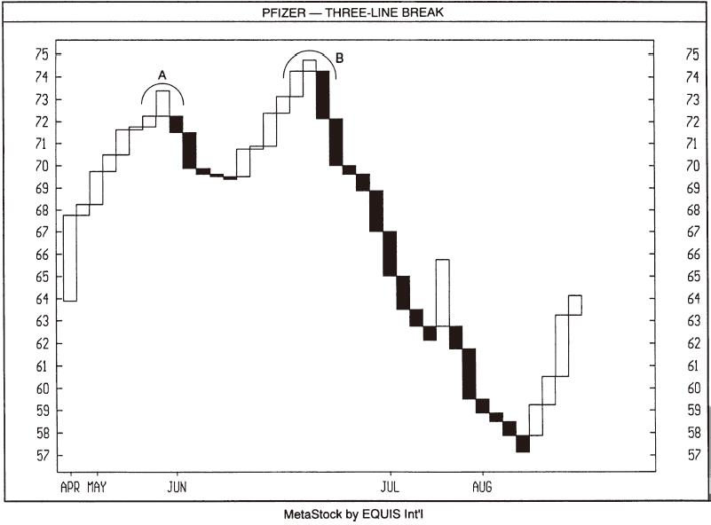
