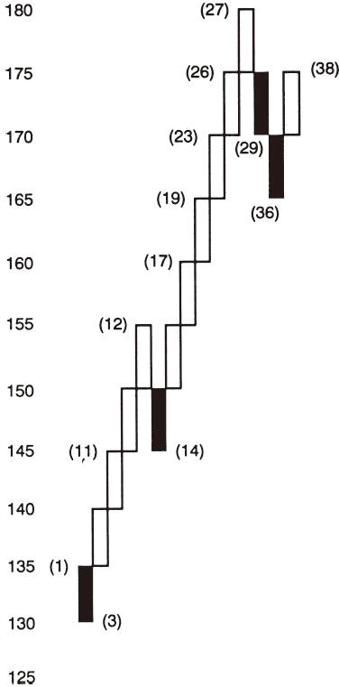
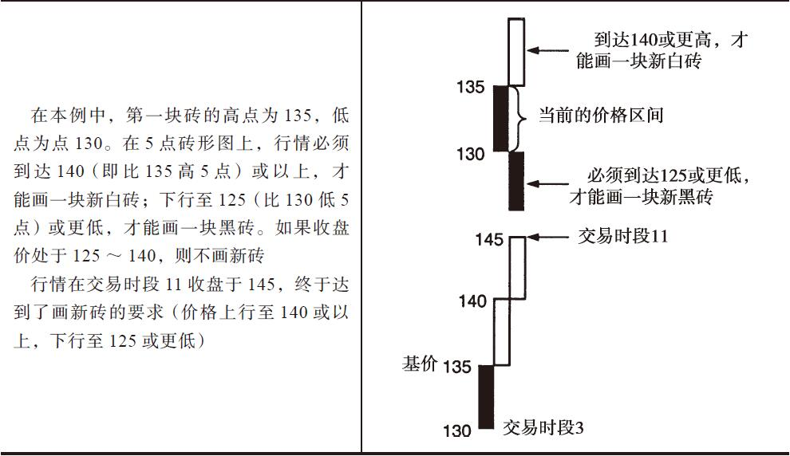
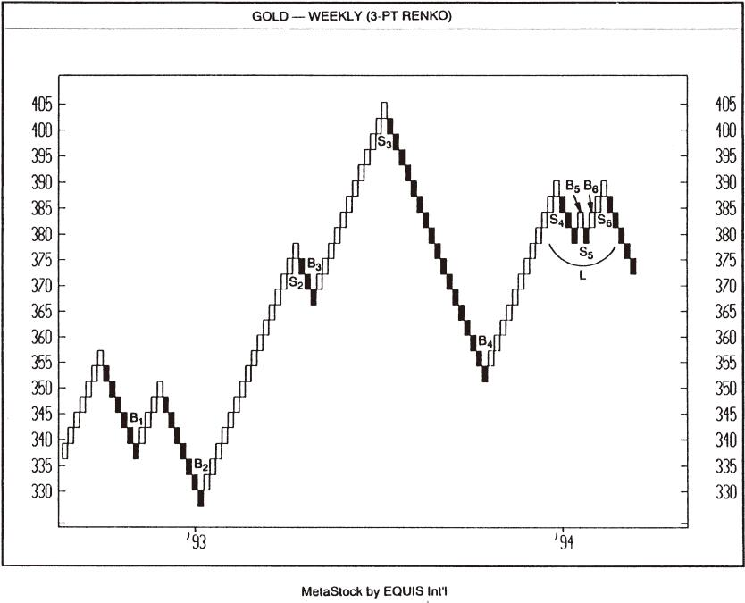
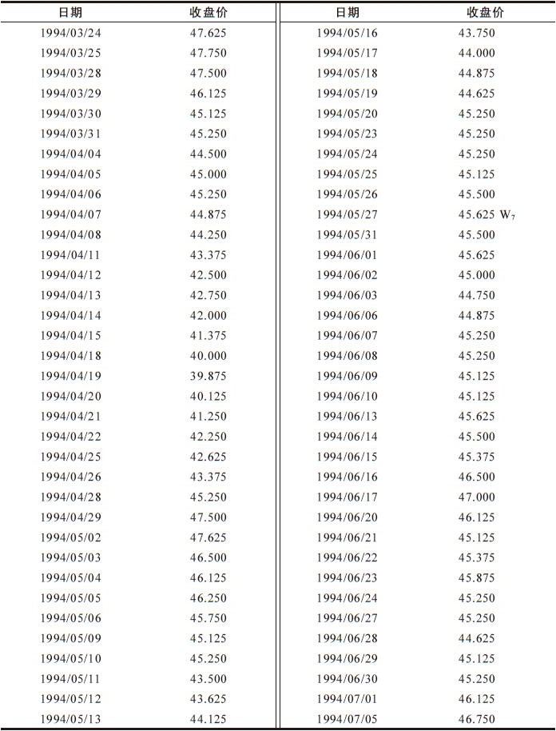
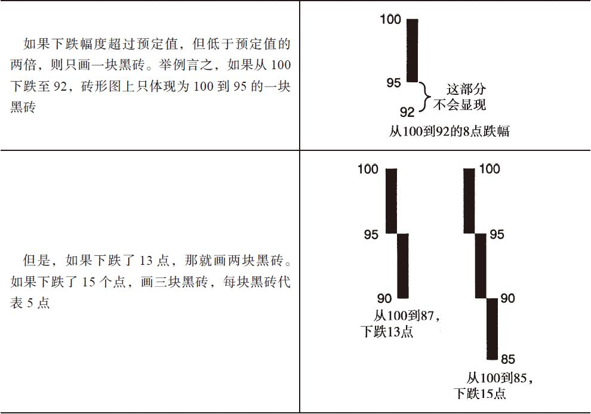

# 第14章-第7章 砖形图

## 章节笔记

### 5点砖形图，变动幅度设定为5点，所依据的收盘价如表7-1所示

- 在第6章所讨论的三线反向突破图中，如果行情沿着主导趋势创出新价格，就要画一根新线，不管这个新高或新低与前高或前低之间有多大的变动幅度。

### 砖形图的画法

- 在一个5点砖形图中，如果某个交易时段的收盘价比前砖头的高点高了20个点，那么就要在图中画上4块砖头，依次升高，每块砖头代表5个点。

### 砖形图的交易技巧

- 三线反向突破图与钥匙图的交易技巧比较多样化，而砖形图的交易技巧比较单一。

### 基本买入、卖出信号

- 如图所示，买入信号（图中以字母B表示）因白砖的出现而形成，卖出信号（以字母S表示）随着黑砖的出现而产生。

### 砖形图练习题

- 表7-2 画1美元砖形图练习题所使用的数据

### 国债期货周线：多头24/32砖形图

- 国债期货周线：多头24/32砖形图

