# 第15章-第8章 钥匙图

## 章节笔记

### 开篇提出的问题

- 20世纪70年代日本出现股票交易市场之初，钥匙图就开始成形，如图8-1所示。

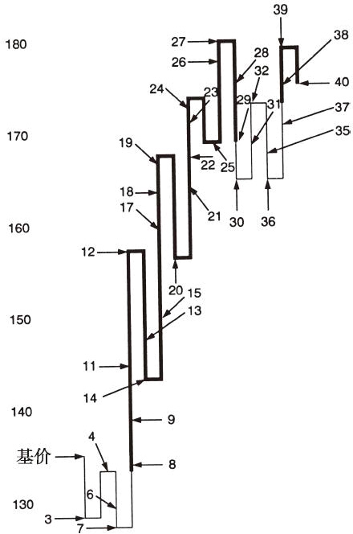

### 钥匙线，所依据数据如表8-1所示

- 有本日文专著曾有言：“正如蜡烛图优于条形图，钥匙图也优于点线图。

### 钥匙图的画法

- 绝大多数钥匙图采用收盘价。

### 百分比钥匙图

- 在日本，使用百分比钥匙图的人还是不如用绝对值（一个固定数值）钥匙图的人数量多。

### 见阳买入，见阴卖出

- 钥匙图有多种用法，最基本的用法就是：当钥匙线由阴转阳（由细变粗）时买入，当钥匙线由阳转阴（由粗变细）时卖出。

### 肩与腰

- 前高也称“肩”，前低则称“腰”。

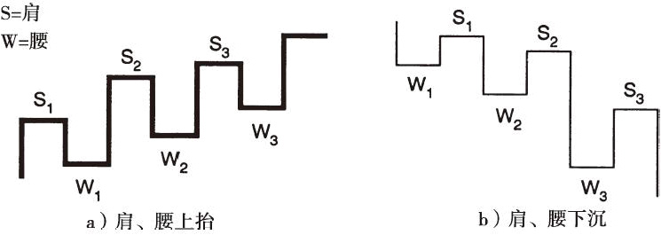

### 高低点的意义

- 股票共同基金的价格只提供收盘价，因为蜡烛图要有开盘价、收盘价、最高价、最低价才能画成，所以蜡烛图不能用来分析股票共同基金。

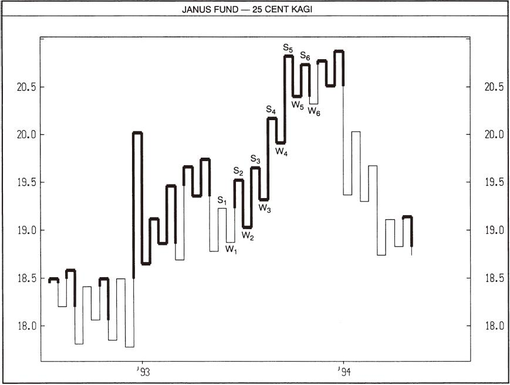

### 多级突破

- 如第6章所述，在利用三线反向突破图进行交易时，日本投资者会在转向线后等待又一根白线或黑线，以待市场对趋势的进一步确认，同样的策略也可用于钥匙图。

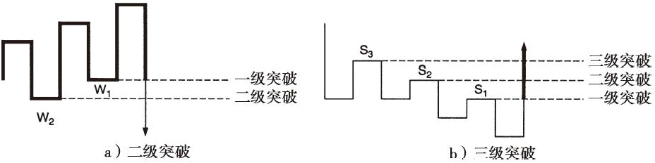

### 二级突破与三级突破

- 任何对进一步确认的等待，意味着等待时间的延长，这对任何技术都不例外，对钥匙图的多级确认技术也是如此，这种等待意味着获利潜力的降低。

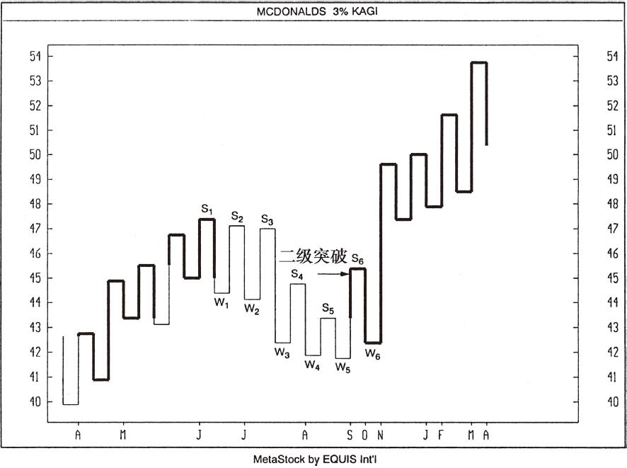

### 阴阳线的长度

- 在钥匙图上，阴阳线的长度也有类似的提示作用。

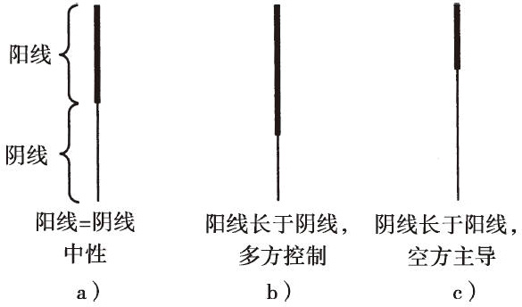

### 比较钥匙线中阴阳线的相对长度

- 在图8-9的钥匙线1～3中，阳线均长于阴线，表示多方的力量比较强大。

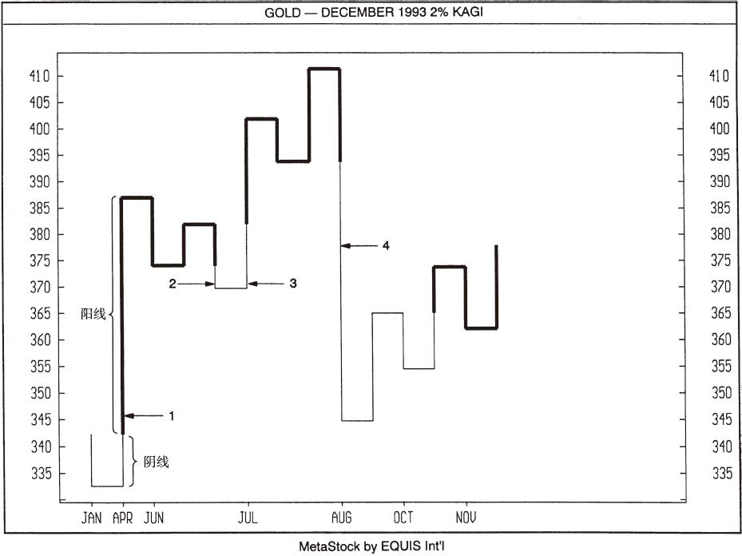

### 修正发生在前钥匙线内部

- 如果市场发生修正，但是修正的幅度没有突破前一根钥匙线的高低点之内，则反映市场情况没有走坏。

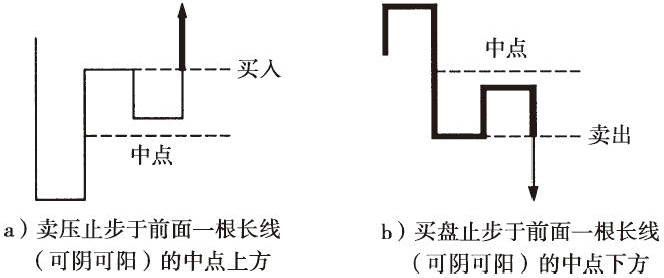

### 钥匙线的中点

- 在一段下行趋势中，市场即使反弹，但如果没有能够刺穿前面一根长钥匙线的中点就回头，这也是一个负面信号，表示多头的力量有限，甚至无法抵达前面一根线的中点位置，如图8-10b所示。

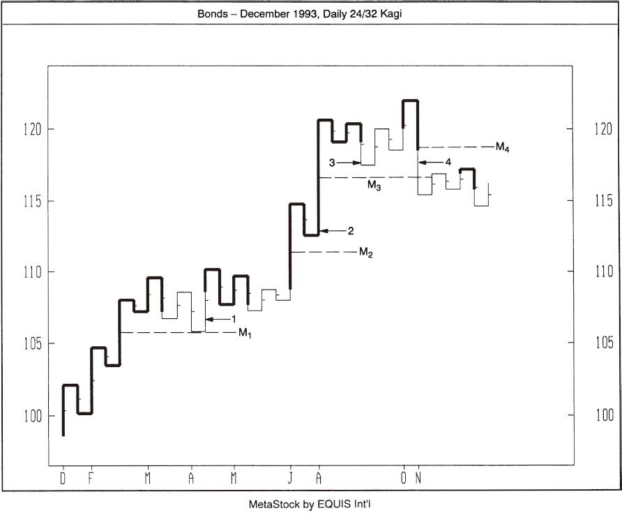

### 钥匙线及其中点

- 章节要点

### 双窗口形态

- 双窗口形态在钥匙图中既可能是底部反转形态，也可能是顶部反转形态（注意，钥匙图中的双窗口形态与蜡烛图中的双窗口是不同的）。

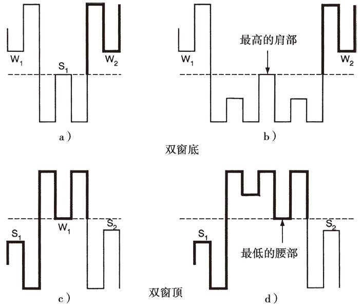

### c与图8-12d为双窗顶部形态，其形成条件为

- 发生在上升趋势中，左肩S 1 低于后面的腰部W 1 ；

### 双窗形态

- 图中我用两个椭圆形标示出两个双窗，因为日本人传统上也是用这种图形来标示双窗形态的。

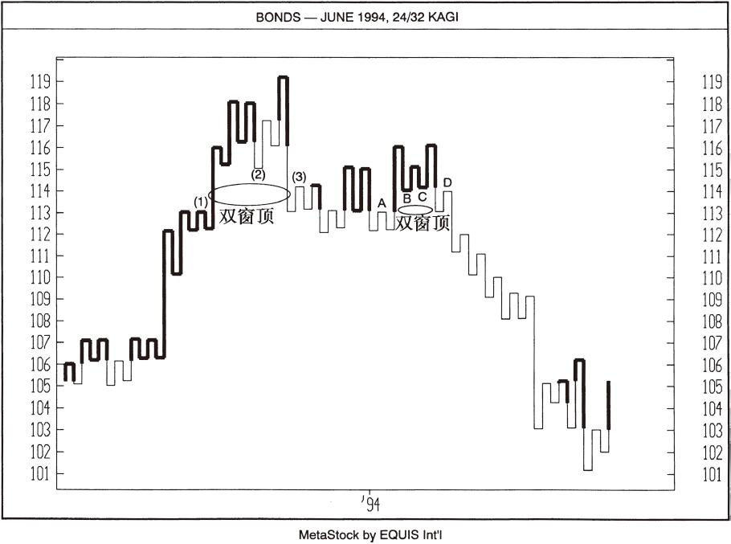

### 趋势线

- 图中X与Y区域形成了一个双底，为一波小反弹构筑了一个比较像样的基础，这波反弹的支撑线为Y处开始的上升趋势线。

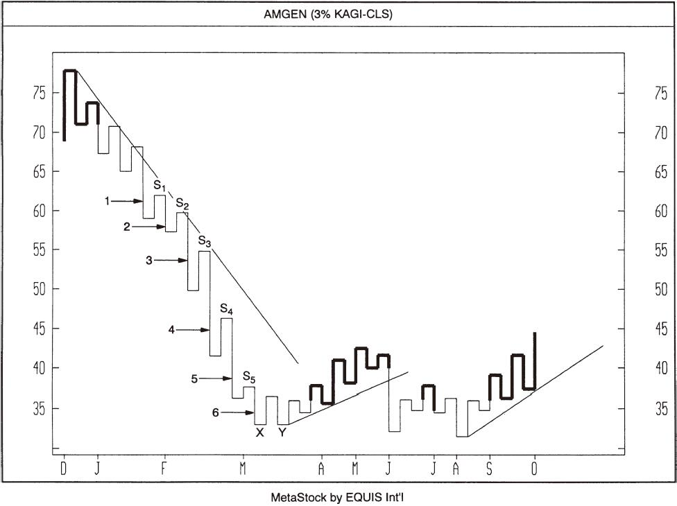

### 支撑线与压力线

- 极性转换原则（前支撑构成现在的压力，前压力构成现在的支撑）也可以用在钥匙图中，因为钥匙图中的前支撑与前压力（阻力）位也是非常明显的。

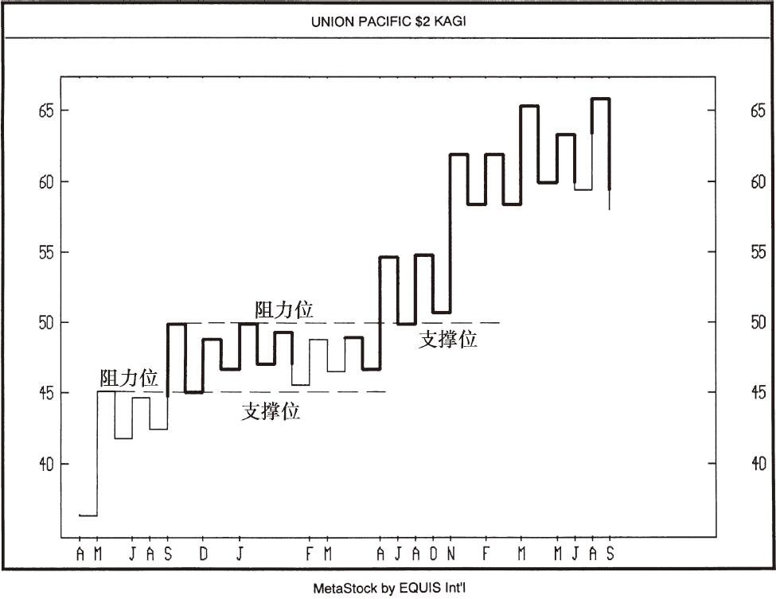

### 镊子顶

- 如上所述，在钥匙图上，支撑位与阻力位都非常明显。

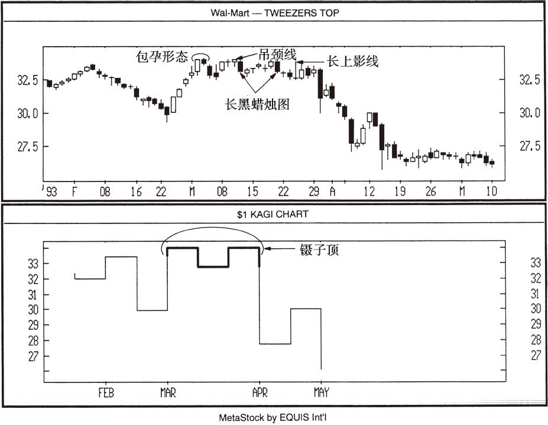

### 典型的三佛顶与三佛底形态

- 我们以图8-19来说明交易者可以用什么方式来判定一个三佛形态的空头或多头信号价值。

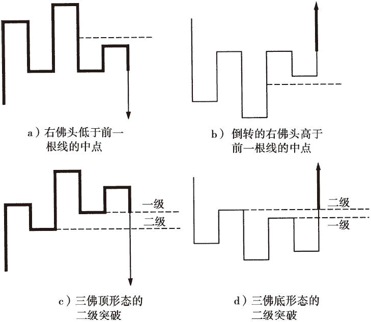

### 三佛形态的变体

- 当上升趋势线被打破以后，图中发出第一个空头信号，而钥匙线上的一级突破，则对这个空头信号进行了确认，如果有的投资者喜欢等待对信号的进一步确认，那么钥匙线上的二级突破就是这样一个对顶部的额外确认。

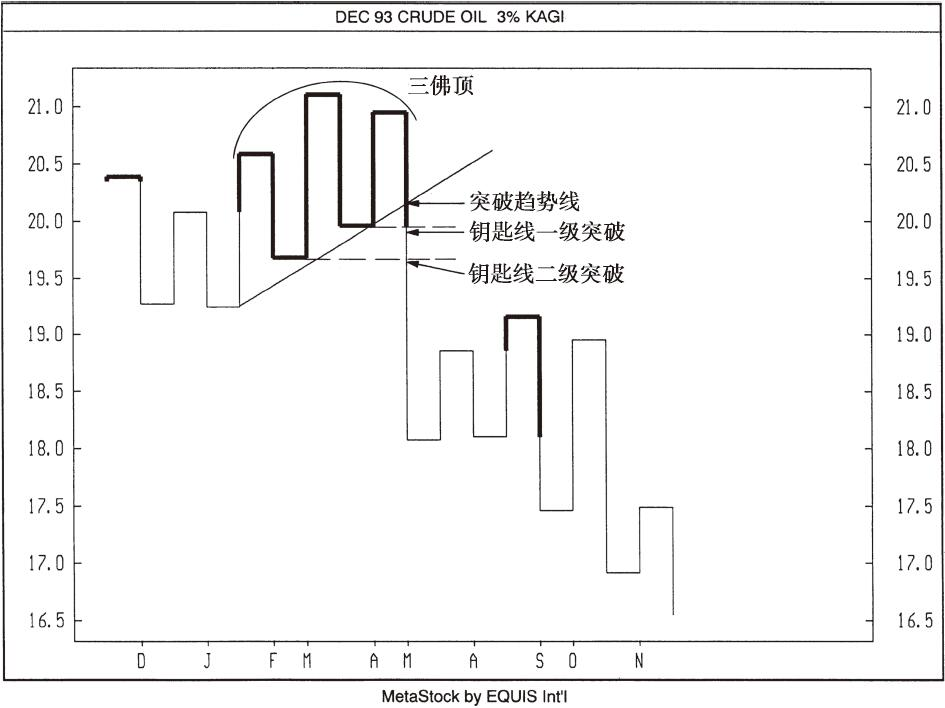

### 迭创新高（低）

- 无论是用蜡烛图还是用钥匙图，日本交易者很看重“迭创新高（低）”概念。

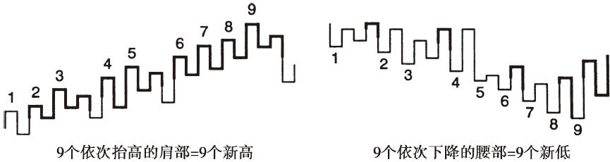

### 迭创新高

- 在本图中，我们看到4月末与5月初出现了明显的阻力位。

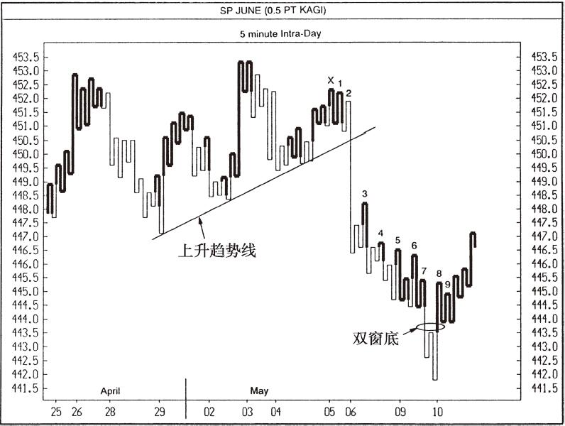

### 显示了钥匙图的一个重要优点，它能让我们对只提供收盘价的共同基金等市场进行详细的分析。在图中的麦哲伦基金走势上，多个钥匙线技术可以用来在1993年年底前发出顶部信号。这些信号包括

- 长线1、2、3以后的回抽都终止于长线的中点以上，表明市场处于强势状态。

### 钥匙图练习题

- 你可以将后面的画图用小方格纸复印一份，然后在上面画图，也可以直接在白纸上画钥匙图，画图用的数据如表8-2所示。

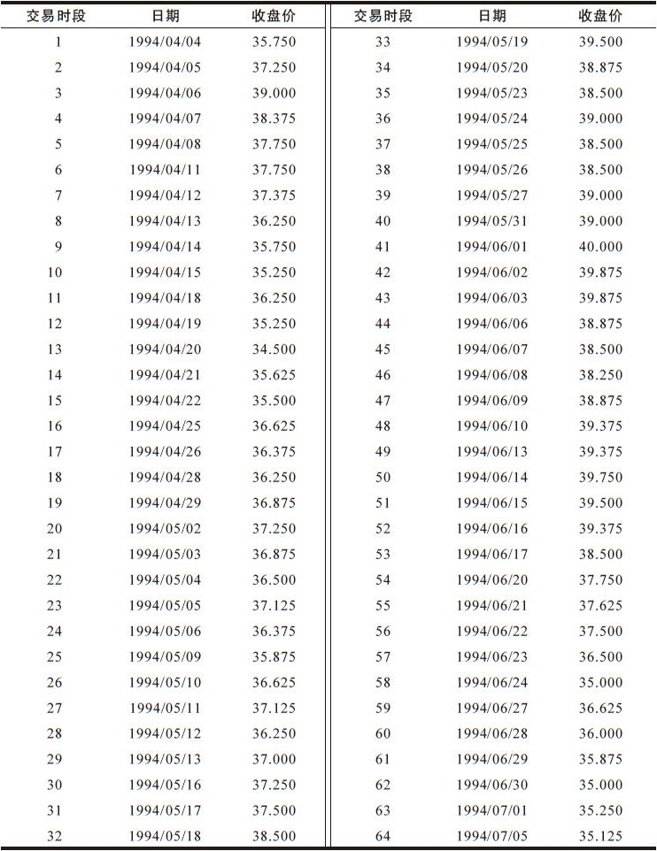

### 基本买入、卖出信号：美林证券3%钥匙图——日线

- 基本买入、卖出信号：美林证券3%钥匙图——日线

### 双窗底：1994年6月原油期货15美分钥匙图

- 如图8-14所示，1993年年末市场出现了一个双窗顶：标示为（2）的最低腰部位置高于两边的（1）、（3）肩部。

### 三佛底：道琼斯25点钥匙线

- 三佛底：道琼斯25点钥匙线

### 麦哲伦基金2%钥匙图——日线

- 高点A～E的上升，以及低点A′～F′的上移，表明市场逐渐逞强。

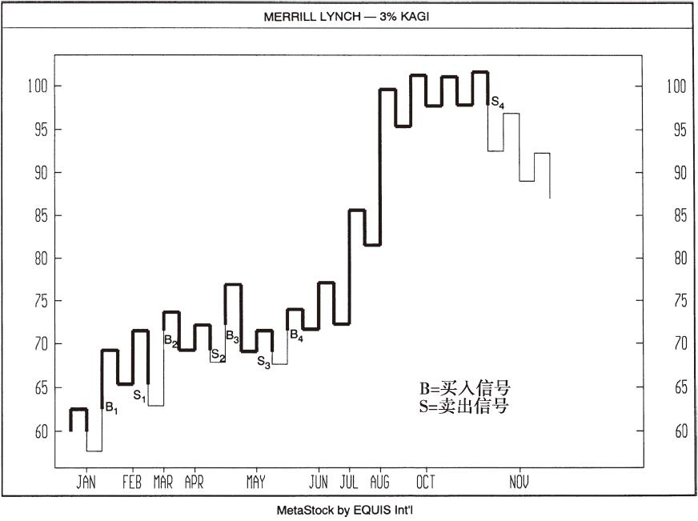

### 高低点的意义：美国氰氨2美元钥匙图——日线

- 股票共同基金的价格只提供收盘价，因为蜡烛图要有开盘价、收盘价、最高价、最低价才能画成，所以蜡烛图不能用来分析股票共同基金。

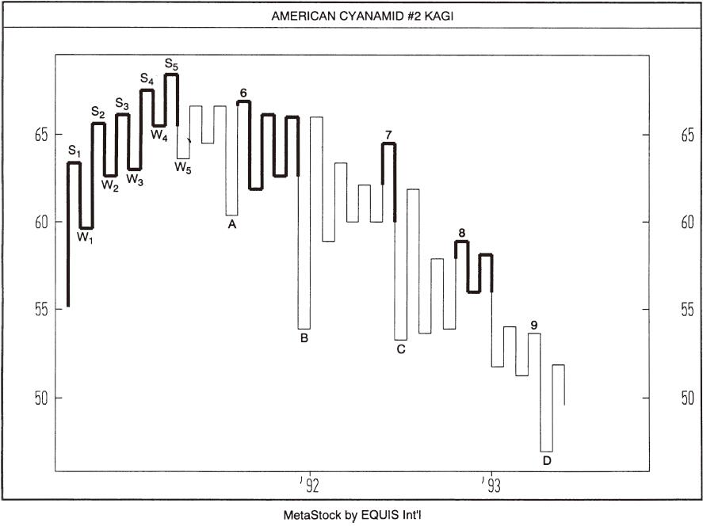

### 迭创新高：百事3%钥匙图——日线

- 在本图中，我们看到4月末与5月初出现了明显的阻力位。

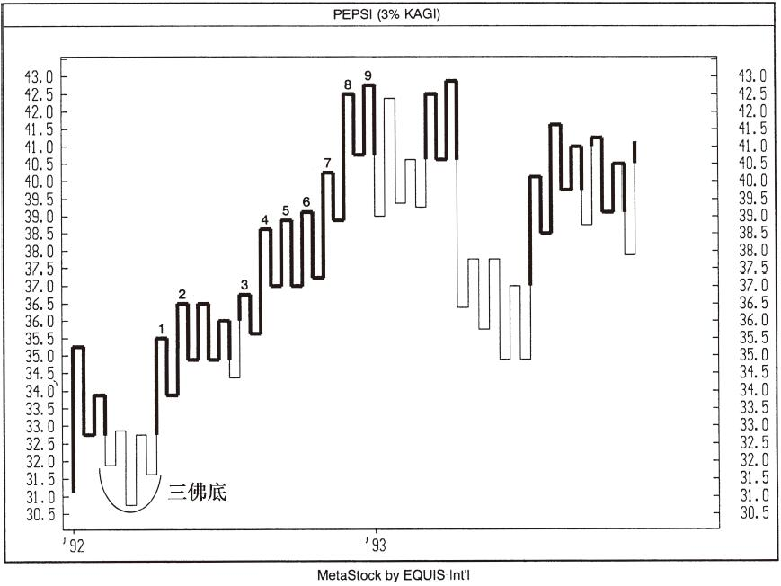
