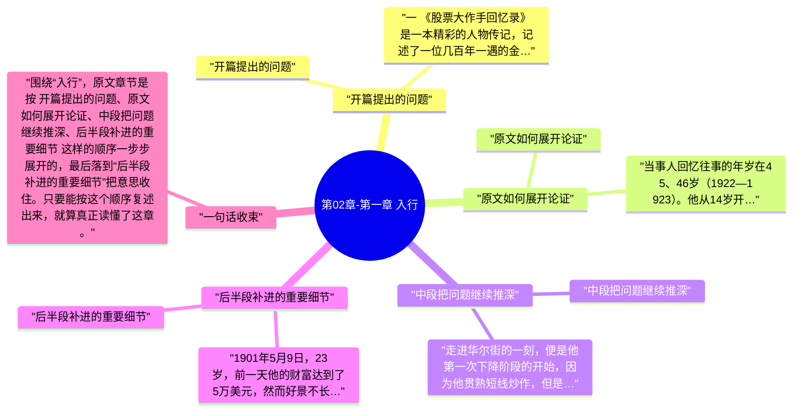

# 第02章-第一章 入行

这一章必须顺着原文读，不能只看章节标题。围绕“入行”，原文开头先写到：一 《股票大作手回忆录》是一本精彩的人物传记，记述了一位几百年一遇的金融市场交易与投资天才——杰西·利弗莫尔（Jesse Lauriston Livermore，1877—1940）的人生、梦想、事业和财富的故事，情节起伏跌宕、激动人心。。也就是说，作者一上来就把这章要谈的问题、对象和判断起点摆出来了。

继续往下看，原文的推进顺序大致是 “开篇提出的问题”、“原文如何展开论证”、“中段把问题继续推深”、“后半段补进的重要细节”，最后再收回到“后半段补进的重要细节”。按这个脉络做笔记，读完后会更清楚《股票作手回忆录》这一章到底详细说了什么。

## 章旨概括

从原文章节本身看，“入行”不是零散观点拼接，而是有明显顺序的展开。开头先从“开篇提出的问题”切入，中间再经过 原文如何展开论证、中段把问题继续推深 这些层次，把论证一点点推开。

到结尾的“后半段补进的重要细节”，作者会把前面的内容重新收束。这样回看时，就能把本章在《股票作手回忆录》里的位置、重点和落点一起串起来。

## 关键要点

### 开篇提出的问题

一

《股票大作手回忆录》是一本精彩的人物传记，记述了一位几百年一遇的金融市场交易与投资天才——杰西·利弗莫尔（Jesse Lauriston Livermore，1877—1940）的人生、梦想、事业和财富的故事，情节起伏跌宕、激动人心。

### 原文如何展开论证

当事人回忆往事的年岁在45、46岁（1922—1923）。他从14岁开始从股票经纪行营业部的小伙计做起，很快便专门从事交易。他的一生既以交易为事业而追求事业成功，又以交易为依托而满足远超过温饱水平的生活需求，股票、商品的交易和投资是他人生的全部基础。45、46岁年华，正是事业兴旺、思想成熟、年富力强的好时候。

他的第一次上升阶段从对赌行开始，当时的盈利最多曾经达到他这一辈子的第一笔1万美元，但是输输赢赢之后，在对赌行终于容身不得，21岁的他只好带着剩下的2500美元闯荡华尔街。

### 中段把问题继续推深

走进华尔街的一刻，便是他第一次下降阶段的开始，因为他贯熟短线炒作，但是在华尔街的真实经纪行里必须下单到交易所场内，执行价往往和意图的价格偏差较大，结果不到一年，就统统亏光了。

于是，他（22岁）只好向经纪行老板赊欠500美元，到圣路易斯的对赌行找运气。他那一套恰恰是对赌行的克星，因此没过多久就带着2500美元二次返回华尔街。

### 后半段补进的重要细节

1901年5月9日，23岁，前一天他的财富达到了5万美元，然而好景不长，到了当天晚上，已经一文不名。 1901年初秋，24岁，他第二次黯然离开华尔街，回到故乡在对赌行和冒牌经纪行里找机会。一年之后，1902年，他已经积攒了足够的资本，开着自己的小汽车，三次重返华尔街了。 这一次他的好运持续得比较久，并且在1907年10月24日（30岁）成为股市之王，挣得了此生的第一笔1百万美元。

1908年，30、31岁，他违背了自己的交易规则，听信商品专家帕西·托马斯的建议，结果棉花交易变得不可收拾，终于让自己再度陷入困境。这一次，他经历了多年的苦苦挣扎，直至1914年宣告破产，才算从1百多万的债务中脱身。 1915年，37岁，他的机会终于来了，从500股的很小一笔信用额度开始，第四次崛起。经过多次破产的严厉市场惩戒之后，在最近的7、8年（1915—1922接受采访的时候）中，他对市场的领悟、趋势研判、交易手段、资金管理体系终于日臻化境，人生、财富都上升到一个全新的高度。

## 投资启发

### 1. 先抓开头界定的问题

读这一章时，最先要盯住的是“开篇提出的问题”。原文开头如果没有看清这一层，后面再看到“中段把问题继续推深”或“后半段补进的重要细节”时，就会只剩结论而看不见推导过程。

### 2. 中段最能看出作者怎样推进

本章真正的含金量通常藏在中段。围绕“中段把问题继续推深”，原文会把前面的定义、判断标准或案例继续往下推，这里最适合做详细笔记，因为它最能说明“入行”到底是怎么被论清楚的。

### 3. 结尾要回收到作者真正想留下的判断

读到“后半段补进的重要细节”时，不要把它当作礼貌性收尾。原文章节在这里通常会把前面各段内容重新拢住，也是做 投资启发 时最值得回看的位置。

## 可执行练习

### 1. 练习1

合上书后，按 “开篇提出的问题”、“原文如何展开论证”、“中段把问题继续推深”、“后半段补进的重要细节” 的顺序，用自己的话把“入行”这一章从头到尾复述一遍，检查自己有没有把原文顺序复述对。

### 2. 练习2

从本章至少挑出两段原文，分别对应开头铺垫和中段推进，写清它们为什么会被放在“入行”这一章里。

### 3. 练习3

把结尾一节与前面任意两节连起来看，写一份 3 到 5 句的复盘，说明作者最后究竟想让读者记住什么。

## 一句总结

围绕“入行”，原文章节是按 开篇提出的问题、原文如何展开论证、中段把问题继续推深、后半段补进的重要细节 这样的顺序一步步展开的，最后落到“后半段补进的重要细节”把意思收住。只要能按这个顺序复述出来，就算真正读懂了这章。

---

## Mermaid 思维导图

### 图1

