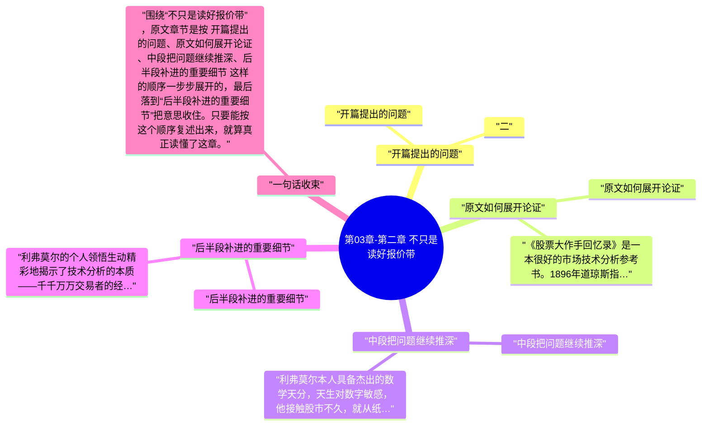

# 第03章-第二章 不只是读好报价带

这一章必须顺着原文读，不能只看章节标题。围绕“不只是读好报价带”，原文开头先写到：二。也就是说，作者一上来就把这章要谈的问题、对象和判断起点摆出来了。

继续往下看，原文的推进顺序大致是 “开篇提出的问题”、“原文如何展开论证”、“中段把问题继续推深”、“后半段补进的重要细节”，最后再收回到“后半段补进的重要细节”。按这个脉络做笔记，读完后会更清楚《股票作手回忆录》这一章到底详细说了什么。

## 章旨概括

从原文章节本身看，“不只是读好报价带”不是零散观点拼接，而是有明显顺序的展开。开头先从“开篇提出的问题”切入，中间再经过 原文如何展开论证、中段把问题继续推深 这些层次，把论证一点点推开。

到结尾的“后半段补进的重要细节”，作者会把前面的内容重新收束。这样回看时，就能把本章在《股票作手回忆录》里的位置、重点和落点一起串起来。

## 关键要点

### 开篇提出的问题

二

这一节的正文不长，但它在原文里负责把主题往下一层推进，因此不能跳过去不看。

### 原文如何展开论证

《股票大作手回忆录》是一本很好的市场技术分析参考书。1896年道琼斯指数问世，在利弗莫尔的时代，道氏理论的雏形还只是零散地分布在若干篇《华尔街日报》社论中的一些思路。道氏理论并不是从实验室里诞生的，而是道氏作为敏感尽责的报人对诸如当事人这样的案例观察总结出来的，是道氏和当事人这样的市场参与者交流互动的共同产物。

这一节的正文不长，但它在原文里负责把主题往下一层推进，因此不能跳过去不看。

### 中段把问题继续推深

利弗莫尔本人具备杰出的数学天分，天生对数字敏感，他接触股市不久，就从纸带上行情数字跳动之中发现了某些典型的形态，并尝试按照这些数字序列的形态预期股票下一步行情。他在对赌行的成功几乎完全建立在对行情数字序列形态的个人经验和认识上，这属于价格形态分析的范畴。后来，对赌行的浅池子已经藏不下这条龙，他到纽约正规经纪行交易，遭遇执行价偏差的困扰。最终，他领悟到市场按照最小阻力路线演变，这就是趋势；总体市场的大趋势决定个股演变趋势，真正的利润来自总体市场趋势，而不是个别股票的个别短线波动。只有当他领悟出这一点之后，他才从豪赌客跃升为职业交易家。

这一节的正文不长，但它在原文里负责把主题往下一层推进，因此不能跳过去不看。

### 后半段补进的重要细节

利弗莫尔的个人领悟生动精彩地揭示了技术分析的本质——千千万万交易者的经验总结和升华。他摸索前行的过程，就是积累技术分析才干的过程，而其交易成功就建筑在他对技术分析本质的领悟和严格服从的基础之上。在市场技术分析中，趋势是核心概念，行为要领是服从纪律。通过本书，技术分析从业者可以正本清源，认识技术分析的起源、发展，最重要的是切实体验到趋势的重要性，把趋势永远放在技术分析的核心地位。

这一节的正文不长，但它在原文里负责把主题往下一层推进，因此不能跳过去不看。

## 投资启发

### 1. 先抓开头界定的问题

读这一章时，最先要盯住的是“开篇提出的问题”。原文开头如果没有看清这一层，后面再看到“中段把问题继续推深”或“后半段补进的重要细节”时，就会只剩结论而看不见推导过程。

### 2. 中段最能看出作者怎样推进

本章真正的含金量通常藏在中段。围绕“中段把问题继续推深”，原文会把前面的定义、判断标准或案例继续往下推，这里最适合做详细笔记，因为它最能说明“不只是读好报价带”到底是怎么被论清楚的。

### 3. 结尾要回收到作者真正想留下的判断

读到“后半段补进的重要细节”时，不要把它当作礼貌性收尾。原文章节在这里通常会把前面各段内容重新拢住，也是做 投资启发 时最值得回看的位置。

### 4. 短章更要看它在全书里的连接作用

像“不只是读好报价带”这类篇幅较短的章节，往往承担的是分段、提示或转场功能。做 投资启发 时，不能只看这一页写了多少，更要看它把下一段内容导向了哪里。

## 可执行练习

### 1. 练习1

合上书后，按 “开篇提出的问题”、“原文如何展开论证”、“中段把问题继续推深”、“后半段补进的重要细节” 的顺序，用自己的话把“不只是读好报价带”这一章从头到尾复述一遍，检查自己有没有把原文顺序复述对。

### 2. 练习2

从本章至少挑出两段原文，分别对应开头铺垫和中段推进，写清它们为什么会被放在“不只是读好报价带”这一章里。

### 3. 练习3

把结尾一节与前面任意两节连起来看，写一份 3 到 5 句的复盘，说明作者最后究竟想让读者记住什么。

### 4. 练习4

把这一章与上一章、下一章的标题并列写下来，说明“不只是读好报价带”在全书结构里起的是分段、转场还是总结作用。

## 一句总结

围绕“不只是读好报价带”，原文章节是按 开篇提出的问题、原文如何展开论证、中段把问题继续推深、后半段补进的重要细节 这样的顺序一步步展开的，最后落到“后半段补进的重要细节”把意思收住。只要能按这个顺序复述出来，就算真正读懂了这章。

---

## Mermaid 思维导图

### 图1

