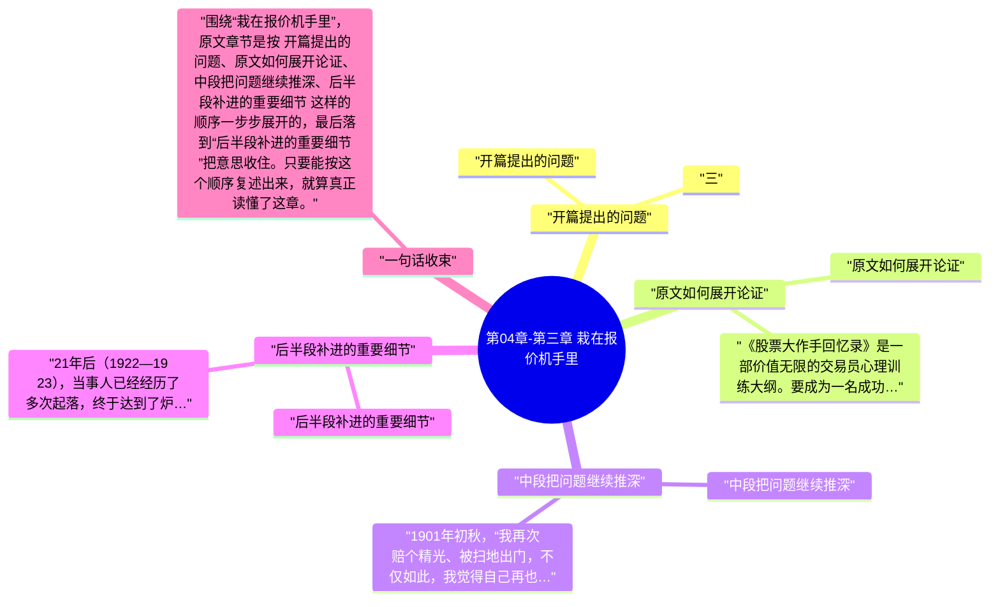

# 第04章-第三章 栽在报价机手里

这一章必须顺着原文读，不能只看章节标题。围绕“栽在报价机手里”，原文开头先写到：三。也就是说，作者一上来就把这章要谈的问题、对象和判断起点摆出来了。

继续往下看，原文的推进顺序大致是 “开篇提出的问题”、“原文如何展开论证”、“中段把问题继续推深”、“后半段补进的重要细节”，最后再收回到“后半段补进的重要细节”。按这个脉络做笔记，读完后会更清楚《股票作手回忆录》这一章到底详细说了什么。

## 章旨概括

从原文章节本身看，“栽在报价机手里”不是零散观点拼接，而是有明显顺序的展开。开头先从“开篇提出的问题”切入，中间再经过 原文如何展开论证、中段把问题继续推深 这些层次，把论证一点点推开。

到结尾的“后半段补进的重要细节”，作者会把前面的内容重新收束。这样回看时，就能把本章在《股票作手回忆录》里的位置、重点和落点一起串起来。

## 关键要点

### 开篇提出的问题

三

这一节的正文不长，但它在原文里负责把主题往下一层推进，因此不能跳过去不看。

### 原文如何展开论证

《股票大作手回忆录》是一部价值无限的交易员心理训练大纲。要成为一名成功的交易员，学习技巧是一方面，认识自我、引导自我、控制自我是另一方面，后者甚至是主要的方面。

这一节的正文不长，但它在原文里负责把主题往下一层推进，因此不能跳过去不看。

### 中段把问题继续推深

1901年初秋，“我再次赔个精光、被扫地出门，不仅如此，我觉得自己再也不能赢得这个游戏，于是深感厌倦，竟至于打算洗手不干，离开纽约在其他什么地方另找饭碗。”这位不世出的交易天才在这次打击之下，对自己产生了深深的怀疑。这是什么样的心理冲击？

这一节的正文不长，但它在原文里负责把主题往下一层推进，因此不能跳过去不看。

### 后半段补进的重要细节

21年后（1922—1923），当事人已经经历了多次起落，终于达到了炉火纯青的造诣，于是他平静地总结：“投机者的主要敌人总是潜藏在他的内部自挖墙脚的。不可能把‘希望’从人类的天性中割除，也不可能把‘恐惧’从人类的天性中割除。在从事投机时，如果市场运行对你不利，每一天你都希望这是最后一天——盲目听从希望的摆布，不接受最初的损失，到头来，亏损反而变本加厉。” 利弗莫尔每一次跌落都必然迫使他对市场再认识、对错误再认识、对自我再认识，并且不得不找到行之有效的解决方案，否则就不可能超越旧的自我，不可能东山再起。“我不希望第二次重复同一个错误。我们只有从自己所犯的错误中汲取教训、将它转化为将来的获利，才能原谅自己的错误。”

交易者的成长之路，是认清自我、超越自我的道路。诚实地面对市场、诚实地面对自我，是先决条件。本书如实交代了当事人在起伏跌宕的交易生涯中曲折前行的心路历程，对我们每一位市场参与者来说都是价值无穷的心理训练大纲。

## 投资启发

### 1. 先抓开头界定的问题

读这一章时，最先要盯住的是“开篇提出的问题”。原文开头如果没有看清这一层，后面再看到“中段把问题继续推深”或“后半段补进的重要细节”时，就会只剩结论而看不见推导过程。

### 2. 中段最能看出作者怎样推进

本章真正的含金量通常藏在中段。围绕“中段把问题继续推深”，原文会把前面的定义、判断标准或案例继续往下推，这里最适合做详细笔记，因为它最能说明“栽在报价机手里”到底是怎么被论清楚的。

### 3. 结尾要回收到作者真正想留下的判断

读到“后半段补进的重要细节”时，不要把它当作礼貌性收尾。原文章节在这里通常会把前面各段内容重新拢住，也是做 投资启发 时最值得回看的位置。

### 4. 短章更要看它在全书里的连接作用

像“栽在报价机手里”这类篇幅较短的章节，往往承担的是分段、提示或转场功能。做 投资启发 时，不能只看这一页写了多少，更要看它把下一段内容导向了哪里。

## 可执行练习

### 1. 练习1

合上书后，按 “开篇提出的问题”、“原文如何展开论证”、“中段把问题继续推深”、“后半段补进的重要细节” 的顺序，用自己的话把“栽在报价机手里”这一章从头到尾复述一遍，检查自己有没有把原文顺序复述对。

### 2. 练习2

从本章至少挑出两段原文，分别对应开头铺垫和中段推进，写清它们为什么会被放在“栽在报价机手里”这一章里。

### 3. 练习3

把结尾一节与前面任意两节连起来看，写一份 3 到 5 句的复盘，说明作者最后究竟想让读者记住什么。

### 4. 练习4

把这一章与上一章、下一章的标题并列写下来，说明“栽在报价机手里”在全书结构里起的是分段、转场还是总结作用。

## 一句总结

围绕“栽在报价机手里”，原文章节是按 开篇提出的问题、原文如何展开论证、中段把问题继续推深、后半段补进的重要细节 这样的顺序一步步展开的，最后落到“后半段补进的重要细节”把意思收住。只要能按这个顺序复述出来，就算真正读懂了这章。

---

## Mermaid 思维导图

### 图1

