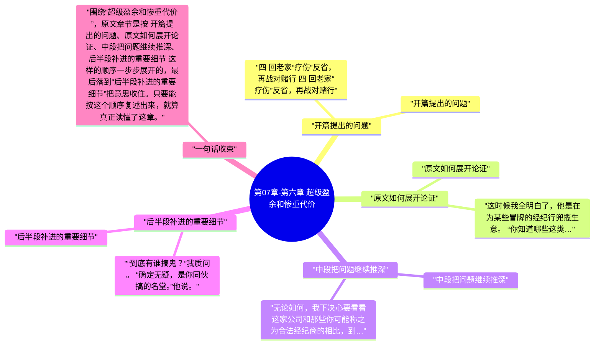

# 第07章-第六章 超级盈余和惨重代价

这一章必须顺着原文读，不能只看章节标题。围绕“超级盈余和惨重代价”，原文开头先写到：四 回老家“疗伤”反省，再战对赌行 四 回老家“疗伤”反省，再战对赌行。也就是说，作者一上来就把这章要谈的问题、对象和判断起点摆出来了。

继续往下看，原文的推进顺序大致是 “开篇提出的问题”、“原文如何展开论证”、“中段把问题继续推深”、“后半段补进的重要细节”，最后再收回到“后半段补进的重要细节”。按这个脉络做笔记，读完后会更清楚《股票作手回忆录》这一章到底详细说了什么。

## 章旨概括

从原文章节本身看，“超级盈余和惨重代价”不是零散观点拼接，而是有明显顺序的展开。开头先从“开篇提出的问题”切入，中间再经过 原文如何展开论证、中段把问题继续推深 这些层次，把论证一点点推开。

到结尾的“后半段补进的重要细节”，作者会把前面的内容重新收束。这样回看时，就能把本章在《股票作手回忆录》里的位置、重点和落点一起串起来。

## 关键要点

### 开篇提出的问题

四 回老家“疗伤”反省，再战对赌行 四 回老家“疗伤”反省，再战对赌行 就这样，我回到老家。但是，就在到家的那一刻，我知道自己这辈子只有一个追求：筹集本金再回华尔街。那里是全国唯一可以让我大手笔交易的地方。总有一天，我的交易路子会走对的，到时候我需要这样一个用武之地。如果你追求的目标恰如其分，那么这一切都会朝你走来，回报你的正确性。

好了，我的食宿费来源就这么断了。但是除去花销，我已经净挣了好几百元，琢磨着怎样把这笔钱用得更好，以便最终挣到足够多的钱重返纽约。我现在的心情比以往任何时候都更急切。我觉得，下一次我可以干得更好。我现在有时间平静地反省过去的一些愚蠢干法，而且你看，站得远一点来观察，反而更有利于看清全貌。当务之急是筹集一笔新本金。 一天，我正在一家饭店大堂和几位熟人聊天，他们都是业绩相当稳定的交易员。每个人都在谈论股票市场。我对大家说，没人能够赢得这场游戏，因为他从经纪商那里得到的执行价糟透了，特别是像我这样总是按照市价指令方式交易的话。 一位仁兄开腔了，问我到底说的是哪一家经纪行。

### 原文如何展开论证

这时候我全明白了，他是在为某些冒牌的经纪行兜揽生意。 “你知道哪些这类经纪行靠得住吗？”我问他。 “我知道美国最大的一家经纪公司，”他说。“我自己就在那儿交易。他们在美国和加拿大的78个城市设有分部。他们的生意大极了。如果他们不是一丝不苟诚实经营，不可能年复一年把生意做得这么好，对吧？”

今年许许多多同类型“经纪商”倒闭，他们算是这类经纪商的鼻祖。这一行通行的门道和伎俩都是一样的，不过，敲诈大众的具体花招与时俱进，因为那些老把戏实在太滥，所以某些细节已经改变了。 这伙人惯常广泛散布买进或卖出某个股票的内幕消息——这几百封电报建议立即买进这只股票，那几百封电报建议立即卖出同一只股票，和老式赛马内幕消息的骗局同出一辙。这时候，买进和卖出的交易单就来了。举例来说，那家公司可能会通过一家正规的股票交易所经纪公司买进和卖出1000股，获得一份正规的成交报告。要是哪位客户心生怀疑，不客气地质疑他们截留客户指令的话，他们就拿出这份报告让他没话说。 他们还惯常在营业部组织代理投资的集合资产管理池，作为一项大恩惠允许客户以书面方式授权他们代理投资，用客户的钱、在客户名下、根据他们认为最合适的方式交易。这么一来，当客户的钱没了踪影之后，即使是最执着的客户也得不到任何合法的赔偿。他们会做多一只股票——在账面上，把客户放到这个集合资产管理池里，然后，他们施展对赌行的老伎俩之一驱使股价下跌，把几百位客户的微薄保证金洗劫一空。他们不放过任何人，妇女、学校教员和老年人是他们最中意的牺牲品。

### 中段把问题继续推深

无论如何，我下决心要看看这家公司和那些你可能称之为合法经纪商的相比，到底能提供哪些交易上的优势。我没有多少钱可以充当保证金，而截留客户指令的公司在这方面自然宽松得多，因此在他们的营业部几百美元就能玩得很带劲了。 我来到他们的地方，找经理本人谈了谈。当他弄明白我是交易老手、曾经在纽约股票交易所的经纪公司拥有过正式户头、并且把自己带去的每一分钱都亏掉了之后，才不再拍胸脯吹牛，说如果我让他们替我操作我的存款的话，保证一分钟为我挣一百万美元。他估摸我是一只无可救药的肥羊，属于对报价机上瘾的类型，屡赌屡输、屡输屡赌；因此，我为经纪商提供了稳定的收入来源，不论在截留客户指令的冒牌经纪商那里，还是在满足于赚取佣金的老实经纪商那里。 我只对经理说，我所求的无非是指令得到合理的执行结果，因为我总是按照市价指令方式交易，我不愿意看到成交回报的价格和报价机显示的价格相差半个点甚至1个点。

他们毫无公平交易精神，他们干这一行不会满足于固定比例的佣金，真是不择手段、连蒙带骗。因为肥羊们在股票市场赌博时总是赔钱——他们算不上真正的投机者——可能你会觉得，这些家伙干的这一行，虽然不合法但是或许还算合情理。然而，他们不是。“在客户中间一买一卖吃差价，一分耕耘一分收获”是一句古老而正确的生意真经，但是他们从没听说过，他们并不满足于和客户直截了当地对赌。 好几次，他们耍出老花招，力图欺骗我。有几次因为我一时疏忽，他们得逞了。他们总是乘我的盘子小于通常规模的时候出老千。我指责他们交易不公平或者更卑劣，但他们不认账，结果是我回来继续如常交易。和骗子做交易也有好处，他总是原谅你曾经现场捉住他，只要你继续和他做生意就行。对他来说，这种事情无所谓。他乐意屈就配合。多么宽宏大量！ 好，我打定主意，他们施展骗子手段妨碍我正常筹集本金的速度，这是不能忍受的，所以我决心给他们一点颜色看。我选择了一只股票，它曾经是投机热门，现在已经归于沉寂，就象被水沤烂了一般（图4.1）。如果我选择一只从来没有活跃过的股票，他们有可能对我的做法起疑心。我给这五家冒牌经纪行都发出买进这只股票的指令。当他们收到指令后，他们就等纸带机上的下一个报价；这时候，我通过股票交易所的经纪行发出指令以市价卖出100股这一股票。我催促他们尽快完成。喔，当这笔卖出指令传到交易所场内的时候，你可以想象场内发生的情景，一向交易清淡的冷门股，某家和外地连线的佣金经纪行突然赶紧卖出。有人买到了便宜货。但是，这笔交易会印在报价机纸带上，其价格就是那五份买入指令我要付给五家公司的价格。加总起来，我做多该股票400股，成本是一个较低的价格。和交易所连线的公司问我听到什么风声，我说有一点内幕消息。就在市场收市前，我给正规经纪行发指令立即买回100股该股票，不要有任何耽搁。无论如何，我并不打算做空。我不在乎他们以什么价格成交。于是，他们给纽约打电报传达指令，尽快买进100股，结果其行情猛然上升。当然，我也给那五家发出卖出指令，轧平那五家朋友截留的500股。整个过程天衣无缝。

### 后半段补进的重要细节

“到底有谁搞鬼？”我质问。 “确定无疑，是你同伙搞的名堂。”他说。 我正告他，“你很清楚，我从来都是独来独往。本地每个人都知道这一点。甚至从我刚开始做股票交易的时候起，大家就知道了。现在，我要给你一点善意的规劝：赶紧派人把钱取给我。我不想把事儿闹大。照我话做就成。”

我们当天在纽黑文过夜，第二天早晨十点差五分的时候，又来到这间好客的对赌行。那位演说家很高兴看到我俩，感觉今天该是他的机会了。然而，当天我净赚的，差几美元就到1500美元。第三天早晨，我们又顺便拜访那位伟大的演说家，递给他卖出500股糖业的单子，他迟疑片刻，但终于还是接受了——一声不吭！该股票下跌了1点，我平仓了结，把成交单交给他。正好500美元的利润，还有我当初500美元的保证金。他从保险柜里取出20张50美元面额的钞票，点了三遍，每一遍都很慢，然后转身到我面前又点了起来。看起来，他指头上的汗水好象是胶水，那些钞票好象粘在他手上，不过，他最终还是把钱递给我。他两臂交叉抱在胸前，咬着下唇，一直咬着，两眼直直瞪着我身后窗户高处。 我对他说，我打算卖出200股钢铁。他一动不动。充耳不闻。我再说一遍我的要求，但把股票数量增加到300股。他回过头。我等着听他长篇大论。但是，他只是看着我。然后，他咂咂嘴，咽了一下——似乎准备开始正式攻击反对党50年来馨竹难书的贪官污吏政治暴政。 最后，他冲着我手上的黄色钞票摇摇手，说，“把那东西拿开！”

## 投资启发

### 1. 先抓开头界定的问题

读这一章时，最先要盯住的是“开篇提出的问题”。原文开头如果没有看清这一层，后面再看到“中段把问题继续推深”或“后半段补进的重要细节”时，就会只剩结论而看不见推导过程。

### 2. 中段最能看出作者怎样推进

本章真正的含金量通常藏在中段。围绕“中段把问题继续推深”，原文会把前面的定义、判断标准或案例继续往下推，这里最适合做详细笔记，因为它最能说明“超级盈余和惨重代价”到底是怎么被论清楚的。

### 3. 结尾要回收到作者真正想留下的判断

读到“后半段补进的重要细节”时，不要把它当作礼貌性收尾。原文章节在这里通常会把前面各段内容重新拢住，也是做 投资启发 时最值得回看的位置。

## 可执行练习

### 1. 练习1

合上书后，按 “开篇提出的问题”、“原文如何展开论证”、“中段把问题继续推深”、“后半段补进的重要细节” 的顺序，用自己的话把“超级盈余和惨重代价”这一章从头到尾复述一遍，检查自己有没有把原文顺序复述对。

### 2. 练习2

从本章至少挑出两段原文，分别对应开头铺垫和中段推进，写清它们为什么会被放在“超级盈余和惨重代价”这一章里。

### 3. 练习3

把结尾一节与前面任意两节连起来看，写一份 3 到 5 句的复盘，说明作者最后究竟想让读者记住什么。

## 一句总结

围绕“超级盈余和惨重代价”，原文章节是按 开篇提出的问题、原文如何展开论证、中段把问题继续推深、后半段补进的重要细节 这样的顺序一步步展开的，最后落到“后半段补进的重要细节”把意思收住。只要能按这个顺序复述出来，就算真正读懂了这章。

---

## Mermaid 思维导图

### 图1

