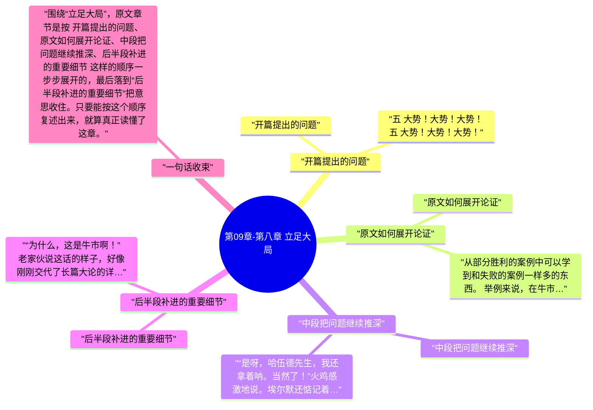

# 第09章-第八章 立足大局

这一章必须顺着原文读，不能只看章节标题。围绕“立足大局”，原文开头先写到：五 大势！大势！大势！ 五 大势！大势！大势！。也就是说，作者一上来就把这章要谈的问题、对象和判断起点摆出来了。

继续往下看，原文的推进顺序大致是 “开篇提出的问题”、“原文如何展开论证”、“中段把问题继续推深”、“后半段补进的重要细节”，最后再收回到“后半段补进的重要细节”。按这个脉络做笔记，读完后会更清楚《股票作手回忆录》这一章到底详细说了什么。

## 章旨概括

从原文章节本身看，“立足大局”不是零散观点拼接，而是有明显顺序的展开。开头先从“开篇提出的问题”切入，中间再经过 原文如何展开论证、中段把问题继续推深 这些层次，把论证一点点推开。

到结尾的“后半段补进的重要细节”，作者会把前面的内容重新收束。这样回看时，就能把本章在《股票作手回忆录》里的位置、重点和落点一起串起来。

## 关键要点

### 开篇提出的问题

五 大势！大势！大势！ 五 大势！大势！大势！ 一般水平的从报价纸带嗅探行情的投机者——或者正如人们常常称呼他们的，“纸带虫子”——因为偏执于市场的单一方向而出错。我猜想，这和他们因为其他原因出错的机会不相上下。偏狭，意味着高度僵化，因此代价高昂。归根结蒂，投机的行当并不纯粹是数学，或者一套固定规则，无论这门行当的基本行为法则要求多么严格。即使是我自己，在阅读纸带的过程中也加进了某些东西，而不单单是数学。其中包括我称之为股票习性的东西，即通过股票的行为特征来判断，未来到底它会不会按照你观察到的特定前兆来变化。如果某股票行为不对路，就不要碰它；因为，既然你不能准确揭示何处不对，就不能分辨它到底要走哪条路。不能查清事实，便不能判断。没有判断，就没有利润。

我第三度重返华尔街，再次试图击败市场，我在正规股票交易所经纪行交易，手法相当活跃。我没有指望自己的业绩能够和我在对赌行一样漂亮，不过，我认为过一段时间自己会比以前做得好得多，因为现在我有能力支配大得多的头寸。并且，我这时候已经看出，自己的主要缺陷在于未能掌握股票赌博和股票投机的重大区别。话说回来，借助我阅读报价纸带的7年宝贵经验，以及对这个行当拥有的一些天赋，我运用本金的结果虽然算不上挣到了大笔财富，但确实挣到了很高的回报率。和过去一样，我有时赢有时输，但是总体在赢利。我挣得越多，花得也就越多。对绝大多数人来说，这都是寻常的做法。不，不必一定只有挣快钱、容易钱的人才这样，而是对每一个人来说，只要他不是天生的守财奴。某些人，比如老拉塞尔·塞奇（Russell Sage），挣钱的本能和藏钱的本能都很发达，自然，他死的时候富得流油，但这有啥光彩呢。 每天，从早晨十点到下午三点，我专心致志地沉浸在击败股票市场的游戏中；三点之后，同样一心一意地沉浸在优游生活的游戏中。请不要误会。我绝不让享乐影响生意。当我亏损的时候，只是因为做错了，而不是因为生活放荡散佚而影响交易。我从来没有发生过精神涣散或四肢麻木而损害交易的情况。我承担不起任何可能导致身体和精神不适的事情。即使现在，我通常都在晚上十点之前就寝。当我年轻的时候，从来不玩得太晚，因为如果睡眠不足，便不能精力充沛地投入生意。因为我的总体业绩赢大于亏，所以我认为没有必要省吃俭用，放弃生活中的美好事物。市场总能供我所需。我逐渐建立信心，我的自信来自于对待自己谋生手段的职业化、不带感情色彩的态度。 我的交易方法第一个变化和时间因素有关。我不能象在对赌行一样，等到事态明朗而确有把握之后出击，捕获1到2点。如果要在富勒顿的营业厅里捕获市场运动，就必须提早很多动手。换句话说，我不得不研判即将出现的行情，预期股票价格变动。这听起来平常得可笑，但是，你知道我到底说的是什么。这标志着我对待这行当态度的根本转变，这一点对我具有超乎寻常的重大意义。市场一点一滴地教诲我，博取小幅波动与预期必将发生的上涨行情和下跌行情之间具有本质区别，赌博和投机之间具有本质区别。

### 原文如何展开论证

从部分胜利的案例中可以学到和失败的案例一样多的东西。 举例来说，在牛市行情开始的时候，我就已经看多了，并且知、行一致，已经买入股票。随后出现一轮上升行情，如我当初曾经清晰地预料的那样。到此为止，一切都好。然而，接下来我是怎么做的呢？唉，我听从老成持重的忠告，克制年轻人的轻浮毛躁。我决意要明智，谨慎从事、保守一点。谁都清楚，这么做的办法就是，先拿回到手的利润，等市场回调的时候再买回来。这正是我采取的做法，或者更准确地说，正是我力图做到的，因为我常常入袋为安，再等市场回落。事与愿违的是，回回都等不来市场回落。就这样，眼睁睁看着我的股票绝尘而去，继续上涨10点，而我却拱手坐在一旁，只有4点利润安稳收藏在“保守的”口袋里。他们说，获利平仓绝不会让你变穷。是，你不会变穷。但是，在牛市行情下，你只拿到4点利润，也绝不会变富。 当我本该挣到2万美元的时候，只挣到了2千。这就是我的保守策略给我的报答。大约就在这个时期，我注意到，在本该挣到大钱的地方，我实际上只挣回了其中如此之小的比例；于是，我有了另一项发现，肥羊们的行事方式和他们的经验深浅有关，经验深浅决定方式的差异。

等那位客户讲完故事、诉说了自己的困惑，接着问他：“您认为我应该怎么做？” 这时，这老火鸡把脑袋歪向一边，带着慈父般的微笑注视着那位交易同行，终于语重心长地开了口，“你知道，这是牛市！” 一次又一次，我听他说，“噢，这是牛市，你知道！”好像他正在赠给你一份价值连城的护身符，而且用价值100万的意外事故险保单包好了。当然，那时我并不懂他的意思。

### 中段把问题继续推深

“是呀，哈伍德先生，我还拿着呐。当然了！”火鸡感激地说。埃尔默还惦记着这位老人，多好的人啊。 “好，是时候了，现在卖掉入袋为安，下次跌下来的时候再进，”埃尔默说，好像他刚刚给老人开了一张存款单。埃尔默从受益人的脸上没看到激动感恩的神色，于是继续道，“我刚刚卖掉手上的每一张股票！” 从他的声音和神态来看，保守估计，你也会觉得他至少是1万股的大手笔。

“是您，哈伍德先生，我对您非常感激。真的，打心里感激，先生。但是——” “打住！听我说！难道这股票没有在10天里连涨7点吗？难道没有吗？” “的确，我对您感恩戴德，我亲爱的兄弟。但是，我不能考虑卖掉这股票。”

### 后半段补进的重要细节

“为什么，这是牛市啊！”老家伙说这话的样子，好像刚刚交代了长篇大论的详尽解答。 “那是啊，”埃尔默说，看上去因为失望而气恼。“是牛市，我跟你一样清楚。但是，你最好先把你那些股票卖了，回落的时候再买回来。这样，就好降低持股成本了。” “我亲爱的兄弟，”老帕特里奇说着，显得十分痛苦——“我亲爱的兄弟，要是现在我把股票卖了，就丧失了自己的立场，那样的话，我到哪儿立足呢？”

老帕特里奇先生之所以再三告诫其他客户，“噢，你知道，这是牛市！”本意乃是告诫他们，大钱不是从哪一次或几次个别起伏中产生的，而是从主要趋势中产生的——就是说，大钱不在于阅读行情纸带，而在于全面估量总体市场及其趋势。当我终于认识到这一点的时候，我觉得，我的交易教育前进了一大步。 就是这儿，请让我强调一点。我已经在华尔街打滚多年，赢过千百万美元，也亏过千百万美元，我要给你的忠告是：我之所以挣大钱，从来不是凭我的作为，而是始终凭我的无为。明白吗？凭我的耐心坚守。正确判断市场方向，其实没有什么奥妙可言。你总是发现很多人在牛市早期便已经看多，在熊市早期便已经看空。我认识许多人，他们都有能力精准把握时机并正确行动，当价格恰恰处在有潜力造就巨额利润之处时，便开始买进或卖出。然而，他们的经历总是和我同出一辙——也就是说，他们都没有从中实现真正算数的利润。既能够正确判断，又能够耐心坚守，这样的人凤毛麟角。我发现，这属于最难学会的内容之一。但是，作为一名股票作手，只有牢牢掌握这一点之后，才能赚大钱。对一名交易者来说，真正学会交易后赢得百万美元，比他在懵里懵懂的日子要挣几百美元还容易。“会者不难，难者不会”，千真万确。 原因就在于，某人也许看市场一目了然，但是当市场正在花时间逐步酝酿他预料必然出现的进程时，却变得没有耐心或者怀疑动摇。如此之多的华尔街才俊，根本不属于肥羊的层次，甚至也不属于第三个等级，竟然不能幸免亏损，这正是其根源所在。不是市场打败了他们，是他们自己把自己打败了。他们虽然有脑子，却不能持之以恒。老火鸡如是操作，并如是告诫同行，完全正确。他不仅有勇气把自己确信的判断付诸行动，更有明智的耐心坚持到底。

## 投资启发

### 1. 先抓开头界定的问题

读这一章时，最先要盯住的是“开篇提出的问题”。原文开头如果没有看清这一层，后面再看到“中段把问题继续推深”或“后半段补进的重要细节”时，就会只剩结论而看不见推导过程。

### 2. 中段最能看出作者怎样推进

本章真正的含金量通常藏在中段。围绕“中段把问题继续推深”，原文会把前面的定义、判断标准或案例继续往下推，这里最适合做详细笔记，因为它最能说明“立足大局”到底是怎么被论清楚的。

### 3. 结尾要回收到作者真正想留下的判断

读到“后半段补进的重要细节”时，不要把它当作礼貌性收尾。原文章节在这里通常会把前面各段内容重新拢住，也是做 投资启发 时最值得回看的位置。

## 可执行练习

### 1. 练习1

合上书后，按 “开篇提出的问题”、“原文如何展开论证”、“中段把问题继续推深”、“后半段补进的重要细节” 的顺序，用自己的话把“立足大局”这一章从头到尾复述一遍，检查自己有没有把原文顺序复述对。

### 2. 练习2

从本章至少挑出两段原文，分别对应开头铺垫和中段推进，写清它们为什么会被放在“立足大局”这一章里。

### 3. 练习3

把结尾一节与前面任意两节连起来看，写一份 3 到 5 句的复盘，说明作者最后究竟想让读者记住什么。

## 一句总结

围绕“立足大局”，原文章节是按 开篇提出的问题、原文如何展开论证、中段把问题继续推深、后半段补进的重要细节 这样的顺序一步步展开的，最后落到“后半段补进的重要细节”把意思收住。只要能按这个顺序复述出来，就算真正读懂了这章。

---

## Mermaid 思维导图

### 图1

