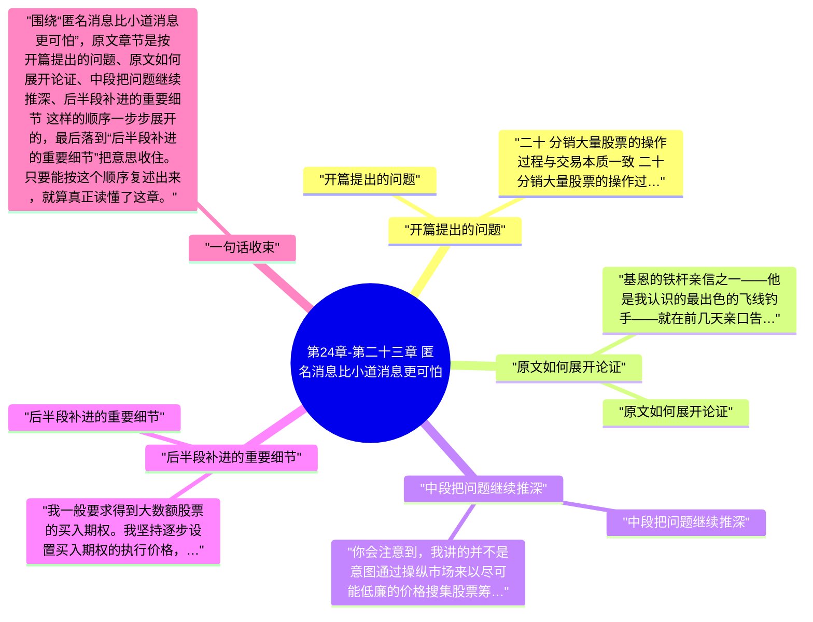

# 第24章-第二十三章 匿名消息比小道消息更可怕

这一章必须顺着原文读，不能只看章节标题。围绕“匿名消息比小道消息更可怕”，原文开头先写到：二十 分销大量股票的操作过程与交易本质一致 二十 分销大量股票的操作过程与交易本质一致。也就是说，作者一上来就把这章要谈的问题、对象和判断起点摆出来了。

继续往下看，原文的推进顺序大致是 “开篇提出的问题”、“原文如何展开论证”、“中段把问题继续推深”、“后半段补进的重要细节”，最后再收回到“后半段补进的重要细节”。按这个脉络做笔记，读完后会更清楚《股票作手回忆录》这一章到底详细说了什么。

## 章旨概括

从原文章节本身看，“匿名消息比小道消息更可怕”不是零散观点拼接，而是有明显顺序的展开。开头先从“开篇提出的问题”切入，中间再经过 原文如何展开论证、中段把问题继续推深 这些层次，把论证一点点推开。

到结尾的“后半段补进的重要细节”，作者会把前面的内容重新收束。这样回看时，就能把本章在《股票作手回忆录》里的位置、重点和落点一起串起来。

## 关键要点

### 开篇提出的问题

二十 分销大量股票的操作过程与交易本质一致 二十 分销大量股票的操作过程与交易本质一致 我本人从来没有和华尔街仍然在谈论的那些股票市场大操作者有过直接接触。我指的不是那些大老板，而是市场操作者。他们都是比我这代更早期的人物，虽然当我刚来到纽约的时候，詹姆斯·R·基恩，他们之中最了不起的一位，正如日中天。但是，我那时只是一个小后生，一心想的是在一家信誉良好的经纪商营业厅完全再现自己在家乡对赌行里曾经享有的成功交易方式。而且那个时候基恩正忙着美国钢铁股票——他的市场操作案例中的杰作——我对市场操作没有任何经验，实际上对其一无所知，既不知道它有什么用处，也不知道它是什么意思。而且我也不怎么需要这样的知识。如果我曾经对它有过什么想法的话，估计一定把它看成了包装更加冠冕堂皇的高级骗术，我在对赌行里曾经遭遇的那些骗局与其本质一致，只是更赤裸裸、更低级。此后我听到的这类话题在很大程度上是由臆断、疑惑组成的，与其说是理性分析，毋宁说是猜测。

很遗憾，基恩没有把他最出色的英勇事迹留下准确记录——即1901年春对美国钢铁公司股份的成功操作。照我理解，基恩从来没有就此事和J·P·摩根面谈过。摩根的公司通过塔尔博特·J·泰勒公司（Talbot J. Taylor & Co.）交易，或者与之交易，而基恩正是以这家公司的营业厅作为自己的大本营。塔尔博特·泰勒是基恩的女婿。有人言之凿凿告诉我，基恩从其工作中获得的回报包括他在工作过程中体验到的乐趣。那年春天他为行情上涨助了一臂之力，自己也获利数百万美元，这事众所周知。他曾经对我的一位朋友说，在几个星期之内，他通过公开市场为股票承销团卖出了超过75万股股票。考虑到以下两项因素，这个业绩实在不差：第一，该公司的股票初次发行，未经市场考验，并且其总市值比当时美国政府的全部债务总额还要大；第二，在基恩助力造成的市场上，D·G·里德、W·B·利兹、穆尔兄弟、亨利·菲普斯、H·C·弗里克以及其他钢铁巨头利用同一个市场、于同一时间也向公众发售了数十万、上百万的股票。 当然，总体形势对他有利。当时不仅有良好的商业形势，还有普遍的乐观预期以及不受限制的强大资金后盾，为他的成功铺平了道路。当时不仅存在一个巨大的牛市行情，还有高涨的商业景气以及人们亢奋的精神状态，这些以后不大可能再遇到了。市场对这批证券消化不良，后来引发了大恐慌，美国钢铁的普通股基恩在1901年标价为55美元，1903年跌到10美元，1904年再下跌到8 7/8美元。 我们无从分析基恩手法巧妙的销售活动。找不到他的著作，也不存在足够翔实的文件记录。举例来说，如果有机会研究一下他在联合铜业（Amalgamated Copper）上的处理手法，会很有意思的。H·H·罗杰斯和威廉·洛克菲勒曾经试图在市场上把他们多余的股票销售出去，但是失败了。最终他们请求基恩来销售他们的库存，他答应了。请记着，H·H·罗杰斯在他的时代曾经是华尔街最精明强干的生意人之一，而威廉·洛克菲勒在整个标准石油公司的小集团内当属最为大胆进取的投机客。他们拥有几乎无尽的资源、显赫的声望，并且自己也在股票市场的游戏中浸淫多年。然而，他们依然不得不求助于基恩。我之所以指出这一点，是为了向你说明，有些事务非得交给行家里手不可。这只股票曾经得到广泛的策动，其控股股东是美国最了不起的资本家，但是就是不好出手，除非折让一大笔价钱、再牺牲一些声誉。罗杰斯和洛克菲勒的确明智，他们决定寻求基恩的帮助。

### 原文如何展开论证

基恩的铁杆亲信之一——他是我认识的最出色的飞线钓手——就在前几天亲口告诉我，在运作联合铜业期间，有一次基恩发现自己手上几乎一股都没有了。也就是说，在推高价格的过程中，他不得不吃进一些股票，现在这些股票全卖光了。卖光之后的第二天，他可能买回几千股。第三天，再卖出，达到总体平衡。然后，他便放手不管市场，看看市场是不是能够自己照顾自己，同时也引导市场逐步适应独立交易。到了他真正动手销售那笔头寸的时候，采取的就是刚才我说的做法：在市场下跌途中卖出。公众交易者总是习惯于抢市场反弹，此外做空的人此时也在买入平仓。 那位基恩的亲信对我说，在基恩完成罗杰斯—洛克菲勒持仓的销售任务之后，卖得了大约2千万～2千5百万美元的现金，罗杰斯派人送来一张20万美元的支票。这个故事很容易令人联想起另一则故事，一位百万富翁的夫人在大都会歌剧院遗失了一条价值10万美元的珍珠项链，剧院清扫女工拾得项链并原璧归赵，结果这位夫人只打赏50美分。基恩退回那张支票，并彬彬有礼地附了一张便条，写道，他不是股票经纪商，不过很高兴给他们提供服务。他们留下支票，寄来一封信，说他们会很乐意再次跟他合作。之后不久，H·H·罗杰斯好心地给了基恩一个贴士，叫他在130买进联合铜业！ 詹姆斯·R·基恩，多么卓越的作手！他的私人秘书对我说，当市场演变方向对基恩先生有利的时候，他性情暴躁。了解他的人都说，他发脾气表现为喜欢发表嘲讽式的警句，这些警句往往在听者的脑海中萦绕多日。然而，当他处在亏损状态时，反而是心情最好的状态，举止文质彬彬，态度平易近人，言谈机智风趣。

事实上，变化根本不像我们想象的那么激进。回报不再有过去那么大，因为工作也不再如过去那样具有开创性，当然不可能得到开创阶段的高回报。无论如何，在某些特定方面，市场操作比过去更容易，而在其他方面则比基恩的时代难得多了。 毫无疑问，广告推销是一门艺术，而市场操作则是以行情纸带为媒介的一门广告推销艺术。行情纸带应当讲述操作者希望读者看到的故事。故事越真实，则必定越有说服力；说服力越强，则广告推销的效果越好。举例来说，今天的操作者不仅要让股票行情看起来坚挺，还要让它果真坚挺。因此，操作者必须以扎实的交易原则为依归。正是凭着这一点，基恩才能成为如此杰出的操作者，他首先是一位完美的交易者。 “操纵”这个词现在已经带有恶名声了，因此需要一个代称。如果市场操作的目的是为了整批销售股票，并且在操作过程中没有不实的陈述，那么我不认为其过程带有任何神秘的色彩，或者过程本身带有任何欺诈的意味。毫无疑问，市场操作者必须在投机者中间寻求买主。他的诉求对象是那些期望为其资本谋求大回报的人们，因此，这些人愿意承担比常规商业更高的风险。如果有人明知这一点，但是在未能如愿赚到来得容易的快钱时便归咎于他人，对这样的人我没有多少同情心。你看，当他获利的时候，觉得自己多么英明啊。然而，当他亏钱的时候，他的替罪羊便成了骗子，成了操纵者！到了这种时候，从这种人嘴里说出来的往往是“有人搞鬼”。实情并非如此。

### 中段把问题继续推深

你会注意到，我讲的并不是意图通过操纵市场来以尽可能低廉的价格搜集股票筹码的做法，举例来说，通过大批买进到达控制盘面的目的，因为这类行为如今已经不再经常发生了。 当杰伊·古尔德打算确保自己对西联汇款公司（Western Union）的控制的时候，决定买入一大批该公司股票。华盛顿·E·康纳（Washington E. Connor）已经有多年没在股票交易所场内露过面了，突然亲自跑到西联汇款公司的交易席位上。他开始叫买西联汇款。场内交易者对他大笑——嘲笑他如此愚蠢，竟然以为他们会简单、天真得上钩——他们开心地把他叫买的所有股票都抛给他。这样的把戏太浅陋了，他以为只要装出古尔德先生打算买进西联汇款的样子，就能够把该股的价格推高。这算操纵市场吗？我想我只能这样回答：“既不是，也是！” 前面已经说过，在大多数情况下市场操作的目的是尽可能以最好的价格把股票卖给公众。这不仅仅是一个卖出的问题，而且还是一个派发的问题。如果某个股票的持有人达到1千人，那么无论从哪个角度来看，显然都优于只有1个持有人的情况——对该股票的市场更有利。因此，操作者必须考虑不仅要卖出一个好的价格，还要让股票具备良好的分布特性。

假定他听说我了解这个行当。好，我认为他会尽量查访关于我的一切情况。然后，他安排一场面谈，在约定的时间访问我的办公室。 当然，很可能我熟悉那个股票，知道有关的背景。干我这一行就该知道。我是凭这个来谋生的。我的来访者告诉我他和他的合作者们的意图，并请求我来承担这笔交易。 接下来轮到我说话。我会向他查问我认为必要的所有信息，让我清楚地理解到底对方要求我做什么。我判断股票的价值，评估市场接受该股票的可能性。这些情况加上我对当前市场总体形势的研读，有助于我评估提议中的操作项目成功的把握有多大。

### 后半段补进的重要细节

我一般要求得到大数额股票的买入期权。我坚持逐步设置买入期权的执行价格，这对所有参与方都是最公平的。买入期权的执行价从稍稍低于当前市场价格的位置开始，然后逐步上升。举例来说，我总共得到10万股的买入期权，该股票当前价格为40。我从35开始得到几千股的买入期权，下一笔在37，接下来是40、45、50，以此类推，直至75或80。 如果我的专业工作——我的操作——起了作用，股价上升，并且在最高价格市场对该股的需求旺盛，我就能够卖出标的股票中的相当数额，自然会行使买入权。我挣到钱，我的客户也挣到钱。这是天经地义的。如果我的市场技巧值得他们支付的价码，他们就应该得到价值回报。当然，也有时候某个集合资产池的运作结果是亏损的，不过这种时候只占极少数，因为当初除非我已经清楚地看到获利的前景，否则是不会承接项目的。今年有一两笔交易我不太走运，没有获利。事出有因，但那是另一个故事了，以后或许可以讲一讲。 要推动某个股票形成上涨行情，第一个步骤是大作广告，让大家都知道该股票即将形成上涨行情。听起来挺笨，不是吗？好，停下来想一想。这并不像听上去那么笨，是吧？事实上，要让大家知道你的诚实意图，做广告的最有效的办法是促进该股票交易活跃和行情坚挺。说一千道一万，世上最了不起的公共关系代理人乃是行情报价机，最有效的广告媒介乃是行情纸带。我用不着为我的客户发布任何文字资料。我不必通知各家日报该股价值多少，也不必说动财经评论人员对该公司的前景发表研究报告。我也不需要他人跟风买进。我达到上述最需要的目的的唯一手段是，促进该股成交活跃。只要股票交易活跃，则必定同时引起人们对其中缘由的追问。这当然意味着市场将自动发布必要的理由，根本无需我做任何努力。

随着市场的拓展，我当然会在行情上涨的过程中卖出股票，但是卖出的数量绝不会达到阻止上涨的程度。这一点与我的稳定计划是严格一致的。显然，我在合理而有序的上涨过程中卖出的股票越多，便越能鼓励那些保守的投机者，他们的人数远远超过草率的场内交易员。不仅如此，在随后不可避免地出现回落的日子里，我就能够为该股票提供更多的支撑。通过总是做空的方式，我便随时做好准备支撑股票价格而不增加自己的风险。通常，我总是在成交价格足以带来利润的时候开始卖出。但是我也经常在没有利润的条件下卖出，目的只在于造就或者进一步增强我所称的无风险买进能力。我的生意不只是要推高股票价格，或是替我的客户卖出一大批股票，还要为我自己挣钱。正因为此，我不要求任何客户为我的操作提供资金融通。我的项目费用收入取决于我成功的程度。 当然，上面描述的做法并不是一成不变。我从来没有一个固定的套路，也从不机械刻板地遵循什么套路。我根据环境条件相机修订自己的条款和条件。 如果打算分销某个股票，就应该操作市场到达尽可能高的点位再卖出。之所以要重申这一点，既因为这是一项基本规则，也因为公众显然相信股票派发统统发生在市场顶部。有时候，某个股票在某种程度上像被水沤烂了，就是涨不起来。这便是卖出的时候。在你卖出的时候，股价自然会下降，并且下降的幅度超过你的意愿，不过一般都可以慢慢调理让它涨回来。只要我操作的股票在我买进的时候能够上涨，我便知道一切顺利，如果需要的话，我会满怀信心地动用自己的资金买进而无需担忧——在任何其他股票上如果出现同样的表现，我都会买进的。这便是最小阻力路线。你还记得我关于最小阻力路线的交易理论吧？好，当最小阻力路线确立后，我追随之，不是因为我在此一特定时刻正在操作此一特定股票，而是因为无论何时我都是一名股票交易者。

## 投资启发

### 1. 先抓开头界定的问题

读这一章时，最先要盯住的是“开篇提出的问题”。原文开头如果没有看清这一层，后面再看到“中段把问题继续推深”或“后半段补进的重要细节”时，就会只剩结论而看不见推导过程。

### 2. 中段最能看出作者怎样推进

本章真正的含金量通常藏在中段。围绕“中段把问题继续推深”，原文会把前面的定义、判断标准或案例继续往下推，这里最适合做详细笔记，因为它最能说明“匿名消息比小道消息更可怕”到底是怎么被论清楚的。

### 3. 结尾要回收到作者真正想留下的判断

读到“后半段补进的重要细节”时，不要把它当作礼貌性收尾。原文章节在这里通常会把前面各段内容重新拢住，也是做 投资启发 时最值得回看的位置。

## 可执行练习

### 1. 练习1

合上书后，按 “开篇提出的问题”、“原文如何展开论证”、“中段把问题继续推深”、“后半段补进的重要细节” 的顺序，用自己的话把“匿名消息比小道消息更可怕”这一章从头到尾复述一遍，检查自己有没有把原文顺序复述对。

### 2. 练习2

从本章至少挑出两段原文，分别对应开头铺垫和中段推进，写清它们为什么会被放在“匿名消息比小道消息更可怕”这一章里。

### 3. 练习3

把结尾一节与前面任意两节连起来看，写一份 3 到 5 句的复盘，说明作者最后究竟想让读者记住什么。

## 一句总结

围绕“匿名消息比小道消息更可怕”，原文章节是按 开篇提出的问题、原文如何展开论证、中段把问题继续推深、后半段补进的重要细节 这样的顺序一步步展开的，最后落到“后半段补进的重要细节”把意思收住。只要能按这个顺序复述出来，就算真正读懂了这章。

---

## Mermaid 思维导图

### 图1

