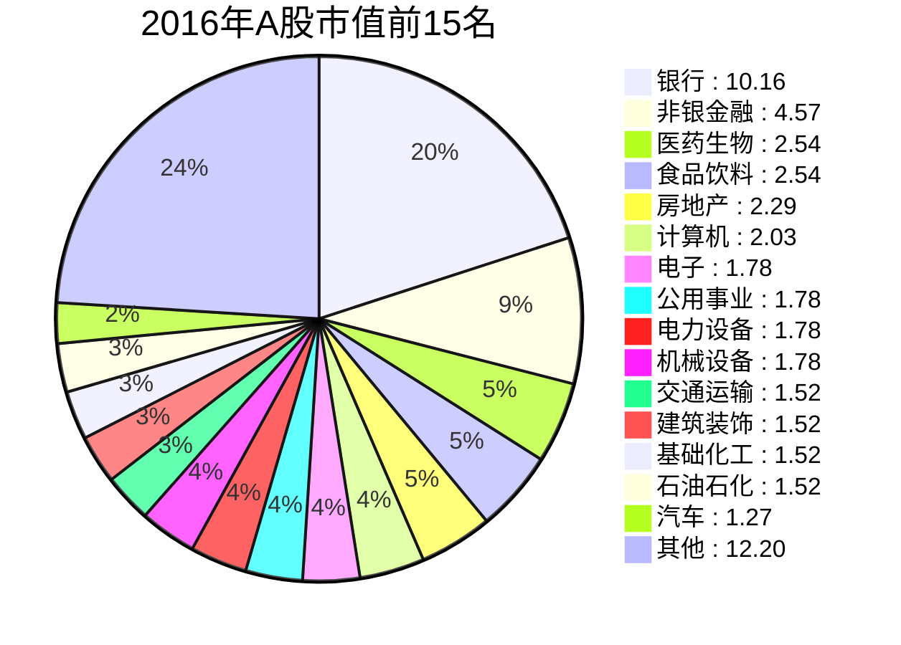
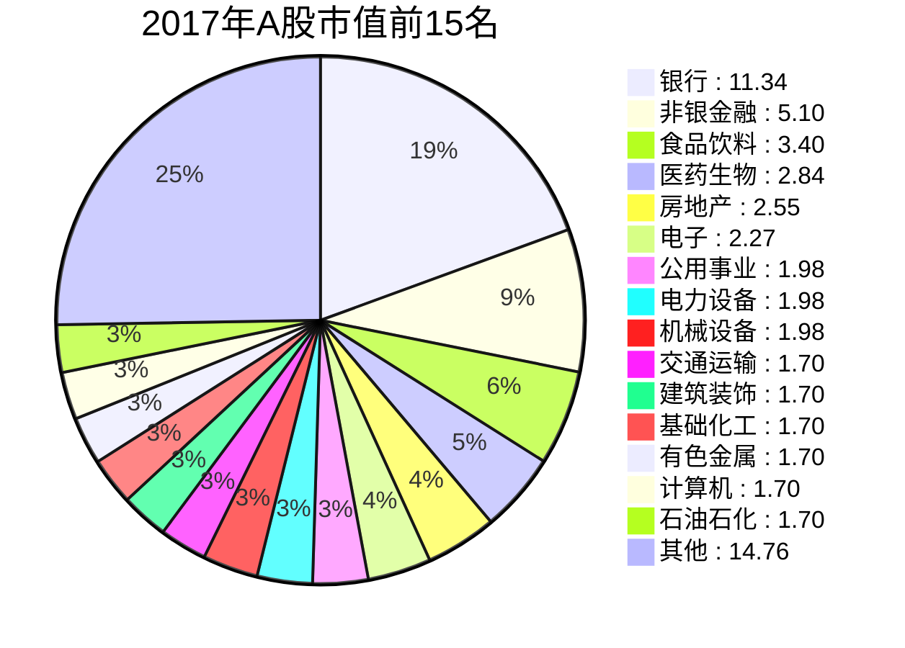
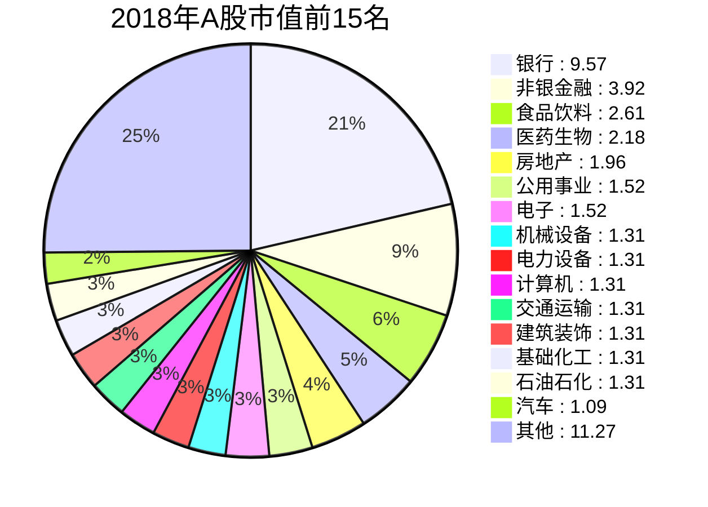
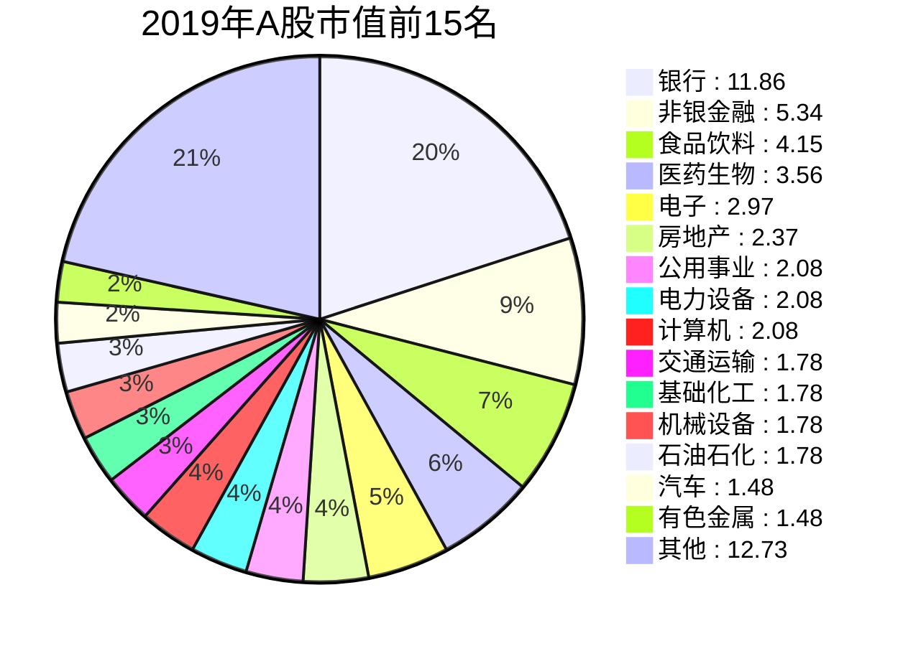
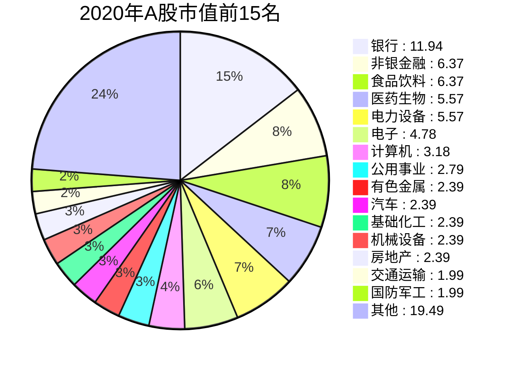
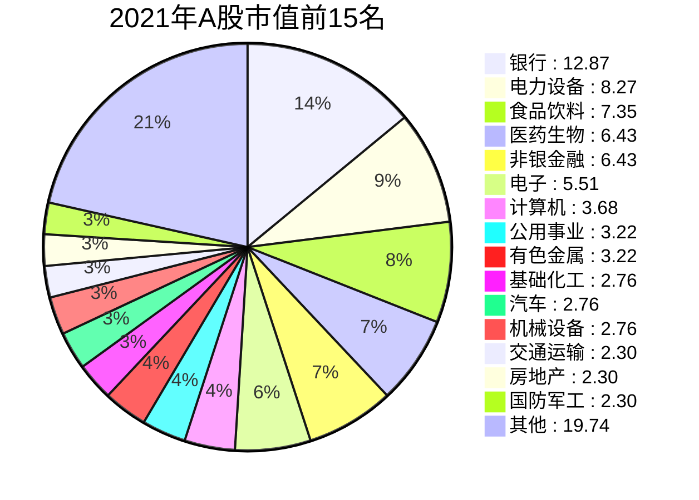
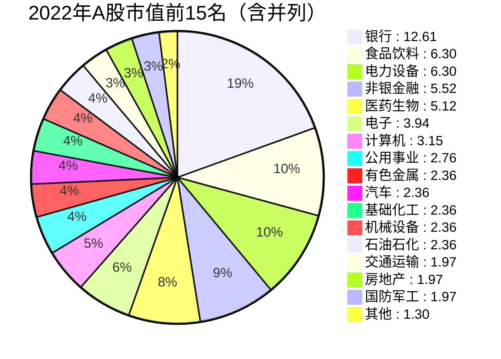
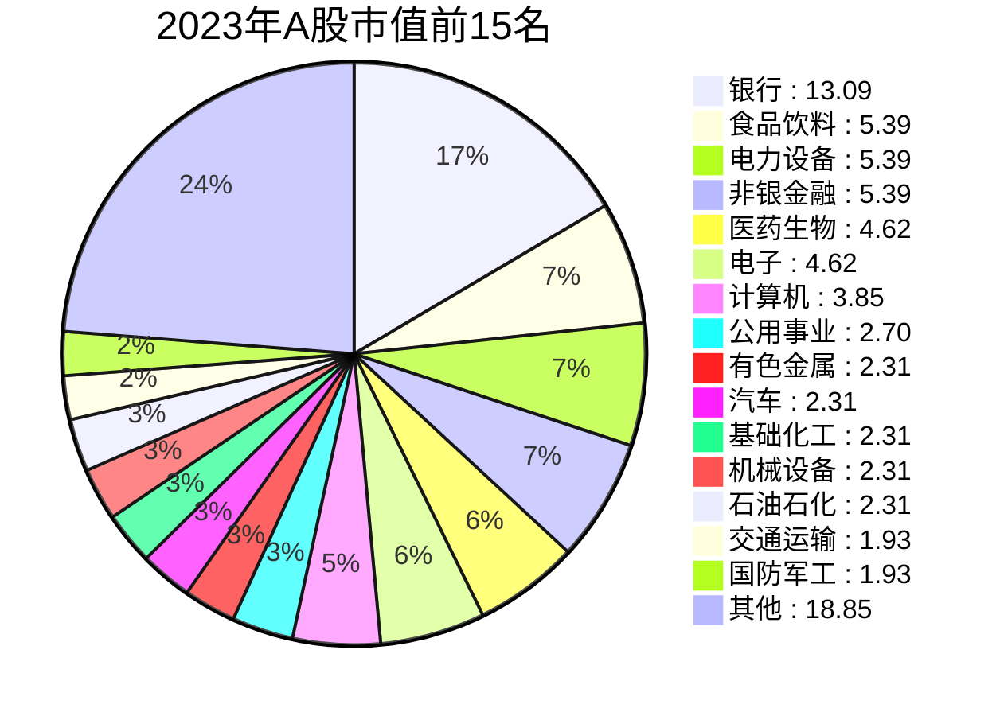
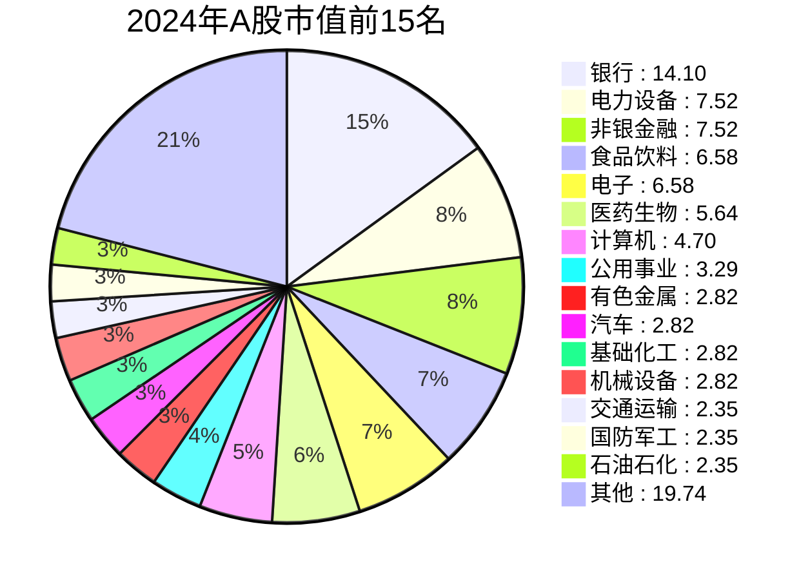
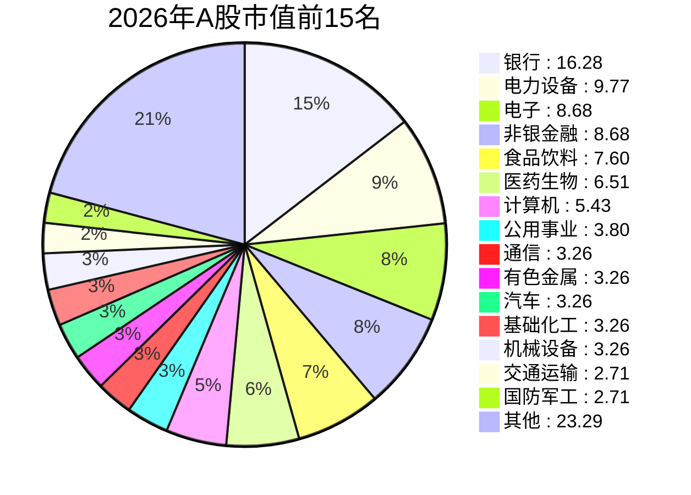

## 2016年（总市值：50.80万亿元，按占比排序）

| 行业 | 市值（万亿元） | 占比（%） |
|------|----------------|-----------|
| 银行 | 10.16 | 20.0 |
| 非银金融 | 4.57 | 9.0 |
| 医药生物 | 2.54 | 5.0 |
| 食品饮料 | 2.54 | 5.0 |
| 房地产 | 2.29 | 4.5 |
| 计算机 | 2.03 | 4.0 |
| 电子 | 1.78 | 3.5 |
| 公用事业 | 1.78 | 3.5 |
| 电力设备 | 1.78 | 3.5 |
| 机械设备 | 1.78 | 3.5 |
| 交通运输 | 1.52 | 3.0 |
| 建筑装饰 | 1.52 | 3.0 |
| 基础化工 | 1.52 | 3.0 |
| 石油石化 | 1.52 | 3.0 |
| 汽车 | 1.27 | 2.5 |
| 有色金属 | 1.27 | 2.5 |
| 国防军工 | 1.27 | 2.5 |
| 传媒 | 1.27 | 2.5 |
| 家用电器 | 1.02 | 2.0 |
| 建筑材料 | 1.02 | 2.0 |
| 钢铁 | 0.81 | 1.6 |
| 煤炭 | 0.76 | 1.5 |
| 通信 | 0.76 | 1.5 |
| 商贸零售 | 0.76 | 1.5 |
| 农林牧渔 | 0.56 | 1.1 |
| 纺织服饰 | 0.51 | 1.0 |
| 轻工制造 | 0.51 | 1.0 |
| 社会服务 | 0.51 | 1.0 |
| 综合 | 0.25 | 0.5 |
| 环保 | 0.46 | 0.9 |
| 美容护理 | 0.05 | 0.1 |

## 2017年（总市值：56.70万亿元，按占比排序）

| 行业 | 市值（万亿元） | 占比（%） |
|------|----------------|-----------|
| 银行 | 11.34 | 20.0 |
| 非银金融 | 5.10 | 9.0 |
| 食品饮料 | 3.40 | 6.0 |
| 医药生物 | 2.84 | 5.0 |
| 房地产 | 2.55 | 4.5 |
| 电子 | 2.27 | 4.0 |
| 公用事业 | 1.98 | 3.5 |
| 电力设备 | 1.98 | 3.5 |
| 机械设备 | 1.98 | 3.5 |
| 交通运输 | 1.70 | 3.0 |
| 建筑装饰 | 1.70 | 3.0 |
| 基础化工 | 1.70 | 3.0 |
| 有色金属 | 1.70 | 3.0 |
| 计算机 | 1.70 | 3.0 |
| 石油石化 | 1.70 | 3.0 |
| 汽车 | 1.42 | 2.5 |
| 家用电器 | 1.42 | 2.5 |
| 国防军工 | 1.13 | 2.0 |
| 建筑材料 | 1.13 | 2.0 |
| 传媒 | 1.13 | 2.0 |
| 钢铁 | 1.02 | 1.8 |
| 煤炭 | 0.85 | 1.5 |
| 通信 | 0.85 | 1.5 |
| 商贸零售 | 0.85 | 1.5 |
| 农林牧渔 | 0.62 | 1.1 |
| 纺织服饰 | 0.57 | 1.0 |
| 轻工制造 | 0.57 | 1.0 |
| 社会服务 | 0.57 | 1.0 |
| 综合 | 0.28 | 0.5 |
| 环保 | 0.51 | 0.9 |
| 美容护理 | 0.11 | 0.2 |

## 2018年（总市值：43.50万亿元，按占比排序）

| 行业 | 市值（万亿元） | 占比（%） |
|------|----------------|-----------|
| 银行 | 9.57 | 22.0 |
| 非银金融 | 3.92 | 9.0 |
| 食品饮料 | 2.61 | 6.0 |
| 医药生物 | 2.18 | 5.0 |
| 房地产 | 1.96 | 4.5 |
| 公用事业 | 1.52 | 3.5 |
| 电子 | 1.52 | 3.5 |
| 机械设备 | 1.31 | 3.0 |
| 电力设备 | 1.31 | 3.0 |
| 计算机 | 1.31 | 3.0 |
| 交通运输 | 1.31 | 3.0 |
| 建筑装饰 | 1.31 | 3.0 |
| 基础化工 | 1.31 | 3.0 |
| 石油石化 | 1.31 | 3.0 |
| 汽车 | 1.09 | 2.5 |
| 有色金属 | 1.09 | 2.5 |
| 家用电器 | 0.87 | 2.0 |
| 建筑材料 | 0.87 | 2.0 |
| 国防军工 | 0.87 | 2.0 |
| 传媒 | 0.87 | 2.0 |
| 钢铁 | 0.78 | 1.8 |
| 煤炭 | 0.65 | 1.5 |
| 通信 | 0.65 | 1.5 |
| 商贸零售 | 0.65 | 1.5 |
| 农林牧渔 | 0.48 | 1.1 |
| 纺织服饰 | 0.44 | 1.0 |
| 轻工制造 | 0.44 | 1.0 |
| 社会服务 | 0.44 | 1.0 |
| 综合 | 0.22 | 0.5 |
| 环保 | 0.39 | 0.9 |
| 美容护理 | 0.09 | 0.2 |

## 2019年（总市值：59.30万亿元，按占比排序）

| 行业 | 市值（万亿元） | 占比（%） |
|------|----------------|-----------|
| 银行 | 11.86 | 20.0 |
| 非银金融 | 5.34 | 9.0 |
| 食品饮料 | 4.15 | 7.0 |
| 医药生物 | 3.56 | 6.0 |
| 电子 | 2.97 | 5.0 |
| 房地产 | 2.37 | 4.0 |
| 公用事业 | 2.08 | 3.5 |
| 电力设备 | 2.08 | 3.5 |
| 计算机 | 2.08 | 3.5 |
| 交通运输 | 1.78 | 3.0 |
| 基础化工 | 1.78 | 3.0 |
| 机械设备 | 1.78 | 3.0 |
| 石油石化 | 1.78 | 3.0 |
| 汽车 | 1.48 | 2.5 |
| 有色金属 | 1.48 | 2.5 |
| 建筑装饰 | 1.48 | 2.5 |
| 家用电器 | 1.19 | 2.0 |
| 建筑材料 | 1.19 | 2.0 |
| 国防军工 | 1.19 | 2.0 |
| 传媒 | 1.19 | 2.0 |
| 钢铁 | 0.89 | 1.5 |
| 煤炭 | 0.89 | 1.5 |
| 通信 | 0.89 | 1.5 |
| 商贸零售 | 0.89 | 1.5 |
| 农林牧渔 | 0.65 | 1.1 |
| 纺织服饰 | 0.59 | 1.0 |
| 轻工制造 | 0.59 | 1.0 |
| 社会服务 | 0.59 | 1.0 |
| 综合 | 0.30 | 0.5 |
| 环保 | 0.53 | 0.9 |
| 美容护理 | 0.18 | 0.3 |

## 2020年（总市值：79.60万亿元，按占比排序）

| 行业 | 市值（万亿元） | 占比（%） |
|------|----------------|-----------|
| 银行 | 11.94 | 15.0 |
| 非银金融 | 6.37 | 8.0 |
| 食品饮料 | 6.37 | 8.0 |
| 医药生物 | 5.57 | 7.0 |
| 电力设备 | 5.57 | 7.0 |
| 电子 | 4.78 | 6.0 |
| 计算机 | 3.18 | 4.0 |
| 公用事业 | 2.79 | 3.5 |
| 有色金属 | 2.39 | 3.0 |
| 汽车 | 2.39 | 3.0 |
| 基础化工 | 2.39 | 3.0 |
| 机械设备 | 2.39 | 3.0 |
| 房地产 | 2.39 | 3.0 |
| 交通运输 | 1.99 | 2.5 |
| 国防军工 | 1.99 | 2.5 |
| 石油石化 | 1.99 | 2.5 |
| 家用电器 | 1.59 | 2.0 |
| 建筑材料 | 1.59 | 2.0 |
| 建筑装饰 | 1.59 | 2.0 |
| 传媒 | 1.59 | 2.0 |
| 钢铁 | 0.96 | 1.2 |
| 煤炭 | 0.96 | 1.2 |
| 通信 | 1.19 | 1.5 |
| 商贸零售 | 0.80 | 1.0 |
| 农林牧渔 | 0.88 | 1.1 |
| 纺织服饰 | 0.80 | 1.0 |
| 轻工制造 | 0.80 | 1.0 |
| 社会服务 | 0.80 | 1.0 |
| 综合 | 0.40 | 0.5 |
| 环保 | 0.72 | 0.9 |
| 美容护理 | 0.40 | 0.5 |

## 2021年（总市值：91.90万亿元，按占比排序）

| 行业 | 市值（万亿元） | 占比（%） |
|------|----------------|-----------|
| 银行 | 12.87 | 14.0 |
| 电力设备 | 8.27 | 9.0 |
| 食品饮料 | 7.35 | 8.0 |
| 医药生物 | 6.43 | 7.0 |
| 非银金融 | 6.43 | 7.0 |
| 电子 | 5.51 | 6.0 |
| 计算机 | 3.68 | 4.0 |
| 公用事业 | 3.22 | 3.5 |
| 有色金属 | 3.22 | 3.5 |
| 基础化工 | 2.76 | 3.0 |
| 汽车 | 2.76 | 3.0 |
| 机械设备 | 2.76 | 3.0 |
| 交通运输 | 2.30 | 2.5 |
| 房地产 | 2.30 | 2.5 |
| 国防军工 | 2.30 | 2.5 |
| 石油石化 | 2.30 | 2.5 |
| 家用电器 | 1.84 | 2.0 |
| 建筑材料 | 1.84 | 2.0 |
| 建筑装饰 | 1.84 | 2.0 |
| 传媒 | 1.38 | 1.5 |
| 通信 | 1.38 | 1.5 |
| 钢铁 | 1.10 | 1.2 |
| 煤炭 | 1.10 | 1.2 |
| 农林牧渔 | 1.01 | 1.1 |
| 商贸零售 | 0.92 | 1.0 |
| 纺织服饰 | 0.92 | 1.0 |
| 轻工制造 | 0.92 | 1.0 |
| 社会服务 | 0.92 | 1.0 |
| 综合 | 0.46 | 0.5 |
| 环保 | 0.83 | 0.9 |
| 美容护理 | 0.64 | 0.7 |

## 2022年（总市值：78.80万亿元，按占比排序）

| 行业 | 市值（万亿元） | 占比（%） |
|------|----------------|-----------|
| 银行 | 12.61 | 16.0 |
| 食品饮料 | 6.30 | 8.0 |
| 电力设备 | 6.30 | 8.0 |
| 非银金融 | 5.52 | 7.0 |
| 医药生物 | 5.12 | 6.5 |
| 电子 | 3.94 | 5.0 |
| 计算机 | 3.15 | 4.0 |
| 公用事业 | 2.76 | 3.5 |
| 有色金属 | 2.36 | 3.0 |
| 汽车 | 2.36 | 3.0 |
| 基础化工 | 2.36 | 3.0 |
| 机械设备 | 2.36 | 3.0 |
| 石油石化 | 2.36 | 3.0 |
| 交通运输 | 1.97 | 2.5 |
| 房地产 | 1.97 | 2.5 |
| 国防军工 | 1.97 | 2.5 |
| 家用电器 | 1.58 | 2.0 |
| 建筑材料 | 1.58 | 2.0 |
| 建筑装饰 | 1.58 | 2.0 |
| 通信 | 1.18 | 1.5 |
| 煤炭 | 1.18 | 1.5 |
| 传媒 | 1.18 | 1.5 |
| 钢铁 | 0.95 | 1.2 |
| 农林牧渔 | 0.87 | 1.1 |
| 商贸零售 | 0.79 | 1.0 |
| 纺织服饰 | 0.79 | 1.0 |
| 轻工制造 | 0.79 | 1.0 |
| 社会服务 | 0.79 | 1.0 |
| 综合 | 0.39 | 0.5 |
| 环保 | 0.71 | 0.9 |
| 美容护理 | 0.55 | 0.7 |

## 2023年（总市值：77.00万亿元，按占比排序）

| 行业 | 市值（万亿元） | 占比（%） |
|------|----------------|-----------|
| 银行 | 13.09 | 17.0 |
| 食品饮料 | 5.39 | 7.0 |
| 电力设备 | 5.39 | 7.0 |
| 非银金融 | 5.39 | 7.0 |
| 医药生物 | 4.62 | 6.0 |
| 电子 | 4.62 | 6.0 |
| 计算机 | 3.85 | 5.0 |
| 公用事业 | 2.70 | 3.5 |
| 有色金属 | 2.31 | 3.0 |
| 汽车 | 2.31 | 3.0 |
| 基础化工 | 2.31 | 3.0 |
| 机械设备 | 2.31 | 3.0 |
| 石油石化 | 2.31 | 3.0 |
| 交通运输 | 1.93 | 2.5 |
| 国防军工 | 1.93 | 2.5 |
| 家用电器 | 1.54 | 2.0 |
| 建筑装饰 | 1.54 | 2.0 |
| 传媒 | 1.54 | 2.0 |
| 通信 | 1.54 | 2.0 |
| 房地产 | 1.54 | 2.0 |
| 建筑材料 | 1.16 | 1.5 |
| 煤炭 | 1.16 | 1.5 |
| 钢铁 | 0.92 | 1.2 |
| 农林牧渔 | 0.85 | 1.1 |
| 商贸零售 | 0.77 | 1.0 |
| 纺织服饰 | 0.77 | 1.0 |
| 轻工制造 | 0.77 | 1.0 |
| 社会服务 | 0.77 | 1.0 |
| 综合 | 0.39 | 0.5 |
| 环保 | 0.69 | 0.9 |
| 美容护理 | 0.54 | 0.7 |

## 2024年（总市值：94.00万亿元，按占比排序）

| 行业 | 市值（万亿元） | 占比（%） |
|------|----------------|-----------|
| 银行 | 14.10 | 15.0 |
| 电力设备 | 7.52 | 8.0 |
| 非银金融 | 7.52 | 8.0 |
| 食品饮料 | 6.58 | 7.0 |
| 电子 | 6.58 | 7.0 |
| 医药生物 | 5.64 | 6.0 |
| 计算机 | 4.70 | 5.0 |
| 公用事业 | 3.29 | 3.5 |
| 有色金属 | 2.82 | 3.0 |
| 汽车 | 2.82 | 3.0 |
| 基础化工 | 2.82 | 3.0 |
| 机械设备 | 2.82 | 3.0 |
| 交通运输 | 2.35 | 2.5 |
| 国防军工 | 2.35 | 2.5 |
| 石油石化 | 2.35 | 2.5 |
| 通信 | 2.35 | 2.5 |
| 家用电器 | 1.88 | 2.0 |
| 建筑装饰 | 1.88 | 2.0 |
| 传媒 | 1.88 | 2.0 |
| 建筑材料 | 1.41 | 1.5 |
| 煤炭 | 1.41 | 1.5 |
| 房地产 | 1.41 | 1.5 |
| 钢铁 | 1.13 | 1.2 |
| 农林牧渔 | 1.03 | 1.1 |
| 商贸零售 | 0.94 | 1.0 |
| 纺织服饰 | 0.94 | 1.0 |
| 轻工制造 | 0.94 | 1.0 |
| 社会服务 | 0.94 | 1.0 |
| 综合 | 0.47 | 0.5 |
| 环保 | 0.85 | 0.9 |
| 美容护理 | 0.75 | 0.8 |

## 2025年（总市值：105.00万亿元，按占比排序）

| 行业 | 市值（万亿元） | 占比（%） |
|------|----------------|-----------|
| 银行 | 15.75 | 15.0 |
| 电力设备 | 9.45 | 9.0 |
| 电子 | 8.40 | 8.0 |
| 非银金融 | 8.40 | 8.0 |
| 食品饮料 | 7.35 | 7.0 |
| 医药生物 | 6.30 | 6.0 |
| 计算机 | 5.25 | 5.0 |
| 公用事业 | 3.68 | 3.5 |
| 通信 | 3.15 | 3.0 |
| 有色金属 | 3.15 | 3.0 |
| 汽车 | 3.15 | 3.0 |
| 基础化工 | 3.15 | 3.0 |
| 机械设备 | 3.15 | 3.0 |
| 交通运输 | 2.63 | 2.5 |
| 国防军工 | 2.63 | 2.5 |
| 石油石化 | 2.63 | 2.5 |
| 家用电器 | 2.10 | 2.0 |
| 建筑装饰 | 2.10 | 2.0 |
| 传媒 | 2.10 | 2.0 |
| 建筑材料 | 1.58 | 1.5 |
| 煤炭 | 1.58 | 1.5 |
| 房地产 | 1.58 | 1.5 |
| 钢铁 | 1.26 | 1.2 |
| 农林牧渔 | 1.16 | 1.1 |
| 商贸零售 | 1.05 | 1.0 |
| 纺织服饰 | 1.05 | 1.0 |
| 轻工制造 | 1.05 | 1.0 |
| 社会服务 | 1.05 | 1.0 |
| 综合 | 0.53 | 0.5 |
| 环保 | 0.95 | 0.9 |
| 美容护理 | 0.84 | 0.8 |

## 2026年（总市值：108.50万亿元，截至年中近似值，按占比排序）

| 行业 | 市值（万亿元） | 占比（%） |
|------|----------------|-----------|
| 银行 | 16.28 | 15.0 |
| 电力设备 | 9.77 | 9.0 |
| 电子 | 8.68 | 8.0 |
| 非银金融 | 8.68 | 8.0 |
| 食品饮料 | 7.60 | 7.0 |
| 医药生物 | 6.51 | 6.0 |
| 计算机 | 5.43 | 5.0 |
| 公用事业 | 3.80 | 3.5 |
| 通信 | 3.26 | 3.0 |
| 有色金属 | 3.26 | 3.0 |
| 汽车 | 3.26 | 3.0 |
| 基础化工 | 3.26 | 3.0 |
| 机械设备 | 3.26 | 3.0 |
| 交通运输 | 2.71 | 2.5 |
| 国防军工 | 2.71 | 2.5 |
| 石油石化 | 2.71 | 2.5 |
| 家用电器 | 2.17 | 2.0 |
| 建筑装饰 | 2.17 | 2.0 |
| 传媒 | 2.17 | 2.0 |
| 建筑材料 | 1.63 | 1.5 |
| 煤炭 | 1.63 | 1.5 |
| 房地产 | 1.63 | 1.5 |
| 钢铁 | 1.30 | 1.2 |
| 农林牧渔 | 1.19 | 1.1 |
| 商贸零售 | 1.09 | 1.0 |
| 纺织服饰 | 1.09 | 1.0 |
| 轻工制造 | 1.09 | 1.0 |
| 社会服务 | 1.09 | 1.0 |
| 综合 | 0.54 | 0.5 |
| 环保 | 0.98 | 0.9 |
| 美容护理 | 0.87 | 0.8 |

