# 基础词汇 A1-A2（2000词）

本文件收录 2000 个 A1-A2 级别基础英语单词，按主题分类，每个单词配有音标、词性、中文释义和例句。适合英语初学者或需要夯实基础的学习者。

---

## 第一章：数字、时间与日期（Numbers, Time & Dates）

### 1.1 基数词与序数词

| 单词 | 音标 | 词性 | 中文释义 | 例句 |
|------|------|------|---------|------|
| one | /wʌn/ | num | 一 | I have **one** brother. |
| two | /tuː/ | num | 二 | There are **two** cats. |
| three | /θriː/ | num | 三 | She bought **three** apples. |
| four | /fɔːr/ | num | 四 | The table has **four** legs. |
| five | /faɪv/ | num | 五 | He works **five** days a week. |
| six | /sɪks/ | num | 六 | There are **six** people in the room. |
| seven | /ˈsevən/ | num | 七 | **Seven** days make a week. |
| eight | /eɪt/ | num | 八 | She is **eight** years old. |
| nine | /naɪn/ | num | 九 | The shop opens at **nine**. |
| ten | /ten/ | num | 十 | Count from one to **ten**. |
| eleven | /ɪˈlevən/ | num | 十一 | The bus leaves at **eleven**. |
| twelve | /twelv/ | num | 十二 | There are **twelve** months in a year. |
| twenty | /ˈtwenti/ | num | 二十 | He is **twenty** years old. |
| thirty | /ˈθɜːrti/ | num | 三十 | The book costs **thirty** yuan. |
| forty | /ˈfɔːrti/ | num | 四十 | She ran **forty** kilometers. |
| fifty | /ˈfɪfti/ | num | 五十 | My father is **fifty**. |
| hundred | /ˈhʌndrəd/ | num | 百 | A **hundred** people came. |
| thousand | /ˈθaʊzənd/ | num | 千 | This costs two **thousand** yuan. |
| million | /ˈmɪljən/ | num | 百万 | There are seven **billion** people. |
| first | /fɜːrst/ | adj/adv | 第一 | She came **first** in the race. |
| second | /ˈsekənd/ | adj/adv | 第二 | This is my **second** visit. |
| third | /θɜːrd/ | adj/adv | 第三 | He finished **third**. |
| last | /lɑːst/ | adj/adv | 最后 | This is the **last** bus tonight. |

#### 1.1 基数词与序数词思维导图

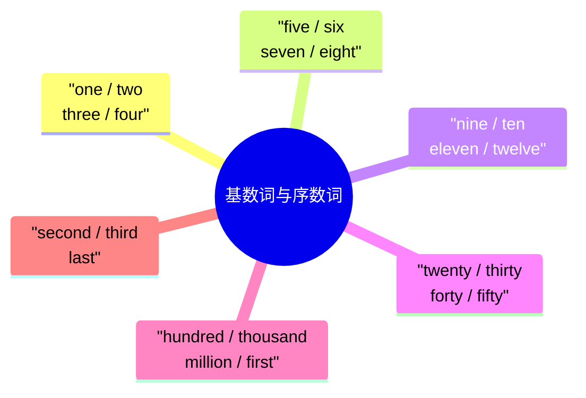

### 1.2 时间词汇

| 单词 | 音标 | 词性 | 中文释义 | 例句 |
|------|------|------|---------|------|
| time | /taɪm/ | n | 时间 | What **time** is it? |
| hour | /ˈaʊər/ | n | 小时 | I'll be there in an **hour**. |
| minute | /ˈmɪnɪt/ | n | 分钟 | Wait a **minute**, please. |
| second | /ˈsekənd/ | n | 秒 | It only takes a **second**. |
| morning | /ˈmɔːrnɪŋ/ | n | 早晨 | Good **morning**! |
| afternoon | /ˌɑːftərˈnuːn/ | n | 下午 | See you this **afternoon**. |
| evening | /ˈiːvnɪŋ/ | n | 傍晚/晚上 | Good **evening**, everyone. |
| night | /naɪt/ | n | 夜晚 | I work at **night**. |
| midnight | /ˈmɪdnaɪt/ | n | 午夜 | The party ends at **midnight**. |
| noon | /nuːn/ | n | 正午 | Let's meet at **noon**. |
| day | /deɪ/ | n | 天/日 | Have a nice **day**! |
| week | /wiːk/ | n | 周 | I'll see you next **week**. |
| month | /mʌnθ/ | n | 月 | This **month** is very busy. |
| year | /jɪər/ | n | 年 | Happy New **Year**! |
| today | /təˈdeɪ/ | n/adv | 今天 | What day is **today**? |
| tomorrow | /təˈmɒrəʊ/ | n/adv | 明天 | See you **tomorrow**. |
| yesterday | /ˈjestərdeɪ/ | n/adv | 昨天 | I was sick **yesterday**. |
| now | /naʊ/ | adv | 现在 | I'm busy **now**. |
| soon | /suːn/ | adv | 很快 | Dinner will be ready **soon**. |
| late | /leɪt/ | adj/adv | 晚/迟 | Don't be **late**. |
| early | /ˈɜːrli/ | adj/adv | 早 | She woke up **early**. |
| always | /ˈɔːlweɪz/ | adv | 总是 | He **always** arrives on time. |
| usually | /ˈjuːʒuəli/ | adv | 通常 | I **usually** drink coffee in the morning. |
| often | /ˈɒfən/ | adv | 经常 | How **often** do you exercise? |
| sometimes | /ˈsʌmtaɪmz/ | adv | 有时 | **Sometimes** I feel lonely. |
| never | /ˈnevər/ | adv | 从不 | I **never** eat fast food. |
| already | /ɔːlˈredi/ | adv | 已经 | I've **already** eaten. |
| still | /stɪl/ | adv | 仍然 | Are you **still** here? |
| yet | /jet/ | adv | 还/已经 | Has he arrived **yet**? |

#### 1.2 时间词汇思维导图

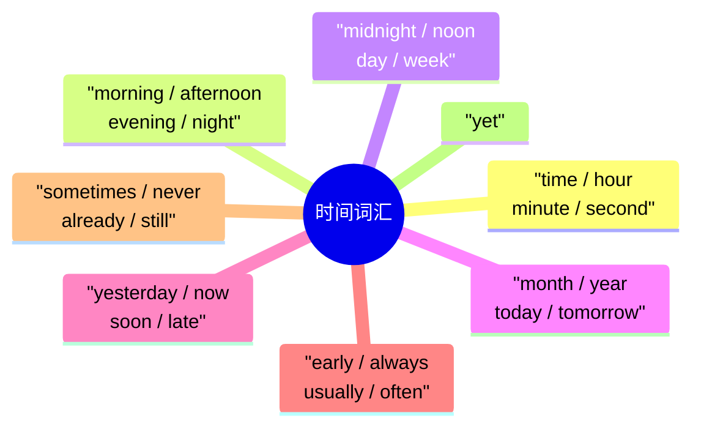

### 1.3 星期与月份

| 单词 | 音标 | 中文释义 |
|------|------|---------|
| Monday | /ˈmʌndeɪ/ | 星期一 |
| Tuesday | /ˈtjuːzdeɪ/ | 星期二 |
| Wednesday | /ˈwenzdeɪ/ | 星期三 |
| Thursday | /ˈθɜːrzdeɪ/ | 星期四 |
| Friday | /ˈfraɪdeɪ/ | 星期五 |
| Saturday | /ˈsætərdeɪ/ | 星期六 |
| Sunday | /ˈsʌndeɪ/ | 星期日 |
| January | /ˈdʒænjueri/ | 一月 |
| February | /ˈfebrueri/ | 二月 |
| March | /mɑːrtʃ/ | 三月 |
| April | /ˈeɪprəl/ | 四月 |
| May | /meɪ/ | 五月 |
| June | /dʒuːn/ | 六月 |
| July | /dʒuˈlaɪ/ | 七月 |
| August | /ˈɔːɡəst/ | 八月 |
| September | /sepˈtembər/ | 九月 |
| October | /ɒkˈtoʊbər/ | 十月 |
| November | /noʊˈvembər/ | 十一月 |
| December | /dɪˈsembər/ | 十二月 |

---

#### 1.3 星期与月份思维导图

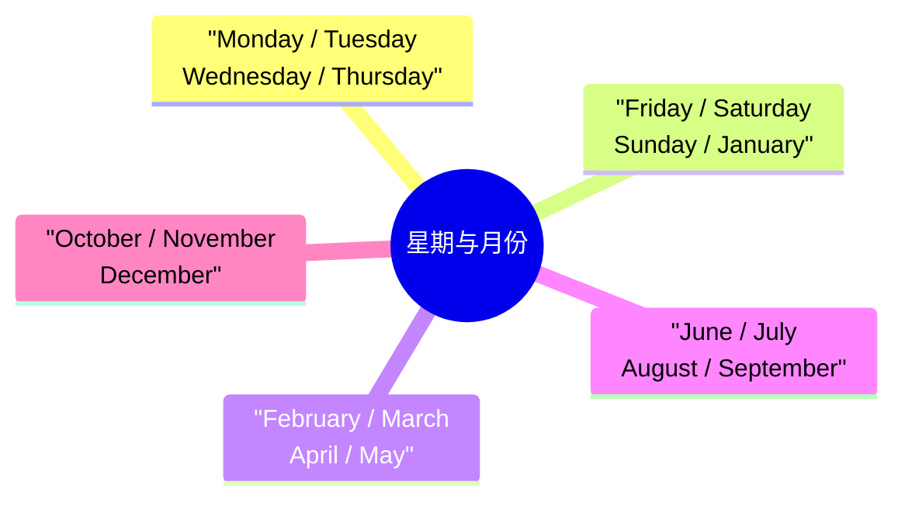

## 第二章：家庭与人际关系（Family & Relationships）

| 单词 | 音标 | 词性 | 中文释义 | 例句 |
|------|------|------|---------|------|
| family | /ˈfæməli/ | n | 家庭/家人 | My **family** lives in Beijing. |
| parent | /ˈpeərənt/ | n | 父母（一方） | My **parents** are both teachers. |
| father | /ˈfɑːðər/ | n | 父亲 | My **father** works in a bank. |
| mother | /ˈmʌðər/ | n | 母亲 | My **mother** is a doctor. |
| dad | /dæd/ | n | 爸爸（口语） | **Dad**, can I go out? |
| mum / mom | /mʌm/  | n | 妈妈（口语） | **Mom** cooked dinner tonight. |
| child | /tʃaɪld/ | n | 孩子 | She has one **child**. |
| children | /ˈtʃɪldrən/ | n | 孩子们 | The **children** are playing. |
| son | /sʌn/ | n | 儿子 | His **son** is five years old. |
| daughter | /ˈdɔːtər/ | n | 女儿 | Their **daughter** studies in Paris. |
| brother | /ˈbrʌðər/ | n | 兄弟 | I have two **brothers**. |
| sister | /ˈsɪstər/ | n | 姐妹 | My **sister** is older than me. |
| husband | /ˈhʌzbənd/ | n | 丈夫 | Her **husband** is very kind. |
| wife | /waɪf/ | n | 妻子 | His **wife** is from Shanghai. |
| grandparent | /ˈɡrændpeərənt/ | n | 祖父母/外祖父母 | My **grandparents** are healthy. |
| grandfather | /ˈɡrændfɑːðər/ | n | 祖父/外祖父 | My **grandfather** tells great stories. |
| grandmother | /ˈɡrændmʌðər/ | n | 祖母/外祖母 | **Grandmother** makes delicious soup. |
| grandpa | /ˈɡrændpɑː/ | n | 爷爷/外公（口语） | **Grandpa** loves gardening. |
| grandma | /ˈɡrændmɑː/ | n | 奶奶/外婆（口语） | **Grandma** knits beautiful sweaters. |
| uncle | /ˈʌŋkəl/ | n | 叔叔/舅舅 | My **uncle** lives in Chengdu. |
| aunt | /ɑːnt/ | n | 阿姨/姑姑 | **Aunt** Mary visited us last week. |
| cousin | /ˈkʌzən/ | n | 表/堂兄弟姐妹 | My **cousin** and I grew up together. |
| nephew | /ˈnefjuː/ | n | 侄子/外甥 | My **nephew** is very clever. |
| niece | /niːs/ | n | 侄女/外甥女 | My **niece** loves drawing. |
| baby | /ˈbeɪbi/ | n | 婴儿 | The **baby** is sleeping. |
| boy | /bɔɪ/ | n | 男孩 | That **boy** runs very fast. |
| girl | /ɡɜːrl/ | n | 女孩 | The **girl** sings beautifully. |
| man | /mæn/ | n | 男人 | That **man** is my teacher. |
| woman | /ˈwʊmən/ | n | 女人 | The **woman** in blue is my boss. |
| friend | /frend/ | n | 朋友 | She is my best **friend**. |
| neighbor | /ˈneɪbər/ | n | 邻居 | My **neighbor** is very friendly. |
| colleague | /ˈkɒliːɡ/ | n | 同事 | My **colleagues** are helpful. |
| classmate | /ˈklɑːsmeɪt/ | n | 同学 | We are **classmates**. |
| stranger | /ˈstreɪndʒər/ | n | 陌生人 | Don't talk to **strangers**. |
| couple | /ˈkʌpəl/ | n | 夫妻/一对 | They are a happy **couple**. |
| person | /ˈpɜːrsən/ | n | 人 | She is a kind **person**. |
| people | /ˈpiːpəl/ | n | 人们 | **People** here are very warm. |

---

### 第二章：家庭与人际关系思维导图

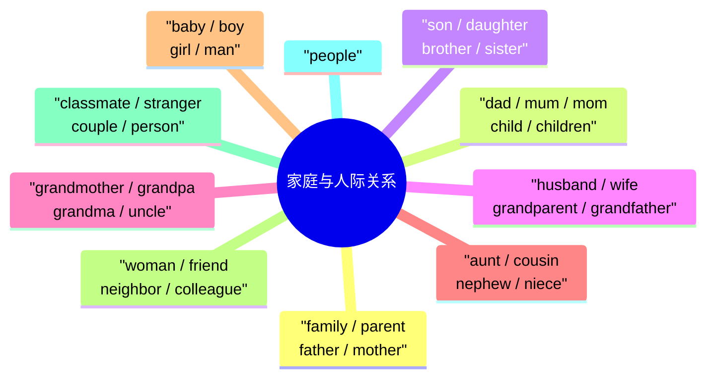

## 第三章：身体与健康（Body & Health）

### 3.1 身体部位

| 单词 | 音标 | 词性 | 中文释义 | 例句 |
|------|------|------|---------|------|
| body | /ˈbɒdi/ | n | 身体 | Exercise keeps the **body** healthy. |
| head | /hed/ | n | 头 | My **head** hurts. |
| face | /feɪs/ | n | 脸 | She has a pretty **face**. |
| eye | /aɪ/ | n | 眼睛 | Close your **eyes** and rest. |
| ear | /ɪər/ | n | 耳朵 | I have a pain in my **ear**. |
| nose | /noʊz/ | n | 鼻子 | My **nose** is running. |
| mouth | /maʊθ/ | n | 嘴 | Open your **mouth** wide. |
| tooth | /tuːθ/ | n | 牙齿 | I have a **toothache**. |
| teeth | /tiːθ/ | n | 牙齿（复数） | Brush your **teeth** every day. |
| lip | /lɪp/ | n | 嘴唇 | Her **lips** are dry. |
| tongue | /tʌŋ/ | n | 舌头 | The food burned my **tongue**. |
| neck | /nek/ | n | 脖子 | My **neck** is stiff. |
| shoulder | /ˈʃoʊldər/ | n | 肩膀 | She tapped him on the **shoulder**. |
| arm | /ɑːrm/ | n | 手臂 | He broke his **arm**. |
| elbow | /ˈelboʊ/ | n | 肘部 | Don't put your **elbows** on the table. |
| wrist | /rɪst/ | n | 手腕 | She wears a bracelet on her **wrist**. |
| hand | /hænd/ | n | 手 | Wash your **hands** before eating. |
| finger | /ˈfɪŋɡər/ | n | 手指 | She cut her **finger**. |
| thumb | /θʌm/ | n | 拇指 | **Thumbs up** means great! |
| chest | /tʃest/ | n | 胸部 | He has a pain in his **chest**. |
| back | /bæk/ | n | 背部 | My **back** aches after sitting long. |
| stomach | /ˈstʌmək/ | n | 胃/腹部 | My **stomach** is growling. |
| hip | /hɪp/ | n | 臀部/髋部 | She broke her **hip** in the fall. |
| leg | /leɡ/ | n | 腿 | She has long **legs**. |
| knee | /niː/ | n | 膝盖 | He hurt his **knee** playing football. |
| ankle | /ˈæŋkəl/ | n | 踝关节 | I twisted my **ankle**. |
| foot | /fʊt/ | n | 脚 | My **feet** are cold. |
| toe | /toʊ/ | n | 脚趾 | I stubbed my **toe**. |
| skin | /skɪn/ | n | 皮肤 | Her **skin** is smooth. |
| hair | /heər/ | n | 头发 | She has long black **hair**. |
| heart | /hɑːrt/ | n | 心脏/心 | Exercise is good for the **heart**. |
| brain | /breɪn/ | n | 大脑 | The **brain** controls all body functions. |
| blood | /blʌd/ | n | 血液 | He donated **blood** last month. |
| bone | /boʊn/ | n | 骨头 | Milk is good for your **bones**. |
| muscle | /ˈmʌsəl/ | n | 肌肉 | Regular exercise builds **muscles**. |

#### 3.1 身体部位思维导图

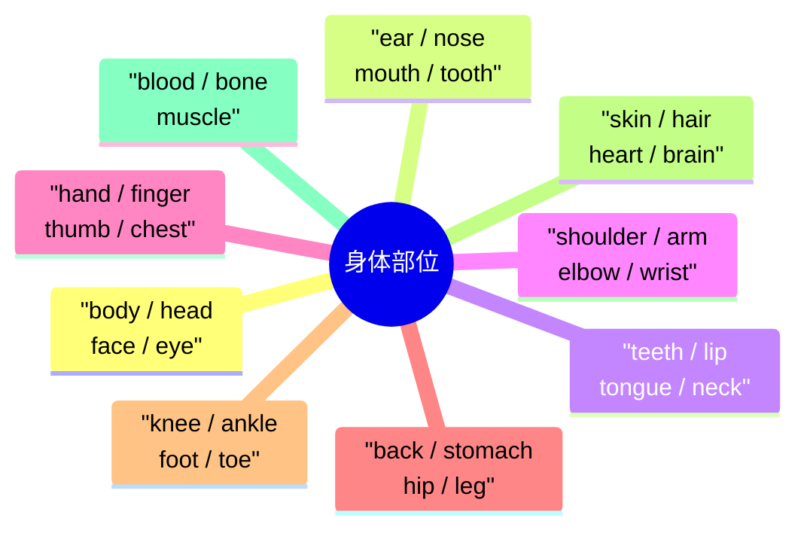

### 3.2 健康与疾病

| 单词 | 音标 | 词性 | 中文释义 | 例句 |
|------|------|------|---------|------|
| health | /helθ/ | n | 健康 | **Health** is more important than wealth. |
| healthy | /ˈhelθi/ | adj | 健康的 | Eat **healthy** food every day. |
| sick | /sɪk/ | adj | 生病的 | I'm feeling **sick** today. |
| ill | /ɪl/ | adj | 生病的 | She's been **ill** for a week. |
| pain | /peɪn/ | n | 疼痛 | I feel a sharp **pain** in my leg. |
| ache | /eɪk/ | n/v | 疼痛 | I have a **headache**. |
| fever | /ˈfiːvər/ | n | 发烧 | He has a high **fever**. |
| cold | /koʊld/ | n | 感冒 | She caught a **cold**. |
| cough | /kɒf/ | n/v | 咳嗽 | I have a bad **cough**. |
| sneeze | /sniːz/ | v/n | 打喷嚏 | He **sneezed** three times. |
| tired | /ˈtaɪərd/ | adj | 疲惫的 | I'm very **tired** today. |
| rest | /rest/ | n/v | 休息 | You need to **rest**. |
| sleep | /sliːp/ | n/v | 睡眠/睡觉 | I need eight hours of **sleep**. |
| doctor | /ˈdɒktər/ | n | 医生 | See a **doctor** right away. |
| nurse | /nɜːrs/ | n | 护士 | The **nurse** gave me an injection. |
| hospital | /ˈhɒspɪtl/ | n | 医院 | He was taken to the **hospital**. |
| medicine | /ˈmedɪsən/ | n | 药/医学 | Take this **medicine** three times a day. |
| drug | /drʌɡ/ | n | 药物 | This **drug** has side effects. |
| pill | /pɪl/ | n | 药片 | Take two **pills** after each meal. |
| injection | /ɪnˈdʒekʃən/ | n | 注射 | The doctor gave me an **injection**. |
| exercise | /ˈeksərsaɪz/ | n/v | 运动/练习 | Daily **exercise** keeps you healthy. |
| diet | /ˈdaɪət/ | n | 饮食/节食 | A balanced **diet** is important. |
| weight | /weɪt/ | n | 体重 | She wants to lose **weight**. |

---

#### 3.2 健康与疾病思维导图

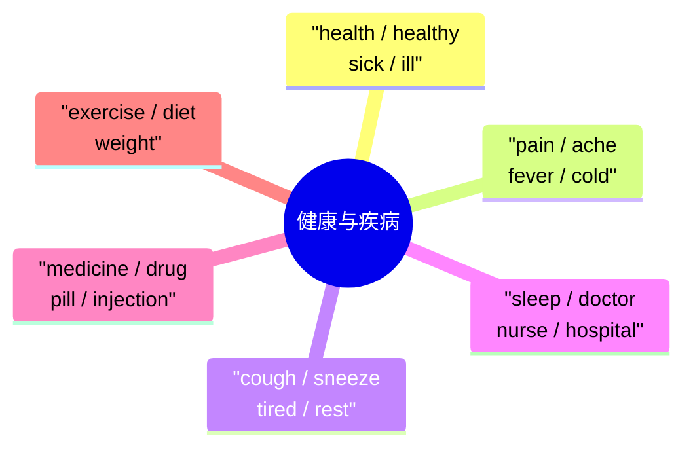

## 第四章：食物与饮食（Food & Dining）

### 4.1 基本食物

| 单词 | 音标 | 词性 | 中文释义 | 例句 |
|------|------|------|---------|------|
| food | /fuːd/ | n | 食物 | Chinese **food** is delicious. |
| meal | /miːl/ | n | 一餐 | We have three **meals** a day. |
| breakfast | /ˈbrekfəst/ | n | 早餐 | I never skip **breakfast**. |
| lunch | /lʌntʃ/ | n | 午餐 | What did you have for **lunch**? |
| dinner | /ˈdɪnər/ | n | 晚餐 | **Dinner** is ready! |
| snack | /snæk/ | n | 零食/点心 | I had a **snack** at 4pm. |
| rice | /raɪs/ | n | 米饭/大米 | I eat **rice** every day. |
| bread | /bred/ | n | 面包 | I had toast for **bread**. |
| noodle | /ˈnuːdəl/ | n | 面条 | I love **noodles**. |
| soup | /suːp/ | n | 汤 | This **soup** is too hot. |
| salad | /ˈsæləd/ | n | 沙拉 | I'll have a **salad** please. |
| sandwich | /ˈsænwɪdʒ/ | n | 三明治 | I made a cheese **sandwich**. |
| pizza | /ˈpiːtsə/ | n | 披萨 | Let's order **pizza** tonight. |
| hamburger | /ˈhæmbɜːrɡər/ | n | 汉堡 | He ate a **hamburger** for lunch. |
| egg | /eɡ/ | n | 鸡蛋 | I want scrambled **eggs**. |
| meat | /miːt/ | n | 肉 | She doesn't eat **meat**. |
| chicken | /ˈtʃɪkɪn/ | n | 鸡/鸡肉 | Grilled **chicken** is tasty. |
| beef | /biːf/ | n | 牛肉 | I'd like a **beef** steak. |
| pork | /pɔːrk/ | n | 猪肉 | **Pork** is popular in China. |
| fish | /fɪʃ/ | n | 鱼/鱼肉 | I eat **fish** twice a week. |
| seafood | /ˈsiːfuːd/ | n | 海鲜 | I love **seafood**. |
| vegetable | /ˈvedʒtəbəl/ | n | 蔬菜 | Eat more **vegetables**. |
| fruit | /fruːt/ | n | 水果 | Fresh **fruit** is healthy. |
| apple | /ˈæpəl/ | n | 苹果 | An **apple** a day keeps the doctor away. |
| banana | /bəˈnɑːnə/ | n | 香蕉 | I eat a **banana** every morning. |
| orange | /ˈɒrɪndʒ/ | n | 橙子 | I want some **orange** juice. |
| tomato | /təˈmɑːtoʊ/ | n | 番茄 | Add **tomatoes** to the salad. |
| onion | /ˈʌnjən/ | n | 洋葱 | Fry the **onions** first. |
| potato | /pəˈteɪtoʊ/ | n | 土豆 | I like mashed **potatoes**. |
| carrot | /ˈkærət/ | n | 胡萝卜 | Rabbits love **carrots**. |
| garlic | /ˈɡɑːrlɪk/ | n | 大蒜 | Add some **garlic** for flavor. |
| sugar | /ˈʃʊɡər/ | n | 糖 | Don't add too much **sugar**. |
| salt | /sɔːlt/ | n | 盐 | The soup needs more **salt**. |
| oil | /ɔɪl/ | n | 油 | Cook in a little **oil**. |
| butter | /ˈbʌtər/ | n | 黄油 | Spread **butter** on the bread. |
| cheese | /tʃiːz/ | n | 奶酪 | I love **cheese** pizza. |
| milk | /mɪlk/ | n | 牛奶 | Children need to drink **milk**. |
| coffee | /ˈkɒfi/ | n | 咖啡 | I drink two cups of **coffee** a day. |
| tea | /tiː/ | n | 茶 | Would you like some **tea**? |
| water | /ˈwɔːtər/ | n | 水 | Drink eight glasses of **water** a day. |
| juice | /dʒuːs/ | n | 果汁 | I'll have orange **juice** please. |
| beer | /bɪər/ | n | 啤酒 | He ordered a cold **beer**. |
| wine | /waɪn/ | n | 葡萄酒 | A glass of red **wine** with dinner. |

#### 4.1 基本食物思维导图

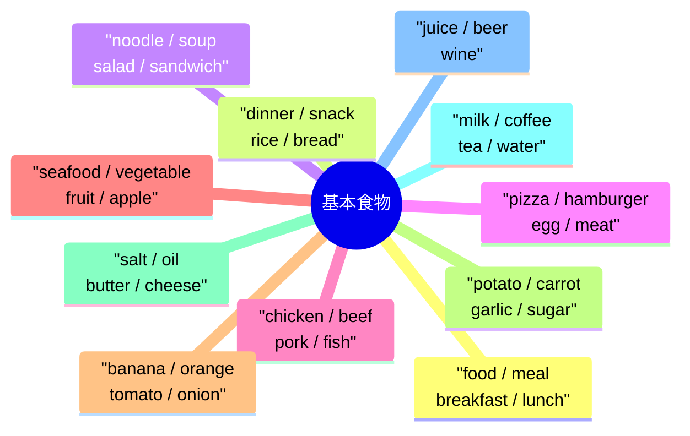

### 4.2 餐厅与烹饪

| 单词 | 音标 | 词性 | 中文释义 | 例句 |
|------|------|------|---------|------|
| restaurant | /ˈrestərɒnt/ | n | 餐厅 | Let's go to a **restaurant**. |
| menu | /ˈmenjuː/ | n | 菜单 | May I see the **menu**? |
| order | /ˈɔːrdər/ | v/n | 点菜/命令 | Are you ready to **order**? |
| waiter | /ˈweɪtər/ | n | 服务员(男) | **Waiter**, could I have the bill? |
| waitress | /ˈweɪtrɪs/ | n | 服务员(女) | The **waitress** brought our food. |
| bill | /bɪl/ | n | 账单 | Could I have the **bill** please? |
| tip | /tɪp/ | n | 小费/建议 | Leave a **tip** for good service. |
| cook | /kʊk/ | v/n | 烹饪/厨师 | I love to **cook**. |
| boil | /bɔɪl/ | v | 煮/烧开 | **Boil** the water first. |
| fry | /fraɪ/ | v | 煎/炸 | **Fry** the eggs in butter. |
| bake | /beɪk/ | v | 烤（烤箱） | She **bakes** bread every Sunday. |
| grill | /ɡrɪl/ | v/n | 烤（烤架） | **Grill** the fish for 10 minutes. |
| cut | /kʌt/ | v | 切 | **Cut** the vegetables into small pieces. |
| mix | /mɪks/ | v | 混合 | **Mix** the flour and eggs together. |
| taste | /teɪst/ | v/n | 品尝/味道 | **Taste** the soup before adding salt. |
| delicious | /dɪˈlɪʃəs/ | adj | 美味的 | This cake is **delicious**! |
| sweet | /swiːt/ | adj | 甜的 | This apple is very **sweet**. |
| sour | /ˈsaʊər/ | adj | 酸的 | The lemon is too **sour**. |
| bitter | /ˈbɪtər/ | adj | 苦的 | Black coffee is quite **bitter**. |
| spicy | /ˈspaɪsi/ | adj | 辣的/香辣的 | I love **spicy** food. |
| salty | /ˈsɔːlti/ | adj | 咸的 | This soup is too **salty**. |
| fresh | /freʃ/ | adj | 新鲜的 | Buy **fresh** vegetables from the market. |
| hot | /hɒt/ | adj | 热的 | Be careful, the soup is **hot**. |
| cold | /koʊld/ | adj | 冷的 | I prefer **cold** drinks in summer. |
| hungry | /ˈhʌŋɡri/ | adj | 饿的 | I'm so **hungry**! |
| full | /fʊl/ | adj | 饱的 | I'm **full**, thank you. |
| thirsty | /ˈθɜːrsti/ | adj | 渴的 | I'm very **thirsty**. |

---

#### 4.2 餐厅与烹饪思维导图

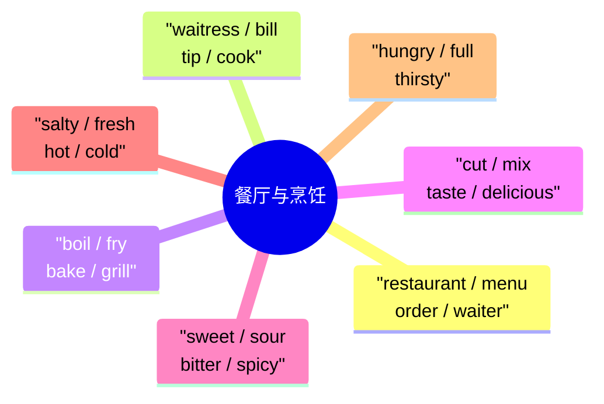

## 第五章：家居与日常生活（Home & Daily Life）

### 5.1 房间与家具

| 单词 | 音标 | 词性 | 中文释义 | 例句 |
|------|------|------|---------|------|
| home | /hoʊm/ | n | 家/住所 | There's no place like **home**. |
| house | /haʊs/ | n | 房子 | They bought a new **house**. |
| apartment | /əˈpɑːrtmənt/ | n | 公寓 | I live in a small **apartment**. |
| flat | /flæt/ | n | 公寓(英式) | She rents a **flat** in London. |
| room | /ruːm/ | n | 房间 | My **room** is on the third floor. |
| bedroom | /ˈbedruːm/ | n | 卧室 | The **bedroom** has a big window. |
| living room | /ˈlɪvɪŋ ruːm/ | n | 客厅 | We watch TV in the **living room**. |
| kitchen | /ˈkɪtʃən/ | n | 厨房 | She spends a lot of time in the **kitchen**. |
| bathroom | /ˈbɑːθruːm/ | n | 浴室/卫生间 | The **bathroom** is upstairs. |
| toilet | /ˈtɔɪlɪt/ | n | 马桶/卫生间 | Where is the **toilet**? |
| balcony | /ˈbælkəni/ | n | 阳台 | I have breakfast on the **balcony**. |
| garden | /ˈɡɑːrdən/ | n | 花园 | She grows roses in her **garden**. |
| yard | /jɑːrd/ | n | 院子 | Kids play in the **yard**. |
| door | /dɔːr/ | n | 门 | Please close the **door**. |
| window | /ˈwɪndoʊ/ | n | 窗户 | Open the **window** for fresh air. |
| wall | /wɔːl/ | n | 墙 | The **walls** are painted white. |
| floor | /flɔːr/ | n | 地板/楼层 | The **floor** is slippery. |
| ceiling | /ˈsiːlɪŋ/ | n | 天花板 | The **ceiling** is too high. |
| roof | /ruːf/ | n | 屋顶 | There's a leak in the **roof**. |
| stairs | /steərz/ | n | 楼梯 | Take the **stairs** for exercise. |
| bed | /bed/ | n | 床 | I make my **bed** every morning. |
| sofa | /ˈsoʊfə/ | n | 沙发 | Sit on the **sofa** and relax. |
| chair | /tʃeər/ | n | 椅子 | Pull up a **chair**. |
| table | /ˈteɪbəl/ | n | 桌子 | Dinner is on the **table**. |
| desk | /desk/ | n | 书桌 | My **desk** is messy. |
| shelf | /ʃelf/ | n | 书架/架子 | Books are on the **shelf**. |
| wardrobe | /ˈwɔːrdroʊb/ | n | 衣橱 | Hang your coat in the **wardrobe**. |
| drawer | /drɔːr/ | n | 抽屉 | The pen is in the top **drawer**. |
| lamp | /læmp/ | n | 台灯/灯 | Turn on the **lamp**. |
| curtain | /ˈkɜːrtən/ | n | 窗帘 | Draw the **curtains** at night. |
| carpet | /ˈkɑːrpɪt/ | n | 地毯 | The **carpet** is soft and warm. |
| mirror | /ˈmɪrər/ | n | 镜子 | Check yourself in the **mirror**. |
| clock | /klɒk/ | n | 时钟 | The **clock** on the wall says noon. |
| refrigerator | /rɪˈfrɪdʒəreɪtər/ | n | 冰箱 | Put the milk in the **refrigerator**. |
| fridge | /frɪdʒ/ | n | 冰箱（口语） | Is there any juice in the **fridge**? |
| oven | /ˈʌvən/ | n | 烤箱 | Preheat the **oven** to 180°C. |
| microwave | /ˈmaɪkrəweɪv/ | n | 微波炉 | Heat it in the **microwave**. |
| washing machine | /ˈwɒʃɪŋ məˌʃiːn/ | n | 洗衣机 | The **washing machine** is broken. |
| air conditioner | /eər kənˌdɪʃənər/ | n | 空调 | Turn on the **air conditioner**. |
| television | /ˈtelɪvɪʒən/ | n | 电视 | We watch **television** after dinner. |
| TV | /tiːˈviː/ | n | 电视（缩写） | What's on **TV** tonight? |
| computer | /kəmˈpjuːtər/ | n | 电脑 | I use my **computer** for work. |
| phone | /foʊn/ | n | 电话/手机 | My **phone** is out of battery. |

---

#### 5.1 房间与家具思维导图

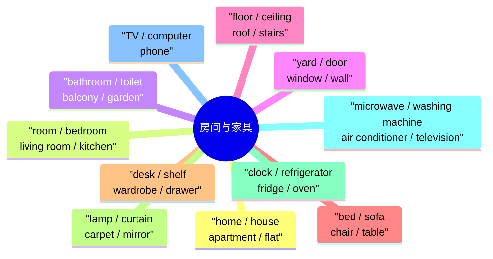

## 第六章：衣物与外貌（Clothing & Appearance）

### 6.1 服装

| 单词 | 音标 | 词性 | 中文释义 | 例句 |
|------|------|------|---------|------|
| clothes | /kloʊðz/ | n | 衣服 | I need to buy new **clothes**. |
| clothing | /ˈkloʊðɪŋ/ | n | 服装（总称） | Warm **clothing** is needed in winter. |
| shirt | /ʃɜːrt/ | n | 衬衫 | He wears a white **shirt**. |
| T-shirt | /ˈtiːʃɜːrt/ | n | T恤 | She's wearing a blue **T-shirt**. |
| blouse | /blaʊz/ | n | 女式衬衫 | She wore a silk **blouse**. |
| sweater | /ˈswetər/ | n | 毛衣 | Put on a **sweater**, it's cold. |
| jacket | /ˈdʒækɪt/ | n | 夹克/外套 | Don't forget your **jacket**. |
| coat | /koʊt/ | n | 大衣 | She wore a long winter **coat**. |
| pants | /pænts/ | n | 裤子（美式） | He bought new **pants**. |
| trousers | /ˈtraʊzərz/ | n | 裤子（英式） | These **trousers** are too tight. |
| jeans | /dʒiːnz/ | n | 牛仔裤 | **Jeans** go with everything. |
| shorts | /ʃɔːrts/ | n | 短裤 | I wear **shorts** in summer. |
| skirt | /skɜːrt/ | n | 裙子 | She's wearing a red **skirt**. |
| dress | /dres/ | n | 连衣裙 | She looked beautiful in that **dress**. |
| suit | /suːt/ | n | 西装/套装 | He wore a black **suit** to the meeting. |
| uniform | /ˈjuːnɪfɔːrm/ | n | 制服/校服 | Students wear a **uniform** at school. |
| sock | /sɒk/ | n | 袜子 | I can't find my matching **socks**. |
| shoe | /ʃuː/ | n | 鞋子 | These **shoes** are too tight. |
| boot | /buːt/ | n | 靴子 | She wears **boots** in winter. |
| sneaker | /ˈsniːkər/ | n | 运动鞋 | He wore **sneakers** to the gym. |
| hat | /hæt/ | n | 帽子 | Wear a **hat** in the sun. |
| cap | /kæp/ | n | 棒球帽/便帽 | He wears a baseball **cap**. |
| scarf | /skɑːrf/ | n | 围巾 | She wrapped a **scarf** around her neck. |
| gloves | /ɡlʌvz/ | n | 手套 | Put on your **gloves**, it's freezing. |
| tie | /taɪ/ | n/v | 领带/打结 | He adjusted his **tie**. |
| belt | /belt/ | n | 腰带/皮带 | Tighten your **belt**. |
| bag | /bæɡ/ | n | 包 | She carries a large **bag**. |
| backpack | /ˈbækpæk/ | n | 双肩包 | Students carry **backpacks** to school. |
| pocket | /ˈpɒkɪt/ | n | 口袋 | He put his keys in his **pocket**. |
| button | /ˈbʌtən/ | n | 纽扣 | One of my **buttons** fell off. |
| zipper | /ˈzɪpər/ | n | 拉链 | The **zipper** is stuck. |

#### 6.1 服装思维导图

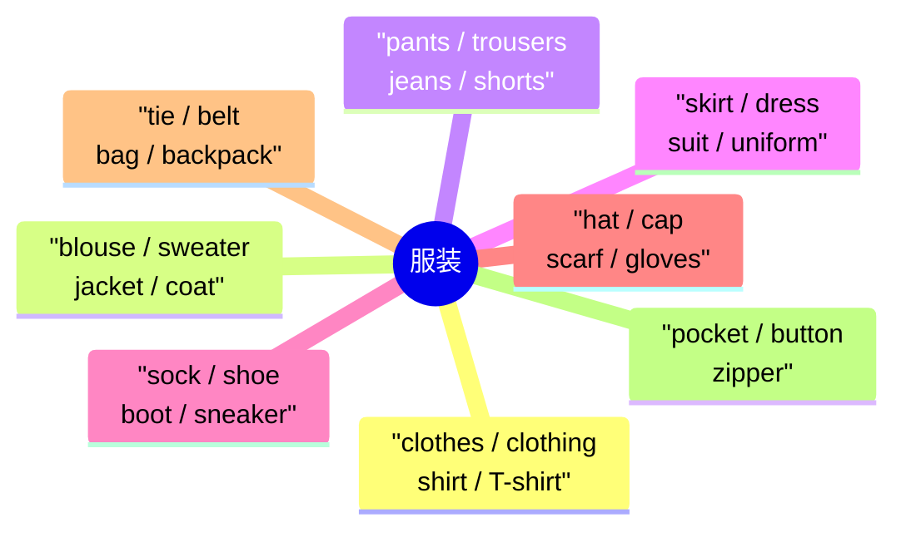

### 6.2 外貌描述

| 单词 | 音标 | 词性 | 中文释义 | 例句 |
|------|------|------|---------|------|
| tall | /tɔːl/ | adj | 高的 | He is very **tall**. |
| short | /ʃɔːrt/ | adj | 矮的/短的 | She is quite **short**. |
| thin | /θɪn/ | adj | 瘦的/薄的 | He looks too **thin**. |
| fat | /fæt/ | adj | 胖的 | The cat is getting **fat**. |
| slim | /slɪm/ | adj | 苗条的 | She has a **slim** figure. |
| beautiful | /ˈbjuːtɪfəl/ | adj | 美丽的 | What a **beautiful** sunset! |
| handsome | /ˈhænsəm/ | adj | 英俊的 | He is very **handsome**. |
| pretty | /ˈprɪti/ | adj | 漂亮的 | She looks **pretty** in that dress. |
| ugly | /ˈʌɡli/ | adj | 丑的 | Don't judge by appearances. |
| young | /jʌŋ/ | adj | 年轻的 | She looks very **young**. |
| old | /oʊld/ | adj | 老的/旧的 | He is getting **old**. |
| blonde | /blɒnd/ | adj/n | 金发的 | She has **blonde** hair. |
| dark | /dɑːrk/ | adj | 深色的/黑暗的 | He has **dark** hair. |
| curly | /ˈkɜːrli/ | adj | 卷的 | She has **curly** red hair. |
| straight | /streɪt/ | adj | 直的/笔直的 | She has **straight** black hair. |
| bald | /bɔːld/ | adj | 秃头的 | He's going **bald**. |
| beard | /bɪərd/ | n | 胡子（络腮） | He grew a **beard** this winter. |
| mustache | /ˈmʌstæʃ/ | n | 上唇须 | He shaved his **mustache**. |

---

#### 6.2 外貌描述思维导图

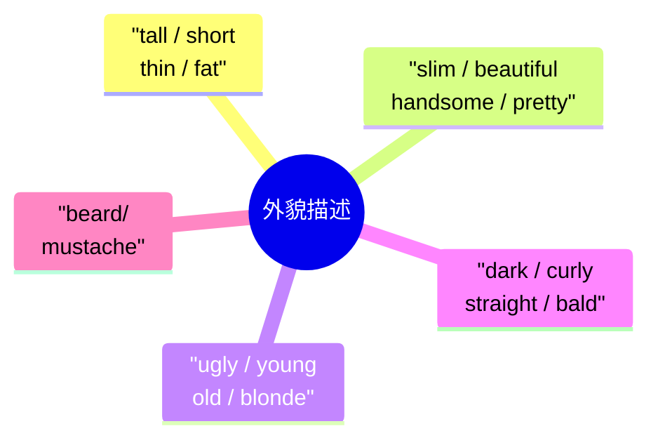

## 第七章：交通与出行（Transport & Travel）

| 单词 | 音标 | 词性 | 中文释义 | 例句 |
|------|------|------|---------|------|
| transport | /ˈtrænspɔːrt/ | n | 交通/运输 | Public **transport** is cheap here. |
| travel | /ˈtrævəl/ | v/n | 旅行/出行 | I love to **travel**. |
| car | /kɑːr/ | n | 汽车 | He drives a red **car**. |
| bus | /bʌs/ | n | 公共汽车 | Take the **bus** to the station. |
| train | /treɪn/ | n | 火车 | The **train** leaves at 9 AM. |
| plane | /pleɪn/ | n | 飞机 | We flew by **plane** to Beijing. |
| aircraft | /ˈeərkræft/ | n | 飞行器/飞机 | The **aircraft** landed safely. |
| bike | /baɪk/ | n | 自行车/摩托车 | I ride my **bike** to work. |
| bicycle | /ˈbaɪsɪkəl/ | n | 自行车 | She cycles on her **bicycle**. |
| motorbike | /ˈmoʊtərbaɪk/ | n | 摩托车 | He rides a **motorbike**. |
| taxi | /ˈtæksi/ | n | 出租车 | Let's take a **taxi**. |
| subway | /ˈsʌbweɪ/ | n | 地铁（美式） | Take the **subway** to downtown. |
| metro | /ˈmetroʊ/ | n | 地铁 | The **metro** is very convenient. |
| ship | /ʃɪp/ | n | 轮船 | We crossed the sea by **ship**. |
| boat | /boʊt/ | n | 小船 | We rowed a **boat** on the lake. |
| road | /roʊd/ | n | 道路 | The **road** is under construction. |
| street | /striːt/ | n | 街道 | Turn left on the next **street**. |
| avenue | /ˈævənjuː/ | n | 大道/林荫道 | The hotel is on 5th **Avenue**. |
| highway | /ˈhaɪweɪ/ | n | 高速公路 | Drive on the **highway**. |
| bridge | /brɪdʒ/ | n | 桥 | Cross the **bridge** to get there. |
| tunnel | /ˈtʌnəl/ | n | 隧道 | The train goes through a **tunnel**. |
| station | /ˈsteɪʃən/ | n | 车站 | Meet me at the train **station**. |
| airport | /ˈeərpɔːrt/ | n | 机场 | I'll pick you up at the **airport**. |
| ticket | /ˈtɪkɪt/ | n | 票 | Buy a **ticket** online. |
| passport | /ˈpɑːspɔːrt/ | n | 护照 | Don't forget your **passport**. |
| luggage | /ˈlʌɡɪdʒ/ | n | 行李 | I have two pieces of **luggage**. |
| suitcase | /ˈsuːtkeɪs/ | n | 手提箱 | Pack your **suitcase** the night before. |
| map | /mæp/ | n | 地图 | Use a **map** to navigate. |
| direction | /daɪˈrekʃən/ | n | 方向 | Could you give me **directions**? |
| left | /left/ | adj/adv/n | 左/左边 | Turn **left** at the corner. |
| right | /raɪt/ | adj/adv/n | 右/右边 | Turn **right** at the traffic lights. |
| straight | /streɪt/ | adv | 直走 | Go **straight** ahead. |
| north | /nɔːrθ/ | n/adj | 北/北方 | Head **north** for 5 kilometers. |
| south | /saʊθ/ | n/adj | 南/南方 | The beach is to the **south**. |
| east | /iːst/ | n/adj | 东/东方 | The sun rises in the **east**. |
| west | /west/ | n/adj | 西/西方 | Drive **west** on Highway 10. |

---

### 第七章：交通与出行思维导图

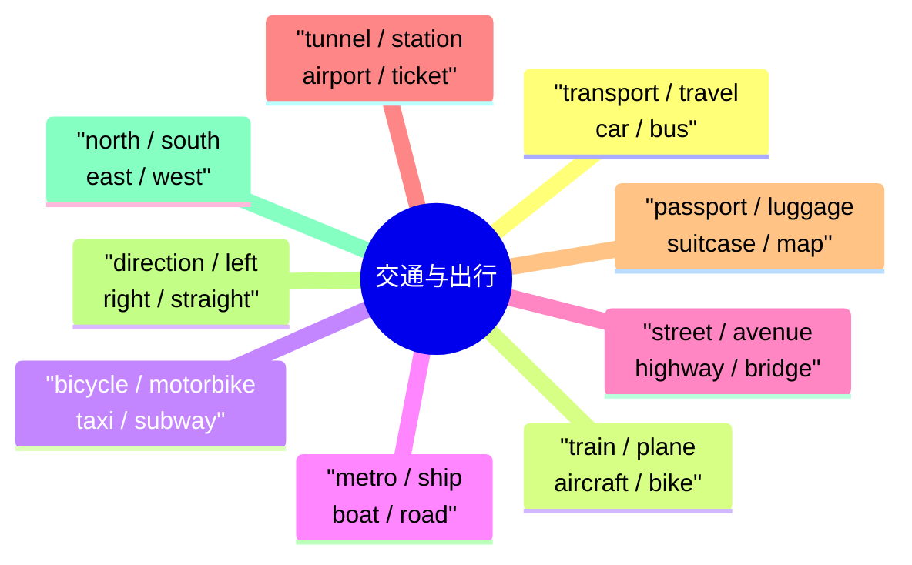

## 第八章：工作与职业（Work & Jobs）

### 8.1 职业名称

| 单词 | 音标 | 词性 | 中文释义 | 例句 |
|------|------|------|---------|------|
| job | /dʒɒb/ | n | 工作/职位 | She got a new **job**. |
| work | /wɜːrk/ | n/v | 工作 | I **work** from 9 to 6. |
| career | /kəˈrɪər/ | n | 职业生涯 | She built a successful **career**. |
| profession | /prəˈfeʃən/ | n | 职业（专业） | Teaching is a noble **profession**. |
| teacher | /ˈtiːtʃər/ | n | 教师 | My **teacher** is very patient. |
| doctor | /ˈdɒktər/ | n | 医生 | She is a **doctor** at the local hospital. |
| nurse | /nɜːrs/ | n | 护士 | The **nurses** work long hours. |
| engineer | /ˌendʒɪˈnɪər/ | n | 工程师 | He is a software **engineer**. |
| lawyer | /ˈlɔːjər/ | n | 律师 | She hired a **lawyer**. |
| police officer | /pəˈliːs ˈɒfɪsər/ | n | 警察 | The **police officer** directed traffic. |
| firefighter | /ˈfaɪərfaɪtər/ | n | 消防员 | **Firefighters** are brave. |
| soldier | /ˈsoʊldʒər/ | n | 士兵 | The **soldier** stood guard. |
| pilot | /ˈpaɪlət/ | n | 飞行员 | The **pilot** landed safely. |
| driver | /ˈdraɪvər/ | n | 司机 | The bus **driver** was friendly. |
| farmer | /ˈfɑːrmər/ | n | 农民 | The **farmer** grows rice. |
| chef | /ʃef/ | n | 厨师（主厨） | The **chef** prepared a five-course meal. |
| waiter | /ˈweɪtər/ | n | 服务员 | The **waiter** took our order. |
| artist | /ˈɑːrtɪst/ | n | 艺术家 | She is a talented **artist**. |
| musician | /mjuːˈzɪʃən/ | n | 音乐家 | He is a famous **musician**. |
| actor | /ˈæktər/ | n | 演员 | The **actor** won an Oscar. |
| journalist | /ˈdʒɜːrnəlɪst/ | n | 记者 | The **journalist** wrote a great article. |
| scientist | /ˈsaɪəntɪst/ | n | 科学家 | **Scientists** are studying climate change. |
| programmer | /ˈproʊɡræmər/ | n | 程序员 | She works as a **programmer**. |
| designer | /dɪˈzaɪnər/ | n | 设计师 | He is a graphic **designer**. |
| accountant | /əˈkaʊntənt/ | n | 会计 | Our **accountant** handles the finances. |
| manager | /ˈmænɪdʒər/ | n | 经理 | She became a **manager** last year. |
| boss | /bɒs/ | n | 老板/上司 | My **boss** is strict but fair. |
| employee | /ˌɪmˈplɔɪiː/ | n | 雇员/员工 | The company has 500 **employees**. |
| employer | /ɪmˈplɔɪər/ | n | 雇主 | The **employer** provided training. |
| secretary | /ˈsekrəteri/ | n | 秘书 | The **secretary** answered the phone. |

#### 8.1 职业名称思维导图

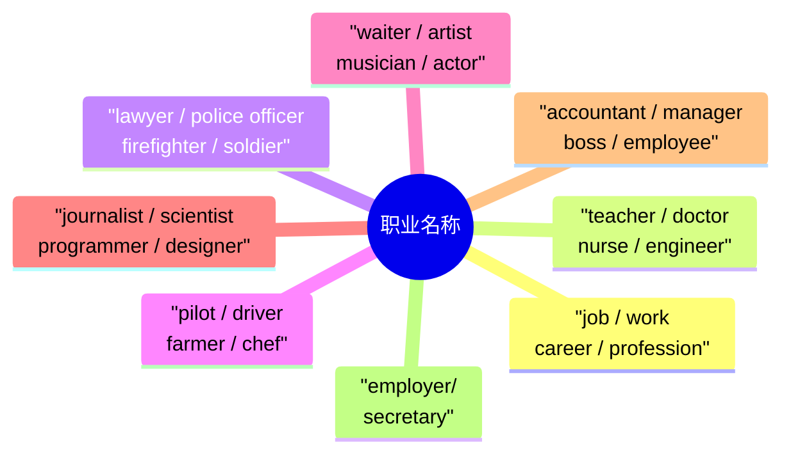

### 8.2 工作场所与职场词汇

| 单词 | 音标 | 词性 | 中文释义 | 例句 |
|------|------|------|---------|------|
| office | /ˈɒfɪs/ | n | 办公室 | I work in a busy **office**. |
| company | /ˈkʌmpəni/ | n | 公司 | She works for a big **company**. |
| factory | /ˈfæktəri/ | n | 工厂 | The **factory** produces cars. |
| shop | /ʃɒp/ | n | 商店 | Open a **shop** downtown. |
| store | /stɔːr/ | n | 商店（较大） | The department **store** is on sale. |
| bank | /bæŋk/ | n | 银行 | I need to go to the **bank**. |
| school | /skuːl/ | n | 学校 | He teaches at a **school**. |
| hospital | /ˈhɒspɪtl/ | n | 医院 | The **hospital** is nearby. |
| meeting | /ˈmiːtɪŋ/ | n | 会议 | I have a **meeting** at 10 AM. |
| salary | /ˈsæləri/ | n | 薪水/工资 | Her **salary** increased this year. |
| pay | /peɪ/ | n/v | 工资/支付 | They **pay** well at this company. |
| holiday | /ˈhɒlɪdeɪ/ | n | 假期 | I'm going on **holiday** next week. |
| vacation | /veɪˈkeɪʃən/ | n | 假期（美式） | We plan a family **vacation** this summer. |
| interview | /ˈɪntərvjuː/ | n/v | 面试/采访 | She has a job **interview** tomorrow. |
| hire | /haɪər/ | v | 雇用 | They plan to **hire** 10 new staff. |
| fire | /faɪər/ | v | 解雇 | He was **fired** for being late. |
| resign | /rɪˈzaɪn/ | v | 辞职 | She **resigned** from her job. |
| retire | /rɪˈtaɪər/ | v | 退休 | He will **retire** at 65. |
| promote | /prəˈmoʊt/ | v | 晋升/促销 | She was **promoted** to team leader. |
| deadline | /ˈdedlaɪn/ | n | 截止日期 | The **deadline** is Friday. |
| project | /ˈprɒdʒekt/ | n | 项目 | Our **project** is due next month. |
| report | /rɪˈpɔːrt/ | n/v | 报告/汇报 | Write a **report** by Monday. |
| email | /ˈiːmeɪl/ | n/v | 电子邮件 | Send me an **email** with details. |

---

#### 8.2 工作场所与职场词汇思维导图

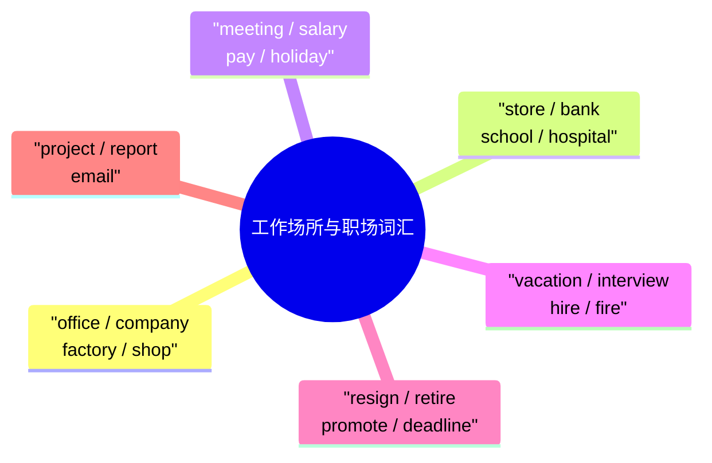

## 第九章：教育（Education）

| 单词 | 音标 | 词性 | 中文释义 | 例句 |
|------|------|------|---------|------|
| education | /ˌedʒuˈkeɪʃən/ | n | 教育 | **Education** is the key to success. |
| study | /ˈstʌdi/ | v/n | 学习/书房 | I **study** every evening. |
| learn | /lɜːrn/ | v | 学习/了解 | Children **learn** fast. |
| teach | /tiːtʃ/ | v | 教 | She **teaches** mathematics. |
| student | /ˈstjuːdənt/ | n | 学生 | The **students** are very motivated. |
| pupil | /ˈpjuːpɪl/ | n | 小学生/学生 | The **pupil** raised his hand. |
| teacher | /ˈtiːtʃər/ | n | 老师 | The **teacher** explained clearly. |
| professor | /prəˈfesər/ | n | 教授 | The **professor** gave a great lecture. |
| class | /klɑːs/ | n | 班级/课 | Our **class** starts at 8 AM. |
| lesson | /ˈlesən/ | n | 课程/功课 | Today's **lesson** was about history. |
| subject | /ˈsʌbdʒɪkt/ | n | 科目/主题 | What is your favorite **subject**? |
| homework | /ˈhoʊmwɜːrk/ | n | 家庭作业 | I finished my **homework** early. |
| exam | /ɪɡˈzæm/ | n | 考试 | The final **exam** is next week. |
| test | /test/ | n/v | 测试/考验 | We have a **test** on Friday. |
| grade | /ɡreɪd/ | n/v | 成绩/年级 | She got a high **grade**. |
| score | /skɔːr/ | n/v | 分数/得分 | His **score** was 95 out of 100. |
| pass | /pɑːs/ | v | 通过/经过 | I hope to **pass** the test. |
| fail | /feɪl/ | v | 失败/不及格 | He didn't study and **failed**. |
| university | /ˌjuːnɪˈvɜːrsɪti/ | n | 大学 | She went to **university** in Shanghai. |
| college | /ˈkɒlɪdʒ/ | n | 学院/大学（美） | He attended a local **college**. |
| degree | /dɪˈɡriː/ | n | 学位/度 | She has a **degree** in English. |
| library | /ˈlaɪbrəri/ | n | 图书馆 | I study in the **library**. |
| book | /bʊk/ | n | 书 | I'm reading an interesting **book**. |
| notebook | /ˈnoʊtbʊk/ | n | 笔记本 | Write it in your **notebook**. |
| pen | /pen/ | n | 钢笔/圆珠笔 | Can I borrow your **pen**? |
| pencil | /ˈpensəl/ | n | 铅笔 | Draw with a **pencil** first. |
| dictionary | /ˈdɪkʃəneri/ | n | 字典 | Look it up in the **dictionary**. |
| answer | /ˈɑːnsər/ | n/v | 答案/回答 | What is the **answer** to question 3? |
| question | /ˈkwestʃən/ | n | 问题 | Do you have any **questions**? |
| write | /raɪt/ | v | 写 | **Write** your name at the top. |
| read | /riːd/ | v | 读/阅读 | I love to **read**. |

---

### 第九章：教育思维导图

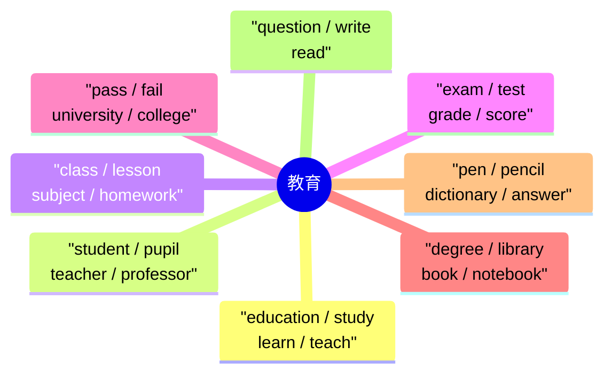

## 第十章：自然与天气（Nature & Weather）

### 10.1 天气

| 单词 | 音标 | 词性 | 中文释义 | 例句 |
|------|------|------|---------|------|
| weather | /ˈweðər/ | n | 天气 | What's the **weather** like today? |
| temperature | /ˈtempərətʃər/ | n | 温度 | The **temperature** dropped to zero. |
| sunny | /ˈsʌni/ | adj | 晴朗的 | It's a **sunny** day today. |
| cloudy | /ˈklaʊdi/ | adj | 多云的 | It looks **cloudy** outside. |
| rainy | /ˈreɪni/ | adj | 下雨的 | It's a **rainy** afternoon. |
| windy | /ˈwɪndi/ | adj | 有风的 | It's very **windy** today. |
| snowy | /ˈsnoʊi/ | adj | 下雪的 | The forecast says **snowy** weather. |
| foggy | /ˈfɒɡi/ | adj | 有雾的 | It was **foggy** this morning. |
| stormy | /ˈstɔːrmi/ | adj | 有暴风雨的 | A **stormy** night kept me indoors. |
| hot | /hɒt/ | adj | 炎热的 | It's so **hot** in July. |
| warm | /wɔːrm/ | adj | 温暖的 | Spring is **warm** and pleasant. |
| cool | /kuːl/ | adj | 凉爽的 | A **cool** breeze blew from the sea. |
| cold | /koʊld/ | adj | 寒冷的 | It's freezing **cold** outside. |
| freezing | /ˈfriːzɪŋ/ | adj | 极冷的 | It's **freezing** outside today! |
| rain | /reɪn/ | n/v | 雨/下雨 | It will **rain** this afternoon. |
| snow | /snoʊ/ | n/v | 雪/下雪 | The first **snow** of the year fell. |
| wind | /wɪnd/ | n | 风 | The **wind** is blowing hard. |
| cloud | /klaʊd/ | n | 云 | Dark **clouds** appeared in the sky. |
| storm | /stɔːrm/ | n | 暴风雨 | A **storm** is coming. |
| thunder | /ˈθʌndər/ | n | 雷声 | Did you hear that **thunder**? |
| lightning | /ˈlaɪtnɪŋ/ | n | 闪电 | **Lightning** struck the tree. |
| flood | /flʌd/ | n/v | 洪水/淹没 | The **flood** damaged many houses. |
| drought | /draʊt/ | n | 旱灾 | The **drought** lasted three months. |
| ice | /aɪs/ | n | 冰 | Be careful on the **ice**. |
| frost | /frɒst/ | n | 霜冻 | There was a heavy **frost** last night. |
| sunshine | /ˈsʌnʃaɪn/ | n | 阳光 | I love the warm **sunshine**. |
| rainbow | /ˈreɪnboʊ/ | n | 彩虹 | A **rainbow** appeared after the rain. |

#### 10.1 天气思维导图

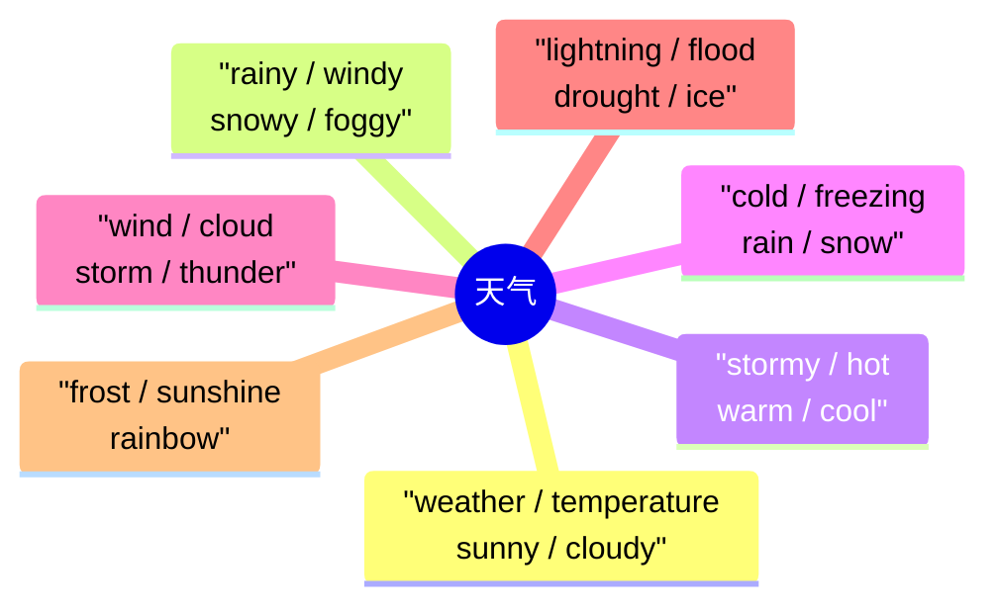

### 10.2 地形与自然

| 单词 | 音标 | 词性 | 中文释义 | 例句 |
|------|------|------|---------|------|
| mountain | /ˈmaʊntən/ | n | 山 | We hiked up the **mountain**. |
| hill | /hɪl/ | n | 小山/丘陵 | The house is on a **hill**. |
| valley | /ˈvæli/ | n | 山谷 | The **valley** was covered in mist. |
| river | /ˈrɪvər/ | n | 河流 | The **river** flows through the city. |
| lake | /leɪk/ | n | 湖 | We swam in the **lake**. |
| sea | /siː/ | n | 海 | The **sea** was calm and blue. |
| ocean | /ˈoʊʃən/ | n | 大洋 | The Pacific **Ocean** is huge. |
| beach | /biːtʃ/ | n | 海滩 | I love walking on the **beach**. |
| coast | /koʊst/ | n | 海岸 | The hotel is on the **coast**. |
| island | /ˈaɪlənd/ | n | 岛屿 | Hainan is a beautiful **island**. |
| desert | /ˈdezərt/ | n | 沙漠 | The **desert** is very dry. |
| forest | /ˈfɒrɪst/ | n | 森林 | The **forest** is full of wildlife. |
| jungle | /ˈdʒʌŋɡəl/ | n | 丛林 | The Amazon **jungle** is vast. |
| field | /fiːld/ | n | 田野/领域 | Cows graze in the **field**. |
| farm | /fɑːrm/ | n | 农场 | She grew up on a **farm**. |
| countryside | /ˈkʌntrisaɪd/ | n | 农村/乡村 | I love the peaceful **countryside**. |
| city | /ˈsɪti/ | n | 城市 | Beijing is a big **city**. |
| town | /taʊn/ | n | 小城镇 | She grew up in a small **town**. |
| village | /ˈvɪlɪdʒ/ | n | 村庄 | The **village** has only 200 people. |
| park | /pɑːrk/ | n | 公园 | Kids play in the **park**. |
| sky | /skaɪ/ | n | 天空 | The **sky** is clear tonight. |
| star | /stɑːr/ | n | 星星 | There are millions of **stars**. |
| sun | /sʌn/ | n | 太阳 | The **sun** sets in the west. |
| moon | /muːn/ | n | 月亮 | The **moon** is full tonight. |
| earth | /ɜːrθ/ | n | 地球/土地 | We must protect the **Earth**. |
| soil | /sɔɪl/ | n | 土壤 | This **soil** is very fertile. |
| rock | /rɒk/ | n | 岩石 | Sit on that big **rock**. |
| sand | /sænd/ | n | 沙子 | Build a castle in the **sand**. |
| tree | /triː/ | n | 树 | The old **tree** fell in the storm. |
| flower | /ˈflaʊər/ | n | 花 | She grows beautiful **flowers**. |
| grass | /ɡrɑːs/ | n | 草 | Please keep off the **grass**. |
| plant | /plɑːnt/ | n/v | 植物/种植 | Water your **plants** every day. |
| leaf | /liːf/ | n | 叶子 | Autumn **leaves** are colorful. |
| root | /ruːt/ | n | 根 | The tree **roots** go deep. |
| animal | /ˈænɪməl/ | n | 动物 | My favorite **animal** is the panda. |
| dog | /dɒɡ/ | n | 狗 | My **dog** loves to run. |
| cat | /kæt/ | n | 猫 | The **cat** sat by the window. |
| bird | /bɜːrd/ | n | 鸟 | **Birds** sing in the morning. |
| fish | /fɪʃ/ | n | 鱼 | **Fish** swim in the river. |
| horse | /hɔːrs/ | n | 马 | She rides a **horse** every weekend. |
| cow | /kaʊ/ | n | 奶牛/母牛 | The **cow** gives milk every day. |
| pig | /pɪɡ/ | n | 猪 | Pigs are intelligent **animals**. |
| sheep | /ʃiːp/ | n | 绵羊 | A flock of **sheep** grazed. |
| chicken | /ˈtʃɪkɪn/ | n | 鸡 | The **chickens** are in the yard. |
| rabbit | /ˈræbɪt/ | n | 兔子 | The **rabbit** hopped into the garden. |
| tiger | /ˈtaɪɡər/ | n | 老虎 | The **tiger** is endangered. |
| lion | /ˈlaɪən/ | n | 狮子 | A **lion** roared in the distance. |
| elephant | /ˈelɪfənt/ | n | 大象 | **Elephants** are the largest land animals. |
| monkey | /ˈmʌŋki/ | n | 猴子 | **Monkeys** swing through the trees. |
| snake | /sneɪk/ | n | 蛇 | Be careful — there are **snakes** here. |
| frog | /frɒɡ/ | n | 青蛙 | **Frogs** jump into the pond. |
| insect | /ˈɪnsekt/ | n | 昆虫 | Many **insects** are attracted to light. |
| bee | /biː/ | n | 蜜蜂 | **Bees** make honey. |
| butterfly | /ˈbʌtərflaɪ/ | n | 蝴蝶 | A **butterfly** landed on the flower. |

---

#### 10.2 地形与自然思维导图

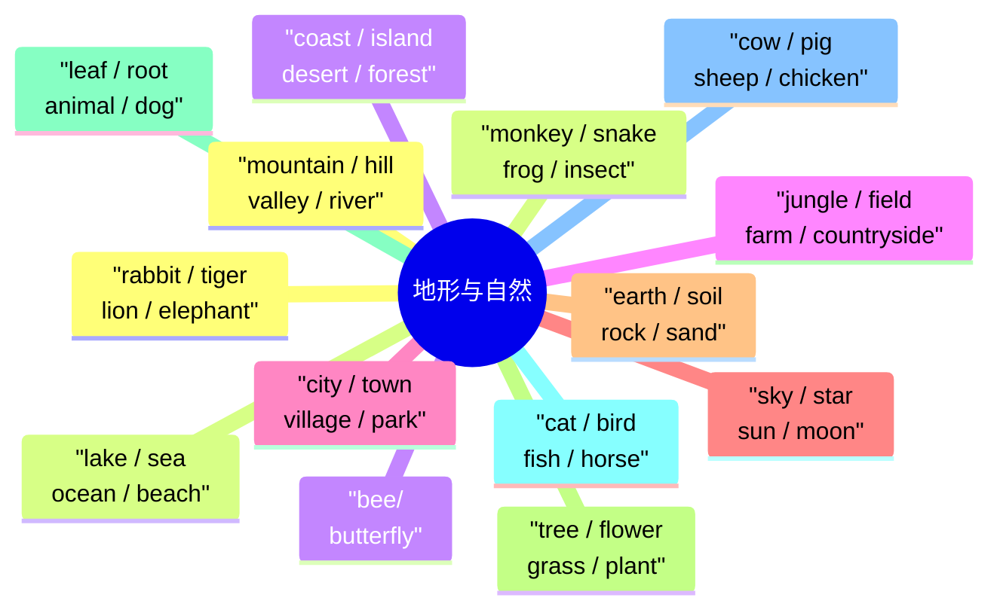

## 第十一章：情感与性格（Emotions & Character）

### 11.1 情绪词汇

| 单词 | 音标 | 词性 | 中文释义 | 例句 |
|------|------|------|---------|------|
| happy | /ˈhæpi/ | adj | 快乐的 | I'm very **happy** today. |
| sad | /sæd/ | adj | 悲伤的 | She looked very **sad**. |
| angry | /ˈæŋɡri/ | adj | 生气的 | He was **angry** about being late. |
| excited | /ɪkˈsaɪtɪd/ | adj | 兴奋的 | I'm so **excited** about the trip! |
| nervous | /ˈnɜːrvəs/ | adj | 紧张的/焦虑的 | I feel **nervous** before exams. |
| worried | /ˈwʌrid/ | adj | 担心的 | She's **worried** about her son. |
| surprised | /sərˈpraɪzd/ | adj | 惊讶的 | I was **surprised** by the news. |
| scared | /skeərd/ | adj | 害怕的 | The child was **scared** of the dog. |
| afraid | /əˈfreɪd/ | adj | 害怕的 | I'm **afraid** of spiders. |
| bored | /bɔːrd/ | adj | 无聊的 | I'm so **bored** today. |
| tired | /ˈtaɪərd/ | adj | 疲倦的 | I feel very **tired** after work. |
| stressed | /strest/ | adj | 压力大的 | She's very **stressed** at work. |
| lonely | /ˈloʊnli/ | adj | 孤独的 | Living alone can feel **lonely**. |
| confident | /ˈkɒnfɪdənt/ | adj | 自信的 | She gave a **confident** speech. |
| proud | /praʊd/ | adj | 自豪的/骄傲的 | I'm so **proud** of you! |
| embarrassed | /ɪmˈbærəst/ | adj | 尴尬的 | I felt **embarrassed** when I fell. |
| disappointed | /ˌdɪsəˈpɔɪntɪd/ | adj | 失望的 | He was **disappointed** with the result. |
| grateful | /ˈɡreɪtfəl/ | adj | 感激的 | I'm very **grateful** for your help. |
| jealous | /ˈdʒeləs/ | adj | 嫉妒的 | She felt **jealous** of her classmate. |
| love | /lʌv/ | n/v | 爱/喜爱 | I **love** spending time with family. |
| hate | /heɪt/ | v | 讨厌/憎恨 | I **hate** being late. |
| like | /laɪk/ | v | 喜欢 | I **like** reading. |
| enjoy | /ɪnˈdʒɔɪ/ | v | 享受/喜爱 | I **enjoy** cooking. |
| hope | /hoʊp/ | n/v | 希望 | I **hope** you feel better soon. |
| fear | /fɪər/ | n/v | 恐惧 | My greatest **fear** is failure. |

#### 11.1 情绪词汇思维导图

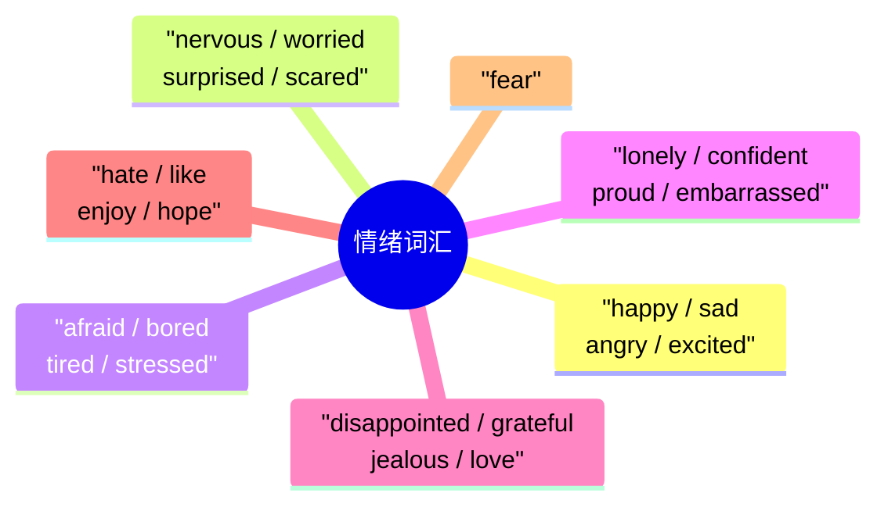

### 11.2 性格特征

| 单词 | 音标 | 词性 | 中文释义 | 例句 |
|------|------|------|---------|------|
| kind | /kaɪnd/ | adj | 善良的 | She is very **kind** to everyone. |
| friendly | /ˈfrendli/ | adj | 友好的 | The staff here are very **friendly**. |
| generous | /ˈdʒenərəs/ | adj | 慷慨的 | He is very **generous** with his time. |
| honest | /ˈɒnɪst/ | adj | 诚实的 | Always be **honest** with people. |
| brave | /breɪv/ | adj | 勇敢的 | The firefighter was very **brave**. |
| patient | /ˈpeɪʃənt/ | adj/n | 耐心的/病人 | Be **patient** — it takes time. |
| smart | /smɑːrt/ | adj | 聪明的 | She is a **smart** student. |
| clever | /ˈklevər/ | adj | 聪明的/机灵的 | That was a **clever** idea. |
| funny | /ˈfʌni/ | adj | 有趣的/好笑的 | He told a **funny** joke. |
| polite | /pəˈlaɪt/ | adj | 有礼貌的 | It's important to be **polite**. |
| rude | /ruːd/ | adj | 粗鲁的 | Don't be **rude** to your elders. |
| lazy | /ˈleɪzi/ | adj | 懒惰的 | Don't be **lazy** — get up! |
| hard-working | /ˌhɑːrd ˈwɜːrkɪŋ/ | adj | 勤奋的 | She is very **hard-working**. |
| creative | /kriˈeɪtɪv/ | adj | 有创意的 | Kids are naturally **creative**. |
| quiet | /ˈkwaɪət/ | adj | 安静的 | He is a **quiet** person. |
| shy | /ʃaɪ/ | adj | 害羞的 | She was too **shy** to speak up. |
| outgoing | /ˈaʊtɡoʊɪŋ/ | adj | 外向的 | She is very **outgoing** and fun. |
| serious | /ˈsɪəriəs/ | adj | 严肃的/严重的 | He is always very **serious** at work. |
| stubborn | /ˈstʌbərn/ | adj | 固执的 | He's too **stubborn** to admit mistakes. |
| ambitious | /æmˈbɪʃəs/ | adj | 有抱负的 | She's very **ambitious** and driven. |

---

#### 11.2 性格特征思维导图

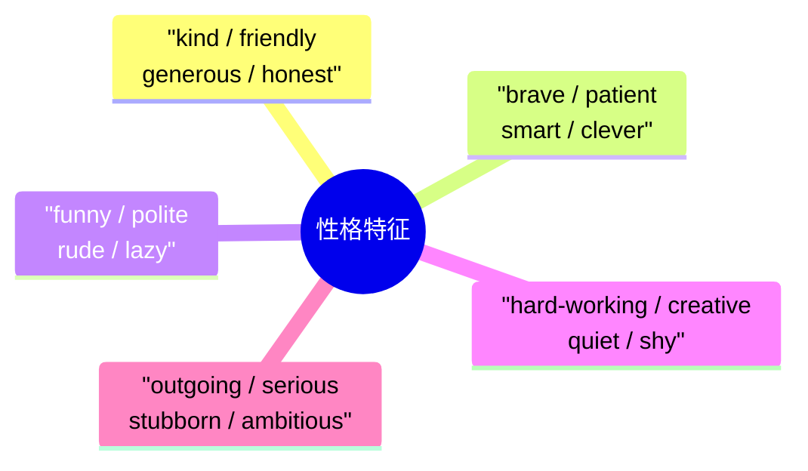

## 第十二章：购物与金钱（Shopping & Money）

| 单词 | 音标 | 词性 | 中文释义 | 例句 |
|------|------|------|---------|------|
| money | /ˈmʌni/ | n | 钱/金钱 | **Money** doesn't buy happiness. |
| price | /praɪs/ | n | 价格 | What's the **price** of this? |
| cost | /kɒst/ | n/v | 费用/花费 | How much does it **cost**? |
| expensive | /ɪkˈspensɪv/ | adj | 贵的/昂贵的 | This restaurant is too **expensive**. |
| cheap | /tʃiːp/ | adj | 便宜的 | This shirt is very **cheap**. |
| free | /friː/ | adj/adv | 免费的/自由的 | The Wi-Fi is **free** here. |
| discount | /ˈdɪskaʊnt/ | n | 折扣 | I got a 20% **discount**. |
| sale | /seɪl/ | n | 销售/打折 | Everything is on **sale** today. |
| buy | /baɪ/ | v | 购买 | I want to **buy** a new phone. |
| sell | /sel/ | v | 卖/出售 | She **sells** handmade jewelry. |
| pay | /peɪ/ | v | 付款 | I'll **pay** by card. |
| cash | /kæʃ/ | n | 现金 | Do you accept **cash**? |
| credit card | /ˈkredɪt kɑːrd/ | n | 信用卡 | I'll pay with my **credit card**. |
| receipt | /rɪˈsiːt/ | n | 收据 | Keep the **receipt** for a refund. |
| refund | /ˈriːfʌnd/ | n | 退款 | Can I get a **refund**? |
| shop | /ʃɒp/ | n/v | 商店/购物 | Let's go **shopping** this weekend. |
| supermarket | /ˈsuːpərmɑːrkɪt/ | n | 超市 | I shop at the **supermarket** weekly. |
| mall | /mɔːl/ | n | 购物中心 | The new **mall** opened last week. |
| market | /ˈmɑːrkɪt/ | n | 市场 | I buy vegetables at the **market**. |
| wallet | /ˈwɒlɪt/ | n | 钱包 | My **wallet** was stolen. |
| purse | /pɜːrs/ | n | 手提包/钱包(女) | She can't find her **purse**. |
| coin | /kɔɪn/ | n | 硬币 | Do you have any **coins**? |
| note | /noʊt/ | n | 钞票/笔记 | I paid with a 100-yuan **note**. |
| bank | /bæŋk/ | n | 银行 | I need to go to the **bank**. |
| account | /əˈkaʊnt/ | n | 账户 | Open a bank **account**. |
| savings | /ˈseɪvɪŋz/ | n | 储蓄 | She has **savings** for emergencies. |
| spend | /spend/ | v | 花费(金钱/时间) | I **spend** too much on coffee. |
| save | /seɪv/ | v | 储蓄/节省/救 | Try to **save** money each month. |
| waste | /weɪst/ | v/n | 浪费 | Don't **waste** food. |
| afford | /əˈfɔːrd/ | v | 负担得起 | I can't **afford** a new car. |

---

### 第十二章：购物与金钱思维导图

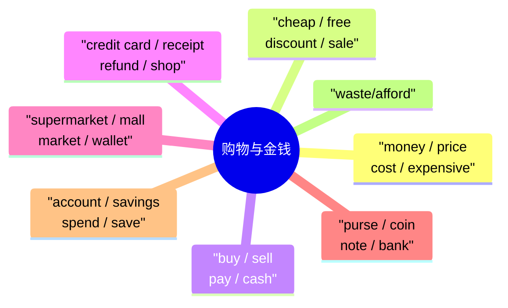

## 第十三章：运动与休闲（Sports & Hobbies）

### 13.1 运动

| 单词 | 音标 | 词性 | 中文释义 | 例句 |
|------|------|------|---------|------|
| sport | /spɔːrt/ | n | 运动/体育 | She loves **sports**. |
| football | /ˈfʊtbɔːl/ | n | 足球（英式）/美式橄榄球 | He plays **football** every weekend. |
| soccer | /ˈsɒkər/ | n | 足球（美式） | **Soccer** is the world's most popular sport. |
| basketball | /ˈbɑːskɪtbɔːl/ | n | 篮球 | He plays **basketball** after school. |
| tennis | /ˈtenɪs/ | n | 网球 | She plays **tennis** twice a week. |
| badminton | /ˈbædmɪntən/ | n | 羽毛球 | **Badminton** is popular in China. |
| volleyball | /ˈvɒlibɔːl/ | n | 排球 | They played **volleyball** on the beach. |
| swimming | /ˈswɪmɪŋ/ | n | 游泳 | **Swimming** is a great full-body workout. |
| running | /ˈrʌnɪŋ/ | n | 跑步 | He goes **running** every morning. |
| cycling | /ˈsaɪklɪŋ/ | n | 骑自行车 | **Cycling** is eco-friendly transport. |
| hiking | /ˈhaɪkɪŋ/ | n | 徒步/爬山 | We enjoy **hiking** in the mountains. |
| yoga | /ˈjoʊɡə/ | n | 瑜伽 | She does **yoga** every morning. |
| gym | /dʒɪm/ | n | 健身房 | I go to the **gym** three times a week. |
| match | /mætʃ/ | n | 比赛/配对 | The **match** starts at 7 PM. |
| game | /ɡeɪm/ | n | 游戏/比赛 | It was a great **game**. |
| team | /tiːm/ | n | 团队/队 | Our **team** won the championship. |
| player | /ˈpleɪər/ | n | 运动员/球员 | He's the best **player** on the team. |
| coach | /koʊtʃ/ | n | 教练 | The **coach** trained the players hard. |
| champion | /ˈtʃæmpiən/ | n | 冠军 | She became the world **champion**. |
| win | /wɪn/ | v/n | 赢/胜利 | We're going to **win**! |
| lose | /luːz/ | v | 输/失去 | It's okay to **lose** sometimes. |
| score | /skɔːr/ | n/v | 得分/比分 | The **score** is 3-1. |
| goal | /ɡoʊl/ | n | 进球/目标 | He scored a **goal** in the last minute. |

#### 13.1 运动思维导图

```mermaid
mindmap
  root((运动))
    "sport / football<br/>soccer / basketball"
    "tennis / badminton<br/>volleyball / swimming"
    "running / cycling<br/>hiking / yoga"
    "gym / match<br/>game / team"
    "player / coach<br/>champion / win"
    "lose / score<br/>goal"
```

### 13.2 爱好

| 单词 | 音标 | 词性 | 中文释义 | 例句 |
|------|------|------|---------|------|
| hobby | /ˈhɒbi/ | n | 爱好 | My **hobby** is photography. |
| music | /ˈmjuːzɪk/ | n | 音乐 | I listen to **music** every day. |
| song | /sɒŋ/ | n | 歌曲 | She sang a beautiful **song**. |
| sing | /sɪŋ/ | v | 唱歌 | He loves to **sing** in the shower. |
| dance | /dɑːns/ | v/n | 跳舞/舞蹈 | She **dances** at a studio. |
| painting | /ˈpeɪntɪŋ/ | n | 绘画/画作 | He has a talent for **painting**. |
| drawing | /ˈdrɔːɪŋ/ | n | 素描/绘图 | I enjoy **drawing** in my free time. |
| reading | /ˈriːdɪŋ/ | n | 阅读 | **Reading** expands your world. |
| writing | /ˈraɪtɪŋ/ | n | 写作 | She has a passion for **writing**. |
| cooking | /ˈkʊkɪŋ/ | n | 烹饪 | **Cooking** is my favorite hobby. |
| gardening | /ˈɡɑːrdənɪŋ/ | n | 园艺 | **Gardening** is relaxing. |
| photography | /fəˈtɒɡrəfi/ | n | 摄影 | **Photography** captures special moments. |
| travel | /ˈtrævəl/ | n/v | 旅行 | **Traveling** broadens the mind. |
| movie | /ˈmuːvi/ | n | 电影 | Let's watch a **movie** tonight. |
| film | /fɪlm/ | n | 电影/胶片 | He directed an award-winning **film**. |
| theater | /ˈθɪətər/ | n | 剧院/电影院 | We went to the **theater**. |
| concert | /ˈkɒnsərt/ | n | 音乐会 | I'm going to a **concert** Saturday. |
| show | /ʃoʊ/ | n | 节目/表演 | The **show** starts at 8. |
| game | /ɡeɪm/ | n | 游戏 | Do you want to play a board **game**? |
| video game | /ˈvɪdioʊ ɡeɪm/ | n | 电子游戏 | He plays **video games** after school. |

---

#### 13.2 爱好思维导图

```mermaid
mindmap
  root((爱好))
    "hobby / music<br/>song / sing"
    "dance / painting<br/>drawing / reading"
    "writing / cooking<br/>gardening / photography"
    "travel / movie<br/>film / theater"
    "concert / show<br/>game / video game"
```

## 第十四章：颜色、形状与尺寸（Colors, Shapes & Sizes）

### 14.1 颜色

| 单词 | 音标 | 中文释义 | 例句 |
|------|------|---------|------|
| red | /red/ | 红色 | She wore a **red** dress. |
| blue | /bluː/ | 蓝色 | The sky is **blue**. |
| green | /ɡriːn/ | 绿色 | The leaves are **green** in spring. |
| yellow | /ˈjeloʊ/ | 黄色 | Sunflowers are **yellow**. |
| orange | /ˈɒrɪndʒ/ | 橙色 | She wore an **orange** jacket. |
| purple | /ˈpɜːrpəl/ | 紫色 | Lavender is **purple**. |
| pink | /pɪŋk/ | 粉红色 | She likes **pink** roses. |
| brown | /braʊn/ | 棕色 | The dog has **brown** fur. |
| black | /blæk/ | 黑色 | He drives a **black** car. |
| white | /waɪt/ | 白色 | She wore a **white** wedding dress. |
| grey / gray | /ɡreɪ/ | 灰色 | The clouds are **grey**. |
| gold | /ɡoʊld/ | 金色 | She wears a **gold** necklace. |
| silver | /ˈsɪlvər/ | 银色 | The trophy is made of **silver**. |
| light | /laɪt/ | 浅色的 | She prefers **light** blue. |
| dark | /dɑːrk/ | 深色的 | He chose **dark** green walls. |
| bright | /braɪt/ | 鲜艳的/明亮的 | She wore **bright** colors. |

#### 14.1 颜色思维导图

```mermaid
mindmap
  root((颜色))
    "red / blue<br/>green / yellow"
    "orange / purple<br/>pink / brown"
    "black / white<br/>grey / gray / gold"
    "silver / light<br/>dark / bright"
```

### 14.2 形状与尺寸

| 单词 | 音标 | 词性 | 中文释义 | 例句 |
|------|------|------|---------|------|
| circle | /ˈsɜːrkəl/ | n | 圆形 | Draw a **circle** on the paper. |
| square | /skweər/ | n | 正方形 | A **square** has four equal sides. |
| triangle | /ˈtraɪæŋɡəl/ | n | 三角形 | A **triangle** has three sides. |
| rectangle | /ˈrektæŋɡəl/ | n | 长方形 | The table is a **rectangle**. |
| round | /raʊnd/ | adj | 圆的 | The ball is **round**. |
| flat | /flæt/ | adj | 平的/扁的 | The land here is very **flat**. |
| pointed | /ˈpɔɪntɪd/ | adj | 尖的 | The pencil has a **pointed** end. |
| big | /bɪɡ/ | adj | 大的 | She lives in a **big** house. |
| small | /smɔːl/ | adj | 小的 | I need a **small** bag. |
| large | /lɑːrdʒ/ | adj | 大的 | She ordered a **large** coffee. |
| tiny | /ˈtaɪni/ | adj | 极小的 | A **tiny** ant crawled across my hand. |
| huge | /hjuːdʒ/ | adj | 巨大的 | It was a **huge** mistake. |
| long | /lɒŋ/ | adj | 长的 | She has **long** hair. |
| short | /ʃɔːrt/ | adj | 短的/矮的 | The deadline is **short**. |
| wide | /waɪd/ | adj | 宽的 | The road is very **wide**. |
| narrow | /ˈnæroʊ/ | adj | 窄的 | The alley is very **narrow**. |
| deep | /diːp/ | adj | 深的 | The lake is very **deep**. |
| shallow | /ˈʃæloʊ/ | adj | 浅的 | The river is **shallow** here. |
| thick | /θɪk/ | adj | 厚的 | Put on a **thick** coat. |
| thin | /θɪn/ | adj | 薄的/细的 | The paper is very **thin**. |
| heavy | /ˈhevi/ | adj | 重的 | This box is very **heavy**. |
| light | /laɪt/ | adj | 轻的 | The bag is **light** enough to carry. |

---

#### 14.2 形状与尺寸思维导图

```mermaid
mindmap
  root((形状与尺寸))
    "circle / square<br/>triangle / rectangle"
    "round / flat<br/>pointed / big"
    "small / large<br/>tiny / huge"
    "long / short<br/>wide / narrow"
    "deep / shallow<br/>thick / thin"
    "heavy/light"
```

## 第十五章：常用动词（Common Verbs）

### 15.1 基本动作动词

| 单词 | 音标 | 中文释义 | 例句 |
|------|------|---------|------|
| be | /biː/ | 是/在/存在 | I **am** a teacher. |
| have | /hæv/ | 有/拥有 | I **have** two sisters. |
| do | /duː/ | 做/执行 | What do you **do**? |
| make | /meɪk/ | 制作/使 | She **makes** great coffee. |
| go | /ɡoʊ/ | 去/走 | Let's **go** to the park. |
| come | /kʌm/ | 来/到来 | Please **come** in. |
| get | /ɡet/ | 得到/变得 | I need to **get** some milk. |
| give | /ɡɪv/ | 给/递 | **Give** me a hand, please. |
| take | /teɪk/ | 拿/带/乘 | **Take** an umbrella, it might rain. |
| put | /pʊt/ | 放置 | **Put** it on the table. |
| use | /juːz/ | 使用 | **Use** a pencil for this test. |
| find | /faɪnd/ | 找到/发现 | Did you **find** your keys? |
| see | /siː/ | 看见/理解 | Can you **see** the mountain? |
| look | /lʊk/ | 看/看起来 | **Look** at that beautiful bird! |
| watch | /wɒtʃ/ | 观看/注意 | I **watch** the news every evening. |
| hear | /hɪər/ | 听见 | Can you **hear** that sound? |
| listen | /ˈlɪsən/ | 听（主动） | Please **listen** carefully. |
| say | /seɪ/ | 说/讲 | What did she **say**? |
| tell | /tel/ | 告诉/讲述 | **Tell** me a story. |
| ask | /ɑːsk/ | 问/请求 | **Ask** for help if you need it. |
| know | /noʊ/ | 知道/了解 | I **know** the answer. |
| think | /θɪŋk/ | 想/认为 | I **think** you're right. |
| feel | /fiːl/ | 感觉/感受 | I **feel** better now. |
| want | /wɒnt/ | 想要 | I **want** a cup of tea. |
| need | /niːd/ | 需要 | I **need** some help. |
| like | /laɪk/ | 喜欢 | I **like** reading books. |
| love | /lʌv/ | 爱/喜爱 | I **love** summer! |
| try | /traɪ/ | 尝试 | **Try** to stay calm. |
| help | /help/ | 帮助 | Can you **help** me? |
| start | /stɑːrt/ | 开始 | Let's **start** the meeting. |
| stop | /stɒp/ | 停止 | **Stop** talking! |
| open | /ˈoʊpən/ | 打开 | Please **open** the window. |
| close | /kloʊz/ | 关闭 | **Close** the door behind you. |
| turn | /tɜːrn/ | 转动/变成 | **Turn** left at the corner. |
| walk | /wɔːk/ | 步行/走 | I **walk** to work every day. |
| run | /rʌn/ | 跑步 | She **runs** 5 km every morning. |
| sit | /sɪt/ | 坐 | Please **sit** down. |
| stand | /stænd/ | 站立 | Please **stand** up. |
| sleep | /sliːp/ | 睡觉 | I need to **sleep** early tonight. |
| wake | /weɪk/ | 醒来/叫醒 | I **wake up** at 7 AM. |
| eat | /iːt/ | 吃 | Let's **eat**! |
| drink | /drɪŋk/ | 喝 | **Drink** plenty of water. |
| buy | /baɪ/ | 买 | I'll **buy** some bread. |
| bring | /brɪŋ/ | 带来 | Please **bring** your ID. |
| carry | /ˈkæri/ | 携带/搬运 | I **carried** the heavy box. |
| call | /kɔːl/ | 打电话/叫 | I'll **call** you tomorrow. |
| send | /send/ | 发送 | Please **send** me the file. |
| receive | /rɪˈsiːv/ | 收到 | Did you **receive** my message? |
| show | /ʃoʊ/ | 显示/展示 | **Show** me what you made. |
| play | /pleɪ/ | 玩/演奏/比赛 | Children love to **play**. |
| work | /wɜːrk/ | 工作/运转 | I **work** very hard. |
| wait | /weɪt/ | 等待 | Please **wait** a moment. |
| meet | /miːt/ | 遇见/会面 | Nice to **meet** you! |
| leave | /liːv/ | 离开/留下 | I **leave** at 8 every morning. |
| arrive | /əˈraɪv/ | 到达 | The train will **arrive** at 6. |
| stay | /steɪ/ | 停留/住 | We **stayed** at a nice hotel. |
| return | /rɪˈtɜːrn/ | 返回/归还 | I'll **return** the book tomorrow. |
| change | /tʃeɪndʒ/ | 改变/换 | Nothing will **change** overnight. |
| move | /muːv/ | 移动/搬家 | We're **moving** to a new house. |
| clean | /kliːn/ | 打扫/清洁 | **Clean** up your room. |
| wash | /wɒʃ/ | 洗 | **Wash** your hands before eating. |
| write | /raɪt/ | 写 | She **writes** beautiful poetry. |
| read | /riːd/ | 读/阅读 | I **read** for an hour each night. |
| speak | /spiːk/ | 说话 | She **speaks** three languages. |
| talk | /tɔːk/ | 交谈 | Let's **talk** about it. |
| understand | /ˌʌndərˈstænd/ | 理解 | Do you **understand**? |
| remember | /rɪˈmembər/ | 记得 | **Remember** to lock the door. |
| forget | /fərˈɡet/ | 忘记 | I always **forget** birthdays. |
| learn | /lɜːrn/ | 学习 | I want to **learn** French. |
| teach | /tiːtʃ/ | 教导 | She **teaches** piano. |
| build | /bɪld/ | 建造 | They're **building** a new school. |
| break | /breɪk/ | 打破/休息 | Don't **break** the rules. |
| fix | /fɪks/ | 修理/固定 | Can you **fix** my computer? |
| grow | /ɡroʊ/ | 生长/成长 | Plants **grow** fast in summer. |
| fall | /fɔːl/ | 跌落/秋天 | Be careful not to **fall**. |
| hit | /hɪt/ | 击打/撞击 | The ball **hit** the window. |
| cut | /kʌt/ | 切/削减 | **Cut** the cake into equal pieces. |
| pull | /pʊl/ | 拉/拔 | **Pull** the door to open it. |
| push | /pʊʃ/ | 推 | **Push** the button to start. |
| hold | /hoʊld/ | 抓住/持有 | **Hold** my hand. |
| pick | /pɪk/ | 摘/挑选 | She **picked** some flowers. |
| throw | /θroʊ/ | 扔/投 | **Throw** the ball to me! |
| catch | /kætʃ/ | 接住/抓住 | **Catch** the ball! |
| jump | /dʒʌmp/ | 跳 | The kids **jump** on the trampoline. |
| climb | /klaɪm/ | 攀爬 | We **climbed** to the top. |
| swim | /swɪm/ | 游泳 | She can **swim** very well. |
| drive | /draɪv/ | 驾驶 | He **drives** to work. |
| fly | /flaɪ/ | 飞/乘飞机 | Birds **fly** south in winter. |
| ride | /raɪd/ | 骑/乘坐 | She **rides** her bike to school. |
| type | /taɪp/ | 打字 | I **type** 80 words per minute. |
| print | /prɪnt/ | 打印 | Please **print** this document. |
| save | /seɪv/ | 保存/节省/救 | Remember to **save** your work. |
| delete | /dɪˈliːt/ | 删除 | **Delete** that old file. |
| download | /ˈdaʊnloʊd/ | 下载 | **Download** the app first. |
| upload | /ˈʌploʊd/ | 上传 | **Upload** the photo to the website. |
| search | /sɜːrtʃ/ | 搜索/寻找 | **Search** for information online. |

---

#### 15.1 基本动作动词思维导图

图1

```mermaid
mindmap
  root((基本动作动词（第1张）))
    "be / have<br/>do / make"
    "go / come<br/>get / give"
    "take / put<br/>use / find"
    "see / look<br/>watch / hear"
    "listen / say<br/>tell / ask"
    "know / think<br/>feel / want"
    "need / like<br/>love / try"
    "help / start<br/>stop / open"
    "close / turn<br/>walk / run"
    "sit / stand<br/>sleep / wake"
    "eat / drink<br/>buy / bring"
    "carry / call<br/>send / receive"
    "show / play<br/>work / wait"
    "meet / leave<br/>arrive / stay"
```

图2

```mermaid
mindmap
  root((基本动作动词（第2张）))
    "return / change<br/>move / clean"
    "wash / write<br/>read / speak"
    "talk / understand<br/>remember / forget"
    "learn / teach<br/>build / break"
    "fix / grow<br/>fall / hit"
    "cut / pull<br/>push / hold"
    "pick / throw<br/>catch / jump"
    "climb / swim<br/>drive / fly"
    "ride / type<br/>print / save"
    "delete / download<br/>upload / search"
```

## 第十六章：常用形容词与副词（Common Adjectives & Adverbs）

### 16.1 描述性形容词

| 单词 | 音标 | 中文释义 | 例句 |
|------|------|---------|------|
| good | /ɡʊd/ | 好的 | She did a **good** job. |
| bad | /bæd/ | 坏的/差的 | That's a **bad** idea. |
| great | /ɡreɪt/ | 极好的/伟大的 | That sounds **great**! |
| excellent | /ˈeksələnt/ | 优秀的 | Your English is **excellent**. |
| wonderful | /ˈwʌndərfəl/ | 精彩的/极好的 | We had a **wonderful** time. |
| terrible | /ˈterəbəl/ | 可怕的/糟糕的 | What a **terrible** smell! |
| interesting | /ˈɪntrɪstɪŋ/ | 有趣的 | This is an **interesting** book. |
| boring | /ˈbɔːrɪŋ/ | 无聊的 | The lecture was **boring**. |
| easy | /ˈiːzi/ | 容易的 | The test was very **easy**. |
| difficult | /ˈdɪfɪkəlt/ | 困难的 | Math is **difficult** for me. |
| hard | /hɑːrd/ | 硬的/困难的/努力地 | He works very **hard**. |
| important | /ɪmˈpɔːrtənt/ | 重要的 | This is very **important**. |
| necessary | /ˈnesəseri/ | 必要的 | Practice is **necessary**. |
| possible | /ˈpɒsəbəl/ | 可能的 | Is it **possible** to finish today? |
| impossible | /ɪmˈpɒsəbəl/ | 不可能的 | Nothing is **impossible**. |
| different | /ˈdɪfrənt/ | 不同的 | We have **different** opinions. |
| same | /seɪm/ | 相同的 | We like the **same** music. |
| popular | /ˈpɒpjələr/ | 受欢迎的 | This app is very **popular**. |
| famous | /ˈfeɪməs/ | 著名的 | He's a **famous** singer. |
| special | /ˈspeʃəl/ | 特别的 | Today is a **special** day. |
| normal | /ˈnɔːrməl/ | 正常的 | Everything is back to **normal**. |
| typical | /ˈtɪpɪkəl/ | 典型的 | That's **typical** of him. |
| strange | /streɪndʒ/ | 奇怪的 | I had a **strange** dream. |
| busy | /ˈbɪzi/ | 忙碌的 | I've been really **busy** lately. |
| free | /friː/ | 空闲的/免费的 | Are you **free** this weekend? |
| sure | /ʃʊər/ | 确定的 | Are you **sure** about that? |
| ready | /ˈredi/ | 准备好的 | Are you **ready** to go? |
| real | /riːl/ | 真实的/真正的 | Is this a **real** diamond? |
| new | /njuː/ | 新的 | She bought a **new** phone. |
| old | /oʊld/ | 旧的/老的 | This is an **old** tradition. |
| main | /meɪn/ | 主要的 | The **main** idea is simple. |
| next | /nekst/ | 下一个的 | Turn at the **next** corner. |
| last | /lɑːst/ | 最后的/上一个的 | This is your **last** chance. |
| only | /ˈoʊnli/ | 唯一的 | She is the **only** child. |
| own | /oʊn/ | 自己的 | I want my **own** room. |
| full | /fʊl/ | 满的/完整的 | The glass is **full**. |
| empty | /ˈempti/ | 空的 | The bottle is **empty**. |
| open | /ˈoʊpən/ | 开着的/开放的 | The store is **open** until 10. |
| closed | /kloʊzd/ | 关着的 | The library is **closed** today. |
| right | /raɪt/ | 正确的/右边的 | That's the **right** answer! |
| wrong | /rɒŋ/ | 错误的 | I got the **wrong** answer. |
| safe | /seɪf/ | 安全的 | Is it **safe** to drink the water? |
| dangerous | /ˈdeɪndʒərəs/ | 危险的 | This road is **dangerous**. |
| clean | /kliːn/ | 干净的 | Keep your room **clean**. |
| dirty | /ˈdɜːrti/ | 脏的 | My shoes are **dirty**. |
| loud | /laʊd/ | 响亮的/大声的 | The music is too **loud**. |
| quiet | /ˈkwaɪət/ | 安静的 | Please be **quiet** in the library. |
| fast | /fɑːst/ | 快的/快地 | She is a **fast** learner. |
| slow | /sloʊ/ | 慢的/缓慢地 | Traffic is very **slow** today. |
| strong | /strɒŋ/ | 强壮的/强烈的 | He is very **strong**. |
| weak | /wiːk/ | 软弱的/薄弱的 | She felt **weak** after the illness. |
| clear | /klɪər/ | 清晰的/晴朗的 | The explanation was very **clear**. |

#### 16.1 描述性形容词思维导图

```mermaid
mindmap
  root((描述性形容词))
    "good / bad<br/>great / excellent"
    "wonderful / terrible<br/>interesting / boring"
    "easy / difficult<br/>hard / important"
    "necessary / possible<br/>impossible / different"
    "same / popular<br/>famous / special"
    "normal / typical<br/>strange / busy"
    "free / sure<br/>ready / real"
    "new / old<br/>main / next"
    "last / only<br/>own / full"
    "empty / open<br/>closed / right"
    "wrong / safe<br/>dangerous / clean"
    "dirty / loud<br/>quiet / fast"
    "slow / strong<br/>weak / clear"
```

### 16.2 常用副词

| 单词 | 音标 | 中文释义 | 例句 |
|------|------|---------|------|
| very | /ˈveri/ | 非常 | I'm **very** tired. |
| really | /ˈriːəli/ | 真的/非常 | This is **really** good! |
| quite | /kwaɪt/ | 相当/颇 | It's **quite** cold outside. |
| too | /tuː/ | 太/也 | It's **too** hot today. |
| also | /ˈɔːlsoʊ/ | 也/同样 | I **also** like music. |
| just | /dʒʌst/ | 刚刚/只是 | I **just** arrived. |
| even | /ˈiːvən/ | 甚至/连 | **Even** children can do this. |
| only | /ˈoʊnli/ | 只/仅仅 | I **only** have five minutes. |
| actually | /ˈæktʃuəli/ | 实际上 | **Actually**, I'm not sure. |
| maybe | /ˈmeɪbi/ | 也许/可能 | **Maybe** we should try again. |
| probably | /ˈprɒbəbli/ | 大概/可能 | He'll **probably** be late. |
| definitely | /ˈdefɪnətli/ | 肯定/绝对 | I will **definitely** come. |
| certainly | /ˈsɜːrtənli/ | 当然/确实 | **Certainly**, I can help. |
| already | /ɔːlˈredi/ | 已经 | I've **already** finished. |
| finally | /ˈfaɪnəli/ | 最终 | We **finally** arrived. |
| suddenly | /ˈsʌdənli/ | 突然 | He **suddenly** stopped talking. |
| quickly | /ˈkwɪkli/ | 迅速地 | She answered **quickly**. |
| slowly | /ˈsloʊli/ | 缓慢地 | Walk **slowly** in the rain. |
| carefully | /ˈkeərfəli/ | 仔细地/小心地 | Read the instructions **carefully**. |
| well | /wel/ | 好地/健康 | He speaks English very **well**. |
| badly | /ˈbædli/ | 糟糕地/严重地 | He was **badly** injured. |
| hard | /hɑːrd/ | 努力地 | She works very **hard**. |
| together | /təˈɡeðər/ | 一起 | Let's do this **together**. |
| alone | /əˈloʊn/ | 单独/独自 | I prefer to work **alone**. |
| outside | /ˌaʊtˈsaɪd/ | 外面/向外 | Let's go **outside**. |
| inside | /ˌɪnˈsaɪd/ | 里面/向内 | Come **inside**, it's cold. |
| here | /hɪər/ | 这里 | Come **here** please. |
| there | /ðeər/ | 那里 | Put it over **there**. |
| everywhere | /ˈevriwer/ | 到处 | I've looked **everywhere**. |
| somewhere | /ˈsʌmwer/ | 某处 | I put my keys down **somewhere**. |
| nowhere | /ˈnoʊwer/ | 无处 | There is **nowhere** to hide. |
| ago | /əˈɡoʊ/ | …以前 | I met her two years **ago**. |
| again | /əˈɡen/ | 再次 | Say that **again** please. |
| enough | /ɪˈnʌf/ | 足够 | I've had **enough** to eat. |
| almost | /ˈɔːlmoʊst/ | 几乎 | It's **almost** time to leave. |
| exactly | /ɪɡˈzæktli/ | 正好/确切地 | That's **exactly** what I meant. |

---

#### 16.2 常用副词思维导图

```mermaid
mindmap
  root((常用副词))
    "very / really<br/>quite / too"
    "also / just<br/>even / only"
    "actually / maybe<br/>probably / definitely"
    "certainly / already<br/>finally / suddenly"
    "quickly / slowly<br/>carefully / well"
    "badly / hard<br/>together / alone"
    "outside / inside<br/>here / there"
    "everywhere / somewhere<br/>nowhere / ago"
    "again / enough<br/>almost / exactly"
```

## 第十七章：介词与连词（Prepositions & Conjunctions）

### 17.1 常用介词

| 单词 | 音标 | 中文释义 | 例句 |
|------|------|---------|------|
| in | /ɪn/ | 在…里/在…中 | She lives **in** Beijing. |
| on | /ɒn/ | 在…上面/在(日期) | Put it **on** the table. |
| at | /æt/ | 在（时间/地点） | Meet me **at** 6 PM. |
| to | /tuː/ | 到/向 | I'm going **to** the market. |
| from | /frɒm/ | 从/来自 | I'm **from** Shanghai. |
| of | /əv/ | …的（所属） | The door **of** the room is open. |
| for | /fɔːr/ | 为了/对于/时间段 | This is a gift **for** you. |
| with | /wɪð/ | 和…一起/用 | Come **with** me. |
| by | /baɪ/ | 通过/被/在…旁 | He travels **by** train. |
| about | /əˈbaʊt/ | 关于/大约 | Tell me **about** yourself. |
| after | /ˈɑːftər/ | 在…之后 | I'll call you **after** work. |
| before | /bɪˈfɔːr/ | 在…之前 | Come **before** 9 AM. |
| between | /bɪˈtwiːn/ | 在…之间（两者） | Sit **between** John and Mary. |
| among | /əˈmʌŋ/ | 在…之中（多者） | She was **among** the winners. |
| through | /θruː/ | 穿过/通过 | Walk **through** the park. |
| around | /əˈraʊnd/ | 在…周围/大约 | Gather **around** the table. |
| under | /ˈʌndər/ | 在…下面 | The cat is **under** the bed. |
| above | /əˈbʌv/ | 在…上方 | The plane flew **above** the clouds. |
| below | /bɪˈloʊ/ | 在…下方 | The temperature fell **below** zero. |
| near | /nɪər/ | 靠近 | There's a park **near** my home. |
| beside | /bɪˈsaɪd/ | 在…旁边 | She sat **beside** me. |
| behind | /bɪˈhaɪnd/ | 在…后面 | I parked **behind** the building. |
| in front of | /ɪn frʌnt əv/ | 在…前面 | Stand **in front of** the camera. |
| next to | /nekst tuː/ | 紧邻/紧靠 | The bank is **next to** the school. |
| during | /ˈdjʊərɪŋ/ | 在…期间 | Don't talk **during** the movie. |
| since | /sɪns/ | 自从 | I've lived here **since** 2010. |
| until | /ənˈtɪl/ | 直到 | Wait **until** I call you. |
| without | /wɪˈðaʊt/ | 没有/不 | I can't live **without** coffee. |
| despite | /dɪˈspaɪt/ | 尽管 | We went out **despite** the rain. |
| across | /əˈkrɒs/ | 穿越/横跨 | The store is **across** the street. |
| along | /əˈlɒŋ/ | 沿着 | Walk **along** the river. |
| into | /ˈɪntuː/ | 进入 | She walked **into** the room. |
| out of | /aʊt əv/ | 从…出来/出自 | Take it **out of** the bag. |

#### 17.1 常用介词思维导图

```mermaid
mindmap
  root((常用介词))
    "in / on<br/>at / to"
    "from / of<br/>for / with"
    "by / about<br/>after / before"
    "between / among<br/>through / around"
    "under / above<br/>below / near"
    "beside / behind<br/>in front of / next to"
    "during / since<br/>until / without"
    "despite / across<br/>along / into"
    "outof"
```

### 17.2 常用连词

| 单词 | 音标 | 中文释义 | 例句 |
|------|------|---------|------|
| and | /ænd/ | 和/并且 | I like tea **and** coffee. |
| but | /bʌt/ | 但是/然而 | I like it, **but** it's too expensive. |
| or | /ɔːr/ | 或者 | Coffee **or** tea? |
| so | /soʊ/ | 所以/因此 | It was raining, **so** I stayed home. |
| because | /bɪˈkɒz/ | 因为 | I stayed home **because** I was sick. |
| although | /ɔːlˈðoʊ/ | 虽然/尽管 | **Although** it was cold, we went out. |
| though | /ðoʊ/ | 虽然/不过 | I liked it, **though** it was expensive. |
| if | /ɪf/ | 如果 | Call me **if** you need help. |
| when | /wen/ | 当…时候 | Call me **when** you arrive. |
| while | /waɪl/ | 当…的时候/然而 | I read **while** she cooked. |
| since | /sɪns/ | 因为/自从 | **Since** you're here, let's talk. |
| as | /æz/ | 当/作为/像 | Do **as** I say. |
| unless | /ənˈles/ | 除非 | Don't go **unless** you're sure. |
| until | /ənˈtɪl/ | 直到…为止 | Wait **until** I come back. |
| before | /bɪˈfɔːr/ | 在…之前 | Finish homework **before** you watch TV. |
| after | /ˈɑːftər/ | 在…之后 | Call me **after** you arrive. |
| both...and | /boʊθ ænd/ | 两者都 | **Both** you **and** I are tired. |
| either...or | /ˈiːðər ɔːr/ | 要么…要么 | **Either** come now **or** wait outside. |
| neither...nor | /ˈniːðər nɔːr/ | 既不…也不 | **Neither** tea **nor** coffee for me. |
| not only...but also | — | 不仅…而且 | She is **not only** smart **but also** kind. |
| however | /haʊˈevər/ | 然而/不过 | **However**, the result was disappointing. |
| therefore | /ˈðeərfɔːr/ | 因此 | He studied hard; **therefore**, he passed. |
| moreover | /ˌmɔːrˈoʊvər/ | 此外 | **Moreover**, it saves time and money. |

---

> **学习建议**：建议每天学习 30-50 个词，按主题分组，结合例句记忆。完成本文件后请继续 [02-进阶词汇-B1B2-3000词.md](02-进阶词汇-B1B2-3000词.md)。

#### 17.2 常用连词思维导图

```mermaid
mindmap
  root((常用连词))
    "and / but<br/>or / so"
    "because / although<br/>though / if"
    "when / while<br/>since / as"
    "unless / until<br/>before / after"
    "both...and / either...or<br/>neither...nor / not only...but also"
    "however / therefore<br/>moreover"
```
