# 进阶词汇 B1-B2（3000词）

本文件收录 B1-B2 级别 3000 个进阶英语单词，覆盖学术阅读、职场沟通、新闻理解和话题讨论所需词汇。每词配有音标、词性、中文释义、例句及常见搭配。

---

## 第一章：学术与思维（Academic & Thinking）

### 1.1 分析与论证

| 单词 | 音标 | 词性 | 中文释义 | 例句 | 常见搭配 |
|------|------|------|---------|------|---------|
| analyze | /ˈænəlaɪz/ | v | 分析 | We need to **analyze** the data carefully. | analyze data/trends/results |
| analysis | /əˈnæləsɪs/ | n | 分析/解析 | The **analysis** shows a clear trend. | detailed/careful/critical analysis |
| argument | /ˈɑːrɡjumənt/ | n | 论点/争论 | His **argument** was convincing. | make/support an argument |
| claim | /kleɪm/ | v/n | 声称/主张 | She **claims** to be an expert. | make a claim; support/refute a claim |
| conclude | /kənˈkluːd/ | v | 得出结论 | We **concluded** that more research is needed. | conclude that... |
| conclusion | /kənˈkluːʒən/ | n | 结论 | What **conclusion** did you reach? | draw/reach a conclusion |
| consider | /kənˈsɪdər/ | v | 考虑/认为 | **Consider** all the options first. | consider + n/gerund |
| contrast | /ˈkɒntrɑːst/ | n/v | 对比/对照 | By **contrast**, the other method is slower. | in contrast to/with |
| critical | /ˈkrɪtɪkəl/ | adj | 批判性的/关键的 | **Critical** thinking is essential. | critical analysis/thinking |
| debate | /dɪˈbeɪt/ | n/v | 辩论/讨论 | There is an ongoing **debate** about this. | debate an issue/a topic |
| define | /dɪˈfaɪn/ | v | 定义/确定 | Please **define** the term. | define a concept/term |
| definition | /ˌdefɪˈnɪʃən/ | n | 定义 | Can you give a clear **definition**? | by definition |
| demonstrate | /ˈdemənstreɪt/ | v | 证明/展示 | He **demonstrated** how it works. | demonstrate a point/skill |
| describe | /dɪˈskraɪb/ | v | 描述 | **Describe** what you see. | describe as/in detail |
| determine | /dɪˈtɜːrmɪn/ | v | 决定/确定 | This will **determine** the outcome. | determine the cause/result |
| evaluate | /ɪˈvæljueɪt/ | v | 评估/评价 | **Evaluate** the risks carefully. | evaluate performance/results |
| evidence | /ˈevɪdəns/ | n | 证据 | Where is the **evidence**? | provide/gather evidence |
| examine | /ɪɡˈzæmɪn/ | v | 检查/研究 | **Examine** the problem from all sides. | examine in detail |
| example | /ɪɡˈzɑːmpəl/ | n | 例子 | Give me a practical **example**. | for example; give an example |
| explain | /ɪkˈspleɪn/ | v | 解释/说明 | Can you **explain** this concept? | explain clearly/in detail |
| factor | /ˈfæktər/ | n | 因素 | Many **factors** influence the result. | key/main/contributing factor |
| focus | /ˈfoʊkəs/ | v/n | 聚焦/重点 | Let's **focus** on the main issue. | focus on sth |
| hypothesis | /haɪˈpɒθɪsɪs/ | n | 假设 | Test the **hypothesis** first. | form/test a hypothesis |
| identify | /aɪˈdentɪfaɪ/ | v | 识别/确定 | Can you **identify** the problem? | identify a problem/pattern |
| imply | /ɪmˈplaɪ/ | v | 暗示/意味着 | What does this **imply**? | imply that... |
| indicate | /ˈɪndɪkeɪt/ | v | 表明/指出 | The data **indicates** a rising trend. | indicate that... |
| interpret | /ɪnˈtɜːrprɪt/ | v | 解释/诠释 | How do you **interpret** this graph? | interpret data/results |
| issue | /ˈɪʃuː/ | n | 问题/议题 | This is a complex **issue**. | raise/address an issue |
| justify | /ˈdʒʌstɪfaɪ/ | v | 证明…正当/辩护 | How do you **justify** that decision? | justify a decision/action |
| logical | /ˈlɒdʒɪkəl/ | adj | 合乎逻辑的 | That's a **logical** conclusion. | logical thinking/argument |
| method | /ˈmeθəd/ | n | 方法 | What **method** did you use? | use a method |
| objective | /əbˈdʒektɪv/ | adj/n | 客观的/目标 | Try to be **objective**. | objective analysis; achieve an objective |
| observe | /əbˈzɜːrv/ | v | 观察/遵守 | Scientists **observe** carefully. | observe a trend/pattern |
| opinion | /əˈpɪnjən/ | n | 意见/观点 | In my **opinion**, this is wrong. | express/share an opinion |
| point | /pɔɪnt/ | n/v | 要点/指出 | That's a good **point**. | make a point; get to the point |
| prove | /pruːv/ | v | 证明 | Can you **prove** it? | prove a theory |
| purpose | /ˈpɜːrpəs/ | n | 目的/用途 | What is the **purpose** of this meeting? | on purpose; serve a purpose |
| reason | /ˈriːzən/ | n | 原因/理由 | Give me one good **reason**. | the reason for/why... |
| refer | /rɪˈfɜːr/ | v | 提到/参考 | Please **refer** to the chart below. | refer to a source |
| reflect | /rɪˈflekt/ | v | 反思/反映 | **Reflect** on what happened. | reflect on/upon |
| research | /rɪˈsɜːrtʃ/ | n/v | 研究 | Conduct **research** on this topic. | research into/on |
| result | /rɪˈzʌlt/ | n | 结果 | What are the **results** of the study? | as a result of |
| suggest | /səˈdʒest/ | v | 建议/暗示 | I **suggest** we try a new approach. | suggest that... |
| summarize | /ˈsʌməraɪz/ | v | 总结/概括 | **Summarize** the main points. | summarize briefly |
| support | /səˈpɔːrt/ | v/n | 支持/支撑 | The data **supports** the theory. | support a claim/argument |
| theory | /ˈθɪəri/ | n | 理论 | Darwin's **theory** of evolution. | prove/test a theory |
| understand | /ˌʌndərˈstænd/ | v | 理解 | Do you **understand** the concept? | fully understand |

---

#### 1.1 分析与论证思维导图

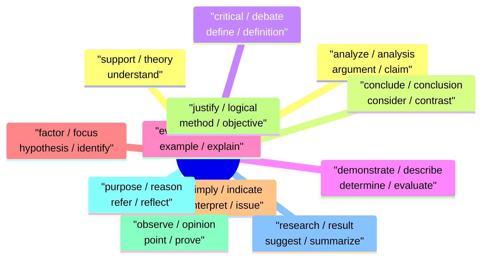

## 第二章：社会与政治（Society & Politics）

| 单词 | 音标 | 词性 | 中文释义 | 例句 | 常见搭配 |
|------|------|------|---------|------|---------|
| society | /səˈsaɪəti/ | n | 社会 | Modern **society** is changing rapidly. | in society; modern/civil society |
| community | /kəˈmjuːnɪti/ | n | 社区/社群 | The local **community** organized an event. | local/online community |
| culture | /ˈkʌltʃər/ | n | 文化 | Chinese **culture** is rich and diverse. | cultural heritage |
| tradition | /trəˈdɪʃən/ | n | 传统 | This is a family **tradition**. | long-standing tradition |
| government | /ˈɡʌvərnmənt/ | n | 政府 | The **government** announced new policies. | local/central government |
| policy | /ˈpɒlɪsi/ | n | 政策 | The new **policy** aims to reduce pollution. | public/government policy |
| law | /lɔː/ | n | 法律/规律 | Everyone must obey the **law**. | break/follow the law |
| rule | /ruːl/ | n/v | 规则/统治 | Follow the **rules**. | strict rules; rule a country |
| regulation | /ˌreɡjuˈleɪʃən/ | n | 法规/规定 | Safety **regulations** must be followed. | strict/government regulations |
| rights | /raɪts/ | n | 权利 | Everyone has basic human **rights**. | human/civil rights |
| freedom | /ˈfriːdəm/ | n | 自由 | **Freedom** of speech is a basic right. | freedom of speech/expression |
| democracy | /dɪˈmɒkrəsi/ | n | 民主 | They are fighting for **democracy**. | promote democracy |
| election | /ɪˈlekʃən/ | n | 选举 | The **election** is held every four years. | hold/win an election |
| vote | /voʊt/ | v/n | 投票 | Did you **vote** in the election? | cast a vote |
| protest | /ˈproʊtest/ | n/v | 抗议 | Thousands joined the **protest**. | peaceful protest |
| crisis | /ˈkraɪsɪs/ | n | 危机 | The country faces an economic **crisis**. | manage/face a crisis |
| conflict | /ˈkɒnflɪkt/ | n | 冲突/矛盾 | The **conflict** lasted three years. | resolve a conflict |
| peace | /piːs/ | n | 和平 | We must work for **peace**. | maintain peace |
| war | /wɔːr/ | n | 战争 | **War** brings only suffering. | wage/declare war |
| poverty | /ˈpɒvərti/ | n | 贫困 | Millions live in **poverty**. | reduce/fight poverty |
| inequality | /ˌɪnɪˈkwɒlɪti/ | n | 不平等 | **Inequality** is a global problem. | social/economic inequality |
| discrimination | /dɪˌskrɪmɪˈneɪʃən/ | n | 歧视 | **Discrimination** must be eliminated. | racial/gender discrimination |
| justice | /ˈdʒʌstɪs/ | n | 正义/司法 | We demand **justice**. | social justice |
| authority | /ɔːˈθɒrɪti/ | n | 权威/当局 | Respect the **authority**. | in authority |
| corruption | /kəˈrʌpʃən/ | n | 腐败/腐化 | Fight against **corruption**. | political corruption |
| reform | /rɪˈfɔːrm/ | n/v | 改革 | Educational **reform** is needed. | carry out reform |
| revolution | /ˌrevəˈluːʃən/ | n | 革命 | The industrial **revolution** changed everything. | lead a revolution |
| independence | /ˌɪndɪˈpendəns/ | n | 独立 | The country gained **independence** in 1949. | declare independence |
| population | /ˌpɒpjuˈleɪʃən/ | n | 人口 | China's **population** is 1.4 billion. | growing/aging population |
| immigration | /ˌɪmɪˈɡreɪʃən/ | n | 移民/入境 | **Immigration** policy is controversial. | illegal immigration |
| citizen | /ˈsɪtɪzən/ | n | 公民 | Every **citizen** has responsibilities. | responsible citizen |
| nationality | /ˌnæʃəˈnælɪti/ | n | 国籍/民族 | What is your **nationality**? | Chinese nationality |
| minority | /maɪˈnɒrɪti/ | n | 少数民族/少数派 | **Minorities** deserve equal treatment. | ethnic minority |
| majority | /məˈdʒɒrɪti/ | n | 多数 | The **majority** voted yes. | vast majority |
| welfare | /ˈwelfɛər/ | n | 福利/幸福 | Social **welfare** programs help the poor. | animal/social welfare |
| charity | /ˈtʃærɪti/ | n | 慈善/慈善机构 | She volunteers for a **charity**. | donate to charity |
| volunteer | /ˌvɒlənˈtɪər/ | n/v | 志愿者/自愿 | He **volunteers** at the hospital. | volunteer for |
| campaign | /kæmˈpeɪn/ | n | 运动/活动 | They launched a health **campaign**. | run a campaign |
| movement | /ˈmuːvmənt/ | n | 运动/动向 | The civil rights **movement** changed history. | social movement |
| influence | /ˈɪnfluəns/ | n/v | 影响/影响力 | She had a great **influence** on me. | have influence over |
| impact | /ˈɪmpækt/ | n | 冲击/影响 | The policy had a huge **impact**. | have an impact on |

---

### 第二章：社会与政治思维导图

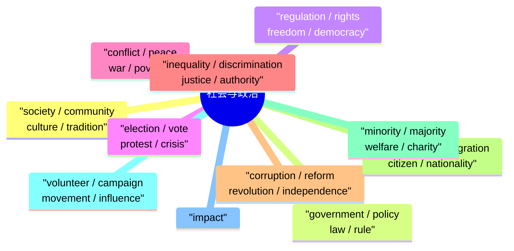

## 第三章：科学与技术（Science & Technology）

| 单词 | 音标 | 词性 | 中文释义 | 例句 | 常见搭配 |
|------|------|------|---------|------|---------|
| technology | /tekˈnɒlədʒi/ | n | 技术/科技 | **Technology** has changed our lives. | advanced technology |
| science | /ˈsaɪəns/ | n | 科学 | **Science** explains the natural world. | natural/applied science |
| experiment | /ɪkˈsperɪmənt/ | n/v | 实验 | Run an **experiment** to test it. | conduct an experiment |
| discovery | /dɪˈskʌvəri/ | n | 发现 | A major **discovery** was announced. | make a discovery |
| invention | /ɪnˈvenʃən/ | n | 发明 | The telephone was an important **invention**. | great invention |
| innovation | /ˌɪnəˈveɪʃən/ | n | 创新 | **Innovation** drives growth. | drive innovation |
| digital | /ˈdɪdʒɪtl/ | adj | 数字的 | We live in a **digital** age. | digital technology |
| artificial | /ˌɑːrtɪˈfɪʃəl/ | adj | 人工的/人造的 | **Artificial** intelligence is advancing fast. | artificial intelligence |
| algorithm | /ˈælɡərɪðəm/ | n | 算法 | The **algorithm** processes the data. | design an algorithm |
| data | /ˈdeɪtə/ | n | 数据 | The **data** shows clear patterns. | analyze/collect data |
| software | /ˈsɒftweər/ | n | 软件 | Update your **software** regularly. | install software |
| hardware | /ˈhɑːrdweər/ | n | 硬件 | The **hardware** needs replacing. | hardware components |
| network | /ˈnetwɜːrk/ | n | 网络/关系网 | Connect to the **network**. | social/wireless network |
| internet | /ˈɪntərnet/ | n | 互联网 | I spend hours on the **internet**. | on the internet |
| online | /ˌɒnˈlaɪn/ | adj/adv | 在线的 | Shop **online** for convenience. | go online |
| device | /dɪˈvaɪs/ | n | 设备/装置 | What **device** are you using? | mobile/smart device |
| system | /ˈsɪstəm/ | n | 系统 | The **system** crashed. | operating system |
| process | /ˈprəʊses/ | n/v | 过程/处理 | Explain the **process**. | production process |
| function | /ˈfʌŋkʃən/ | n/v | 功能/运作 | What is the **function** of this button? | serve a function |
| feature | /ˈfiːtʃər/ | n | 特征/功能 | This new **feature** is useful. | key/main feature |
| access | /ˈækses/ | n/v | 访问/获取 | You need a password to **access** it. | have access to |
| operate | /ˈɒpəreɪt/ | v | 操作/运营 | Learn how to **operate** the machine. | operate efficiently |
| install | /ɪnˈstɔːl/ | v | 安装 | **Install** the app on your phone. | install software |
| update | /ˌʌpˈdeɪt/ | v/n | 更新 | Please **update** your password. | software update |
| connect | /kəˈnekt/ | v | 连接 | **Connect** to the Wi-Fi. | connect to/with |
| protect | /prəˈtekt/ | v | 保护 | **Protect** your data online. | protect from/against |
| security | /sɪˈkjʊərɪti/ | n | 安全/保障 | Improve your online **security**. | cybersecurity |
| privacy | /ˈprɪvəsi/ | n | 隐私 | Protect your **privacy** online. | breach of privacy |
| efficient | /ɪˈfɪʃənt/ | adj | 高效的 | This method is very **efficient**. | highly efficient |
| accurate | /ˈækjərət/ | adj | 准确的 | Make sure the data is **accurate**. | highly accurate |
| automatic | /ˌɔːtəˈmætɪk/ | adj | 自动的 | The door is **automatic**. | automatic response |
| manual | /ˈmænjuəl/ | adj/n | 手动的/手册 | Read the **manual** first. | instruction manual |
| energy | /ˈenərdʒi/ | n | 能量/精力 | Solar **energy** is renewable. | renewable energy |
| power | /ˈpaʊər/ | n/v | 能源/能量/驱动 | **Power** is generated by the sun. | electrical power |
| environment | /ɪnˈvaɪrənmənt/ | n | 环境 | Protect the **environment**. | natural environment |
| pollution | /pəˈluːʃən/ | n | 污染 | Air **pollution** is a serious problem. | reduce pollution |
| climate | /ˈklaɪmɪt/ | n | 气候 | **Climate** change is a global crisis. | climate change |
| resource | /ˈriːsɔːrs/ | n | 资源 | Natural **resources** are limited. | natural/human resources |
| renewable | /rɪˈnjuːəbəl/ | adj | 可再生的 | **Renewable** energy is the future. | renewable energy sources |
| sustainable | /səˈsteɪnəbəl/ | adj | 可持续的 | We need **sustainable** development. | sustainable practice |

---

### 第三章：科学与技术思维导图

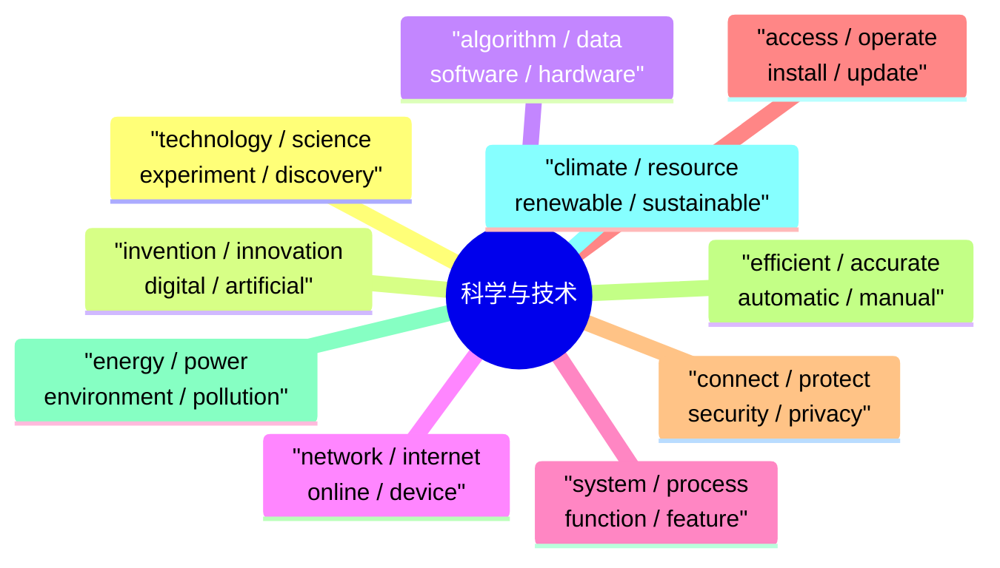

## 第四章：经济与商业（Economics & Business）

| 单词 | 音标 | 词性 | 中文释义 | 例句 | 常见搭配 |
|------|------|------|---------|------|---------|
| economy | /ɪˈkɒnəmi/ | n | 经济/节约 | The **economy** is growing. | global/national economy |
| market | /ˈmɑːrkɪt/ | n | 市场 | The **market** is competitive. | stock market; market share |
| trade | /treɪd/ | n/v | 贸易/交换 | International **trade** boosts growth. | free trade |
| industry | /ˈɪndəstri/ | n | 行业/工业 | The tech **industry** is booming. | manufacturing industry |
| business | /ˈbɪznəs/ | n | 商业/生意 | She runs her own **business**. | start a business |
| profit | /ˈprɒfɪt/ | n | 利润 | The company made a large **profit**. | make a profit |
| loss | /lɒs/ | n | 损失/亏损 | The company reported a **loss**. | make a loss |
| investment | /ɪnˈvestmənt/ | n | 投资 | He made a wise **investment**. | make an investment |
| budget | /ˈbʌdʒɪt/ | n | 预算 | Stay within the **budget**. | set a budget |
| revenue | /ˈrevənjuː/ | n | 收入/营业额 | Annual **revenue** reached $1 billion. | generate revenue |
| expense | /ɪkˈspens/ | n | 费用/开支 | Cut unnecessary **expenses**. | travel/business expenses |
| tax | /tæks/ | n | 税/税金 | Pay your **taxes** on time. | income tax |
| finance | /ˈfaɪnæns/ | n | 财务/金融 | She works in **finance**. | manage finances |
| loan | /loʊn/ | n | 贷款 | She took out a **loan** for the house. | bank loan |
| debt | /det/ | n | 债务 | He's in **debt**. | pay off a debt |
| contract | /ˈkɒntrækt/ | n | 合同/合约 | Sign the **contract** before starting. | sign/breach a contract |
| deal | /diːl/ | n | 交易/协议 | We made a good **deal**. | strike/close a deal |
| supply | /səˈplaɪ/ | n/v | 供应/供给 | **Supply** meets demand. | supply and demand |
| demand | /dɪˈmɑːnd/ | n/v | 需求/要求 | There is high **demand** for this product. | meet/increase demand |
| competition | /ˌkɒmpɪˈtɪʃən/ | n | 竞争 | The **competition** is fierce. | face competition |
| competitor | /kəmˈpetɪtər/ | n | 竞争对手 | Study your **competitors**. | direct competitor |
| strategy | /ˈstrætədʒi/ | n | 策略/战略 | Develop a clear **strategy**. | business strategy |
| goal | /ɡoʊl/ | n | 目标 | Set clear **goals** for this quarter. | achieve a goal |
| target | /ˈtɑːrɡɪt/ | n/v | 目标/针对 | Hit the sales **target**. | set a target |
| launch | /lɔːntʃ/ | v/n | 发布/推出 | We'll **launch** the product next month. | product launch |
| promote | /prəˈmoʊt/ | v | 推广/晋升 | **Promote** the brand on social media. | promote a product |
| advertise | /ˈædvərtaɪz/ | v | 做广告 | They **advertised** on TV. | advertise a product |
| brand | /brænd/ | n | 品牌 | This is a trusted **brand**. | build a brand |
| customer | /ˈkʌstəmər/ | n | 顾客/客户 | The **customer** is always right. | satisfy customers |
| client | /ˈklaɪənt/ | n | 客户（专业服务） | Meet with the **client** at 10 AM. | attract clients |
| partner | /ˈpɑːrtnər/ | n | 合作伙伴 | She is my business **partner**. | business partner |
| headquarters | /ˈhedkwɔːrtərz/ | n | 总部 | The company **HQ** is in Shanghai. | move headquarters |
| negotiate | /nɪˈɡoʊʃieɪt/ | v | 谈判/协商 | **Negotiate** a better price. | negotiate a deal |
| proposal | /prəˈpoʊzəl/ | n | 提案/建议书 | Submit the **proposal** by Friday. | write a proposal |
| opportunity | /ˌɒpəˈtjuːnɪti/ | n | 机会/良机 | Seize the **opportunity**. | miss an opportunity |
| challenge | /ˈtʃælɪndʒ/ | n | 挑战 | Every **challenge** is an opportunity. | face a challenge |
| solution | /səˈluːʃən/ | n | 解决方案 | Find a **solution** to the problem. | provide a solution |
| success | /səkˈses/ | n | 成功 | Hard work leads to **success**. | achieve success |
| failure | /ˈfeɪljər/ | n | 失败/故障 | Learn from **failure**. | avoid failure |
| achievement | /əˈtʃiːvmənt/ | n | 成就/成绩 | This is a great **achievement**. | outstanding achievement |

---

### 第四章：经济与商业思维导图

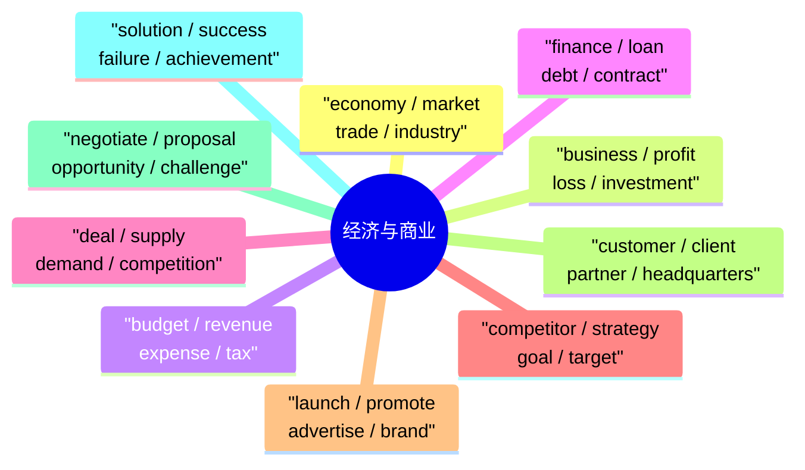

## 第五章：教育与职业发展（Education & Career）

| 单词 | 音标 | 词性 | 中文释义 | 例句 | 常见搭配 |
|------|------|------|---------|------|---------|
| academic | /ˌækəˈdemɪk/ | adj/n | 学术的/学者 | She has an **academic** background. | academic performance |
| curriculum | /kəˈrɪkjuləm/ | n | 课程/课程体系 | The school redesigned its **curriculum**. | school curriculum |
| assignment | /əˈsaɪnmənt/ | n | 作业/任务 | Complete the **assignment** by Monday. | submit an assignment |
| essay | /ˈeseɪ/ | n | 作文/论文 | She wrote an excellent **essay**. | write an essay |
| presentation | /ˌprezənˈteɪʃən/ | n | 演示/报告 | Prepare a **presentation** for class. | give a presentation |
| scholarship | /ˈskɒlərʃɪp/ | n | 奖学金/学术 | She won a full **scholarship**. | apply for a scholarship |
| graduate | /ˈɡrædjuət/ | v/n | 毕业/毕业生 | She will **graduate** this June. | graduate from |
| qualification | /ˌkwɒlɪfɪˈkeɪʃən/ | n | 资质/学历 | List your **qualifications**. | professional qualifications |
| certificate | /səˈtɪfɪkət/ | n | 证书 | She received a **certificate** of completion. | gain/earn a certificate |
| diploma | /dɪˈploʊmə/ | n | 文凭/毕业证 | He has a **diploma** in design. | earn a diploma |
| skill | /skɪl/ | n | 技能 | Communication is a key **skill**. | develop/improve skills |
| experience | /ɪkˈspɪəriəns/ | n | 经验/经历 | Work **experience** is valuable. | gain experience |
| internship | /ˈɪntɜːrnʃɪp/ | n | 实习 | She did an **internship** at Google. | complete an internship |
| application | /ˌæplɪˈkeɪʃən/ | n | 申请/应用程序 | Submit your **application** by April 1. | job application |
| resume | /ˈrezjumeɪ/ | n | 简历（美式） | Update your **resume** before applying. | submit a resume |
| curriculum vitae (CV) | — | n | 简历（英式） | Attach your **CV** to the email. | send your CV |
| reference | /ˈrefərəns/ | n | 推荐信/参考 | She provided two **references**. | provide references |
| promotion | /prəˈmoʊʃən/ | n | 晋升/促销 | He received a **promotion**. | get a promotion |
| leadership | /ˈliːdərʃɪp/ | n | 领导力 | Show strong **leadership**. | leadership skills |
| teamwork | /ˈtiːmwɜːrk/ | n | 团队合作 | **Teamwork** makes the dream work. | encourage teamwork |
| communicate | /kəˈmjuːnɪkeɪt/ | v | 沟通/交流 | **Communicate** clearly with your team. | communicate effectively |
| collaborate | /kəˈlæbəreɪt/ | v | 合作 | Let's **collaborate** on this project. | collaborate with |
| motivate | /ˈmoʊtɪveɪt/ | v | 激励/激发 | A good leader **motivates** the team. | motivate employees |
| achieve | /əˈtʃiːv/ | v | 实现/达到 | **Achieve** your goals step by step. | achieve a goal |
| succeed | /səkˈsiːd/ | v | 成功 | Work hard and you will **succeed**. | succeed in doing |
| compete | /kəmˈpiːt/ | v | 竞争 | We **compete** in the global market. | compete with/against |
| perform | /pərˈfɔːrm/ | v | 执行/表现/表演 | The team **performed** well. | perform well/poorly |
| manage | /ˈmænɪdʒ/ | v | 管理/设法 | She **manages** a team of 20. | manage a project/team |
| organize | /ˈɔːrɡənaɪz/ | v | 组织/安排 | **Organize** the files by date. | organize an event |
| schedule | /ˈskedʒuːl/ | n/v | 日程/安排 | Check the **schedule** first. | on schedule |
| deadline | /ˈdedlaɪn/ | n | 截止日期 | The **deadline** is tomorrow. | meet a deadline |
| priority | /praɪˈɒrɪti/ | n | 优先事项 | Make it your top **priority**. | set priorities |
| feedback | /ˈfiːdbæk/ | n | 反馈 | Give me honest **feedback**. | provide/receive feedback |

---

### 第五章：教育与职业发展思维导图

```mermaid
mindmap
  root((教育与职业发展))
    "academic / curriculum<br/>assignment / essay"
    "presentation / scholarship<br/>graduate / qualification"
    "certificate / diploma<br/>skill / experience"
    "internship / application<br/>resume / curriculum vitae (CV)"
    "reference / promotion<br/>leadership / teamwork"
    "communicate / collaborate<br/>motivate / achieve"
    "succeed / compete<br/>perform / manage"
    "organize / schedule<br/>deadline / priority"
    "feedback"
```

## 第六章：健康与医疗（Health & Medicine）

| 单词 | 音标 | 词性 | 中文释义 | 例句 | 常见搭配 |
|------|------|------|---------|------|---------|
| disease | /dɪˈziːz/ | n | 疾病 | Heart **disease** is common. | rare/infectious disease |
| illness | /ˈɪlnəs/ | n | 疾病/患病 | She recovered from a serious **illness**. | serious/chronic illness |
| condition | /kənˈdɪʃən/ | n | 状况/病症 | He has a medical **condition**. | health condition |
| symptom | /ˈsɪmptəm/ | n | 症状 | What are the **symptoms**? | show symptoms |
| treatment | /ˈtriːtmənt/ | n | 治疗 | She received effective **treatment**. | undergo treatment |
| therapy | /ˈθerəpi/ | n | 疗法/治疗 | Physical **therapy** helped her recover. | undergo therapy |
| surgery | /ˈsɜːrdʒəri/ | n | 手术 | He needs **surgery** on his knee. | perform surgery |
| vaccine | /ˈvæksiːn/ | n | 疫苗 | Get the **vaccine** before traveling. | develop a vaccine |
| virus | /ˈvaɪrəs/ | n | 病毒 | The **virus** spread rapidly. | spread a virus |
| bacteria | /bækˈtɪəriə/ | n | 细菌 | Wash hands to remove **bacteria**. | harmful bacteria |
| infection | /ɪnˈfekʃən/ | n | 感染/传染 | Treat the **infection** immediately. | bacterial/viral infection |
| diagnosis | /ˌdaɪəɡˈnoʊsɪs/ | n | 诊断 | The **diagnosis** was cancer. | make a diagnosis |
| prescription | /prɪˈskrɪpʃən/ | n | 处方 | The doctor gave me a **prescription**. | fill a prescription |
| dose | /doʊs/ | n | 剂量 | Take the correct **dose**. | daily/recommended dose |
| allergy | /ˈælədʒi/ | n | 过敏 | She has a nut **allergy**. | severe allergy |
| chronic | /ˈkrɒnɪk/ | adj | 慢性的/长期的 | He suffers from **chronic** pain. | chronic disease |
| emergency | /ɪˈmɜːrdʒənsi/ | n | 紧急情况 | Call an ambulance in an **emergency**. | in an emergency |
| ambulance | /ˈæmbjuləns/ | n | 救护车 | An **ambulance** rushed to the scene. | call an ambulance |
| clinic | /ˈklɪnɪk/ | n | 诊所 | Visit the local **clinic**. | dental/medical clinic |
| surgeon | /ˈsɜːrdʒən/ | n | 外科医生 | The **surgeon** performed the operation. | skilled surgeon |
| mental | /ˈmentl/ | adj | 心理的/精神的 | **Mental** health is as important as physical. | mental health |
| stress | /stres/ | n/v | 压力/强调 | Chronic **stress** harms health. | reduce/manage stress |
| anxiety | /æŋˈzaɪəti/ | n | 焦虑 | She suffers from **anxiety**. | cause anxiety |
| depression | /dɪˈpreʃən/ | n | 抑郁/萧条 | **Depression** is a serious illness. | suffer from depression |
| nutrition | /njuːˈtrɪʃən/ | n | 营养 | Good **nutrition** is essential. | balanced nutrition |
| calorie | /ˈkæləri/ | n | 卡路里 | Count **calories** to lose weight. | high/low calorie |
| protein | /ˈproʊtiːn/ | n | 蛋白质 | Eat enough **protein** for muscle growth. | high-protein diet |
| vitamin | /ˈvaɪtəmɪn/ | n | 维生素 | Take **vitamin** C for immunity. | vitamin deficiency |
| immune | /ɪˈmjuːn/ | adj | 免疫的 | Boost your **immune** system. | immune system |
| recover | /rɪˈkʌvər/ | v | 康复/恢复 | She **recovered** quickly. | recover from |

---

### 第六章：健康与医疗思维导图

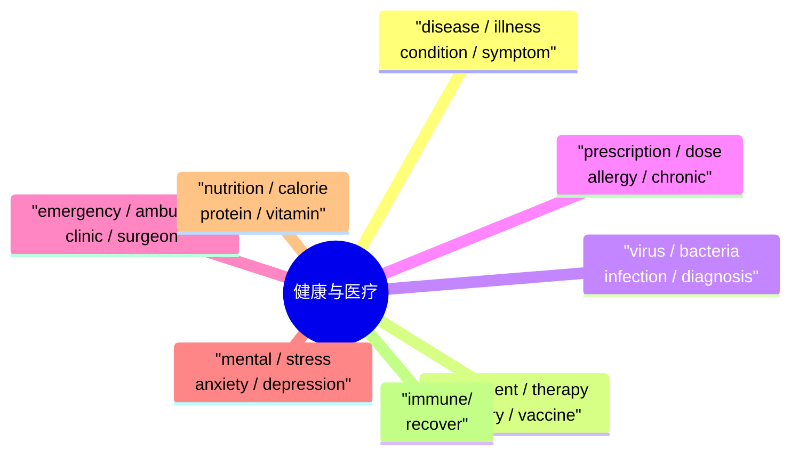

## 第七章：环境与生态（Environment & Ecology）

| 单词 | 音标 | 词性 | 中文释义 | 例句 | 常见搭配 |
|------|------|------|---------|------|---------|
| ecosystem | /ˈiːkoʊsɪstəm/ | n | 生态系统 | The coral reef **ecosystem** is fragile. | marine ecosystem |
| habitat | /ˈhæbɪtæt/ | n | 栖息地 | Forests are the natural **habitat** of tigers. | natural habitat |
| species | /ˈspiːʃiːz/ | n | 物种 | Several **species** are endangered. | endangered species |
| extinct | /ɪkˈstɪŋkt/ | adj | 灭绝的 | The dinosaurs are **extinct**. | go extinct |
| endangered | /ɪnˈdeɪndʒərd/ | adj | 濒危的 | Pandas are **endangered**. | endangered species |
| biodiversity | /ˌbaɪoʊdaɪˈvɜːrsɪti/ | n | 生物多样性 | Protect **biodiversity**. | protect biodiversity |
| deforestation | /dɪˌfɒrɪˈsteɪʃən/ | n | 滥伐森林 | **Deforestation** destroys habitats. | cause deforestation |
| carbon | /ˈkɑːrbən/ | n | 碳 | Reduce your **carbon** footprint. | carbon emissions |
| emission | /ɪˈmɪʃən/ | n | 排放 | Cut greenhouse gas **emissions**. | reduce emissions |
| fossil fuel | /ˈfɒsəl fjuːəl/ | n | 化石燃料 | **Fossil fuels** cause pollution. | burn fossil fuels |
| greenhouse | /ˈɡriːnhaʊs/ | n/adj | 温室/温室效应 | The **greenhouse** effect warms the Earth. | greenhouse gas |
| global warming | /ˌɡloʊbəl ˈwɔːrmɪŋ/ | n | 全球变暖 | **Global warming** threatens wildlife. | cause global warming |
| recycle | /ˌriːˈsaɪkəl/ | v | 回收利用 | **Recycle** your paper and plastic. | recycle waste |
| waste | /weɪst/ | n | 废物/浪费 | Reduce plastic **waste**. | manage waste |
| conservation | /ˌkɒnsəˈveɪʃən/ | n | 保护/保存 | Wildlife **conservation** is vital. | promote conservation |
| preserve | /prɪˈzɜːrv/ | v | 保护/保存 | **Preserve** the rainforest. | preserve the environment |
| contaminate | /kənˈtæmɪneɪt/ | v | 污染/污染 | Industrial waste **contaminates** rivers. | contaminate water |
| toxic | /ˈtɒksɪk/ | adj | 有毒的 | **Toxic** chemicals must be disposed carefully. | toxic waste |
| drought | /draʊt/ | n | 干旱 | The **drought** lasted for months. | severe drought |
| earthquake | /ˈɜːrθkweɪk/ | n | 地震 | A major **earthquake** struck the region. | devastating earthquake |
| hurricane | /ˈhʌrɪkən/ | n | 飓风 | The **hurricane** caused massive damage. | powerful hurricane |
| tsunami | /tsuːˈnɑːmi/ | n | 海啸 | A **tsunami** hit the coastline. | deadly tsunami |
| wildlife | /ˈwaɪldlaɪf/ | n | 野生动植物 | Protect **wildlife** from poaching. | protect wildlife |
| ocean | /ˈoʊʃən/ | n | 大洋 | The **oceans** cover 70% of Earth. | deep ocean |
| atmosphere | /ˈætməsfɪər/ | n | 大气层/气氛 | Protect the **atmosphere**. | Earth's atmosphere |

---

### 第七章：环境与生态思维导图

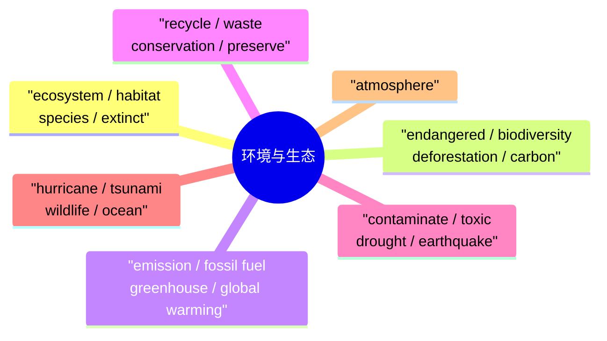

## 第八章：传媒与通信（Media & Communication）

| 单词 | 音标 | 词性 | 中文释义 | 例句 | 常见搭配 |
|------|------|------|---------|------|---------|
| media | /ˈmiːdiə/ | n | 媒体/媒介 | The **media** covered the story widely. | social media |
| news | /njuːz/ | n | 新闻 | I watch the **news** every morning. | breaking news |
| article | /ˈɑːrtɪkəl/ | n | 文章/条款 | Read the **article** carefully. | newspaper article |
| headline | /ˈhedlaɪn/ | n | 头条 | The **headline** shocked everyone. | make headlines |
| broadcast | /ˈbrɔːdkɑːst/ | v/n | 广播/播出 | The game was **broadcast** live. | live broadcast |
| publish | /ˈpʌblɪʃ/ | v | 出版/发表 | The paper was **published** today. | publish a book |
| reporter | /rɪˈpɔːrtər/ | n | 记者/报道员 | A **reporter** asked me questions. | news reporter |
| editor | /ˈedɪtər/ | n | 编辑 | The **editor** reviewed the article. | chief editor |
| audience | /ˈɔːdiəns/ | n | 观众/听众/读者 | The **audience** loved the show. | target audience |
| review | /rɪˈvjuː/ | n/v | 评论/复习 | Read the **reviews** before buying. | write a review |
| comment | /ˈkɒment/ | n/v | 评论/注解 | Leave a **comment** below the video. | make a comment |
| platform | /ˈplætfɔːrm/ | n | 平台 | Use a social media **platform**. | digital platform |
| content | /ˈkɒntent/ | n | 内容 | Create engaging **content**. | digital content |
| channel | /ˈtʃænəl/ | n | 频道/渠道 | Watch it on YouTube **channel**. | TV channel |
| communicate | /kəˈmjuːnɪkeɪt/ | v | 交流/沟通 | **Communicate** ideas clearly. | communicate effectively |
| message | /ˈmesɪdʒ/ | n | 消息/信息 | I got your **message**. | send a message |
| share | /ʃeər/ | v | 分享 | **Share** this post. | share information |
| post | /poʊst/ | n/v | 帖子/张贴 | He **posted** a photo online. | post on social media |
| follow | /ˈfɒloʊ/ | v | 关注/跟随 | **Follow** me on Twitter. | follow an account |
| subscribe | /səbˈskraɪb/ | v | 订阅 | **Subscribe** to the newsletter. | subscribe to a channel |
| viral | /ˈvaɪrəl/ | adj | 病毒式传播的 | The video went **viral**. | go viral |
| controversy | /ˈkɒntrəvɜːrsi/ | n | 争议 | The decision sparked **controversy**. | cause controversy |
| fake | /feɪk/ | adj/n | 假的/虚假 | Beware of **fake** news. | fake news |
| source | /sɔːrs/ | n | 来源/消息源 | Check the **source** of information. | reliable source |
| reliable | /rɪˈlaɪəbəl/ | adj | 可靠的 | Is the source **reliable**? | reliable information |

---

### 第八章：传媒与通信思维导图

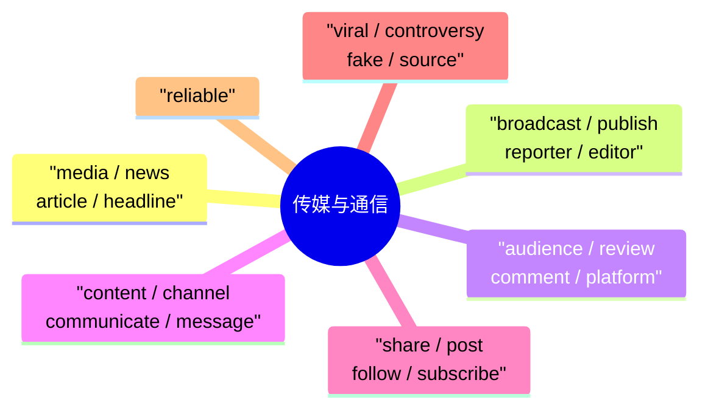

## 第九章：旅游与文化（Travel & Culture）

| 单词 | 音标 | 词性 | 中文释义 | 例句 | 常见搭配 |
|------|------|------|---------|------|---------|
| destination | /ˌdestɪˈneɪʃən/ | n | 目的地 | Paris is my dream **destination**. | travel destination |
| journey | /ˈdʒɜːrni/ | n | 旅程/行程 | It's a long **journey** by train. | begin a journey |
| trip | /trɪp/ | n | 旅行/短途旅行 | We took a **trip** to the mountains. | go on a trip |
| tour | /tʊər/ | n/v | 游览/旅游 | We went on a guided **tour**. | take a tour |
| tourist | /ˈtʊərɪst/ | n | 游客/旅游者 | Millions of **tourists** visit every year. | foreign tourist |
| attraction | /əˈtrækʃən/ | n | 景点/吸引力 | The Eiffel Tower is a major **attraction**. | tourist attraction |
| sightseeing | /ˈsaɪtsiːɪŋ/ | n | 观光 | We went **sightseeing** in Rome. | go sightseeing |
| landmark | /ˈlændmɑːrk/ | n | 地标/里程碑 | The Great Wall is a famous **landmark**. | historic landmark |
| monument | /ˈmɒnjumənt/ | n | 纪念碑/历史遗迹 | Visit the war **monument**. | historical monument |
| museum | /mjuːˈziːəm/ | n | 博物馆 | Visit the national **museum**. | natural history museum |
| gallery | /ˈɡæləri/ | n | 画廊/美术馆 | The art **gallery** has amazing works. | art gallery |
| hotel | /hoʊˈtel/ | n | 酒店 | Book a **hotel** in advance. | five-star hotel |
| accommodation | /əˌkɒməˈdeɪʃən/ | n | 住宿/住所 | Arrange **accommodation** before traveling. | book accommodation |
| reservation | /ˌrezəˈveɪʃən/ | n | 预订/保留 | Do you have a **reservation**? | make a reservation |
| currency | /ˈkʌrənsi/ | n | 货币 | Exchange **currency** at the bank. | local currency |
| customs | /ˈkʌstəmz/ | n | 海关/风俗 | Respect local **customs**. | go through customs |
| immigration | /ˌɪmɪˈɡreɪʃən/ | n | 出入境/移民 | Pass through **immigration** at the airport. | immigration control |
| itinerary | /aɪˈtɪnəreri/ | n | 行程表/路线 | I planned a detailed **itinerary**. | follow an itinerary |
| backpacker | /ˈbækpækər/ | n | 背包客 | He's a seasoned **backpacker**. | experienced backpacker |
| adventure | /ədˈventʃər/ | n | 冒险 | Life is a great **adventure**. | spirit of adventure |
| explore | /ɪkˈsplɔːr/ | v | 探索/探险 | I love to **explore** new places. | explore the city |
| local | /ˈloʊkəl/ | adj/n | 当地的/本地人 | Try **local** food when you travel. | local cuisine |
| cuisine | /kwɪˈziːn/ | n | 菜肴/烹饪风格 | French **cuisine** is world-famous. | local/traditional cuisine |
| heritage | /ˈherɪtɪdʒ/ | n | 遗产/传承 | Protect our cultural **heritage**. | cultural/natural heritage |
| ancient | /ˈeɪnʃənt/ | adj | 古代的/古老的 | Visit the **ancient** ruins. | ancient civilization |

---

### 第九章：旅游与文化思维导图

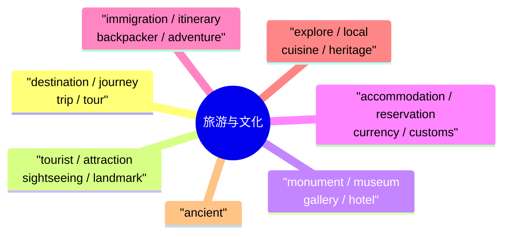

## 第十章：人际交往与沟通（Interpersonal Skills & Communication）

### 10.1 社交表达

| 单词/短语 | 音标 | 中文释义 | 例句 |
|---------|------|---------|------|
| greet | /ɡriːt/ | 问候/打招呼 | **Greet** your guests at the door. |
| introduce | /ˌɪntrəˈdjuːs/ | 介绍/引入 | Let me **introduce** myself. |
| apologize | /əˈpɒlədʒaɪz/ | 道歉 | I need to **apologize** for being late. |
| compliment | /ˈkɒmplɪmənt/ | 赞美/恭维 | She received many **compliments** on her work. |
| criticize | /ˈkrɪtɪsaɪz/ | 批评/指责 | Don't **criticize** without offering solutions. |
| encourage | /ɪnˈkɜːrɪdʒ/ | 鼓励 | **Encourage** others to do their best. |
| disagree | /ˌdɪsəˈɡriː/ | 不同意 | I respectfully **disagree** with you. |
| negotiate | /nɪˈɡoʊʃieɪt/ | 谈判/协商 | We **negotiated** a compromise. |
| persuade | /pərˈsweɪd/ | 说服 | She **persuaded** him to try. |
| convince | /kənˈvɪns/ | 使相信/说服 | I tried to **convince** him. |
| hesitate | /ˈhezɪteɪt/ | 犹豫/迟疑 | Don't **hesitate** to ask for help. |
| interrupt | /ˌɪntəˈrʌpt/ | 打断/中断 | Don't **interrupt** when others speak. |
| express | /ɪkˈspres/ | 表达/表示 | **Express** your feelings clearly. |
| respond | /rɪˈspɒnd/ | 回应/回答 | **Respond** to emails promptly. |
| react | /riˈækt/ | 做出反应 | How did she **react** to the news? |
| trust | /trʌst/ | 信任 | Build **trust** over time. |
| respect | /rɪˈspekt/ | 尊重 | Show **respect** to others. |
| support | /səˈpɔːrt/ | 支持/支撑 | **Support** your friends in tough times. |
| appreciate | /əˈpriːʃieɪt/ | 欣赏/感激 | I really **appreciate** your help. |
| accept | /əkˈsept/ | 接受 | **Accept** both success and failure. |
| reject | /rɪˈdʒekt/ | 拒绝 | His application was **rejected**. |
| ignore | /ɪɡˈnɔːr/ | 忽视/不理睬 | Don't **ignore** the warning signs. |
| misunderstand | /ˌmɪsʌndərˈstænd/ | 误解 | I think you **misunderstood** me. |
| clarify | /ˈklærɪfaɪ/ | 澄清/说明 | Let me **clarify** what I meant. |
| confirm | /kənˈfɜːrm/ | 确认 | Please **confirm** your attendance. |

#### 10.1 社交表达思维导图

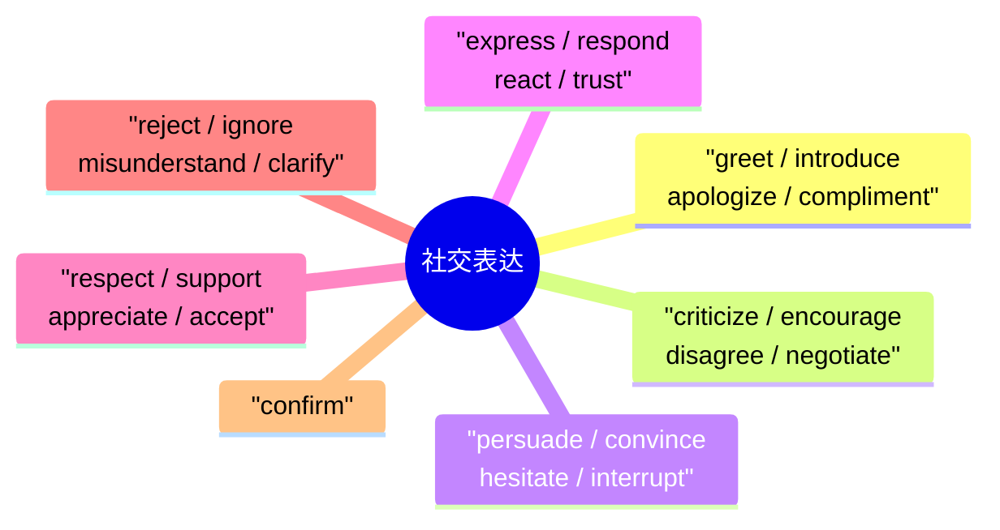

### 10.2 描述人和观点

| 单词 | 音标 | 词性 | 中文释义 | 例句 |
|------|------|------|---------|------|
| perspective | /pərˈspektɪv/ | n | 视角/观点 | Consider different **perspectives**. |
| attitude | /ˈætɪtjuːd/ | n | 态度 | A positive **attitude** matters. |
| behavior | /bɪˈheɪvjər/ | n | 行为/举止 | Good **behavior** is rewarded. |
| character | /ˈkærəktər/ | n | 性格/特征 | She has strong **character**. |
| personality | /ˌpɜːrsəˈnælɪti/ | n | 个性/性格 | She has a great **personality**. |
| reputation | /ˌrepjuˈteɪʃən/ | n | 名誉/声望 | Protect your **reputation**. |
| value | /ˈvæljuː/ | n | 价值观/价值 | Family is my top **value**. |
| belief | /bɪˈliːf/ | n | 信念/信仰 | Respect others' **beliefs**. |
| principle | /ˈprɪnsɪpəl/ | n | 原则 | Stick to your **principles**. |
| habit | /ˈhæbɪt/ | n | 习惯 | Build good **habits** early. |
| talent | /ˈtælənt/ | n | 天赋/才能 | She has a **talent** for music. |
| strength | /streŋθ/ | n | 力量/优势 | Play to your **strengths**. |
| weakness | /ˈwiːknəs/ | n | 弱点/缺点 | Recognize your **weaknesses**. |
| potential | /pəˈtenʃəl/ | n/adj | 潜力/潜在的 | She has great **potential**. |
| capable | /ˈkeɪpəbəl/ | adj | 有能力的 | She is very **capable**. |

---

#### 10.2 描述人和观点思维导图

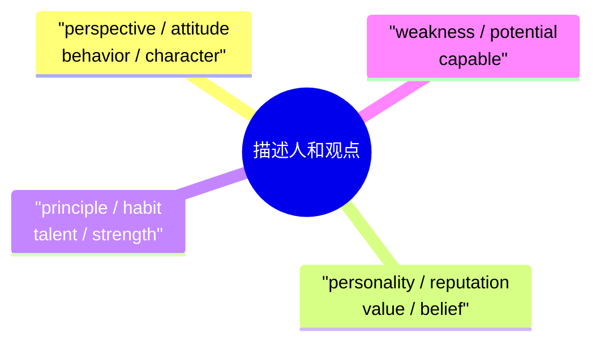

## 第十一章：文学与艺术（Literature & Arts）

| 单词 | 音标 | 词性 | 中文释义 | 例句 |
|------|------|------|---------|------|
| literature | /ˈlɪtərətʃər/ | n | 文学 | I studied English **literature**. |
| novel | /ˈnɒvəl/ | n/adj | 小说/新颖的 | She wrote an award-winning **novel**. |
| fiction | /ˈfɪkʃən/ | n | 小说/虚构 | I prefer **fiction** to non-fiction. |
| poetry | /ˈpoʊɪtri/ | n | 诗歌 | She loves reading **poetry**. |
| poem | /ˈpoʊɪm/ | n | 诗/诗篇 | He wrote a beautiful **poem**. |
| author | /ˈɔːθər/ | n | 作者/作家 | Who is the **author** of this book? |
| character | /ˈkærəktər/ | n | 角色 | The main **character** is a detective. |
| plot | /plɒt/ | n | 情节/阴谋 | The **plot** was exciting. |
| theme | /θiːm/ | n | 主题 | The **theme** of the novel is love. |
| symbolism | /ˈsɪmbəlɪzəm/ | n | 象征主义 | **Symbolism** is used throughout. |
| metaphor | /ˈmetəfɔːr/ | n | 隐喻 | Use a **metaphor** to explain. |
| narrative | /ˈnærətɪv/ | n/adj | 叙述/叙事的 | The **narrative** kept me engaged. |
| genre | /ˈʒɒnrə/ | n | 体裁/流派 | What's your favorite **genre**? |
| style | /staɪl/ | n | 风格 | She has her own writing **style**. |
| masterpiece | /ˈmɑːstərpiːs/ | n | 杰作 | The painting is a **masterpiece**. |
| exhibit | /ɪɡˈzɪbɪt/ | n/v | 展品/展览 | Visit the new **exhibit** at the museum. |
| sculpture | /ˈskʌlptʃər/ | n | 雕塑 | The **sculpture** is made of marble. |
| architecture | /ˈɑːrkɪtektʃər/ | n | 建筑/建筑学 | I love Gothic **architecture**. |
| orchestra | /ˈɔːrkɪstrə/ | n | 管弦乐队 | The **orchestra** performed beautifully. |
| instrument | /ˈɪnstrəmənt/ | n | 乐器/仪器 | What **instrument** do you play? |
| compose | /kəmˈpoʊz/ | v | 作曲/组成 | He **composed** the piece in one week. |
| rhythm | /ˈrɪðəm/ | n | 节奏/韵律 | I love the **rhythm** of the music. |
| inspire | /ɪnˈspaɪər/ | v | 激励/启发 | Great art can **inspire** people. |
| creative | /kriˈeɪtɪv/ | adj | 有创意的 | She's very **creative**. |
| imagination | /ɪˌmædʒɪˈneɪʃən/ | n | 想象力 | Use your **imagination**! |

---

### 第十一章：文学与艺术思维导图

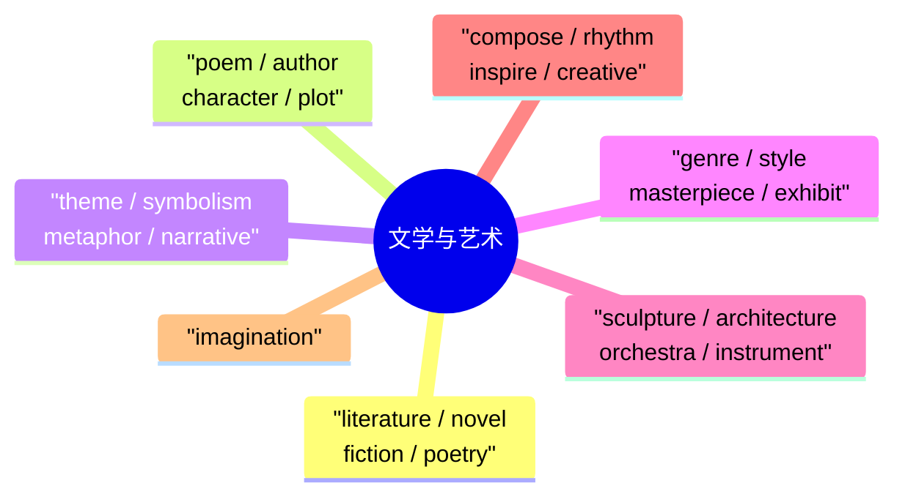

## 第十二章：词汇拓展——常用短语动词（Phrasal Verbs）

短语动词是英语的重要组成部分，同一动词配不同介词/副词，意思大相径庭。

### 12.1 bring 系列

| 短语动词 | 中文释义 | 例句 |
|---------|---------|------|
| bring up | 提出/养育 | He **brought up** an interesting point. |
| bring about | 引起/导致 | The reform **brought about** major changes. |
| bring back | 带回/恢复 | This song **brings back** memories. |
| bring down | 降低/推翻 | The government **brought down** prices. |
| bring in | 引入/赚取 | The project **brought in** new investors. |
| bring out | 推出/激发 | Hard work **brings out** the best in people. |
| bring forward | 提前/提出 | The meeting was **brought forward** to Monday. |

#### 12.1 bring 系列思维导图

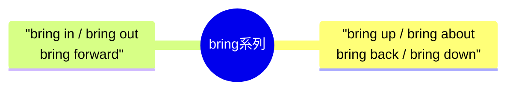

### 12.2 break 系列

| 短语动词 | 中文释义 | 例句 |
|---------|---------|------|
| break down | 崩溃/出故障/分解 | The car **broke down** on the highway. |
| break out | 爆发/逃脱 | A fire **broke out** in the building. |
| break through | 突破/克服 | Scientists **broke through** the barrier. |
| break up | 分手/分解/解散 | They **broke up** after two years. |
| break in | 闯入/打断 | Someone **broke in** to the house. |
| break off | 中断/断裂 | She **broke off** the relationship. |
| break even | 收支平衡 | They **broke even** in the first year. |

#### 12.2 break 系列思维导图

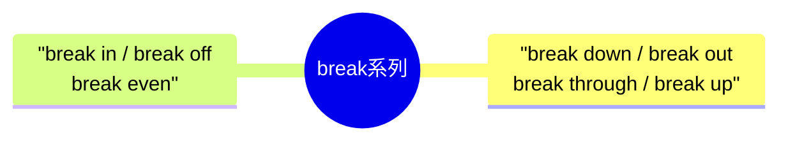

### 12.3 get 系列

| 短语动词 | 中文释义 | 例句 |
|---------|---------|------|
| get along | 相处融洽 | We **get along** very well. |
| get away | 逃脱/度假 | I need to **get away** for a weekend. |
| get by | 勉强维持生活 | We can **get by** with less money. |
| get over | 克服/从…恢复 | I need to **get over** this cold. |
| get together | 聚集/聚会 | Let's **get together** for dinner. |
| get through | 度过/接通(电话) | We'll **get through** this difficult time. |
| get up | 起床/站起来 | What time do you **get up**? |
| get rid of | 摆脱/去除 | **Get rid of** old habits. |
| get across | 传达/越过 | Did you **get** the message **across**? |

#### 12.3 get 系列思维导图

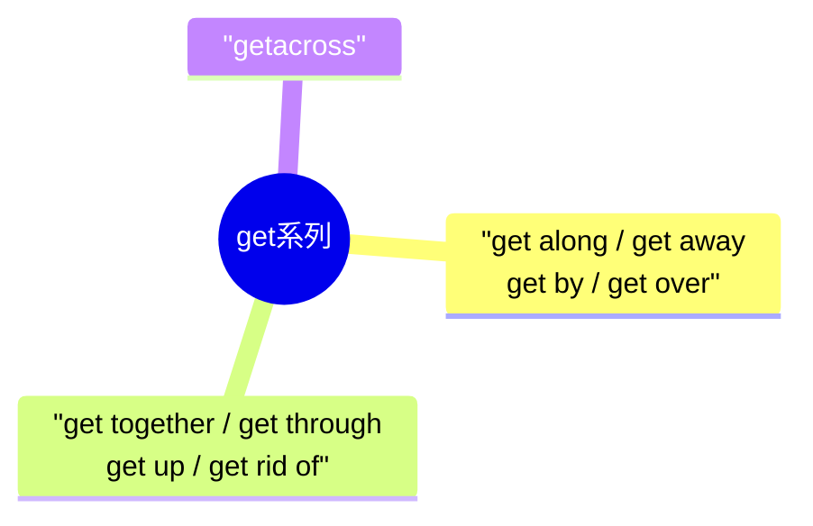

### 12.4 give 系列

| 短语动词 | 中文释义 | 例句 |
|---------|---------|------|
| give up | 放弃 | Never **give up** on your dreams! |
| give in | 让步/屈服 | She finally **gave in** to the pressure. |
| give away | 赠送/泄露 | Don't **give away** the surprise! |
| give back | 归还 | **Give back** what you borrowed. |
| give out | 分发/耗尽 | She **gave out** flyers on the street. |
| give rise to | 引起/导致 | This **gave rise to** much debate. |

#### 12.4 give 系列思维导图

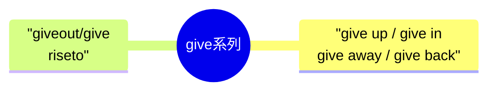

### 12.5 look 系列

| 短语动词 | 中文释义 | 例句 |
|---------|---------|------|
| look after | 照顾 | Can you **look after** my cat? |
| look for | 寻找 | I'm **looking for** my keys. |
| look forward to | 期待 | I **look forward to** seeing you. |
| look into | 调查/研究 | Police are **looking into** the matter. |
| look up | 查阅/仰视 | **Look up** the word in the dictionary. |
| look out | 小心/注意 | **Look out**! There's a car coming! |
| look up to | 仰慕/尊重 | Children **look up to** their parents. |
| look down on | 瞧不起 | Don't **look down on** others. |

#### 12.5 look 系列思维导图

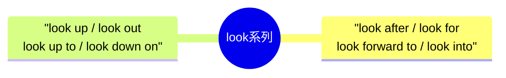

### 12.6 make 系列

| 短语动词 | 中文释义 | 例句 |
|---------|---------|------|
| make up | 组成/化妆/编造 | She **made up** an excuse. |
| make out | 辨认出/理解 | I can't **make out** what he said. |
| make do with | 凑合使用 | We had to **make do with** less. |
| make for | 走向/有助于 | This **makes for** better teamwork. |
| make up for | 弥补 | Work hard to **make up for** lost time. |
| make it | 成功/及时到达 | She finally **made it** to the top! |

---

#### 12.6 make 系列思维导图

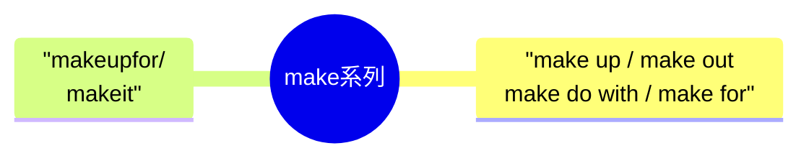

## 第十三章：形容词进阶（Advanced Adjectives）

| 单词 | 音标 | 中文释义 | 例句 |
|------|------|---------|------|
| significant | /sɪɡˈnɪfɪkənt/ | 重大的/显著的 | A **significant** change occurred. |
| considerable | /kənˈsɪdərəbəl/ | 相当大的/可观的 | There was **considerable** progress. |
| remarkable | /rɪˈmɑːrkəbəl/ | 显著的/非凡的 | A **remarkable** achievement! |
| substantial | /səbˈstænʃəl/ | 大量的/实质性的 | **Substantial** improvements were made. |
| adequate | /ˈædɪkwət/ | 足够的/适当的 | The resources are **adequate**. |
| sufficient | /səˈfɪʃənt/ | 足够的 | Is there **sufficient** time? |
| excessive | /ɪkˈsesɪv/ | 过多的/过度的 | **Excessive** screen time is harmful. |
| appropriate | /əˈproʊpriɪt/ | 适当的/合适的 | Choose **appropriate** language. |
| relevant | /ˈreləvənt/ | 相关的 | Please provide **relevant** examples. |
| complex | /ˈkɒmpleks/ | 复杂的 | This is a **complex** problem. |
| comprehensive | /ˌkɒmprɪˈhensɪv/ | 全面的/综合的 | A **comprehensive** study was done. |
| consistent | /kənˈsɪstənt/ | 一致的/连贯的 | Be **consistent** in your efforts. |
| confident | /ˈkɒnfɪdənt/ | 自信的 | She gave a **confident** presentation. |
| determined | /dɪˈtɜːrmɪnd/ | 坚定的/下定决心的 | She was **determined** to succeed. |
| flexible | /ˈfleksɪbəl/ | 灵活的 | Stay **flexible** in your plans. |
| logical | /ˈlɒdʒɪkəl/ | 合乎逻辑的 | That's a **logical** conclusion. |
| practical | /ˈpræktɪkəl/ | 实际的/实用的 | Give **practical** advice. |
| realistic | /ˌriːəˈlɪstɪk/ | 现实的/现实主义的 | Set **realistic** goals. |
| responsible | /rɪˈspɒnsɪbəl/ | 负责的 | Be **responsible** for your actions. |
| sensitive | /ˈsensɪtɪv/ | 敏感的/体贴的 | Be **sensitive** to others' feelings. |
| aggressive | /əˈɡresɪv/ | 攻击性的/积极进取的 | Don't be **aggressive** in negotiations. |
| productive | /prəˈdʌktɪv/ | 富有成效的/多产的 | Have a **productive** day! |
| efficient | /ɪˈfɪʃənt/ | 效率高的 | An **efficient** worker saves time. |
| competitive | /kəmˈpetɪtɪv/ | 竞争性的/有竞争力的 | The market is very **competitive**. |
| diverse | /daɪˈvɜːrs/ | 多样化的 | We have a **diverse** team. |
| innovative | /ˈɪnəveɪtɪv/ | 创新的 | We need **innovative** solutions. |
| traditional | /trəˈdɪʃənəl/ | 传统的 | She prefers **traditional** methods. |
| modern | /ˈmɒdərn/ | 现代的 | The building has a **modern** design. |
| contemporary | /kənˈtempəreri/ | 当代的/同时代的 | I enjoy **contemporary** art. |
| global | /ˈɡloʊbəl/ | 全球的 | A **global** perspective is important. |
| local | /ˈloʊkəl/ | 本地的/当地的 | Support **local** businesses. |
| fundamental | /ˌfʌndəˈmentl/ | 基本的/根本的 | This is a **fundamental** principle. |
| essential | /ɪˈsenʃəl/ | 必要的/基本的 | Water is **essential** for life. |
| optional | /ˈɒpʃənəl/ | 可选择的/非必须的 | This module is **optional**. |
| unique | /juːˈniːk/ | 独特的/唯一的 | Each person is **unique**. |
| universal | /ˌjuːnɪˈvɜːrsəl/ | 普遍的/通用的 | Music is a **universal** language. |
| temporary | /ˈtempəreri/ | 暂时的/临时的 | This is only a **temporary** solution. |
| permanent | /ˈpɜːrmənənt/ | 永久的/持久的 | Looking for a **permanent** position. |
| obvious | /ˈɒbviəs/ | 明显的 | The answer is **obvious**. |
| apparent | /əˈpærənt/ | 表面上的/明显的 | The cause was not immediately **apparent**. |
| crucial | /ˈkruːʃəl/ | 至关重要的 | Timing is **crucial** in business. |
| vital | /ˈvaɪtl/ | 极其重要的 | Exercise is **vital** for health. |

---

> **学习提示**：B1-B2 词汇的核心是**在语境中使用**——学一个词，找 3 个真实例句，尝试造句，再在阅读中主动识别它。完成本文件后请继续 [03-高级词汇-C1C2-3000词.md](03-高级词汇-C1C2-3000词.md)。

### 第十三章：形容词进阶思维导图

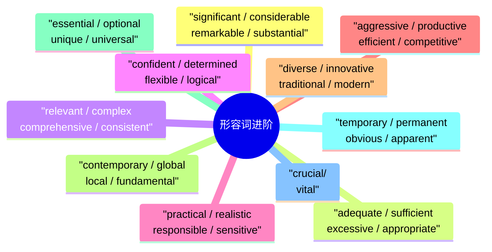
