# 高级词汇 C1-C2（3000词）

本文件收录 C1-C2 级别 3000 个高级英语单词，覆盖学术写作、专业会议、文学阅读、法律、哲学、科学等高层次语境所需词汇。每词配有音标、中文释义、例句和辨析。

---

## 第一章：抽象思维与哲学（Abstract Thinking & Philosophy）

| 单词 | 音标 | 词性 | 中文释义 | 例句 | 近义词/辨析 |
|------|------|------|---------|------|------------|
| abstraction | /æbˈstrækʃən/ | n | 抽象/抽象概念 | Art can be an **abstraction** of reality. | — |
| ambiguity | /ˌæmbɪˈɡjuːɪti/ | n | 歧义/模糊性 | The contract has too much **ambiguity**. | vagueness |
| paradox | /ˈpærədɒks/ | n | 悖论/矛盾 | Time is a **paradox**: the faster you run, the less you get. | contradiction |
| notion | /ˈnoʊʃən/ | n | 概念/想法 | The **notion** of justice varies across cultures. | concept, idea |
| premise | /ˈpremɪs/ | n | 前提/假设 | The **premise** of the argument is flawed. | assumption |
| inference | /ˈɪnfərəns/ | n | 推论/推断 | Draw an **inference** from the available evidence. | deduction |
| cognition | /kɒɡˈnɪʃən/ | n | 认知 | Memory is a key aspect of **cognition**. | — |
| consciousness | /ˈkɒnʃəsnəs/ | n | 意识/知觉 | He lost **consciousness** after the accident. | awareness |
| perception | /pərˈsepʃən/ | n | 感知/看法 | **Perception** shapes reality. | viewpoint |
| intuition | /ˌɪntjuˈɪʃən/ | n | 直觉 | Trust your **intuition**. | gut feeling |
| rationality | /ˌræʃəˈnælɪti/ | n | 理性/合理性 | **Rationality** governs decision-making. | reason |
| empirical | /ɪmˈpɪrɪkəl/ | adj | 经验性的/实证的 | We need **empirical** evidence. | evidence-based |
| epistemology | /ɪˌpɪstɪˈmɒlədʒi/ | n | 认识论 | **Epistemology** studies the nature of knowledge. | — |
| ethics | /ˈeθɪks/ | n | 伦理/道德 | Medical **ethics** are very important. | morality |
| morality | /məˈrælɪti/ | n | 道德/道德体系 | Different cultures have different **moralities**. | ethics |
| virtue | /ˈvɜːrtʃuː/ | n | 美德/优点 | Patience is a **virtue**. | moral quality |
| ideology | /ˌaɪdiˈɒlədʒi/ | n | 意识形态 | Political **ideology** shapes policy. | belief system |
| dogma | /ˈdɒɡmə/ | n | 教条/教义 | Question **dogma** and think critically. | doctrine |
| axiom | /ˈæksiəm/ | n | 公理/不言自明的道理 | Self-interest is an **axiom** of economics. | self-evident truth |
| dialectic | /ˌdaɪəˈlektɪk/ | n | 辩证法 | Hegel used **dialectic** to explain history. | — |
| paradigm | /ˈpærədaɪm/ | n | 范式/典范 | A new **paradigm** in scientific thinking. | model, framework |
| pragmatism | /ˈpræɡmətɪzəm/ | n | 实用主义 | **Pragmatism** focuses on what works. | practicalism |
| realism | /ˈriːəlɪzəm/ | n | 现实主义 | **Realism** in art depicts everyday life. | — |
| nihilism | /ˈnaɪhɪlɪzəm/ | n | 虚无主义 | **Nihilism** denies all meaning. | — |
| stoicism | /ˈstoʊɪsɪzəm/ | n | 斯多葛主义/坚忍 | **Stoicism** teaches emotional resilience. | — |
| skepticism | /ˈskeptɪsɪzəm/ | n | 怀疑主义/质疑 | Healthy **skepticism** is good in science. | doubt |
| contemplation | /ˌkɒntəmˈpleɪʃən/ | n | 深思/冥想 | She sat in quiet **contemplation**. | meditation, reflection |
| introspection | /ˌɪntrəˈspekʃən/ | n | 内省/自我反省 | Regular **introspection** builds self-awareness. | self-examination |
| transcendence | /trænˈsendəns/ | n | 超越/超脱 | Art offers a sense of **transcendence**. | — |
| inherent | /ɪnˈhɪərənt/ | adj | 固有的/内在的 | There is **inherent** risk in every venture. | intrinsic |

---

### 第一章：抽象思维与哲学思维导图

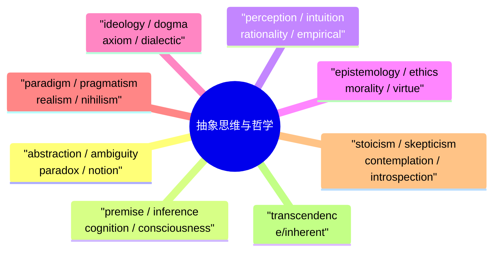

## 第二章：语言与修辞（Language & Rhetoric）

| 单词 | 音标 | 词性 | 中文释义 | 例句 |
|------|------|------|---------|------|
| rhetoric | /ˈretərɪk/ | n | 修辞/雄辩 | Political **rhetoric** can be misleading. |
| eloquence | /ˈeləkwəns/ | n | 口才/雄辩 | She spoke with great **eloquence**. |
| metaphor | /ˈmetəfɔːr/ | n | 隐喻 | "Life is a journey" is a **metaphor**. |
| simile | /ˈsɪmɪli/ | n | 明喻 | "As brave as a lion" is a **simile**. |
| irony | /ˈaɪərəni/ | n | 反语/讽刺 | The **irony** is that he failed the driving test. |
| sarcasm | /ˈsɑːrkæzəm/ | n | 讽刺/挖苦 | He responded with **sarcasm**. |
| hyperbole | /haɪˈpɜːrbəli/ | n | 夸张法 | "I've told you a million times" is **hyperbole**. |
| allegory | /ˈæləɡəri/ | n | 寓言/寓意 | Animal Farm is an **allegory** for revolution. |
| analogy | /əˈnælədʒi/ | n | 类比 | He used an **analogy** to explain the process. |
| euphemism | /ˈjuːfəmɪzəm/ | n | 委婉语 | "Passed away" is a **euphemism** for death. |
| ambiguity | /ˌæmbɪˈɡjuːɪti/ | n | 歧义 | The sentence contains **ambiguity**. |
| connotation | /ˌkɒnəˈteɪʃən/ | n | 内涵/含义 | "Home" has warm **connotations**. |
| denotation | /ˌdiːnoʊˈteɪʃən/ | n | 字面含义 | The **denotation** of "home" is a dwelling. |
| nuance | /ˈnjuːɑːns/ | n | 细微差别 | The **nuance** of tone matters in writing. |
| syntax | /ˈsɪntæks/ | n | 句法 | Study the **syntax** of complex sentences. |
| semantics | /sɪˈmæntɪks/ | n | 语义学 | **Semantics** studies word meaning. |
| discourse | /ˈdɪskɔːrs/ | n | 话语/论述 | Academic **discourse** requires precision. |
| articulate | /ɑːrˈtɪkjuleɪt/ | adj/v | 表达清晰的/清晰表达 | She is highly **articulate**. |
| verbose | /vɜːrˈboʊs/ | adj | 啰嗦的 | Avoid being **verbose** in academic writing. |
| concise | /kənˈsaɪs/ | adj | 简洁的/精炼的 | Keep your writing **concise**. |
| coherent | /koʊˈhɪərənt/ | adj | 连贯的/有条理的 | Present a **coherent** argument. |
| incoherent | /ˌɪnkoʊˈhɪərənt/ | adj | 语无伦次的 | His speech was **incoherent**. |
| paraphrase | /ˈpærəfreɪz/ | v/n | 释义/改述 | **Paraphrase** the original text. |
| rephrase | /riːˈfreɪz/ | v | 重新表述 | Let me **rephrase** that. |
| terminology | /ˌtɜːrmɪˈnɒlədʒi/ | n | 术语/术语学 | Learn the **terminology** of the field. |
| jargon | /ˈdʒɑːrɡən/ | n | 行话/专业术语 | Avoid technical **jargon** in reports. |
| slang | /slæŋ/ | n | 俚语 | "Wicked" is British **slang** for excellent. |
| idiom | /ˈɪdiəm/ | n | 习语/成语 | "Break a leg" is an **idiom**. |
| colloquial | /kəˈloʊkwiəl/ | adj | 口语的/通俗的 | This expression is **colloquial**. |
| dialect | /ˈdaɪəlekt/ | n | 方言 | He speaks a northern **dialect**. |

---

### 第二章：语言与修辞思维导图

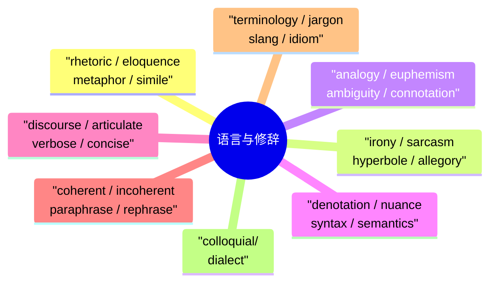

## 第三章：法律与政治（Law & Politics）

| 单词 | 音标 | 词性 | 中文释义 | 例句 |
|------|------|------|---------|------|
| legislation | /ˌledʒɪˈsleɪʃən/ | n | 立法/法律 | New **legislation** was passed yesterday. |
| statute | /ˈstætʃuːt/ | n | 法规/成文法 | A **statute** was enacted to protect workers. |
| constitution | /ˌkɒnstɪˈtjuːʃən/ | n | 宪法/体质 | The **constitution** guarantees freedom of speech. |
| jurisdiction | /ˌdʒʊərɪsˈdɪkʃən/ | n | 司法权/管辖权 | This falls under federal **jurisdiction**. |
| prosecution | /ˌprɒsɪˈkjuːʃən/ | n | 起诉/检方 | The **prosecution** presented strong evidence. |
| defendant | /dɪˈfendənt/ | n | 被告 | The **defendant** pleaded not guilty. |
| verdict | /ˈvɜːrdɪkt/ | n | 裁决/判决 | The jury delivered a **verdict** of guilty. |
| sentence | /ˈsentəns/ | n | 判决/句子 | He received a five-year **sentence**. |
| acquit | /əˈkwɪt/ | v | 宣告无罪 | The jury **acquitted** him of all charges. |
| convict | /kənˈvɪkt/ | v | 定罪/判决有罪 | He was **convicted** of fraud. |
| liable | /ˈlaɪəbəl/ | adj | 负有法律责任的 | You may be **liable** for damages. |
| mandatory | /ˈmændətɔːri/ | adj | 强制性的/法定的 | A helmet is **mandatory** by law. |
| prohibition | /ˌproʊhɪˈbɪʃən/ | n | 禁止/禁令 | The **prohibition** on alcohol ended in 1933. |
| amendment | /əˈmendmənt/ | n | 修正案/修改 | The First **Amendment** protects free speech. |
| treaty | /ˈtriːti/ | n | 条约/协定 | Sign a peace **treaty**. |
| sovereignty | /ˈsɒvrənti/ | n | 主权 | The country's **sovereignty** must be respected. |
| diplomacy | /dɪˈploʊməsi/ | n | 外交/外交手段 | **Diplomacy** resolves international disputes. |
| sanction | /ˈsæŋkʃən/ | n/v | 制裁/批准 | Economic **sanctions** were imposed. |
| bureaucracy | /bjʊˈrɒkrəsi/ | n | 官僚体制 | Cut through the **bureaucracy**. |
| transparency | /trænsˈpærənsi/ | n | 透明度 | Government **transparency** builds trust. |
| accountability | /əˌkaʊntəˈbɪlɪti/ | n | 问责制 | Leaders must be held to **accountability**. |
| legitimacy | /lɪˈdʒɪtɪməsi/ | n | 合法性/正当性 | The **legitimacy** of the election was questioned. |
| hegemony | /hɪˈdʒemərni/ | n | 霸权/主导地位 | The US maintained global **hegemony** for decades. |
| totalitarian | /toʊˌtæliˈteəriən/ | adj | 极权主义的 | A **totalitarian** regime controls everything. |
| authoritarian | /ɔːˌθɒrɪˈteəriən/ | adj | 专制的 | The **authoritarian** leader banned free speech. |
| populism | /ˈpɒpjuˌlɪzəm/ | n | 民粹主义 | **Populism** appeals to ordinary citizens. |
| geopolitics | /ˌdʒiːoʊˈpɒlɪtɪks/ | n | 地缘政治 | **Geopolitics** shapes global relations. |
| referendum | /ˌrefəˈrendəm/ | n | 全民公投 | The **referendum** result was close. |
| coalition | /ˌkoʊəˈlɪʃən/ | n | 联盟/联合政府 | A **coalition** government was formed. |
| impeach | /ɪmˈpiːtʃ/ | v | 弹劾 | The president was **impeached**. |

---

### 第三章：法律与政治思维导图

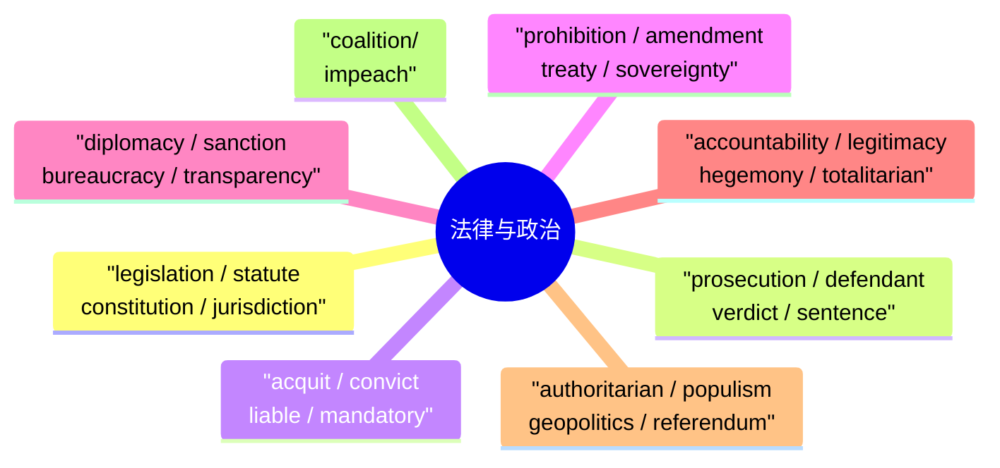

## 第四章：经济学高级词汇（Advanced Economics）

| 单词 | 音标 | 词性 | 中文释义 | 例句 |
|------|------|------|---------|------|
| macroeconomics | /ˌmækroʊˌiːkəˈnɒmɪks/ | n | 宏观经济学 | **Macroeconomics** examines national economies. |
| microeconomics | /ˌmaɪkroʊˌiːkəˈnɒmɪks/ | n | 微观经济学 | **Microeconomics** studies individual markets. |
| inflation | /ɪnˈfleɪʃən/ | n | 通货膨胀 | High **inflation** erodes purchasing power. |
| deflation | /dɪˈfleɪʃən/ | n | 通货紧缩 | **Deflation** leads to lower prices. |
| recession | /rɪˈseʃən/ | n | 经济衰退 | The country entered a **recession**. |
| depression | /dɪˈpreʃən/ | n | 经济大萧条 | The Great **Depression** began in 1929. |
| GDP | /ˌdʒiːdiːˈpiː/ | abbr | 国内生产总值 | The country's **GDP** grew by 5%. |
| fiscal | /ˈfɪskəl/ | adj | 财政的 | **Fiscal** policy affects tax and spending. |
| monetary | /ˈmɒnɪteri/ | adj | 货币的 | The central bank sets **monetary** policy. |
| subsidy | /ˈsʌbsɪdi/ | n | 补贴/津贴 | Farmers receive government **subsidies**. |
| austerity | /ɒˈsterɪti/ | n | 紧缩/朴素 | Austerity measures cut public services. |
| monopoly | /məˈnɒpəli/ | n | 垄断 | A **monopoly** controls the market. |
| oligopoly | /ˌɒlɪˈɡɒpəli/ | n | 寡头垄断 | The telecom industry is an **oligopoly**. |
| tariff | /ˈtærɪf/ | n | 关税/价目表 | Impose a 25% **tariff** on imports. |
| embargo | /ɪmˈbɑːrɡoʊ/ | n | 贸易禁运 | A trade **embargo** was imposed. |
| globalization | /ˌɡloʊbəlaɪˈzeɪʃən/ | n | 全球化 | **Globalization** connects the world. |
| neoliberalism | /ˌniːoʊˈlɪbərəlɪzəm/ | n | 新自由主义 | **Neoliberalism** promotes free market. |
| capitalism | /ˈkæpɪtəlɪzəm/ | n | 资本主义 | **Capitalism** drives economic growth. |
| socialism | /ˈsoʊʃəlɪzəm/ | n | 社会主义 | **Socialism** advocates public ownership. |
| commodity | /kəˈmɒdɪti/ | n | 商品/大宗商品 | Oil is a valuable **commodity**. |
| speculation | /ˌspekjuˈleɪʃən/ | n | 投机/猜测 | **Speculation** in real estate is risky. |
| portfolio | /pɔːrtˈfoʊlioʊ/ | n | 投资组合/作品集 | Diversify your investment **portfolio**. |
| dividend | /ˈdɪvɪdend/ | n | 股息/红利 | The company paid a **dividend** to shareholders. |
| equity | /ˈekwɪti/ | n | 股权/公平 | She holds 20% **equity** in the firm. |
| leverage | /ˈliːvərɪdʒ/ | n | 杠杆/影响力 | Use financial **leverage** wisely. |
| liquidity | /lɪˈkwɪdɪti/ | n | 流动性 | The bank has sufficient **liquidity**. |
| volatility | /ˌvɒləˈtɪlɪti/ | n | 波动性 | The stock market shows high **volatility**. |
| depreciation | /dɪˌpriːʃiˈeɪʃən/ | n | 贬值/折旧 | The currency experienced **depreciation**. |
| appreciation | /əˌpriːʃiˈeɪʃən/ | n | 增值/感激 | Property **appreciation** over 10 years. |
| remittance | /rɪˈmɪtəns/ | n | 汇款 | He sends a monthly **remittance** home. |

---

### 第四章：经济学高级词汇思维导图

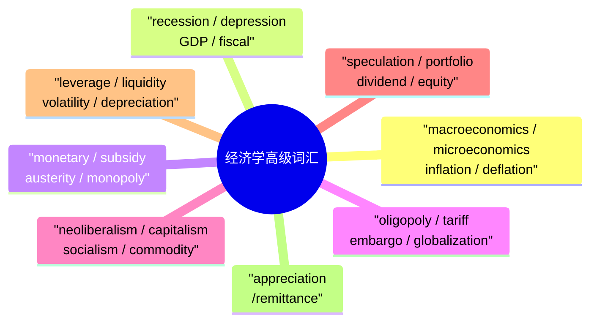

## 第五章：科学与医学（Science & Medicine Advanced）

| 单词 | 音标 | 词性 | 中文释义 | 例句 |
|------|------|------|---------|------|
| metabolism | /məˈtæbəlɪzəm/ | n | 新陈代谢 | Exercise speeds up **metabolism**. |
| genome | /ˈdʒiːnoʊm/ | n | 基因组 | Map the human **genome**. |
| chromosome | /ˈkroʊməsoʊm/ | n | 染色体 | Humans have 46 **chromosomes**. |
| mutation | /mjuːˈteɪʃən/ | n | 突变/变异 | A **mutation** caused the disease. |
| pathogen | /ˈpæθədʒən/ | n | 病原体 | A **pathogen** triggers the immune response. |
| pandemic | /pænˈdemɪk/ | n | 大流行病 | A **pandemic** affected the world in 2020. |
| epidemic | /ˌepɪˈdemɪk/ | n | 流行病 | A cholera **epidemic** swept through the region. |
| neuroscience | /ˈnjʊərəʊˌsaɪəns/ | n | 神经科学 | **Neuroscience** studies brain function. |
| neuron | /ˈnjʊərɒn/ | n | 神经元 | **Neurons** transmit electrical signals. |
| cognitive | /ˈkɒɡnɪtɪv/ | adj | 认知的 | **Cognitive** decline increases with age. |
| placebo | /pləˈsiːboʊ/ | n | 安慰剂 | A **placebo** can have real effects. |
| prognosis | /prɒɡˈnoʊsɪs/ | n | 预后/预测 | The **prognosis** is good. |
| carcinogen | /kɑːrˈsɪnədʒən/ | n | 致癌物 | Tobacco is a known **carcinogen**. |
| immunology | /ˌɪmjuˈnɒlədʒi/ | n | 免疫学 | **Immunology** studies the immune system. |
| antibiotic | /ˌæntɪbaɪˈɒtɪk/ | n | 抗生素 | Overuse of **antibiotics** causes resistance. |
| pharmaceutical | /ˌfɑːrməˈsuːtɪkəl/ | adj/n | 制药的/药物 | A **pharmaceutical** company develops drugs. |
| anatomy | /əˈnætəmi/ | n | 解剖学/结构 | Study human **anatomy**. |
| physiology | /ˌfɪziˈɒlədʒi/ | n | 生理学 | **Physiology** studies body functions. |
| hypothesis | /haɪˈpɒθɪsɪs/ | n | 假说 | Formulate a **hypothesis** before testing. |
| empiricism | /ɪmˈpɪrɪsɪzəm/ | n | 经验主义 | **Empiricism** relies on observation. |
| combustion | /kəmˈbʌstʃən/ | n | 燃烧 | **Combustion** releases heat energy. |
| photosynthesis | /ˌfoʊtoʊˈsɪnθɪsɪs/ | n | 光合作用 | Plants use **photosynthesis** for energy. |
| osmosis | /ɒzˈmoʊsɪs/ | n | 渗透作用 | Water moves by **osmosis**. |
| entropy | /ˈentrəpi/ | n | 熵/无序 | **Entropy** increases in closed systems. |
| equilibrium | /ˌiːkwɪˈlɪbriəm/ | n | 平衡/均衡 | Reach chemical **equilibrium**. |
| quantum | /ˈkwɒntəm/ | n/adj | 量子 | **Quantum** physics defies logic. |
| relativity | /ˌreləˈtɪvɪti/ | n | 相对论 | Einstein's theory of **relativity** changed physics. |
| particle | /ˈpɑːrtɪkəl/ | n | 粒子 | Atoms contain **particles**. |
| catalyst | /ˈkætəlɪst/ | n | 催化剂/促进因素 | Education is a **catalyst** for change. |
| hypothesis | /haɪˈpɒθɪsɪs/ | n | 假说 | Test your **hypothesis** with evidence. |

---

### 第五章：科学与医学思维导图

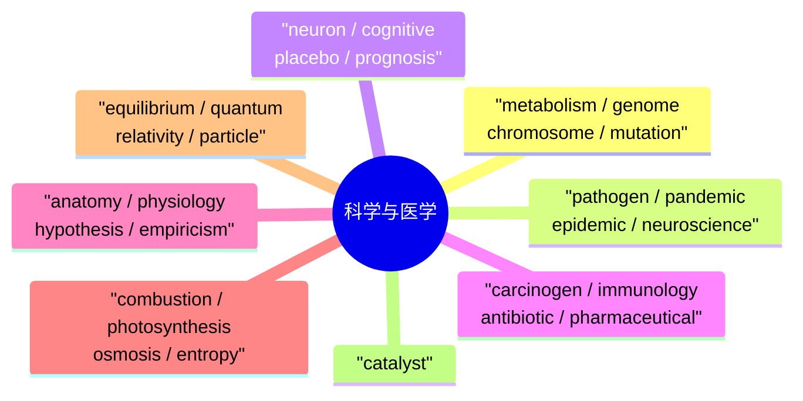

## 第六章：高级形容词（Advanced Adjectives）

| 单词 | 音标 | 中文释义 | 例句 | 反义/相关 |
|------|------|---------|------|-----------|
| ambivalent | /æmˈbɪvələnt/ | 矛盾心理的/态度不明的 | I'm **ambivalent** about moving abroad. | conflicted |
| arcane | /ɑːrˈkeɪn/ | 神秘的/晦涩的 | The text is full of **arcane** references. | obscure |
| arid | /ˈærɪd/ | 干燥的/枯燥的 | The **arid** desert gets no rain. | parched |
| astute | /əˈstjuːt/ | 精明的/敏锐的 | An **astute** businesswoman. | shrewd |
| austere | /ɒˈstɪər/ | 严峻的/朴素的 | The room was **austere** and bare. | spartan |
| benevolent | /bɪˈnevələnt/ | 仁慈的/乐善好施的 | A **benevolent** leader cares for citizens. | malevolent |
| candid | /ˈkændɪd/ | 直率的/坦诚的 | Be **candid** in your assessment. | frank |
| capricious | /kəˈprɪʃəs/ | 反复无常的/任性的 | The weather here is **capricious**. | unpredictable |
| circumspect | /ˈsɜːrkəmspekt/ | 谨慎的/周到的 | Be **circumspect** before deciding. | cautious |
| coercive | /koʊˈɜːrsɪv/ | 强制性的 | **Coercive** tactics are unacceptable. | — |
| coherent | /koʊˈhɪərənt/ | 连贯的/有条理的 | Present a **coherent** argument. | incoherent |
| complacent | /kəmˈpleɪsənt/ | 自满的/沾沾自喜的 | Don't become **complacent** after success. | — |
| compelling | /kəmˈpelɪŋ/ | 引人注目的/令人信服的 | A **compelling** argument. | convincing |
| conceited | /kənˈsiːtɪd/ | 自负的/骄傲自大的 | Don't be so **conceited**. | arrogant |
| condescending | /ˌkɒndɪˈsendɪŋ/ | 居高临下的/傲慢的 | His **condescending** tone offended everyone. | patronizing |
| contentious | /kənˈtenʃəs/ | 有争议的/好辩的 | This is a **contentious** issue. | controversial |
| cynical | /ˈsɪnɪkəl/ | 愤世嫉俗的/玩世不恭的 | A **cynical** view of human nature. | — |
| desolate | /ˈdesələt/ | 荒芜的/孤寂的 | A **desolate** landscape stretched before us. | barren |
| detrimental | /ˌdetrɪˈmentl/ | 有害的/不利的 | Smoking is **detrimental** to health. | harmful |
| diligent | /ˈdɪlɪdʒənt/ | 勤勉的/刻苦的 | She is a **diligent** student. | hardworking |
| elusive | /ɪˈluːsɪv/ | 难以捉摸的/难以找到的 | The answer remained **elusive**. | evasive |
| eminent | /ˈemɪnənt/ | 杰出的/卓越的 | An **eminent** scientist. | distinguished |
| empathetic | /ˌempəˈθetɪk/ | 感同身受的/有同理心的 | Be **empathetic** to others' pain. | — |
| enigmatic | /ˌenɪɡˈmætɪk/ | 神秘莫测的 | She has an **enigmatic** smile. | mysterious |
| erratic | /ɪˈrætɪk/ | 不稳定的/不规则的 | His **erratic** behavior confused people. | irregular |
| ethereal | /ɪˈθɪəriəl/ | 空灵的/超凡的 | The music had an **ethereal** quality. | — |
| exemplary | /ɪɡˈzempleri/ | 典范的/模范的 | **Exemplary** behavior should be recognized. | model |
| exorbitant | /ɪɡˈzɔːrbɪtənt/ | 过高的/过度的 | The rent is **exorbitant**. | excessive |
| forthright | /ˈfɔːrθraɪt/ | 直截了当的 | He was **forthright** about his opinion. | straightforward |
| formidable | /ˈfɔːrmɪdəbəl/ | 令人敬畏的/强大的 | She is a **formidable** opponent. | — |
| futile | /ˈfjuːtaɪl/ | 徒劳的/无益的 | It's **futile** to resist. | pointless |
| impeccable | /ɪmˈpekəbəl/ | 无可挑剔的 | She has **impeccable** taste. | flawless |
| impartial | /ɪmˈpɑːrʃəl/ | 公正的/不偏不倚的 | The judge must be **impartial**. | unbiased |
| imperious | /ɪmˈpɪəriəs/ | 专横的/傲慢的 | An **imperious** tone. | domineering |
| implicit | /ɪmˈplɪsɪt/ | 隐含的/不言而喻的 | There was **implicit** trust between them. | tacit |
| indifferent | /ɪnˈdɪfrənt/ | 漠不关心的/不在乎的 | He was **indifferent** to the outcome. | apathetic |
| indigenous | /ɪnˈdɪdʒɪnəs/ | 本土的/土著的 | Protect **indigenous** cultures. | native |
| industrious | /ɪnˈdʌstriəs/ | 勤劳的 | An **industrious** worker. | diligent |
| inevitable | /ɪnˈevɪtəbəl/ | 不可避免的 | Change is **inevitable**. | unavoidable |
| ingenious | /ɪnˈdʒiːniəs/ | 有独创性的/巧妙的 | An **ingenious** solution. | clever |
| insightful | /ˈɪnsaɪtfəl/ | 有见解的/深刻的 | An **insightful** observation. | perceptive |
| insidious | /ɪnˈsɪdiəs/ | 阴险的/潜伏的 | An **insidious** disease spreads silently. | — |
| insolent | /ˈɪnsələnt/ | 粗鲁无礼的/傲慢的 | Don't be **insolent** to your elders. | impudent |
| intricate | /ˈɪntrɪkɪt/ | 错综复杂的 | An **intricate** design. | complex |
| lucid | /ˈluːsɪd/ | 清晰的/明了的 | A **lucid** explanation. | clear |
| meticulous | /mɪˈtɪkjuləs/ | 一丝不苟的/细致的 | **Meticulous** attention to detail. | thorough |
| mundane | /mʌnˈdeɪn/ | 平凡的/世俗的 | Don't ignore the **mundane** tasks. | ordinary |
| obsolete | /ˌɒbsəˈliːt/ | 过时的/废弃的 | Fax machines are now **obsolete**. | outdated |
| ostensible | /ɒˈstensɪbəl/ | 表面上的/明显的 | The **ostensible** reason was cost. | apparent |
| paradoxical | /ˌpærəˈdɒksɪkəl/ | 矛盾的/似是而非的 | It seems **paradoxical** but it's true. | contradictory |
| pervasive | /pərˈveɪsɪv/ | 普遍的/弥漫的 | Social media has a **pervasive** influence. | widespread |
| poignant | /ˈpɔɪnjənt/ | 令人心酸的/深刻的 | A **poignant** moment in the film. | touching |
| pompous | /ˈpɒmpəs/ | 自大的/浮夸的 | A **pompous** speaker. | arrogant |
| pragmatic | /præɡˈmætɪk/ | 务实的/实用的 | A **pragmatic** approach to problems. | practical |
| precarious | /prɪˈkeəriəs/ | 不稳定的/危险的 | A **precarious** financial situation. | unstable |
| profound | /prəˈfaʊnd/ | 深刻的/深远的 | A **profound** influence on history. | deep |
| prolific | /prəˈlɪfɪk/ | 多产的/大量的 | A **prolific** writer. | productive |
| prudent | /ˈpruːdənt/ | 谨慎的/有远见的 | A **prudent** investor. | wise |
| resilient | /rɪˈzɪliənt/ | 有弹性的/有韧性的 | Be **resilient** in the face of adversity. | tough |
| resolute | /ˈrezəluːt/ | 坚决的/果断的 | Stay **resolute** under pressure. | determined |
| reverent | /ˈrevərənt/ | 恭敬的/虔诚的 | A **reverent** attitude. | respectful |
| rigorous | /ˈrɪɡərəs/ | 严格的/缜密的 | A **rigorous** academic program. | thorough |
| robust | /roʊˈbʌst/ | 强健的/稳健的 | A **robust** economy. | strong |
| rudimentary | /ˌruːdɪˈmentri/ | 基本的/初级的 | **Rudimentary** skills are not enough. | basic |
| spontaneous | /spɒnˈteɪniəs/ | 自发的/自然的 | A **spontaneous** reaction. | impulsive |
| spurious | /ˈspjʊəriəs/ | 虚假的/伪造的 | A **spurious** argument. | false |
| stagnant | /ˈstæɡnənt/ | 停滞的/不流通的 | A **stagnant** economy. | static |
| steadfast | /ˈstedfɑːst/ | 坚定不移的 | Remain **steadfast** in your beliefs. | unwavering |
| stringent | /ˈstrɪndʒənt/ | 严格的/严厉的 | **Stringent** regulations are needed. | strict |
| sublime | /səˈblaɪm/ | 崇高的/壮观的 | The view was **sublime**. | magnificent |
| subtle | /ˈsʌtl/ | 微妙的/不明显的 | A **subtle** difference. | nuanced |
| superfluous | /suːˈpɜːrfluəs/ | 多余的/不必要的 | Remove **superfluous** words. | unnecessary |
| susceptible | /səˈseptɪbəl/ | 易受影响的/敏感的 | Children are **susceptible** to peer pressure. | vulnerable |
| tenacious | /tɪˈneɪʃəs/ | 坚韧的/执着的 | A **tenacious** spirit. | persistent |
| tumultuous | /tjuːˈmʌltʃuəs/ | 骚乱的/动荡的 | A **tumultuous** period in history. | turbulent |
| ubiquitous | /juːˈbɪkwɪtəs/ | 无处不在的 | Smartphones are **ubiquitous** today. | omnipresent |
| unequivocal | /ˌʌnɪˈkwɪvəkəl/ | 明确的/不含糊的 | An **unequivocal** answer. | unambiguous |
| vehement | /ˈviːəmənt/ | 激烈的/热烈的 | A **vehement** protest. | passionate |
| volatile | /ˈvɒlətaɪl/ | 不稳定的/易挥发的 | A **volatile** situation. | unstable |
| whimsical | /ˈwɪmzɪkəl/ | 异想天开的/奇特的 | A **whimsical** story for children. | playful |
| zealous | /ˈzeləs/ | 热情的/热心的 | A **zealous** supporter. | enthusiastic |

---

### 第六章：高级形容词思维导图

图1

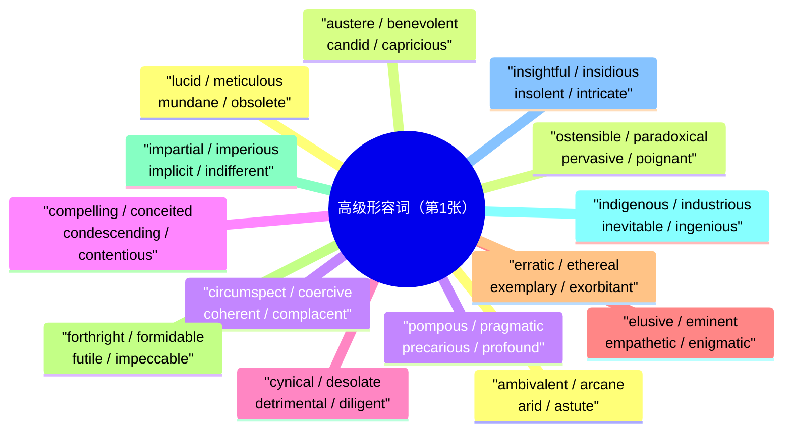

图2

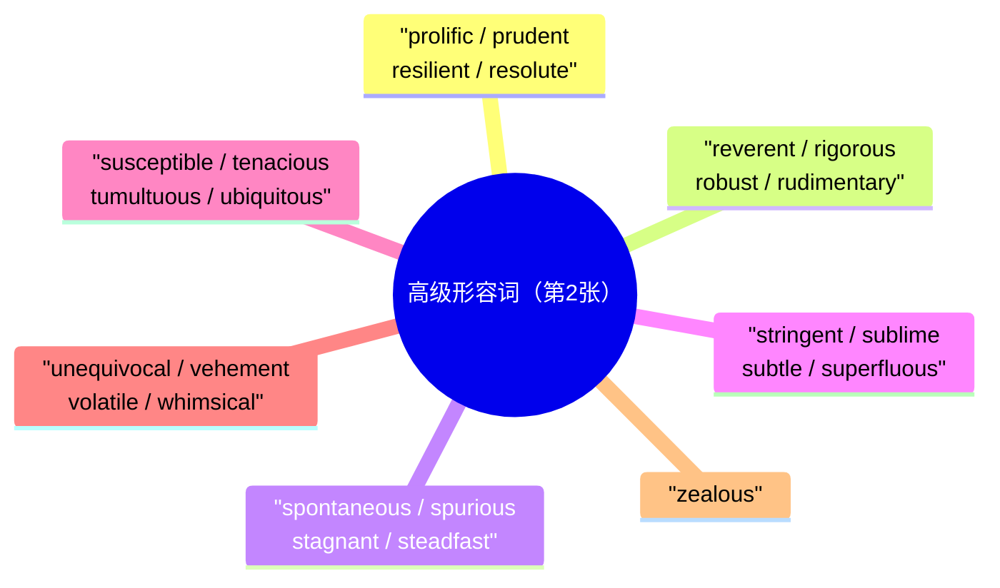

## 第七章：高级动词（Advanced Verbs）

| 单词 | 音标 | 中文释义 | 例句 |
|------|------|---------|------|
| alleviate | /əˈliːvieɪt/ | 减轻/缓和 | **Alleviate** the pain with medicine. |
| aggravate | /ˈæɡrəveɪt/ | 加重/激怒 | Stress **aggravates** the condition. |
| advocate | /ˈædvəkeɪt/ | 倡导/支持 | She **advocates** for equal rights. |
| allude | /əˈluːd/ | 暗指/间接提到 | He **alluded** to earlier problems. |
| amplify | /ˈæmplɪfaɪ/ | 放大/增强 | **Amplify** the signal for better reception. |
| anticipate | /ænˈtɪsɪpeɪt/ | 预期/期望 | We **anticipated** a large crowd. |
| articulate | /ɑːrˈtɪkjuleɪt/ | 清楚表达 | **Articulate** your ideas clearly. |
| assert | /əˈsɜːrt/ | 断言/坚称 | She **asserted** her innocence. |
| assimilate | /əˈsɪmɪleɪt/ | 吸收/融合 | **Assimilate** new information quickly. |
| augment | /ɔːɡˈment/ | 增加/扩大 | **Augment** the team's capabilities. |
| capitulate | /kəˈpɪtjuleɪt/ | 投降/妥协 | He **capitulated** under pressure. |
| circumvent | /ˌsɜːrkəmˈvent/ | 规避/绕过 | **Circumvent** the restrictions. |
| coerce | /koʊˈɜːrs/ | 强迫/胁迫 | You can't **coerce** people into compliance. |
| compel | /kəmˈpel/ | 强迫/迫使 | He was **compelled** to confess. |
| contemplate | /ˈkɒntəmpleɪt/ | 深思/考虑 | **Contemplate** the consequences. |
| corroborate | /kəˈrɒbəreɪt/ | 证实/确认 | New evidence **corroborates** the theory. |
| denounce | /dɪˈnaʊns/ | 谴责/揭发 | The press **denounced** the corruption. |
| depict | /dɪˈpɪkt/ | 描绘/描述 | The painting **depicts** rural life. |
| derive | /dɪˈraɪv/ | 得出/获得 | **Derive** meaning from your work. |
| deter | /dɪˈtɜːr/ | 阻止/威慑 | Heavy fines **deter** violations. |
| deviate | /ˈdiːvieɪt/ | 偏离/偏差 | Don't **deviate** from the plan. |
| differentiate | /ˌdɪfəˈrenʃieɪt/ | 区分/区别 | **Differentiate** between cause and effect. |
| diminish | /dɪˈmɪnɪʃ/ | 减少/降低/贬低 | His influence has **diminished**. |
| dismantle | /dɪsˈmæntl/ | 拆除/瓦解 | **Dismantle** the old structure. |
| dispel | /dɪˈspel/ | 消除/驱散 | **Dispel** the myths. |
| distort | /dɪˈstɔːrt/ | 扭曲/变形 | Don't **distort** the facts. |
| elicit | /ɪˈlɪsɪt/ | 引出/引发 | The speech **elicited** strong reactions. |
| embody | /ɪmˈbɒdi/ | 体现/具体化 | She **embodies** grace and strength. |
| enhance | /ɪnˈhɑːns/ | 提升/增强 | Regular practice **enhances** skills. |
| engender | /ɪnˈdʒendər/ | 引起/产生 | Poverty **engenders** crime. |
| epitomize | /ɪˈpɪtəmaɪz/ | 是…的典范/体现 | She **epitomizes** modern leadership. |
| eradicate | /ɪˈrædɪkeɪt/ | 根除/消灭 | **Eradicate** poverty from the roots. |
| exacerbate | /ɪɡˈzæsərbeɪt/ | 使恶化/加剧 | Stress **exacerbates** health problems. |
| fabricate | /ˈfæbrɪkeɪt/ | 捏造/制造 | He **fabricated** the evidence. |
| facilitate | /fəˈsɪlɪteɪt/ | 促进/推动 | Technology **facilitates** communication. |
| fluctuate | /ˈflʌktʃueɪt/ | 波动/起伏 | Prices **fluctuate** with supply. |
| foster | /ˈfɒstər/ | 促进/培养 | **Foster** a culture of learning. |
| generate | /ˈdʒenəreɪt/ | 产生/生成 | **Generate** new ideas through brainstorming. |
| hinder | /ˈhɪndər/ | 阻碍/妨碍 | Don't **hinder** others' progress. |
| illustrate | /ˈɪləstreɪt/ | 说明/阐明/插图 | **Illustrate** the concept with an example. |
| impede | /ɪmˈpiːd/ | 阻碍/妨碍 | Fear **impedes** progress. |
| impose | /ɪmˈpoʊz/ | 强加/征收 | **Impose** strict rules. |
| instill | /ɪnˈstɪl/ | 灌输/逐渐培养 | **Instill** good values in children. |
| integrate | /ˈɪntɪɡreɪt/ | 整合/融合 | **Integrate** technology into teaching. |
| mitigate | /ˈmɪtɪɡeɪt/ | 减轻/缓和 | **Mitigate** the risks. |
| negate | /nɪˈɡeɪt/ | 否定/使无效 | This **negates** the previous claim. |
| objectify | /əbˈdʒektɪfaɪ/ | 使物化/将…当作物品 | Don't **objectify** people. |
| obscure | /əbˈskjʊər/ | 使模糊/遮蔽 | Clouds **obscured** the view. |
| overwhelm | /ˌoʊvərˈwelm/ | 压倒/使不知所措 | Don't let challenges **overwhelm** you. |
| permeate | /ˈpɜːrmieɪt/ | 弥漫/渗透 | The smell **permeated** the room. |
| persist | /pərˈsɪst/ | 坚持/持续 | **Persist** despite the difficulties. |
| polarize | /ˈpoʊləraɪz/ | 使两极分化 | The issue **polarized** the country. |
| precipitate | /prɪˈsɪpɪteɪt/ | 加速/引发 | The scandal **precipitated** his resignation. |
| reconcile | /ˈrekənsaɪl/ | 调和/和解 | **Reconcile** differences through dialogue. |
| reiterate | /riˈɪtəreɪt/ | 重申/反复说 | Let me **reiterate** the key points. |
| repudiate | /rɪˈpjuːdieɪt/ | 拒绝承认/否认 | He **repudiated** the accusations. |
| scrutinize | /ˈskruːtɪnaɪz/ | 仔细审查/研究 | **Scrutinize** the data carefully. |
| stimulate | /ˈstɪmjuleɪt/ | 刺激/激励 | **Stimulate** economic growth. |
| streamline | /ˈstriːmlaɪn/ | 精简/使流线型 | **Streamline** the production process. |
| substantiate | /səbˈstænʃieɪt/ | 证实/为…提供依据 | **Substantiate** your claims with facts. |
| transcend | /trænˈsend/ | 超越/超出 | Great art **transcends** cultural barriers. |
| undermine | /ˌʌndərˈmaɪn/ | 破坏/削弱 | Don't **undermine** your colleague's work. |
| validate | /ˈvælɪdeɪt/ | 验证/使有效 | **Validate** the results with a second test. |
| yield | /jiːld/ | 产生/屈服 | The research **yielded** unexpected results. |

---

### 第七章：高级动词思维导图

图1

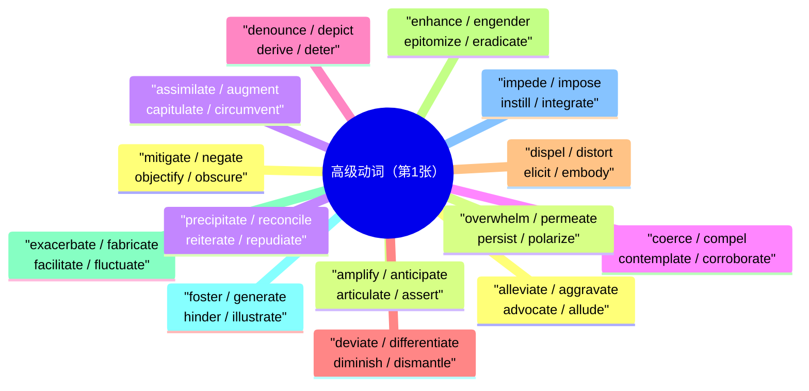

图2

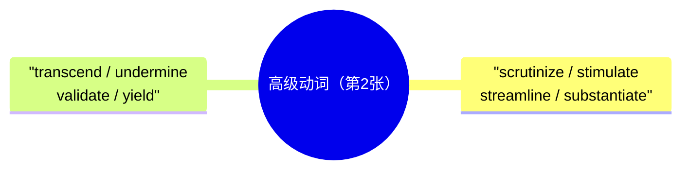

## 第八章：学术写作高频词（Academic Writing Vocabulary）

### 8.1 论文结构表达

| 用途 | 表达方式 |
|------|---------|
| 引言 | This paper **examines** / **explores** / **investigates** ... |
| 陈述目的 | The aim of this study is to **analyze** / **assess** / **evaluate** ... |
| 文献综述 | Previous research has **demonstrated** / **suggested** / **shown** that ... |
| 阐述观点 | It is **argued** / **contended** / **proposed** that ... |
| 举例说明 | **For instance**, / **For example**, / **To illustrate**, ... |
| 对比转折 | **However**, / **Nevertheless**, / **On the other hand**, ... |
| 递进关系 | **Furthermore**, / **Moreover**, / **In addition**, ... |
| 因果关系 | **As a result**, / **Consequently**, / **Therefore**, ... |
| 总结 | **In conclusion**, / **To sum up**, / **In summary**, ... |
| 引用来源 | **According to** Smith (2020), ... / As **cited by** ... |

#### 8.1 论文结构表达思维导图

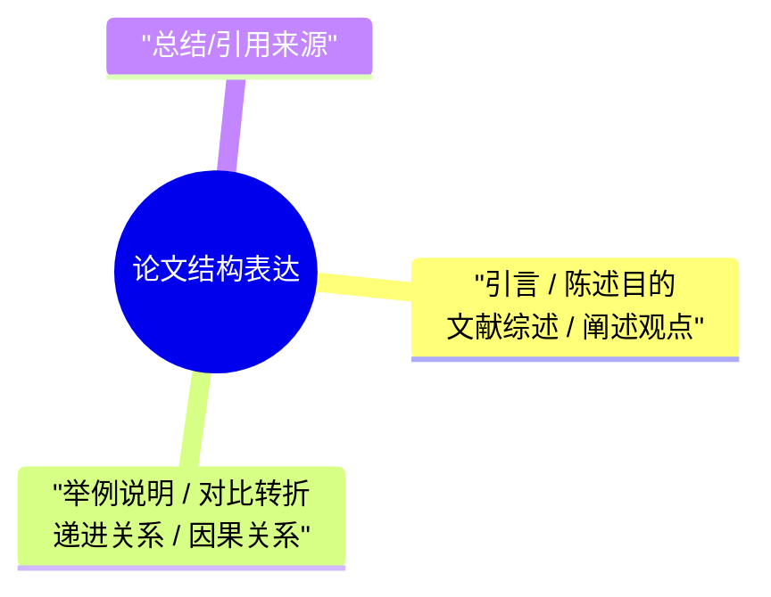

### 8.2 评价与判断

| 单词 | 中文释义 | 例句 |
|------|---------|------|
| compelling | 令人信服的 | A **compelling** argument. |
| convincing | 有说服力的 | **Convincing** evidence is presented. |
| plausible | 似乎合理的 | A **plausible** explanation. |
| problematic | 有问题的 | This approach is **problematic**. |
| controversial | 有争议的 | A **controversial** claim. |
| flawed | 有缺陷的 | The methodology is **flawed**. |
| robust | 扎实的/强有力的 | **Robust** data supports the conclusion. |
| inconclusive | 不确定的/无结论的 | The results were **inconclusive**. |
| comprehensive | 全面的/详尽的 | A **comprehensive** review. |
| nuanced | 有细微差别的 | A **nuanced** analysis. |

---

#### 8.2 评价与判断思维导图

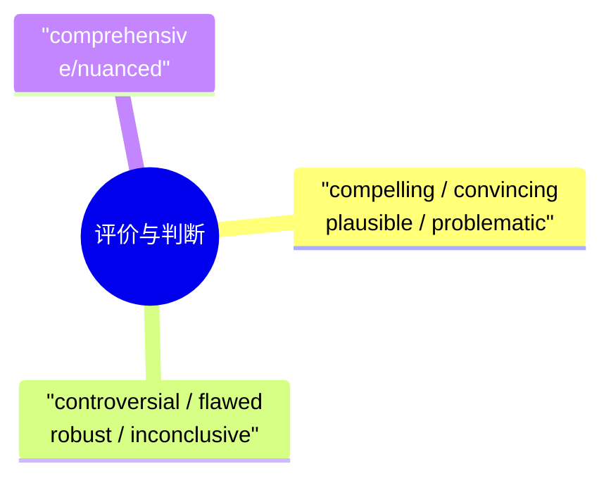

## 第九章：常用固定搭配与习语（Collocations & Idioms C1-C2）

### 9.1 动词+名词搭配

| 搭配 | 中文释义 | 例句 |
|------|---------|------|
| bridge the gap | 消除差距 | We need to **bridge the gap** between rich and poor. |
| bear the brunt | 首当其冲 | Small businesses **bore the brunt** of the recession. |
| take precedence | 优先于 | Safety **takes precedence** over speed. |
| cast doubt on | 对…提出质疑 | New evidence **casts doubt on** the theory. |
| come to terms with | 接受/适应 | She finally **came to terms with** her loss. |
| draw the line | 划定界限 | You need to **draw the line** somewhere. |
| gain momentum | 获得动力/发展势头 | The movement **gained momentum**. |
| hold sway | 有影响力/支配 | Tradition still **holds sway** in rural areas. |
| lay the groundwork | 奠定基础 | Early efforts **laid the groundwork** for success. |
| meet the deadline | 按时完成 | He always **meets his deadlines**. |
| pose a threat | 构成威胁 | Climate change **poses a threat** to all life. |
| reach a consensus | 达成共识 | They **reached a consensus**. |
| spark a debate | 引发辩论 | The proposal **sparked a heated debate**. |
| stem the tide | 遏制/阻止浪潮 | We must **stem the tide** of pollution. |
| strike a balance | 取得平衡 | **Strike a balance** between work and life. |
| take root | 扎根/生根 | Democratic values **take root** over time. |
| throw light on | 阐明/揭示 | This research **throws light on** the issue. |
| tip the balance | 改变平衡/起决定性作用 | His vote **tipped the balance**. |
| weather the storm | 度过难关 | We will **weather the storm** together. |
| yield results | 取得成果 | Hard work eventually **yields results**. |

#### 9.1 动词+名词搭配思维导图

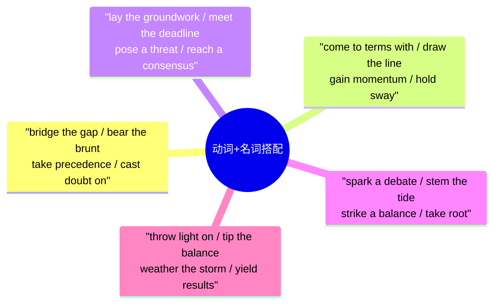

### 9.2 高级习语（Advanced Idioms）

| 习语 | 中文释义 | 例句 |
|------|---------|------|
| a blessing in disguise | 因祸得福 | Losing that job was **a blessing in disguise**. |
| a double-edged sword | 双刃剑 | The internet is **a double-edged sword**. |
| a far cry from | 与…相差甚远 | This is **a far cry from** perfection. |
| a hard nut to crack | 难对付的人/难解决的问题 | This problem is **a hard nut to crack**. |
| a shot in the dark | 瞎猜/盲目尝试 | My guess was **a shot in the dark**. |
| add fuel to the fire | 火上浇油 | His comments **added fuel to the fire**. |
| at the eleventh hour | 在最后一刻 | The deal was struck **at the eleventh hour**. |
| barking up the wrong tree | 找错对象/方向搞错了 | You're **barking up the wrong tree**. |
| beat around the bush | 绕圈子/不直接说 | Stop **beating around the bush**. |
| bite the bullet | 忍痛坚持 | Just **bite the bullet** and get it done. |
| bite the hand that feeds you | 恩将仇报 | Don't **bite the hand that feeds you**. |
| burn bridges | 断绝关系/断退路 | Don't **burn bridges** with former colleagues. |
| cut corners | 偷工减料/走捷径 | Never **cut corners** on safety. |
| face the music | 接受惩罚/面对后果 | It's time to **face the music**. |
| get the ball rolling | 开始/启动 | Let's **get the ball rolling** on this project. |
| hit the nail on the head | 一针见血/说到点子上 | You really **hit the nail on the head**. |
| leave no stone unturned | 不遗余力/竭尽所能 | She **left no stone unturned** in her search. |
| on the fence | 保持中立/犹豫不决 | He's **on the fence** about the proposal. |
| pull strings | 走后门/利用关系 | He **pulled strings** to get the job. |
| read between the lines | 从字里行间推断 | You have to **read between the lines**. |
| reinvent the wheel | 重新发明轮子/做重复的无用功 | Don't **reinvent the wheel**. |
| see eye to eye | 意见一致 | We don't always **see eye to eye**. |
| sit on the fence | 持观望态度 | Politicians often **sit on the fence**. |
| spill the beans | 泄露秘密 | Don't **spill the beans** about the surprise. |
| the tip of the iceberg | 冰山一角 | This problem is just **the tip of the iceberg**. |
| throw in the towel | 认输/放弃 | Never **throw in the towel**. |
| turn a blind eye | 视而不见/睁一只眼闭一只眼 | Don't **turn a blind eye** to injustice. |
| under the weather | 身体不舒服 | I'm feeling a bit **under the weather**. |
| up in the air | 悬而未决 | The plan is still **up in the air**. |
| walk on eggshells | 如履薄冰 | He **walks on eggshells** around his boss. |

---

#### 9.2 高级习语思维导图

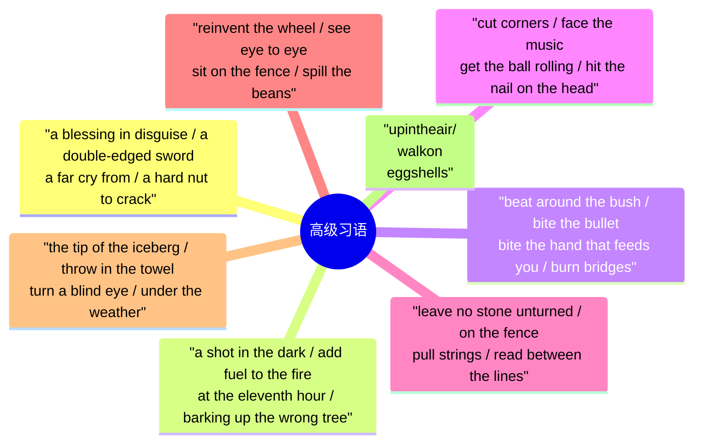

## 第十章：词汇辨析（Confusing Word Pairs）

精确使用词汇的关键是分清形近或义近词的差别。

| 词对 | 区别 | 例句 |
|------|------|------|
| affect / effect | **affect**（动词）影响；**effect**（名词）结果/影响 | Stress **affects** health. / The **effect** of stress is real. |
| lie / lay | **lie**（不及物）躺；**lay**（及物）放置 | She **lay** on the bed. / **Lay** the book on the table. |
| rise / raise | **rise**（不及物）上升；**raise**（及物）举起/提高 | Prices **rose** sharply. / **Raise** your hand. |
| further / farther | **farther**（可测量的距离）；**further**（程度/进一步） | I can't walk any **farther**. / Let's explore this **further**. |
| comprise / compose | **comprise**（整体包括部分）；**compose**（部分构成整体） | The team **comprises** five members. / Five members **compose** the team. |
| imply / infer | **imply**（说话人暗示）；**infer**（听者推断） | He **implied** he was unhappy. / I **inferred** he was angry. |
| explicit / implicit | **explicit**（明确说明的）；**implicit**（不言而喻的/含蓄的） | The rules are **explicit**. / There was **implicit** trust. |
| continuous / continual | **continuous**（不间断的）；**continual**（频繁重复的） | **Continuous** rain for days. / **Continual** interruptions. |
| principal / principle | **principal**（主要的/校长）；**principle**（原则/原理） | The **principal** reason is cost. / Stick to your **principles**. |
| complement / compliment | **complement**（补充/配合）；**compliment**（赞美） | Wine **complements** cheese. / She **complimented** my work. |
| discreet / discrete | **discreet**（谨慎的/不张扬的）；**discrete**（分离的/独立的） | Be **discreet** about personal matters. / Three **discrete** stages. |
| eminent / imminent | **eminent**（杰出的）；**imminent**（即将发生的） | An **eminent** scientist. / Danger is **imminent**. |
| assure / ensure / insure | **assure**（向…保证）；**ensure**（确保）；**insure**（投保） | I **assure** you it's safe. / **Ensure** quality control. / **Insure** your car. |
| fewer / less | **fewer**（可数名词）；**less**（不可数名词） | **Fewer** people; **less** money. |
| historic / historical | **historic**（有历史意义的）；**historical**（历史的/历史上的） | A **historic** victory. / A **historical** novel. |

---

### 第十章：词汇辨析思维导图

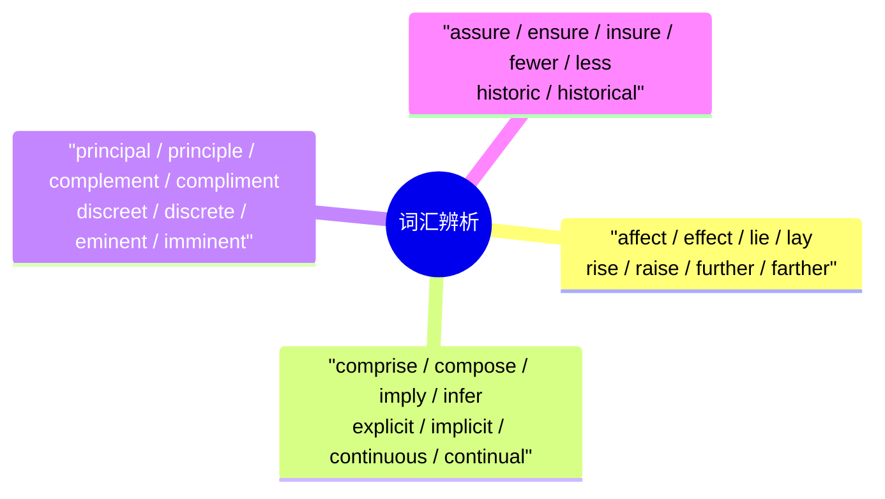

## 第十一章：学科专业词汇（Discipline-Specific Vocabulary）

### 11.1 社会学

| 单词 | 中文释义 | 例句 |
|------|---------|------|
| socialization | 社会化 | **Socialization** shapes behavior. |
| stratification | 社会分层 | Social **stratification** exists everywhere. |
| cohesion | 凝聚力/团结 | Social **cohesion** is essential. |
| deviance | 越轨行为 | **Deviance** challenges social norms. |
| norm | 社会规范 | Violate a social **norm**. |
| stigma | 污名/耻辱 | Mental illness carries a **stigma**. |
| mobility | 流动性/社会流动 | Upward social **mobility** is declining. |
| assimilation | 同化 | Cultural **assimilation** is complex. |
| marginalization | 边缘化 | Fight against the **marginalization** of minorities. |
| patriarchy | 父权制 | Challenge the **patriarchy**. |

#### 11.1 社会学思维导图

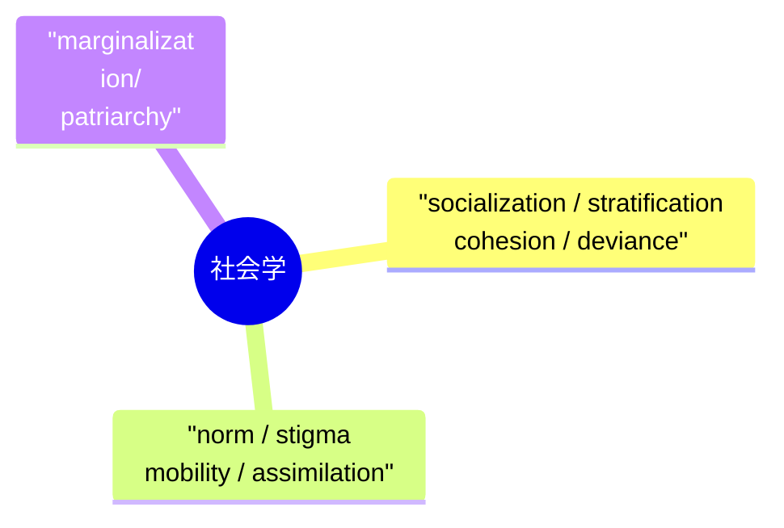

### 11.2 心理学

| 单词 | 中文释义 | 例句 |
|------|---------|------|
| cognition | 认知 | **Cognition** involves memory and reasoning. |
| reinforcement | 强化 | Positive **reinforcement** encourages good behavior. |
| conditioned | 条件反射的 | **Conditioned** responses are automatic. |
| subconscious | 潜意识的 | **Subconscious** fears affect behavior. |
| trauma | 心理创伤 | **Trauma** can have lasting effects. |
| repression | 压抑 | **Repression** of memories is a defense mechanism. |
| narcissism | 自恋 | Extreme **narcissism** harms relationships. |
| empathy | 同理心 | Show **empathy** toward others. |
| resilience | 心理弹性/韧性 | Build emotional **resilience**. |
| attachment | 依恋 | **Attachment** theory explains early relationships. |

#### 11.2 心理学思维导图

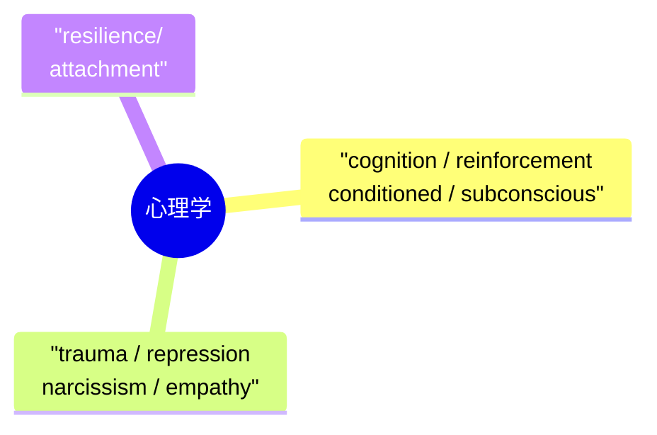

### 11.3 经济学/金融

| 单词 | 中文释义 | 例句 |
|------|---------|------|
| arbitrage | 套利 | **Arbitrage** exploits price differences. |
| hedge | 套期保值/对冲 | **Hedge** your investments to reduce risk. |
| derivatives | 衍生金融工具 | **Derivatives** are complex financial products. |
| amortization | 摊销/分期偿还 | **Amortization** spreads loan payments. |
| collateral | 担保品/抵押物 | Provide **collateral** for the loan. |
| solvency | 偿付能力 | Test the company's **solvency**. |
| dividend | 股息 | Receive a quarterly **dividend**. |
| benchmark | 基准/标准 | Use the S&P 500 as a **benchmark**. |
| speculation | 投机 | **Speculation** in currency can be risky. |
| conglomerate | 大型企业集团 | A multinational **conglomerate**. |

---

> **学习建议**：C1-C2 词汇应在真实语境（阅读原著、观看英语新闻、写作练习）中反复遇见才能内化。建议配合本词汇文件，同步阅读 04-阅读文章 目录中的 B2-C1 级别文章。

#### 11.3 经济学/金融思维导图

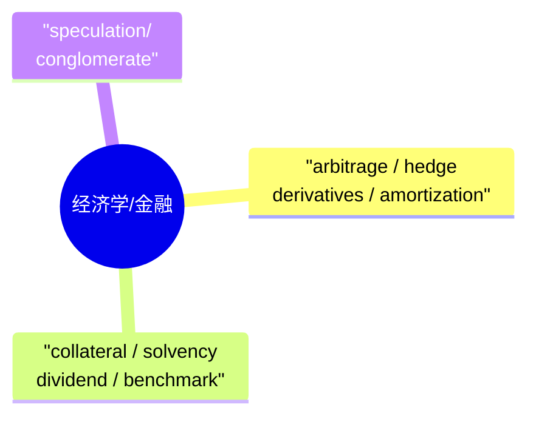
