# 词根词缀记忆法

掌握词根词缀是快速扩展词汇量的最有效方法。英语有约 60% 的词汇来自拉丁语和希腊语。学会 200 个常见词根词缀，可以推断数千个单词的意思。

---

## 第一章：常见前缀（Prefixes）

前缀改变词义，通常表示否定、方向、数量、程度等。

### 1.1 否定前缀

| 前缀 | 含义 | 例词 | 中文释义 |
|------|------|------|---------|
| un- | 不/未 | **un**happy, **un**likely, **un**known | 不快乐、不太可能、未知 |
| in- / im- / il- / ir- | 不/无 | **in**correct, **im**possible, **il**legal, **ir**regular | 不正确、不可能、非法、不规则 |
| dis- | 不/相反 | **dis**agree, **dis**honest, **dis**appear | 不同意、不诚实、消失 |
| non- | 非/无 | **non**sense, **non**fiction, **non**profit | 废话、非小说类、非营利 |
| mis- | 错误地 | **mis**understand, **mis**take, **mis**lead | 误解、错误、误导 |
| anti- | 反对/对抗 | **anti**social, **anti**biotic, **anti**dote | 反社会、抗生素、解药 |
| counter- | 反/对抗 | **counter**productive, **counter**attack | 适得其反、反击 |
| de- | 去/减少 | **de**construct, **de**frost, **de**value | 解构、解冻、贬值 |

> **记忆案例**：看到 `ir-` 开头的词，大概率是否定：
> - `rational`（理性的）→ `irrational`（非理性的）
> - `relevant`（相关的）→ `irrelevant`（不相关的）
> - `responsible`（负责任的）→ `irresponsible`（不负责任的）

#### 1.1 否定前缀思维导图

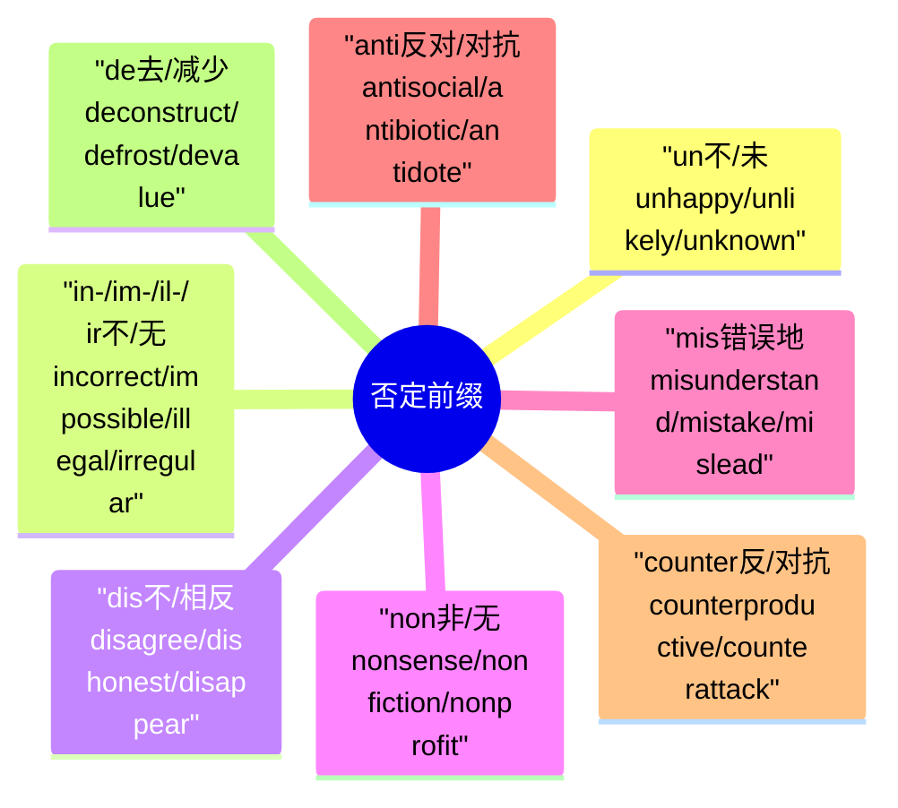

### 1.2 方向与位置前缀

| 前缀 | 含义 | 例词 | 中文释义 |
|------|------|------|---------|
| pre- | 前/预先 | **pre**view, **pre**pare, **pre**dict | 预览、准备、预测 |
| post- | 后/之后 | **post**pone, **post**war, **post**graduate | 推迟、战后、研究生 |
| inter- | 在…之间 | **inter**national, **inter**act, **inter**view | 国际、互动、采访 |
| trans- | 跨越/转变 | **trans**port, **trans**form, **trans**late | 运输、转变、翻译 |
| sub- | 下/次/副 | **sub**way, **sub**marine, **sub**title | 地铁、潜水艇、字幕 |
| super- | 超/在上 | **super**market, **super**natural, **super**man | 超市、超自然、超人 |
| over- | 过度/上面 | **over**work, **over**come, **over**look | 过度工作、克服、俯瞰 |
| under- | 不足/在下 | **under**estimate, **under**ground, **under**line | 低估、地下、下划线 |
| extra- | 超出/额外 | **extra**ordinary, **extra**terrestrial | 非凡的、外星的 |
| ultra- | 极端/超 | **ultra**sound, **ultra**violet | 超声波、紫外线 |
| out- | 超越/在外 | **out**perform, **out**door, **out**run | 超越、室外、跑过 |

> **生活案例**：
> - `subway`（sub地下+way路）= 地铁
> - `submarine`（sub水下+marine海洋）= 潜水艇
> - `subtitle`（sub次要+title标题）= 字幕

#### 1.2 方向与位置前缀思维导图

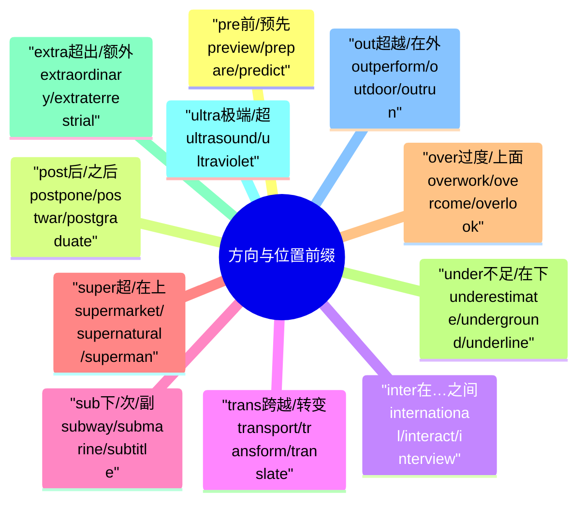

### 1.3 数量前缀

| 前缀 | 含义 | 例词 | 中文释义 |
|------|------|------|---------|
| mono- / uni- | 单/一 | **mono**tone, **uni**form, **uni**verse | 单调、制服、宇宙 |
| bi- / di- | 二/双 | **bi**cycle, **bi**lingual, **di**oxide | 自行车、双语的、二氧化物 |
| tri- | 三 | **tri**angle, **tri**cycle, **tri**angle | 三角形、三轮车 |
| multi- / poly- | 多 | **multi**media, **poly**gon, **multi**task | 多媒体、多边形、多任务 |
| semi- | 半 | **semi**circle, **semi**final, **semi**colon | 半圆、半决赛、分号 |
| cent- | 百 | **cent**ury, **cent**imeter | 世纪、厘米 |
| milli- | 千/千分之一 | **milli**meter, **milli**second | 毫米、毫秒 |
| kilo- | 千 | **kilo**gram, **kilo**meter | 千克、千米 |
| micro- | 微小 | **micro**scope, **micro**phone, **micro**wave | 显微镜、麦克风、微波 |
| mega- | 巨大/百万 | **mega**phone, **mega**byte | 扩音器、兆字节 |

#### 1.3 数量前缀思维导图

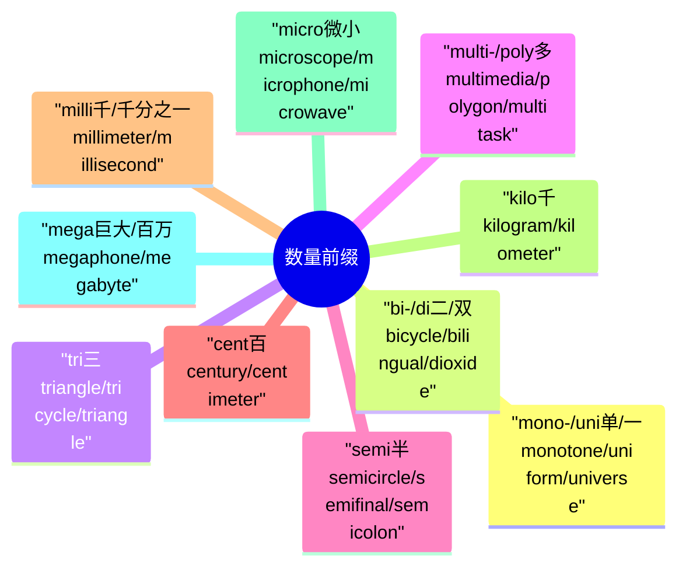

### 1.4 程度与强调前缀

| 前缀 | 含义 | 例词 | 中文释义 |
|------|------|------|---------|
| fore- | 前面/预先 | **fore**cast, **fore**see, **fore**head | 预测、预见、前额 |
| re- | 再/重新 | **re**write, **re**view, **re**build | 重写、复习、重建 |
| auto- | 自动/自我 | **auto**matic, **auto**biography, **auto**mobile | 自动、自传、汽车 |
| co- / com- / con- | 共同 | **co**operate, **com**bine, **con**nect | 合作、结合、连接 |
| pro- | 支持/向前 | **pro**gress, **pro**mote, **pro**pose | 进步、晋升、提议 |
| en- / em- | 使成为/进入 | **en**able, **em**power, **en**force | 使能够、赋权、执行 |
| ex- | 前/曾经/出 | **ex**port, **ex**president, **ex**hale | 出口、前总统、呼气 |

---

#### 1.4 程度与强调前缀思维导图

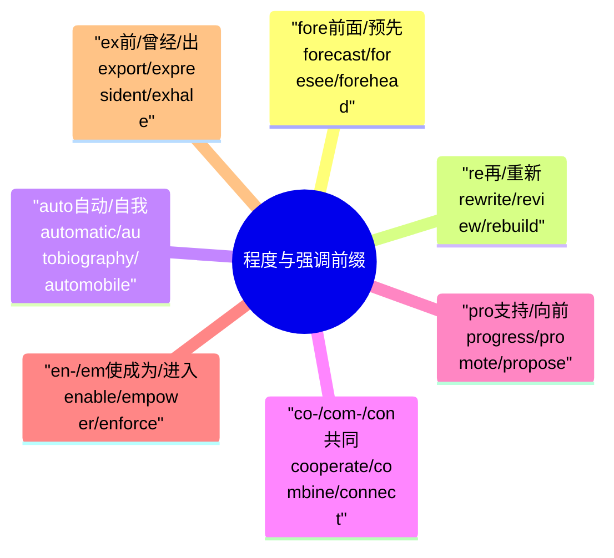

## 第二章：常见词根（Roots）

词根是词的核心，携带主要意义。

### 2.1 与人体和行动相关的词根

| 词根 | 含义 | 例词 | 中文释义 |
|------|------|------|---------|
| **aud** | 听 | **aud**ible, **aud**ience, **aud**itorium | 听得见的、观众、礼堂 |
| **vis / vid** | 看 | **vis**ible, **vid**eo, **vis**ion | 可见的、视频、视力 |
| **spec / spect** | 看 | **spec**tator, in**spect**, per**spect**ive | 观众、检查、视角 |
| **man / manu** | 手 | **man**ual, **man**uscript, **manu**facture | 手动的、手稿、制造 |
| **ped / pod** | 脚 | **ped**estrian, **pod**ium, im**ped**e | 行人、讲台、阻碍 |
| **cap / cept** | 拿取/抓 | **cap**ture, re**cept**ion, per**cept**ion | 捕获、接待、感知 |
| **duct / duc** | 引导/带领 | **duct**, con**duct**, pro**duct** | 管道、行为/指挥、产品 |
| **port** | 携带 | **port**able, trans**port**, im**port** | 便携的、运输、进口 |
| **tract** | 拉/吸引 | at**tract**, con**tract**, dis**tract** | 吸引、合同、使分心 |
| **ject** | 投掷 | pro**ject**, in**ject**, re**ject** | 项目/投影、注射、拒绝 |

> **记忆诀窍——`spec`（看）**：
> - `inspect`（in进去+spec看）= 检查
> - `spectator`（spec看+ator人）= 观众
> - `perspective`（per通过+spec看+ive）= 视角
> - `spectacular`（spec看+ular）= 壮观的

#### 2.1 与人体和行动相关的词根思维导图

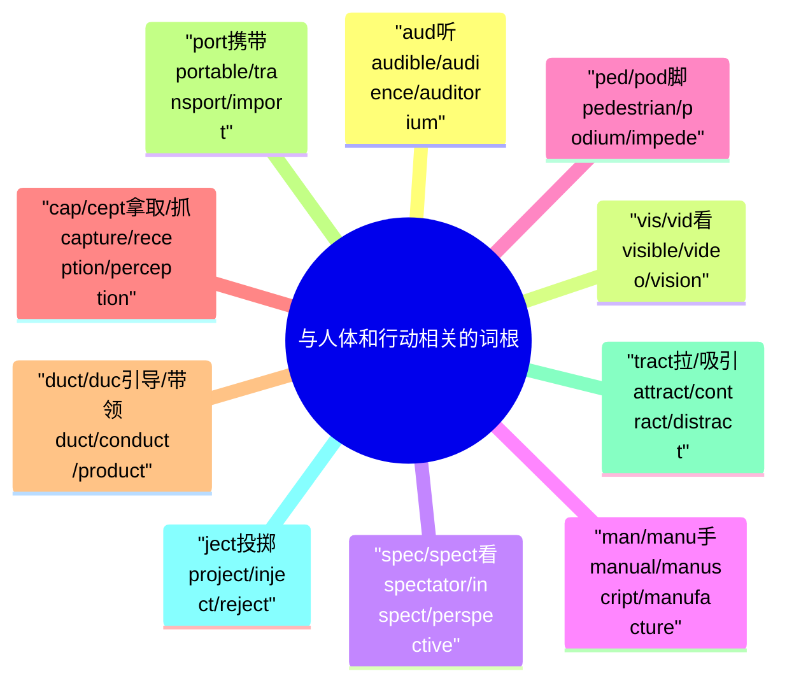

### 2.2 与思维和语言相关的词根

| 词根 | 含义 | 例词 | 中文释义 |
|------|------|------|---------|
| **logue / log** | 言语/逻辑 | dia**log**ue, mono**log**ue, **log**ic | 对话、独白、逻辑 |
| **dict** | 说/命令 | **dict**ionary, pre**dict**, contra**dict** | 字典、预测、反驳 |
| **voc / voke** | 呼叫/声音 | **voc**abulary, **voc**al, pro**voke** | 词汇、嗓音的、激怒 |
| **scrib / script** | 写 | de**scribe**, pre**script**ion, manu**script** | 描述、处方、手稿 |
| **gram / graph** | 写/记录 | **gram**mar, auto**graph**, para**graph** | 语法、亲笔签名、段落 |
| **cogn / gnos** | 知道/认识 | **cogn**ize, re**cogn**ize, dia**gnos**is | 认识、识别、诊断 |
| **sens / sent** | 感觉 | **sens**e, **sent**ence, con**sent** | 感觉、句子/判决、同意 |
| **ment** | 思考/心灵 | **ment**al, docu**ment**, com**ment** | 心理的、文件、评论 |
| **mem** | 记忆 | **mem**ory, re**mem**ber, **mem**orial | 记忆、记得、纪念碑 |
| **cred** | 相信 | **cred**it, in**cred**ible, **cred**ential | 信用/学分、难以置信的、证书 |

#### 2.2 与思维和语言相关的词根思维导图

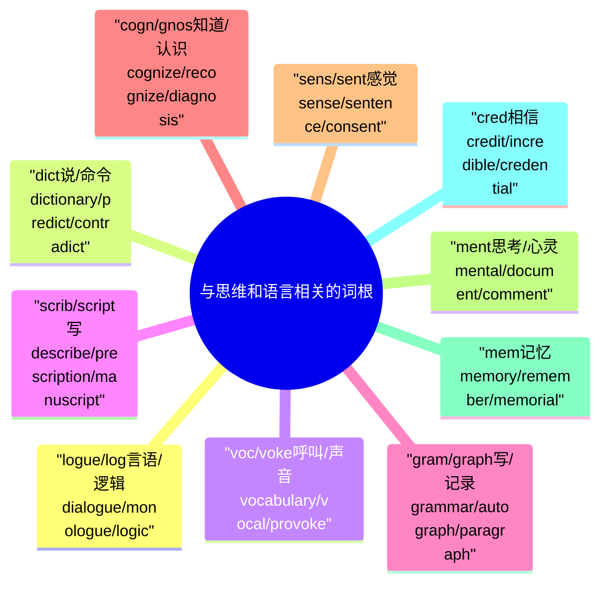

### 2.3 与运动和变化相关的词根

| 词根 | 含义 | 例词 | 中文释义 |
|------|------|------|---------|
| **mot / mov** | 移动 | **mot**ion, re**mov**e, e**mot**ion | 运动、移除、情感 |
| **vert / vers** | 转变 | con**vert**, di**vers**e, re**vers**e | 转换、多样化、反转 |
| **flux / flu** | 流动 | **flu**ent, in**flu**ence, re**flu**x | 流利的、影响、回流 |
| **grad / gress** | 步骤/前进 | **grad**e, pro**gress**, ag**gress**ive | 年级/等级、进步、攻击性 |
| **clud / clus** | 关闭 | in**clud**e, ex**clud**e, con**clus**ion | 包括、排除、结论 |
| **struct** | 建造 | con**struct**, de**struct**, in**struct** | 建造、破坏、指导 |
| **form** | 形状/形式 | in**form**, trans**form**, con**form** | 通知、转变、顺从 |
| **fract / frag** | 打破 | **fract**ure, **frag**ment, re**fract** | 骨折、碎片、折射 |
| **miss / mit** | 发送 | sub**mit**, trans**mit**, per**mit** | 提交、传送、允许 |
| **press** | 压 | ex**press**, de**press**, im**press** | 表达、使沮丧、给…留下印象 |

#### 2.3 与运动和变化相关的词根思维导图

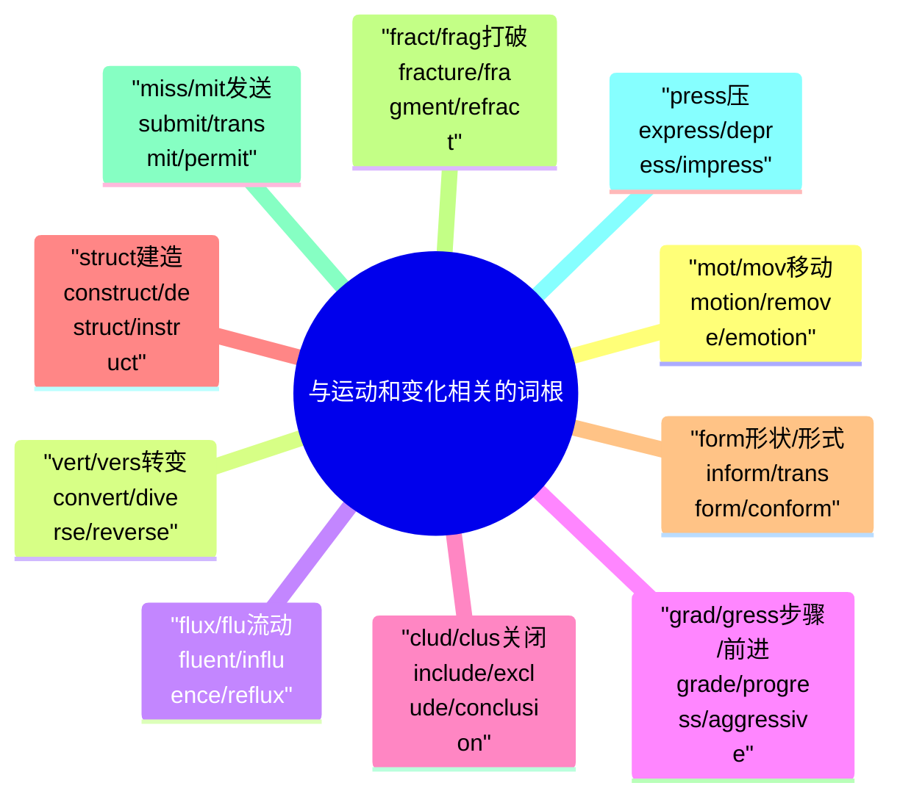

### 2.4 与生命和自然相关的词根

| 词根 | 含义 | 例词 | 中文释义 |
|------|------|------|---------|
| **bio** | 生命 | **bio**logy, **bio**graphy, anti**bio**tic | 生物学、传记、抗生素 |
| **vit / viv** | 生命/活着 | **vit**al, sur**viv**e, **viv**id | 至关重要的、幸存、生动的 |
| **mort / mori** | 死亡 | **mort**al, im**mort**al, **mort**uary | 凡人的、不朽的、停尸房 |
| **natur / nat** | 出生/自然 | **natur**e, **nat**ural, **nat**ion | 自然、自然的、国家 |
| **geo** | 地球 | **geo**graphy, **geo**logy, **geo**metry | 地理、地质、几何 |
| **aqua / hydr** | 水 | **aqua**rium, **hydr**ogen, de**hydr**ate | 水族馆、氢、脱水 |
| **terra / terr** | 土地 | **terra**in, **terr**itory, Medi**terr**anean | 地形、领土、地中海 |
| **sol** | 太阳 | **sol**ar, **sol**itude, para**sol** | 太阳的、独处、遮阳伞 |
| **lum / luc** | 光 | **lum**inous, **luc**id, il**lum**inate | 发光的、清晰的、照明 |
| **therm** | 热 | **therm**ometer, **therm**al, hypo**therm**ia | 温度计、热的、低温症 |

#### 2.4 与生命和自然相关的词根思维导图

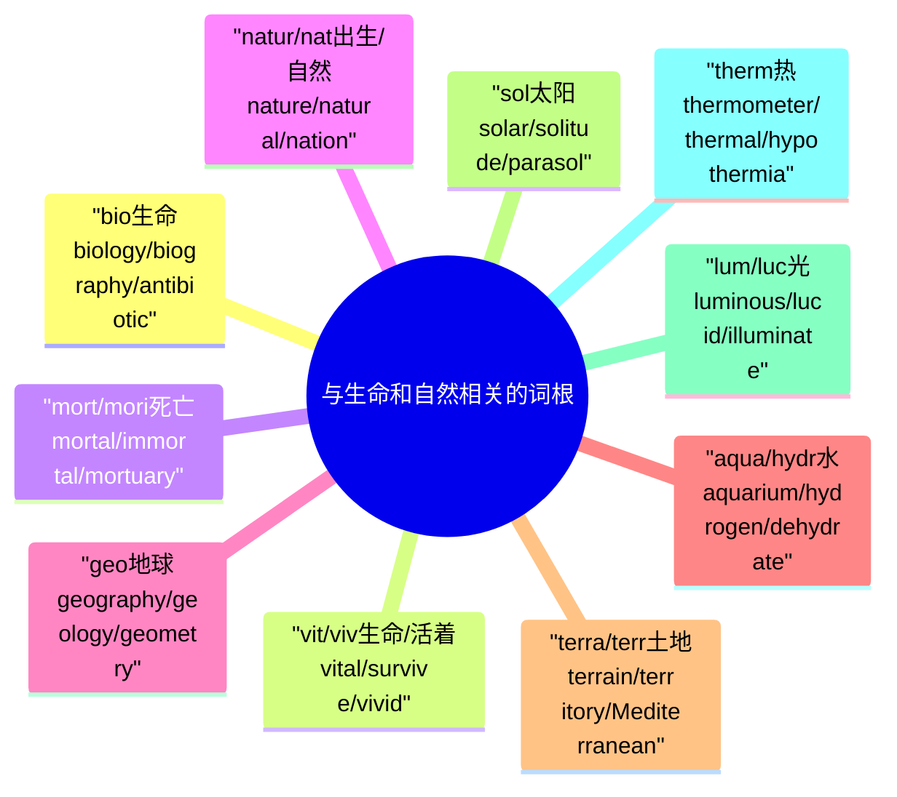

### 2.5 与社会和组织相关的词根

| 词根 | 含义 | 例词 | 中文释义 |
|------|------|------|---------|
| **soci** | 社会/伙伴 | **soci**ety, **soci**al, as**soci**ate | 社会、社交的、联系 |
| **polit** | 城市/政治 | **polit**ics, **polit**e, metro**polis** | 政治、礼貌、大都市 |
| **arch** | 统治/主要 | mon**arch**, **arch**itect, **arch**ive | 君主、建筑师、档案馆 |
| **crat / cracy** | 统治 | demo**cracy**, bureau**cracy**, aristo**crat** | 民主、官僚体制、贵族 |
| **leg** | 法律/使节 | **leg**al, **leg**islate, privi**leg**e | 法律的、立法、特权 |
| **jud / jur** | 法律/判断 | **jud**ge, **jur**y, pre**jud**ice | 法官、陪审团、偏见 |
| **econ** | 家庭/经济 | **econ**omy, **econ**omics | 经济、经济学 |
| **corp** | 身体/法人 | **corp**oration, **corp**orate, **corp**se | 公司、企业的、尸体 |
| **fin** | 结束/目的/金融 | **fin**ance, **fin**al, de**fin**e | 金融、最终的、定义 |

---

#### 2.5 与社会和组织相关的词根思维导图

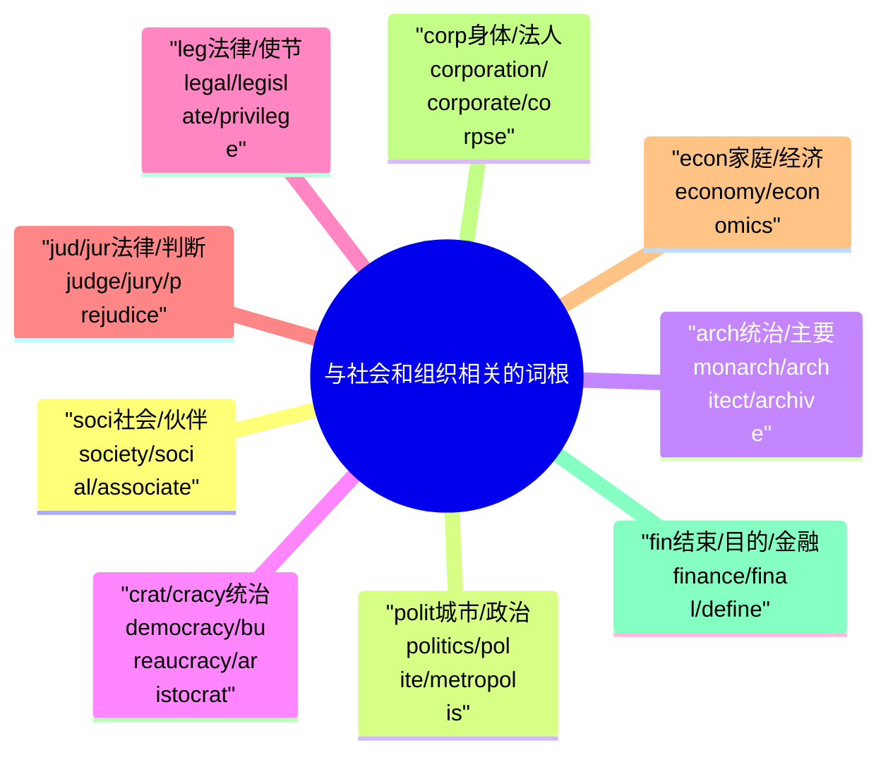

## 第三章：常见后缀（Suffixes）

后缀通常决定词性（名词、动词、形容词、副词）。

### 3.1 名词后缀

| 后缀 | 含义 | 例词 | 中文释义 |
|------|------|------|---------|
| -tion / -sion | 动作/状态/结果 | communica**tion**, deci**sion** | 沟通、决定 |
| -ness | 性质/状态 | happi**ness**, dark**ness** | 快乐、黑暗 |
| -ity / -ty | 性质/状态 | qual**ity**, equal**ity**, liber**ty** | 质量、平等、自由 |
| -ment | 动作结果 | achieve**ment**, develop**ment** | 成就、发展 |
| -ance / -ence | 性质/状态 | import**ance**, independ**ence** | 重要性、独立 |
| -er / -or / -ar | 做某事的人/工具 | teach**er**, act**or**, lect**ure** | 教师、演员、讲座 |
| -ist | 专家/信奉者 | scient**ist**, journal**ist** | 科学家、记者 |
| -ism | 主义/状态 | capital**ism**, optimism | 资本主义、乐观 |
| -ology | 学科/研究 | psych**ology**, bi**ology** | 心理学、生物学 |
| -ship | 关系/状态 | friend**ship**, leader**ship** | 友谊、领导力 |
| -hood | 状态/群体 | child**hood**, neighbor**hood** | 童年、社区 |
| -dom | 领域/状态 | free**dom**, wis**dom** | 自由、智慧 |

#### 3.1 名词后缀思维导图

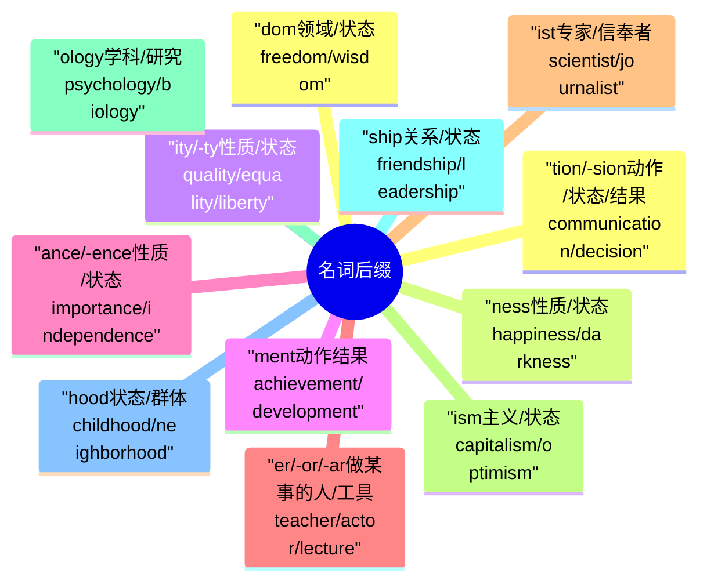

### 3.2 形容词后缀

| 后缀 | 含义 | 例词 | 中文释义 |
|------|------|------|---------|
| -ful | 充满…的 | beauti**ful**, use**ful**, hope**ful** | 美丽的、有用的、有希望的 |
| -less | 没有…的 | hope**less**, use**less**, care**less** | 没希望的、无用的、粗心的 |
| -able / -ible | 能够/可以 | comfort**able**, flex**ible** | 舒适的、灵活的 |
| -ous / -ious | 具有性质的 | danger**ous**, ambit**ious** | 危险的、有抱负的 |
| -al | 属于…的 | nation**al**, person**al** | 国家的、个人的 |
| -ic / -ical | 与…有关的 | econom**ic**, histor**ical** | 经济的、历史的 |
| -ive | 有倾向的 | effect**ive**, creat**ive** | 有效的、有创意的 |
| -ary / -ory | 与…相关的 | vision**ary**, mandát**ory** | 有远见的、强制的 |
| -ent / -ant | 表示性质 | differ**ent**, import**ant** | 不同的、重要的 |
| -ward | 方向 | east**ward**, back**ward** | 向东、向后 |

#### 3.2 形容词后缀思维导图

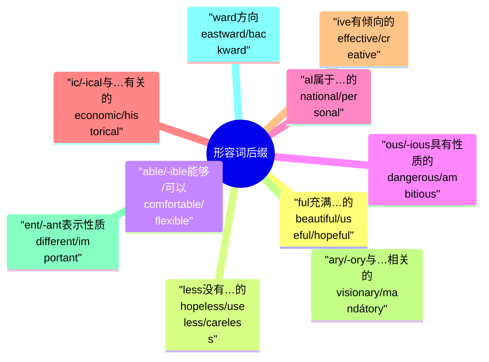

### 3.3 动词后缀

| 后缀 | 含义 | 例词 | 中文释义 |
|------|------|------|---------|
| -ize / -ise | 使成为/做 | modern**ize**, organ**ize** | 现代化、组织 |
| -ify / -fy | 使…化 | simpli**fy**, clari**fy** | 简化、澄清 |
| -ate | 使/做 | communic**ate**, creat**e** | 交流、创造 |
| -en | 使成为 | strength**en**, dark**en** | 加强、变暗 |

#### 3.3 动词后缀思维导图

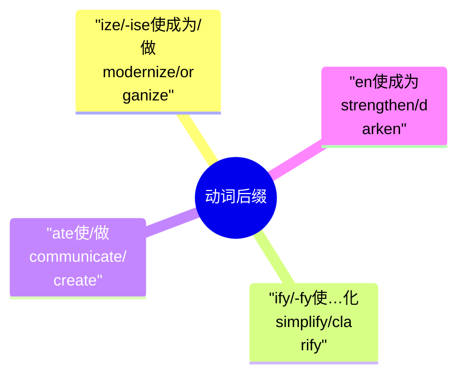

### 3.4 副词后缀

| 后缀 | 含义 | 例词 | 中文释义 |
|------|------|------|---------|
| -ly | 以…方式 | quick**ly**, careful**ly** | 迅速地、仔细地 |
| -ward(s) | 向…方向 | for**ward**, up**ward** | 向前、向上 |
| -wise | 在…方面 | other**wise**, clock**wise** | 否则、顺时针 |

---

#### 3.4 副词后缀思维导图

```mermaid
mindmap
  root((副词后缀))
    "ly以…方式<br/>quickly/care<br/>fully"
    "ward(s)向…方向<br/>forward/upwa<br/>rd"
    "wise在…方面<br/>otherwise/cl<br/>ockwise"
```

## 第四章：高频词根记忆表（Top 50 Roots）

以下 50 个词根覆盖英语中数千个常用词，是词汇记忆的核心。

| # | 词根 | 含义 | 5 个衍生词 |
|---|------|------|-----------|
| 1 | **vid/vis** | 看 | video, vision, visible, visit, supervise |
| 2 | **aud** | 听 | audio, audible, audience, auditorium, audit |
| 3 | **scrib/script** | 写 | describe, scripture, subscribe, manuscript, inscribe |
| 4 | **dict** | 说 | dictionary, predict, contradict, dictate, verdict |
| 5 | **ject** | 投 | project, inject, reject, object, subject |
| 6 | **port** | 携带 | import, export, transport, portable, report |
| 7 | **tract** | 拉 | attract, contract, distract, extract, abstract |
| 8 | **duct/duc** | 引导 | conduct, produce, reduce, introduce, deduce |
| 9 | **mit/miss** | 发送 | permit, submit, transmit, admit, commission |
| 10 | **cap/cept** | 拿 | capture, accept, concept, except, reception |
| 11 | **spect/spec** | 看 | inspect, spectator, respect, prospect, spectacle |
| 12 | **vert/vers** | 转 | convert, reverse, divert, versatile, controversy |
| 13 | **struct** | 建造 | construct, destroy, instruct, restructure, obstruct |
| 14 | **form** | 形状 | reform, inform, transform, uniform, conform |
| 15 | **fract/frag** | 打破 | fracture, fragment, fraction, refract, infraction |
| 16 | **press** | 压 | express, depress, impress, compress, suppress |
| 17 | **cred** | 相信 | credit, incredible, credential, credible, discredit |
| 18 | **bio** | 生命 | biology, biography, biometric, antibiotic, biosphere |
| 19 | **geo** | 地球 | geography, geology, geometry, geopolitics, geocentric |
| 20 | **log/logue** | 言/逻辑 | logic, dialogue, monologue, prologue, catalog |
| 21 | **voc/voke** | 声音/呼叫 | vocal, vocabulary, invoke, provoke, revoke |
| 22 | **sens/sent** | 感觉 | sense, sensitive, consent, resent, sentiment |
| 23 | **mot/mov** | 移动 | motion, emotion, remote, remove, motivation |
| 24 | **grad/gress** | 步骤 | grade, progress, aggressive, regress, digress |
| 25 | **clud/clus** | 关闭 | include, exclude, conclude, preclude, recluse |
| 26 | **cogn** | 知道 | recognize, cognitive, incognito, diagnose |
| 27 | **graph/gram** | 写/记录 | photograph, telegram, paragraph, biography, diagram |
| 28 | **therm** | 热 | thermometer, thermal, hypothermia, thermostat |
| 29 | **aqua/hydr** | 水 | aquarium, hydrogen, dehydrate, aquatic, hydrant |
| 30 | **lum/luc** | 光 | luminous, lucid, illuminate, translucent, elucidate |
| 31 | **mort** | 死 | mortal, immortal, mortuary, mortality, moribund |
| 32 | **vit/viv** | 生命 | vital, survive, vivid, revive, vitamin |
| 33 | **terr** | 土地 | territory, terrain, terrestrial, Mediterranean |
| 34 | **sol** | 太阳/独自 | solar, solitude, sole, solitary, parasol |
| 35 | **arch** | 统治/主要 | monarch, architecture, archive, patriarchal |
| 36 | **crat/cracy** | 统治 | democracy, bureaucracy, aristocrat, technocracy |
| 37 | **leg** | 法律 | legal, legislation, privilege, illegitimate |
| 38 | **jud/jur** | 判断/法 | judge, jury, prejudice, jurisdiction, justice |
| 39 | **soci** | 社会 | society, social, associate, sociology |
| 40 | **polit** | 政治/城市 | politics, polite, metropolis, politician |
| 41 | **corp** | 身体/法人 | corporation, corporate, corps, corpse |
| 42 | **fin** | 结束/金融 | finance, final, define, infinite, refine |
| 43 | **equ** | 相等 | equal, equality, equator, equilibrium, equip |
| 44 | **nov/new** | 新 | novel, innovation, novice, renovate, nouveau |
| 45 | **temp** | 时间 | temporary, contemporary, temporal, tempo |
| 46 | **mem** | 记忆 | memory, remember, memorial, memorize, memoir |
| 47 | **path** | 感情/疾病 | empathy, sympathy, pathetic, pathology |
| 48 | **phon** | 声音 | microphone, telephone, symphony, phonetic |
| 49 | **chron** | 时间 | chronic, chronology, synchronize, anachronism |
| 50 | **anthrop** | 人 | anthropology, philanthropy, misanthrope |

---

### 第四章：高频词根记忆表思维导图

图1

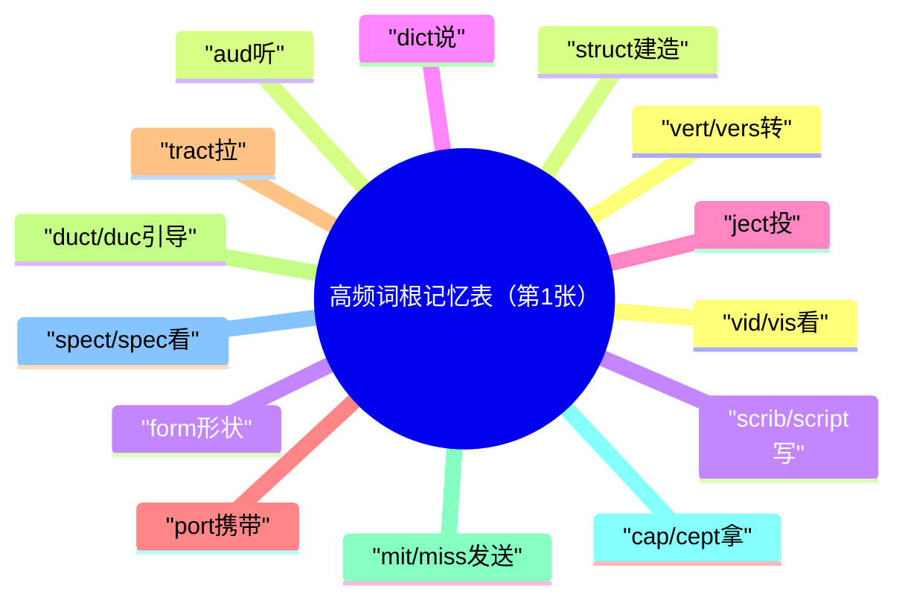

图2

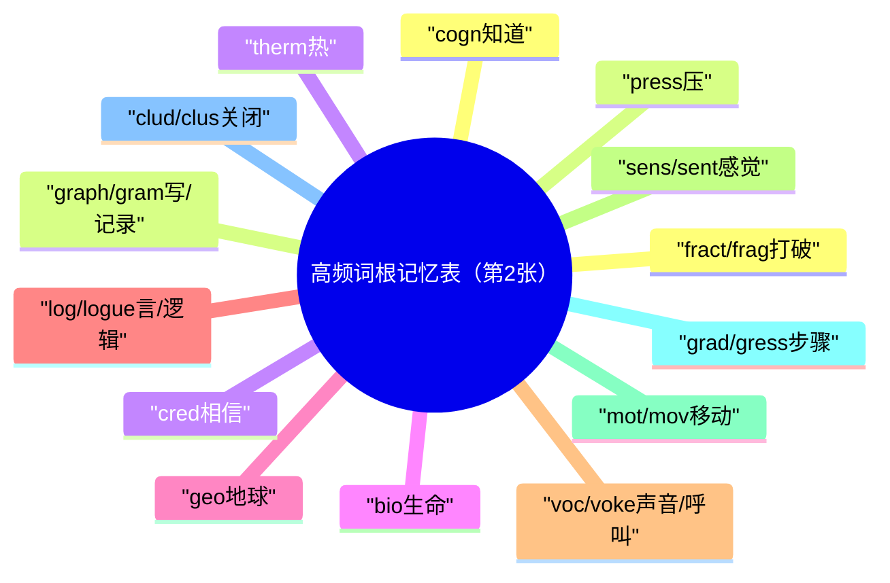

图3

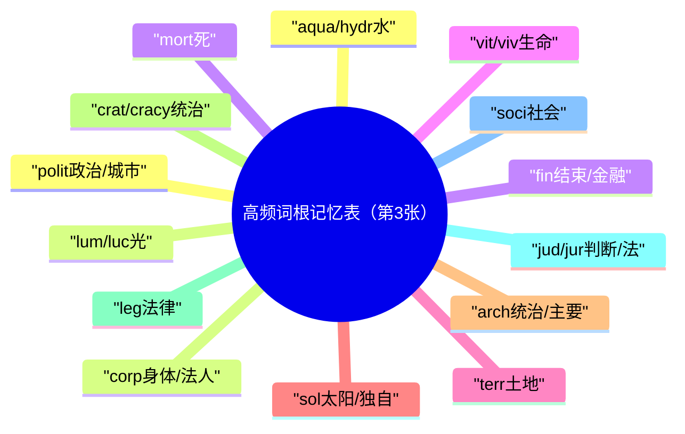

图4

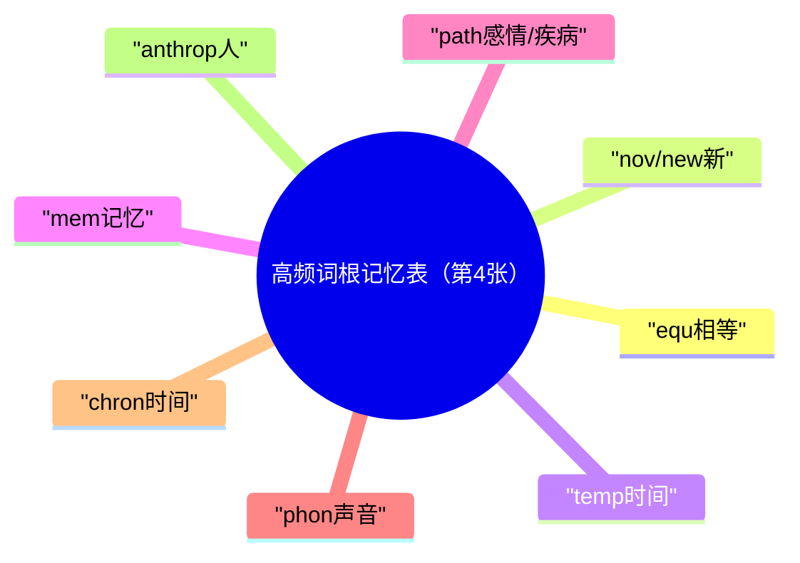

## 第五章：实战词根分析（5 个示例词汇群）

### 示例1：`port`（携带）词族

```
port（携带）
├── import（im进+port）= 进口
├── export（ex出+port）= 出口
├── transport（trans跨+port）= 运输
├── portable（port+able能）= 便携式的
├── report（re返+port报告）= 报告
├── support（sub下+port）= 支持（从下面撑着）
├── airport（air空气+port）= 机场（带你飞的地方）
└── portfolio（port+folio文件夹）= 作品集/投资组合
```

#### 示例1：port词族思维导图

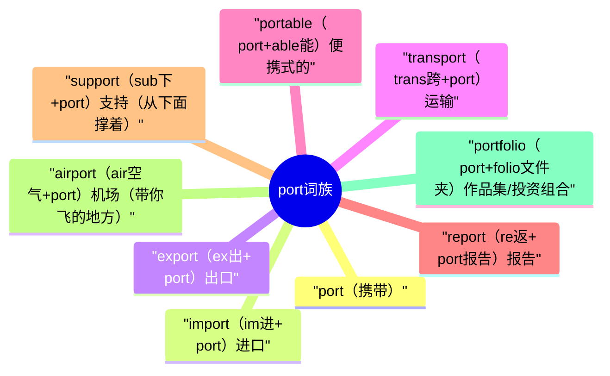

### 示例2：`spec`（看）词族

```
spec（看）
├── inspect（in进+spec）= 检查
├── expect（ex出+spec）= 期望（往外看）
├── respect（re再+spec）= 尊重（再看看人家）
├── spectator（spec+ator人）= 观众
├── spectacle（spec+acle）= 壮观景象
├── perspective（per通过+spec+ive）= 视角
├── suspect（sub下+spec）= 怀疑（从下面偷看）
└── spectacular（spec+ular）= 壮观的
```

#### 示例2：spec词族思维导图

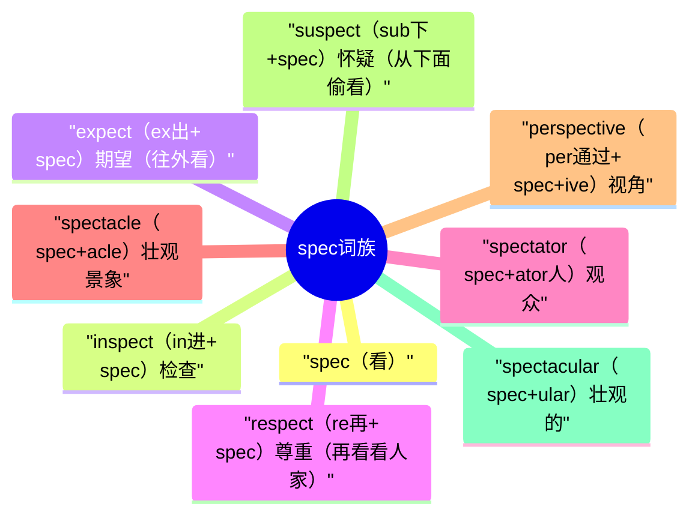

### 示例3：`form`（形状）词族

```
form（形状/形式）
├── inform（in进入+form）= 通知（形成知识）
├── reform（re再+form）= 改革
├── transform（trans跨+form）= 转变
├── uniform（uni一+form）= 制服（同一形状）
├── conform（con共+form）= 顺从（形成相同形状）
├── platform（plat平+form）= 平台
├── perform（per完全+form）= 执行/表演
└── formula（form+ula小）= 公式/配方
```

#### 示例3：form词族思维导图

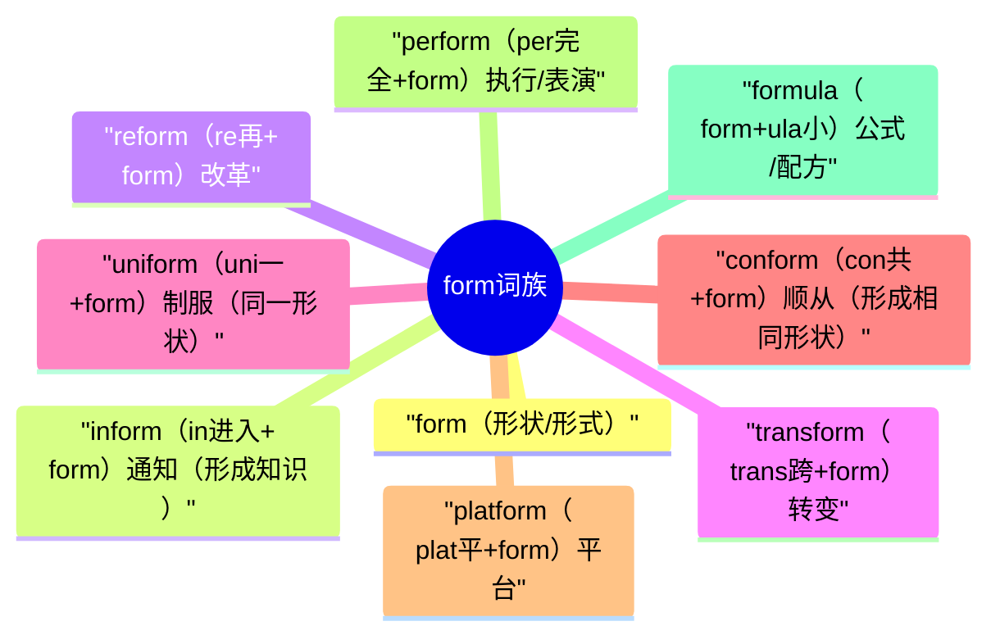

### 示例4：`vert`（转）词族

```
vert（转变）
├── convert（con一起+vert）= 转变/转换
├── divert（di分+vert）= 转移/使绕道
├── invert（in进入+vert）= 倒置/颠倒
├── revert（re回+vert）= 回归/复原
├── reverse（re回+vers+e）= 反转/颠倒
├── diverse（di分+vers+e）= 多样化
├── controversial（contro反+vers+ial）= 有争议的
├── versatile（vers+atile）= 多才多艺的
└── universe（uni一+verse）= 宇宙（向一个方向转动）
```

#### 示例4：vert词族思维导图

```mermaid
mindmap
  root((vert词族))
    "vert（转变）"
    "convert（con一<br/>起+vert）转变/转换"
    "divert（di分+<br/>vert）转移/使绕道"
    "invert（in进入+<br/>vert）倒置/颠倒"
    "revert（re回+<br/>vert）回归/复原"
    "reverse（re回+<br/>vers+e）反转/颠倒"
    "diverse（di分+<br/>vers+e）多样化"
    "controversia<br/>l（contro反+<br/>vers+ial）有争议<br/>的"
    "versatile（<br/>vers+atile）多<br/>才多艺的"
    "universe（uni<br/>一+verse）宇宙（向<br/>一个方向转动）"
```

### 示例5：`struct`（建造）词族

```
struct（建造）
├── construct（con共同+struct）= 建造
├── destruct（de破+struct）= 破坏
├── instruct（in进入+struct）= 指导（把知识建入脑中）
├── obstruct（ob对着+struct）= 阻碍（建墙挡路）
├── restructure（re再+struct+ure）= 重组
├── infrastructure（infra下+struct+ure）= 基础设施
└── construction（con+struct+ion）= 建设/建筑物
```

---

> **学习建议**：背词根不要单独背，而是通过"词族"来记忆。每学一个词根，列出 5-10 个衍生词，用一张思维导图画出关联。这样比死记硬背快 3-5 倍。

#### 示例5：struct词族思维导图

```mermaid
mindmap
  root((struct词族))
    "struct（建造）"
    "construct（<br/>con共同+struct<br/>）建造"
    "destruct（de破<br/>+struct）破坏"
    "instruct（in进<br/>入+struct）指导（<br/>把知识建入脑中）"
    "obstruct（ob对<br/>着+struct）阻碍（<br/>建墙挡路）"
    "restructure（<br/>re再+<br/>struct+ure）重<br/>组"
    "infrastructu<br/>re（infra下+<br/>struct+ure）基<br/>础设施"
    "construction<br/>（<br/>con+struct+i<br/>on）建设/建筑物"
```
