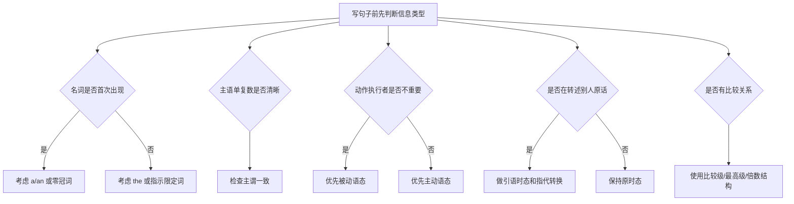

# 语法查漏补全：冠词、主谓一致、被动语态、引语与比较

这份补充文档用于填补前 3 份语法笔记中最容易漏掉、但考试和写作中高频出错的模块。你可以把它当作语法查漏手册，和时态、句子结构、虚拟语气三份主文档配套使用。建议按“先规则、后例句、再自检”的顺序学习。

---

## 语法缺口速览

| 模块 | 为什么重要 | 常见错误 |
|------|------------|----------|
| 冠词与限定词 | 决定名词是泛指还是特指 | `I bought book yesterday.` |
| 主谓一致 | 保证主语与谓语数一致 | `The list of items are long.` |
| 被动语态 | 学术写作和说明文高频结构 | `The work finished yesterday.` |
| 直接/间接引语 | 叙述、转述、听力题常考 | `He said he is tired.` |
| 比较结构与倍数 | 数据表达、描述对比必需 | `He is more taller than me.` |
| 介词高频误区 | 影响句子自然度与准确度 | `arrive to Beijing` |

---

## 第一章：冠词与限定词

### 1.1 三类冠词

| 类型 | 用法 | 例句 |
|------|------|------|
| 不定冠词 a/an | 首次提及、泛指“一个” | I saw **a** dog in the park. |
| 定冠词 the | 特指、双方都知道的对象 | The dog barked at me. |
| 零冠词 | 不可数名词泛指、复数泛指、专有名词前 | Water is important. / Students need sleep. |

### 1.2 a 和 an 的选择

按发音而不是拼写判断：
- `an hour`（h 不发音）
- `a university`（/ju:/ 开头，辅音音素）
- `an MBA`（M 读 /em/，元音音素开头）

### 1.3 必须用 the 的典型场景

1. 世界上独一无二：`the sun`, `the earth`, `the internet`
2. 最高级前：`the best solution`
3. 序数词前：`the first chapter`
4. 再次提及：I bought a book. **The book** is excellent.
5. 乐器前：play **the** piano

### 1.4 固定表达易错

| 正确表达 | 含义 |
|----------|------|
| go to school | 去上学（功能） |
| go to the school | 去学校那栋建筑 |
| in hospital (BrE) / in the hospital (AmE) | 住院 |
| at table | 在进餐 |
| at the table | 在桌子旁 |

---

## 第二章：主谓一致

### 2.1 基础原则

谓语动词的人称与数由主语决定，而不是由离动词最近的名词决定。

- The list of items **is** long.
- The students in this class **are** active.

### 2.2 高频规则

| 规则 | 例句 |
|------|------|
| each/every + 单数名词，谓语单数 | Every student **has** a locker. |
| one of + 复数名词，谓语单数 | One of my friends **is** a pilot. |
| a number of + 复数，谓语复数 | A number of people **were** waiting. |
| the number of + 复数，谓语单数 | The number of people **is** rising. |
| 不定代词 everyone/someone/none(单数义) 常接单数 | Everyone **is** ready. |

### 2.3 就近一致

在以下结构中，谓语与最近主语一致：
- either A or B
- neither A nor B
- not only A but also B

例句：
- Either the teachers or the principal **is** coming.
- Not only Tom but also his friends **are** invited.

### 2.4 集合名词

- 强调整体：The team **is** winning.
- 强调个体成员（英式更常见）：The team **are** arguing among themselves.

---

## 第三章：被动语态

### 3.1 核心结构

被动语态 = `be + 过去分词`

- The report **was finished** yesterday.
- New policies **are being discussed**.

### 3.2 时态对应表

| 主动 | 被动 |
|------|------|
| do | am/is/are done |
| did | was/were done |
| is doing | is being done |
| has done | has been done |
| had done | had been done |
| will do | will be done |
| will have done | will have been done |
| can/must do | can/must be done |

### 3.3 何时优先被动

1. 不知道执行者：My bike was stolen.
2. 执行者不重要：English is spoken worldwide.
3. 强调结果而非动作人：The system has been upgraded.

### 3.4 主动改被动步骤

1. 找宾语并移到主语位置
2. 原谓语改为 `be + pp`
3. 原主语可保留为 `by + 执行者`（可省略）

主动：People grow rice in this area.
被动：Rice **is grown** in this area (by people).

### 3.5 易错点

- 不及物动词一般不能直接被动：`happen`, `arrive`, `die`
- 双宾语句有两种被动：
  - He gave me a gift.
  - I was given a gift. / A gift was given to me.

---

## 第四章：直接引语与间接引语

### 4.1 时态后移（常规）

当主句谓语是过去时，间接引语常后移一档：

| 直接引语 | 间接引语 |
|----------|----------|
| am/is | was |
| are | were |
| do/does | did |
| did | had done |
| have done | had done |
| will | would |
| can | could |

直接：He said, "I am tired."
间接：He said (that) he **was** tired.

### 4.2 指代与时间地点词变化

| 直接引语 | 间接引语 |
|----------|----------|
| now | then |
| today | that day |
| yesterday | the day before |
| tomorrow | the next/following day |
| this | that |
| these | those |
| here | there |

### 4.3 疑问句与祈使句转述

1. 一般疑问句：`if/whether + 陈述语序`
2. 特殊疑问句：保留疑问词 + 陈述语序
3. 祈使句：`tell/ask/order + sb + to do`

例句：
- "Are you ready?" → She asked if I was ready.
- "Where do you live?" → He asked where I lived.
- "Please sit down." → The teacher asked us to sit down.

### 4.4 不后移的常见情况

1. 客观真理：The teacher said the earth goes around the sun.
2. 转述内容仍然真实有效：He said he works in Shanghai.（现在仍在上海工作）

---

## 第五章：比较结构与倍数表达

### 5.1 规则比较级与最高级

| 形容词 | 比较级 | 最高级 |
|--------|--------|--------|
| small | smaller | smallest |
| happy | happier | happiest |
| careful | more careful | most careful |
| good | better | best |
| bad | worse | worst |
| far | farther/further | farthest/furthest |

### 5.2 常见比较结构

1. A is `-er` than B
2. A is `more + adj` than B
3. A is `as + adj + as` B
4. A is `not as/so + adj + as` B
5. The + 比较级..., the + 比较级...

例句：
- The more you practice, the more confident you become.
- This method is not as efficient as the old one.

### 5.3 倍数表达

| 结构 | 例句 |
|------|------|
| 倍数 + as ... as | This room is twice as large as that one. |
| 倍数 + 比较级 + than | This room is twice larger than that one.（口语可见，正式写作建议第一种） |
| 倍数 + the + 名词 + of | This room is twice the size of that one. |

---

## 第六章：介词高频误区

### 6.1 时间介词

| 介词 | 用法 | 例句 |
|------|------|------|
| at | 时刻/节日点 | at 7:30, at noon |
| on | 具体某天 | on Monday, on May 1 |
| in | 月份/年份/较长时间段 | in June, in 2026 |

### 6.2 地点介词

| 介词 | 例句 |
|------|------|
| at | at the station |
| in | in Beijing, in a room |
| on | on the wall, on the bus |

### 6.3 常考搭配

- arrive **in** a city / arrive **at** a place
- depend **on**
- be interested **in**
- be good **at**
- be responsible **for**
- married **to**
- apologize **to** someone **for** something

### 6.4 in time 与 on time

- on time：准时
- in time：及时（来得及）

---

## 第七章：一页查漏清单

学习或写作前可快速过一遍：

1. 名词前是否该加冠词或限定词？
2. 主语和谓语是否数一致？
3. 是否应该用被动而不是生硬主动？
4. 转述别人原话时，时态和指代是否已转换？
5. 比较级是否双重比较（如 more better）？
6. 介词是否符合固定搭配？
7. 句子是否存在中式直译结构？

---

## 第八章：补充练习（含答案）

### 8.1 选择或改错

1. I bought ___ umbrella yesterday. (`a` / `an` / `the`)
2. The number of applicants ___ increasing rapidly. (`is` / `are`)
3. The bridge ___ in 1998. (`built` / `was built`)
4. He said he ___ tired then. (`is` / `was`)
5. This task is twice ___ difficult as that one. (`as` / `so`)
6. We arrived ___ Shanghai at midnight. (`in` / `at`)
7. Everyone in the class ___ submitted the assignment. (`have` / `has`)
8. The proposal ___ by the committee next week. (`will discuss` / `will be discussed`)
9. She asked me where I ___. (`live` / `lived`)
10. Your answer is not as clear ___ hers. (`as` / `than`)

### 8.2 参考答案

1. an
2. is
3. was built
4. was
5. as
6. in
7. has
8. will be discussed
9. lived
10. as
